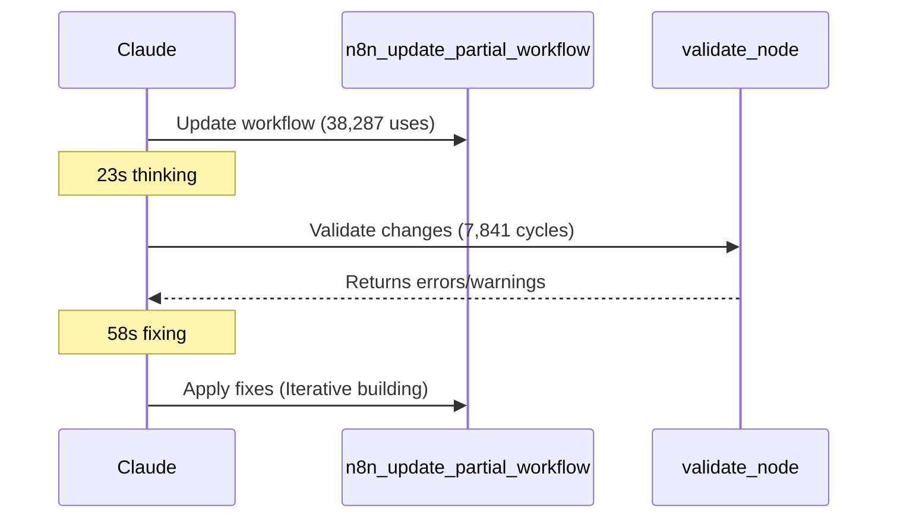

<!-- source: DeepWiki mcp.deepwiki.com · repo czlonkowski/n8n-skills · page 5 MCP Server Integration · fetched 2026-10-26 -->

# MCP Server Integration

<details>
<summary>Relevant source files</summary>

The following files were used as context for generating this wiki page:

- [docs/DEVELOPMENT.md](docs/DEVELOPMENT.md)
- [docs/MCP_TESTING_LOG.md](docs/MCP_TESTING_LOG.md)
- [docs/USAGE.md](docs/USAGE.md)
- [skills/n8n-mcp-tools-expert/README.md](skills/n8n-mcp-tools-expert/README.md)
- [skills/n8n-mcp-tools-expert/WORKFLOW_GUIDE.md](skills/n8n-mcp-tools-expert/WORKFLOW_GUIDE.md)
- [skills/n8n-validation-expert/ERROR_CATALOG.md](skills/n8n-validation-expert/ERROR_CATALOG.md)
- [skills/n8n-validation-expert/README.md](skills/n8n-validation-expert/README.md)

</details>


## Purpose and Scope

This document provides a technical deep dive into the **n8n-mcp MCP server**, which serves as the foundational integration layer between Claude's skills and n8n workflow automation. The n8n-mcp server exposes 40+ tools across five categories, validated through 447,557 real tool invocations captured in production telemetry.

This page covers:
- Server architecture and tool organization
- API availability models (read-only vs. authenticated)
- Performance characteristics from real usage data
- Integration patterns between skills and MCP tools

For detailed information on specific tool categories, see:
- [Tool Categories and Availability](#5.1) - The 40+ tools organized by function
- [Validation System](#5.2) - Validation profiles, error types, and auto-sanitization
- [Workflow Management Tools](#5.3) - Creating and editing workflows via API
- [Common Tool Usage Patterns](#5.4) - Real usage insights from 447K events

For installation and configuration, see [Installation](#2.1).

---

## Architecture Overview

The n8n-mcp server functions as a **Model Context Protocol server** that translates Claude's natural language requests into concrete n8n operations. Skills guide Claude on **how** to use these tools; the MCP server **executes** the operations.

### MCP Server as Integration Layer

```mermaid
graph TB
    subgraph "Claude_Layer"
        [Skills] --> ["n8n-skills (7 expert skills)"]
        [Claude] --> ["Claude (Sonnet 3.5/4.5)"]
    end
    
    subgraph "MCP_Server_Layer"
        [MCPServer] --> ["n8n-mcp Server (npm: n8n-mcp)"]
        
        [ReadOnly] --> ["Read-Only Tools: search_nodes, get_node, validate_node"]
        
        [APIRequired] --> ["API-Required Tools: n8n_create_workflow, n8n_update_partial_workflow"]
    end
    
    subgraph "Data_Sources"
        [EmbeddedDB] --> ["Embedded SQLite DB: 537 nodes, 2,653 templates"]
        
        [N8NAPI] --> ["n8n Instance API: N8N_API_URL, N8N_API_KEY"]
    end
    
    [Skills] -->|"Guides tool usage"| [Claude]
    [Claude] -->|"MCP protocol"| [MCPServer]
    
    [MCPServer] --> [ReadOnly]
    [MCPServer] --> [APIRequired]
    
    [ReadOnly] -->|"Always available"| [EmbeddedDB]
    [APIRequired] -->|"Requires credentials"| [N8NAPI]
```

**Sources:** [skills/n8n-mcp-tools-expert/README.md:7-39](), [docs/MCP_TESTING_LOG.md:27-51](), [docs/DEVELOPMENT.md:305-323]()

---

## Tool Categories and Functions

The n8n-mcp server organizes tools into five functional categories. Each category serves a specific role in the workflow development lifecycle.

### Tool Categorization by Function

```mermaid
graph LR
    subgraph "1_Node_Discovery"
        [search_nodes] --> ["search_nodes: 99.9% success"]
        [get_node] --> ["get_node: Essentials vs Full mode"]
    end
    
    subgraph "2_Configuration_Validation"
        [validate_node] --> ["validate_node: Profile-dependent"]
        [validate_workflow] --> ["validate_workflow: 100-500ms"]
    end
    
    subgraph "3_Workflow_Management"
        [n8n_create_workflow] --> ["n8n_create_workflow: New builds"]
        [n8n_update_partial_workflow] --> ["n8n_update_partial_workflow: 38,287 uses"]
    end
    
    subgraph "4_Template_Library"
        [search_templates] --> ["search_templates: 2,653 items"]
        [get_template] --> ["get_template: Structure mode"]
    end
    
    subgraph "5_System_Tools"
        [n8n_health_check] --> ["n8n_health_check: API status"]
        [get_database_statistics] --> ["get_database_statistics: DB health"]
    end
```

**Sources:** [skills/n8n-mcp-tools-expert/README.md:51-57](), [skills/n8n-mcp-tools-expert/WORKFLOW_GUIDE.md:15-86](), [docs/MCP_TESTING_LOG.md:55-108]()

---

## Tool Availability Models

Tools operate under two distinct availability models based on data source requirements. This determines what operations are possible without n8n API credentials.

### Availability by Data Source

| Category | Tools | Source | API Key Required? |
| :--- | :--- | :--- | :--- |
| **Discovery** | `search_nodes`, `get_node` | Embedded DB | No |
| **Validation** | `validate_node`, `validate_workflow` | Embedded DB | No |
| **Templates** | `search_templates`, `get_template` | Embedded DB | No |
| **Workflow Mgmt** | `n8n_create_workflow`, `n8n_update_partial_workflow` | n8n API | **Yes** |
| **Execution** | `n8n_trigger_webhook_workflow` | n8n API | **Yes** |

**Key Insight:** Skills remain functional in **read-only mode** (no API credentials) by using the embedded database for node discovery, validation, and template access. Workflow creation and management require API authentication [skills/n8n-mcp-tools-expert/WORKFLOW_GUIDE.md:7-12]().

**Sources:** [docs/MCP_TESTING_LOG.md:154-168](), [skills/n8n-mcp-tools-expert/WORKFLOW_GUIDE.md:7-12]()

---

## Embedded Database Statistics

The MCP server maintains an embedded database containing pre-indexed n8n metadata, enabling fast read-only operations without API access.

| Resource Type | Count | Coverage |
| :--- | :--- | :--- |
| **Total Nodes** | 537 | 100% |
| **AI-Capable Tools** | 270 | 50.3% |
| **Trigger Nodes** | 108 | 20.1% |
| **Versioned Nodes** | 141 | 26.3% |
| **Documented Nodes** | 470 | 88% |
| **Templates** | 2,653 | Avg 4,115 views |

**Package Distribution:**
- `n8n-nodes-base`: 437 nodes (81%)
- `@n8n/n8n-nodes-langchain`: 100 nodes (19%)

**Sources:** [docs/MCP_TESTING_LOG.md:27-51]()

---

## nodeType Format Distinction

A critical integration detail: the MCP server uses **two different nodeType formats** depending on the tool category. This distinction appears in 38,287 workflow update operations.

### Format Mapping by Tool Category

```mermaid
graph TB
    subgraph "Search_Validate_Tools"
        [ShortPrefix] --> ["Format: nodes-base.slack"]
        [SearchUsage] --> ["Used by: search_nodes, get_node, validate_node"]
    end
    
    subgraph "Workflow_Tools"
        [FullPrefix] --> ["Format: n8n-nodes-base.slack"]
        [WorkflowUsage] --> ["Used by: n8n_create_workflow, n8n_update_partial_workflow"]
    end
    
    [SearchResult] --> ["search_nodes returns BOTH formats"]
    
    [ShortPrefix] -.-> [SearchUsage]
    [FullPrefix] -.-> [WorkflowUsage]
    [SearchResult] -.-> [ShortPrefix]
    [SearchResult] -.-> [FullPrefix]
```

**Example Conversion:**
- `search_nodes` returns `nodeType: "nodes-base.slack"` (for validation) and `workflowNodeType: "n8n-nodes-base.slack"` (for creation) [docs/MCP_TESTING_LOG.md:59-62]().

**Sources:** [skills/n8n-mcp-tools-expert/README.md:44-46](), [docs/MCP_TESTING_LOG.md:59-62]()

---

## Performance Characteristics

Performance data from 447,557 real tool invocations reveals significant variance in success rates and response times.

### Tool Performance Matrix

| Tool | Success Rate | Response Time | Payload Size | Invocations |
| :--- | :--- | :--- | :--- | :--- |
| `search_nodes` | 99.9% | <20ms | Small | 9,835 |
| `get_node` (essentials) | 91.7% | <10ms | ~5KB | High |
| `get_node` (full) | 80% ⚠️ | Varies | 100KB+ | Discouraged |
| `n8n_update_partial_workflow` | 99.0% ✓ | 50-200ms | Small | 38,287 |
| `n8n_create_workflow` | 96.8% | 100-500ms | Medium | N/A |

**Key Observations:**
1. **Most reliable:** `search_nodes` (99.9%), `n8n_update_partial_workflow` (99.0%) [skills/n8n-mcp-tools-expert/WORKFLOW_GUIDE.md:80-81]().
2. **Least reliable:** `get_node` (full) (80%) - use essentials instead [docs/MCP_TESTING_LOG.md:131-132]().
3. **Most used:** `n8n_update_partial_workflow` (38,287 invocations) [skills/n8n-mcp-tools-expert/WORKFLOW_GUIDE.md:80-81]().

**Sources:** [skills/n8n-mcp-tools-expert/WORKFLOW_GUIDE.md:17-81](), [docs/MCP_TESTING_LOG.md:130-134]()

---

## Telemetry-Driven Usage Patterns

Analysis of 447,557 tool invocations reveals three dominant usage patterns with consistent timing characteristics.

### Pattern 1: Edit-Validate Loop (Most Common)

The **most frequently observed pattern** involves iterative workflow updates followed by validation checks.



**Timing Characteristics:**
- **23 seconds** between update → validate (thinking) [skills/n8n-validation-expert/README.md:15-17]().
- **58 seconds** between validate → update (fixing) [skills/n8n-validation-expert/README.md:15-17]().
- **56 seconds** average between consecutive updates (iterative building) [skills/n8n-mcp-tools-expert/WORKFLOW_GUIDE.md:84-85]().

**Sources:** [skills/n8n-validation-expert/README.md:15-17](), [skills/n8n-mcp-tools-expert/WORKFLOW_GUIDE.md:84-85]()

---

## Smart Parameters for Multi-Output Nodes

The MCP server supports **smart parameters** to simplify connections for nodes with multiple outputs (IF, Switch), eliminating manual `sourceIndex` calculations.

### IF Node Branch Names
```javascript
{
  type: "addConnection",
  source: "IF",
  target: "True Handler",
  branch: "true"  // Instead of sourceIndex: 0
}
```

### Switch Node Case Numbers
```javascript
{
  type: "addConnection",
  source: "Switch",
  target: "Handler A",
  case: 0
}
```

**Sources:** [skills/n8n-mcp-tools-expert/WORKFLOW_GUIDE.md:129-164](), [docs/MCP_TESTING_LOG.md:133-134]()

---

## AI Connection Types

The MCP server supports **8 specialized connection types** for AI workflows using the `sourceOutput` parameter.

| Connection Type | Source Nodes | Target Nodes |
| :--- | :--- | :--- |
| `ai_languageModel` | OpenAI, Anthropic | AI Agent |
| `ai_tool` | HTTP Request Tool, Code Tool | AI Agent |
| `ai_memory` | Window Buffer Memory | AI Agent |
| `ai_vectorStore` | Pinecone, Supabase | Retrieval nodes |

**Sources:** [skills/n8n-mcp-tools-expert/WORKFLOW_GUIDE.md:165-203](), [docs/MCP_TESTING_LOG.md:150-151]()

---

## Validation Profiles

The validation system supports **four distinct profiles** optimized for different stages of workflow development.

| Profile | Use Case | False Positive Rate |
| :--- | :--- | :--- |
| `minimal` | Quick checks during editing | High |
| `runtime` | Recommended for most use cases | Medium |
| `ai-friendly` | Reduces noise for AI workflows | **60% lower** |
| `strict` | Maximum safety, many warnings | Highest |

**Key Insight:** The `ai-friendly` profile reduces false positives by 60% compared to `runtime` [skills/n8n-validation-expert/README.md:50-51]().

**Sources:** [skills/n8n-validation-expert/README.md:35-40](), [skills/n8n-validation-expert/README.md:120-123]()

---

## Auto-Sanitization System

The MCP server implements **automatic operator structure correction** that runs on **every workflow save operation**. This system fixes 2% of validation errors automatically [skills/n8n-validation-expert/ERROR_CATALOG.md:18-19]().

### Auto-Fixed Issues
- **Binary Operator Fix:** Removes `singleValue` property for `equals`, `contains`.
- **Unary Operator Fix:** Adds `singleValue: true` for `isEmpty`, `isNotEmpty`.
- **Metadata:** Adds IF/Switch metadata required for correct rendering [skills/n8n-validation-expert/README.md:41-46]().

**Sources:** [skills/n8n-validation-expert/README.md:41-46](), [skills/n8n-validation-expert/ERROR_CATALOG.md:18-19]()

---

## Summary

The n8n-mcp server provides a foundational integration layer with a **two-tier availability model**: read-only tools accessible without credentials, and workflow management tools requiring API authentication. Performance analysis reveals that workflows are built iteratively (56s between edits) and rely heavily on the edit-validate loop (7,841 cycles observed).

For detailed coverage of specific tool categories, see the subsection pages:
- [Tool Categories and Availability](#5.1)
- [Validation System](#5.2)
- [Workflow Management Tools](#5.3)
- [Common Tool Usage Patterns](#5.4)

---

