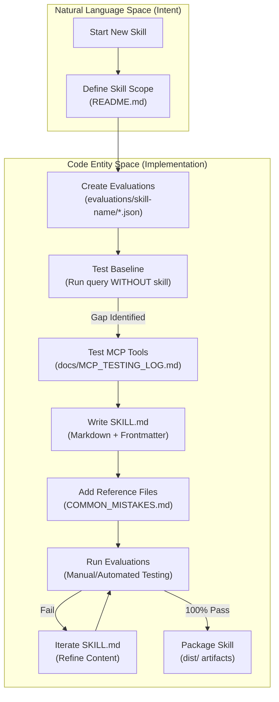
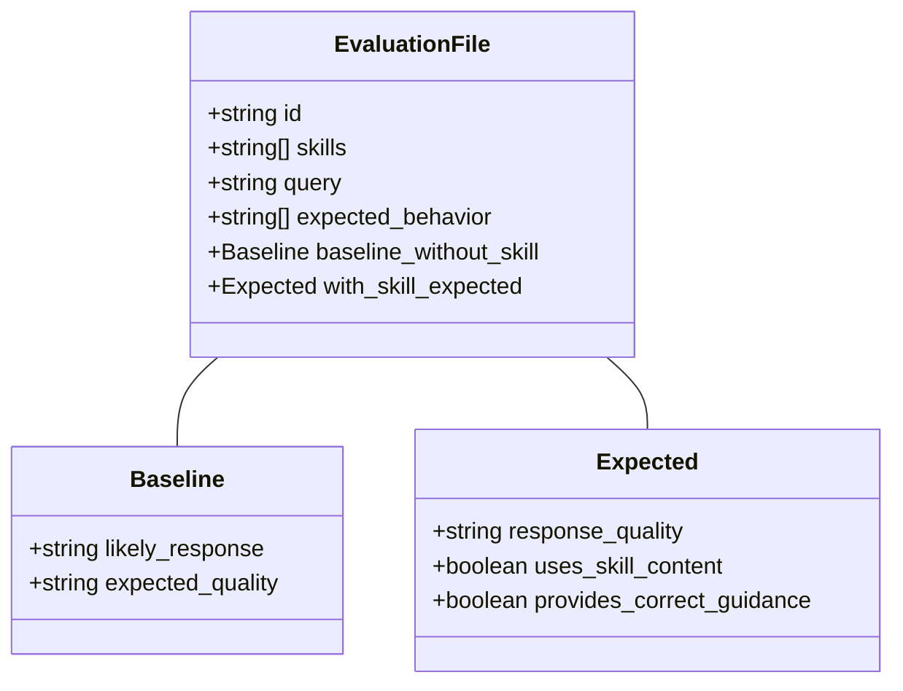

<!-- source: DeepWiki mcp.deepwiki.com · repo czlonkowski/n8n-skills · page 6.1 Evaluation-Driven Development (EDD) · fetched 2026-10-26 -->

# Evaluation-Driven Development (EDD)

<details>
<summary>Relevant source files</summary>

The following files were used as context for generating this wiki page:

- [docs/DEVELOPMENT.md](docs/DEVELOPMENT.md)
- [docs/MCP_TESTING_LOG.md](docs/MCP_TESTING_LOG.md)
- [docs/USAGE.md](docs/USAGE.md)
- [evaluations/mcp-tools/eval-001-tool-selection.json](evaluations/mcp-tools/eval-001-tool-selection.json)
- [evaluations/mcp-tools/eval-002-nodetype-format.json](evaluations/mcp-tools/eval-002-nodetype-format.json)
- [evaluations/mcp-tools/eval-003-validation-workflow.json](evaluations/mcp-tools/eval-003-validation-workflow.json)
- [evaluations/mcp-tools/eval-004-essentials-vs-info.json](evaluations/mcp-tools/eval-004-essentials-vs-info.json)
- [evaluations/mcp-tools/eval-005-smart-parameters.json](evaluations/mcp-tools/eval-005-smart-parameters.json)
- [evaluations/workflow-patterns/eval-001-webhook-workflow.json](evaluations/workflow-patterns/eval-001-webhook-workflow.json)
- [evaluations/workflow-patterns/eval-002-http-api-workflow.json](evaluations/workflow-patterns/eval-002-http-api-workflow.json)
- [evaluations/workflow-patterns/eval-003-database-sync.json](evaluations/workflow-patterns/eval-003-database-sync.json)
- [evaluations/workflow-patterns/eval-004-ai-agent.json](evaluations/workflow-patterns/eval-004-ai-agent.json)
- [evaluations/workflow-patterns/eval-005-scheduled-report.json](evaluations/workflow-patterns/eval-005-scheduled-report.json)

</details>


## Purpose and Scope

This document describes the Evaluation-Driven Development (EDD) methodology used in the n8n-skills project. EDD is the core development philosophy where **evaluations are written before skill content**, establishing objective success criteria and ensuring skills solve real problems. This page covers the EDD process, evaluation structure, baseline testing, and iteration strategies.

For implementation details on creating new skills, see [6.2 Creating New Skills](). For quality standards and testing frameworks, see [6.3 Testing and Quality Standards](). For understanding how MCP tool testing informs evaluation scenarios, see [5. MCP Server Integration]().

---

## The EDD Philosophy

Evaluation-Driven Development inverts the traditional development sequence. Instead of writing skill content and hoping it works, EDD requires establishing measurable success criteria first through evaluation scenarios.

### Core Principles

| Principle | Description | Benefit |
|-----------|-------------|---------|
| **Evaluations First** | Write 3+ test scenarios before any skill content | Prevents feature creep, ensures focus on real problems |
| **Objective Criteria** | Define expected behaviors as measurable assertions | Enables automated testing, eliminates subjective judgment |
| **Baseline Comparison** | Test Claude's response without the skill | Quantifies skill value, justifies development effort |
| **Iterate to 100%** | Refine skill content until all evaluations pass | Guarantees quality, prevents premature release |
| **MCP-Informed** | Base scenarios on real MCP tool responses | Ensures accuracy, prevents invented examples |

The philosophy emerged from observing that skills often addressed theoretical problems rather than actual user pain points. By requiring evaluations first, development focuses on solving validated, real-world scenarios.

**Sources:** [docs/DEVELOPMENT.md:9-21]()

---

## The EDD Process Flow

The EDD process follows a strict sequence where each phase validates the previous one before proceeding.

### Natural Language to Code Entity Space: EDD Lifecycle



**Process Phases:**

1.  **Define Scope**: Answer what problem is solved, when skill activates, and which MCP tools it teaches [docs/DEVELOPMENT.md:89-98]().
2.  **Create Evaluations**: Write at least 3 evaluation JSON files covering basic usage, common mistakes, and advanced scenarios [docs/DEVELOPMENT.md:99-130]().
3.  **Test Baseline**: Run queries through Claude WITHOUT the skill to establish baseline quality [docs/DEVELOPMENT.md:114-117]().
4.  **Test MCP Tools**: Execute actual MCP tool calls (e.g., `search_nodes`, `get_node`) and document responses in `docs/MCP_TESTING_LOG.md` [docs/DEVELOPMENT.md:131-154]().
5.  **Write Skill Content**: Create `SKILL.md` using real examples from MCP testing. Keep under 500 lines [docs/DEVELOPMENT.md:156-194]().
6.  **Add Reference Files**: Create additional documentation files like `COMMON_MISTAKES.md` or `EXAMPLES.md` [docs/DEVELOPMENT.md:195-208]().
7.  **Run Evaluations**: Test all scenarios with the skill active and iterate until 100% pass rate [docs/DEVELOPMENT.md:210-223]().

**Sources:** [docs/DEVELOPMENT.md:9-21](), [docs/DEVELOPMENT.md:89-249]()

---

## Evaluation File Structure

Evaluations are stored as JSON files in the `evaluations/` directory. Each evaluation follows a schema that enables objective testing.

### Evaluation Schema Mapping



### Real Example: Webhook Processing Pattern

The `eval-001-webhook-workflow.json` demonstrates how a pattern is evaluated:

```json
{
  "id": "pattern-001",
  "skills": ["n8n-workflow-patterns"],
  "query": "I need to build a workflow that receives webhook data and sends it to Slack. What's the best way to structure this?",
  "expected_behavior": [
    "Identifies this as a Webhook Processing pattern",
    "References the webhook_processing.md pattern file",
    "Explains the basic structure: Webhook → Transform → Output",
    "Mentions data is nested under $json.body for webhook payloads",
    "Suggests validation and error handling",
    "Provides checklist: trigger, validation, transformation, output, error handling"
  ]
}
```

**Key Fields Explained:**
*   **`id`**: Unique identifier (e.g., `pattern-001`) [evaluations/workflow-patterns/eval-001-webhook-workflow.json:2]().
*   **`skills`**: The skill(s) being tested [evaluations/workflow-patterns/eval-001-webhook-workflow.json:3]().
*   **`query`**: The exact user prompt [evaluations/workflow-patterns/eval-001-webhook-workflow.json:4]().
*   **`expected_behavior`**: Measurable assertions the skill must satisfy [evaluations/workflow-patterns/eval-001-webhook-workflow.json:5-13]().

**Sources:** [evaluations/workflow-patterns/eval-001-webhook-workflow.json:1-15](), [docs/DEVELOPMENT.md:104-124]()

---

## Baseline Testing and MCP Integration

Baseline testing quantifies the skill's added value by documenting Claude's response without the skill's specific guidance.

### Baseline vs. Skill-Enhanced Comparison

| Dimension | Baseline Without Skill | With Skill Expected |
|-----------|-------------------------|---------------------|
| **Tool Knowledge** | Likely response: Generic answer [docs/DEVELOPMENT.md:115]() | High quality, uses skill content [docs/DEVELOPMENT.md:119-120]() |
| **Accuracy** | May assume more data is better [evaluations/mcp-tools/eval-004-essentials-vs-info.json:15]() | Recommends `get_node_essentials` (5KB vs 100KB+) [evaluations/mcp-tools/eval-004-essentials-vs-info.json:6-7]() |
| **Patterns** | Might guess at validation [evaluations/mcp-tools/eval-003-validation-workflow.json:15]() | Shows validation loop: validate → fix → validate [evaluations/mcp-tools/eval-003-validation-workflow.json:10]() |

### MCP-Informed Content
All skill content must be based on real MCP tool responses documented in `docs/MCP_TESTING_LOG.md`.

*   **Node Discovery**: `search_nodes({query: "webhook"})` returns `nodes-base.webhook` [docs/MCP_TESTING_LOG.md:59-60]().
*   **Data Access**: Webhook data structure is confirmed as `$json.body.*` [docs/MCP_TESTING_LOG.md:80]().
*   **Validation**: Real validation errors (e.g., missing required field "name") inform the `Validation Expert` skill [docs/MCP_TESTING_LOG.md:101-105]().

**Sources:** [docs/DEVELOPMENT.md:25-37](), [docs/MCP_TESTING_LOG.md:1-172](), [evaluations/mcp-tools/eval-004-essentials-vs-info.json:1-26]()

---

## The Iteration Loop

The core of EDD is the iterative process of refining `SKILL.md` until it meets the 100% pass requirement.

1.  **Run Evaluation**: Start Claude Code and ask the evaluation query [docs/DEVELOPMENT.md:289-297]().
2.  **Verify Behavior**: Check if the response matches all `expected_behavior` items.
3.  **Refine**: If behavior is missing (e.g., failing to mention `$json.body` for webhooks), update the skill content [docs/DEVELOPMENT.md:210-216]().
4.  **Repeat**: Continue until the skill activates correctly and provides accurate, data-driven guidance [docs/DEVELOPMENT.md:218-223]().

### Success Criteria Checklist
*   [ ] All 3+ evaluations pass 100% [docs/DEVELOPMENT.md:218-223]().
*   [ ] `SKILL.md` is under 500 lines [docs/DEVELOPMENT.md:41]().
*   [ ] Content uses real examples from `MCP_TESTING_LOG.md` [docs/DEVELOPMENT.md:52]().
*   [ ] Activation triggers are verified [docs/USAGE.md:11-20]().

**Sources:** [docs/DEVELOPMENT.md:18-21](), [docs/DEVELOPMENT.md:209-223](), [docs/DEVELOPMENT.md:41-57]()

---

