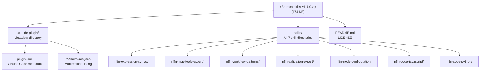

<!-- source: DeepWiki mcp.deepwiki.com · repo czlonkowski/n8n-skills · page 7 Reference · fetched 2026-10-26 -->

# Reference

<details>
<summary>Relevant source files</summary>

The following files were used as context for generating this wiki page:

- [.claude-plugin/marketplace.json](.claude-plugin/marketplace.json)
- [.claude-plugin/plugin.json](.claude-plugin/plugin.json)
- [build.sh](build.sh)
- [dist/README.md](dist/README.md)

</details>


This page provides technical reference material for the n8n-skills distribution system. It covers package structures, metadata specifications, file organization, and platform-specific details. This is intended as a quick-lookup resource for developers and advanced users working with the n8n-skills codebase.

For detailed installation procedures, see [Installation](#2.1). For troubleshooting guidance, see [Common Issues and Solutions](#7.4). For architectural context, see [System Architecture Diagrams](#7.3).

---

## Quick Reference Tables

### Package Comparison

| Package Type | File Name | Size | Skills Included | Target Platform |
|--------------|-----------|------|-----------------|-----------------|
| Complete Bundle | `n8n-mcp-skills-v1.4.0.zip` | 174 KB | All 7 skills | Claude Code, API/SDK |
| Expression Syntax | `n8n-expression-syntax-v1.4.0.zip` | 11 KB | Skill #1 only | Claude.ai |
| MCP Tools Expert | `n8n-mcp-tools-expert-v1.4.0.zip` | 19 KB | Skill #2 only | Claude.ai |
| Workflow Patterns | `n8n-workflow-patterns-v1.4.0.zip` | 37 KB | Skill #3 only | Claude.ai |
| Validation Expert | `n8n-validation-expert-v1.4.0.zip` | 19 KB | Skill #4 only | Claude.ai |
| Node Configuration | `n8n-node-configuration-v1.4.0.zip` | 18 KB | Skill #5 only | Claude.ai |
| JavaScript Code | `n8n-code-javascript-v1.4.0.zip` | 34 KB | Skill #6 only | Claude.ai |
| Python Code | `n8n-code-python-v1.4.0.zip` | 31 KB | Skill #7 only | Claude.ai |

Sources: [dist/README.md:11-17](), [dist/README.md:53-61](), [build.sh:8]()

### Platform Compatibility Matrix

| Platform | Installation Method | Package Format | Code Skills (JS/PY) | Activation |
|----------|-------------------|----------------|---------------------|------------|
| **Claude Code** | `/plugin install` or manual copy | Complete bundle (zip) | ✅ Included | Automatic via frontmatter |
| **Claude.ai / Desktop** | Upload via Settings → Capabilities | Individual zips | ✅ Available as separate zips | Automatic via frontmatter |
| **Claude API** | `loadSkillsFromDirectory()` | Extract `skills/` folder | ✅ Included | Programmatic |

Sources: [dist/README.md:41-47]()

---

## Package Anatomy: Complete Bundle

The complete bundle (`n8n-mcp-skills-v1.4.0.zip`) is designed specifically for Claude Code and contains the following structure:

**Complete Bundle Structure**


Sources: [dist/README.md:79-95](), [build.sh:38-45]()

---

## Metadata Files: Schema and Purpose

### plugin.json Schema

Located at [.claude-plugin/plugin.json:1-23](), this file defines the plugin for Claude Code's plugin system.

```json
{
  "name": "n8n-mcp-skills",
  "version": "1.4.0",
  "description": "Expert skills for building n8n workflows with n8n-mcp",
  "author": {
    "name": "Romuald Członkowski",
    "url": "https://www.aiadvisors.pl/en"
  },
  "license": "MIT",
  "keywords": ["n8n", "workflow", "automation", "mcp", "validation", "expressions", "code", "javascript", "python"],
  "repository": "https://github.com/czlonkowski/n8n-skills",
  "homepage": "https://github.com/czlonkowski/n8n-skills"
}
```

Sources: [.claude-plugin/plugin.json:1-23]()

### marketplace.json Schema

Located at [.claude-plugin/marketplace.json:1-36](), this file provides metadata for Claude's marketplace listing system.

```json
{
  "name": "n8n-mcp-skills",
  "description": "Expert skills for building n8n workflows",
  "owner": { "name": "Romuald Członkowski", "url": "..." },
  "plugins": [
    {
      "name": "n8n-mcp-skills",
      "source": "./",
      "description": "Complete bundle: 7 expert skills...",
      "version": "1.4.0",
      "category": "automation",
      "keywords": ["n8n", "workflow", "mcp", "automation", "validation", "expressions", "code", "javascript", "python", "skills"],
      "homepage": "...",
      "repository": "...",
      "license": "MIT"
    }
  ]
}
```

Sources: [.claude-plugin/marketplace.json:1-36]()

---

## File Path to Entity Mapping

This diagram shows how file paths in the distribution map to conceptual system components and installation targets:

**Distribution Mapping**
```mermaid
graph LR
    subgraph "Distribution Files (dist/)"
        Bundle["n8n-mcp-skills-v1.4.0.zip"]
        IndivJS["n8n-code-javascript-v1.4.0.zip"]
        IndivExp["n8n-expression-syntax-v1.4.0.zip"]
        IndivTools["n8n-mcp-tools-expert-v1.4.0.zip"]
    end
    
    subgraph "Claude Code Entity Space"
        CC_Skills["~/.claude/skills/n8n-mcp-skills/"]
        CC_Meta[".claude-plugin/plugin.json"]
        CC_S_Dir["skills/"]
    end
    
    subgraph "Claude.ai Entity Space"
        CAI_Skill["Skill Capability Storage"]
        CAI_SKILLMD["SKILL.md (Root Level)"]
    end
    
    Bundle -->|"/plugin install"| CC_Skills
    CC_Skills --> CC_Meta
    CC_Skills --> CC_S_Dir
    
    IndivJS -->| "Upload Skill" | CAI_Skill
    IndivExp -->| "Upload Skill" | CAI_Skill
    IndivTools -->| "Upload Skill" | CAI_Skill
    
    CAI_Skill --> CAI_SKILLMD
```

Sources: [dist/README.md:19-38](), [dist/README.md:137-141](), [build.sh:19-36]()

---

## SKILL.md File Structure

Each skill package contains a `SKILL.md` file. For Claude.ai, this file must be at the root of the zip. For Claude Code, it resides within the `skills/<skill-name>/` directory.

**Frontmatter Fields (YAML):**
- `skill_name`: Display name of the skill.
- `description`: Brief explanation of skill's purpose.
- `version`: Skill version number (currently `1.4.0`).
- `activation_triggers`: Array of keywords that activate this skill.

Sources: [dist/README.md:71-77](), [dist/README.md:144-146]()

---

## Installation Command Reference

### Claude Code (Plugin System)

```bash
# Install from GitHub
/plugin install czlonkowski/n8n-skills

# Install from local file
/plugin install ./dist/n8n-mcp-skills-v1.4.0.zip
```

Sources: [dist/README.md:32-38]()

### Claude.ai (Manual Upload)

1. Go to **Settings > Capabilities > Skills**.
2. Click **"Upload Skill"**.
3. Select an individual zip file (e.g., `n8n-expression-syntax-v1.4.0.zip`).
4. **Important:** Do not upload the bundle zip; Claude.ai requires exactly one `SKILL.md` at the zip root.

Sources: [dist/README.md:19-23](), [dist/README.md:133-135]()

---

## Verification Queries

Test activation by asking:

| Query | Expected Activation |
|-------|---------------------|
| `"How do I write n8n expressions?"` | `n8n Expression Syntax` |
| `"Find me a Slack node"` | `n8n MCP Tools Expert` |
| `"Build a webhook workflow"` | `n8n Workflow Patterns` |

Sources: [dist/README.md:99-116]()

---

## Subsection Overview

For more specific details, visit the following child pages:

- [Distribution Package Structure](#7.1) — Detailed breakdown of file organization and package sizes.
- [Plugin Metadata Specification](#7.2) — Deep dive into the `plugin.json` and `marketplace.json` schemas.
- [System Architecture Diagrams](#7.3) — Comprehensive visual guides for ecosystem and activation flows.
- [Common Issues and Solutions](#7.4) — Troubleshooting guide for platform-specific installation and runtime errors.

---

