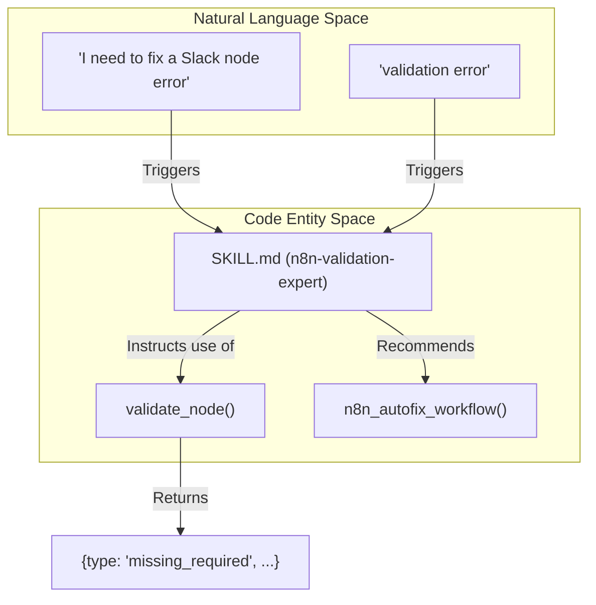
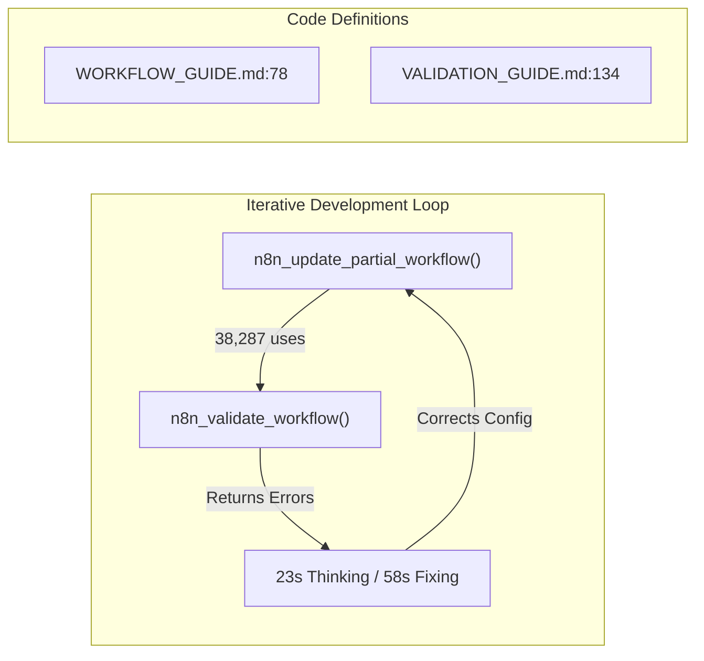

<!-- source: DeepWiki mcp.deepwiki.com · repo czlonkowski/n8n-skills · page 8 Glossary · fetched 2026-10-26 -->

# Glossary

Relevant source files

The following files were used as context for generating this wiki page:

- [.claude-plugin/marketplace.json](.claude-plugin/marketplace.json)
- [.claude-plugin/plugin.json](.claude-plugin/plugin.json)
- [CLAUDE.md](CLAUDE.md)
- [build.sh](build.sh)
- [dist/README.md](dist/README.md)
- [skills/n8n-mcp-tools-expert/VALIDATION_GUIDE.md](skills/n8n-mcp-tools-expert/VALIDATION_GUIDE.md)
- [skills/n8n-mcp-tools-expert/WORKFLOW_GUIDE.md](skills/n8n-mcp-tools-expert/WORKFLOW_GUIDE.md)
- [skills/n8n-validation-expert/SKILL.md](skills/n8n-validation-expert/SKILL.md)
- [skills/n8n-workflow-patterns/SKILL.md](skills/n8n-workflow-patterns/SKILL.md)

This glossary defines codebase-specific terms, technical jargon, and domain concepts used throughout the `n8n-skills` repository. It is intended for onboarding engineers to understand the relationship between the n8n ecosystem, the Model Context Protocol (MCP), and the skill-based guidance system.

## Core Concepts

### Model Context Protocol (MCP)
An open protocol that enables AI models (like Claude) to access external tools and data. In this repository, the **n8n-mcp server** acts as the bridge between Claude and n8n instances [CLAUDE.md:13-17]().

### Skill
A set of specialized instructions and reference materials that teach an AI assistant how to perform specific tasks within n8n. Each skill is defined by a `SKILL.md` file containing YAML frontmatter and Markdown content [dist/README.md:73-74]().

### Skill Activation
The process by which Claude selects a skill based on user query keywords. For example, "How do I write n8n expressions?" triggers the `n8n-expression-syntax` skill [dist/README.md:101-103]().

### Evaluation-Driven Development (EDD)
The development philosophy used in this repo: writing test scenarios (evaluations) first to establish a baseline before iterating on skill content [CLAUDE.md:138-144]().

---

## Technical Terms & Implementation

| Term | Definition | Code Pointer |
|:---|:---|:---|
| **nodeType** | The unique identifier for an n8n node (e.g., `n8n-nodes-base.webhook`). | [skills/n8n-mcp-tools-expert/WORKFLOW_GUIDE.md:41]() |
| **typeVersion** | The version of a specific node type, used to handle breaking changes. | [skills/n8n-mcp-tools-expert/WORKFLOW_GUIDE.md:42]() |
| **$json.body** | The specific path required to access incoming payload data from Webhook triggers. | [skills/n8n-workflow-patterns/SKILL.md:184-187]() |
| **Auto-Sanitization** | A system that automatically corrects common structural errors in nodes during workflow updates. | [skills/n8n-mcp-tools-expert/VALIDATION_GUIDE.md:226-236]() |
| **Smart Parameters** | Semantic aliases (like `branch: "true"`) that simplify connection management for IF/Switch nodes. | [skills/n8n-mcp-tools-expert/WORKFLOW_GUIDE.md:129-146]() |
| **Validation Profile** | A set of rules (`minimal`, `runtime`, `ai-friendly`, `strict`) determining validation depth. | [skills/n8n-validation-expert/SKILL.md:137-187]() |

### Validation Profiles Detail
*   **`minimal`**: Checks only required fields; fastest for quick edits [skills/n8n-validation-expert/SKILL.md:141-150]().
*   **`runtime`**: The recommended profile; validates types and allowed values [skills/n8n-validation-expert/SKILL.md:151-164]().
*   **`ai-friendly`**: Reduces false positives for AI-generated configurations [skills/n8n-validation-expert/SKILL.md:165-175]().
*   **`strict`**: Maximum safety; includes best practices and security checks [skills/n8n-validation-expert/SKILL.md:176-187]().

**Sources:** [skills/n8n-validation-expert/SKILL.md:137-187](), [skills/n8n-mcp-tools-expert/VALIDATION_GUIDE.md:64-87](), [skills/n8n-mcp-tools-expert/WORKFLOW_GUIDE.md:129-146]()

---

## System Architecture Diagrams

### Natural Language to Code Entity Mapping
This diagram shows how user intent (Natural Language) is mapped to specific code entities and MCP tools.

**Sources:** [skills/n8n-validation-expert/SKILL.md:1-4](), [skills/n8n-mcp-tools-expert/VALIDATION_GUIDE.md:15-18](), [skills/n8n-mcp-tools-expert/VALIDATION_GUIDE.md:265-268]()

### Workflow Management Data Flow
This diagram illustrates the "Edit-Validate Loop" pattern identified in system telemetry.

**Sources:** [skills/n8n-mcp-tools-expert/WORKFLOW_GUIDE.md:78-85](), [skills/n8n-mcp-tools-expert/VALIDATION_GUIDE.md:134-153](), [skills/n8n-validation-expert/SKILL.md:18-21]()

---

## Distribution & Packaging

### Distribution Formats
*   **Individual Zips**: Target Claude.ai and Claude Desktop. Each zip contains one skill at the root [dist/README.md:7-17]().
*   **Complete Bundle**: Targets Claude Code. Uses a `.claude-plugin/` directory and a nested `skills/` folder [dist/README.md:25-29]().

### Key Metadata Files
*   **`plugin.json`**: Contains plugin metadata (name, version, keywords) for Claude Code [ .claude-plugin/plugin.json:1-23]().
*   **`marketplace.json`**: Listing information for the Claude plugin marketplace [ .claude-plugin/marketplace.json:1-37]().
*   **`build.sh`**: The script responsible for generating all distribution packages [build.sh:1-55]().

### AI Connection Types
The system supports 8 specific connection types for AI Agent workflows [skills/n8n-mcp-tools-expert/WORKFLOW_GUIDE.md:194-203]():
1.  `ai_languageModel`
2.  `ai_tool`
3.  `ai_memory`
4.  `ai_outputParser`
5.  `ai_embedding`
6.  `ai_vectorStore`
7.  `ai_document`
8.  `ai_textSplitter`

**Sources:** [dist/README.md:7-29](), [.claude-plugin/plugin.json:1-23](), [skills/n8n-mcp-tools-expert/WORKFLOW_GUIDE.md:194-203](), [build.sh:1-55]()