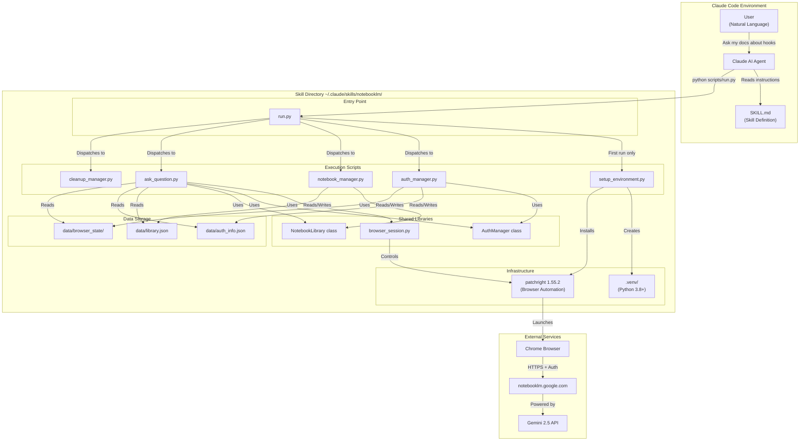
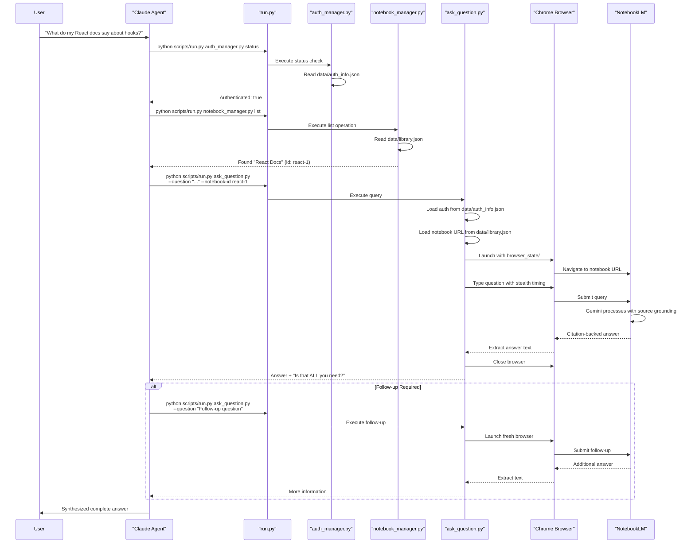
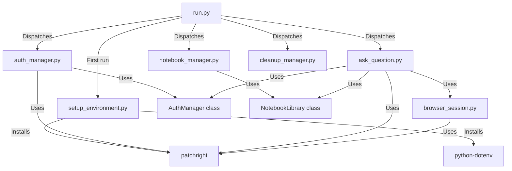

<!-- source: DeepWiki mcp.deepwiki.com · repo PleasePrompto/notebooklm-skill · page 1 Overview · fetched 2026-10-26 -->

# Overview

<details>
<summary>Relevant source files</summary>

The following files were used as context for generating this wiki page:

- [README.md](README.md)
- [SKILL.md](SKILL.md)

</details>


This document provides an introduction to the NotebookLM Skill system, a Claude Code Skill that enables programmatic querying of Google NotebookLM notebooks through browser automation. The system allows Claude Code to retrieve source-grounded, citation-backed answers from user-uploaded documents without hallucinations.

**Scope**: This page covers the system's purpose, architectural overview, core components, and data flow patterns. For detailed component APIs, see [API Reference](#5). For setup procedures, see [Getting Started](#2). For architectural deep-dives, see [Architecture](#1.1).

## System Purpose

The NotebookLM Skill solves the problem of inefficient documentation research during coding tasks. When developers instruct Claude Code to search local documentation, the following inefficiencies occur:

| Problem | Impact |
|---------|--------|
| Massive token consumption | Reading multiple files repeatedly for each query |
| Inaccurate keyword retrieval | Missing contextual connections between documents |
| Hallucinations | Inventing plausible-sounding APIs when information is not found |
| Manual context switching | Constant copy-paste between NotebookLM browser and editor |

The system provides a solution by enabling Claude Code to programmatically query NotebookLM's Gemini-powered knowledge base, which synthesizes answers exclusively from user-uploaded documents with source citations.

**Sources**: [README.md:28-44]()

## System Architecture Overview



**High-Level System Architecture**: This diagram shows the complete system structure from user interaction through Claude Code to NotebookLM integration. The entry point (`run.py`) orchestrates all operations, dispatching to specialized execution scripts. Shared libraries provide reusable functionality for browser automation and data management. All data persists locally in the `data/` directory, with browser automation handled through Patchright-controlled Chrome instances.

**Sources**: [README.md:160-179](), [SKILL.md:192-198]()

## Core Components

### Orchestration Layer

The orchestration layer consists of a single mandatory entry point that manages environment setup and script execution.

| Component | File | Responsibility |
|-----------|------|----------------|
| **Universal Wrapper** | `scripts/run.py` | Environment verification, virtual environment management, script dispatch with proper context |

The `run.py` wrapper must always be used to execute any script. Direct script execution will fail due to missing virtual environment activation. The wrapper automatically creates the `.venv` directory, installs dependencies, and ensures proper Python interpreter usage.

**Sources**: [SKILL.md:40-59](), [README.md:83-88]()

### Execution Modules

Five specialized modules implement the system's core capabilities:

| Module | File | Primary Functions |
|--------|------|-------------------|
| **Environment Setup** | `scripts/setup_environment.py` | Creates `.venv`, installs dependencies (patchright, python-dotenv), configures Chrome |
| **Authentication Manager** | `scripts/auth_manager.py` | Google OAuth flow, session persistence, authentication status validation |
| **Notebook Manager** | `scripts/notebook_manager.py` | CRUD operations on notebook library, search, activation, metadata management |
| **Query Executor** | `scripts/ask_question.py` | Browser automation, question submission, response extraction, follow-up prompts |
| **Cleanup Manager** | `scripts/cleanup_manager.py` | Selective data deletion, library preservation, browser state reset |

**Sources**: [README.md:165-171](), [SKILL.md:143-173]()

### Shared Utilities

Reusable classes and functions used across multiple execution modules:

- **`browser_session.py`**: Provides browser session management, stealth typing utilities, and activity tracking.
- **`AuthManager` class**: Encapsulates authentication state, login orchestration, and cookie management.
- **`NotebookLibrary` class**: Handles JSON persistence of notebook metadata and active notebook tracking.

**Sources**: [SKILL.md:143-167](), [README.md:160-179]()

## Data Flow: Query Execution



**Query Execution Flow**: This sequence diagram traces a complete question-answer cycle. Key observations: (1) Authentication verification precedes all operations, (2) Notebook selection uses the local library registry, (3) Each query opens a fresh browser instance (stateless model), (4) Follow-up mechanism triggers additional queries when initial response is incomplete, (5) Claude synthesizes multiple query results before responding to the user.

**Sources**: [README.md:277-291](), [SKILL.md:128-142]()

## Component Dependencies



**Component Dependency Graph**: This graph shows how execution modules depend on shared utilities and external libraries. Notable patterns: (1) `run.py` is the only entry point and never imports other modules, (2) `ask_question.py` has the most dependencies, indicating it is the most complex operation, (3) Authentication and notebook management are orthogonal concerns with no direct dependencies, (4) Browser automation is centralized through `patchright`.

**Sources**: [SKILL.md:40-59](), [README.md:160-179]()

## File System Layout

The skill follows a self-contained directory structure within `~/.claude/skills/notebooklm/`:

```
notebooklm/
├── SKILL.md              # Claude Code skill definition
├── requirements.txt      # Python dependencies
├── .gitignore           # Excludes data/ and .venv/
├── scripts/
│   ├── run.py                    # Universal wrapper (REQUIRED entry point)
│   ├── setup_environment.py      # Environment initialization
│   ├── auth_manager.py           # Authentication CLI
│   ├── notebook_manager.py       # Library management CLI
│   ├── ask_question.py           # Query execution CLI
│   ├── cleanup_manager.py        # Data cleanup CLI
│   ├── browser_session.py        # Browser utilities
├── .venv/                # Isolated Python environment (auto-created)
│   ├── bin/python        # Python interpreter
│   └── lib/site-packages/
│       ├── patchright/   # Browser automation library
│       └── dotenv/       # Environment config
└── data/                 # Local storage (Git-ignored)
    ├── library.json      # Notebook metadata and registry
    ├── auth_info.json    # Authentication status
    └── browser_state/    # Browser cookies and session data
        ├── cookies.json
        └── storage/
```

**Git Exclusion**: The `.gitignore` file protects sensitive data by excluding `data/` and `.venv/` from version control. Only source code (`scripts/`, `SKILL.md`, `requirements.txt`) is tracked.

**Sources**: [README.md:163-171](), [README.md:262-275](), [SKILL.md:192-198]()

## Session Model: Stateless Design

The system employs a **stateless session model** where each query opens a fresh browser instance:

```mermaid
graph LR
    Q1["Query 1"] --> B1["Launch Browser 1"]
    B1 --> NLM1["NotebookLM Session 1"]
    NLM1 --> A1["Extract Answer 1"]
    A1 --> C1["Close Browser 1"]
    
    C1 -.->|Independent| Q2["Query 2"]
    Q2 --> B2["Launch Browser 2"]
    B2 --> NLM2["NotebookLM Session 2"]
    NLM2 --> A2["Extract Answer 2"]
    A2 --> C2["Close Browser 2"]
    
    C2 -.->|Independent| Q3["Query 3"]
    Q3 --> B3["Launch Browser 3"]
```



**Stateless Session Architecture**: Each query is completely independent. Authentication state and notebook metadata persist in `data/`, but browser instances do not. This design differs from the MCP server implementation which maintains persistent browser sessions.

**Key Implications**:
- No conversational context between queries.
- Each question must be self-contained.
- Follow-up mechanism compensates by prompting Claude to ask additional questions.
- Authentication cookies are reloaded from `data/browser_state/` for each session.

**Sources**: [README.md:149-159](), [SKILL.md:128-142]()

## Claude Code Integration

The skill integrates with Claude Code through a declarative interface defined in `SKILL.md`:

```mermaid
graph TB
    User["User: Natural Language"]
    SkillMD["SKILL.md"]
    Claude["Claude AI Agent"]
    RunPy["run.py"]
    
    User -->|"Ask my docs about X"| Claude
    Claude -->|Reads| SkillMD
    SkillMD -->|Defines commands:<br/>auth_manager.py status<br/>notebook_manager.py list<br/>ask_question.py --question| Claude
    Claude -->|Maps intent to commands| Claude
    Claude -->|"python scripts/run.py ..."| RunPy
    RunPy -->|Executes| Claude
    Claude -->|Analyzes response:<br/>"Is that ALL you need?"| Claude
    Claude -->|May trigger follow-ups| RunPy
```

**Claude Integration Pattern**: Claude reads `SKILL.md` to understand available commands and their parameters. When a user mentions NotebookLM or shares a notebook URL, Claude automatically selects the skill, verifies authentication, identifies the relevant notebook, and executes queries. The follow-up mechanism ("Is that ALL you need?") enables Claude to iteratively gather complete information across multiple stateless queries before responding to the user.

**Sources**: [SKILL.md:1-18](), [README.md:145-179](), [SKILL.md:128-142]()

## Key Design Principles

| Principle | Implementation |
|-----------|----------------|
| **Isolation** | All dependencies in `.venv/`, no global Python package pollution. |
| **Security** | Sensitive data in `data/` excluded from Git via `.gitignore`. |
| **Statelessness** | Fresh browser per query, no session persistence. |
| **Orchestration** | Mandatory `run.py` wrapper ensures proper environment setup. |
| **Zero-Hallucination** | Answers restricted to uploaded document sources via Gemini source-grounding. |
| **Human-Like Automation** | Stealth typing speeds, random delays, realistic interaction patterns. |

**Sources**: [README.md:196-201](), [README.md:249-253]()

## External Dependencies

The system requires two external Python packages installed in the isolated `.venv/`:

| Package | Version | Purpose |
|---------|---------|---------|
| `patchright` | 1.55.2 | Playwright-based browser automation with anti-detection features. |
| `python-dotenv` | 1.0.0 | Environment variable configuration from `.env` files. |

Additionally, the system requires:
- **Python 3.8+**: Host system interpreter for creating `.venv/`.
- **Google Chrome**: Installed browser for automation (not Chromium).
- **Network access**: Required for NotebookLM communication.

**Sources**: [README.md:256-259](), [README.md:89]()

## Data Persistence

All stateful information persists locally in three locations:

| File | Format | Contents | Git Status |
|------|--------|----------|------------|
| `data/library.json` | JSON | Notebook registry with metadata (id, name, description, topics, url, active status). | Ignored |
| `data/auth_info.json` | JSON | Authentication status flags and timestamps. | Ignored |
| `data/browser_state/` | Directory | Browser cookies, session storage, authentication tokens. | Ignored |

**Security Note**: The `data/` directory contains sensitive authentication credentials and personal notebook information. It must never be committed to version control or shared publicly.

**Sources**: [README.md:262-275](), [SKILL.md:192-198]()

---

**Next Steps**: For detailed component specifications, see [Architecture](#1.1). For setup instructions, see [Installation](#2.1). For API references, see [API Reference](#5).

---

