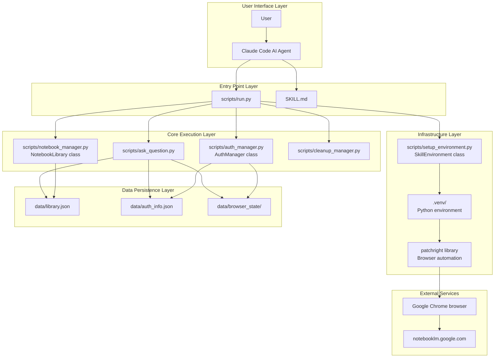
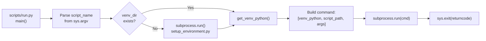
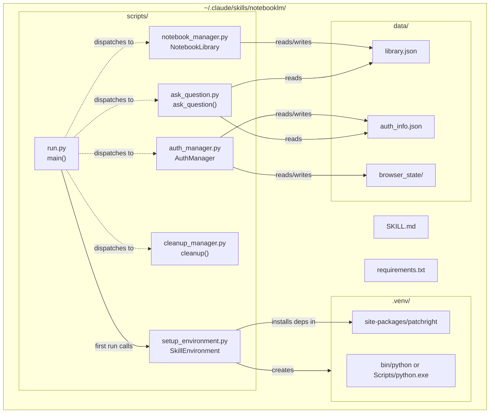
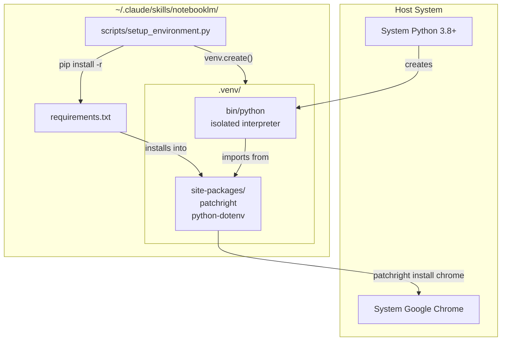
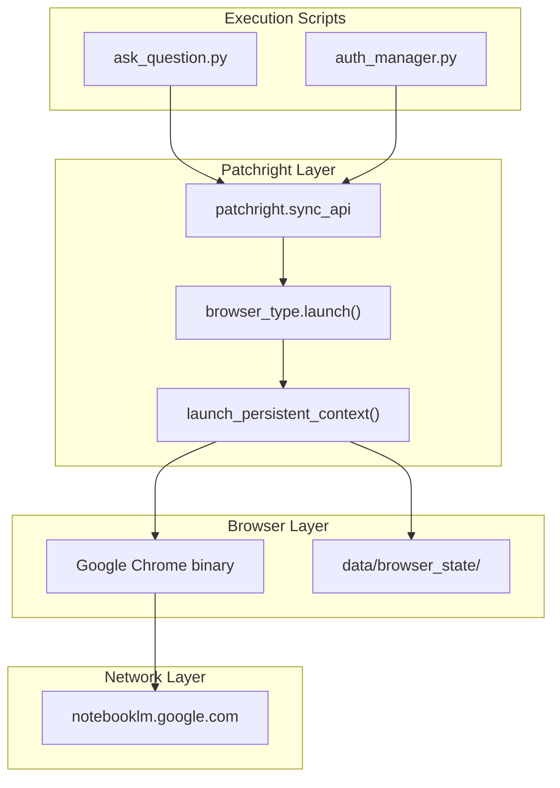
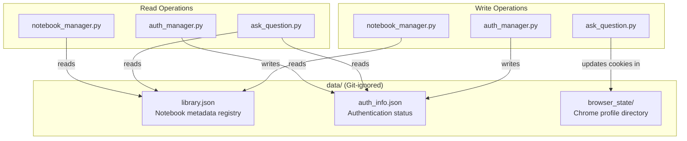
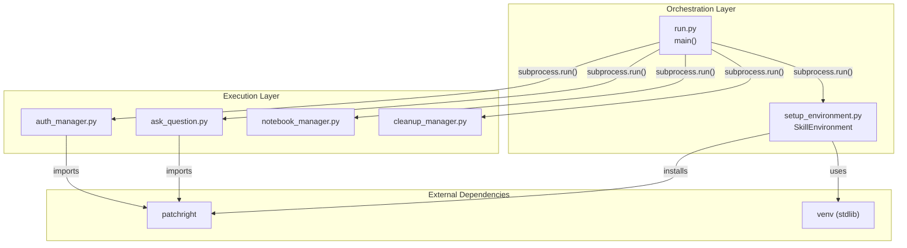

<!-- source: DeepWiki mcp.deepwiki.com · repo PleasePrompto/notebooklm-skill · page 1.1 Architecture · fetched 2026-10-26 -->

# Architecture

<details>
<summary>Relevant source files</summary>

The following files were used as context for generating this wiki page:

- [README.md](README.md)
- [SKILL.md](SKILL.md)
- [scripts/run.py](scripts/run.py)
- [scripts/setup_environment.py](scripts/setup_environment.py)

</details>


## Purpose and Scope

This document provides a detailed explanation of the NotebookLM Skill system architecture. It covers the orchestration model, module structure, virtual environment isolation, browser automation approach, and data persistence strategy. For information about specific command-line interfaces, see [API Reference](#5). For deployment and usage patterns, see [User Guide](#4).

The architecture is designed around five core principles:
1. **Mandatory orchestration** through `run.py` as the universal entry point [[scripts/run.py:1-102]()]
2. **Environment isolation** via skill-local `.venv/` directory [[scripts/setup_environment.py:14-30]()]
3. **Stateless execution** where each query is an independent browser session [[SKILL.md:7-9]()]
4. **Local data persistence** with Git protection for sensitive information [[SKILL.md:191-198]()]
5. **Real browser automation** using Patchright with Chrome (not Chromium) [[scripts/setup_environment.py:70-86]()]

---

## Architectural Layers

The system is organized into five distinct layers, each with specific responsibilities:

### System Layer Overview



**Layer Responsibilities:**

| Layer | Components | Responsibilities |
|-------|-----------|------------------|
| **User Interface** | User, Claude Code AI | Natural language command input, intent interpretation |
| **Entry Point** | `run.py`, `SKILL.md` | Mandatory orchestration, environment verification, script dispatch [[SKILL.md:40-59]()] |
| **Core Execution** | `auth_manager.py`, `notebook_manager.py`, `ask_question.py`, `cleanup_manager.py` | Feature implementation, business logic, NotebookLM interaction [[README.md:163-171]()] |
| **Infrastructure** | `setup_environment.py`, `.venv/`, `patchright` | Environment management, dependency isolation, browser control [[scripts/setup_environment.py:14-110]()] |
| **Data Persistence** | `library.json`, `auth_info.json`, `browser_state/` | Local state storage, metadata management, session persistence [[SKILL.md:191-198]()] |
| **External Services** | Chrome, NotebookLM | Browser execution, AI-powered query responses [[README.md:83-90]()] |

Sources: [README.md:160-171](), [scripts/run.py:1-102](), [scripts/setup_environment.py:1-148](), [SKILL.md:40-59]()

---

## The Orchestration Model

The `run.py` script serves as the **mandatory universal entry point** for all skill operations. No script should be executed directly; all must go through this orchestrator [[SKILL.md:40-52]()].

### Why Mandatory Orchestration?

The orchestration model solves three critical problems:

1. **Environment consistency** - Ensures the `.venv/` exists and is properly configured before any script runs [[scripts/run.py:26-45]()]
2. **Automatic setup** - First-run detection triggers environment creation without user intervention [[scripts/run.py:33-41]()]
3. **Error propagation** - Consistent error handling and exit codes across all operations [[scripts/run.py:90-98]()]

### run.py Implementation



**Key Functions:**

| Function | Location | Purpose |
|----------|----------|---------|
| `get_venv_python()` | [scripts/run.py:13-23]() | Returns path to `.venv/bin/python` or `.venv/Scripts/python.exe` based on OS |
| `ensure_venv()` | [scripts/run.py:26-45]() | Checks if `.venv/` exists, runs `setup_environment.py` if not |
| `main()` | [scripts/run.py:48-98]() | Parses script name, ensures environment, executes script in subprocess |

**Invocation Pattern:**

```bash
# User never calls scripts directly
python scripts/run.py ask_question.py --question "What is X?"

# run.py ensures .venv exists, then executes:
.venv/bin/python scripts/ask_question.py --question "What is X?"
```

The orchestrator handles script name normalization (removing `scripts/` prefix, adding `.py` extension) at [scripts/run.py:64-70]() and provides clear error messages when scripts are not found at [scripts/run.py:76-81]().

Sources: [scripts/run.py:1-102](), [README.md:163-171](), [SKILL.md:40-59]()

---

## Module Organization

The skill follows a flat module structure within the `scripts/` directory, with each module implementing a specific capability.

### Directory Structure with Code Entities



### Module Responsibilities

| Module | Primary Class/Function | Purpose | Entry Point |
|--------|----------------------|---------|-------------|
| `run.py` | `main()` | Universal script dispatcher | Always via `python scripts/run.py <script>` [[scripts/run.py:48-58]()] |
| `setup_environment.py` | `SkillEnvironment` | Manages `.venv/` creation and dependencies | Called automatically by `run.py` [[scripts/run.py:38]()] |
| `auth_manager.py` | `AuthManager` | Google authentication flow and session persistence | `python scripts/run.py auth_manager.py <command>` [[SKILL.md:145-151]()] |
| `notebook_manager.py` | `NotebookLibrary` | CRUD operations on `library.json` | `python scripts/run.py notebook_manager.py <command>` [[SKILL.md:153-161]()] |
| `ask_question.py` | `ask_question()` | Executes queries against NotebookLM | `python scripts/run.py ask_question.py --question "..."` [[SKILL.md:163-166]()] |
| `cleanup_manager.py` | `cleanup()` | Selective deletion of data files | `python scripts/run.py cleanup_manager.py <options>` [[SKILL.md:168-173]()] |

### Module Interaction Pattern

Scripts follow a **three-tier interaction model**:

1. **Orchestration Tier**: `run.py` receives all external commands [[scripts/run.py:50-58]()]
2. **Execution Tier**: Feature scripts (`auth_manager.py`, `notebook_manager.py`, etc.) implement capabilities [[SKILL.md:143-173]()]
3. **Infrastructure Tier**: `setup_environment.py` provides the isolated runtime [[scripts/setup_environment.py:14-110]()]

Sources: [README.md:163-171](), [scripts/run.py:48-58](), [SKILL.md:143-173]()

---

## Virtual Environment Isolation

The system uses a **skill-local virtual environment** at `.venv/` for complete dependency isolation [[scripts/setup_environment.py:17-21]()].

### Isolation Architecture



### SkillEnvironment Class Responsibilities

The `SkillEnvironment` class at [scripts/setup_environment.py:14-146]() manages the virtual environment lifecycle:

| Method | Purpose | Implementation |
|--------|---------|----------------|
| `__init__()` | Sets up paths for `.venv/`, requirements, Python/pip executables | [scripts/setup_environment.py:17-29]() |
| `ensure_venv()` | Creates `.venv/` if missing, installs dependencies, installs Chrome | [scripts/setup_environment.py:31-94]() |
| `is_in_skill_venv()` | Checks if currently running in the skill's `.venv/` | [scripts/setup_environment.py:96-102]() |
| `get_python_executable()` | Returns path to `.venv/bin/python` or system Python | [scripts/setup_environment.py:104-108]() |
| `run_script()` | Executes a script with the `.venv/` Python interpreter | [scripts/setup_environment.py:110-136]() |

### Environment Setup Flow

**First-time setup** (triggered by `run.py` when `.venv/` doesn't exist):

1. `run.py` calls `subprocess.run([sys.executable, setup_environment.py])` at [scripts/run.py:38]()
2. `setup_environment.py` creates `.venv/` using `venv.create()` at [scripts/setup_environment.py:43]()
3. Upgrades pip in `.venv/` at [scripts/setup_environment.py:54-59]()
4. Installs requirements at [scripts/setup_environment.py:62-68]()
5. Installs Chrome via `patchright install chrome` at [scripts/setup_environment.py:75-80]()

**Dependency installation** uses real Chrome instead of Chromium for:
- Cross-platform reliability
- Consistent browser fingerprinting
- Better anti-detection with Google services [[scripts/setup_environment.py:71-73]()]

### Why Local Isolation?

The `.venv/` approach provides:

| Benefit | Implementation |
|---------|----------------|
| **No global pollution** | Dependencies never installed in system Python [[scripts/setup_environment.py:31-47]()] |
| **Portability** | Entire skill self-contained in folder [[README.md:87-88]()] |
| **Automatic setup** | First run creates environment [[scripts/run.py:33-45]()] |
| **Chrome requirement** | Ensures "real" Chrome is available for Patchright [[scripts/setup_environment.py:73-86]()] |

Sources: [scripts/setup_environment.py:1-148](), [scripts/run.py:26-45](), [README.md:83-90]()

---

## Browser Automation Stack

The system uses **Patchright** (a Playwright fork with anti-detection) to control a **real Chrome browser** (not Chromium) for interacting with NotebookLM [[scripts/setup_environment.py:73-86]()].

### Browser Automation Architecture



### Patchright and Stealth

Patchright is used to avoid bot detection by Google services. The system specifically installs Chrome (not Chromium) for maximum reliability [[scripts/setup_environment.py:73-86]()].

**Stealth Characteristics:**
- **Real Chrome**: Mimics natural browser fingerprinting [[scripts/setup_environment.py:71-72]()].
- **Persistent Context**: Uses `data/browser_state/` to maintain session cookies [[SKILL.md:193-197]()].
- **Headless Toggle**: Supports visible browser for authentication or debugging [[SKILL.md:124-126]()].

Sources: [scripts/setup_environment.py:70-86](), [README.md:89-90](), [SKILL.md:124-126]()

---

## Data Persistence Strategy

All stateful data is stored in the `data/` directory with **strict Git exclusion** for security [[SKILL.md:191-198]()].

### Data Directory Structure



### File Specifications

| File/Folder | Purpose | Responsibility |
|-------------|---------|----------------|
| `library.json` | Stores notebook metadata (URL, name, topics) | `notebook_manager.py` [[SKILL.md:194]()] |
| `auth_info.json` | Tracks authentication status and timestamps | `auth_manager.py` [[SKILL.md:195]()] |
| `browser_state/` | Chrome persistent profile (cookies, session) | Patchright/Chrome [[SKILL.md:196]()] |

### Git Protection

The `data/` directory is protected by `.gitignore` to ensure sensitive authentication data is never committed [[SKILL.md:198]()].

Sources: [SKILL.md:191-198](), [README.md:170-171]()

---

## Component Dependencies

The following diagram shows the relationship between orchestration, execution, and infrastructure components:

### Code-Level Dependency Graph



Sources: [scripts/run.py:1-102](), [scripts/setup_environment.py:1-148](), [SKILL.md:40-59]()

---

