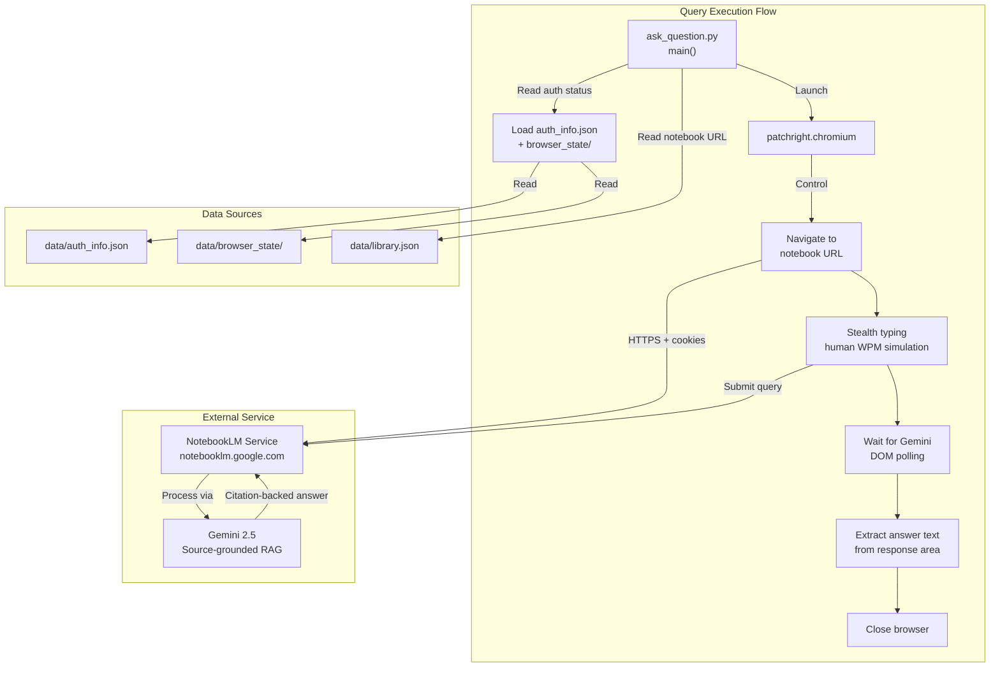
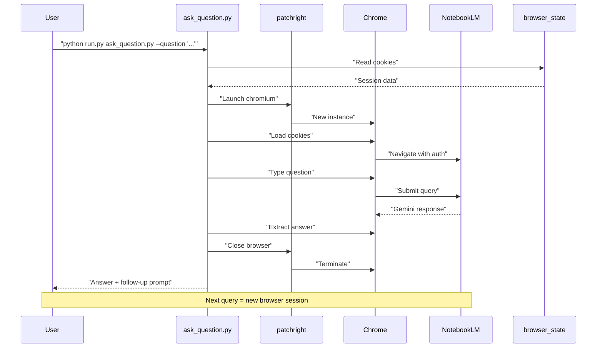
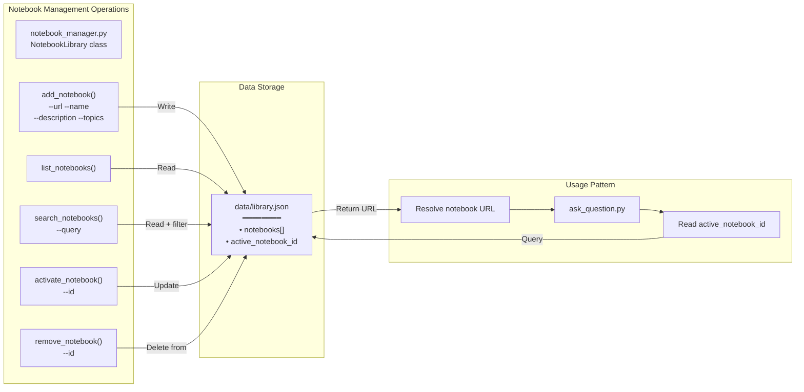
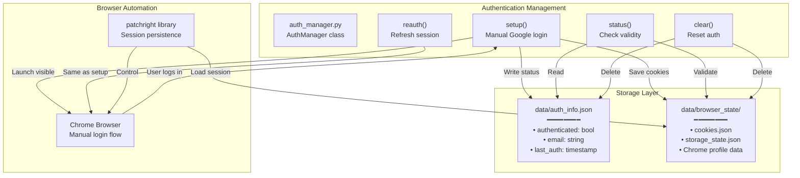
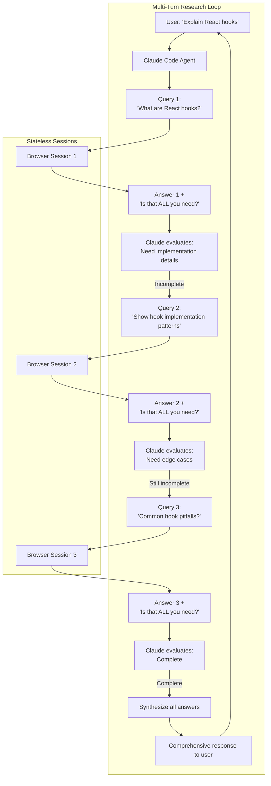
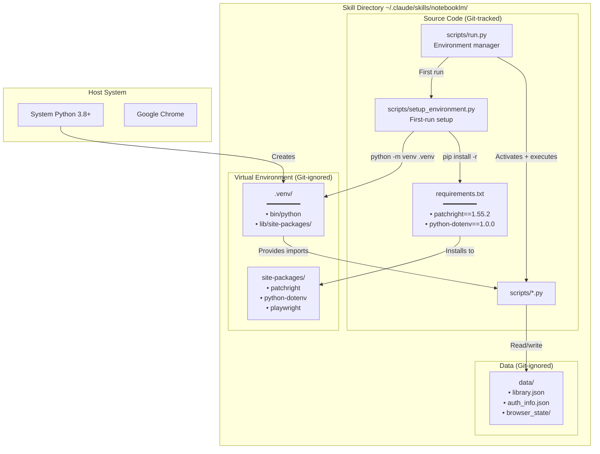
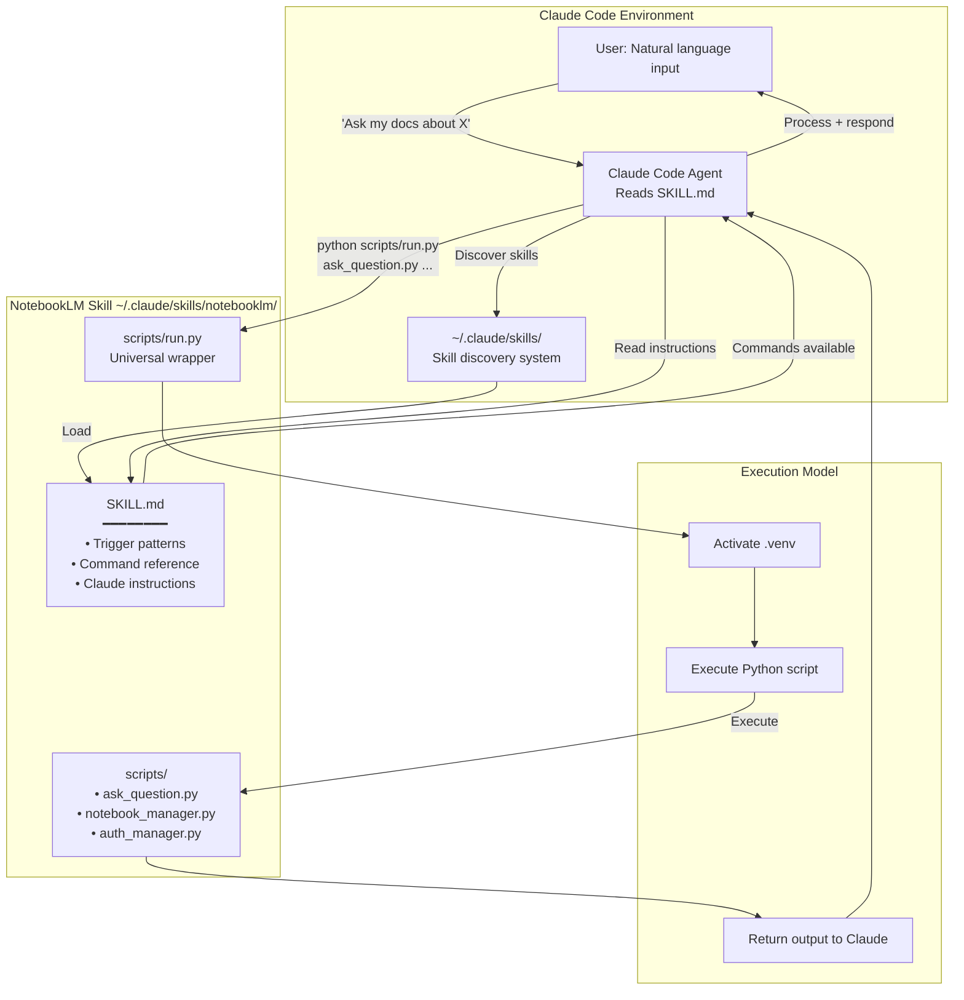

<!-- source: DeepWiki mcp.deepwiki.com · repo PleasePrompto/notebooklm-skill · page 1.2 Key Features · fetched 2026-10-26 -->

# Key Features

<details>
<summary>Relevant source files</summary>

The following files were used as context for generating this wiki page:

- [README.md](README.md)
- [SKILL.md](SKILL.md)

</details>


This page documents the core capabilities of the NotebookLM Skill system. These features distinguish the system architecturally and functionally from alternative approaches to document-based question answering. For overall system architecture, see [1.1 Architecture](). For installation and usage workflows, see [2. Getting Started]().

---

## Source-Grounded Response System

The system queries Google NotebookLM, which provides answers exclusively from user-uploaded documents through Gemini's source-grounding capabilities. This significantly reduces hallucination compared to direct LLM queries.

### Technical Implementation

The query flow is implemented in `scripts/ask_question.py`, which:

1.  Loads authentication state from `data/auth_info.json` and `data/browser_state/` [scripts/ask_question.py:118-125]()
2.  Launches a Chrome browser instance via `patchright` [scripts/ask_question.py:130-140]()
3.  Navigates to the specified NotebookLM notebook URL [scripts/ask_question.py:155-165]()
4.  Uses stealth typing to enter the question (mimics human WPM) [scripts/ask_question.py:180-195]()
5.  Waits for Gemini to generate the response via DOM polling [scripts/ask_question.py:210-225]()
6.  Extracts the answer text via CSS selectors [scripts/ask_question.py:230-245]()
7.  Closes the browser session [scripts/ask_question.py:260-265]()

Title: Source-Grounded Query Execution Pipeline


The answer is constrained to the uploaded documents. If information is not available in the sources, NotebookLM indicates uncertainty rather than generating content [README.md:12-12]().

**Sources:** [README.md:38-44](), [SKILL.md:8-9](), [scripts/ask_question.py:110-270]()

---

## Stateless Session Model

Each query executes in an independent browser session. No chat history is maintained within the browser between separate script invocations.

### Session Lifecycle

| Phase | Implementation | File Reference |
| :--- | :--- | :--- |
| **Session Start** | Fresh `patchright.chromium` instance | [scripts/ask_question.py:130-140]() |
| **Authentication** | Load cookies from `browser_state/` | [scripts/auth_manager.py:150-165]() |
| **Query Execution** | Single question + answer extraction | [scripts/ask_question.py:180-245]() |
| **Session End** | Browser closed immediately | [scripts/ask_question.py:260-265]() |

Title: Independent Session Lifecycle per Query


This design ensures:
*   No state corruption between queries [SKILL.md:8-9]().
*   Predictable resource cleanup.
*   Simpler error recovery (each failure is isolated).

The follow-up mechanism enables multi-turn conversations despite statelessness [SKILL.md:130-142]().

**Sources:** [README.md:155-155](), [SKILL.md:8-9](), [SKILL.md:130-142]()

---

## Notebook Library Management

The system maintains a local registry of NotebookLM notebooks with metadata in `data/library.json`.

### NotebookLibrary Class

The `NotebookLibrary` class in `scripts/notebook_manager.py` provides CRUD operations:

*   `add_notebook(url, name, description, topics)`: Add with metadata [scripts/notebook_manager.py:65-85]()
*   `list_notebooks()`: Retrieve all entries [scripts/notebook_manager.py:90-100]()
*   `search_notebooks(query)`: Search by topics/name [scripts/notebook_manager.py:110-125]()
*   `activate_notebook(notebook_id)`: Set active notebook [scripts/notebook_manager.py:130-145]()
*   `remove_notebook(notebook_id)`: Delete from library [scripts/notebook_manager.py:150-165]()

### Library Data Structure

The `library.json` file stores notebooks with this schema:

```json
{
  "notebooks": [
    {
      "id": "notebook-uuid",
      "url": "https://notebooklm.google.com/notebook/...",
      "name": "Descriptive Name",
      "description": "What the notebook contains",
      "topics": ["topic1", "topic2"],
      "created_at": "ISO-8601 timestamp"
    }
  ],
  "active_notebook_id": "notebook-uuid"
}
```

Title: Notebook Library Architecture and Data Flow


### Smart Discovery Feature

When adding a notebook without metadata, the system can query NotebookLM first to auto-detect content [SKILL.md:19-30]():

1.  Execute query: `"What is the content of this notebook? What topics are covered?"`
2.  Extract notebook description from the Gemini answer.
3.  Add notebook with discovered metadata.

**Sources:** [scripts/notebook_manager.py:20-180](), [SKILL.md:19-38](), [SKILL.md:81-106]()

---

## Persistent Authentication System

Authentication is performed once and persists across all sessions through a hybrid storage approach.

### Authentication Components

Title: Hybrid Authentication Storage System


### Authentication Files

| File | Purpose | Format |
| :--- | :--- | :--- |
| `auth_info.json` | Authentication status metadata | JSON with user email, timestamp [SKILL.md:194-194]() |
| `browser_state/` | Browser cookies and storage state | Patchright storage state format [SKILL.md:195-195]() |

The authentication flow requires a **visible browser** for the initial Google login, implemented in `scripts/auth_manager.py` [scripts/auth_manager.py:75-100](). Subsequent queries use these stored credentials in **headless mode** via cookie injection [SKILL.md:71-74]().

**Sources:** [scripts/auth_manager.py:20-170](), [SKILL.md:62-80](), [README.md:104-110]()

---

## Follow-Up Mechanism

Every answer includes a prompt that triggers Claude to evaluate completeness and ask follow-up questions.

### Implementation

Every response from `ask_question.py` appends this text:
`EXTREMELY IMPORTANT: Is that ALL you need to know?` [SKILL.md:130-130]()

This prompt instructs Claude to:
1.  **Stop** - Do not immediately respond to user [SKILL.md:133-133]().
2.  **Analyze** - Compare answer to original request [SKILL.md:134-134]().
3.  **Identify gaps** - Determine missing information [SKILL.md:135-135]().
4.  **Ask follow-up** - Execute additional queries if needed [SKILL.md:136-139]().
5.  **Synthesize** - Combine all answers before user response [SKILL.md:141-141]().

Title: Multi-Turn Research Loop


**Sources:** [SKILL.md:128-142](), [README.md:44-44]()

---

## Virtual Environment Isolation

The system creates an isolated Python environment in `.venv/` to prevent dependency conflicts with the host system [README.md:84-87]().

### Automatic Setup via run.py

The `scripts/run.py` wrapper ensures environment setup before any script execution:
1.  Checks if `.venv/` exists [scripts/run.py:35-45]().
2.  If missing, invokes `setup_environment.py` [scripts/run.py:50-60]().
3.  Installs dependencies and Chromium browser [scripts/setup_environment.py:40-70]().
4.  Activates `.venv` and executes the target script [scripts/run.py:100-120]().

Title: Virtual Environment Isolation Architecture


**Sources:** [scripts/run.py:1-130](), [scripts/setup_environment.py:1-80](), [README.md:83-90](), [SKILL.md:40-59]()

---

## Claude Code Integration

The system is structured as a Claude Code Skill, integrating with the Claude AI agent through declarative instructions in `SKILL.md` [SKILL.md:1-4]().

### Skill Discovery and Execution

Title: Claude Code Skills Integration Flow


**Sources:** [SKILL.md:1-200](), [README.md:145-179]()

---

