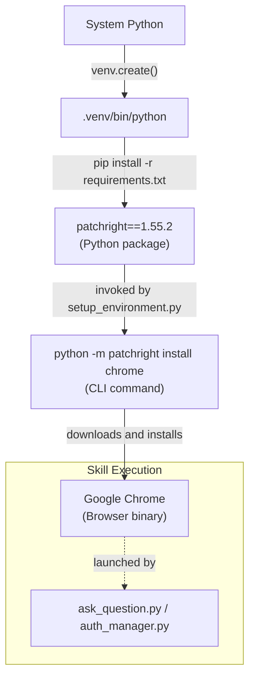
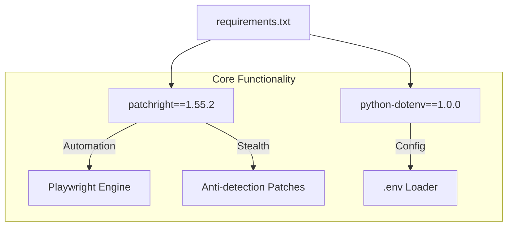
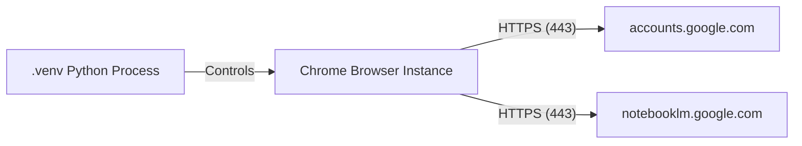

<!-- source: DeepWiki mcp.deepwiki.com · repo PleasePrompto/notebooklm-skill · page 1.3 System Requirements · fetched 2026-10-26 -->

# System Requirements

<details>
<summary>Relevant source files</summary>

The following files were used as context for generating this wiki page:

- [requirements.txt](requirements.txt)
- [scripts/setup_environment.py](scripts/setup_environment.py)

</details>


This page documents all prerequisites for running the NotebookLM Skill, including Python version, operating system compatibility, browser requirements, and external dependencies. The system is designed to be self-contained, managing its own environment through automated scripts.

## Python Requirements

The skill requires **Python 3.7 or higher** to function properly. The system uses Python's built-in `venv` module for virtual environment management to ensure dependency isolation from the global system Python.

| Component | Requirement | Purpose |
|-----------|-------------|---------|
| Python Version | ≥ 3.7 | Core interpreter for skill execution |
| `venv` module | Built-in (standard library) | Virtual environment creation |
| `pip` | Included with Python | Dependency installation |
| System Python | Required | Creates and manages `.venv` directory |

The `SkillEnvironment` class manages the lifecycle of this isolated environment [scripts/setup_environment.py:14-30](). It identifies the correct paths for the Python executable and `pip` based on the host operating system [scripts/setup_environment.py:23-29]().

**Python Executable Paths:**
- **Windows:** `.venv/Scripts/python.exe` [scripts/setup_environment.py:25-25]()
- **Unix/macOS:** `.venv/bin/python` [scripts/setup_environment.py:28-28]()

**Sources:** [scripts/setup_environment.py:14-30](), [scripts/setup_environment.py:23-29](), [requirements.txt:1-10]()

## Operating System Compatibility

The skill is cross-platform and supports all major operating systems where Python and Google Chrome are available. The [SkillEnvironment](scripts/setup_environment.py:14-30)() class handles platform detection and path resolution automatically through `os.name` checks.

### Platform Compatibility Matrix

| Platform | Status | Notes |
|----------|--------|-------|
| **Linux** | ✅ Fully Supported | Debian, Ubuntu, Fedora, Arch, etc. |
| **macOS** | ✅ Fully Supported | Intel and Apple Silicon |
| **Windows** | ✅ Fully Supported | Windows 10/11 |

### Platform-Specific Implementations

The environment setup script dynamically adjusts to the host OS:
- **Windows (`nt`):** Uses `Scripts/` for binaries and `.bat` for activation [scripts/setup_environment.py:24-26](), [scripts/setup_environment.py:140-142]().
- **Unix/macOS:** Uses `bin/` for binaries and `source` for activation [scripts/setup_environment.py:27-29](), [scripts/setup_environment.py:143-145]().

**Sources:** [scripts/setup_environment.py:24-29](), [scripts/setup_environment.py:140-145]()

## Browser Requirements

### Google Chrome (Required)

The skill **requires Google Chrome**, specifically the branded version, not Chromium. This is critical for cross-platform reliability, consistent browser fingerprinting, and avoiding detection as an automated bot.

**Chrome Installation Flow**



**Why Chrome and Not Chromium?**
As noted in the environment setup [scripts/setup_environment.py:70-72](), using real Chrome ensures:
- **Anti-detection**: Better compatibility with Patchright's stealth features [requirements.txt:5-6]().
- **Reliability**: Consistent behavior across different OS environments [scripts/setup_environment.py:71-72]().

**Installation Process:**
The browser is automatically installed during the environment setup phase via `subprocess.run` calling `patchright install chrome` [scripts/setup_environment.py:73-81]().

**Sources:** [scripts/setup_environment.py:70-85](), [requirements.txt:5-7]()

## External Dependencies

The skill relies on a minimal set of high-impact libraries defined in `requirements.txt`.

### Dependency Hierarchy



### Core Libraries

1.  **Patchright (`patchright==1.55.2`)**: A specialized fork of Playwright designed for anti-detection [requirements.txt:7-7](). It is responsible for all browser interactions with NotebookLM.
2.  **Python-Dotenv (`python-dotenv==1.0.0`)**: Manages configuration via `.env` files [requirements.txt:10-10]().

**Sources:** [requirements.txt:1-10](), [scripts/setup_environment.py:61-68]()

## System Resources

### Disk Space Requirements

| Component | Size | Location | Notes |
|-----------|------|----------|-------|
| Virtual Environment | ~150 MB | `.venv/` | Python packages and pip |
| Chrome Browser | ~300 MB | Platform-specific | Managed by Patchright |
| Browser State | ~10-50 MB | `data/browser_state/` | Persistent session data |
| **Total Estimated** | **~500 MB** | Skill directory | Varies by platform |

### Memory and CPU

- **RAM**: During a query, the system launches a full Chrome instance. A minimum of **1 GB of free RAM** is recommended to handle the browser process and the NotebookLM web application.
- **CPU**: No specific requirements; any processor capable of running modern Chrome is sufficient.

**Sources:** [scripts/setup_environment.py:40-44](), [scripts/setup_environment.py:73-81]()

## Network Requirements

The skill requires an active internet connection to communicate with Google services.

**Network Access Diagram**



**Required Access:**
- **HTTPS (Port 443)**: Must be open for outbound traffic to `*.google.com`.
- **DNS**: Must be able to resolve Google service domains.

**Sources:** General system architecture and `requirements.txt`.

## Environment Verification

The `setup_environment.py` script provides a built-in verification mechanism to ensure all requirements are met.

### Automated Check
Users can verify their setup by running:
```bash
python scripts/setup_environment.py --check
```
This checks for the existence of the `.venv`, identifies the Python executable, and provides manual activation instructions [scripts/setup_environment.py:177-185]().

### Manual Verification Checklist
1.  **Python Version**: `python --version` (should be 3.7+)
2.  **Venv Existence**: Check for `.venv/` directory [scripts/setup_environment.py:20-20]().
3.  **Chrome Binary**: Verify `python -m patchright install chrome` has been executed [scripts/setup_environment.py:75-80]().

**Sources:** [scripts/setup_environment.py:175-185](), [scripts/setup_environment.py:31-48]()

---

**Related Pages:**
- [Installation](2.1) — Step-by-step setup guide.
- [Virtual Environment Isolation](3.5) — Deep dive into the `.venv` implementation.
- [Browser Automation](3.2) — Details on Patchright and Chrome usage.

---

