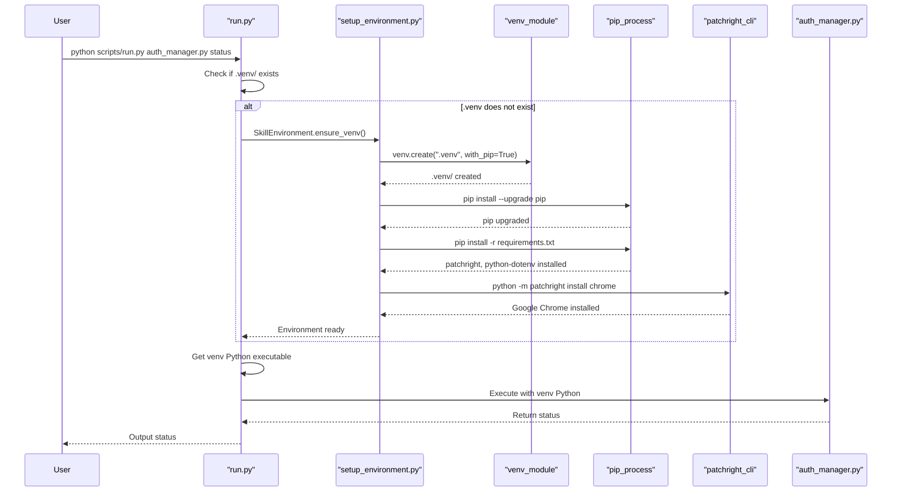
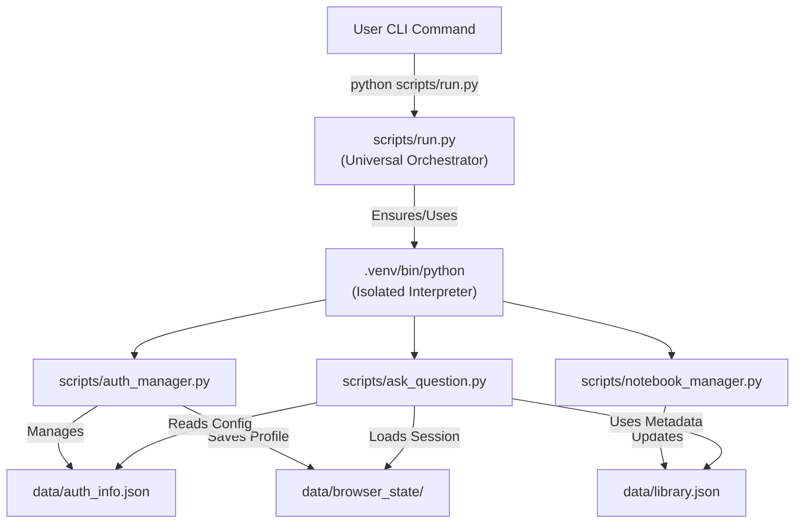
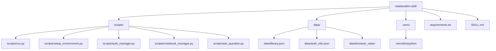

<!-- source: DeepWiki mcp.deepwiki.com · repo PleasePrompto/notebooklm-skill · page 2 Getting Started · fetched 2026-10-26 -->

# Getting Started

<details>
<summary>Relevant source files</summary>

The following files were used as context for generating this wiki page:

- [README.md](README.md)
- [scripts/setup_environment.py](scripts/setup_environment.py)

</details>


This page guides you through the initial setup and execution of your first query with the NotebookLM Skill. It covers environment setup, authentication, and basic usage. For detailed command-line reference, see [API Reference](#5). For troubleshooting common setup issues, see [Troubleshooting](#6).

## Prerequisites

The following must be present on your system before installation:

| Requirement | Version | Purpose |
|------------|---------|---------|
| Python | 3.8+ | Runtime environment for all scripts |
| Google Chrome | Latest | Browser automation target (not Chromium) |
| Google Account | N/A | NotebookLM access and authentication |
| Git | Any | Repository cloning |

**Note:** The skill uses Google Chrome specifically (not Chromium) for reliable browser fingerprinting and cross-platform compatibility. This is configured in [scripts/setup_environment.py:70-85]().

Sources: [README.md:7-9](), [scripts/setup_environment.py:70-85]()

## Installation Overview

The installation process consists of three stages executed by `run.py` on first invocation. Unlike traditional Python projects, you do not need to manually create a virtual environment or install requirements; the orchestrator handles this automatically.

**Initial Setup Sequence Diagram**



Sources: [scripts/run.py:26-45](), [scripts/setup_environment.py:31-94]()

### Automatic Environment Management

The `run.py` wrapper provides automatic environment management without manual intervention:

1. **Virtual Environment Creation**: [scripts/run.py:26-45]() checks for `.venv/` directory existence.
2. **Dependency Installation**: [scripts/setup_environment.py:50-68]() installs from `requirements.txt`.
3. **Browser Setup**: [scripts/setup_environment.py:70-85]() installs Chrome via `patchright` to ensure anti-detection and reliability.
4. **Script Execution**: [scripts/run.py:83-98]() executes the target script with the isolated venv Python.

**Key Implementation Details:**

- `run.py` invokes `setup_environment.py` only when `.venv/` is missing or specifically requested.
- System Python executes `setup_environment.py`, which creates the isolated environment.
- All subsequent script executions use `.venv/bin/python` (Unix) or `.venv/Scripts/python.exe` (Windows).
- The `SkillEnvironment` class in [scripts/setup_environment.py:14-146]() manages platform-specific paths.

Sources: [scripts/run.py:1-102](), [scripts/setup_environment.py:14-146]()

## Quick Start Workflow

The following sequence demonstrates the minimal steps from installation to first query:

```bash
# 1. Clone the repository into Claude Code skills directory
mkdir -p ~/.claude/skills
cd ~/.claude/skills
git clone https://github.com/PleasePrompto/notebooklm-skill notebooklm
cd notebooklm

# 2. Check authentication status (triggers automatic setup)
python scripts/run.py auth_manager.py status

# 3. If not authenticated, set up authentication (opens Chrome)
python scripts/run.py auth_manager.py setup

# 4. Add a notebook to the library (Manual Add)
python scripts/run.py notebook_manager.py add \
  --url "https://notebooklm.google.com/notebook/YOUR-NOTEBOOK-ID" \
  --name "Project Docs" \
  --description "Internal project documentation" \
  --topics "architecture,api,setup"

# 5. Query the notebook
python scripts/run.py ask_question.py \
  --question "How do I initialize the database?" \
  --notebook-id "YOUR-NOTEBOOK-ID"
```

**Command Structure Diagram**



Sources: [README.md:71-81](), [scripts/run.py:48-98]()

## Setup Process Details

### Stage 1: Virtual Environment Creation

The `SkillEnvironment` class handles environment isolation to prevent dependency conflicts with the system Python:

| Component | Path (Unix) | Path (Windows) | Purpose |
|-----------|-------------|----------------|---------|
| Virtual environment | `.venv/` | `.venv/` | Isolated Python environment |
| Python executable | `.venv/bin/python` | `.venv\Scripts\python.exe` | Venv Python interpreter |
| Pip executable | `.venv/bin/pip` | `.venv\Scripts\pip.exe` | Package installer |

Implementation: [scripts/setup_environment.py:17-29]()

The `ensure_venv()` method in [scripts/setup_environment.py:31-94]() performs the following checks:
1. Verify if already running in skill venv via `is_in_skill_venv()` [scripts/setup_environment.py:96-102]().
2. Create venv if `.venv/` directory doesn't exist.
3. Install dependencies and **Google Chrome** (not Chromium) for `patchright` [scripts/setup_environment.py:73-85]().

Sources: [scripts/setup_environment.py:14-102]()

### Stage 2: Authentication Configuration

Authentication setup is a one-time manual process that persists session data locally. This allows the skill to bypass 2FA and login screens during automated queries.

```bash
python scripts/run.py auth_manager.py setup
```

**Authentication Flow:**
1. `auth_manager.py setup` launches a visible Chrome browser.
2. User manually logs in to their Google account.
3. The system captures session data and saves it to `data/browser_state/`.
4. Authentication status is recorded in `data/auth_info.json`.

For detailed authentication procedures, see [Authentication Setup](#2.2).

Sources: [README.md:104-110]()

### Stage 3: Notebook Library Initialization

The notebook library stores metadata about NotebookLM notebooks in `data/library.json`. You can add notebooks manually or use "Smart Add" via Claude Code.

**Smart Discovery Workflow:**
Instead of manual entry, you can ask Claude to discover the notebook:
```
"Query this notebook about its content and add it to my library: [URL]"
```
Claude will execute `ask_question.py` with the `--notebook-url` flag to probe the content, then call `notebook_manager.py add` with the extracted metadata.

Sources: [README.md:123-133]()

## Post-Installation Directory Structure

After successful setup, the skill directory contains the following entities:

**Directory Structure Diagram**



Sources: [scripts/setup_environment.py:17-29](), [README.md:162-171]()

## Verification Commands

After setup completion, verify the installation using these commands via `run.py`:

| Command | Purpose | Expected Output |
|---------|---------|-----------------|
| `python scripts/run.py auth_manager.py status` | Check authentication | "Authenticated" or "Not authenticated" |
| `python scripts/run.py notebook_manager.py list` | List notebooks | JSON array of notebooks or empty array |
| `python scripts/run.py notebook_manager.py stats` | Show library statistics | Count of notebooks and topics |

Sources: [README.md:95-102]()

## Common Setup Issues

| Issue | Cause | Solution |
|-------|-------|----------|
| `ModuleNotFoundError` | Script called directly without venv | Always use `python scripts/run.py [script]` |
| Chrome installation fails | Permission or network error | Run `python -m patchright install chrome` manually in venv |
| Authentication fails | Headless mode enabled during setup | Ensure setup is run in headed mode (default) |

For comprehensive troubleshooting, see [Troubleshooting](#6).

Sources: [scripts/setup_environment.py:82-85]()

## Next Steps

After completing the setup process:

1. **Detailed Installation**: See [Installation](#2.1) for deep dives into environment logic.
2. **Configure authentication**: See [Authentication Setup](#2.2) for troubleshooting session persistence.
3. **Execute your first query**: See [Your First Query](#2.3) for a complete walkthrough of the research workflow.

The skill is now ready for use. All subsequent commands will execute within the configured virtual environment without manual activation.

---

