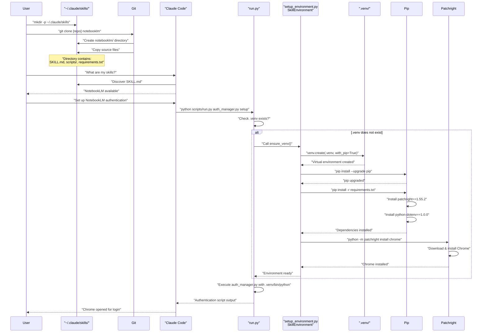
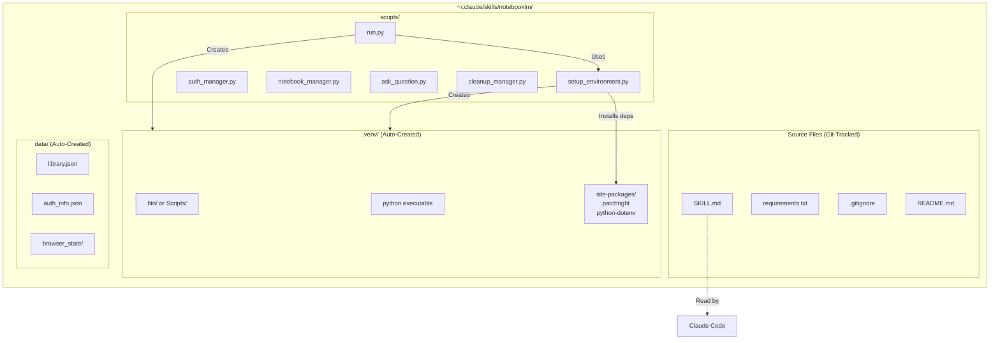
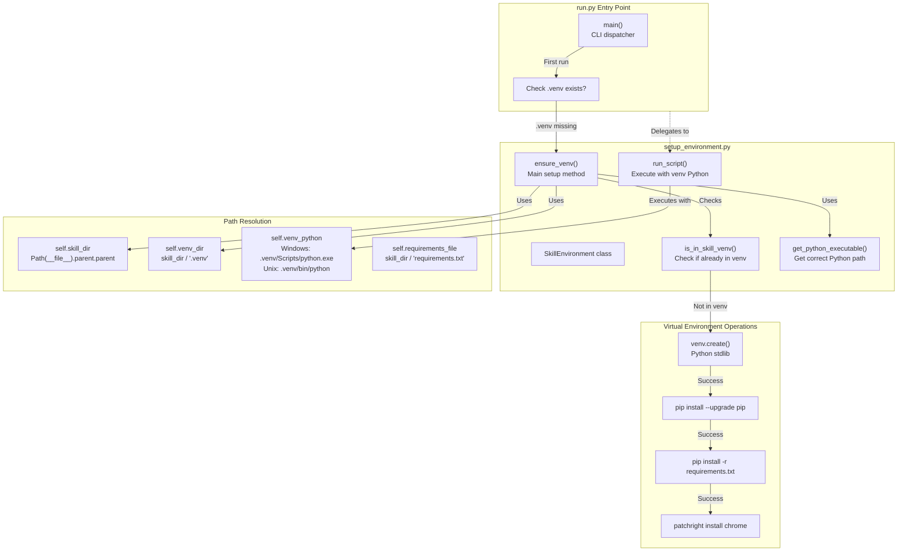

<!-- source: DeepWiki mcp.deepwiki.com · repo PleasePrompto/notebooklm-skill · page 2.1 Installation · fetched 2026-10-26 -->

# Installation

<details>
<summary>Relevant source files</summary>

The following files were used as context for generating this wiki page:

- [requirements.txt](requirements.txt)
- [scripts/run.py](scripts/run.py)
- [scripts/setup_environment.py](scripts/setup_environment.py)

</details>


This page provides step-by-step instructions for installing the NotebookLM Skill into Claude Code. Installation involves cloning the repository to a specific directory location and allowing the skill to automatically configure its isolated Python environment on first use.

For information about system prerequisites and compatibility, see [System Requirements](#1.3). For the next step after installation, see [Authentication Setup](#2.2).

---

## Overview

The NotebookLM Skill uses a self-contained installation model where all code and dependencies are isolated within the skill directory at `~/.claude/skills/notebooklm/`. The installation process consists of two phases:

1. **Manual**: Clone the repository to the Claude Code skills directory.
2. **Automatic**: On first use, the `run.py` [scripts/run.py:1-5]() orchestrator triggers `setup_environment.py` [scripts/setup_environment.py:1-5]() to create a virtual environment and install all dependencies.

This approach ensures that the skill does not interfere with system Python packages or other projects.

**Sources**: [scripts/run.py:1-5](), [scripts/setup_environment.py:1-5]()

---

## Installation Process Flow



This diagram shows the complete installation and first-use flow. The key insight is that repository cloning is manual, but environment setup is automatic and triggered by the first script execution through `run.py` [scripts/run.py:26-46]().

**Sources**: [scripts/run.py:26-46](), [scripts/setup_environment.py:31-94]()

---

## Step 1: Create Skills Directory

Claude Code discovers skills by scanning `~/.claude/skills/`. Create this directory if it does not exist:

```bash
mkdir -p ~/.claude/skills
```

On Windows:
```cmd
mkdir %USERPROFILE%\.claude\skills
```

---

## Step 2: Clone Repository

Clone the repository into the skills directory with the name `notebooklm`:

```bash
cd ~/.claude/skills
git clone https://github.com/PleasePrompto/notebooklm-skill notebooklm
```

The directory name must be `notebooklm` for Claude Code to properly discover and reference the skill.

After cloning, verify the directory structure:

```bash
ls ~/.claude/skills/notebooklm/
# Expected: SKILL.md  scripts/  requirements.txt  .gitignore  README.md
```

---

## Installation Directory Structure

After cloning, the skill directory contains the following structure:



This diagram shows the complete directory structure after both cloning and first use. The `.venv/` and `data/` directories are created automatically. The `run.py` script serves as the universal entry point [scripts/run.py:3-5]().

**Sources**: [scripts/run.py:3-5](), [scripts/setup_environment.py:17-21]()

---

## Step 3: Verify Installation

After cloning, verify that Claude Code can discover the skill:

1. Open Claude Code
2. Say: `"What are my skills?"`
3. Claude should list NotebookLM among available skills

At this point, no virtual environment or dependencies are installed. These will be created automatically on first use via `ensure_venv` [scripts/run.py:26-46]().

**Sources**: [scripts/run.py:26-46]()

---

## Automatic Environment Setup

The first time you execute any skill command, `run.py` triggers automatic environment setup through the `SkillEnvironment` class in `setup_environment.py` [scripts/setup_environment.py:14]().

### SkillEnvironment Class Architecture



This diagram maps the automatic setup process to specific classes and methods in the codebase. The `SkillEnvironment` class is responsible for all environment management operations [scripts/setup_environment.py:14-30]().

**Sources**: [scripts/setup_environment.py:14-30](), [scripts/setup_environment.py:31-94]()

---

## What Gets Installed

### Virtual Environment (`.venv/`)

The virtual environment is created using Python's built-in `venv` module at [scripts/setup_environment.py:43](). This creates:

- **Windows**: `.venv/Scripts/python.exe`, `.venv/Scripts/pip.exe` [scripts/setup_environment.py:24-26]()
- **Unix/Linux/Mac**: `.venv/bin/python`, `.venv/bin/pip` [scripts/setup_environment.py:27-29]()

### Python Dependencies

Dependencies are listed in [requirements.txt:1-10]():

| Package | Version | Purpose |
|---------|---------|---------|
| `patchright` | 1.55.2 | Browser automation with anti-detection features |
| `python-dotenv` | 1.0.0 | Environment variable management |

Installation occurs at [scripts/setup_environment.py:62-67]() using `pip install -r requirements.txt`.

### Chrome Browser

After Python dependencies, the setup script installs Google Chrome (not Chromium) for browser automation at [scripts/setup_environment.py:73-85]():

```bash
python -m patchright install chrome
```

**Why Chrome instead of Chromium**: Chrome provides cross-platform reliability and better anti-detection with Google services [requirements.txt:5-7]().

**Sources**: [requirements.txt:1-10](), [scripts/setup_environment.py:24-29](), [scripts/setup_environment.py:43](), [scripts/setup_environment.py:62-67](), [scripts/setup_environment.py:73-85]()

---

## Setup Process Details

### Environment Creation

The `ensure_venv()` method at [scripts/setup_environment.py:31-94]() performs the following operations:

1. **Check if already in venv**: Uses `is_in_skill_venv()` [scripts/setup_environment.py:96-102]() to detect if the current process is already running in the skill's virtual environment.
2. **Create venv if missing**: Calls `venv.create(self.venv_dir, with_pip=True)` [scripts/setup_environment.py:43]().
3. **Upgrade pip**: Executes `pip install --upgrade pip` via subprocess [scripts/setup_environment.py:54-59]().
4. **Install dependencies**: Runs `pip install -r requirements.txt` [scripts/setup_environment.py:62-67]().
5. **Install Chrome**: Executes `python -m patchright install chrome` [scripts/setup_environment.py:75-80]().

### Error Handling

If Chrome installation fails [scripts/setup_environment.py:82-85](), the setup continues but displays a warning. The user may need to manually run:

```bash
cd ~/.claude/skills/notebooklm
# Activate venv first
python -m patchright install chrome
```

**Sources**: [scripts/setup_environment.py:31-102]()

---

## Post-Installation Verification

After the first command execution triggers automatic setup, verify the installation using the setup script's check mode:

```bash
python scripts/setup_environment.py --check
```

This invokes the check logic at [scripts/setup_environment.py:177-185](), which confirms the existence of the `.venv` and provides manual activation instructions [scripts/setup_environment.py:138-145]().

**Sources**: [scripts/setup_environment.py:138-145](), [scripts/setup_environment.py:177-185]()

---

## Troubleshooting Installation

### Virtual Environment Creation Fails

**Symptom**: Error during first use: "Failed to create venv" [scripts/setup_environment.py:46]().

**Solution**:
1. Ensure Python 3.8+ is installed.
2. On Linux, install: `sudo apt-get install python3-venv`.
3. Check write permissions in the `notebooklm` directory.

### Chrome Installation Fails

**Symptom**: Warning: "Failed to install Chrome" [scripts/setup_environment.py:83]().

**Solution**:
```bash
cd ~/.claude/skills/notebooklm
# Activate the venv manually
python -m patchright install chrome
```
Chrome is required (not Chromium) for reliability [scripts/setup_environment.py:85]().

**Sources**: [scripts/setup_environment.py:46](), [scripts/setup_environment.py:83-85]()

---

## Next Steps

After successful installation:

1. **Authentication**: Set up Google authentication for NotebookLM access. See [Authentication Setup](#2.2).
2. **First Query**: Execute your first query to verify the complete setup. See [Your First Query](#2.3).

**Sources**: [scripts/run.py:50-58]()

---

