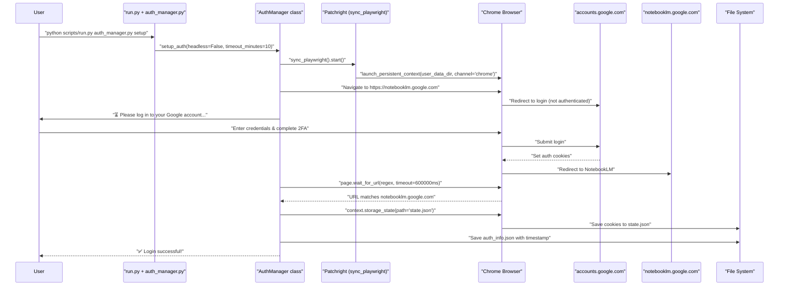
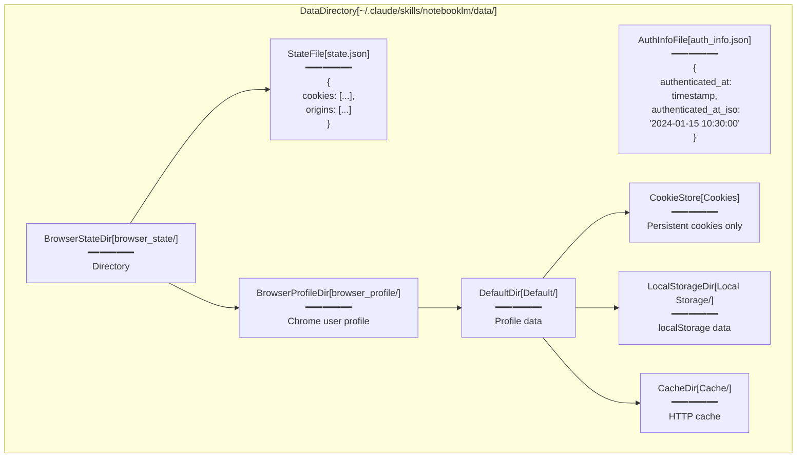
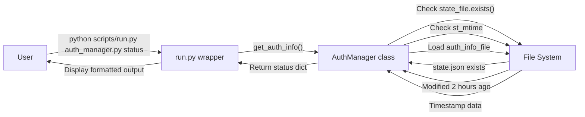
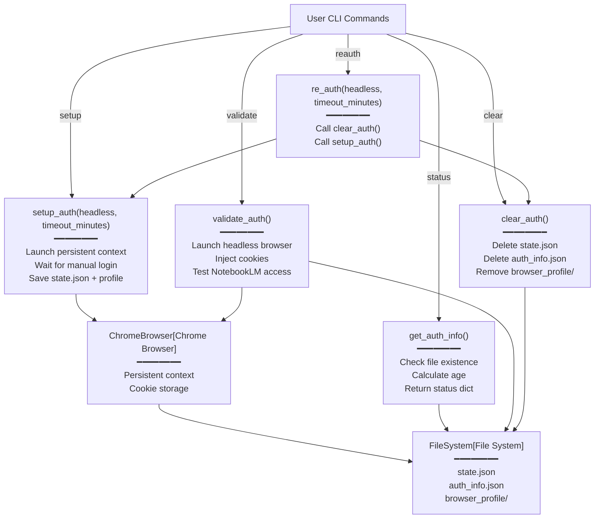

<!-- source: DeepWiki mcp.deepwiki.com · repo PleasePrompto/notebooklm-skill · page 2.2 Authentication Setup · fetched 2026-10-26 -->

# Authentication Setup

<details>
<summary>Relevant source files</summary>

The following files were used as context for generating this wiki page:

- [AUTHENTICATION.md](AUTHENTICATION.md)
- [CHANGELOG.md](CHANGELOG.md)
- [scripts/auth_manager.py](scripts/auth_manager.py)

</details>


This page provides a step-by-step guide for setting up Google authentication to access NotebookLM. Authentication is a one-time manual process where you log in through a browser window, after which session credentials are stored locally for automated use.

For technical details on the hybrid authentication implementation, see [Hybrid Authentication Strategy](#7.1). For API reference of `auth_manager.py` commands, see [auth_manager.py](#5.2). For advanced authentication troubleshooting, see [Authentication Issues](#6.2).

## Overview

The NotebookLM skill requires authentication to access your Google NotebookLM notebooks. The authentication system consists of:

| Component | Purpose | Location |
|-----------|---------|----------|
| **`AuthManager` class** | Orchestrates Google login and session management | `scripts/auth_manager.py` [scripts/auth_manager.py:31-40]() |
| **Browser profile** | Stores browser fingerprint and cache | `data/browser_state/browser_profile/` [AUTHENTICATION.md:103-110]() |
| **State file** | Stores session cookies and localStorage | `data/browser_state/state.json` [AUTHENTICATION.md:104-104]() |
| **Auth metadata** | Tracks authentication timestamp | `data/auth_info.json` [AUTHENTICATION.md:102-102]() |

Authentication is required before using any notebook querying functionality. The system uses a **persistent browser profile** combined with **manual cookie injection** to maintain reliable session state across multiple query executions. Each query operation validates that authentication exists before proceeding.

Sources: [scripts/auth_manager.py:31-51](), [AUTHENTICATION.md:1-48]()

## Prerequisites

Before setting up authentication, ensure:

1. **Environment is initialized**: The virtual environment must exist with all dependencies installed. This happens automatically when using `run.py` as the wrapper. [scripts/auth_manager.py:24-28]()

2. **Google Chrome is installed**: The system requires real Chrome (not Chromium) for reliable browser fingerprinting. The `patchright` library controls Chrome via the `channel="chrome"` parameter. [AUTHENTICATION.md:71-79]()

3. **Browser visibility**: Authentication **cannot** run in headless mode because Google's login flow requires user interaction. The browser window must be visible. [scripts/auth_manager.py:86-91]()

4. **Network access**: Direct HTTPS access to `notebooklm.google.com` and `accounts.google.com` is required. [scripts/auth_manager.py:112-117]()

If any prerequisites are missing, the authentication setup will fail with descriptive error messages.

Sources: [scripts/auth_manager.py:86-117](), [AUTHENTICATION.md:71-79]()

## Authentication Flow

### Authentication Setup Process



**Authentication Setup Steps**

Sources: [scripts/auth_manager.py:86-160](), [scripts/auth_manager.py:160-181]()

### Data Storage Structure



**File System Layout After Authentication**

The authentication process creates three types of stored data:

1. **`auth_info.json`**: Metadata about when authentication occurred, used by `AuthManager.is_authenticated()` to check session age. [scripts/auth_manager.py:49-49](), [scripts/auth_manager.py:170-181]()
2. **`state.json`**: Complete browser state including session cookies and localStorage, saved via `context.storage_state()`. [scripts/auth_manager.py:48-48](), [scripts/auth_manager.py:160-169]()
3. **`browser_profile/`**: Persistent Chrome user profile storing fingerprint, cache, and persistent cookies automatically. [scripts/auth_manager.py:50-50](), [AUTHENTICATION.md:103-110]()

Sources: [scripts/auth_manager.py:42-51](), [AUTHENTICATION.md:98-111]()

## Initial Authentication

### Running Setup Command

Execute the authentication setup using the `run.py` wrapper:

```bash
python scripts/run.py auth_manager.py setup
```

**What happens:**

1. The `run.py` wrapper ensures the virtual environment exists and dependencies are installed.
2. `AuthManager.setup_auth()` is called with default parameters. [scripts/auth_manager.py:86-96]()
3. A Chrome browser window opens automatically (not headless) using `BrowserFactory.launch_persistent_context`. [scripts/auth_manager.py:106-110]()
4. The browser navigates to `https://notebooklm.google.com`. [scripts/auth_manager.py:113-114]()
5. Google redirects to `accounts.google.com` for login.
6. You manually enter credentials and complete any 2FA.
7. After successful login, the URL changes back to NotebookLM, which is detected via `page.wait_for_url`. [scripts/auth_manager.py:126-129]()
8. The system saves browser state to `state.json` and `browser_profile/`. [scripts/auth_manager.py:134-135]()

**Expected output:**

```
🔐 Starting authentication setup...
  Timeout: 10 minutes

  ⏳ Please log in to your Google account...
  ⏱️  Waiting up to 10 minutes for login...
  ✅ Login successful!
  💾 Saved browser state to: data/browser_state/state.json

✅ Authentication setup complete!
You can now use ask_question.py to query NotebookLM
```

### Command Parameters

| Parameter | Type | Default | Purpose |
|-----------|------|---------|---------|
| `--headless` | flag | `false` | Run browser in headless mode (not recommended for setup) |
| `--timeout` | float | `10` | Login timeout in minutes |

The `--headless` flag should **not** be used during initial setup, as Google's login flow requires visible browser interaction for security verification.

Sources: [scripts/auth_manager.py:86-96](), [scripts/auth_manager.py:320-335]()

## Verifying Authentication

### Checking Authentication Status



**Status Check Flow**

Use the `status` command to check authentication state without launching a browser:

```bash
python scripts/run.py auth_manager.py status
```

**Output interpretation:**

```
🔐 Authentication Status:
  Authenticated: Yes
  State age: 2.3 hours
  Last auth: 2024-01-15 10:30:00
  State file: data/browser_state/state.json
```

The status check performs these validations:

1. **File existence**: Checks if `state.json` exists. [scripts/auth_manager.py:52-55]()
2. **Age warning**: Warns if state file is older than 7 days. [scripts/auth_manager.py:57-60]()
3. **Metadata**: Displays timestamp from `auth_info.json`. [scripts/auth_manager.py:72-78]()

Sources: [scripts/auth_manager.py:52-84](), [scripts/auth_manager.py:358-366]()

### Validating Active Authentication

The `validate` command performs a live check by launching a headless browser and attempting to access NotebookLM. This uses the `validate_auth` method. [scripts/auth_manager.py:242-258]()

**Validation process:**

1. Launches Chrome in headless mode with persistent context. [scripts/auth_manager.py:262-275]()
2. Manually injects cookies from `state.json`. [scripts/auth_manager.py:277-287]()
3. Navigates to `https://notebooklm.google.com`. [scripts/auth_manager.py:290-291]()
4. Checks if redirected to login page or successfully authenticated. [scripts/auth_manager.py:293-298]()

**Possible outcomes:**

| Result | Output | Meaning |
|--------|--------|---------|
| **Valid** | `✅ Authentication is valid` | Session cookies are active, no re-auth needed |
| **Invalid** | `❌ Authentication is invalid` | Session expired, run `reauth` command |

The validation uses the same hybrid authentication approach as query execution, so it accurately reflects whether queries will work.

Sources: [scripts/auth_manager.py:242-317](), [scripts/auth_manager.py:368-373]()

## Session Persistence

### How Session Persistence Works

The authentication system uses a **hybrid approach** combining two storage mechanisms to solve Playwright bug #36139. [AUTHENTICATION.md:5-15]()

| Storage Type | Files | Contents | Purpose |
|--------------|-------|----------|---------|
| **Browser Profile** | `browser_profile/Default/Cookies` | Persistent cookies only | Browser fingerprint consistency [AUTHENTICATION.md:57-57]() |
| **State JSON** | `state.json` | All cookies (persistent + session) | Manual cookie injection workaround [AUTHENTICATION.md:58-58]() |

**Why both are needed:**

Playwright has a known bug where **session cookies** (cookies without `Expires` attribute) do not persist in the browser profile directory. The workaround:

1. Use `user_data_dir` for browser fingerprint and persistent cookies. [AUTHENTICATION.md:75-79]()
2. Manually inject all cookies from `state.json` on each query. [AUTHENTICATION.md:81-84]()

Sources: [AUTHENTICATION.md:5-15](), [AUTHENTICATION.md:48-86]()

### Session Lifetime

Google NotebookLM sessions typically last several days, but the system tracks session age:

- **Age Check**: `is_authenticated()` checks if the state file is older than 7 days. [scripts/auth_manager.py:58-60]()
- **Activity**: Cookies refresh on use, but Google security policies may force re-auth.

### Re-authentication

When authentication expires or becomes invalid, use the `reauth` command:

```bash
python scripts/run.py auth_manager.py reauth
```

**What `reauth` does:**

1. Calls `clear_auth()` to remove all existing authentication data. [scripts/auth_manager.py:214-218]()
2. Calls `setup_auth()` to perform fresh login. [scripts/auth_manager.py:220-221]()
3. Opens visible browser window for manual login.

Sources: [scripts/auth_manager.py:214-221](), [scripts/auth_manager.py:379-384]()

## Command Reference

### AuthManager Class Methods



**AuthManager CLI Command Routing**

Sources: [scripts/auth_manager.py:320-388]()

### Complete Command List

All commands must be invoked via `run.py`:

```bash
# Check authentication status (no browser launch)
python scripts/run.py auth_manager.py status

# Initial authentication setup (visible browser)
python scripts/run.py auth_manager.py setup [--timeout MINUTES]

# Validate authentication works (headless browser)
python scripts/run.py auth_manager.py validate

# Clear all authentication data
python scripts/run.py auth_manager.py clear

# Re-authenticate (clear + setup)
python scripts/run.py auth_manager.py reauth [--timeout MINUTES]
```

Sources: [scripts/auth_manager.py:320-388]()

## Common Setup Issues

### Browser Does Not Open

**Symptom:** The `setup` command completes immediately without opening a browser.

**Cause:** The `--headless` flag was accidentally included or environment variables forced it.

**Solution:** Ensure you are not passing `--headless` and your `.env` file (if any) doesn't force `HEADLESS=true`. [scripts/auth_manager.py:86-91]()

### Authentication Times Out

**Symptom:** Error message: `❌ Authentication timeout: ...`

**Cause:** Login not completed within the timeout period (default 10 minutes). [scripts/auth_manager.py:128-129]()

**Solution:** Increase timeout for slower connections:
```bash
python scripts/run.py auth_manager.py setup --timeout 20
```

Sources: [scripts/auth_manager.py:126-140]()

### ModuleNotFoundError

**Symptom:** `ModuleNotFoundError: No module named 'patchright'`

**Cause:** Script was called directly instead of through `run.py`.

**Solution:** Always use `python scripts/run.py auth_manager.py ...` to ensure the virtual environment is used.

### State File Exists But Authentication Fails

**Symptom:** `status` shows authenticated, but queries fail with login redirect.

**Cause:** Session cookies expired. [AUTHENTICATION.md:16-23]()

**Solution:**
```bash
python scripts/run.py auth_manager.py reauth
```

Sources: [scripts/auth_manager.py:214-221]()

---

