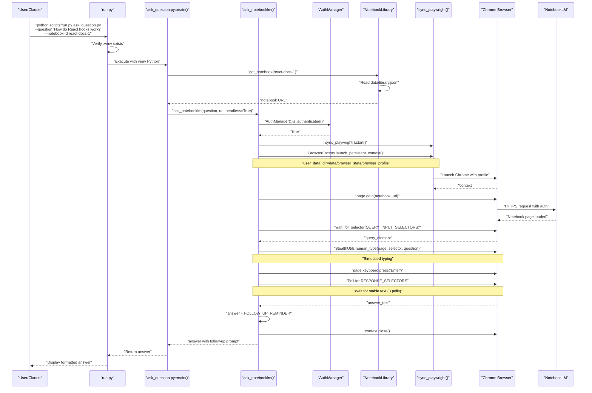
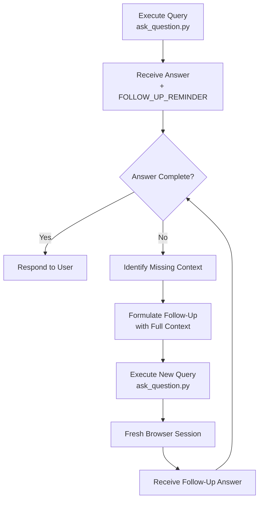

<!-- source: DeepWiki mcp.deepwiki.com · repo PleasePrompto/notebooklm-skill · page 2.3 Your First Query · fetched 2026-10-26 -->

# Your First Query

<details>
<summary>Relevant source files</summary>

The following files were used as context for generating this wiki page:

- [references/usage_patterns.md](references/usage_patterns.md)
- [scripts/ask_question.py](scripts/ask_question.py)
- [scripts/notebook_manager.py](scripts/notebook_manager.py)

</details>


## Purpose and Scope

This guide walks you through executing your first NotebookLM query after completing installation and authentication. You will learn how to add a notebook to the library, execute a query, interpret the response, and use the follow-up mechanism to gather complete information.

---

## Prerequisites Check

Before executing your first query, verify that authentication is complete using the mandatory `run.py` wrapper [references/usage_patterns.md:5-15]():

```bash
python scripts/run.py auth_manager.py status
```

Expected output:
```
✅ Authenticated
Last check: 2024-01-15 10:30:45
```

If authentication fails, return to **2.2 Authentication Setup** to complete the one-time login process.

**Sources:** [scripts/ask_question.py:54-56](), [references/usage_patterns.md:20-24]()

---

## Adding Your First Notebook

Before querying, you must add at least one notebook to the local library stored in `data/library.json` [scripts/notebook_manager.py:27-32](). The system provides two approaches: **Smart Discovery** (recommended) and **Manual Addition**.

### Smart Discovery Approach

Smart Discovery queries the notebook itself to discover its content, eliminating the need to guess metadata. This is the recommended workflow when provided with only a NotebookLM URL [references/usage_patterns.md:46-59]().

```bash
# Step 1: Query the notebook to discover its content
python scripts/run.py ask_question.py \
  --question "What is the content of this notebook? What topics are covered? Provide a complete overview briefly and concisely" \
  --notebook-url "https://notebooklm.google.com/notebook/abc-123"

# Step 2: Use the discovered information to add the notebook
python scripts/run.py notebook_manager.py add \
  --url "https://notebooklm.google.com/notebook/abc-123" \
  --name "React Framework Documentation" \
  --description "Complete React documentation including hooks, components, and best practices" \
  --topics "react,hooks,components,frontend"
```

**Why Smart Discovery?** The `notebook_manager.py` script requires accurate metadata [scripts/notebook_manager.py:63-87](). Rather than using generic values, Smart Discovery extracts accurate metadata from the source documents.

**Sources:** [scripts/notebook_manager.py:63-121](), [references/usage_patterns.md:43-79]()

### Manual Addition Workflow

If you already have complete metadata, add the notebook directly [references/usage_patterns.md:61-72]():

```bash
python scripts/run.py notebook_manager.py add \
  --url "https://notebooklm.google.com/notebook/abc-123" \
  --name "User-provided name" \
  --description "User-provided description" \
  --topics "user,provided,topics"
```

**Critical:** All three parameters (`--name`, `--description`, `--topics`) are used for organization and search [scripts/notebook_manager.py:206-214]().

**Sources:** [scripts/notebook_manager.py:88-121](), [references/usage_patterns.md:61-79]()

---

## First Query Execution Flow

### Query Execution Diagram



**Sources:** [scripts/ask_question.py:40-188](), [scripts/ask_question.py:190-230]()

### Executing the Query

```bash
# Query using notebook ID (recommended)
python scripts/run.py ask_question.py \
  --question "How do React hooks work? Explain useState and useEffect" \
  --notebook-id react-docs-1

# Query using notebook URL directly
python scripts/run.py ask_question.py \
  --question "How do React hooks work?" \
  --notebook-url "https://notebooklm.google.com/notebook/abc-123"
```

If no `--notebook-id` or `--notebook-url` is provided, the system checks for an active notebook in `library.json` [scripts/ask_question.py:213-219]().

**Sources:** [scripts/ask_question.py:190-230](), [scripts/notebook_manager.py:29-32]()

### Code Entity Mapping

| User Action | Code Function | File Location |
|-------------|---------------|---------------|
| Execute query command | `main()` | [scripts/ask_question.py:190-230]() |
| Load notebook metadata | `NotebookLibrary.get_notebook()` | [scripts/ask_question.py:204-207]() |
| Check authentication | `AuthManager.is_authenticated()` | [scripts/ask_question.py:54]() |
| Launch browser session | `BrowserFactory.launch_persistent_context()` | [scripts/ask_question.py:69-72]() |
| Type question | `StealthUtils.human_type()` | [scripts/ask_question.py:108]() |
| Wait for response | Stability polling loop | [scripts/ask_question.py:125-163]() |
| Extract answer | `latest.inner_text().strip()` | [scripts/ask_question.py:142]() |
| Append follow-up prompt | `answer + FOLLOW_UP_REMINDER` | [scripts/ask_question.py:167]() |

**Sources:** [scripts/ask_question.py:1-230]()

---

## Understanding the Response Format

### Response Structure

The `ask_question.py` script returns the NotebookLM answer followed by a mandatory reminder [scripts/ask_question.py:167]():

```
React hooks are functions that let you use state and other React features...

EXTREMELY IMPORTANT: Is that ALL you need to know? You can always ask another question! 
Think about it carefully: before you reply to the user, review their original request and this answer. 
If anything is still unclear or missing, ask me another comprehensive question that includes all 
necessary context (since each question opens a new browser session).
```

### The FOLLOW_UP_REMINDER Constant

The follow-up reminder is defined in [scripts/ask_question.py:31-37]():

```python
FOLLOW_UP_REMINDER = (
    "\n\nEXTREMELY IMPORTANT: Is that ALL you need to know? "
    "You can always ask another question! Think about it carefully: "
    "before you reply to the user, review their original request and this answer. "
    "If anything is still unclear or missing, ask me another comprehensive question "
    "that includes all necessary context (since each question opens a new browser session)."
)
```

This reminder is necessary because the system uses a **stateless session model** where each query opens a fresh browser session [scripts/ask_question.py:36]().

**Sources:** [scripts/ask_question.py:31-37](), [scripts/ask_question.py:167]()

---

## The Follow-Up Mechanism

### Why Follow-Ups Are Critical

The stateless session model means each query is independent. If the initial answer has gaps, you must explicitly ask follow-up questions with full context [references/usage_patterns.md:96-109]().

**Follow-Up Decision Flow:**



**Sources:** [scripts/ask_question.py:31-37](), [references/usage_patterns.md:96-109]()

---

## Query Execution Internals

### Browser Session Lifecycle

Each query follows this lifecycle [scripts/ask_question.py:64-188]():

1. **Initialization**: `sync_playwright().start()`
2. **Launch**: `BrowserFactory.launch_persistent_context()` with `user_data_dir`
3. **Navigation**: `page.goto(notebook_url, wait_until="domcontentloaded")`
4. **Input**: Wait for `QUERY_INPUT_SELECTORS` [scripts/ask_question.py:86-97]()
5. **Submission**: `StealthUtils.human_type()` followed by `page.keyboard.press("Enter")`
6. **Polling**: Loop checking for `thinking-message` and `RESPONSE_SELECTORS` until text is stable for 3 polls [scripts/ask_question.py:125-159]()
7. **Cleanup**: `context.close()` and `playwright.stop()`

### Selector Strategy

The system uses multiple selectors to provide resilience against NotebookLM UI changes [scripts/ask_question.py:25]():

**Query Input Selectors**:
```python
# Defined in config.py, used in ask_question.py:86
QUERY_INPUT_SELECTORS
```

**Response Selectors**:
```python
# Defined in config.py, used in ask_question.py:136
RESPONSE_SELECTORS
```

**Sources:** [scripts/ask_question.py:25](), [scripts/ask_question.py:86-163]()

### Response Stability Detection

The polling loop waits for response text to stabilize before extraction [scripts/ask_question.py:145-152]():

```python
if text == last_text:
    stable_count += 1
    if stable_count >= 3:  # Stable for 3 polls
        answer = text
        break
else:
    stable_count = 0
    last_text = text
```

**Sources:** [scripts/ask_question.py:120-163]()

---

