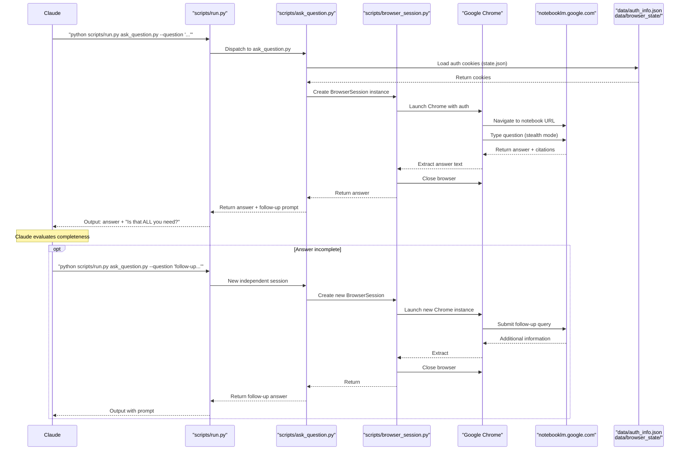

<!-- source: DeepWiki mcp.deepwiki.com · repo PleasePrompto/notebooklm-skill · page 3 Core Concepts · fetched 2026-10-26 -->

# Core Concepts

<details>
<summary>Relevant source files</summary>

The following files were used as context for generating this wiki page:

- [AUTHENTICATION.md](AUTHENTICATION.md)
- [CHANGELOG.md](CHANGELOG.md)
- [README.md](README.md)
- [SKILL.md](SKILL.md)

</details>


This document explains the fundamental architectural concepts and design principles that underpin the NotebookLM Skill system. Understanding these concepts is essential for effectively using, troubleshooting, or extending the skill.

For practical usage instructions, see [User Guide](#4). For implementation details of specific components, see [API Reference](#5). For environment setup mechanics, see [Getting Started](#2).

---

## Conceptual Architecture

The NotebookLM Skill implements a **stateless query model** where each user question triggers an independent browser session. This architecture prioritizes reliability and isolation over persistent chat sessions.

### System Concept Map

```mermaid
graph TB
    subgraph "Entry Point"
        [RunPy]:::code --> ["scripts/run.py<br/>Universal Wrapper"]
    end
    
    subgraph "Execution Isolation"
        [VenvDir]:::code --> [".venv/<br/>Isolated Environment"]
        [SitePackages]:::code --> ["site-packages/<br/>patchright, python-dotenv"]
    end
    
    subgraph "Functional Modules"
        [AuthMgr]:::code --> ["scripts/auth_manager.py<br/>AuthManager class"]
        [NotebookMgr]:::code --> ["scripts/notebook_manager.py<br/>NotebookLibrary class"]
        [AskQ]:::code --> ["scripts/ask_question.py<br/>Query execution"]
        [BrowserSess]:::code --> ["scripts/browser_session.py<br/>BrowserSession class"]
    end
    
    subgraph "Data Persistence"
        [LibraryJson]:::code --> ["data/library.json<br/>Notebook registry"]
        [AuthJson]:::code --> ["data/auth_info.json<br/>Auth status"]
        [BrowserState]:::code --> ["data/browser_state/<br/>Cookies & sessions"]
    end
    
    subgraph "External Services"
        [ChromeBrowser]:::code --> ["Google Chrome<br/>Real Chrome installation"]
        [NotebookLM]:::code --> ["notebooklm.google.com<br/>Gemini 2.5 backend"]
    end
    
    [RunPy] --> [VenvDir]
    [VenvDir] --> [SitePackages]
    [RunPy] --> [AuthMgr]
    [RunPy] --> [NotebookMgr]
    [RunPy] --> [AskQ]
    
    [AskQ] --> [BrowserSess]
    [AskQ] --> [AuthMgr]
    [AskQ] --> [NotebookMgr]
    
    [AuthMgr] --> [AuthJson]
    [AuthMgr] --> [BrowserState]
    [NotebookMgr] --> [LibraryJson]
    
    [BrowserSess] --> [SitePackages]
    [BrowserSess] --> [ChromeBrowser]
    [ChromeBrowser] --> [NotebookLM]

    classDef code font-family:monospace,fill:none,stroke-dasharray: 5 5;
```

**Sources:** [README.md:145-179](), [SKILL.md:40-59](), [SKILL.md:191-198]()

### Key Architectural Principles

| Principle | Implementation | Rationale |
|-----------|---------------|-----------|
| **Statelessness** | Each query launches fresh browser | Reliability, no session corruption |
| **Isolation** | `.venv/` for Python environment | No conflicts with system Python |
| **Security** | `data/` excluded from Git | Protect auth credentials |
| **Orchestration** | `run.py` as mandatory wrapper | Environment verification |
| **Idempotency** | Automatic environment setup | First-run self-configuration |

**Sources:** [README.md:276-292](), [SKILL.md:40-59]()

---

## Stateless Session Model

The skill uses a **stateless session model** where each question-answer cycle is completely independent. Unlike the MCP server version, no browser session persists between queries in this skill implementation [README.md:155]().

For details, see [Stateless Session Model](#3.1).

### Query Execution Flow



**Sources:** [README.md:276-292](), [SKILL.md:128-142](), [AUTHENTICATION.md:69-86]()

### Follow-Up Mechanism

Every answer from `ask_question.py` appends the prompt: **"EXTREMELY IMPORTANT: Is that ALL you need to know?"** [SKILL.md:130](). This triggers Claude to analyze gaps and execute additional queries until the research is complete.

---

## Browser Automation Architecture

The system uses **Patchright** (a Playwright wrapper) to control a real **Google Chrome** installation. This provides reliable automation while avoiding detection through stealth techniques and a hybrid authentication approach [README.md:83-91]().

For details, see [Browser Automation](#3.2).

### Hybrid Authentication Strategy

The skill employs a two-phase authentication system to overcome Playwright's limitations with session cookies [AUTHENTICATION.md:48-86]():
1. **Setup**: Saves state to both the browser profile and an explicit `state.json` file [AUTHENTICATION.md:52-67]().
2. **Runtime**: Launches the persistent context and then manually injects cookies from `state.json` [AUTHENTICATION.md:69-86]().

**Sources:** [AUTHENTICATION.md:1-155](), [scripts/auth_manager.py:94-120](), [scripts/ask_question.py:101-118]()

---

## Notebook Library System

The skill maintains a **local notebook registry** in `data/library.json` that maps user-friendly identifiers to NotebookLM URLs and metadata [SKILL.md:191-198]().

For details, see [Notebook Library](#3.3).

### Smart Discovery Workflow

When adding a notebook without known metadata, Claude uses a **Smart Add** workflow:
1. **Query**: Asks the notebook for an overview of its own content [SKILL.md:25-26]().
2. **Metadata Extraction**: Uses the discovered info to populate the `add` command [SKILL.md:28-30]().

**Sources:** [SKILL.md:19-38](), [scripts/notebook_manager.py:1-161]()

---

## Data Storage Structure

All persistent data resides in the `data/` directory, which is **Git-excluded** to protect sensitive authentication info and browser states [SKILL.md:191-198]().

For details, see [Data Storage](#3.4).

| File/Folder | Purpose | Managed By |
|------|---------|------------|
| `library.json` | Notebook metadata registry | `notebook_manager.py` |
| `auth_info.json` | Authentication status tracker | `auth_manager.py` |
| `browser_state/` | Browser cookies & profile | `auth_manager.py` |

**Sources:** [README.md:263-276](), [SKILL.md:191-198](), [AUTHENTICATION.md:98-111]()

---

## Virtual Environment Isolation

The skill uses an **isolated Python virtual environment** (`.venv/`) to prevent dependency conflicts. This environment is automatically created and managed by the `run.py` wrapper [SKILL.md:40-59]().

For details, see [Virtual Environment Isolation](#3.5).

### Automatic Setup

On the first run, `run.py` automatically:
1. Creates the `.venv/` [SKILL.md:55]().
2. Installs dependencies from `requirements.txt` [SKILL.md:56]().
3. Installs the required browser binary [SKILL.md:180]().

**Sources:** [README.md:83-91](), [SKILL.md:40-59](), [SKILL.md:175-189]()

---

