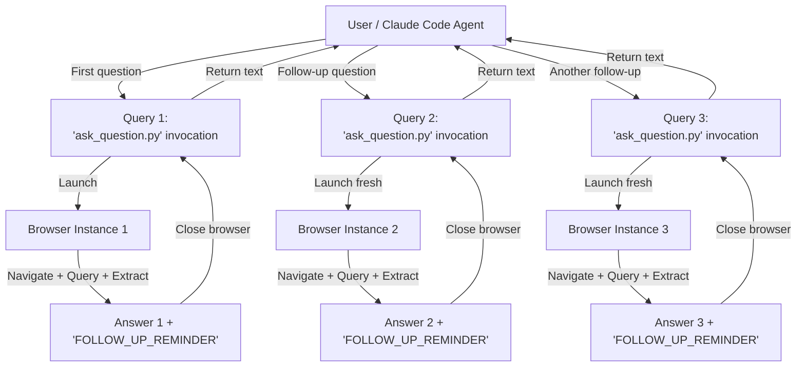
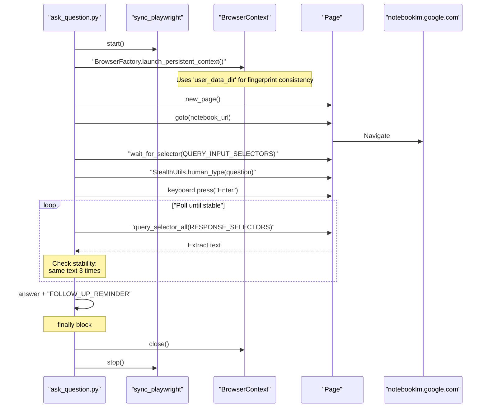
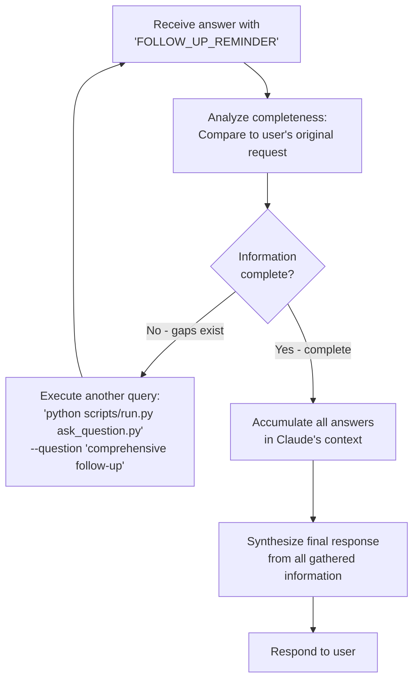
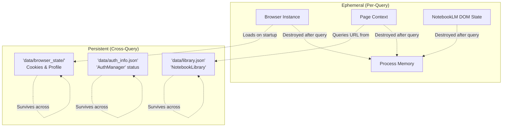

<!-- source: DeepWiki mcp.deepwiki.com · repo PleasePrompto/notebooklm-skill · page 3.1 Stateless Session Model · fetched 2026-10-26 -->

# Stateless Session Model

<details>
<summary>Relevant source files</summary>

The following files were used as context for generating this wiki page:

- [README.md](README.md)
- [SKILL.md](SKILL.md)
- [scripts/ask_question.py](scripts/ask_question.py)

</details>


## Purpose and Scope

This document explains the stateless session design pattern used by the NotebookLM Skill for querying NotebookLM notebooks. Each query operation opens a fresh browser instance, executes the query, retrieves the answer, and immediately closes the browser. This document covers the architectural rationale, implementation mechanics, the follow-up prompt mechanism, and practical implications for usage patterns.

For information about browser automation implementation details, see **3.2 Browser Automation**. For guidance on formulating queries and using the follow-up mechanism, see **4.2 Querying NotebookLM**. For comparison with the persistent session model used in the MCP server alternative, see **7.4 Skill vs MCP Server**.

---

## Design Overview

The stateless session model treats each query as an independent, isolated operation with no retained browser context between questions. This contrasts with traditional chat interfaces where a browser remains open across multiple interactions.

### Architectural Pattern



**Diagram: Stateless Query Lifecycle** - Each `ask_question.py` execution creates an ephemeral browser instance that exists only for the duration of a single query-answer cycle.

Sources: [README.md:155-155](), [scripts/ask_question.py:40-188]()

### Key Characteristics

| Characteristic | Implementation | Impact |
|---------------|----------------|---------|
| **Session Lifetime** | Single query-answer cycle | No conversational memory in browser |
| **Browser State** | Fresh context per query | Authentication reloaded each time |
| **Resource Management** | Immediate cleanup in `finally` block | Predictable resource usage |
| **Context Passing** | Via notebook URL only | Questions must be self-contained |
| **Follow-up Pattern** | Explicit prompt in response text | Claude-driven multi-turn research |

Sources: [README.md:151-159](), [scripts/ask_question.py:175-188]()

---

## Implementation Details

### The `ask_notebooklm` Function

The core stateless implementation is in the `ask_notebooklm` function [scripts/ask_question.py:40-188]():



**Diagram: Single Query Execution Flow** - The `ask_notebooklm` function in [scripts/ask_question.py:40-188]() orchestrates a complete query lifecycle with guaranteed cleanup.

Sources: [scripts/ask_question.py:61-188](), [scripts/ask_question.py:175-188]()

### Code Structure

The stateless pattern is enforced through strict resource management:

**Browser Launch**: [scripts/ask_question.py:66-72]()
- `sync_playwright().start()` creates a fresh Playwright instance.
- `BrowserFactory.launch_persistent_context()` uses a shared browser profile for fingerprint consistency.
- No session state is passed to the browser; it relies on the persistent profile and manual cookie injection (handled by `AuthManager`).

**Query Execution**: [scripts/ask_question.py:75-167]()
- Navigate to notebook URL using `page.goto()`.
- Wait for query input using `QUERY_INPUT_SELECTORS` [scripts/ask_question.py:86-98]().
- Type question using `StealthUtils.human_type()` [scripts/ask_question.py:108-108]().
- Poll for response using `RESPONSE_SELECTORS` [scripts/ask_question.py:136-154]().
- Stability check: text must remain unchanged for 3 polling cycles [scripts/ask_question.py:146-149]().

**Guaranteed Cleanup**: [scripts/ask_question.py:175-188]()
```python
finally:
    # Always clean up
    if context:
        try:
            context.close()
        except:
            pass

    if playwright:
        try:
            playwright.stop()
        except:
            pass
```
This ensures browser resources are freed even if exceptions occur.

Sources: [scripts/ask_question.py:40-188](), [scripts/ask_question.py:175-188]()

---

## Follow-up Mechanism

The stateless model requires explicit coordination to enable multi-turn research conversations. This is achieved through the `FOLLOW_UP_REMINDER` constant appended to every answer.

### The Follow-up Reminder

[scripts/ask_question.py:31-37]() defines the reminder text:

```python
FOLLOW_UP_REMINDER = (
    "\n\nEXTREMELY IMPORTANT: Is that ALL you need to know? "
    "You can always ask another question! Think about it carefully: "
    "before you reply to the user, review their original request and this answer. "
    "If anything is still unclear or missing, ask me another comprehensive question "
    "that includes all necessary context (since each question opens a new browser session)."
)
```

This text is appended to every answer at [scripts/ask_question.py:167]():
```python
return answer + FOLLOW_UP_REMINDER
```

### Claude's Follow-up Workflow



**Diagram: Follow-up Loop Driven by FOLLOW_UP_REMINDER** - Claude Code interprets the reminder prompt to determine if additional queries are needed, creating an iterative research pattern despite stateless browser sessions.

Sources: [scripts/ask_question.py:31-37](), [SKILL.md:128-142]()

### Key Instructions for Claude

The [SKILL.md:128-142]() file explicitly documents the required Claude behavior:

1. **STOP** - Do not immediately respond to user.
2. **ANALYZE** - Compare answer to user's original request.
3. **IDENTIFY GAPS** - Determine if more information is needed.
4. **ASK FOLLOW-UP** - If gaps exist, immediately execute another query.
5. **REPEAT** - Continue until information is complete.
6. **SYNTHESIZE** - Combine all answers before responding to user.

This creates a **Claude-mediated multi-turn conversation** where Claude acts as the intelligent orchestrator, deciding when additional queries are necessary.

Sources: [SKILL.md:128-142](), [README.md:44-44]()

---

## Persistent Data vs Ephemeral Sessions

While browser sessions are ephemeral, certain data persists across queries to enable continuity:



**Diagram: Ephemeral vs Persistent State** - Browser sessions are stateless, but authentication and notebook metadata persist in local data files.

Sources: [scripts/ask_question.py:6-10](), [README.md:170-170](), [SKILL.md:191-198]()

### State Persistence Strategy

| Data Type | Storage Location | Lifecycle | Purpose |
|-----------|-----------------|-----------|---------|
| **Browser state** | `data/browser_state/` | Persistent until cleared | Session cookies and fingerprint |
| **Notebook library** | `data/library.json` | Persistent until removed | Notebook URLs and metadata |
| **Auth status** | `data/auth_info.json` | Persistent until cleared | Quick auth validation |
| **Browser instance** | In-memory | Ephemeral (single query) | Query execution |
| **Page context** | In-memory | Ephemeral (single query) | DOM interaction |

Sources: [README.md:170-170](), [SKILL.md:191-198]()

---

## Comparison with Persistent Session Model

The [README.md:149-159]() section documents the architectural difference from the MCP server implementation:

| Aspect | Stateless Skill Model | Persistent MCP Model |
|--------|----------------------|---------------------|
| **Session Duration** | Single query | Multi-turn chat sessions |
| **Browser Lifecycle** | Launch → Query → Close | Launch once, persist |
| **Context Retention** | None (each query independent) | Full chat history in browser |
| **Follow-ups** | Explicit via `FOLLOW_UP_REMINDER` | Natural chat continuation |
| **Implementation** | `scripts/ask_question.py` | MCP server codebase |
| **Protocol** | Claude Skills | Model Context Protocol |

### When Stateless Is Appropriate

The stateless model is optimal when:

1. **Query independence**: Each question can be answered without referencing previous answers.
2. **Resource constraints**: Background browser processes are undesirable.
3. **Simple integration**: Direct script execution without protocol overhead.
4. **Claude orchestration**: AI agent can manage multi-turn research via follow-up prompts.

Sources: [README.md:149-159](), [SKILL.md:8-8]()

---

## Implications and Trade-offs

### Advantages of Stateless Design

**Simplicity**: No session lifecycle management, connection pooling, or state synchronization required.

**Reliability**: Browser crashes or errors are isolated to a single query. No cascading failures across multiple operations.

**Predictability**: Each query has an identical resource usage profile. No memory leaks or state accumulation over time.

**Skill Compatibility**: Aligns with Claude Code skill execution model where each script invocation is independent.

Sources: [README.md:145-147]()

### Disadvantages and Mitigations

| Disadvantage | Impact | Mitigation Strategy |
|-------------|--------|-------------------|
| **Startup overhead** | Delay per query for browser launch | Acceptable for research workflows (1-5 queries per task) |
| **No conversational context** | Can't reference "previous answer" | `FOLLOW_UP_REMINDER` trains Claude to ask comprehensive questions |
| **Context must be explicit** | Questions must be self-contained | [SKILL.md:36]() instructs Claude to "include all necessary context" |

### Usage Recommendations

**Optimal for**:
- Fact-checking workflows: "What does my API docs say about authentication?"
- Quick lookups: "Get the error code reference from my manual"
- Validation: "Verify this approach against my best practices notebook"

**Less optimal for**:
- Iterative refinement: "Show me more about that specific subsection" (Mitigated by Claude orchestration)

Sources: [SKILL.md:12-17](), [SKILL.md:128-142]()

---

## Implementation in Context

The stateless session model is enforced at the entry point level:

### Command-Line Interface

The `scripts/ask_question.py` `main()` function demonstrates the complete lifecycle:

1. **Parse arguments**: Question text, notebook ID/URL, browser visibility [scripts/ask_question.py:191-198]().
2. **Resolve notebook**: From library if ID provided, or use active notebook [scripts/ask_question.py:200-221]().
3. **Execute query**: Call `ask_notebooklm()` function [scripts/ask_question.py:224-224]().
4. **Print result**: Display answer [scripts/ask_question.py:226-226]().
5. **Exit**: Process terminates, all resources freed via `finally` [scripts/ask_question.py:175-188]().

### Integration with Claude Code

The [SKILL.md:40-59]() file documents the `run.py` wrapper requirement:

```bash
# ✅ CORRECT - Always use run.py:
python scripts/run.py ask_question.py --question "..."
```

The wrapper ensures environment isolation and dependency management, making each script execution self-contained.

Sources: [scripts/ask_question.py:190-227](), [SKILL.md:40-59]()

---

