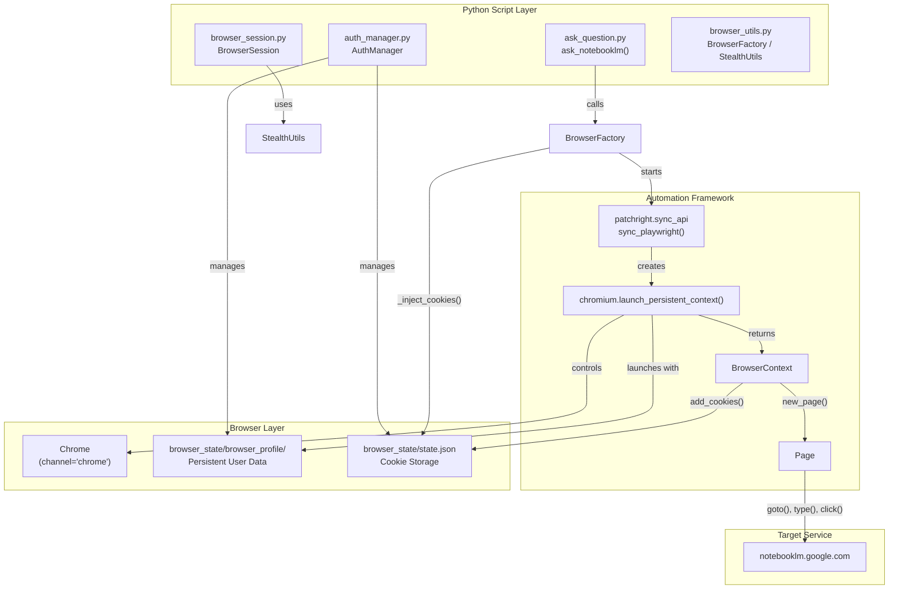
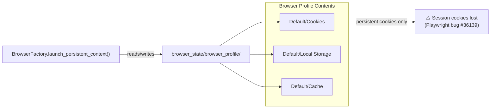
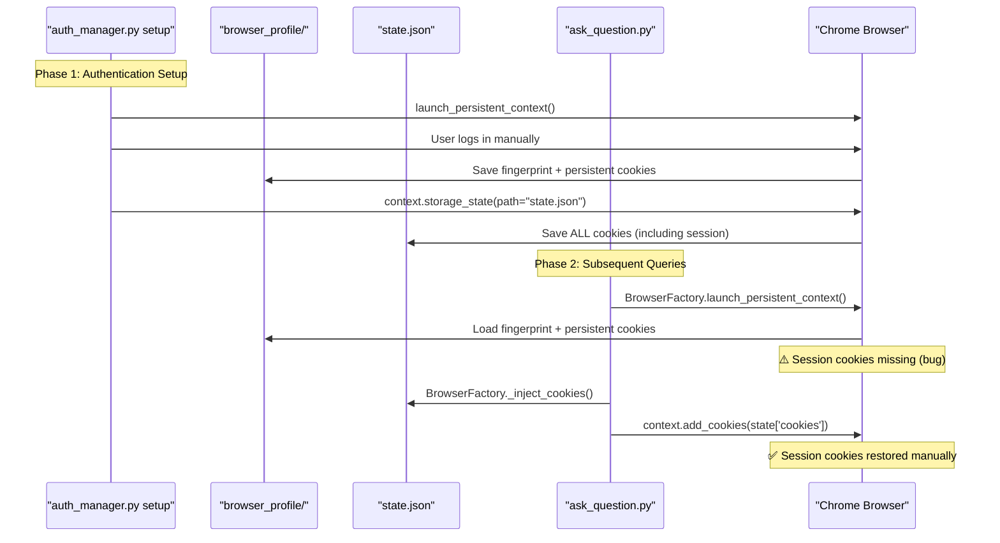
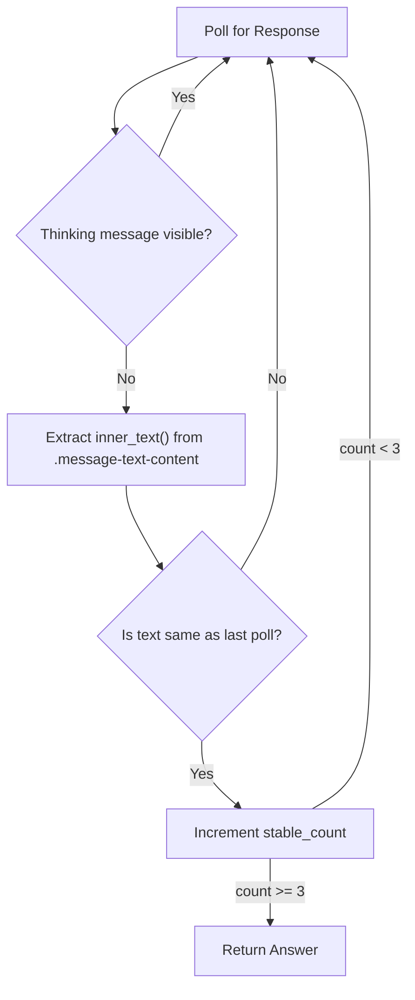
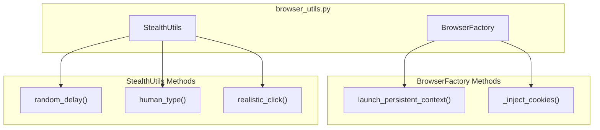

<!-- source: DeepWiki mcp.deepwiki.com · repo PleasePrompto/notebooklm-skill · page 3.2 Browser Automation · fetched 2026-10-26 -->

# Browser Automation

<details>
<summary>Relevant source files</summary>

The following files were used as context for generating this wiki page:

- [AUTHENTICATION.md](AUTHENTICATION.md)
- [CHANGELOG.md](CHANGELOG.md)
- [requirements.txt](requirements.txt)
- [scripts/browser_session.py](scripts/browser_session.py)
- [scripts/browser_utils.py](scripts/browser_utils.py)

</details>


This page describes the browser automation implementation used to interact with Google NotebookLM. It covers the Patchright library, Chrome browser configuration, anti-detection techniques, and the hybrid authentication strategy that works around Playwright API limitations.

For information about the stateless session model that manages when browsers are launched and closed, see [3.1 Stateless Session Model](). For authentication setup procedures, see [2.2 Authentication Setup](). For the complete API reference of the query execution module, see [5.4 ask_question.py]().

## Browser Automation Stack

The system uses **Patchright** (version 1.55.2), a fork of Playwright with built-in anti-detection capabilities. Patchright controls **Google Chrome** (not Chromium) to ensure consistent behavior across platforms and maintain Google's trust signals.



**Sources:** [scripts/ask_question.py:77-118](), [scripts/browser_utils.py:15-43](), [requirements.txt:7]()

### Why Patchright Instead of Playwright

Patchright patches Playwright to avoid common anti-automation detection methods. Key differences:

| Feature | Patchright | Standard Playwright |
|---------|-----------|---------------------|
| `navigator.webdriver` detection | Patched (hidden) | Visible to websites |
| Default fingerprint | More natural | Obvious automation |
| Anti-bot evasion | Built-in patches | Manual configuration required |
| Chrome channel support | Full support | Limited to Chromium |

**Sources:** [requirements.txt:4-7](), [scripts/browser_session.py:13]()

### Chrome vs Chromium

The system explicitly uses the `chrome` channel rather than default Chromium:

```python
context = playwright.chromium.launch_persistent_context(
    user_data_dir=user_data_dir,
    channel="chrome",  # Use real Chrome
    # ...
)
```

**Rationale:**
- **Consistent fingerprinting:** Chrome maintains stable browser signatures across sessions.
- **Google trust signals:** Real Chrome is less likely to trigger additional verification.
- **Cross-platform reliability:** Chrome has better consistency than Chromium builds.
- **Persistent profile support:** Chrome's profile system works reliably with `user_data_dir`.

**Sources:** [scripts/browser_utils.py:29-31](), [AUTHENTICATION.md:30-35](), [AUTHENTICATION.md:95]()

## Browser Launch Configuration

### Anti-Detection Arguments

The browser is launched with specific flags and configurations to avoid automation detection, centralized in `BrowserFactory`:

```python
context = playwright.chromium.launch_persistent_context(
    user_data_dir=user_data_dir,
    channel="chrome",
    headless=headless,
    no_viewport=True,
    ignore_default_args=["--enable-automation"],
    user_agent=USER_AGENT,
    args=BROWSER_ARGS
)
```

| Argument | Purpose |
|----------|---------|
| `no_viewport=True` | Uses browser's natural viewport instead of fixed size (anti-detection). |
| `ignore_default_args` | Removes `--enable-automation` flag that shows automation infobar. |
| `USER_AGENT` | Uses a standard Windows Chrome user agent string. |
| `BROWSER_ARGS` | Includes flags like `--disable-blink-features=AutomationControlled`. |

**Sources:** [scripts/browser_utils.py:28-37](), [scripts/config.py:23-31]()

### Persistent Browser Context

The system uses `launch_persistent_context()` to maintain a persistent browser profile:



**Benefits of persistent context:**
- **Fingerprint consistency:** Same browser fingerprint across sessions.
- **Performance:** Cache and resources persist between runs.
- **Google trust:** Browser appears as a returning user, not new instance.

**Limitation:** Session cookies (no expiry date) are not persisted correctly due to Playwright bug [#36139](https://github.com/microsoft/playwright/issues/36139).

**Sources:** [scripts/browser_utils.py:28-37](), [AUTHENTICATION.md:14-23](), [AUTHENTICATION.md:103-111]()

## Hybrid Authentication Approach

The system implements a two-phase hybrid authentication strategy to work around Playwright API limitations in Python.

### The Problem: Playwright Bug #36139

Playwright's `launch_persistent_context()` has a known bug where **session cookies** (cookies without an `Expires` attribute) do not persist correctly to the browser profile directory:

- ✅ **Persistent cookies** (with `Expires` date) → Saved to browser profile.
- ❌ **Session cookies** (without `Expires`) → Lost after browser closes.

Since some Google authentication cookies are session cookies, this causes random authentication failures.

**Sources:** [AUTHENTICATION.md:14-23]()

### TypeScript vs Python API Difference

The MCP server (TypeScript) can pass `storageState` to `launchPersistentContext()`, but **Python's API doesn't support this parameter**:

```python
# Python - NOT SUPPORTED
context = playwright.chromium.launch_persistent_context(
    user_data_dir=profile_dir,
    storage_state="state.json",  # ← Parameter doesn't exist in Python!
    channel="chrome"
)
```

This API limitation (Playwright issue [#14949](https://github.com/microsoft/playwright/issues/14949)) requires a manual workaround in Python.

**Sources:** [AUTHENTICATION.md:37-46]()

### Two-Phase Hybrid Solution

The system works around both bugs by using a **hybrid approach** that combines persistent browser profiles with manual cookie injection:



**Sources:** [AUTHENTICATION.md:48-85](), [scripts/browser_utils.py:45-57]()

## Stealth Techniques

The system implements human-like interaction patterns via the `StealthUtils` class to avoid detection as automated traffic.

### StealthUtils Class

The `StealthUtils` class provides utilities for human-like browser interactions:

| Method | Purpose | Implementation |
|----------|---------|----------------|
| `random_delay()` | Adds jitter | Uses `random.uniform` between min/max ms. |
| `human_type()` | Simulates typing | Types char-by-char with random delays and 5% chance of long pauses. |
| `realistic_click()` | Natural clicking | Moves mouse to element center before clicking. |
| `random_mouse_movement()` | Avoids straight lines | Moves mouse in steps with random timing. |

**Sources:** [scripts/browser_utils.py:59-108](), [scripts/browser_session.py:70-73]()

### Human-Like Typing

The `human_type()` method simulates natural typing patterns:

```python
def human_type(page: Page, selector: str, text: str, wpm_min: int = 320, wpm_max: int = 480):
    # ...
    for char in text:
        element.type(char, delay=random.uniform(25, 75))
        if random.random() < 0.05:
            time.sleep(random.uniform(0.15, 0.4))
```

**Typing characteristics:**
- **Variation:** Each character has random 25-75ms delay.
- **Pauses:** 5% chance of 150-400ms pause between characters (simulates thinking).
- **Speed:** Controlled by WPM parameters (defaulting to 320-480 WPM).

**Sources:** [scripts/browser_utils.py:68-90]()

## Page Interaction Flow

### Response Extraction and Stability Detection

NotebookLM streams responses. The system uses a stability detection algorithm to ensure the full answer has been generated before returning it.



**Stability detection algorithm:**
1. Check for `div.thinking-message` visibility; if present, wait.
2. Extract text from the latest `.message-text-content` element.
3. Compare with the previous poll's text.
4. If text is unchanged for **3 consecutive polls**, the response is considered complete.
5. Timeout occurs after 120 seconds if no stable response is found.

**Sources:** [scripts/browser_session.py:168-204](), [CHANGELOG.md:17-35]()

### Selector Fallbacks

The system handles NotebookLM UI variations and internationalization through fallback selectors:

- **Input:** `textarea.query-box-input` or `textarea[aria-label="Feld für Anfragen"]`.
- **Output:** `.to-user-container .message-text-content`.

**Sources:** [scripts/browser_session.py:82-90](), [scripts/browser_session.py:111-116](), [CHANGELOG.md:28-30]()

## Code Architecture

### browser_utils.py Structure



**Sources:** [scripts/browser_utils.py:15-108]()

### Integration with Core Scripts

The browser automation layer is consumed by the main query interfaces:

- **`ask_question.py`**: Launches the browser via `BrowserFactory` and performs the high-level question flow.
- **`browser_session.py`**: Encapsulates a specific tab (`Page`) and uses `StealthUtils` for all interactions within that session.
- **`auth_manager.py`**: Uses `BrowserFactory` to launch the browser for manual login and state capture.

**Sources:** [scripts/ask_question.py:86-118](), [scripts/browser_session.py:30-46](), [scripts/auth_manager.py:100-113]()

---

