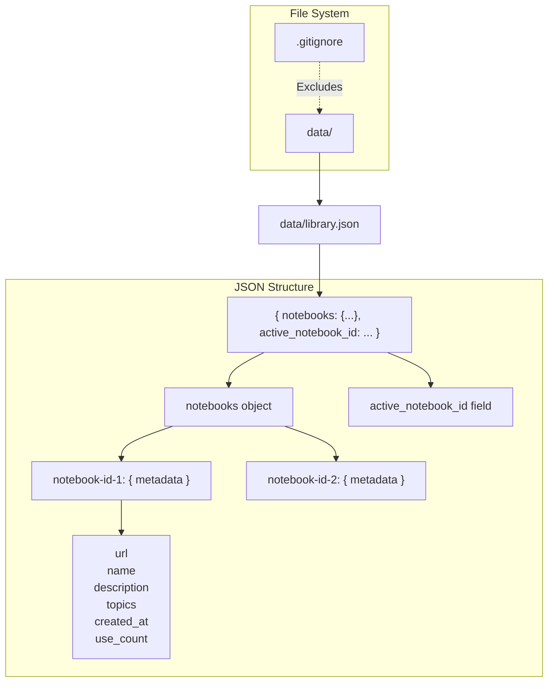
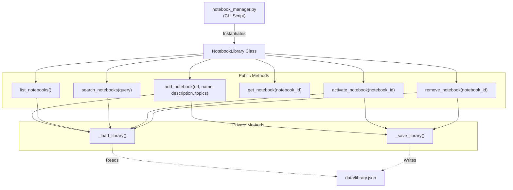
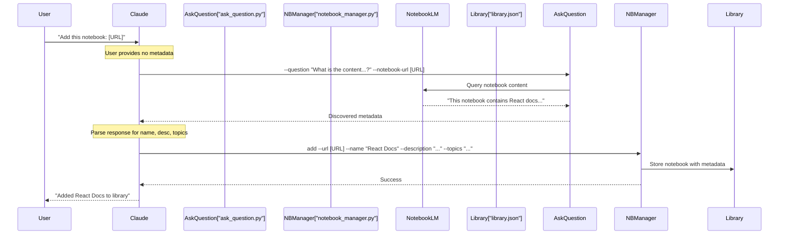
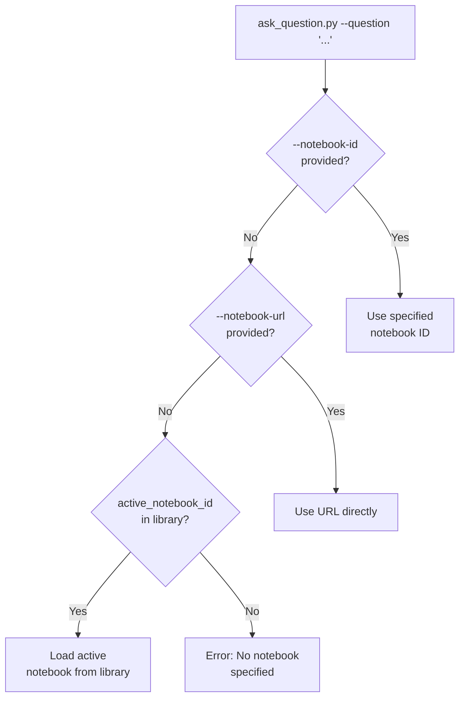

<!-- source: DeepWiki mcp.deepwiki.com · repo PleasePrompto/notebooklm-skill · page 3.3 Notebook Library · fetched 2026-10-26 -->

# Notebook Library

<details>
<summary>Relevant source files</summary>

The following files were used as context for generating this wiki page:

- [SKILL.md](SKILL.md)
- [references/usage_patterns.md](references/usage_patterns.md)
- [scripts/notebook_manager.py](scripts/notebook_manager.py)

</details>


This document describes the local notebook library system, which provides persistent storage and management of NotebookLM notebook metadata. The library enables Claude Code to maintain a registry of notebooks with searchable metadata, eliminating the need to repeatedly provide notebook URLs and allowing intelligent notebook selection based on user queries.

## Overview

The notebook library is a JSON-based local storage system that maintains metadata for NotebookLM notebooks. It is implemented through the `NotebookLibrary` class in [scripts/notebook_manager.py:17-215]() and persists data in [data/library.json](). The library supports CRUD operations, search functionality, and an "active notebook" concept for default queries.

The library stores several key metadata fields per notebook:
- **id**: Unique identifier generated from the notebook name (slugified) [scripts/notebook_manager.py:89-89]().
- **url**: Full NotebookLM notebook URL [scripts/notebook_manager.py:98-98]().
- **name**: Human-readable notebook name [scripts/notebook_manager.py:99-99]().
- **description**: Detailed description of notebook contents [scripts/notebook_manager.py:100-100]().
- **topics**: List of topics/tags for categorization [scripts/notebook_manager.py:101-101]().
- **usage metrics**: `use_count` and `last_used` timestamps [scripts/notebook_manager.py:107-108]().

One notebook can be marked as "active" for use in queries that don't specify a notebook ID [scripts/notebook_manager.py:29-29]().

**Sources:** [SKILL.md:192-198](), [scripts/notebook_manager.py:17-118](), [references/usage_patterns.md:189-203]()

## Library Data Structure

The library is stored as a JSON file with a structure mapping notebook IDs to metadata objects.

**Library File Structure**


The `NotebookLibrary` class provides atomic read/write operations with automatic file creation and validation [scripts/notebook_manager.py:34-62](). The library file is excluded from Git to prevent sharing personal notebook collections [SKILL.md:198-198]().

**Sources:** [SKILL.md:192-198](), [scripts/notebook_manager.py:23-62]()

## NotebookLibrary Class Interface

The `NotebookLibrary` class in [scripts/notebook_manager.py]() provides the core library management API:

**Class Architecture**


The class enforces that `description` and `topics` are provided during addition [scripts/notebook_manager.py:63-71](). The ID is generated by slugifying the name (lowercase, replacing spaces/underscores with hyphens) [scripts/notebook_manager.py:89-89]().

**Sources:** [scripts/notebook_manager.py:17-215](), [SKILL.md:81-106]()

## Library Operations via CLI

All library operations are accessed through `notebook_manager.py` via the `run.py` wrapper [SKILL.md:42-42]():

| Operation | Command | Required Parameters | Description |
|-----------|---------|---------------------|-------------|
| **Add** | `add` | `--url`, `--name`, `--description`, `--topics` | Add notebook to library |
| **List** | `list` | None | Display all notebooks |
| **Search** | `search` | `--query` | Search by keyword |
| **Activate** | `activate` | `--id` | Set active notebook |
| **Remove** | `remove` | `--id` | Delete from library |
| **Stats** | `stats` | None | Show library statistics |

**Example: Manual Add**
```bash
python scripts/run.py notebook_manager.py add \
  --url "https://notebooklm.google.com/notebook/abc123" \
  --name "React Documentation" \
  --description "Official React documentation covering hooks and components" \
  --topics "react,javascript,frontend"
```

**Sources:** [SKILL.md:153-161](), [references/usage_patterns.md:30-35]()

## Smart Discovery Workflow

The Smart Discovery workflow addresses the problem of adding notebooks without knowing their content. Instead of requiring users to manually inspect notebooks, the system queries the notebook itself to discover its contents [SKILL.md:19-30]().

**Smart Discovery Process Flow**


**Phase 1: Discovery Query**
```bash
python scripts/run.py ask_question.py \
  --question "What is the content of this notebook? What topics are covered? Provide a complete overview briefly and concisely" \
  --notebook-url "[URL]"
```

**Phase 2: Metadata-Based Add**
```bash
python scripts/run.py notebook_manager.py add \
  --url "[URL]" \
  --name "[Extracted Name]" \
  --description "[Extracted Description]" \
  --topics "[Extracted Topics]"
```

**Sources:** [SKILL.md:19-38](), [references/usage_patterns.md:42-59]()

## Active Notebook Concept

The library supports designating one notebook as "active" for use in queries that don't explicitly specify a notebook ID [scripts/notebook_manager.py:217-234]().

**Active Notebook Selection Logic**


The active notebook is updated via the `activate` command [scripts/notebook_manager.py:217-234]().

**Sources:** [SKILL.md:101-102](), [scripts/notebook_manager.py:217-234]()

## Search and Discovery Functionality

The `search_notebooks` method scans the `name`, `description`, `topics`, and `tags` fields for matches [scripts/notebook_manager.py:206-215]().

```bash
# Search for notebooks related to React
python scripts/run.py notebook_manager.py search --query "react"
```

The search is case-insensitive and matches partial words [scripts/notebook_manager.py:216-224](). This metadata-driven search allows Claude Code to identify the correct notebook even when the user uses natural language.

**Sources:** [scripts/notebook_manager.py:206-224](), [SKILL.md:98-99]()

## Library Preservation During Cleanup

The `cleanup_manager.py` tool provides selective cleanup of skill data. By default, it preserves the notebook library unless specified otherwise [SKILL.md:168-173]().

```bash
# Clear auth/browser data but preserve library
python scripts/run.py cleanup_manager.py --confirm --preserve-library
```

This preservation is critical for maintaining the "memory" of available research materials while allowing for the reset of transient browser states or authentication tokens.

**Sources:** [SKILL.md:168-173](), [references/usage_patterns.md:131-133]()

---

