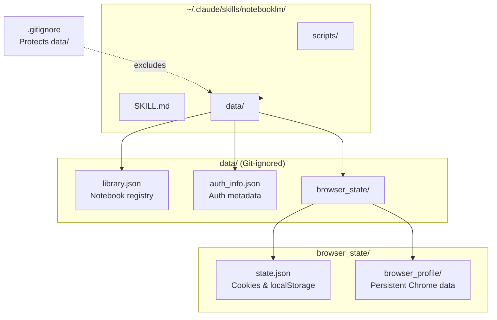
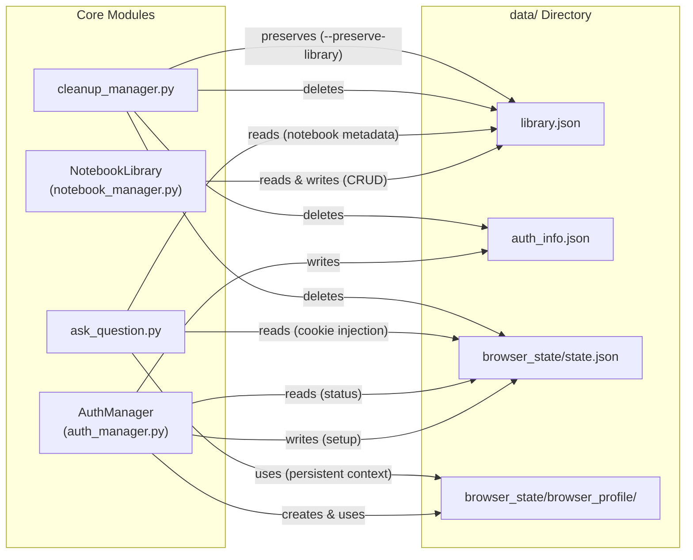
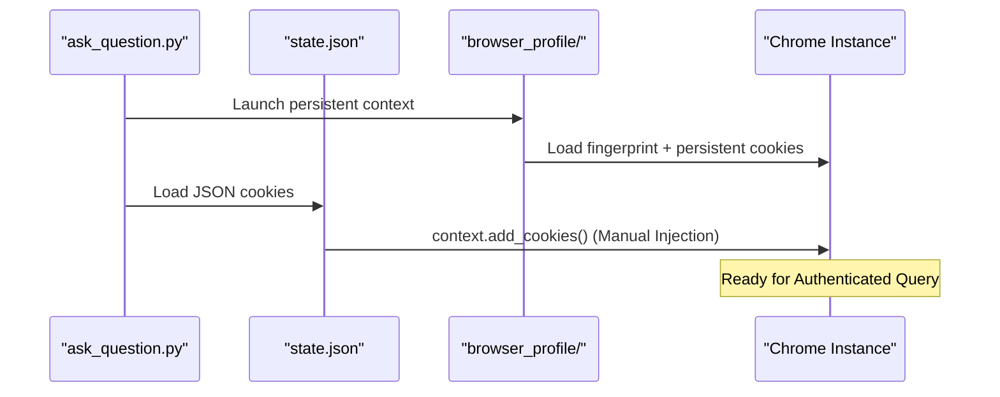

<!-- source: DeepWiki mcp.deepwiki.com · repo PleasePrompto/notebooklm-skill · page 3.4 Data Storage · fetched 2026-10-26 -->

# Data Storage

<details>
<summary>Relevant source files</summary>

The following files were used as context for generating this wiki page:

- [.gitignore](.gitignore)
- [AUTHENTICATION.md](AUTHENTICATION.md)
- [CHANGELOG.md](CHANGELOG.md)
- [SKILL.md](SKILL.md)

</details>


This document describes the local data storage architecture for the NotebookLM Skill system, including directory structure, file formats, security considerations, and how different modules interact with persistent data. For information about the notebook library conceptual model, see **3.3 Notebook Library**. For API-level details on managing stored data, see **5.3 notebook_manager.py** and **5.2 auth_manager.py**.

## Overview

The NotebookLM Skill stores all persistent data locally within the skill directory at `~/.claude/skills/notebooklm/data/`. This directory contains three primary storage components: notebook library metadata (`library.json`), authentication status information (`auth_info.json`), and browser session state (`browser_state/`). All files in the `data/` directory are automatically excluded from version control to protect sensitive authentication credentials and personal notebook information.

Sources: [SKILL.md:191-198](), [.gitignore:7-37]()

## Directory Structure

The skill maintains a dedicated data directory hierarchy isolated within the skill folder:



**Directory Structure Diagram: Physical layout of data storage with Git protection**

The `data/` directory is created automatically during first use. The `AuthManager` class handles the creation of the authentication-related subdirectories.

Sources: [AUTHENTICATION.md:100-111](), [.gitignore:7-11]()

### Initialization Code Patterns

The `AuthManager` module follows a consistent pattern for data directory initialization, ensuring that the base data path and browser state paths exist before attempting to write files.

| Module | Data Directory Initialization | Storage Files Managed |
|--------|------------------------------|----------------------|
| `AuthManager` | [scripts/auth_manager.py:38-46]() | `auth_info.json`, `browser_state/state.json`, `browser_state/browser_profile/` |
| `NotebookLibrary` | [scripts/notebook_manager.py]() | `library.json` |
| `CleanupManager` | [scripts/cleanup_manager.py]() | Operates on existing data directory |

Sources: [SKILL.md:145-173]()

## Storage Files

### library.json - Notebook Registry

The `library.json` file serves as the persistent registry of NotebookLM notebooks added to the user's library. It stores notebook metadata including URLs, names, descriptions, topics, and creation timestamps.

**File Location**: `~/.claude/skills/notebooklm/data/library.json`

**Schema Structure**:
```json
{
  "notebooks": [
    {
      "id": "unique-identifier",
      "url": "https://notebooklm.google.com/notebook/...",
      "name": "User-friendly name",
      "description": "Content description",
      "topics": ["topic1", "topic2"],
      "created_at": "ISO-8601 timestamp"
    }
  ],
  "active_notebook_id": "unique-identifier"
}
```

The `notebook_manager.py` script manages this file through CRUD operations. All parameters (`--url`, `--name`, `--description`, `--topics`) are required when adding a new entry to ensure the library remains searchable and descriptive for Claude.

Sources: [SKILL.md:91-96](), [SKILL.md:153-161]()

### auth_info.json - Authentication Metadata

The `auth_info.json` file contains non-sensitive metadata about the authentication state, including timestamps. It does NOT contain actual credentials or cookies.

**File Location**: `~/.claude/skills/notebooklm/data/auth_info.json`

**Schema Structure**:
```json
{
  "authenticated_at": 1234567890.123,
  "authenticated_at_iso": "2024-01-15 10:30:45"
}
```

This file is created by the `AuthManager` after successful authentication and is used to display the authentication status age.

Sources: [AUTHENTICATION.md:102-102](), [SKILL.md:195-195]()

### browser_state/state.json - Session State

The `state.json` file stores the complete browser session state, including cookies, localStorage, and sessionStorage. This is critical for the hybrid authentication approach used to overcome Playwright session persistence bugs.

**File Location**: `~/.claude/skills/notebooklm/data/browser_state/state.json`

The `AuthManager` saves this file using `context.storage_state()` [AUTHENTICATION.md:66-67]() and `ask_question.py` manually injects cookies from it during session restoration [AUTHENTICATION.md:82-85]().

Sources: [AUTHENTICATION.md:7-19](), [AUTHENTICATION.md:104-104]()

### browser_state/browser_profile/ - Persistent Chrome Data

This directory contains the persistent Chrome user profile data, including browser preferences, cache, and fingerprinting data. It serves as the `user_data_dir` for Chrome's persistent context.

**Purpose**: Maintains consistent browser fingerprinting and stores persistent cookies that Playwright handles correctly.

Sources: [AUTHENTICATION.md:71-79](), [AUTHENTICATION.md:105-110]()

## Module-to-Storage Mapping



**Module Storage Access Diagram: How each module interacts with storage files**

Sources: [AUTHENTICATION.md:48-85](), [SKILL.md:143-173]()

## Security and Git Exclusion

The `data/` directory contains sensitive information including Google authentication cookies and personal notebook links. The repository's `.gitignore` file implements multiple layers of protection to prevent accidental commits.

| Pattern | Purpose |
|---------|---------|
| `data/` | Excludes the primary data directory and all nested content |
| `browser_state/` | Fallback for state files accidentally placed outside `data/` |
| `auth_info.json` | Fallback for metadata files at root |
| `library.json` | Fallback for library files at root |
| `state.json` | Fallback for session state files at root |

**Security Warning**: All data stored in `~/.claude/skills/notebooklm/data/` is considered sensitive. The authentication cookies stored in `state.json` provide access to the user's Google/NotebookLM session.

Sources: [.gitignore:7-37](), [SKILL.md:198-198]()

## Data Lifecycle

### Creation and Updates

1.  **Authentication Setup**: Triggered by `auth_manager.py setup`. Launches Chrome with `browser_profile/`, allows manual login, then exports `state.json` and `auth_info.json`. [AUTHENTICATION.md:52-67]()
2.  **Library Management**: Triggered by `notebook_manager.py add`. Writes to `library.json`. [SKILL.md:91-96]()
3.  **Query Execution**: Triggered by `ask_question.py`. Reads from `library.json` to find URLs, and performs **manual cookie injection** from `state.json` into a context using `browser_profile/`. [AUTHENTICATION.md:69-85]()

### Deletion and Cleanup

The `cleanup_manager.py` script provides controlled deletion of stored data:

*   **Full Cleanup**: `python scripts/run.py cleanup_manager.py --confirm` removes all data.
*   **Preservation**: `python scripts/run.py cleanup_manager.py --confirm --preserve-library` clears authentication and browser state but keeps `library.json`.
*   **Auth Reset**: `python scripts/run.py auth_manager.py clear` specifically targets authentication-related data.

Sources: [SKILL.md:150-151](), [SKILL.md:168-173]()

## Hybrid Authentication Logic

The storage architecture is specifically designed to support the **Hybrid Authentication Strategy**. Because Python's Playwright API does not support loading `storage_state` directly into a `launch_persistent_context` [AUTHENTICATION.md:37-46](), the system must maintain both the `browser_profile/` (for fingerprinting) and `state.json` (for manual cookie injection of session cookies).



**Authentication Storage Flow: Hybrid approach combining profile and manual state injection**

Sources: [AUTHENTICATION.md:70-85](), [AUTHENTICATION.md:127-130]()

---

