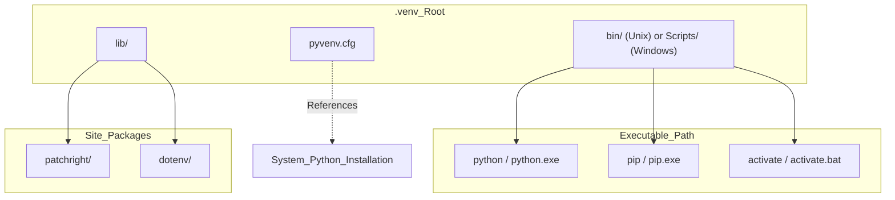
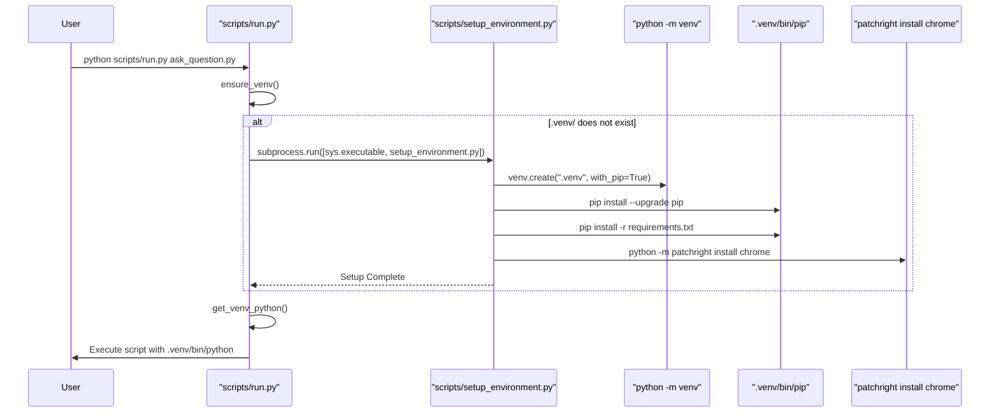
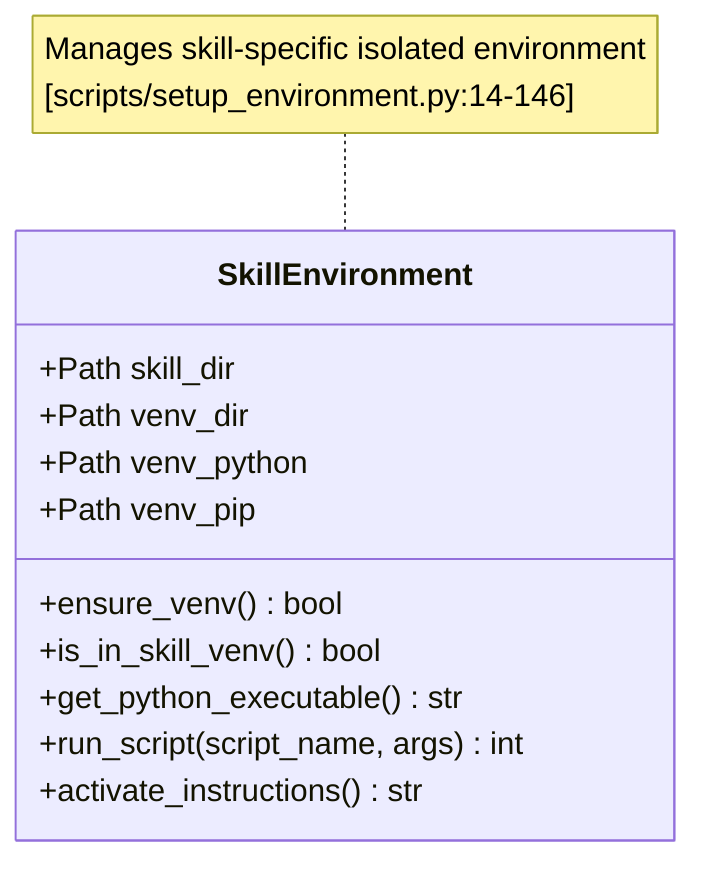
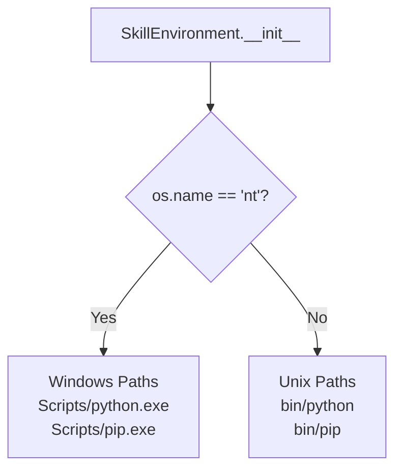
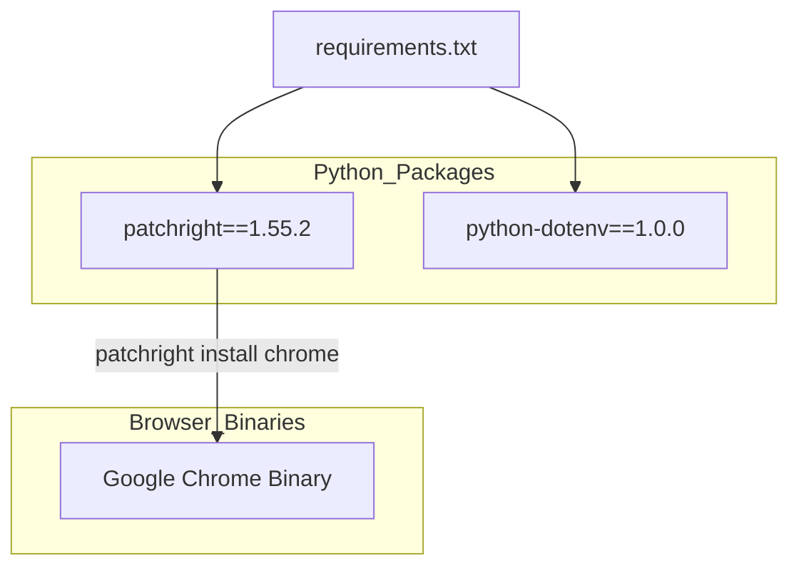

<!-- source: DeepWiki mcp.deepwiki.com · repo PleasePrompto/notebooklm-skill · page 3.5 Virtual Environment Isolation · fetched 2026-10-26 -->

# Virtual Environment Isolation

<details>
<summary>Relevant source files</summary>

The following files were used as context for generating this wiki page:

- [requirements.txt](requirements.txt)
- [scripts/run.py](scripts/run.py)
- [scripts/setup_environment.py](scripts/setup_environment.py)

</details>


## Purpose and Scope

This document explains the virtual environment isolation strategy used by the NotebookLM Skill. It covers the rationale for isolation, the automatic setup mechanism, the `SkillEnvironment` class architecture, and how `run.py` ensures all scripts execute within the isolated environment. For information about the broader orchestration system, see [scripts/run.py:1-102](). For dependency installation specifics, see [scripts/setup_environment.py:1-200]().

---

## Why Virtual Environment Isolation

The NotebookLM Skill maintains complete dependency isolation through a dedicated `.venv/` directory within the skill installation. This isolation serves three critical purposes:

| Purpose | Implementation | Benefit |
|---------|---------------|---------|
| **Dependency Conflict Prevention** | Separate `site-packages/` for `patchright`, `python-dotenv` | No interference with system Python or other projects |
| **Reproducible Execution** | Fixed versions in `requirements.txt` | Consistent behavior across installations |
| **Security Boundary** | Isolated Python interpreter and libraries | Skill cannot pollute or be polluted by global packages |

The skill directory structure enforces separation:

```
notebooklm-skill/
├── .venv/                    # Created locally, contains isolated environment
│   ├── bin/ or Scripts/      # Platform-specific Python executables
│   └── lib/site-packages/    # Isolated dependencies (patchright, etc.)
├── scripts/                  # Core logic (run.py, setup_environment.py, etc.)
└── requirements.txt          # Dependency specification
```

**Sources:** [scripts/setup_environment.py:14-29](), [scripts/run.py:13-24](), [requirements.txt:1-10]()

---

## Virtual Environment Directory Structure

The `.venv/` directory follows Python's standard virtual environment layout with platform-specific differences handled by the `SkillEnvironment` class [scripts/setup_environment.py:24-29]().

### Directory Structure Diagram



**Platform-Specific Paths:**

| Component | Unix/Linux/macOS | Windows |
|-----------|------------------|---------|
| Python Executable | `.venv/bin/python` | `.venv/Scripts/python.exe` |
| Pip Executable | `.venv/bin/pip` | `.venv/Scripts/pip.exe` |

The `SkillEnvironment` class initializes these paths based on `os.name` [scripts/setup_environment.py:24-29]().

**Sources:** [scripts/setup_environment.py:14-30]()

---

## Automatic Setup Flow

The virtual environment is created automatically on first script execution through `run.py` [scripts/run.py:26-45]().

### Initialization Sequence Diagram



**Key Implementation Details:**

1. **First-Run Detection:** `run.py` checks for `.venv/` existence [scripts/run.py:33]().
2. **System Python Bootstrap:** Setup uses the current `sys.executable` to run the setup script [scripts/run.py:38]().
3. **Dependency Installation:** `setup_environment.py` upgrades pip [scripts/setup_environment.py:54-59](), installs `requirements.txt` [scripts/setup_environment.py:62-68](), and installs the Chrome browser binary for Patchright [scripts/setup_environment.py:75-80]().

**Sources:** [scripts/run.py:26-45](), [scripts/setup_environment.py:31-94]()

---

## The SkillEnvironment Class

The `SkillEnvironment` class in `scripts/setup_environment.py` encapsulates all virtual environment management logic.

### Class Architecture Diagram



**Core Methods:**

| Method | Purpose | Return Value |
|--------|---------|--------------|
| `ensure_venv()` | Create venv if missing and install dependencies | `bool` - success status |
| `is_in_skill_venv()` | Check if current process is already using the skill's venv | `bool` |
| `get_python_executable()` | Return path to the venv Python or fallback | `str` |
| `run_script()` | Executes a target script using the venv interpreter | `int` - exit code |

**Sources:** [scripts/setup_environment.py:14-146]()

---

## Cross-Platform Path Handling

The system handles platform differences through conditional path construction in both `SkillEnvironment` and the `run.py` utility functions.

### Platform-Specific Path Resolution



**Implementation:**
- **Windows:** Uses `Scripts/python.exe` [scripts/setup_environment.py:25](), [scripts/run.py:19]().
- **Unix/Mac:** Uses `bin/python` [scripts/setup_environment.py:28](), [scripts/run.py:21]().

**Sources:** [scripts/setup_environment.py:24-29](), [scripts/run.py:18-23]()

---

## Automatic vs Manual Activation

The system is designed to be used via `run.py`, which handles environment selection automatically. However, manual activation is supported for development.

**Automatic Mode (via `run.py`):**
- **Guaranteed Isolation:** `run.py` explicitly calls the Python executable located inside `.venv/` [scripts/run.py:87]().
- **Zero Configuration:** Users do not need to "activate" anything; they just run `python scripts/run.py <script>`.

**Manual Mode:**
- Users can manually activate the environment using the path provided by `activate_instructions()` [scripts/setup_environment.py:138-145]().
- **Unix:** `source .venv/bin/activate`
- **Windows:** `.venv\Scripts\activate.bat`

**Sources:** [scripts/run.py:84-92](), [scripts/setup_environment.py:138-145]()

---

## Dependency Management

The virtual environment manages two categories of dependencies defined in `requirements.txt` [requirements.txt:1-10]().

### Dependency Structure



**Critical Detail - Chrome vs Chromium:**
The system explicitly installs **Google Chrome** (not Chromium) via `patchright install chrome` [scripts/setup_environment.py:76](). This ensures cross-platform reliability and consistent browser fingerprinting for anti-detection [scripts/setup_environment.py:71-72]().

**Sources:** [requirements.txt:7-10](), [scripts/setup_environment.py:70-86]()

---

## Venv Verification and Debugging

The `SkillEnvironment` class provides a CLI interface for verifying the environment status.

**Verification Commands:**
- `python scripts/setup_environment.py --check`: Validates if the venv exists and prints the path [scripts/setup_environment.py:177-185]().
- `python scripts/setup_environment.py`: Performs a full setup or repair of the environment [scripts/setup_environment.py:192-197]().

**Detection Logic:**
The `is_in_skill_venv()` method checks `sys.prefix` against the expected `venv_dir` to ensure the script isn't accidentally running in a global context [scripts/setup_environment.py:96-102]().

**Sources:** [scripts/setup_environment.py:96-102](), [scripts/setup_environment.py:148-197]()

---

