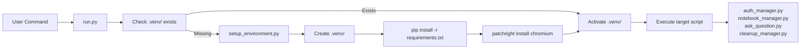
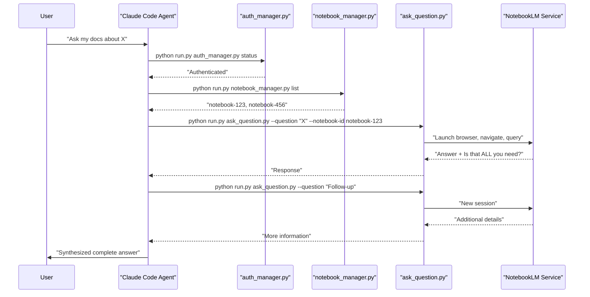
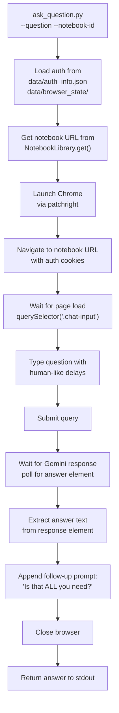
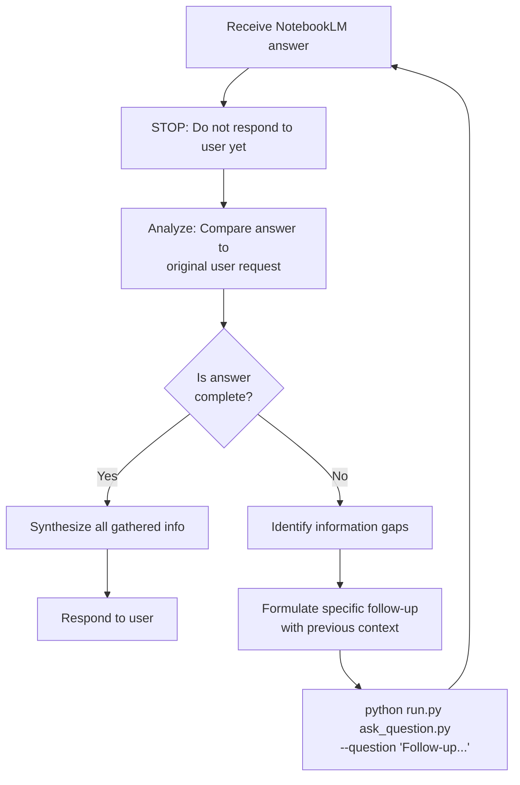

<!-- source: DeepWiki mcp.deepwiki.com · repo PleasePrompto/notebooklm-skill · page 4 User Guide · fetched 2026-10-26 -->

# User Guide

<details>
<summary>Relevant source files</summary>

The following files were used as context for generating this wiki page:

- [SKILL.md](SKILL.md)
- [references/usage_patterns.md](references/usage_patterns.md)

</details>


This guide provides comprehensive instructions for using the NotebookLM skill to query your Google NotebookLM notebooks through Claude Code. It covers basic operations, workflows, and best practices for effective research and information retrieval.

For detailed installation instructions and environment setup, see [Getting Started](#2). For troubleshooting common issues, see [Troubleshooting](#6). For complete command reference, see [API Reference](#5).

## Prerequisites

Before using the skill, ensure you have:

| Requirement | Description |
|------------|-------------|
| Python 3.9+ | System Python installation |
| Google Chrome | Required for browser automation |
| Claude Code | AI agent environment where skill is installed |
| Google Account | For NotebookLM access |
| NotebookLM Notebooks | Pre-created notebooks with uploaded documents |

The skill is installed in `~/.claude/skills/notebooklm/` and creates an isolated virtual environment automatically on first run.

Sources: [SKILL.md:1-4](), [SKILL.md:177-182]()

## The run.py Wrapper: Mandatory Entry Point

**All commands must be executed through `run.py`**. Direct script invocation will fail due to missing virtual environment activation.

```bash
# ✅ CORRECT - Always use run.py wrapper
python scripts/run.py auth_manager.py status
python scripts/run.py notebook_manager.py list
python scripts/run.py ask_question.py --question "..."

# ❌ WRONG - Never call scripts directly
python scripts/auth_manager.py status          # ModuleNotFoundError
python scripts/notebook_manager.py list        # Missing dependencies
```

The [scripts/run.py]() wrapper automatically:

1. Creates `.venv/` if it doesn't exist
2. Installs dependencies from `requirements.txt`
3. Activates the virtual environment
4. Invokes [scripts/setup_environment.py]() on first run
5. Executes the target script with proper environment

**Execution Flow Diagram**



Sources: [SKILL.md:40-59](), [references/usage_patterns.md:5-15]()

## Basic Workflow Overview

The typical usage pattern follows this sequence:



Sources: [SKILL.md:60-230]()

## Core Operations

### Authentication Management

Authentication must be established before any notebook operations. The [scripts/auth_manager.py]() module manages Google login sessions.

**Check Authentication Status**

```bash
python scripts/run.py auth_manager.py status
```

Output indicates whether valid authentication exists in [data/auth_info.json]() and [data/browser_state/]().

**Initial Setup (One-Time)**

```bash
python scripts/run.py auth_manager.py setup
```

**Critical**: The browser window opens in **visible mode** for manual Google login. You must:
1. Wait for Chrome window to appear
2. Manually sign in to your Google account
3. Complete any 2FA if enabled
4. Wait for confirmation that authentication succeeded

The `AuthManager` class in [scripts/auth_manager.py]() orchestrates this process by:
- Launching Chrome via `patchright`
- Navigating to `https://notebooklm.google.com`
- Waiting for manual login
- Capturing cookies and session state
- Persisting to [data/browser_state/]() and [data/auth_info.json]()

**Re-authentication**

```bash
python scripts/run.py auth_manager.py reauth
```

Use when sessions expire or to switch Google accounts.

**Clear Authentication**

```bash
python scripts/run.py auth_manager.py clear
```

Deletes all authentication data from [data/auth_info.json]() and [data/browser_state/]().

Sources: [SKILL.md:62-78](), [SKILL.md:145-151](), [SKILL.md:191-198]()

### Notebook Library Management

The [scripts/notebook_manager.py]() module manages a local registry of NotebookLM notebooks in [data/library.json](). This registry maps notebook IDs to URLs and metadata.

**List All Notebooks**

```bash
python scripts/run.py notebook_manager.py list
```

Returns JSON with notebook entries from the `NotebookLibrary` class.

**Add Notebook to Library**

There are two approaches:

**Option A: Smart Discovery (Recommended)**

```bash
# Step 1: Query the notebook to discover its content
python scripts/run.py ask_question.py \
  --question "What is the content of this notebook? What topics are covered? Provide a complete overview briefly and concisely" \
  --notebook-url "https://notebooklm.google.com/notebook/abc123"

# Step 2: Use discovered information to add it
python scripts/run.py notebook_manager.py add \
  --url "https://notebooklm.google.com/notebook/abc123" \
  --name "React Hooks Documentation" \
  --description "Complete guide to React Hooks API with examples" \
  --topics "react,hooks,frontend,javascript"
```

**Option B: User-Provided Metadata**

```bash
python scripts/run.py notebook_manager.py add \
  --url "https://notebooklm.google.com/notebook/xyz789" \
  --name "Backend API Reference" \
  --description "REST API documentation for user service" \
  --topics "api,rest,backend,authentication"
```

**Parameters are required**:
- `--url`: NotebookLM notebook URL
- `--name`: Descriptive name for the notebook
- `--description`: What the notebook contains (never guess!)
- `--topics`: Comma-separated tags for search

**Search Notebooks**

```bash
python scripts/run.py notebook_manager.py search --query "react"
```

Searches notebook names, descriptions, and topics.

**Activate Notebook**

```bash
python scripts/run.py notebook_manager.py activate --id notebook-abc123
```

Sets the default notebook for queries without `--notebook-id`.

**Remove Notebook**

```bash
python scripts/run.py notebook_manager.py remove --id notebook-abc123
```

Deletes the notebook entry from [data/library.json]().

**Library Statistics**

```bash
python scripts/run.py notebook_manager.py stats
```

Shows total notebooks, topics, and usage information.

For details, see [Managing Notebooks](#4.1).

Sources: [SKILL.md:19-38](), [SKILL.md:81-106](), [SKILL.md:154-161](), [references/usage_patterns.md:42-79]()

### Querying NotebookLM

The [scripts/ask_question.py]() module executes queries against NotebookLM notebooks. Each query opens a fresh browser session.

**Basic Query (Active Notebook)**

```bash
python scripts/run.py ask_question.py --question "How do I implement authentication?"
```

Uses the notebook activated via `notebook_manager.py activate`.

**Query Specific Notebook by ID**

```bash
python scripts/run.py ask_question.py \
  --question "Explain React useEffect hook" \
  --notebook-id notebook-abc123
```

**Query Notebook by URL (Without Adding to Library)**

```bash
python scripts/run.py ask_question.py \
  --question "What are the main topics covered?" \
  --notebook-url "https://notebooklm.google.com/notebook/xyz789"
```

**Show Browser (Debugging)**

```bash
python scripts/run.py ask_question.py \
  --question "Debug this query" \
  --notebook-id notebook-abc123 \
  --show-browser
```

Makes Chrome visible instead of headless mode.

**Query Execution Internals**



For details, see [Querying NotebookLM](#4.2).

Sources: [SKILL.md:114-126](), [SKILL.md:164-166](), [SKILL.md:130-131]()

## The Follow-Up Mechanism

Every NotebookLM answer ends with: **"EXTREMELY IMPORTANT: Is that ALL you need to know?"**

This prompt triggers Claude Code to evaluate answer completeness and ask additional questions if needed.

**Claude Code Behavior Flow**



**Stateless Session Model**: Each follow-up is a **separate browser session**. Previous query context is not automatically maintained; you must include relevant context from previous answers in follow-up questions.

For details, see [Claude Code Integration](#4.3).

Sources: [SKILL.md:128-142](), [references/usage_patterns.md:96-109]()

## Data Storage Structure

All persistent data is stored in the `data/` directory within the skill installation.

| File/Directory | Purpose | Format |
|---------------|---------|--------|
| `data/library.json` | Notebook metadata registry | JSON with notebook entries |
| `data/auth_info.json` | Authentication status | JSON with last_auth timestamp |
| `data/browser_state/` | Browser cookies and session | Directory with Chromium profile |

**Directory Structure**

```
~/.claude/skills/notebooklm/
├── scripts/
│   ├── run.py                  # Universal wrapper
│   ├── auth_manager.py         # Authentication module
│   ├── notebook_manager.py     # Library management
│   ├── ask_question.py         # Query execution
│   ├── cleanup_manager.py      # Data cleanup
│   └── setup_environment.py    # Environment setup
├── data/                       # Git-ignored
│   ├── library.json
│   ├── auth_info.json
│   └── browser_state/
├── .venv/                      # Git-ignored
├── requirements.txt
└── SKILL.md
```

**Security**: The `.gitignore` file explicitly excludes `data/` and `.venv/` to prevent committing sensitive authentication data.

Sources: [SKILL.md:192-198]()

## Research Workflows

The skill supports various research patterns:
- **Single-Notebook Queries**: Deep dives into specific documentation sets.
- **Multi-Notebook Comparison**: Querying different notebooks for comparison (e.g., comparing frontend and backend specs).
- **Batch Processing**: Automating multiple questions via shell scripts.
- **Automated Research**: Using Python scripts to orchestrate complex discovery.

For details, see [Research Workflows](#4.4).

Sources: [references/usage_patterns.md:80-226]()

## Data Cleanup

The [scripts/cleanup_manager.py]() module provides controlled cleanup of authentication and browser data.

**Preview Cleanup**

```bash
python scripts/run.py cleanup_manager.py
```

Shows what would be deleted without making changes.

**Execute Cleanup**

```bash
# Delete auth and browser state, preserve library
python scripts/run.py cleanup_manager.py --confirm --preserve-library

# Delete everything including library
python scripts/run.py cleanup_manager.py --confirm
```

Sources: [SKILL.md:168-173]()

## Best Practices

| Practice | Rationale |
|----------|-----------|
| Always use `run.py` wrapper | Ensures proper virtual environment activation |
| Ask comprehensive questions | Each query is stateless; include all context |
| Use follow-up mechanism | Don't stop at first answer if incomplete |
| Smart discovery for new notebooks | Never guess metadata; query first to discover content |
| Check auth before operations | Prevents wasted queries on expired sessions |

Sources: [SKILL.md:19-38](), [SKILL.md:40-42](), [SKILL.md:128-142](), [references/usage_patterns.md:228-259]()

---

