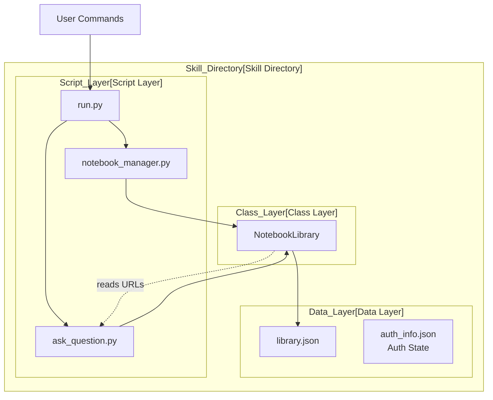
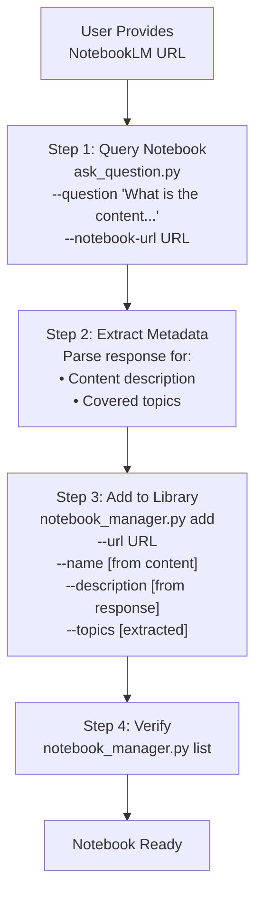
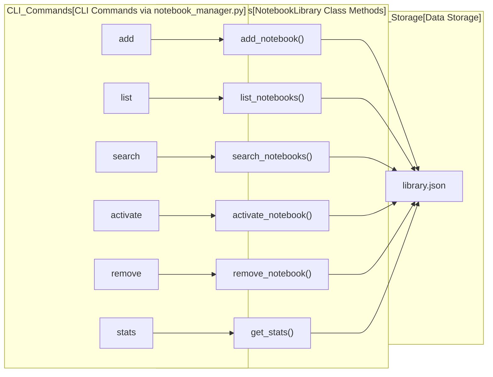
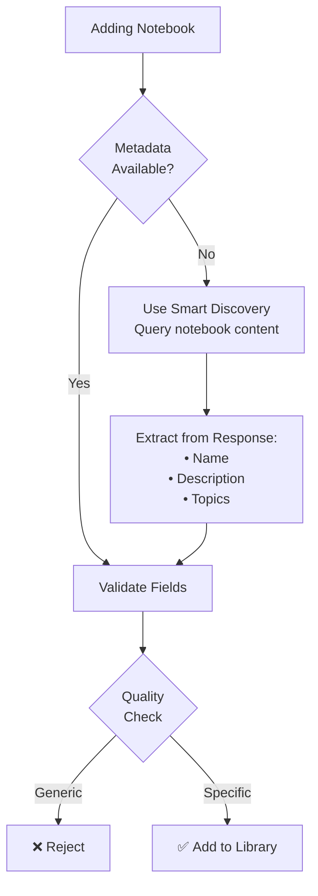
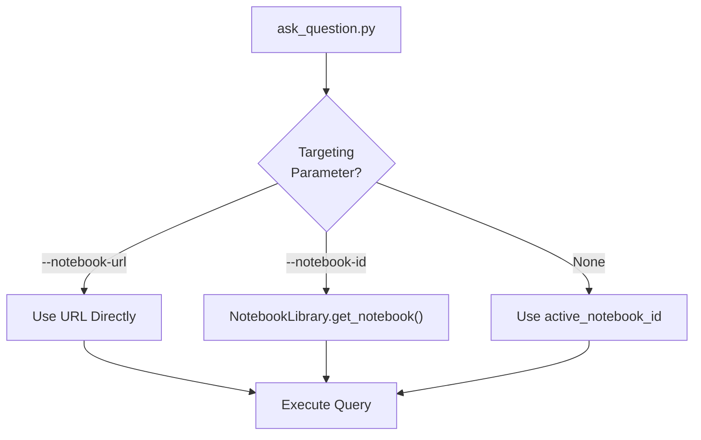

<!-- source: DeepWiki mcp.deepwiki.com · repo PleasePrompto/notebooklm-skill · page 4.1 Managing Notebooks · fetched 2026-10-26 -->

# Managing Notebooks

<details>
<summary>Relevant source files</summary>

The following files were used as context for generating this wiki page:

- [references/api_reference.md](references/api_reference.md)
- [references/usage_patterns.md](references/usage_patterns.md)
- [scripts/notebook_manager.py](scripts/notebook_manager.py)

</details>


This page covers the notebook library system, which maintains a local registry of NotebookLM notebooks for quick access and organization. It explains how to add, list, search, activate, and remove notebooks using the `notebook_manager.py` module and the critical smart discovery workflow for automatic metadata extraction.

For conceptual details about the library system architecture, see [Notebook Library](#3.3). For the complete API reference, see [notebook_manager.py](#5.3). For information on querying notebooks after adding them, see [Querying NotebookLM](#4.2).

## The Notebook Library system

The notebook library is a local metadata registry stored in `data/library.json` that maps notebook identifiers to NotebookLM URLs and descriptive metadata. This allows referring to notebooks by memorable names or IDs rather than full URLs, and enables search functionality across your documentation collection.

**Library Structure Diagram**



Sources: [references/api_reference.md:183-193](), [scripts/notebook_manager.py:17-32](), [scripts/run.py:1-15]()

### Library Data Structure

The `NotebookLibrary` class manages the collection in `data/library.json` [scripts/notebook_manager.py:17-32](). Each notebook entry contains:

| Field | Type | Purpose |
|-------|------|---------|
| `id` | string | Unique identifier generated from name [scripts/notebook_manager.py:89-89]() |
| `url` | string | NotebookLM notebook URL [scripts/notebook_manager.py:98-98]() |
| `name` | string | User-friendly display name [scripts/notebook_manager.py:99-99]() |
| `description` | string | Content description [scripts/notebook_manager.py:100-100]() |
| `topics` | array | Searchable topic tags [scripts/notebook_manager.py:101-101]() |
| `created_at` | timestamp | Addition timestamp [scripts/notebook_manager.py:105-105]() |
| `use_count` | integer | Number of times accessed [scripts/notebook_manager.py:107-107]() |

The library also tracks `active_notebook_id` to indicate which notebook is used by default [scripts/notebook_manager.py:29-29]().

Sources: [scripts/notebook_manager.py:88-109](), [references/api_reference.md:188-193]()

## Smart Discovery Workflow

The **smart discovery workflow** is the recommended method for adding notebooks. Instead of manually specifying metadata, the system queries the notebook to automatically extract its content description and topics [references/usage_patterns.md:42-59]().

**Smart Discovery Process Flow**



Sources: [references/api_reference.md:47-55](), [references/usage_patterns.md:42-59]()

### Discovery Query Command

```bash
# Step 1: Discover notebook content
python scripts/run.py ask_question.py \
  --question "What is the content of this notebook? What topics are covered? Provide a complete overview briefly and concisely" \
  --notebook-url "https://notebooklm.google.com/notebook/..."
```

The discovery query uses `ask_question.py` with the `--notebook-url` parameter [references/api_reference.md:49-51](). This allows querying a notebook without adding it to the library first.

Sources: [references/api_reference.md:47-51](), [references/usage_patterns.md:47-51]()

### Adding with Discovered Metadata

```bash
# Step 2: Add notebook with discovered information
python scripts/run.py notebook_manager.py add \
  --url "https://notebooklm.google.com/notebook/..." \
  --name "React Documentation" \
  --description "Complete React framework documentation including hooks and components" \
  --topics "react,frontend,javascript"
```

Sources: [references/api_reference.md:51-55](), [scripts/notebook_manager.py:63-72]()

### Manual Add Fallback

If discovery fails, prompt the user for metadata [references/usage_patterns.md:61-73](). **Critical**: Never guess what is in a notebook or use generic descriptions [references/usage_patterns.md:75-78]().

Sources: [references/usage_patterns.md:61-78]()

## Core Operations

**NotebookLibrary Class Methods Mapping**



Sources: [scripts/notebook_manager.py:63-238](), [references/api_reference.md:80-86]()

### Adding Notebooks

The `add` command creates a new entry in `library.json` [scripts/notebook_manager.py:63-122]().

```bash
python scripts/run.py notebook_manager.py add \
  --url "https://notebooklm.google.com/notebook/ID" \
  --name "Name" \
  --description "Description" \
  --topics "topic1,topic2"
```

The system generates an ID by replacing spaces and underscores with hyphens in the name [scripts/notebook_manager.py:89-89]().

Sources: [scripts/notebook_manager.py:88-121](), [references/api_reference.md:51-55]()

### Listing Notebooks

The `list` command displays all notebooks and the current active notebook [scripts/notebook_manager.py:202-204]().

```bash
python scripts/run.py notebook_manager.py list
```

Sources: [scripts/notebook_manager.py:202-204](), [references/api_reference.md:65-65]()

### Searching Notebooks

The `search` command finds notebooks by keyword matching across name, description, topics, and tags [scripts/notebook_manager.py:206-224]().

```bash
python scripts/run.py notebook_manager.py search --query "keyword"
```

Sources: [scripts/notebook_manager.py:206-224](), [references/api_reference.md:67-68]()

### Activating Notebooks

The `activate` command sets the default notebook for queries [scripts/notebook_manager.py:226-238]().

```bash
python scripts/run.py notebook_manager.py activate --id notebook-id
```

The active notebook is stored as `active_notebook_id` in `library.json` [scripts/notebook_manager.py:55-55]().

Sources: [scripts/notebook_manager.py:226-238](), [references/api_reference.md:70-71]()

### Removing Notebooks

The `remove` command deletes a notebook from the library [scripts/notebook_manager.py:123-148]().

```bash
python scripts/run.py notebook_manager.py remove --id notebook-id
```

If the active notebook is removed, the system automatically sets a new active notebook if others exist [scripts/notebook_manager.py:137-141]().

Sources: [scripts/notebook_manager.py:123-148](), [references/api_reference.md:73-74]()

### Library Statistics

The `stats` command provides an overview of the library contents [references/api_reference.md:76-77]().

```bash
python scripts/run.py notebook_manager.py stats
```

Sources: [references/api_reference.md:76-77](), [scripts/notebook_manager.py:240-264]()

## Metadata Requirements

All metadata fields (`--url`, `--name`, `--topics`) are required when adding notebooks [references/api_reference.md:81-81]().

**Metadata Quality Guidelines**



Sources: [references/usage_patterns.md:42-79](), [scripts/notebook_manager.py:63-87]()

### Description and Topics

**Description**: Should summarize document types and subject areas [references/usage_patterns.md:33-33]().
**Topics**: Comma-separated keywords used for search matching [scripts/notebook_manager.py:68-68]().

Sources: [references/usage_patterns.md:33-35](), [scripts/notebook_manager.py:63-72]()

## Integration with Query Operations

The notebook library integrates with `ask_question.py` to resolve targets [references/api_reference.md:26-31]().

**Query Targeting Flow**



Sources: [references/api_reference.md:26-34](), [scripts/notebook_manager.py:198-200]()

---

