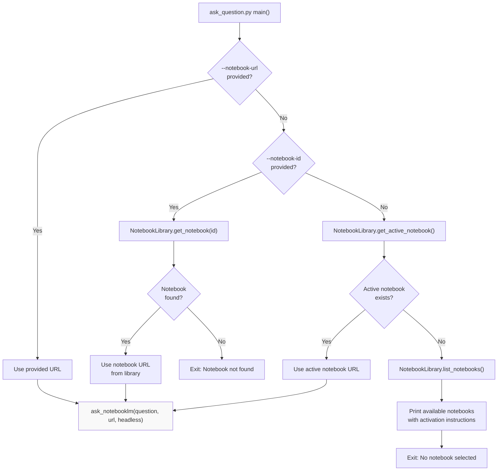
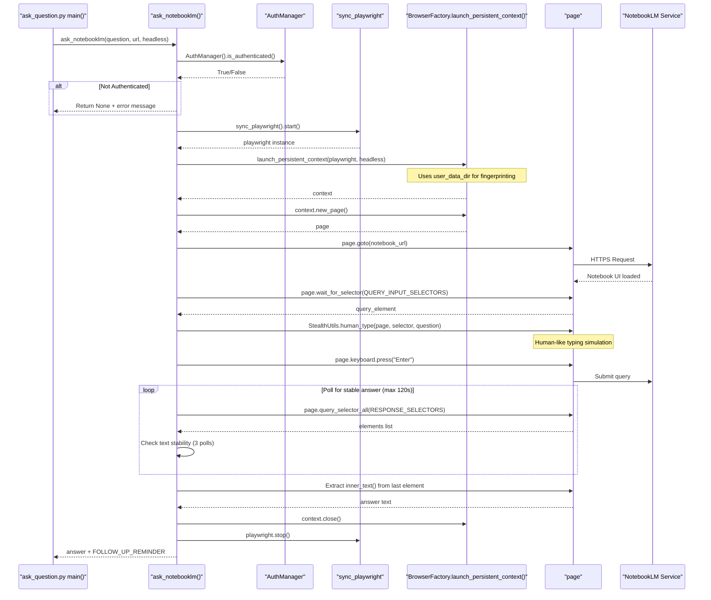
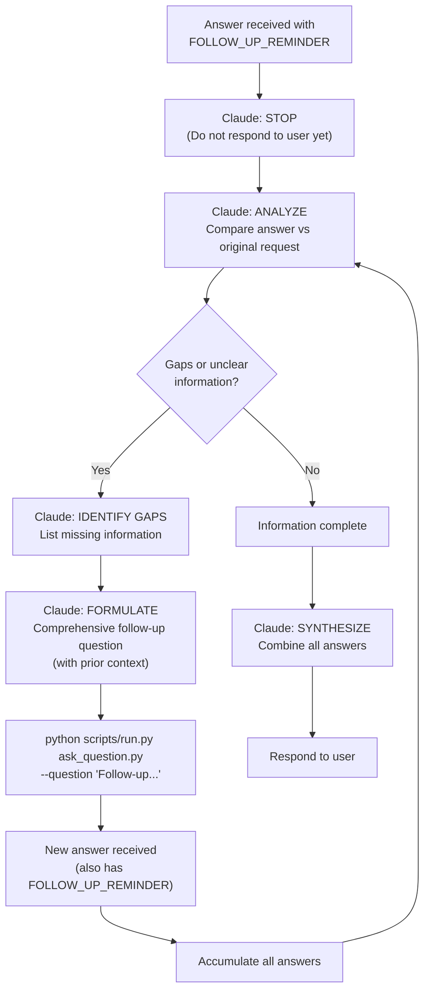
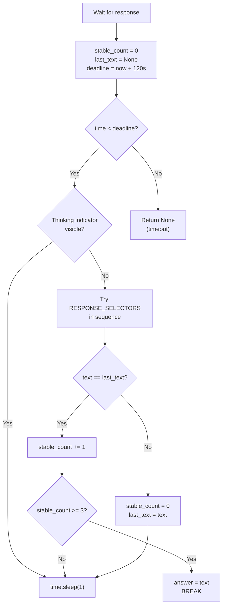

<!-- source: DeepWiki mcp.deepwiki.com · repo PleasePrompto/notebooklm-skill · page 4.2 Querying NotebookLM · fetched 2026-10-26 -->

# Querying NotebookLM

<details>
<summary>Relevant source files</summary>

The following files were used as context for generating this wiki page:

- [SKILL.md](SKILL.md)
- [references/usage_patterns.md](references/usage_patterns.md)
- [scripts/ask_question.py](scripts/ask_question.py)

</details>


This page covers executing queries against NotebookLM notebooks using the `ask_question.py` interface. It explains question formulation best practices, the critical follow-up mechanism that enables multi-turn research conversations, notebook selection methods, and rate limit considerations. For managing the notebook library itself, see [4.1 Managing Notebooks]().

## Query Execution Flow

The `ask_question.py` script orchestrates a complete query cycle: launching a browser session, loading authentication, navigating to a notebook, submitting a question, extracting the response, and closing the browser.

### Basic Command Syntax

All queries must be executed through the `run.py` wrapper to ensure the virtual environment and dependencies are correctly loaded:

```bash
# Query with active notebook
python scripts/run.py ask_question.py --question "Your question here"

# Query specific notebook by ID
python scripts/run.py ask_question.py --question "..." --notebook-id notebook-1

# Query by direct URL (bypasses library)
python scripts/run.py ask_question.py --question "..." --notebook-url "https://notebooklm.google.com/notebook/..."

# Show browser for debugging
python scripts/run.py ask_question.py --question "..." --show-browser
```

Sources: [scripts/ask_question.py:190-227](), [SKILL.md:114-126]()

### Notebook Selection Resolution

The script follows a specific hierarchy to determine which notebook URL to load.

"Notebook Selection Logic in ask_question.py"


**Resolution Priority Table:**

| Parameter Provided | Behavior | Library Lookup |
|-------------------|----------|----------------|
| `--notebook-url` | Use URL directly | No |
| `--notebook-id` | Look up ID in library | Yes (via `get_notebook()`) |
| Neither | Use active notebook | Yes (via `get_active_notebook()`) |
| None available | Show available notebooks | Yes (via `list_notebooks()`) |

Sources: [scripts/ask_question.py:200-227](), [scripts/notebook_manager.py:40-58]()

### Query Execution Internals

The execution utilizes a hybrid authentication approach to bypass common Playwright session persistence issues.

"Internal Execution Sequence"


Sources: [scripts/ask_question.py:40-188](), [scripts/browser_utils.py:15-85]()

## Question Formulation Best Practices

Effective queries require careful formulation due to the stateless session model where each question opens a fresh browser instance.

### Context Inclusion Requirements

Because every query is a new session, you must include necessary context in follow-up questions.

| Scenario | Question Style | Rationale |
|----------|---------------|-----------|
| Initial query | "Explain feature X: implementation, API, examples" | Single comprehensive question |
| Follow-up | "In the previous answer about X, clarify Y with examples" | Include prior context explicitly |
| Multi-part | "For React hooks: 1) useState usage 2) useEffect patterns" | Numbered structure for clarity |
| Comparison | "Compare approaches A and B in terms of performance" | Explicit comparison criteria |

Sources: [references/usage_patterns.md:230-234](), [SKILL.md:128-142]()

## Follow-Up Mechanism (Critical)

The follow-up mechanism is the core pattern that enables comprehensive research through multiple stateless queries.

### The FOLLOW_UP_REMINDER

Every answer returned by `ask_notebooklm()` includes this appended text:

```python
FOLLOW_UP_REMINDER = (
    "\n\nEXTREMELY IMPORTANT: Is that ALL you need to know? "
    "You can always ask another question! Think about it carefully: "
    "before you reply to the user, review their original request and this answer. "
    "If anything is still unclear or missing, ask me another comprehensive question "
    "that includes all necessary context (since each question opens a new browser session)."
)
```

Sources: [scripts/ask_question.py:31-37](), [scripts/ask_question.py:167]()

### Follow-Up Decision Flow

"Claude Follow-up Decision Process"


Sources: [SKILL.md:128-142](), [references/usage_patterns.md:96-109]()

## Response Extraction Process

The system uses polling with text stability detection to extract answers from NotebookLM's dynamically rendered responses.

### Selector Cascade

The system uses a list of known selectors to find the input box and the bot's response.

```python
# Defined in config.py
QUERY_INPUT_SELECTORS = [
    "textarea.query-box-input",
    'textarea[aria-label="Feld für Anfragen"]',
    "textarea[placeholder*='Ask']",
    "textarea"
]

RESPONSE_SELECTORS = [
    ".to-user-container .message-text-content",
    ".to-user-container",
    "[data-message-author='bot']",
    ".message-content"
]
```

Sources: [scripts/config.py:20-35](), [scripts/ask_question.py:86-101]()

### Stability Detection Algorithm

"Answer Stability Polling Logic"


Sources: [scripts/ask_question.py:120-163]()

## Rate Limits and Performance

### Performance Characteristics

| Configuration | Value | Purpose |
|--------------|-------|---------|
| `headless` | `True` (default) | Optimized for CLI execution |
| `typing delay` | Variable | Human-like typing speed via `StealthUtils` |
| `polling` | 1 second | Balance between speed and CPU usage |
| `timeout` | 120 seconds | Maximum wait for Gemini to generate response |

Sources: [scripts/ask_question.py:102-123](), [scripts/browser_utils.py:100-120]()

### Rate Limit Handling

NotebookLM may impose rate limits on the number of queries per hour/day per account.

1. **Batch Processing**: Use `sleep` between automated queries to avoid triggering anti-bot mechanisms.
2. **Account Switching**: If rate limited, use `python scripts/run.py auth_manager.py reauth` to log in with a different Google account.
3. **Comprehensive Questions**: Instead of many small queries, ask one large structured question to maximize the value of each session.

Sources: [references/usage_patterns.md:135-138](), [references/usage_patterns.md:156-158]()

---

