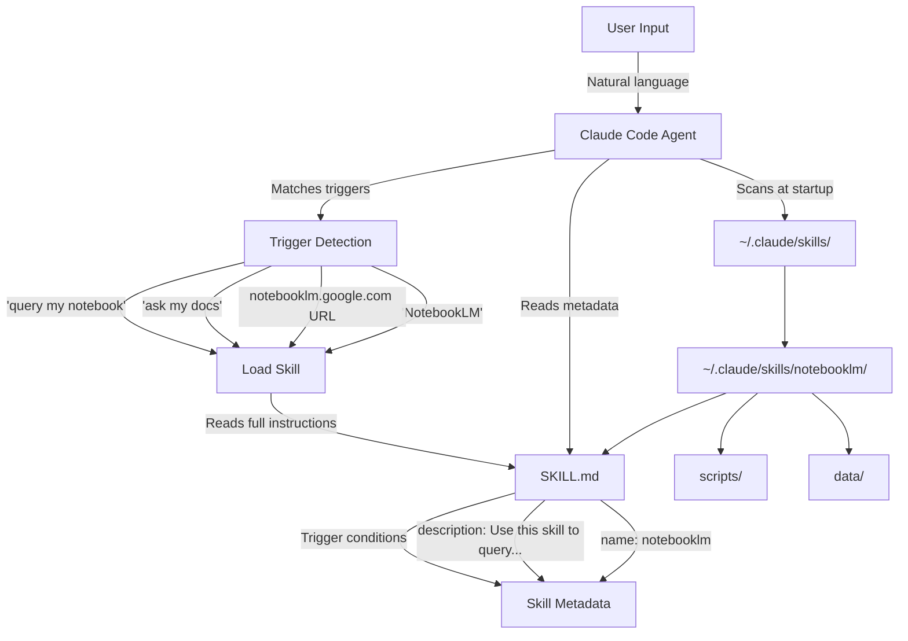
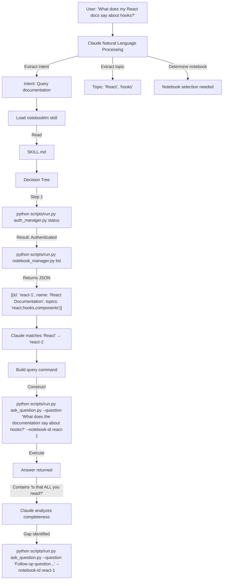
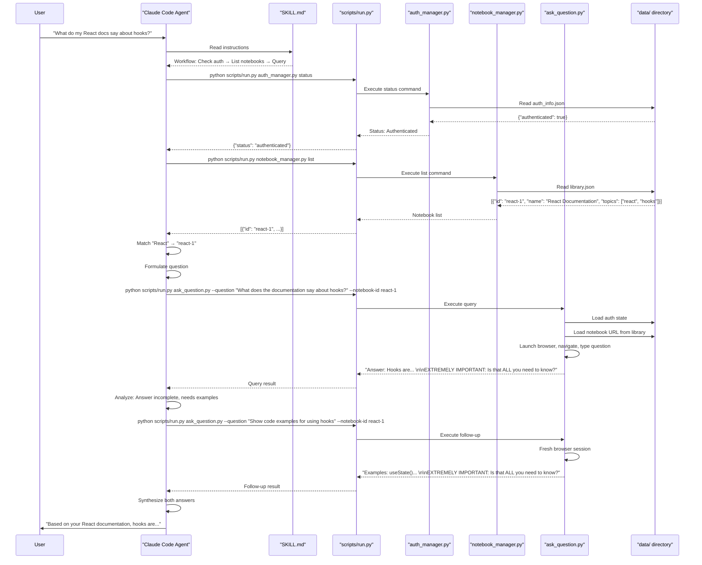
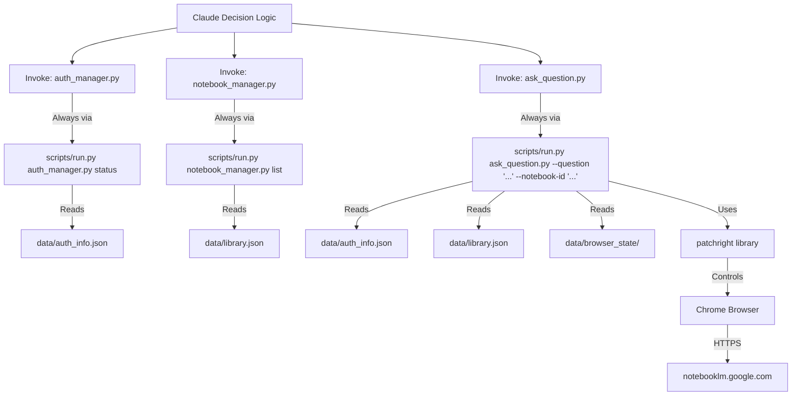
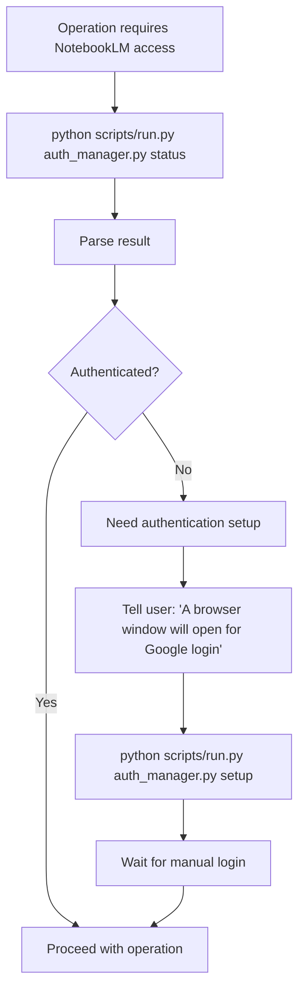

<!-- source: DeepWiki mcp.deepwiki.com · repo PleasePrompto/notebooklm-skill · page 4.3 Claude Code Integration · fetched 2026-10-26 -->

# Claude Code Integration

<details>
<summary>Relevant source files</summary>

The following files were used as context for generating this wiki page:

- [README.md](README.md)
- [SKILL.md](SKILL.md)

</details>


This page explains how the NotebookLM skill integrates with Claude Code's AI agent architecture. It covers how Claude Code discovers the skill, interprets natural language commands, routes requests to skill operations, and manages multi-turn research conversations through the follow-up mechanism.

For details on the command-line interfaces that Claude invokes, see **5.1 run.py - Universal Wrapper**, **5.4 ask_question.py**, and other API references in section **5**. For understanding the stateless session model that underlies this integration, see **3.1 Stateless Session Model**.

---

## Skill Discovery and Loading

Claude Code automatically discovers skills installed in the `~/.claude/skills/` directory. The NotebookLM skill is loaded when Claude detects relevant user intent or explicit mentions of NotebookLM.

### Discovery Process



**Sources:** [SKILL.md:1-18](), [README.md:145-179]()

### Trigger Conditions

The skill defines explicit trigger conditions in `SKILL.md` that Claude Code uses to determine when to load the skill:

| Trigger Type | Examples | Location in Code |
|--------------|----------|------------------|
| Explicit mentions | "NotebookLM", "ask my NotebookLM" | [SKILL.md:10-17]() |
| URL patterns | `https://notebooklm.google.com/notebook/...` | [SKILL.md:14]() |
| Intent phrases | "query my notebook", "check my docs", "ask my docs" | [SKILL.md:17]() |
| Library operations | "add documentation", "show my notebooks" | [SKILL.md:16]() |

**Sources:** [SKILL.md:10-17]()

---

## Interface Definition via SKILL.md

The `SKILL.md` file serves as a declarative interface specification that Claude Code reads to understand available operations. This file defines the contract between Claude's natural language processing and the skill's command-line interface.

### SKILL.md Structure

```mermaid
graph TB
    SKILLMD["SKILL.md"] --> Metadata["Metadata Block"]
    SKILLMD --> WhenToUse["When to Use Section"]
    SKILLMD --> CoreWorkflow["Core Workflow"]
    SKILLMD --> ScriptReference["Script Reference"]
    SKILLMD --> FollowUpMechanism["Follow-Up Mechanism"]
    
    Metadata -->|"name, description"| ClaudeIndex["Claude's Skill Index"]
    
    WhenToUse -->|"Trigger conditions"| TriggerRules["if 'NotebookLM' in user_input"]
    
    CoreWorkflow -->|"Step 1: Check auth"| AuthCommand["python scripts/run.py auth_manager.py status"]
    CoreWorkflow -->|"Step 2: Setup if needed"| SetupCommand["python scripts/run.py auth_manager.py setup"]
    CoreWorkflow -->|"Step 3: Manage library"| LibraryCommands["python scripts/run.py notebook_manager.py list/add/..."]
    CoreWorkflow -->|"Step 4: Ask questions"| QueryCommand["python scripts/run.py ask_question.py --question '...'"]
    
    ScriptReference -->|"auth_manager.py commands"| AuthAPI["setup, status, reauth, clear"]
    ScriptReference -->|"notebook_manager.py commands"| NotebookAPI["add, list, search, activate, remove"]
    ScriptReference -->|"ask_question.py parameters"| QueryAPI["--question, --notebook-id, --notebook-url, --show-browser"]
    
    FollowUpMechanism -->|"Required behavior"| FollowUpLogic["STOP, ANALYZE, IDENTIFY GAPS, ASK FOLLOW-UP, REPEAT, SYNTHESIZE"]
```



**Sources:** [SKILL.md:1-174]()

### Critical Directives

The `SKILL.md` file includes critical directives that modify Claude's behavior:

**Always Use run.py Wrapper**
The skill explicitly forbids calling Python scripts directly to ensure the virtual environment is managed correctly.
```bash
# ✅ CORRECT - Always use run.py:
python scripts/run.py auth_manager.py status

# ❌ WRONG - Never call directly:
python scripts/auth_manager.py status  # Fails without venv!
```
Location: [SKILL.md:40-58]()

**Smart Discovery for Adding Notebooks**
Claude is instructed to query a notebook before adding it to extract high-quality metadata.
```bash
# Step 1: Query the notebook about its content
python scripts/run.py ask_question.py --question "What is the content of this notebook?..." --notebook-url "[URL]"

# Step 2: Use discovered information to add it
python scripts/run.py notebook_manager.py add --url "[URL]" --name "[Based on content]" --description "[Based on content]" --topics "[Based on content]"
```
Location: [SKILL.md:19-38]()

**Sources:** [SKILL.md:19-58]()

---

## Natural Language Interpretation

Claude Code uses its language model to interpret user intent and map it to skill operations. This process involves parsing natural language, extracting parameters, and constructing command-line invocations.

### Intent to Command Mapping



**Sources:** [SKILL.md:10-17](), [SKILL.md:128-142](), [README.md:30-44]()

### Parameter Extraction

Claude extracts structured parameters from natural language:

| User Input | Extracted Parameters | Constructed Command |
|------------|---------------------|---------------------|
| "Ask my API docs about authentication" | `notebook="API docs"`, `question="authentication"` | `python scripts/run.py ask_question.py --question "authentication" --notebook-id api-docs` |
| "Add this notebook: https://..." | `url="https://..."` | Triggers smart discovery workflow [SKILL.md:19-38]() |
| "Show my notebooks" | None | `python scripts/run.py notebook_manager.py list` |
| "Set up NotebookLM" | None | `python scripts/run.py auth_manager.py setup` |

**Sources:** [SKILL.md:83-106](), [SKILL.md:113-126]()

---

## Execution Flow

The typical execution flow involves multiple sequential script invocations orchestrated by Claude Code. Each invocation is stateless, with Claude managing the overall conversation state.

### Complete Request Flow



**Sources:** [SKILL.md:62-84](), [README.md:173-179]()

### Code Entity Mapping



**Sources:** [SKILL.md:40-58](), [README.md:162-179](), [SKILL.md:143-173]()

---

## Follow-Up Mechanism

The follow-up mechanism is the core innovation that enables Claude to conduct deep, multi-turn research conversations. Every answer from NotebookLM includes a prompt that triggers Claude to evaluate completeness and ask additional questions.

### Follow-Up Prompt

Each response from `ask_question.py` appends this prompt:
`EXTREMELY IMPORTANT: Is that ALL you need to know?`

Location: [SKILL.md:130]()

### Required Claude Behavior

The `SKILL.md` specifies the exact behavior Claude must follow when it sees this prompt:

1. **STOP** - Do not immediately respond to user [SKILL.md:133]().
2. **ANALYZE** - Compare answer to user's original request [SKILL.md:134]().
3. **IDENTIFY GAPS** - Determine if more information needed [SKILL.md:135]().
4. **ASK FOLLOW-UP** - If gaps exist, immediately ask: `python scripts/run.py ask_question.py --question "Follow-up with context..."` [SKILL.md:136-139]().
5. **REPEAT** - Continue until information is complete [SKILL.md:140]().
6. **SYNTHESIZE** - Combine all answers before responding to user [SKILL.md:141]().

**Sources:** [SKILL.md:128-142]()

---

## Multi-Turn Conversation Management

Claude manages multi-turn research conversations by maintaining conversation context while the underlying skill operations remain stateless. This creates an illusion of session persistence at the conversation level while each browser session is fresh.

### Context Inclusion in Follow-Ups

Since each browser session is stateless [README.md:155](), Claude must include relevant context in each follow-up question to ensure Gemini in NotebookLM has the necessary background.

**Initial Question:**
```bash
python scripts/run.py ask_question.py \
  --question "What does the API documentation say about user authentication?" \
  --notebook-id api-docs
```

**Follow-Up Question (includes context from Turn 1):**
```bash
python scripts/run.py ask_question.py \
  --question "Based on the OAuth 2.0 approach mentioned, what are the specific error codes?" \
  --notebook-id api-docs
```

**Sources:** [SKILL.md:113-126](), [SKILL.md:136-139]()

---

## Decision Logic

Claude uses a decision tree to determine which skill operations to invoke based on the current state and user intent.

### Authentication Decision Logic

Claude is instructed to always check status before performing operations that require a session.



**Sources:** [SKILL.md:62-80](), [SKILL.md:145-151]()

### Smart Discovery Logic

When a user wants to add a notebook but metadata is unknown, Claude uses the "Smart Add" workflow:

1. **Step 1**: Query the notebook URL directly for content overview: `python scripts/run.py ask_question.py --question "What is the content...?" --notebook-url "[URL]"` [SKILL.md:25-26]().
2. **Step 2**: Use the answer to populate the `add` command: `python scripts/run.py notebook_manager.py add --url "[URL]" --name "[Name]" --description "[Desc]" --topics "[Topics]"` [SKILL.md:28-30]().

**Sources:** [SKILL.md:19-38]()

---

## Summary

The Claude Code integration is designed around several key principles:

1. **Declarative Interface**: `SKILL.md` defines available operations; Claude interprets natural language and maps to commands.
2. **Stateless Operations**: Each script invocation is independent [README.md:155](); Claude maintains conversation context.
3. **Follow-Up Mechanism**: Automatic prompt triggers Claude to ask comprehensive follow-up questions until the user's request is satisfied [SKILL.md:128-142]().
4. **Smart Discovery**: Claude can query notebooks to discover their content before adding them to the library [SKILL.md:19-38]().
5. **Universal Wrapper**: All interactions go through `run.py` to ensure environment stability [SKILL.md:40-58]().

**Sources:** [SKILL.md:1-198](), [README.md:1-179]()

---

