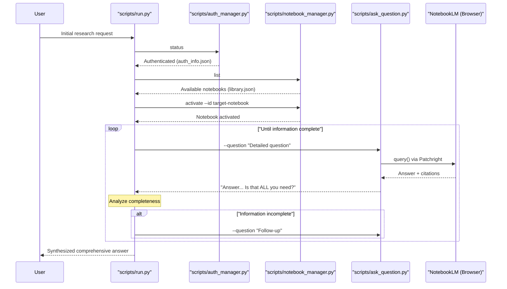
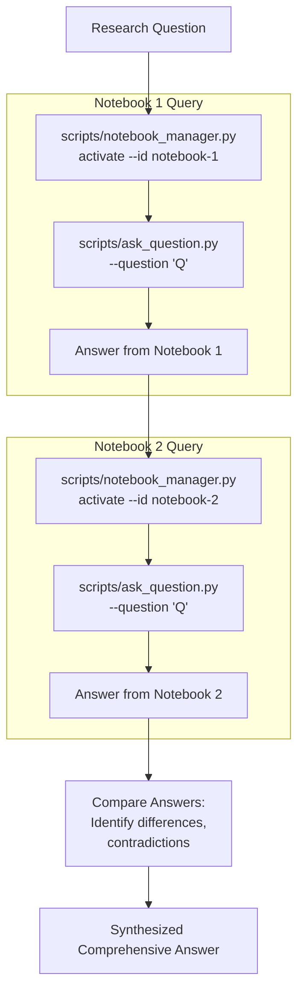
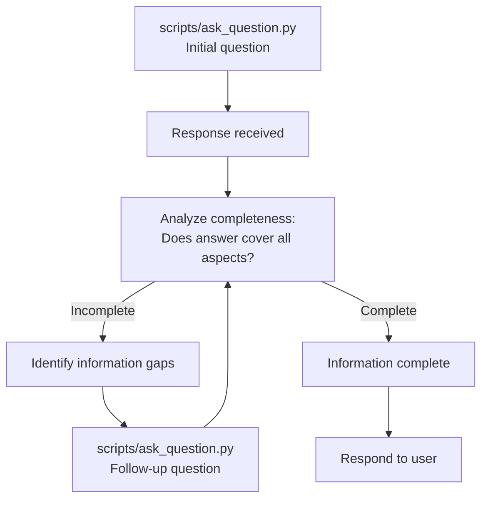

<!-- source: DeepWiki mcp.deepwiki.com · repo PleasePrompto/notebooklm-skill · page 4.4 Research Workflows · fetched 2026-10-26 -->

# Research Workflows

<details>
<summary>Relevant source files</summary>

The following files were used as context for generating this wiki page:

- [references/api_reference.md](references/api_reference.md)
- [references/usage_patterns.md](references/usage_patterns.md)

</details>


This document describes common research patterns and workflows for using the NotebookLM Skill system. It demonstrates how to combine core operations (authentication, notebook management, and querying) into practical research scenarios.

For detailed information about individual operations, see:
- Managing notebooks: [Managing Notebooks](#4.1)
- Querying syntax and parameters: [Querying NotebookLM](#4.2)
- Claude Code natural language integration: [Claude Code Integration](#4.3)

Sources: [references/usage_patterns.md:1-4]()

## Single Notebook Deep Dive

This workflow queries a single notebook with iterative follow-up questions to extract comprehensive information on a topic.

### Basic Pattern

The following diagram illustrates the interaction between the universal wrapper `run.py`, the specialized management scripts, and the browser automation layer.

Title: Single Notebook Query Sequence


Sources: [references/usage_patterns.md:80-109](), [references/api_reference.md:133-150]()

### Implementation Example

```bash
# Step 1: Check authentication status
python scripts/run.py auth_manager.py status

# Step 2: List available notebooks to find target
python scripts/run.py notebook_manager.py list

# Step 3: Activate the target notebook
python scripts/run.py notebook_manager.py activate --id react-docs-1

# Step 4: Initial comprehensive question
python scripts/run.py ask_question.py \
  --question "Explain React hooks in detail: core concepts, useState and useEffect implementation, best practices, common pitfalls, and code examples"

# Step 5: Follow-up questions based on initial response
python scripts/run.py ask_question.py \
  --question "Provide specific examples of custom hooks using useState and useEffect, including error handling patterns"
```

Sources: [references/usage_patterns.md:17-35](), [references/api_reference.md:19-34]()

## Multi-Notebook Comparison

This workflow queries multiple notebooks with the same or related questions to compare information across different sources.

Title: Multi-Notebook Comparison Workflow


Sources: [references/usage_patterns.md:111-122]()

## Iterative Research with Follow-ups

The follow-up mechanism is critical for extracting complete information. Every response from `ask_question.py` ends with `"EXTREMELY IMPORTANT: Is that ALL you need to know?"` to trigger additional queries.

### Follow-up Decision Tree

Title: Follow-up Logic Flow


Sources: [references/usage_patterns.md:96-109]()

## Batch Processing and Automation

For large-scale research, users can automate queries via shell scripts or Python `subprocess` calls.

### Batch Question Processing

| Aspect | Consideration | Implementation Detail |
|------|--------|---------|
| **Rate Limits** | 50 queries/day | Free Google accounts have a daily cap. [references/api_reference.md:231-239]() |
| **Delays** | Sleep between queries | Use `sleep 2` or similar to avoid rate limits. [references/usage_patterns.md:156-156]() |
| **Wrapper** | Universal `run.py` | All batch calls must use `scripts/run.py` to ensure `.venv` is used. [references/api_reference.md:7-15]() |

### Automated Research Script (Python)

Users can integrate the skill into custom Python scripts by calling the CLI via `subprocess`.

```python
import subprocess

def research_topic(topic, notebook_id):
    question = f"Explain {topic} in detail..."
    
    # Always use run.py wrapper for environment isolation
    result = subprocess.run([
        "python", "scripts/run.py", "ask_question.py",
        "--question", question,
        "--notebook-id", notebook_id
    ], capture_output=True, text=True)

    return result.stdout
```

Sources: [references/usage_patterns.md:160-184](), [references/api_reference.md:153-167]()

## Smart Notebook Discovery

When adding a new notebook, the recommended workflow is to query it first to extract metadata.

1.  **Discovery Query**: Ask the notebook to describe itself using `ask_question.py --notebook-url "[URL]"`. [references/usage_patterns.md:46-51]()
2.  **Library Addition**: Use the response to populate `--name`, `--description`, and `--topics` in `notebook_manager.py add`. [references/usage_patterns.md:53-58]()

Sources: [references/usage_patterns.md:42-59](), [references/api_reference.md:48-55]()

---

