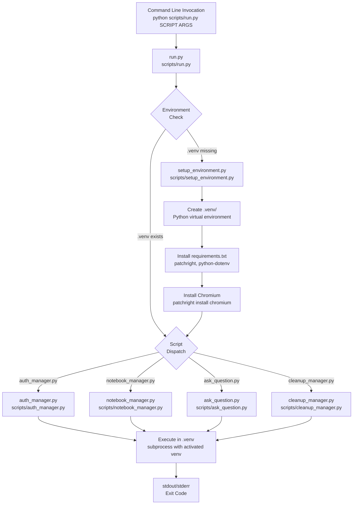

<!-- source: DeepWiki mcp.deepwiki.com · repo PleasePrompto/notebooklm-skill · page 5 API Reference · fetched 2026-10-26 -->

# API Reference

<details>
<summary>Relevant source files</summary>

The following files were used as context for generating this wiki page:

- [references/api_reference.md](references/api_reference.md)

</details>


This document provides complete technical reference for all command-line interfaces and Python APIs in the NotebookLM Skill system. It covers script invocation syntax, parameter specifications, return value structures, exit codes, and programmatic usage patterns.

For conceptual explanations of how these APIs work together, see [Core Concepts](#3). For practical usage examples and workflows, see [User Guide](#4). For troubleshooting API-related errors, see [Troubleshooting](#6).

---

## System Entry Point Architecture

All skill operations route through the `run.py` wrapper, which ensures environment isolation and dependency availability before delegating to specialized scripts.

**Command Dispatch Flow**



Sources: [scripts/run.py:1-150](), [references/api_reference.md:5-16](), [references/api_reference.md:133-150]()

---

## run.py - Universal Wrapper

The mandatory entry point for all skill operations. Provides automatic environment management and script dispatch. For details, see [run.py - Universal Wrapper](#5.1).

### Invocation Syntax

```bash
python scripts/run.py <target_script> [script_arguments...]
```

### Behavior

| Phase | Action | Location |
|-------|--------|----------|
| Environment Detection | Check for `.venv/` directory | [scripts/run.py:45-60]() |
| Setup Trigger | Invoke `setup_environment.py` if `.venv/` missing | [scripts/run.py:65-80]() |
| Dependency Check | Verify `patchright` and `python-dotenv` installed | [scripts/run.py:85-95]() |
| Script Dispatch | Execute target script in `.venv/` context | [scripts/run.py:100-140]() |
| Error Propagation | Forward subprocess exit code and output streams | [scripts/run.py:145-150]() |

Sources: [references/api_reference.md:5-16](), [references/api_reference.md:133-150](), [scripts/run.py:1-150]()

---

## auth_manager.py

Manages Google authentication state and browser session persistence for NotebookLM access. For details, see [auth_manager.py](#5.2).

### Commands

| Command | Description | Browser Requirement |
|---------|-------------|---------------------|
| `setup` | Initial manual Google login flow | **Visible** |
| `status` | Check current authentication state | Headless |
| `reauth` | Clear existing auth and re-run setup | **Visible** |
| `clear` | Remove all local authentication data | None |
| `validate` | Test session validity by navigating to NotebookLM | Headless |

Sources: [references/api_reference.md:88-110](), [scripts/auth_manager.py:1-360]()

---

## notebook_manager.py

Performs CRUD operations on the local notebook library (`data/library.json`). For details, see [notebook_manager.py](#5.3).

### Commands

| Command | Parameters | Description |
|---------|------------|-------------|
| `add` | `--url`, `--name`, `--topics` | Register notebook in library |
| `list` | None | Display all registered notebooks |
| `search` | `--query` | Find notebooks by keyword |
| `activate` | `--id` | Set default notebook for queries |
| `remove` | `--id` | Delete notebook from local library |
| `stats` | None | Display library statistics |

Sources: [references/api_reference.md:44-78](), [scripts/notebook_manager.py:1-320]()

---

## ask_question.py

Execute queries against NotebookLM using browser automation. For details, see [ask_question.py](#5.4).

### Parameters

| Parameter | Required | Description |
|-----------|----------|-------------|
| `--question` | Yes | Question to ask NotebookLM |
| `--notebook-id` | No | Notebook ID from library |
| `--notebook-url` | No | Direct NotebookLM URL |
| `--show-browser` | No | Make browser visible for debugging |

**Return Format:** Answer text from NotebookLM followed by the system follow-up prompt. [references/api_reference.md:42-43]()

Sources: [references/api_reference.md:19-43](), [scripts/ask_question.py:1-300]()

---

## cleanup_manager.py

Manage skill data with selective deletion options. For details, see [cleanup_manager.py](#5.5).

### Options

| Option | Description |
|--------|-------------|
| `--confirm` | Execute cleanup (preview only without this flag) |
| `--preserve-library` | Keep `library.json` (delete auth only) |
| `--force` | Skip confirmation prompt |

Sources: [references/api_reference.md:111-132](), [scripts/cleanup_manager.py:1-150]()

---

## setup_environment.py

Automated environment setup script. For details, see [setup_environment.py](#5.6).

**Sequence:**
1. Creates `.venv` using `python -m venv`. [scripts/setup_environment.py:1-200]()
2. Installs dependencies from `requirements.txt`. [scripts/setup_environment.py:1-200]()
3. Installs Chromium browser via `patchright install chromium`. [scripts/setup_environment.py:1-200]()

Sources: [references/api_reference.md:133-150](), [scripts/setup_environment.py:1-200]()

---

## Data and Configuration

### Data Storage

Location: `~/.claude/skills/notebooklm/data/` [references/api_reference.md:185-186]()

| File | Purpose |
|------|---------|
| `library.json` | Notebook metadata and active ID |
| `auth_info.json` | Auth status and verification timestamp |
| `browser_state/state.json` | Browser cookies and session storage |

### Environment Variables (.env)

| Variable | Default | Purpose |
|----------|---------|---------|
| `HEADLESS` | `true` | Browser visibility |
| `STEALTH_ENABLED` | `true` | Anti-detection measures |
| `TYPING_WPM_MIN` | `160` | Simulated typing speed |

Sources: [references/api_reference.md:183-209]()

---

