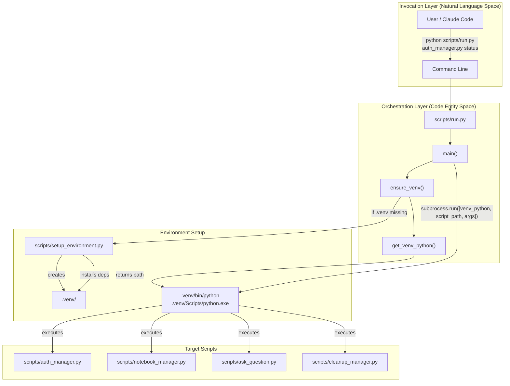
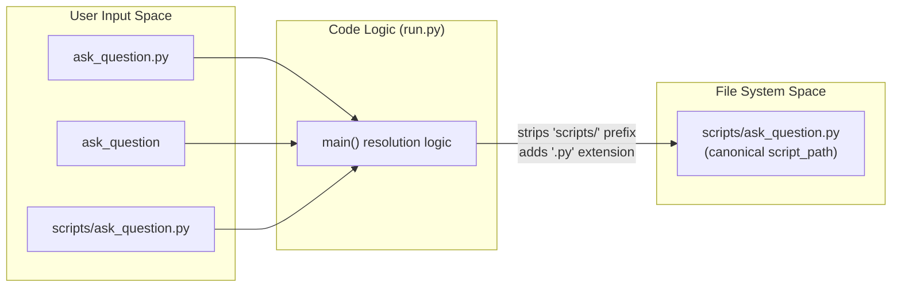
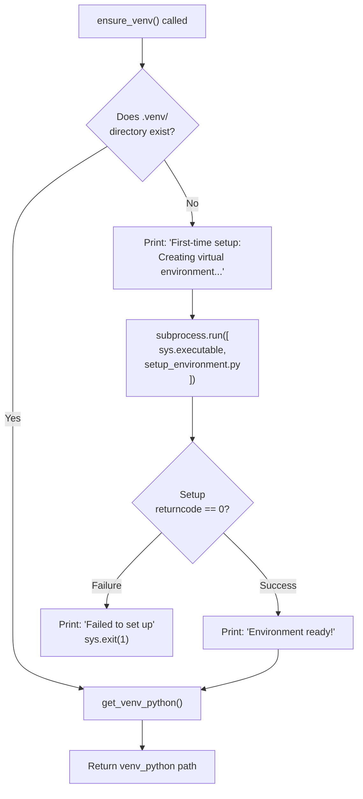
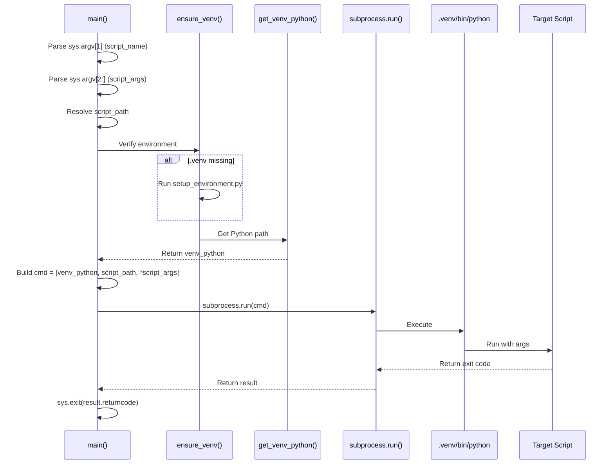

<!-- source: DeepWiki mcp.deepwiki.com · repo PleasePrompto/notebooklm-skill · page 5.1 run.py - Universal Wrapper · fetched 2026-10-26 -->

# run.py - Universal Wrapper

<details>
<summary>Relevant source files</summary>

The following files were used as context for generating this wiki page:

- [references/api_reference.md](references/api_reference.md)
- [scripts/run.py](scripts/run.py)

</details>


## Purpose and Scope

This document describes `scripts/run.py`, the mandatory entry point and orchestration layer for all NotebookLM skill operations. The `run.py` wrapper ensures proper virtual environment setup, resolves script paths, and delegates execution to target scripts with the correct Python interpreter. Every skill operation must be invoked through this wrapper to guarantee environment isolation and dependency availability.

For authentication operations that run through this wrapper, see [5.2 auth_manager.py](). For query execution, see [5.4 ask_question.py](). For notebook library management, see [5.3 notebook_manager.py](). For cleanup operations, see [5.5 cleanup_manager.py](). For details on the environment setup process triggered by this wrapper, see [5.6 setup_environment.py]().

**Sources:** [scripts/run.py:1-102](), [references/api_reference.md:1-15]()

---

## System Role and Architecture

The `run.py` wrapper serves as the universal orchestrator, sitting between the user/Claude Code agent and the functional skill modules. It enforces environment isolation by ensuring all scripts execute within the `.venv` virtual environment, preventing dependency conflicts with the system Python installation or other projects.

### Architectural Position



**Diagram: run.py Orchestration Architecture**

The wrapper acts as a mandatory gateway, enforcing the following guarantees:
1. Virtual environment exists before any script execution [scripts/run.py:33-41]()
2. Dependencies are installed and available via `setup_environment.py` [scripts/run.py:38-39]()
3. Scripts execute with the venv Python interpreter, not system Python [scripts/run.py:87-91]()
4. First-time setup is automatic and transparent [scripts/run.py:34-43]()

**Sources:** [scripts/run.py:1-102](), [references/api_reference.md:7-15]()

---

## Command Interface

### Invocation Syntax

The `run.py` wrapper uses a simple pass-through command structure:

```bash
python scripts/run.py <script_name> [script_arguments...]
```

| Component | Description | Example |
|-----------|-------------|---------|
| `python` | System Python interpreter (3.10+) | `python` or `python3` |
| `scripts/run.py` | Wrapper script path | Always `scripts/run.py` |
| `<script_name>` | Target script to execute | `auth_manager.py`, `ask_question.py` |
| `[script_arguments...]` | Arguments passed to target script | `--question "..."`, `status` |

**Sources:** [scripts/run.py:48-58](), [references/api_reference.md:7-15]()

### Script Name Resolution

The wrapper handles flexible script naming conventions, automatically resolving input to the canonical path `scripts/<script_name>.py`:



**Diagram: Script Name Resolution**

The resolution logic is implemented in `main()`:

1. **Strip `scripts/` prefix**: If the script name starts with `scripts/`, remove it [scripts/run.py:64-66]().
2. **Add `.py` extension**: If the script name doesn't end with `.py`, append it [scripts/run.py:69-70]().
3. **Construct full path**: Combine skill directory with `scripts/` and resolved name [scripts/run.py:73-74]().
4. **Validate existence**: Check if the resolved path exists, error if not [scripts/run.py:76-81]().

**Sources:** [scripts/run.py:60-81]()

---

## Environment Management

### Virtual Environment Detection

The `ensure_venv()` function is the core environment management mechanism, responsible for verifying the `.venv` directory exists.



**Diagram: ensure_venv() Execution Flow**

**Sources:** [scripts/run.py:26-45]()

### Platform-Specific Python Paths

The `get_venv_python()` function resolves the correct Python interpreter path based on the operating system:

| Platform | Python Path | Code Pointer |
|----------|------------|-------|
| Windows (`os.name == 'nt'`) | `.venv/Scripts/python.exe` | [scripts/run.py:18-19]() |
| Unix/Linux/macOS | `.venv/bin/python` | [scripts/run.py:20-21]() |

**Sources:** [scripts/run.py:13-23]()

---

## Script Dispatch Mechanism

### Execution Pipeline

Once the virtual environment is verified, `main()` constructs and executes the target script command:



**Diagram: Script Execution Sequence**

**Sources:** [scripts/run.py:48-99]()

### Command Construction

The command construction happens just before execution:

```python
# [scripts/run.py:86-87]
cmd = [str(venv_python), str(script_path)] + script_args
```

This creates a list suitable for `subprocess.run()` where element 0 is the Virtual environment Python interpreter path, element 1 is the full path to target script, and elements 2+ are the forwarded arguments [scripts/run.py:87]().

**Sources:** [scripts/run.py:86-92]()

### Argument Pass-Through

The wrapper implements transparent argument forwarding. All arguments after the script name in `sys.argv` are captured in `script_args` and passed directly to the target script without modification [scripts/run.py:61]().

**Sources:** [scripts/run.py:60-61]()

---

## Error Handling

### Error Categories

The wrapper handles several categories of errors:

1. **Usage Error**: If no script name is provided, it prints usage help and exits [scripts/run.py:50-58]().
2. **Script Not Found**: If the resolved `script_path` does not exist, it prints diagnostic info including the working directory and skill directory [scripts/run.py:76-81]().
3. **Setup Failure**: If `setup_environment.py` fails during automatic setup, it exits with code 1 [scripts/run.py:39-41]().
4. **User Interrupt**: Catches `KeyboardInterrupt` and exits with code 130 [scripts/run.py:93-95]().
5. **General Execution Error**: Catches other exceptions and prints the error message [scripts/run.py:96-98]().

### Exit Code Propagation

The wrapper preserves the target script's exit code, ensuring error conditions propagate correctly to the calling process (like Claude Code):

```python
# [scripts/run.py:91-92]
result = subprocess.run(cmd)
sys.exit(result.returncode)
```

**Sources:** [scripts/run.py:48-99]()

---

## Implementation Details

### File System Structure

The wrapper uses `pathlib.Path` for cross-platform path handling [scripts/run.py:10](). It identifies the skill root directory relative to its own location in the `scripts/` folder [scripts/run.py:15]().

| Path Variable | Logic | Purpose |
|--------------|-------|---------|
| `skill_dir` | `Path(__file__).parent.parent` | Skill root directory [scripts/run.py:15]() |
| `venv_dir` | `skill_dir / ".venv"` | Virtual environment location [scripts/run.py:16]() |
| `script_path`| `skill_dir / "scripts" / script_name` | Resolved target script [scripts/run.py:74]() |

**Sources:** [scripts/run.py:13-23](), [scripts/run.py:73-74]()

### Dependency on setup_environment.py

The wrapper delegates first-time setup to `scripts/setup_environment.py` [scripts/run.py:30](). It executes this script using the system Python (`sys.executable`) to ensure the environment is built before trying to use the venv Python [scripts/run.py:38]().

**Sources:** [scripts/run.py:26-45]()

---

