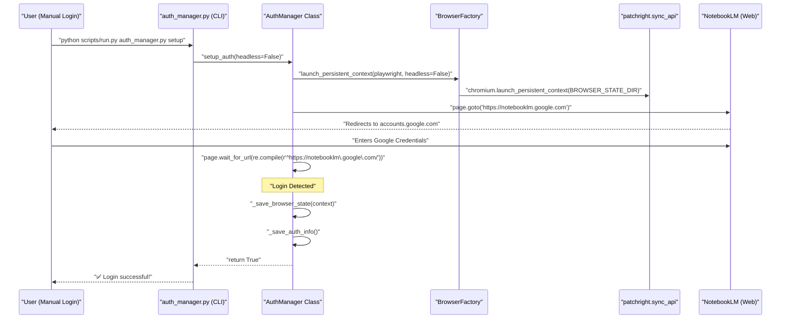
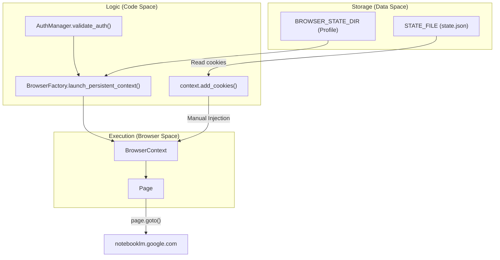

<!-- source: DeepWiki mcp.deepwiki.com · repo PleasePrompto/notebooklm-skill · page 5.2 auth_manager.py · fetched 2026-10-26 -->

# auth_manager.py

<details>
<summary>Relevant source files</summary>

The following files were used as context for generating this wiki page:

- [references/api_reference.md](references/api_reference.md)
- [scripts/auth_manager.py](scripts/auth_manager.py)

</details>


This page documents the authentication management module, which handles Google login and session persistence for NotebookLM access. For information about executing queries with authenticated sessions, see [5.4 ask_question.py](). For deep technical details on the hybrid authentication strategy, see [7.1 Hybrid Authentication Strategy]().

## Purpose and Scope

The `auth_manager.py` module provides both a command-line interface and a Python class (`AuthManager`) for managing Google authentication with NotebookLM. It implements a hybrid authentication approach combining persistent browser profiles with manual cookie injection to work around Playwright limitations. This module handles one-time interactive login, session validation, and authentication state management.

Sources: [scripts/auth_manager.py:2-11]()

## Overview

The authentication system uses Patchright (a Playwright wrapper) to launch real Chrome browsers for Google OAuth login. Authentication state is preserved across skill invocations through:

1.  **Persistent browser profile** stored in `BROWSER_STATE_DIR` for fingerprint consistency [scripts/auth_manager.py:46-50]().
2.  **Manual cookie injection** from `STATE_FILE` for session cookie persistence, addressing a known Playwright issue where session cookies are not always persisted in the user data directory [scripts/auth_manager.py:8-11]().

This hybrid approach ensures reliable authentication while maintaining browser stealth characteristics needed for NotebookLM access.

Sources: [scripts/auth_manager.py:7-11](), [scripts/auth_manager.py:27-28](), [scripts/auth_manager.py:107-110]()

## Command-Line Interface

All commands must be invoked through the `run.py` wrapper to ensure the virtual environment is correctly loaded:

```bash
python scripts/run.py auth_manager.py [command] [options]
```

### Commands

| Command | Description | Options | Browser Visibility |
| :--- | :--- | :--- | :--- |
| `setup` | Perform initial authentication | `--headless`, `--timeout` | **Must be visible** |
| `status` | Check authentication status | None | No browser |
| `validate` | Test if stored auth works | None | Headless |
| `clear` | Remove all authentication data | None | No browser |
| `reauth` | Clear and re-authenticate | `--timeout` | **Must be visible** |

Sources: [scripts/auth_manager.py:320-387](), [references/api_reference.md:88-110]()

### Command Examples

```bash
# Initial setup (browser will open for manual login)
python scripts/run.py auth_manager.py setup

# Setup with custom timeout (15 minutes)
python scripts/run.py auth_manager.py setup --timeout 15

# Check authentication status
python scripts/run.py auth_manager.py status

# Validate that authentication works
python scripts/run.py auth_manager.py validate

# Clear all authentication data
python scripts/run.py auth_manager.py clear

# Re-authenticate (useful for switching accounts)
python scripts/run.py auth_manager.py reauth
```

Sources: [references/api_reference.md:92-102](), [scripts/auth_manager.py:340-344]()

### Command Details

#### setup

Launches a visible Chrome browser and waits for manual Google login. The user must complete the OAuth flow within the timeout period (default 10 minutes).

**Parameters:**
*   `--headless`: Run in headless mode (default: `False`, must be `False` for manual login) [scripts/auth_manager.py:326]().
*   `--timeout`: Login timeout in minutes (default: `10`) [scripts/auth_manager.py:329]().

**Behavior:**
1.  Launches persistent Chrome context via `BrowserFactory.launch_persistent_context` [scripts/auth_manager.py:107-110]().
2.  Navigates to `https://notebooklm.google.com` [scripts/auth_manager.py:114]().
3.  Waits for user to complete Google OAuth login [scripts/auth_manager.py:123-124]().
4.  Detects successful login when URL matches the NotebookLM domain regex [scripts/auth_manager.py:129]().
5.  Saves browser state to `state.json` and metadata to `auth_info.json` [scripts/auth_manager.py:134-135]().

Sources: [scripts/auth_manager.py:86-160](), [scripts/auth_manager.py:350-356]()

#### status

Displays current authentication state without launching a browser. It checks for the existence of the state file and its age [scripts/auth_manager.py:52-62]().

**Output includes:**
*   Authentication status (Yes/No)
*   State file age in hours
*   Last authentication timestamp (from `auth_info.json`)
*   State file path

Sources: [scripts/auth_manager.py:64-84](), [scripts/auth_manager.py:358-366]()

#### validate

Tests authentication by attempting to access NotebookLM in a headless browser.

**Behavior:**
1.  Launches headless Chrome with persistent context [scripts/auth_manager.py:260-264]().
2.  Injects cookies from `state.json` (hybrid auth workaround) [scripts/auth_manager.py:280-288]().
3.  Navigates to NotebookLM and checks if a redirect to Google accounts occurs [scripts/auth_manager.py:293-300]().

Sources: [scripts/auth_manager.py:242-317](), [scripts/auth_manager.py:368-373]()

#### clear

Removes all authentication data including browser state, cookies, and the entire profile directory.

**Deletes:**
*   `STATE_FILE` (`state.json`)
*   `AUTH_INFO_FILE` (`auth_info.json`)
*   `BROWSER_STATE_DIR` (entire directory)

Sources: [scripts/auth_manager.py:182-212](), [scripts/auth_manager.py:375-377]()

#### reauth

Convenience command that performs `clear_auth()` followed by `setup_auth()`. Useful for switching Google accounts.

Sources: [scripts/auth_manager.py:214-240](), [scripts/auth_manager.py:379-384]()

## AuthManager Class

The `AuthManager` class provides programmatic access to authentication operations.

### Class Initialization

```python
from auth_manager import AuthManager

auth = AuthManager()
```

The constructor ensures that the data and browser state directories exist and maps the file paths from `config.py` [scripts/auth_manager.py:42-50]().

Sources: [scripts/auth_manager.py:31-50]()

### Method: is_authenticated()

```python
def is_authenticated(self) -> bool
```

Checks if the `state_file` exists. If the file is older than 7 days, it prints a warning but still returns `True` if the file is present [scripts/auth_manager.py:52-62]().

Sources: [scripts/auth_manager.py:52-62]()

### Method: validate_auth()

```python
def validate_auth(self) -> bool
```

Performs a functional check of the authentication. It launches a browser, injects stored cookies, and verifies access to `notebooklm.google.com` without being redirected to a login page [scripts/auth_manager.py:242-317]().

Sources: [scripts/auth_manager.py:242-317]()

## Authentication Flow Diagrams

### Initial Authentication Flow (Natural Language to Code)

This diagram maps the user's login process to the specific code entities in `auth_manager.py`.



Sources: [scripts/auth_manager.py:86-140](), [scripts/auth_manager.py:160-180]()

### Hybrid Auth Validation (Code Entity Space)

This diagram shows how the system bridges stored data to a live browser session using the hybrid approach.



Sources: [scripts/auth_manager.py:260-293](), [scripts/auth_manager.py:279-289]()

## Data Storage

Location: `~/.claude/skills/notebooklm/data/` (defined via `DATA_DIR` in `config.py`).

| File / Directory | Description |
| :--- | :--- |
| `library.json` | Notebook metadata (managed by `notebook_manager.py`) |
| `auth_info.json` | Auth metadata: `authenticated_at` and `authenticated_at_iso` |
| `browser_state/` | Root directory for browser persistence |
| `browser_state/state.json` | Exported Playwright storage state (cookies, localStorage) |

Sources: [scripts/auth_manager.py:42-50](), [references/api_reference.md:184-193]()

## Hybrid Authentication Strategy

The `AuthManager` implements a hybrid strategy to ensure session persistence:
1.  **Persistent Context**: Uses `BrowserFactory.launch_persistent_context` to maintain a consistent browser profile folder. This helps with fingerprinting and long-term storage [scripts/auth_manager.py:107-110]().
2.  **Cookie Injection**: Due to a Playwright bug (#36139) where session cookies are sometimes lost in persistent contexts, the system explicitly saves cookies to `state.json` using `context.storage_state()` [scripts/auth_manager.py:164]() and re-injects them using `context.add_cookies()` whenever a new context is initialized for validation or querying [scripts/auth_manager.py:280-288]().

Sources: [scripts/auth_manager.py:7-11](), [scripts/auth_manager.py:160-168](), [scripts/auth_manager.py:279-289]()

---

