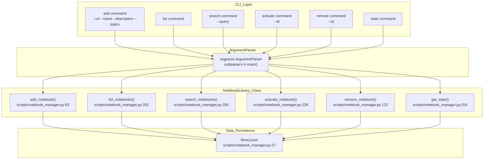
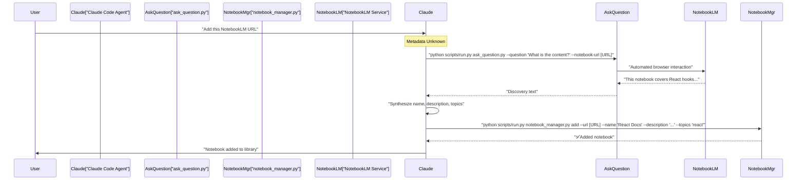

<!-- source: DeepWiki mcp.deepwiki.com · repo PleasePrompto/notebooklm-skill · page 5.3 notebook_manager.py · fetched 2026-10-26 -->

# notebook_manager.py

<details>
<summary>Relevant source files</summary>

The following files were used as context for generating this wiki page:

- [references/api_reference.md](references/api_reference.md)
- [scripts/notebook_manager.py](scripts/notebook_manager.py)

</details>


## Purpose and Scope

This document provides comprehensive API reference documentation for `notebook_manager.py`, the script responsible for managing the local notebook library in the NotebookLM skill. The notebook library is a local registry that maps user-friendly metadata (names, descriptions, topics) to NotebookLM URLs, enabling efficient notebook discovery and selection.

`notebook_manager.py` provides CRUD operations for notebooks stored in `library.json` and includes search, activation, and statistics capabilities. For authentication management, see [auth_manager.py](). For executing queries against notebooks, see [ask_question.py](). For the universal wrapper that must be used to invoke this script, see [run.py]().

**Sources:** [references/api_reference.md:44-88](), [scripts/notebook_manager.py:2-6]()

---

## Command-Line Interface

All commands must be invoked through the `run.py` wrapper to ensure proper virtual environment activation [references/api_reference.md:7-15]():

```bash
python scripts/run.py notebook_manager.py [command] [options]
```

### Available Commands

| Command | Purpose | Required Options | Optional Options |
|---------|---------|------------------|------------------|
| `add` | Add notebook to library | `--url`, `--name`, `--description`, `--topics` | `--content-types`, `--use-cases`, `--tags` |
| `list` | Display all notebooks | None | None |
| `search` | Find notebooks by keyword | `--query` | None |
| `activate` | Set default notebook | `--id` | None |
| `remove` | Delete from library | `--id` | None |
| `stats` | Show library statistics | None | None |

**Sources:** [references/api_reference.md:80-86](), [scripts/notebook_manager.py:328-390]()

---

## Command Reference

### add Command

Adds a new notebook to the library with required metadata.

**Syntax:**
```bash
python scripts/run.py notebook_manager.py add \
  --url "https://notebooklm.google.com/notebook/..." \
  --name "Descriptive Name" \
  --description "What this notebook contains" \
  --topics "topic1,topic2,topic3"
```

**Parameters:**

| Parameter | Type | Required | Description |
|-----------|------|----------|-------------|
| `--url` | String | Yes | Full NotebookLM URL [scripts/notebook_manager.py:333-334]() |
| `--name` | String | Yes | User-friendly name for the notebook [scripts/notebook_manager.py:335-336]() |
| `--description` | String | Yes | Description of notebook contents [scripts/notebook_manager.py:337-338]() |
| `--topics` | String | Yes | Comma-separated list of topics for search [scripts/notebook_manager.py:339-340]() |

**Behavior:**
- Generates a unique ID by slugifying the name (lowercase, spaces to hyphens) [scripts/notebook_manager.py:89-89]().
- Checks for duplicate IDs before adding [scripts/notebook_manager.py:92-93]().
- Automatically sets the notebook as `active` if it is the first one added to the library [scripts/notebook_manager.py:115-116]().
- Persists the entry to `library.json` [scripts/notebook_manager.py:118-118]().

**Sources:** [scripts/notebook_manager.py:63-122](), [references/api_reference.md:58-62]()

---

### list Command

Displays all notebooks in the library with their metadata.

**Syntax:**
```bash
python scripts/run.py notebook_manager.py list
```

**Sources:** [scripts/notebook_manager.py:355-356](), [references/api_reference.md:64-65]()

---

### search Command

Searches notebooks by keyword match in name, description, topics, or tags.

**Syntax:**
```bash
python scripts/run.py notebook_manager.py search --query "keyword"
```

**Search Algorithm:**
- Matches against notebook `name` [scripts/notebook_manager.py:220-220]().
- Matches against `description` text [scripts/notebook_manager.py:221-221]().
- Matches against individual `topics` and `tags` [scripts/notebook_manager.py:222-223]().
- Returns all matching notebooks as a list [scripts/notebook_manager.py:226-226]().

**Sources:** [scripts/notebook_manager.py:206-226](), [references/api_reference.md:67-68]()

---

### activate Command

Sets a notebook as the active default for queries.

**Syntax:**
```bash
python scripts/run.py notebook_manager.py activate --id notebook-id
```

**Behavior:**
- Updates the `active_notebook_id` in the library state [scripts/notebook_manager.py:237-238]().
- Persists the change to disk [scripts/notebook_manager.py:240-240]().

**Sources:** [scripts/notebook_manager.py:228-243](), [references/api_reference.md:70-71]()

---

### remove Command

Deletes a notebook from the library.

**Syntax:**
```bash
python scripts/run.py notebook_manager.py remove --id notebook-id
```

**Behavior:**
- Removes the entry from the `notebooks` dictionary [scripts/notebook_manager.py:134-134]().
- If the removed notebook was active, it attempts to set the first remaining notebook as the new active one [scripts/notebook_manager.py:137-141]().

**Sources:** [scripts/notebook_manager.py:123-149](), [references/api_reference.md:73-74]()

---

## Command Dispatch Flow

**Diagram: CLI Command to Class Method Mapping**



**Sources:** [scripts/notebook_manager.py:328-440](), [references/api_reference.md:44-86]()

---

## NotebookLibrary Class

The `NotebookLibrary` class is the core data structure that manages the notebook registry. It provides methods for all CRUD operations and handles JSON persistence.

### Class Structure

```python
# Implementation in scripts/notebook_manager.py:17
class NotebookLibrary:
    def __init__(self):
        # Initializes data_dir and loads library.json
        # scripts/notebook_manager.py:20-32
        pass
    
    def add_notebook(self, url, name, description, topics, ...):
        # scripts/notebook_manager.py:63
        pass
    
    def list_notebooks(self):
        # scripts/notebook_manager.py:202
        pass
    
    def search_notebooks(self, query):
        # scripts/notebook_manager.py:206
        pass
    
    def activate_notebook(self, notebook_id):
        # scripts/notebook_manager.py:228
        pass
    
    def remove_notebook(self, notebook_id):
        # scripts/notebook_manager.py:123
        pass
    
    def get_stats(self):
        # scripts/notebook_manager.py:254
        pass
```

### Internal Persistence

The library uses `_load_library()` [scripts/notebook_manager.py:34]() and `_save_library()` [scripts/notebook_manager.py:50]() to sync state with `library.json`.

**Sources:** [scripts/notebook_manager.py:17-270]()

---

## Data Structure: library.json

The notebook library is persisted as a JSON file at `data/library.json` within the skill directory [scripts/notebook_manager.py:23-27]().

### File Format

```json
{
  "notebooks": {
    "react-documentation": {
      "id": "react-documentation",
      "url": "https://notebooklm.google.com/notebook/...",
      "name": "React Documentation",
      "description": "React hooks and components",
      "topics": ["react", "hooks"],
      "content_types": [],
      "use_cases": [],
      "tags": [],
      "created_at": "2024-01-15T10:30:00Z",
      "updated_at": "2024-01-15T10:30:00Z",
      "use_count": 0,
      "last_used": null
    }
  },
  "active_notebook_id": "react-documentation",
  "updated_at": "2024-01-15T10:30:00Z"
}
```

**Sources:** [scripts/notebook_manager.py:53-61](), [scripts/notebook_manager.py:96-109](), [references/api_reference.md:186-193]()

---

## Smart Discovery Workflow

The smart discovery workflow is the recommended approach for adding notebooks. It queries the notebook first to discover its content, then uses that information for accurate metadata.

**Diagram: Smart Discovery Process**



**Sources:** [references/api_reference.md:48-55](), [scripts/notebook_manager.py:63-122]()

---

## Integration with Other Components

### With run.py
`notebook_manager.py` must be invoked through `run.py` to ensure the environment is correctly set up [references/api_reference.md:7-15]().

### With ask_question.py
`ask_question.py` utilizes `NotebookLibrary` to resolve a `--notebook-id` into a URL [references/api_reference.md:173-178](). If no ID or URL is provided, it defaults to the `active_notebook_id` managed by this script [references/api_reference.md:207]().

### With cleanup_manager.py
`cleanup_manager.py` can be configured with `--preserve-library` to delete browser state and auth info while leaving `library.json` intact [references/api_reference.md:122-130]().

**Sources:** [references/api_reference.md:151-181](), [scripts/notebook_manager.py:17-32]()

---

