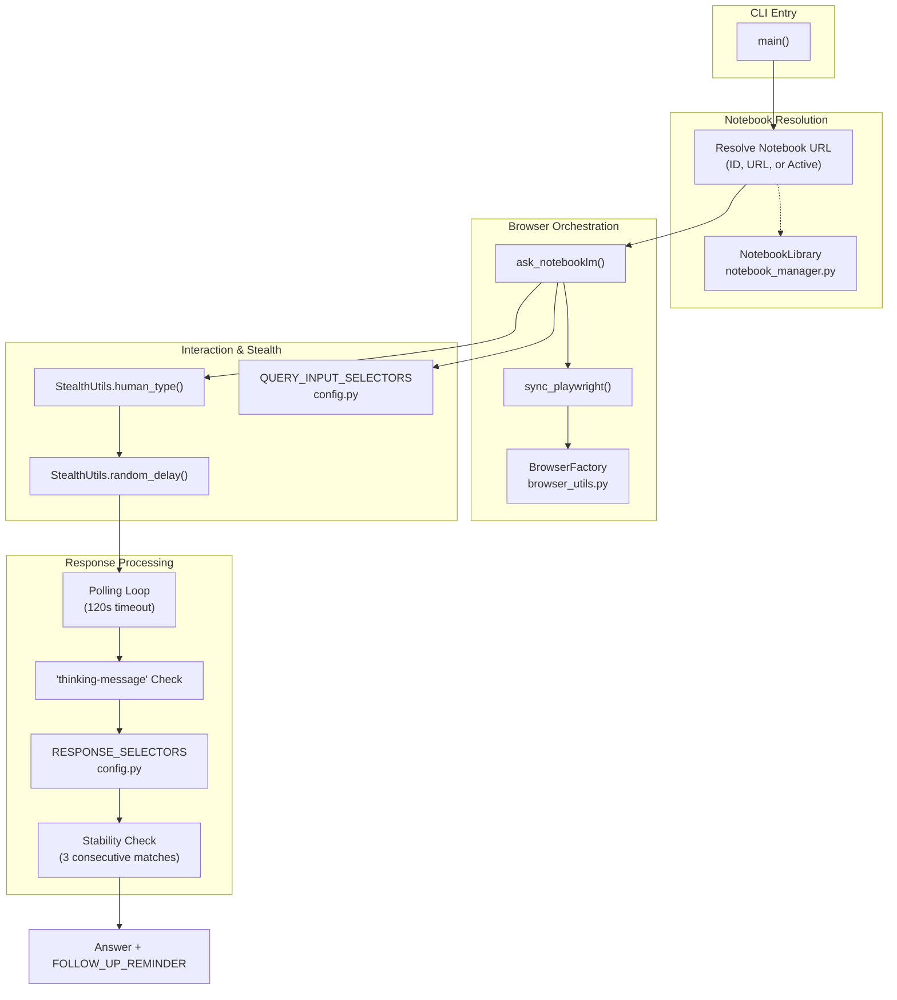
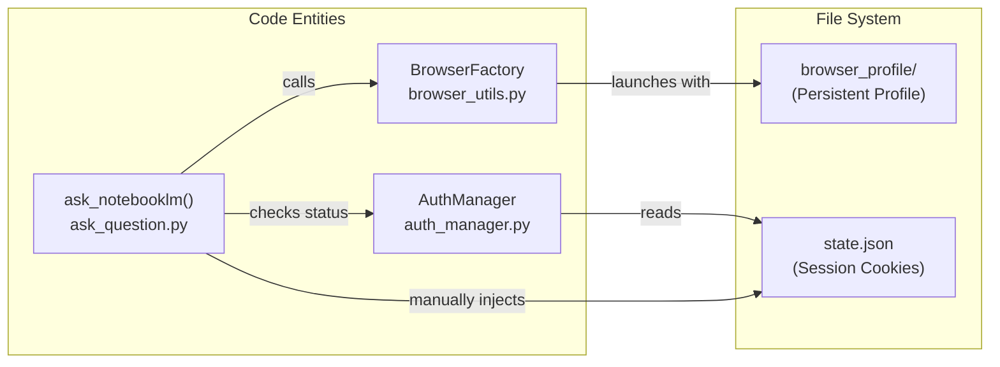

<!-- source: DeepWiki mcp.deepwiki.com · repo PleasePrompto/notebooklm-skill · page 5.4 ask_question.py · fetched 2026-10-26 -->

# ask_question.py

<details>
<summary>Relevant source files</summary>

The following files were used as context for generating this wiki page:

- [references/api_reference.md](references/api_reference.md)
- [scripts/ask_question.py](scripts/ask_question.py)

</details>


## Purpose and Scope

The `ask_question.py` module implements the core query execution interface for interacting with NotebookLM. It provides a command-line tool and Python API for asking questions against notebooks and retrieving source-grounded responses from Google's Gemini-powered NotebookLM service.

This module handles:
- Browser automation for submitting questions via `patchright` [scripts/ask_question.py:18-18]().
- Hybrid authentication state management using `AuthManager` [scripts/ask_question.py:52-52]().
- Response extraction and stabilization through polling [scripts/ask_question.py:120-160]().
- Notebook resolution by ID, URL, or active notebook [scripts/ask_question.py:201-227]().
- Follow-up prompt generation for multi-turn conversations [scripts/ask_question.py:31-37]().

For notebook library management, see [notebook_manager.py](). For authentication setup, see [auth_manager.py](). For the execution wrapper that ensures the proper environment, see [run.py]().

**Sources:** [scripts/ask_question.py:1-37](), [scripts/ask_question.py:52-60]()

---

## Architecture Overview

### Query Execution Flow

The module implements a stateless session model where each question opens a fresh browser instance, authenticates, submits the query, waits for a stable response, and closes the browser.



**Diagram: Data flow from CLI invocation to finalized answer string.**

**Sources:** [scripts/ask_question.py:40-188](), [scripts/ask_question.py:190-227](), [scripts/ask_question.py:25-26]()

---

## Command-Line Interface

### Basic Usage

The module must be invoked through `run.py` to ensure proper virtual environment activation and dependency availability:

```bash
# ✅ Correct: Via run.py wrapper
python scripts/run.py ask_question.py --question "Your question here"

# ❌ Incorrect: Direct invocation will fail
python scripts/ask_question.py --question "Your question"
```

### Arguments

| Argument | Required | Description |
|----------|----------|-------------|
| `--question` | Yes | The question to ask NotebookLM [scripts/ask_question.py:193-193]() |
| `--notebook-id` | No | Notebook identifier from `library.json` [scripts/ask_question.py:195-195]() |
| `--notebook-url` | No | Direct NotebookLM URL [scripts/ask_question.py:194-194]() |
| `--show-browser` | No | Make browser visible for debugging [scripts/ask_question.py:196-196]() |

**Sources:** [scripts/ask_question.py:190-198](), [references/api_reference.md:36-40]()

### Notebook Resolution Strategy

The module resolves which notebook to query using this priority order:

1.  **Direct URL**: Uses `--notebook-url` if provided [scripts/ask_question.py:201-201]().
2.  **Library ID**: Looks up `--notebook-id` in `NotebookLibrary` [scripts/ask_question.py:203-207]().
3.  **Active Notebook**: Falls back to the currently active notebook in the library [scripts/ask_question.py:214-218]().

**Sources:** [scripts/ask_question.py:200-218]()

---

## Core Function: ask_notebooklm()

### Function Signature

```python
def ask_notebooklm(question: str, notebook_url: str, headless: bool = True) -> str:
    """
    Ask a question to NotebookLM
    
    Args:
        question: Question to ask
        notebook_url: NotebookLM notebook URL
        headless: Run browser in headless mode
    
    Returns:
        Answer text from NotebookLM
    """
```

**Sources:** [scripts/ask_question.py:40-51]()

### Authentication Verification

Before launching the browser, the function checks authentication status via `AuthManager` [scripts/ask_question.py:52-52](). If not authenticated, it prompts the user to run the setup command [scripts/ask_question.py:54-56]().

---

## Hybrid Authentication Strategy

The module implements a hybrid authentication approach to work around Playwright/Patchright limitations regarding session cookie persistence in `user_data_dir` [scripts/ask_question.py:6-10]().

### Code Entity Association



**Diagram: Association between authentication data files and the code entities that manage them.**

**Sources:** [scripts/ask_question.py:6-10](), [scripts/ask_question.py:52-52](), [scripts/ask_question.py:69-72]()

---

## Browser Automation Details

### Selector Configuration

The module uses selector arrays defined in `config.py` for robustness across different NotebookLM UI versions [scripts/ask_question.py:25-25]():

- **`QUERY_INPUT_SELECTORS`**: Used to find the textarea for entering questions [scripts/ask_question.py:86-95]().
- **`RESPONSE_SELECTORS`**: Used to identify and extract the bot's response elements [scripts/ask_question.py:136-154]().

**Sources:** [scripts/ask_question.py:25-25](), [scripts/ask_question.py:86-95](), [scripts/ask_question.py:136-154]()

### Human-Like Interaction

The module utilizes `StealthUtils` to mimic human behavior:
- **`StealthUtils.human_type()`**: Types the question into the primary selector [scripts/ask_question.py:108-108]().
- **`StealthUtils.random_delay()`**: Introduces a pause (500ms to 1500ms) after submission to avoid bot-like detection [scripts/ask_question.py:115-115]().

**Sources:** [scripts/ask_question.py:107-108](), [scripts/ask_question.py:115-115]()

---

## Response Extraction Mechanism

### Stability-Based Polling

The module uses a polling loop with a 120-second timeout to wait for the complete response [scripts/ask_question.py:123-125]().

1.  **Thinking Message**: It first checks for a `div.thinking-message`. If visible, it continues waiting [scripts/ask_question.py:128-131]().
2.  **Stability Check**: It retrieves the latest response text using `RESPONSE_SELECTORS` [scripts/ask_question.py:136-142]().
3.  **Consistency**: It compares the current text with the previous poll's text. If they match for 3 consecutive polls (`stable_count >= 3`), the answer is considered complete [scripts/ask_question.py:145-149]().

**Sources:** [scripts/ask_question.py:120-160]()

---

## Follow-Up Reminder System

Because each query is executed in a fresh browser session (stateless), the system appends a `FOLLOW_UP_REMINDER` to every response [scripts/ask_question.py:167-167]().

This prompt instructs the AI (Claude) to:
- Review if the answer is complete [scripts/ask_question.py:34-34]().
- Ask another comprehensive question if context is missing [scripts/ask_question.py:35-36]().
- Include all necessary context in subsequent questions since sessions do not persist [scripts/ask_question.py:36-36]().

**Sources:** [scripts/ask_question.py:31-37](), [scripts/ask_question.py:167-167]()

---

## Error Handling and Cleanup

The module uses a `try-finally` block to ensure that browser resources are released regardless of success or failure [scripts/ask_question.py:175-188]().

- **Context Closure**: `context.close()` is called to shut down the browser profile [scripts/ask_question.py:179-179]().
- **Playwright Stop**: `playwright.stop()` terminates the driver instance [scripts/ask_question.py:185-185]().
- **Error Logging**: Exceptions are caught, printed, and a traceback is provided for debugging [scripts/ask_question.py:169-173]().

**Sources:** [scripts/ask_question.py:64-188]()

---

