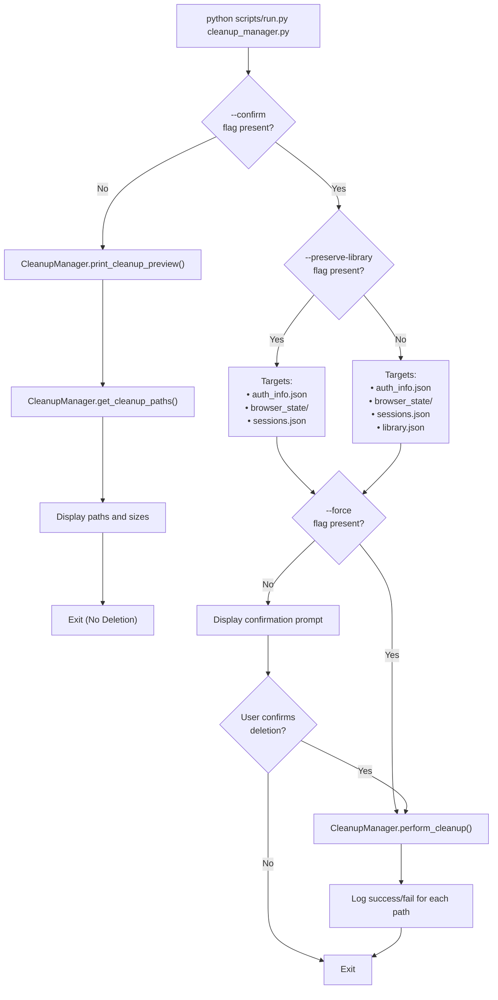
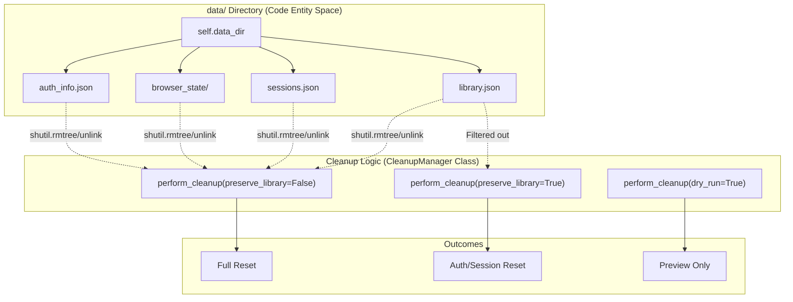

<!-- source: DeepWiki mcp.deepwiki.com · repo PleasePrompto/notebooklm-skill · page 5.5 cleanup_manager.py · fetched 2026-10-26 -->

# cleanup_manager.py

<details>
<summary>Relevant source files</summary>

The following files were used as context for generating this wiki page:

- [references/api_reference.md](references/api_reference.md)
- [scripts/cleanup_manager.py](scripts/cleanup_manager.py)

</details>


This document provides the API reference for `cleanup_manager.py`, which manages the cleanup and reset of persistent data stored by the NotebookLM skill. This includes authentication state, browser session data, and optionally the notebook library.

For information about the data storage structure and security considerations, see [Data Storage](#3.4). For recovery procedures after corruption, see [Recovery Procedures](#6.5). For environment management including virtual environment cleanup, see [setup_environment.py](#5.6).

---

## Purpose and Scope

The `CleanupManager` class in `scripts/cleanup_manager.py` provides selective data cleanup operations for the NotebookLM skill's persistent storage. It allows users to:

- **Preview** which files will be deleted before executing cleanup [scripts/cleanup_manager.py:18-21]().
- **Remove** authentication state and browser session data [scripts/cleanup_manager.py:88-97]().
- **Preserve** the notebook library during cleanup via the `preserve_library` argument [scripts/cleanup_manager.py:77-86]().
- **Force** cleanup without confirmation prompts using the CLI [scripts/cleanup_manager.py:255-258]().

This is particularly useful for resolving authentication issues, browser state corruption, or when switching Google accounts. The script operates on files in the `data/` directory while never touching the source code or virtual environment [scripts/cleanup_manager.py:40-41]().

**Sources:** [scripts/cleanup_manager.py:13-22](), [references/api_reference.md:111-132]()

---

## Implementation Details

The `CleanupManager` class handles the logic for identifying and removing files.

### Key Methods

| Method | Description |
|--------|-------------|
| `get_cleanup_paths(preserve_library)` | Scans the `data/` directory and returns a dictionary of paths categorized by type (browser_state, sessions, library, auth, other) along with their sizes [scripts/cleanup_manager.py:30-114](). |
| `perform_cleanup(preserve_library, dry_run)` | Executes the actual deletion of files using `shutil.rmtree` for directories and `path.unlink` for files [scripts/cleanup_manager.py:139-197](). |
| `_get_size(path)` | Recursively calculates the size of a file or directory in bytes [scripts/cleanup_manager.py:116-129](). |

**Sources:** [scripts/cleanup_manager.py:13-197]()

---

## Command-Line Interface

All invocations must use the `run.py` wrapper to ensure proper environment activation [references/api_reference.md:5-15]():

```bash
python scripts/run.py cleanup_manager.py [OPTIONS]
```

### Options

| Option | Description | Default Behavior |
|--------|-------------|------------------|
| (no options) | Preview mode - shows what would be deleted without performing cleanup [scripts/cleanup_manager.py:249-250]() | Safe preview only |
| `--confirm` | Execute the cleanup operation [scripts/cleanup_manager.py:251-253]() | Required to perform actual deletion |
| `--preserve-library` | Keep `library.json` intact during cleanup [scripts/cleanup_manager.py:259-261]() | Library is deleted by default |
| `--force` | Skip confirmation prompts and proceed immediately [scripts/cleanup_manager.py:255-258]() | Confirmation prompt shown by default |

**Sources:** [scripts/cleanup_manager.py:243-263](), [references/api_reference.md:128-131]()

---

## Cleanup Targets

### Default Cleanup Scope

When executed with `--confirm`, the `CleanupManager` removes the following from the `data/` directory [scripts/cleanup_manager.py:52-109]():

```
data/
├── auth_info.json      # ✅ DELETED - Authentication status
├── browser_state/      # ✅ DELETED - Browser cookies and session
│   └── state.json
├── sessions.json       # ✅ DELETED - Session tracking
└── library.json        # ✅ DELETED (unless --preserve-library specified)
```

### Preserved Assets

The following are **never** deleted by cleanup operations:

- Source code in `scripts/` [scripts/cleanup_manager.py:27]()
- Virtual environment `.venv/` [scripts/cleanup_manager.py:40-41]()
- Configuration file `.env` (if present)
- Documentation and repository metadata

**Sources:** [scripts/cleanup_manager.py:40-41](), [references/api_reference.md:188-193]()

---

## Cleanup Decision Flow



**Cleanup Decision Flow Diagram**

This diagram shows the execution path through `cleanup_manager.py`. The script first checks for `--confirm`; without it, only preview mode executes. The `preserve_library` boolean passed to `get_cleanup_paths` determines whether `library.json` is included in deletion targets [scripts/cleanup_manager.py:77-86]().

**Sources:** [scripts/cleanup_manager.py:30-114](), [scripts/cleanup_manager.py:243-286]()

---

## Data Directory State Management



**Data Directory State Management Diagram**

This diagram maps the `CleanupManager` methods to their effects on the `data/` directory structure. The logic in `get_cleanup_paths` filters the `library.json` file if `preserve_library` is set to `True` [scripts/cleanup_manager.py:77-86]().

**Sources:** [scripts/cleanup_manager.py:30-114](), [scripts/cleanup_manager.py:139-197]()

---

## Usage Patterns

### Pattern 1: Safe Preview Before Cleanup

Preview what will be deleted without making changes:

```bash
python scripts/run.py cleanup_manager.py
```

**Output:** Lists files categorized by type with their human-readable sizes [scripts/cleanup_manager.py:203-221]().

**Sources:** [scripts/cleanup_manager.py:199-221](), [references/api_reference.md:115-116]()

---

### Pattern 2: Complete Data Reset

Remove all persistent data including the notebook library:

```bash
python scripts/run.py cleanup_manager.py --confirm
```

**Effects:**
- Deletes `auth_info.json`
- Deletes `browser_state/`
- Deletes `sessions.json`
- Deletes `library.json`

**Sources:** [scripts/cleanup_manager.py:167-185](), [references/api_reference.md:118-119]()

---

### Pattern 3: Auth Reset with Library Preservation

Clear authentication and browser state while keeping notebook library:

```bash
python scripts/run.py cleanup_manager.py --confirm --preserve-library
```

**Effects:**
- Deletes `auth_info.json`
- Deletes `browser_state/`
- Deletes `sessions.json`
- **Preserves** `library.json` [scripts/cleanup_manager.py:77-78]()

**Use Case:** Fix authentication issues without losing notebook metadata.

**Sources:** [scripts/cleanup_manager.py:141](), [references/api_reference.md:121-122]()

---

## Exit Codes and Error Handling

### Exit Codes

| Code | Meaning | Description |
|------|---------|-------------|
| `0` | Success | Cleanup completed successfully or preview displayed |
| `1` | Error | Unhandled exception during execution |

### Error Handling

The `perform_cleanup` method uses a `try-except` block for each item it attempts to delete [scripts/cleanup_manager.py:170-183](). If a deletion fails (e.g., due to a file being locked or permission issues), the error is caught, printed to the console, and added to a `failed_items` list returned in the result dictionary [scripts/cleanup_manager.py:193-197]().

**Sources:** [scripts/cleanup_manager.py:167-185]()

---

## Command Option Matrix

| Command | Preview | Delete Auth | Delete Browser | Delete Library | Prompt |
|---------|---------|-------------|----------------|----------------|--------|
| `cleanup_manager.py` | ✅ | ❌ | ❌ | ❌ | N/A |
| `cleanup_manager.py --confirm` | ❌ | ✅ | ✅ | ✅ | ✅ |
| `cleanup_manager.py --confirm --preserve-library` | ❌ | ✅ | ✅ | ❌ | ✅ |
| `cleanup_manager.py --confirm --force` | ❌ | ✅ | ✅ | ✅ | ❌ |

**Sources:** [scripts/cleanup_manager.py:243-263](), [references/api_reference.md:128-131]()

---

## Security Considerations

### Data Protection

The cleanup manager operates on sensitive data. `browser_state/` contains session cookies for Google authentication, and `library.json` contains notebook URLs. All these files are protected by `.gitignore` [references/api_reference.md:195]().

### Irreversible Operations

Once `--confirm` is executed, deletion is **irreversible**. The script uses `shutil.rmtree` and `path.unlink` which do not move files to a trash bin; they are removed directly from the filesystem [scripts/cleanup_manager.py:173-175]().

**Sources:** [scripts/cleanup_manager.py:167-185](), [references/api_reference.md:195]()

---

