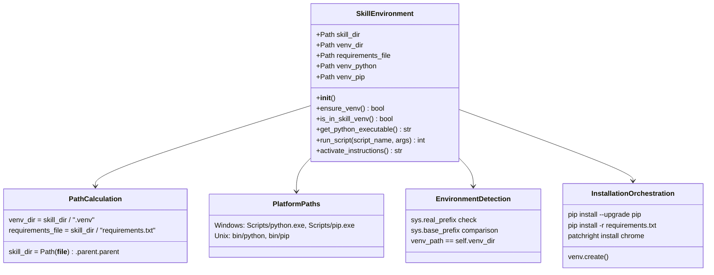
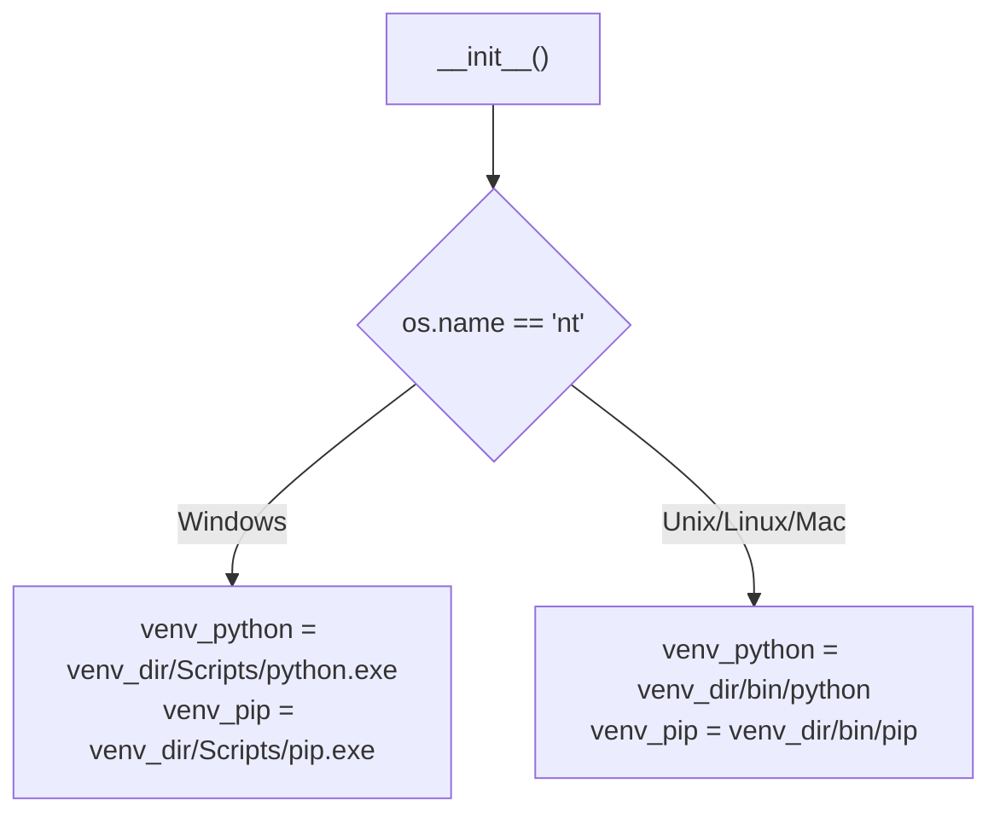
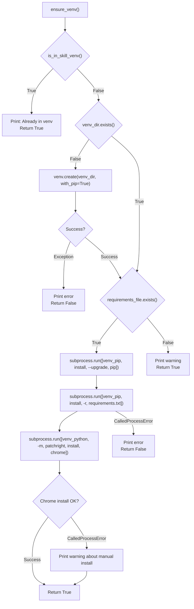
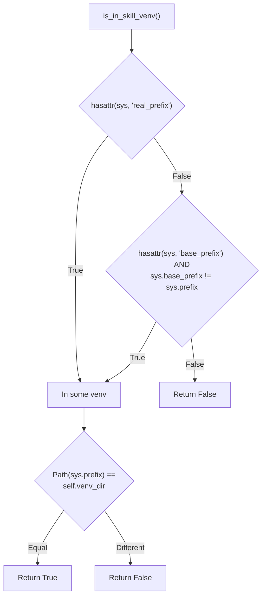
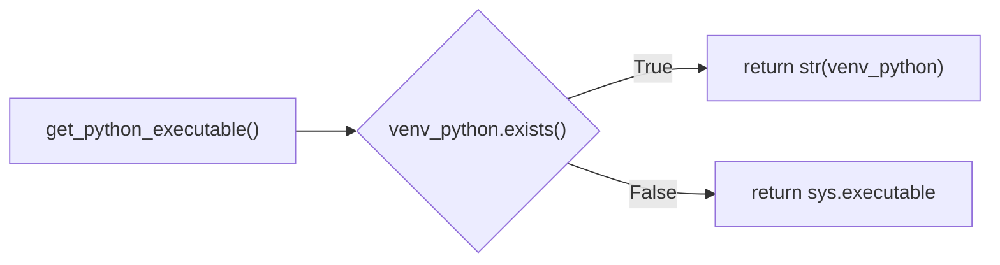
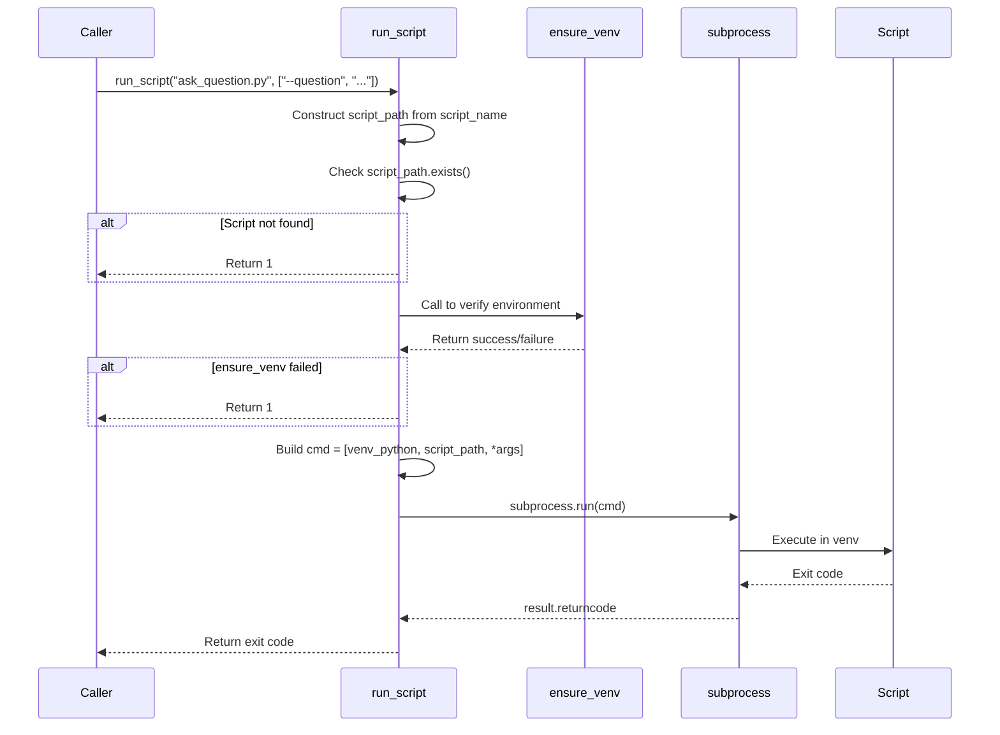
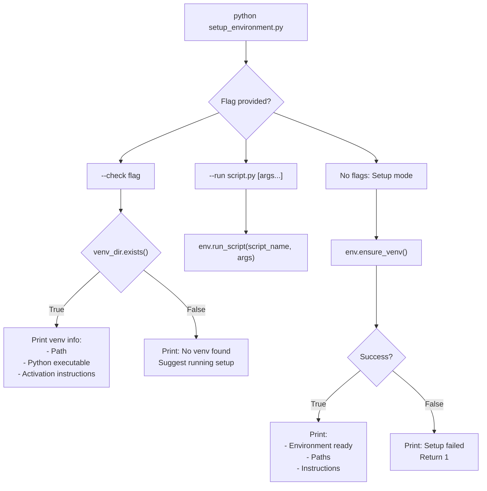
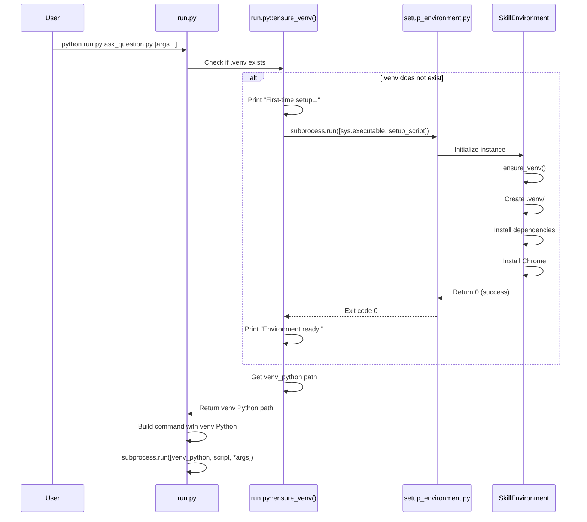

<!-- source: DeepWiki mcp.deepwiki.com · repo PleasePrompto/notebooklm-skill · page 5.6 setup_environment.py · fetched 2026-10-26 -->

# setup_environment.py

<details>
<summary>Relevant source files</summary>

The following files were used as context for generating this wiki page:

- [references/api_reference.md](references/api_reference.md)
- [scripts/setup_environment.py](scripts/setup_environment.py)

</details>


## Purpose and Scope

This document provides API reference documentation for `setup_environment.py`, the environment setup script responsible for creating and managing the skill's isolated Python virtual environment. This script handles venv creation, dependency installation, and Chrome browser setup for Patchright automation.

For information about how `run.py` orchestrates this setup process, see [run.py - Universal Wrapper](5.1). For general concepts about virtual environment isolation, see [Virtual Environment Isolation](3.5).

Sources: [scripts/setup_environment.py:1-11]()

---

## Overview

The `setup_environment.py` script provides automated management of the skill's Python virtual environment located at `.venv/` [scripts/setup_environment.py:20-20](). It is invoked automatically by `run.py` during first-time setup and can be run manually for environment maintenance tasks. The script encapsulates all environment management logic in the `SkillEnvironment` class [scripts/setup_environment.py:14-146]().

**Key responsibilities:**
- Virtual environment creation in `.venv/` [scripts/setup_environment.py:40-47]()
- Installation of Python dependencies from `requirements.txt` [scripts/setup_environment.py:61-68]()
- Chrome browser installation for Patchright [scripts/setup_environment.py:70-85]()
- Environment detection and validation [scripts/setup_environment.py:96-102]()
- Script execution within the virtual environment [scripts/setup_environment.py:110-136]()

Sources: [scripts/setup_environment.py:1-11](), [scripts/setup_environment.py:14-21](), [scripts/setup_environment.py:40-85]()

---

## SkillEnvironment Class

### Class Structure

The `SkillEnvironment` class [scripts/setup_environment.py:14-146]() manages all environment operations. It calculates paths, detects existing environments, and coordinates installation steps.

**SkillEnvironment Class Hierarchy**



Sources: [scripts/setup_environment.py:14-146]()

---

### Constructor: `__init__()`

Initializes the `SkillEnvironment` instance by calculating all necessary file paths [scripts/setup_environment.py:17-29]().

**Path Resolution:**

| Attribute | Description | Windows Path | Unix Path |
|-----------|-------------|--------------|-----------|
| `skill_dir` | Root skill directory | `Path(__file__).parent.parent` | Same |
| `venv_dir` | Virtual environment directory | `skill_dir / ".venv"` | Same |
| `requirements_file` | Dependencies manifest | `skill_dir / "requirements.txt"` | Same |
| `venv_python` | Python executable in venv | `.venv/Scripts/python.exe` | `.venv/bin/python` |
| `venv_pip` | Pip executable in venv | `.venv/Scripts/pip.exe` | `.venv/bin/pip` |

**Platform Detection Logic:**



Sources: [scripts/setup_environment.py:17-29]()

---

### Method: `ensure_venv()`

**Signature:** `ensure_venv() -> bool` [scripts/setup_environment.py:31-31]()

The primary method responsible for creating and configuring the virtual environment. Returns `True` on success, `False` on failure.

**Execution Flow:**



**Installation Stages:**

1. **Environment Check** [scripts/setup_environment.py:34-37]()
   - Calls `is_in_skill_venv()` to detect if already in correct venv.
   - Short-circuits if running from target environment.

2. **Venv Creation** [scripts/setup_environment.py:40-47]()
   - Uses `venv.create(self.venv_dir, with_pip=True)` from standard library.
   - Creates `.venv/` directory structure and installs bootstrap pip.

3. **Pip Upgrade** [scripts/setup_environment.py:53-59]()
   - Executes: `pip install --upgrade pip` to ensure latest version.

4. **Requirements Installation** [scripts/setup_environment.py:61-68]()
   - Executes: `pip install -r requirements.txt`.
   - Installs core dependencies like `patchright`.

5. **Chrome Installation** [scripts/setup_environment.py:70-85]()
   - Executes: `python -m patchright install chrome`.
   - Downloads and installs Google Chrome (not Chromium) for reliability.
   - Continues on failure with warning (non-fatal) [scripts/setup_environment.py:82-85]().

**Chrome Installation Rationale:**

The script explicitly installs Chrome (not Chromium) for cross-platform reliability and consistent browser fingerprinting, as documented in [scripts/setup_environment.py:70-72](). Patchright's anti-detection capabilities work best with Chrome.

Sources: [scripts/setup_environment.py:31-94]()

---

### Method: `is_in_skill_venv()`

**Signature:** `is_in_skill_venv() -> bool` [scripts/setup_environment.py:96-96]()

Detects whether the current Python interpreter is running from the skill's virtual environment.

**Detection Algorithm:**



**Detection Logic Explained:**

| Condition | Purpose |
|-----------|---------|
| `hasattr(sys, 'real_prefix')` | Detects virtualenv (older method) |
| `sys.base_prefix != sys.prefix` | Detects venv (Python 3.3+) |
| `Path(sys.prefix) == self.venv_dir` | Verifies it's the skill's specific venv |

This two-stage check ensures the script can detect both that Python is running in *some* virtual environment, and specifically that it's the skill's `.venv` directory [scripts/setup_environment.py:98-101]().

Sources: [scripts/setup_environment.py:96-102]()

---

### Method: `get_python_executable()`

**Signature:** `get_python_executable() -> str` [scripts/setup_environment.py:104-104]()

Returns the path to the Python executable that should be used for running scripts.

**Resolution Logic:**



If `.venv/bin/python` (or `.venv/Scripts/python.exe` on Windows) exists, returns that path [scripts/setup_environment.py:106-107](). Otherwise, falls back to the current system Python interpreter (`sys.executable`) [scripts/setup_environment.py:108-108]().

Sources: [scripts/setup_environment.py:104-108]()

---

### Method: `run_script()`

**Signature:** `run_script(script_name: str, args: list = None) -> int` [scripts/setup_environment.py:110-110]()

Executes a skill script using the virtual environment's Python interpreter. Returns the exit code of the subprocess.

**Execution Sequence:**



**Parameters:**

| Parameter | Type | Description |
|-----------|------|-------------|
| `script_name` | `str` | Name of script in `scripts/` directory (e.g., `"ask_question.py"`) |
| `args` | `list` | Optional list of command-line arguments to pass to script |

**Return Value:** Integer exit code from the subprocess (0 = success, non-zero = failure) [scripts/setup_environment.py:132-133]().

Sources: [scripts/setup_environment.py:110-136]()

---

### Method: `activate_instructions()`

**Signature:** `activate_instructions() -> str` [scripts/setup_environment.py:138-138]()

Returns platform-specific instructions for manually activating the virtual environment [scripts/setup_environment.py:140-145]().

**Platform-Specific Activation Commands:**

| Platform | Activation Command |
|----------|-------------------|
| Windows | `.venv\Scripts\activate.bat` |
| Unix/Linux/Mac | `source .venv/bin/activate` |

Sources: [scripts/setup_environment.py:138-145]()

---

## Command-Line Interface

The `main()` function [scripts/setup_environment.py:148-204]() provides a CLI for standalone execution.

**CLI Argument Specification:**



### Usage Patterns

**1. Check Environment Status**

```bash
python setup_environment.py --check
```

Output when environment exists [scripts/setup_environment.py:178-181]():
```
✅ Virtual environment exists: /path/to/.venv
   Python: /path/to/.venv/bin/python
   To activate manually: source /path/to/.venv/bin/activate
```

**2. Run Script with Venv**

```bash
python setup_environment.py --run ask_question.py --question "What is X?"
```

Equivalent to manually activating venv and running the script [scripts/setup_environment.py:187-189]().

**3. Setup/Repair Environment**

```bash
python setup_environment.py
```

Creates venv if missing, installs/updates dependencies, installs Chrome [scripts/setup_environment.py:191-197]().

Sources: [scripts/setup_environment.py:148-204]()

---

## Integration with run.py

The `setup_environment.py` script is invoked by `run.py` during first-time setup. The following diagram shows the interaction pattern:

**run.py → setup_environment.py Integration**



The `run.py` wrapper uses path checking to determine if setup is needed, delegating all environment management complexity to `SkillEnvironment` [scripts/run.py:26-45]().

Sources: [scripts/run.py:26-45](), [scripts/setup_environment.py:31-94]()

---

## Error Handling

**Error Classification:**

| Operation | Exception Type | Fatal? | Handler |
|-----------|---------------|--------|---------|
| Venv creation | `Exception` | Yes | Print error, return `False` [scripts/setup_environment.py:45-47]() |
| Pip upgrade/install | `CalledProcessError` | Yes | Print error with output, return `False` [scripts/setup_environment.py:88-91]() |
| Chrome installation | `CalledProcessError` | No | Print warning, continue [scripts/setup_environment.py:82-85]() |
| Script execution | `Exception` | Yes | Print error, return 1 [scripts/setup_environment.py:134-136]() |

Chrome installation is non-fatal because it can be completed manually later: `python -m patchright install chrome` [scripts/setup_environment.py:84-85]().

Sources: [scripts/setup_environment.py:45-47](), [scripts/setup_environment.py:82-91](), [scripts/setup_environment.py:134-136]()

---

## Data Storage

The environment setup process interacts with the following data structure [references/api_reference.md:183-193]():

```
data/
├── library.json       # Notebook metadata
├── auth_info.json     # Auth status
└── browser_state/     # Browser cookies
    └── state.json
```

**Security:** Protected by `.gitignore`, never commit [references/api_reference.md:195-195]().

Sources: [references/api_reference.md:183-196]()

---

