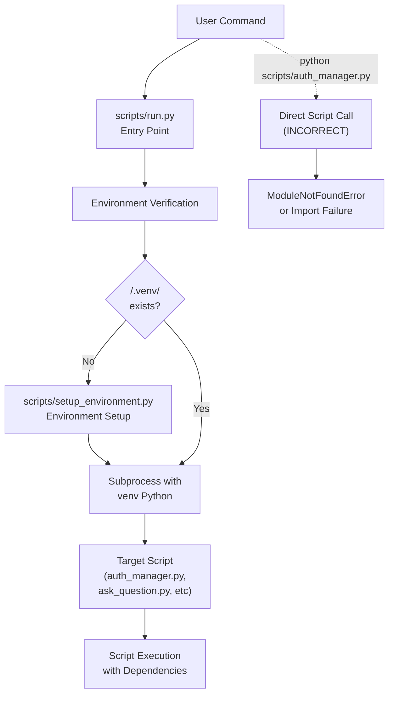
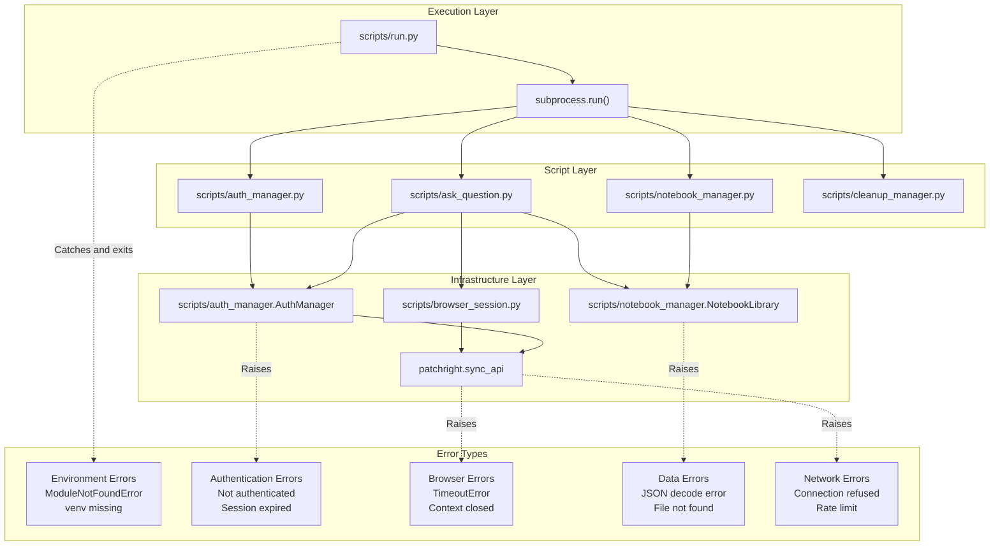
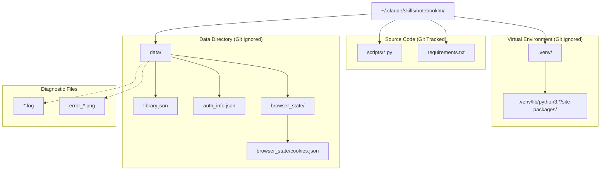
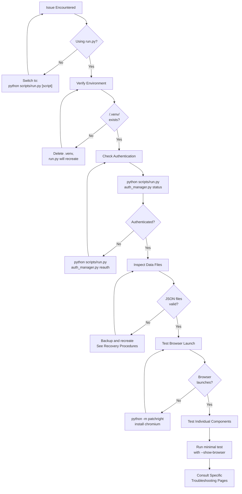

<!-- source: DeepWiki mcp.deepwiki.com · repo PleasePrompto/notebooklm-skill · page 6 Troubleshooting · fetched 2026-10-26 -->

# Troubleshooting

<details>
<summary>Relevant source files</summary>

The following files were used as context for generating this wiki page:

- [references/troubleshooting.md](references/troubleshooting.md)

</details>


This document provides a systematic approach to diagnosing and resolving issues in the NotebookLM Skill system. It covers error propagation, diagnostic techniques, data inspection, and general debugging workflows.

For specific categories of issues, see:
- Common errors and quick fixes: [Common Issues](#6.1)
- Authentication and Google login problems: [Authentication Issues](#6.2)
- Browser crashes and environment setup: [Browser and Environment Issues](#6.3)
- Notebook access and query failures: [Notebook and Query Issues](#6.4)
- Complete system reset procedures: [Recovery Procedures](#6.5)

For detailed API documentation of individual scripts, see [API Reference](#5).

## Understanding the Wrapper Architecture

The most critical concept for troubleshooting is understanding the role of `scripts/run.py` as the mandatory execution wrapper. Approximately 90% of reported issues stem from attempting to execute scripts directly instead of through `run.py`.

### System Invocation Flow


**Key Points:**
- `scripts/run.py` performs environment verification before delegating to target scripts [scripts/run.py:40-60]().
- Direct script invocation bypasses virtual environment activation, causing `ModuleNotFoundError` [references/troubleshooting.md:14-25]().
- `scripts/setup_environment.py` is automatically invoked on first run to create `.venv/` and install dependencies [scripts/run.py:20-35]().

**Sources:** [scripts/run.py](), [references/troubleshooting.md:14-25]()

## Error Propagation Model

Understanding how errors flow through the system is essential for effective debugging.

### Component Error Mapping


**Error Handling Patterns:**

| Layer | Error Handling | Exit Behavior |
|-------|----------------|---------------|
| `run.py` | Catches environment setup failures | Exits with status 1 [scripts/run.py:45-55]() |
| Script layer | Raises exceptions with descriptive messages | Propagates to `run.py` subprocess |
| `AuthManager` | Validates state, raises `AuthenticationError` | [scripts/auth_manager.py:50-80]() |
| `NotebookLibrary` | JSON validation, raises `ValueError` | [scripts/notebook_manager.py:40-60]() |
| Browser automation | `TimeoutError`, `Error` from Playwright | [scripts/browser_session.py]() |

**Sources:** [scripts/run.py](), [scripts/auth_manager.py](), [scripts/browser_session.py](), [references/troubleshooting.md:313-338]()

## Diagnostic Data Locations

All system state is stored in the `data/` directory. Understanding this structure is critical for manual inspection and recovery.

### Data Entity Relationship


**Key Data Files:**

| File | Purpose | Inspection Command |
|------|---------|-------------------|
| `data/library.json` | Notebook metadata registry | `cat data/library.json \| jq` [scripts/notebook_manager.py:200-220]() |
| `data/auth_info.json` | Auth status and timestamp | `cat data/auth_info.json` [scripts/auth_manager.py:100-120]() |
| `data/browser_state/` | Persistent browser profile | `ls -la data/browser_state/` [scripts/browser_session.py:30-50]() |
| `.venv/` | Python environment | `ls .venv/lib/python*/site-packages/` [scripts/run.py:20-35]() |

**Sources:** [references/troubleshooting.md:213-240](), [scripts/notebook_manager.py](), [scripts/auth_manager.py]()

## General Diagnostic Workflow

This workflow applies to any issue category. Specific issues are covered in child pages.



**Sources:** [references/troubleshooting.md:242-261]()

## System Health Check Commands

Use these commands to verify system state before deep debugging:

```bash
# 1. Environment verification
python scripts/run.py auth_manager.py status

# 2. Virtual environment check
ls -la .venv/lib/python*/site-packages/ | grep patchright

# 3. Data directory inspection
ls -la data/

# 4. Library integrity
python scripts/run.py notebook_manager.py list

# 5. Browser availability
python scripts/run.py ask_question.py --question "test" --show-browser
```

**Sources:** [references/troubleshooting.md:250-261]()

## Common Failure Points

| Component | Failure Point | Symptom |
|-----------|--------------|---------|
| **Environment** | Missing `.venv/` | `ModuleNotFoundError` [scripts/run.py:20-35]() |
| **Authentication** | Expired session | "Not authenticated" error [scripts/auth_manager.py:50-80]() |
| **Browser** | Chromium not found | "Browser not found" [references/troubleshooting.md:93-104]() |
| **Browser** | Context closed | "TimeoutError" or "Context closed" [references/troubleshooting.md:75-78]() |
| **Notebook** | Invalid URL | "Notebook not found" [references/troubleshooting.md:137-151]() |
| **Network** | Rate limiting | HTTP 429 (50 queries/day) [references/troubleshooting.md:108-124]() |
| **Data** | Corrupted JSON | `JSONDecodeError` [references/troubleshooting.md:215-230]() |

**Sources:** [references/troubleshooting.md:3-12](), [references/troubleshooting.md:313-338]()

## Debugging Techniques

### Enable Verbose Output
The `--show-browser` flag is the primary debugging tool for visual inspection:
```bash
python scripts/run.py ask_question.py --question "test query" --show-browser
```
This is processed by [scripts/ask_question.py]() to launch Chromium in non-headless mode [references/troubleshooting.md:244-249]().

### Process Inspection
When browser operations hang, identify and kill hanging processes:
```bash
pkill -f chromium
pkill -f chrome
```
[references/troubleshooting.md:82-84]()

### Data File Validation
JSON files can be manually inspected:
```bash
cat data/library.json | jq .
cat data/auth_info.json | jq .
```
The library structure is validated by [scripts/notebook_manager.py:200-220]() and authentication status by [scripts/auth_manager.py:100-120]().

**Sources:** [references/troubleshooting.md:213-230](), [references/troubleshooting.md:77-91]()

## Next Steps

For specific issue categories, consult the following pages:

- **Quick fixes for common errors:** [Common Issues](#6.1)
- **Google login and session problems:** [Authentication Issues](#6.2)  
- **Browser crashes and environment setup:** [Browser and Environment Issues](#6.3)
- **Notebook access and query failures:** [Notebook and Query Issues](#6.4)
- **Complete system reset procedures:** [Recovery Procedures](#6.5)

**Sources:** [references/troubleshooting.md:1-376]()

---

