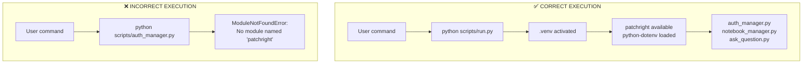
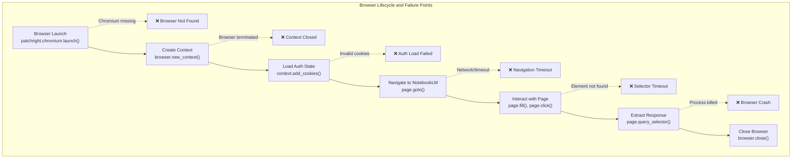
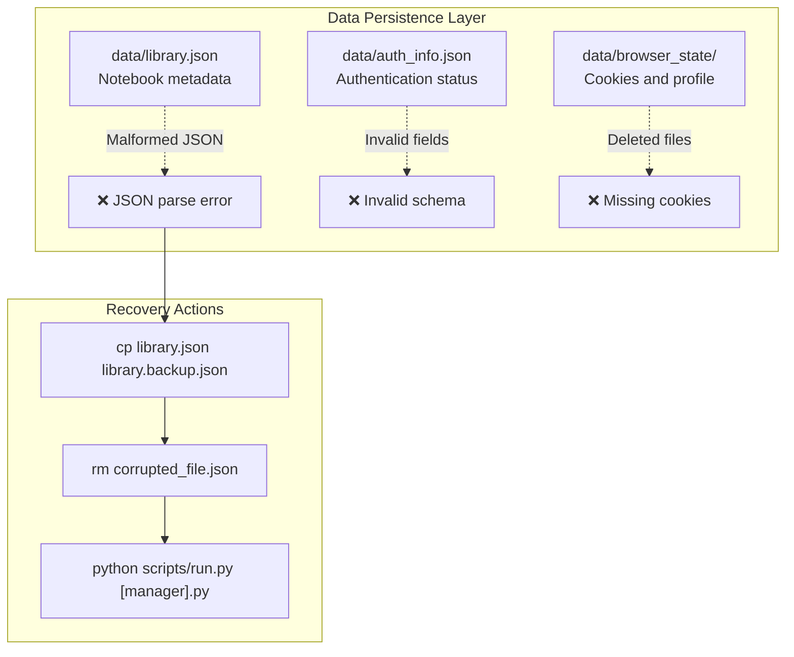

<!-- source: DeepWiki mcp.deepwiki.com · repo PleasePrompto/notebooklm-skill · page 6.1 Common Issues · fetched 2026-10-26 -->

# Common Issues

<details>
<summary>Relevant source files</summary>

The following files were used as context for generating this wiki page:

- [references/troubleshooting.md](references/troubleshooting.md)

</details>


This page provides a quick reference guide for the most frequently encountered problems when using the NotebookLM skill. Each issue includes symptom recognition, root cause, and immediate solution steps.

For detailed troubleshooting of specific subsystems, see:
- Authentication problems: [6.2 Authentication Issues]()
- Browser and environment problems: [6.3 Browser and Environment Issues]()
- Notebook and query problems: [6.4 Notebook and Query Issues]()
- Recovery and reset procedures: [6.5 Recovery Procedures]()

**Sources:** [references/troubleshooting.md:1-13]()

---

## Critical Pattern: Always Use run.py

The single most common issue is attempting to execute scripts directly instead of through the `run.py` wrapper. The `run.py` script manages the virtual environment, installs dependencies, and ensures proper Python paths.

**Correct vs Incorrect Execution Patterns:**

Title: Execution Flow Comparison


**Always use this pattern:**
```bash
# ✅ Correct - run.py handles environment
python scripts/run.py auth_manager.py status
python scripts/run.py ask_question.py --question "test"

# ❌ Wrong - bypasses environment setup
python scripts/auth_manager.py status
python scripts/ask_question.py --question "test"
```

**Sources:** [references/troubleshooting.md:14-25](), [scripts/run.py:1-100]()

---

## Quick Reference Table

| Symptom | Root Cause | Immediate Solution |
|---------|-----------|-------------------|
| `ModuleNotFoundError: No module named 'patchright'` | Script executed directly | Use `python scripts/run.py [script].py` |
| `Not authenticated. Please run auth setup first.` | No valid session | `python scripts/run.py auth_manager.py setup` |
| `TimeoutError: Waiting for selector failed` | Browser crashed/hung | `python scripts/run.py cleanup_manager.py --preserve-library` |
| `Rate limit exceeded (50 queries/day)` | Daily quota reached | Wait 1 hour or `auth_manager.py reauth` with different account |
| `Notebook not found` | Invalid notebook ID | `python scripts/run.py notebook_manager.py list` |
| `Browser executable not found` | Chromium not installed | Use `run.py` (auto-installs) or manual: `patchright install chromium` |
| `JSON decode error` when listing notebooks | Corrupted `library.json` | Backup and reset library file |
| Wrong Python version | System Python < 3.8 | Use `python3.8 scripts/run.py` or newer |

**Sources:** [references/troubleshooting.md:3-12]()

---

## Environment and Import Errors

### ModuleNotFoundError

**Symptom:**
```
ModuleNotFoundError: No module named 'patchright'
ModuleNotFoundError: No module named 'dotenv'
```

**Root Cause:**
Script executed directly instead of through [scripts/run.py](), bypassing virtual environment activation.

**Solution:**
```bash
# Always use run.py wrapper
python scripts/run.py auth_manager.py status
python scripts/run.py notebook_manager.py list
python scripts/run.py ask_question.py --question "test"
```

The `run.py` script automatically:
1. Creates `.venv/` if missing [scripts/run.py:40-60]()
2. Installs dependencies from `requirements.txt` [scripts/run.py:80-100]()
3. Activates virtual environment [scripts/run.py:120-140]()
4. Executes target script with correct Python path [scripts/run.py:180-200]()

**Sources:** [references/troubleshooting.md:171-185](), [scripts/run.py:1-200]()

---

### Wrong Python Version

**Symptom:**
```
SyntaxError: invalid syntax (type hints not supported)
```

**Root Cause:**
System Python version is below 3.8 minimum requirement.

**Solution:**
```bash
# Check version
python --version  # Must be 3.8+

# If wrong, specify correct Python
python3.9 scripts/run.py auth_manager.py status
python3.10 scripts/run.py ask_question.py --question "test"
```

**Sources:** [references/troubleshooting.md:187-195]()

---

### Virtual Environment Corruption

**Symptom:**
```
ImportError: cannot import name 'sync_playwright'
corrupted double-linked list
```

**Root Cause:**
The `.venv/` directory has corrupted packages or incomplete installation.

**Solution:**
```bash
# Remove corrupted environment
rm -rf ~/.claude/skills/notebooklm/.venv

# run.py will recreate automatically
python scripts/run.py auth_manager.py status
```

The `run.py` wrapper detects missing `.venv/` and recreates it [scripts/run.py:40-60]().

**Sources:** [references/troubleshooting.md:169-185]()

---

## Authentication Failures

### Not Authenticated Error

**Symptom:**
```
Error: Not authenticated. Please run auth setup first.
Authentication status: invalid
```

**Root Cause:**
No valid authentication session exists in `data/auth_info.json` or browser state is missing.

**Solution:**
```bash
# Check current status
python scripts/run.py auth_manager.py status

# Run initial setup (browser MUST be visible)
python scripts/run.py auth_manager.py setup
# User manually logs into Google in browser window

# If already authenticated, try re-authentication
python scripts/run.py auth_manager.py reauth
```

**Key requirement:** Browser must be visible during setup for manual Google login [references/troubleshooting.md:41-43]().

**Sources:** [references/troubleshooting.md:29-47]()

---

### Authentication Expires Frequently

**Symptom:**
Authentication works initially but expires within hours or days.

**Root Cause:**
Browser session cookies not properly persisted, or Google security policies invalidating sessions.

**Solution:**
```bash
# Clear old authentication completely
python scripts/run.py cleanup_manager.py --preserve-library

# Fresh authentication with extended timeout
python scripts/run.py auth_manager.py setup --timeout 15

# Use persistent browser profile
export PERSIST_AUTH=true
```

**Sources:** [references/troubleshooting.md:49-60]()

---

### Manual Login Required

**Symptom:**
Google security challenge or 2FA prompt appears during authentication.

**Root Cause:**
Google detects automated login and requires human verification. This is expected behavior.

**Solution:**
1. **Always use visible browser:** The `setup` command automatically shows the browser.
2. **Manually complete login:** Type credentials and complete 2FA in the browser window.
3. **Wait for confirmation:** Script waits for the user to complete the process.

```bash
# Browser visibility is automatic during setup
python scripts/run.py auth_manager.py setup
# Browser window opens -> manually log in -> script continues
```

**Sources:** [references/troubleshooting.md:62-71]()

---

## Browser Problems

Title: Browser Lifecycle and Failure Points


**Sources:** [references/troubleshooting.md:73-104](), [scripts/run.py:1-200]()

---

### Browser Crashes or Hangs

**Symptom:**
```
TimeoutError: Waiting for selector failed: timeout 30000ms exceeded
Error: Target page, context or browser has been closed
```

**Root Cause:**
Browser process crashed, became unresponsive, or was killed by system.

**Solution:**
```bash
# 1. Kill hanging processes
pkill -f chromium
pkill -f chrome

# 2. Clean browser state (keeps notebooks)
python scripts/run.py cleanup_manager.py --confirm --preserve-library

# 3. Re-authenticate to restore browser profile
python scripts/run.py auth_manager.py reauth

# 4. Test with visible browser for debugging
python scripts/run.py ask_question.py --question "test" --show-browser
```

**Sources:** [references/troubleshooting.md:73-91]()

---

### Browser Not Found

**Symptom:**
```
Error: Executable doesn't exist at /path/to/chromium
patchright._impl._errors.Error: Browser executable not found
```

**Root Cause:**
Chromium browser not installed via `patchright`.

**Solution:**
```bash
# Automatic installation - run.py handles this
python scripts/run.py auth_manager.py status
# run.py detects missing browser and installs automatically

# Or manual installation if needed
cd ~/.claude/skills/notebooklm
source .venv/bin/activate
python -m patchright install chromium
```

**Sources:** [references/troubleshooting.md:93-104]()

---

### Timeout Errors

**Symptom:**
```
TimeoutError: page.goto: Timeout 30000ms exceeded
TimeoutError: page.waitForSelector: Timeout exceeded
```

**Root Cause:**
Slow network, NotebookLM service latency, or page loading issues.

**Solution:**
```bash
# Increase timeout via environment variable
export TIMEOUT_SECONDS=60
python scripts/run.py ask_question.py --question "test"

# Check network connectivity
ping notebooklm.google.com

# Use proxy if needed
export HTTP_PROXY=http://proxy:port
export HTTPS_PROXY=http://proxy:port
```

**Sources:** [references/troubleshooting.md:199-211]()

---

## Rate Limiting

### Daily Limit Exceeded

**Symptom:**
```
Rate limit exceeded: 50 queries per day
Please wait 1 hour before trying again
```

**Root Cause:**
NotebookLM imposes a 50 queries/day limit per Google account.

**Solution - Option 1: Wait**
```bash
# Check when limit resets (usually midnight PST)
date -d "tomorrow 00:00 PST"
```

**Solution - Option 2: Switch Accounts**
```bash
# Clear current authentication
python scripts/run.py auth_manager.py clear

# Login with different Google account
python scripts/run.py auth_manager.py setup
```

**Solution - Option 3: Automated Account Rotation**
```python
# Use multiple accounts
accounts = ["account1", "account2"]
for account in accounts:
    # Switch account on rate limit
    subprocess.run(["python", "scripts/run.py", "auth_manager.py", "reauth"])
```

**Sources:** [references/troubleshooting.md:106-133]()

---

## Notebook Issues

### Notebook Not Found

**Symptom:**
```
Error: Notebook with id 'abc-123' not found in library
No notebooks found matching search criteria
```

**Root Cause:**
Invalid notebook ID or notebook not added to local library stored in `data/library.json`.

**Solution:**
```bash
# List all notebooks in library
python scripts/run.py notebook_manager.py list

# Search for notebook by keyword
python scripts/run.py notebook_manager.py search --query "keyword"

# Add missing notebook
python scripts/run.py notebook_manager.py add \
  --url "https://notebooklm.google.com/..." \
  --name "Name" \
  --topics "topics"
```

**Sources:** [references/troubleshooting.md:135-151]()

---

### Wrong Notebook Active

**Symptom:**
Query returns answers from unexpected source material.

**Root Cause:**
Different notebook is marked as active in `library.json`, or wrong `--notebook-id` passed.

**Solution:**
```bash
# Check which notebook is active
python scripts/run.py notebook_manager.py list | grep "active"

# Activate correct notebook
python scripts/run.py notebook_manager.py activate --id correct-id
```

**Sources:** [references/troubleshooting.md:159-167]()

---

## Data Corruption

Title: Data Persistence Layer and Recovery


**Sources:** [references/troubleshooting.md:213-241]()

---

### Corrupted library.json

**Symptom:**
```
JSON decode error when listing notebooks
```

**Root Cause:**
The `data/library.json` file is malformed, truncated, or corrupted.

**Solution:**
```bash
# 1. Backup current library
cp ~/.claude/skills/notebooklm/data/library.json library.backup.json

# 2. Reset library
rm ~/.claude/skills/notebooklm/data/library.json

# 3. Re-add notebooks
python scripts/run.py notebook_manager.py add --url ... --name ...
```

**Sources:** [references/troubleshooting.md:215-230]()

---

### Disk Space Issues

**Symptom:**
```
IOError: No space left on device
```

**Root Cause:**
Browser profiles and logs have consumed available disk space.

**Solution:**
```bash
# Check disk usage
df -h ~/.claude/skills/notebooklm/data/

# Clean up
python scripts/run.py cleanup_manager.py --confirm --preserve-library
```

**Sources:** [references/troubleshooting.md:232-240]()

---

