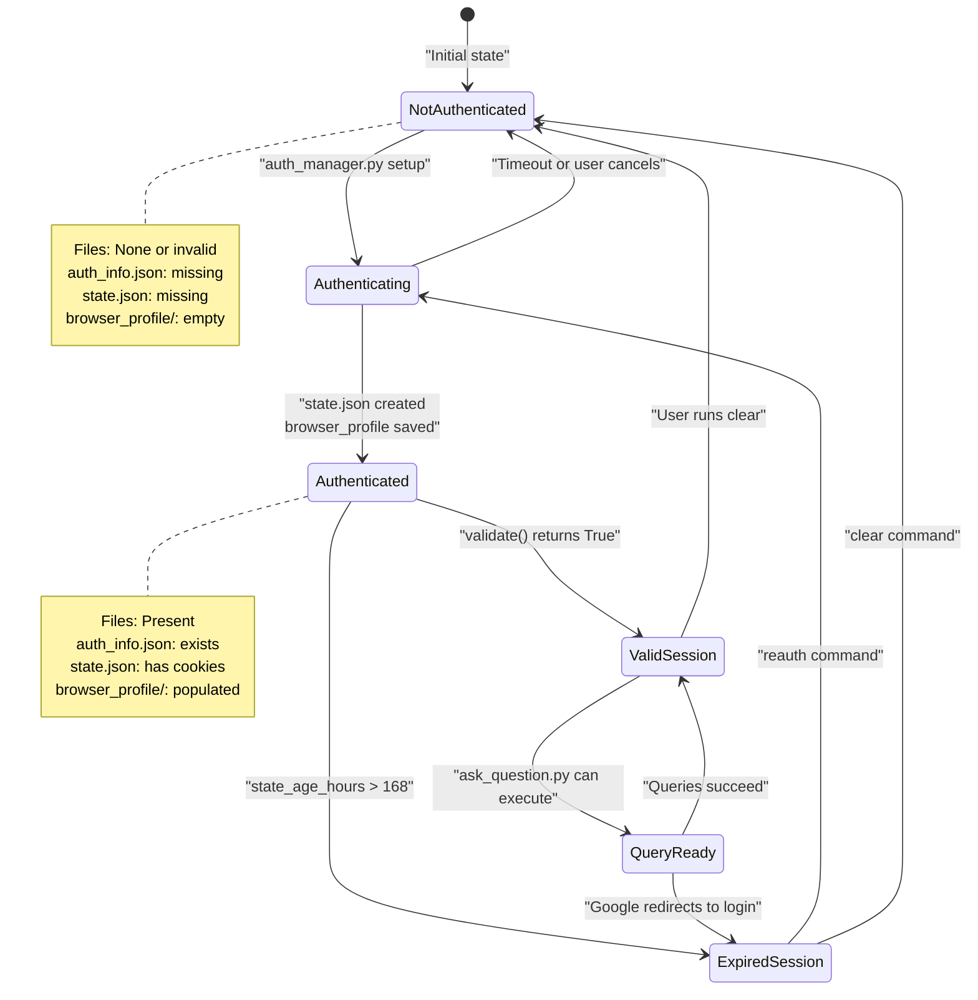
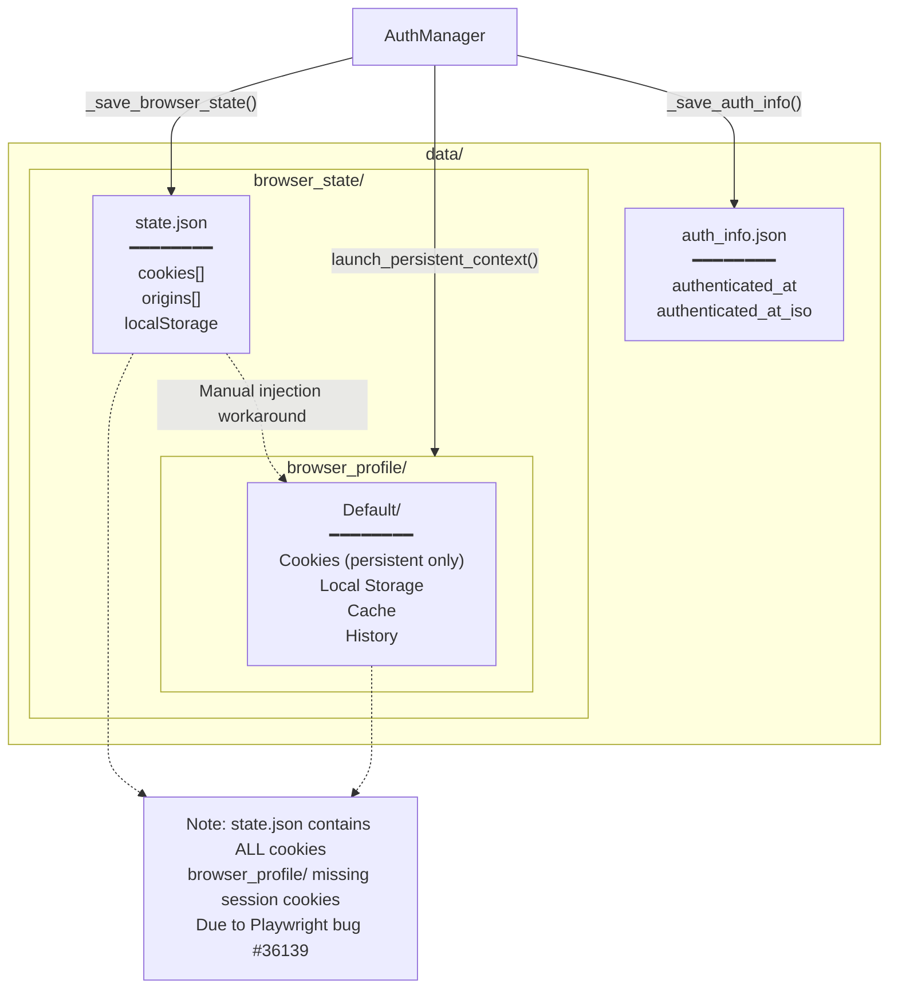
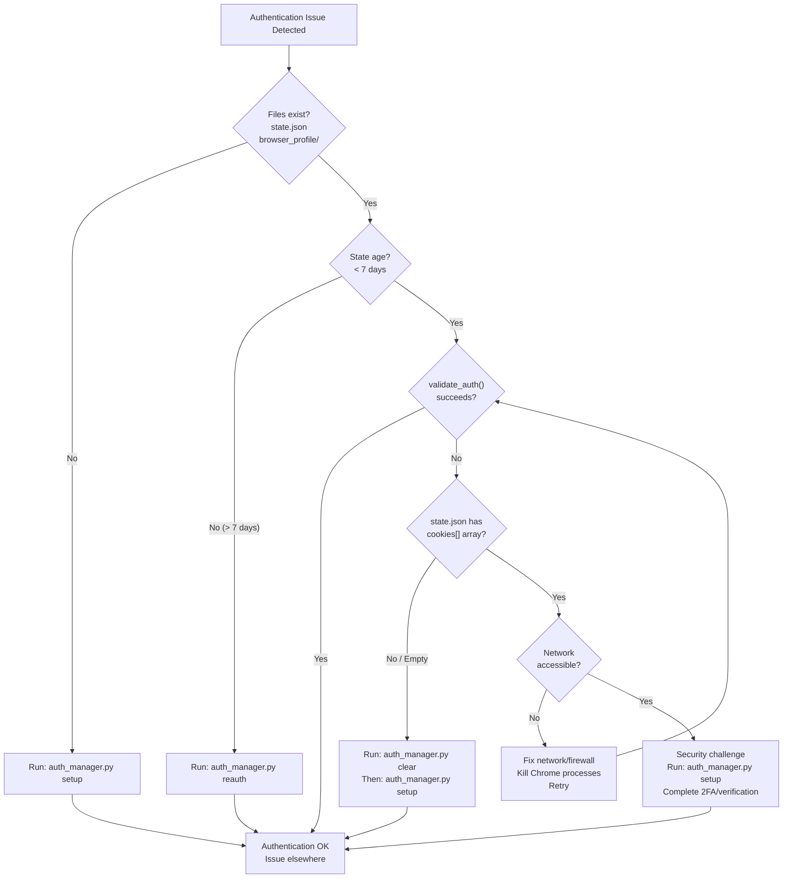

<!-- source: DeepWiki mcp.deepwiki.com · repo PleasePrompto/notebooklm-skill · page 6.2 Authentication Issues · fetched 2026-10-26 -->

# Authentication Issues

<details>
<summary>Relevant source files</summary>

The following files were used as context for generating this wiki page:

- [AUTHENTICATION.md](AUTHENTICATION.md)
- [CHANGELOG.md](CHANGELOG.md)
- [references/troubleshooting.md](references/troubleshooting.md)
- [scripts/auth_manager.py](scripts/auth_manager.py)

</details>


This page provides detailed troubleshooting guidance for authentication-related problems in the NotebookLM Skill. It covers common error patterns, diagnostic procedures, and resolution strategies specific to Google authentication, browser state persistence, and session management.

For general troubleshooting guidance, see [Common Issues](#6.1). For browser-related problems that are not authentication-specific, see [Browser and Environment Issues](#6.3). For complete system recovery procedures, see [Recovery Procedures](#6.5).

## Authentication Error Patterns

The NotebookLM Skill uses a hybrid authentication approach that combines persistent browser profiles (`user_data_dir`) with manual cookie injection from `state.json`. Authentication failures typically fall into four categories:

| Error Pattern | Primary Cause | Quick Check |
|--------------|---------------|-------------|
| **Not Authenticated** | Missing or invalid `state.json` | `auth_manager.py status` |
| **Session Expired** | Cookies older than 7 days | Check `state_age_hours` in status |
| **Login Redirect** | Session cookies not persisting | Verify `state.json` exists and has cookies |
| **Validation Failure** | Browser state corrupted or Google security challenge | `auth_manager.py validate` |

Sources: [scripts/auth_manager.py:48-62](), [scripts/auth_manager.py:64-85](), [references/troubleshooting.md:29-72]()

## Authentication State Flow



**Diagram: Authentication State Lifecycle**

This diagram shows how the `AuthManager` class transitions between states. The `is_authenticated()` method checks for `state.json` existence and age, while `validate_auth()` performs actual NotebookLM access verification.

Sources: [scripts/auth_manager.py:52-62](), [scripts/auth_manager.py:242-318](), [scripts/auth_manager.py:182-213]()

## Authentication Data Structure



**Diagram: Authentication Data Relationships**

The `AuthManager` class manages three data structures. The `browser_profile/` directory is automatically managed by Playwright's `launch_persistent_context()`, while `state.json` is explicitly saved via `storage_state()` and manually injected during query execution.

Sources: [scripts/auth_manager.py:42-51](), [scripts/auth_manager.py:160-169](), [scripts/auth_manager.py:170-181](), [AUTHENTICATION.md:98-112]()

## Common Authentication Failures

### Not Authenticated Error

**Symptom:**
```
Error: Not authenticated. Please run auth setup first.
```

**Root Cause:** The `is_authenticated()` method returns `False` because `state.json` does not exist at `data/browser_state/state.json`.

**Diagnostic Steps:**

1. Check authentication status:
```bash
python scripts/run.py auth_manager.py status
```

2. Verify file existence:
```bash
ls -la ~/.claude/skills/notebooklm/data/browser_state/state.json
```

3. Check auth_info metadata:
```bash
cat ~/.claude/skills/notebooklm/data/auth_info.json
```

**Resolution:**

Execute the setup command, which launches a visible browser for manual Google login:
```bash
python scripts/run.py auth_manager.py setup --timeout 15
```

**Important:** The browser must be visible during setup. The `setup_auth()` method at [scripts/auth_manager.py:86-159]() uses `headless=False` by default and requires user interaction to complete Google's login flow.

**Expected Outcome:** After successful login, the following files are created:
- `data/browser_state/state.json` - Contains all cookies including session cookies [scripts/auth_manager.py:164]()
- `data/browser_state/browser_profile/` - Contains persistent browser data [scripts/auth_manager.py:107]()
- `data/auth_info.json` - Contains authentication timestamp [scripts/auth_manager.py:177]()

Sources: [scripts/auth_manager.py:52-62](), [scripts/auth_manager.py:86-159](), [references/troubleshooting.md:31-47]()

### Authentication Expired / Session Too Old

**Symptom:**
```
⚠️ Browser state is 8.3 days old, may need re-authentication
```

**Root Cause:** The `is_authenticated()` method checks if `state.json` is older than 7 days at [scripts/auth_manager.py:58-60](). Google session cookies typically expire after 7-14 days.

**Diagnostic Steps:**

1. Check state age:
```bash
python scripts/run.py auth_manager.py status
# Look for "State age: X hours"
```

2. Validate authentication actually works:
```bash
python scripts/run.py auth_manager.py validate
```

The `validate_auth()` method at [scripts/auth_manager.py:242-318]() performs a real test by launching Chrome, loading cookies, and attempting to access NotebookLM.

**Resolution:**

**Option 1: Re-authenticate (recommended)**
```bash
python scripts/run.py auth_manager.py reauth --timeout 15
```

The `re_auth()` method at [scripts/auth_manager.py:214-241]() performs a complete clear and setup sequence.

**Option 2: Clear and setup separately**
```bash
python scripts/run.py auth_manager.py clear
python scripts/run.py auth_manager.py setup --timeout 15
```

Sources: [scripts/auth_manager.py:58-60](), [scripts/auth_manager.py:242-318](), [scripts/auth_manager.py:214-241](), [references/troubleshooting.md:49-60]()

### Login Redirect Loop

**Symptom:** Queries redirect to `accounts.google.com` instead of executing on `notebooklm.google.com`.

**Root Cause:** Session cookies are not persisting correctly due to Playwright bug [#36139](https://github.com/microsoft/playwright/issues/36139). This occurs when:
1. `state.json` exists but cookies array is empty
2. Manual cookie injection fails in `ask_question.py`
3. Browser profile lacks session cookies

**Diagnostic Steps:**

1. Inspect `state.json` structure:
```bash
cat ~/.claude/skills/notebooklm/data/browser_state/state.json | jq '.cookies | length'
# Should return > 0
```

2. Verify cookie injection occurs during validation:
```bash
python scripts/run.py auth_manager.py validate
# Look for: "🔧 Injected X cookies from state.json"
```

3. Check for cookie injection errors in query execution by examining the code at [scripts/ask_question.py:101-118]() where manual injection occurs.

**Resolution:**

**Step 1: Clear corrupted state**
```bash
python scripts/run.py auth_manager.py clear
```

The `clear_auth()` method at [scripts/auth_manager.py:182-213]() removes:
- `state.json`
- `auth_info.json`
- Entire `browser_state/` directory including `browser_profile/`

**Step 2: Perform fresh authentication**
```bash
python scripts/run.py auth_manager.py setup --timeout 15
```

**Step 3: Verify cookie injection works**
```bash
python scripts/run.py auth_manager.py validate
# Should show: "🔧 Injected X cookies from state.json"
# Should show: "✅ Authentication is valid"
```

Sources: [AUTHENTICATION.md:13-48](), [scripts/auth_manager.py:279-290](), [scripts/auth_manager.py:182-213](), [references/troubleshooting.md:62-72]()

### Authentication Timeout During Setup

**Symptom:**
```
❌ Authentication timeout: Timeout 600000ms exceeded.
```

**Root Cause:** The `setup_auth()` method uses `page.wait_for_url()` at [scripts/auth_manager.py:129]() with a configurable timeout (default 10 minutes). Timeout occurs if user does not complete login within this window.

**Resolution:**

**Option 1: Increase timeout**
```bash
python scripts/run.py auth_manager.py setup --timeout 20
# Timeout in minutes
```

**Option 2: Pre-authenticate in regular Chrome**

If Google presents security challenges (2FA, device verification), pre-authenticate:

1. Open regular Chrome browser (not automated)
2. Navigate to `https://notebooklm.google.com`
3. Complete all security challenges
4. Close Chrome
5. Run setup:
```bash
python scripts/run.py auth_manager.py setup --timeout 10
```

**Option 3: Use dedicated automation account**

Create a Google account specifically for automation:
- Enable "Less secure app access" if available
- Disable 2FA or use app-specific password
- Pre-verify the account from your current device/IP

Sources: [scripts/auth_manager.py:86-159](), [scripts/auth_manager.py:328-330](), [references/troubleshooting.md:62-72]()

## Browser Visibility Requirements

### Why Browser Must Be Visible During Setup

**Technical Reason:** Google's login flow uses advanced bot detection that requires:
1. Real user interaction (mouse movements, typing patterns)
2. Visible browser viewport for CAPTCHA challenges
3. Device fingerprinting that matches human behavior

**Code Implementation:** The `setup_auth()` method defaults to `headless=False`:

```python
def setup_auth(self, headless: bool = False, timeout_minutes: int = 10) -> bool:
```

At [scripts/auth_manager.py:86](), the `headless` parameter is offered but **should never be set to `True`** during initial authentication.

**Common Mistake:**
```bash
# ❌ WRONG - Will likely fail Google bot detection
python scripts/run.py auth_manager.py setup --headless

# ✅ CORRECT - Browser visible, user logs in manually  
python scripts/run.py auth_manager.py setup
```

**After Authentication:** Subsequent operations (queries via `ask_question.py`) can run headless because they use the saved authentication state.

Sources: [scripts/auth_manager.py:86-110](), [scripts/auth_manager.py:123-136](), [references/troubleshooting.md:62-72]()

## Session Cookie Persistence Issue

### The Playwright Bug

**Problem:** Playwright's `launch_persistent_context()` with `user_data_dir` fails to persist session cookies (cookies without `Expires` attribute) across browser restarts.

**Impact:**
- Persistent cookies (with `Expires`) → Saved correctly ✅
- Session cookies (without `Expires`) → Lost after browser closes ❌
- Google authentication uses both types of cookies
- Results in random authentication failures

**Evidence:**

1. Check browser profile cookies:
```bash
# Chromium stores cookies in SQLite database
sqlite3 ~/.claude/skills/notebooklm/data/browser_state/browser_profile/Default/Cookies \
  "SELECT name, is_persistent FROM cookies WHERE host_key LIKE '%google.com%'"
```

2. Compare with `state.json`:
```bash
cat ~/.claude/skills/notebooklm/data/browser_state/state.json | \
  jq '.cookies[] | select(.domain | contains("google.com")) | {name, expires}'
```

Session cookies have `expires: -1` in `state.json` but are missing from the browser profile database.

### The Hybrid Solution

The codebase works around this bug using a two-phase approach:

**Phase 1: Setup** - Save to both locations
```python
# At scripts/auth_manager.py:107-114
context = BrowserFactory.launch_persistent_context(
    playwright,
    headless=headless
)
# User logs in...
# At scripts/auth_manager.py:164
context.storage_state(path=str(self.state_file))  # Save all cookies to state.json
```

**Phase 2: Runtime** - Manual injection
```python
# At scripts/ask_question.py:86-99
context = BrowserFactory.launch_persistent_context(
    playwright,
    headless=headless,
    slow_mo=50 if stealth_enabled else 0
)

# Manually inject cookies from state.json (workaround for session cookies)
# At scripts/ask_question.py:101-118
with open(auth_manager.state_file, 'r') as f:
    state = json.load(f)
    if 'cookies' in state:
        context.add_cookies(state['cookies'])  # ← Critical workaround
```

**Why This Works:**
- `user_data_dir` provides consistent browser fingerprinting (same User-Agent, extensions, cache)
- Manual `add_cookies()` injects session cookies that Playwright fails to persist
- Google sees the same trusted browser across requests

Sources: [AUTHENTICATION.md:49-86](), [scripts/auth_manager.py:107-114](), [scripts/auth_manager.py:164](), [scripts/ask_question.py:86-118]()

## Account Switching

### Switching Between Google Accounts

**Use Case:** 
- Testing with different accounts
- Avoiding rate limits by rotating accounts
- Accessing notebooks shared with specific accounts

**Procedure:**

1. Clear current authentication:
```bash
python scripts/run.py auth_manager.py clear
```

2. Authenticate with new account:
```bash
python scripts/run.py auth_manager.py setup
# Browser opens - log in with different Google account
```

3. Verify new account:
```bash
python scripts/run.py auth_manager.py status
# Check authenticated_at timestamp is recent
```

**Important:** The `clear_auth()` method at [scripts/auth_manager.py:182-213]() removes the entire `browser_state_dir/` directory, ensuring no cached credentials from the previous account remain.

### Multi-Account Workflow

For automated account rotation (e.g., to bypass rate limits):

```bash
#!/bin/bash
# Rotate through multiple accounts
ACCOUNTS=("account1@gmail.com" "account2@gmail.com" "account3@gmail.com")

for account in "${ACCOUNTS[@]}"; do
    echo "Switching to $account"
    python scripts/run.py auth_manager.py clear
    python scripts/run.py auth_manager.py setup --timeout 5
    # Perform queries...
    # When rate limit hit, loop continues to next account
done
```

**Limitation:** Each account switch requires manual login in the visible browser. There is no automated credential entry to maintain security and avoid triggering Google's anti-bot systems.

Sources: [scripts/auth_manager.py:182-213](), [scripts/auth_manager.py:214-241](), [references/troubleshooting.md:118-133]()

## Validation Failures

### Validation vs Status Check

**Distinction:**

| Method | What It Checks | Performance | Use Case |
|--------|----------------|-------------|----------|
| `is_authenticated()` | File existence and age | Fast (filesystem only) | Pre-flight check |
| `validate_auth()` | Actual NotebookLM access | Slow (launches browser) | Verify auth works |

At [scripts/auth_manager.py:52-62](), `is_authenticated()` performs quick checks:
```python
def is_authenticated(self) -> bool:
    if not self.state_file.exists():
        return False
    age_days = (time.time() - self.state_file.stat().st_mtime) / 86400
    if age_days > 7:
        print(f"⚠️ Browser state is {age_days:.1f} days old")
    return True
```

At [scripts/auth_manager.py:242-318](), `validate_auth()` performs full verification by launching Chrome and accessing NotebookLM.

### Validation Failure Scenarios

**Scenario 1: Files exist but validation fails**

```bash
python scripts/run.py auth_manager.py status
# Shows: Authenticated: Yes

python scripts/run.py auth_manager.py validate  
# Shows: ❌ Authentication is invalid (redirected to login)
```

**Cause:** `state.json` exists but cookies are expired or Google revoked the session.

**Resolution:**
```bash
python scripts/run.py auth_manager.py reauth --timeout 15
```

**Scenario 2: Validation timeout**

```
❌ Validation failed: Timeout 30000ms exceeded
```

**Causes:**
- Network connectivity issues
- NotebookLM service down
- Firewall blocking browser traffic
- Chrome process hanging

**Resolution:**

1. Check network:
```bash
ping notebooklm.google.com
curl -I https://notebooklm.google.com
```

2. Kill hanging Chrome processes:
```bash
pkill -f chrome
pkill -f chromium
```

3. Retry validation:
```bash
python scripts/run.py auth_manager.py validate
```

**Scenario 3: Security challenge required**

If validation shows:
```
❌ Authentication is invalid (redirected to login)
```

But `state.json` is fresh (< 24 hours old), Google likely triggered a security challenge.

**Resolution:** Run visible browser setup to complete challenge:
```bash
python scripts/run.py auth_manager.py setup
# Complete any 2FA or device verification prompts
```

Sources: [scripts/auth_manager.py:52-62](), [scripts/auth_manager.py:242-318](), [references/troubleshooting.md:197-212]()

## Authentication Recovery Matrix



**Diagram: Authentication Troubleshooting Decision Tree**

This flowchart maps authentication issues to specific recovery commands based on diagnostic checks.

Sources: [scripts/auth_manager.py:52-318](), [references/troubleshooting.md:29-133]()

## Prevention Strategies

### Regular Maintenance

**Weekly Tasks:**
```bash
# Check authentication health
python scripts/run.py auth_manager.py status

# If > 5 days old, preemptively re-authenticate
python scripts/run.py auth_manager.py validate
```

**After Extended Inactivity (> 7 days):**
```bash
# Proactively refresh before critical work
python scripts/run.py auth_manager.py reauth
```

### Monitoring Authentication Age

Create a simple health check script:

```bash
#!/bin/bash
# check_auth_health.sh
STATUS=$(python scripts/run.py auth_manager.py status)

AGE=$(echo "$STATUS" | grep "State age" | awk '{print $3}')

if (( $(echo "$AGE > 168" | bc -l) )); then
    echo "⚠️  Authentication older than 7 days, refreshing..."
    python scripts/run.py auth_manager.py reauth
else
    echo "✅ Authentication healthy (${AGE} hours old)"
fi
```

Run before batch operations:
```bash
./check_auth_health.sh
python scripts/run.py ask_question.py --question "..."
```

### Dedicated Automation Account

**Best Practices:**

1. Create separate Google account for automation
2. Do not enable 2FA (or use app-specific passwords)
3. Pre-verify from your device/IP
4. Only use this account with the skill (no manual browser use)

**Benefits:**
- Reduces security challenge frequency
- Main account remains secure with 2FA
- Easier to debug authentication issues
- Account suspension won't affect primary email

Sources: [references/troubleshooting.md:62-72](), [AUTHENTICATION.md:1-154]()

## File Location Reference

All authentication data is stored in the skill's data directory:

```
~/.claude/skills/notebooklm/data/
├── auth_info.json                 # Timestamp and metadata
├── browser_state/
│   ├── state.json                # All cookies (manual injection source)
│   └── browser_profile/          # Persistent context data
│       ├── Default/
│       │   ├── Cookies           # Persistent cookies only (SQLite)
│       │   ├── Local Storage/    # localStorage data
│       │   ├── Cache/            # HTTP cache
│       │   └── History           # Browsing history
│       ├── First Run
│       └── Local State
```

**Critical Files:**
- `state.json` - Required for session cookie injection [scripts/auth_manager.py:48]()
- `browser_profile/` - Required for consistent fingerprinting [scripts/auth_manager.py:50]()
- `auth_info.json` - Metadata only (not required for operation) [scripts/auth_manager.py:49]()

**Backup for Account Recovery:**
```bash
# Backup authentication state
cp ~/.claude/skills/notebooklm/data/browser_state/state.json ~/backup_state.json

# Restore after cleanup
mkdir -p ~/.claude/skills/notebooklm/data/browser_state/
cp ~/backup_state.json ~/.claude/skills/notebooklm/data/browser_state/state.json
```

**Important:** `browser_profile/` should not be manually backed up. It contains browser-specific cache that may become invalid. Always re-authenticate to recreate it.

Sources: [scripts/auth_manager.py:42-51](), [AUTHENTICATION.md:98-112]()

## Command Reference

All authentication commands must be invoked via `run.py`:

| Command | Purpose | Arguments | Example |
|---------|---------|-----------|---------|
| `setup` | Initial authentication | `--timeout` (minutes, default 10) | `python scripts/run.py auth_manager.py setup --timeout 15` |
| `status` | Check auth state | None | `python scripts/run.py auth_manager.py status` |
| `validate` | Test auth works | None | `python scripts/run.py auth_manager.py validate` |
| `clear` | Remove all auth data | None | `python scripts/run.py auth_manager.py clear` |
| `reauth` | Clear and setup | `--timeout` (minutes, default 10) | `python scripts/run.py auth_manager.py reauth --timeout 15` |

**Critical:** Never run auth_manager.py directly. Always use run.py wrapper:
```bash
# ❌ WRONG - ModuleNotFoundError
python scripts/auth_manager.py status

# ✅ CORRECT - run.py ensures venv activation
python scripts/run.py auth_manager.py status
```

Sources: [scripts/auth_manager.py:320-390](), [references/troubleshooting.md:14-25]()

---

