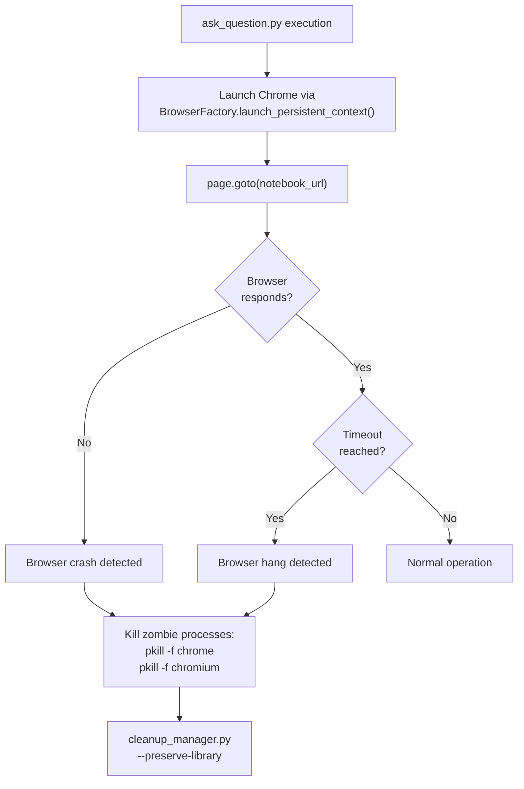
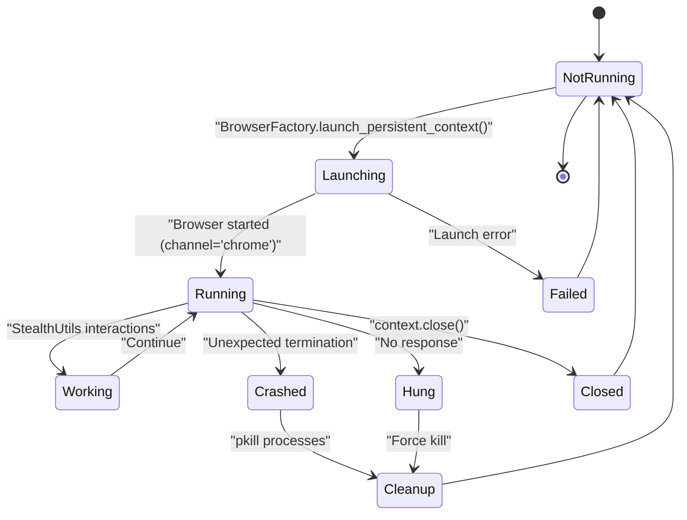
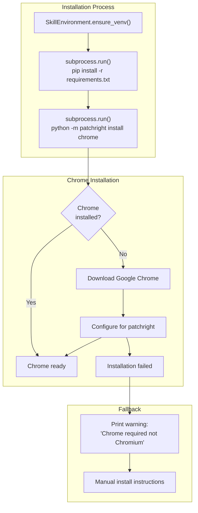
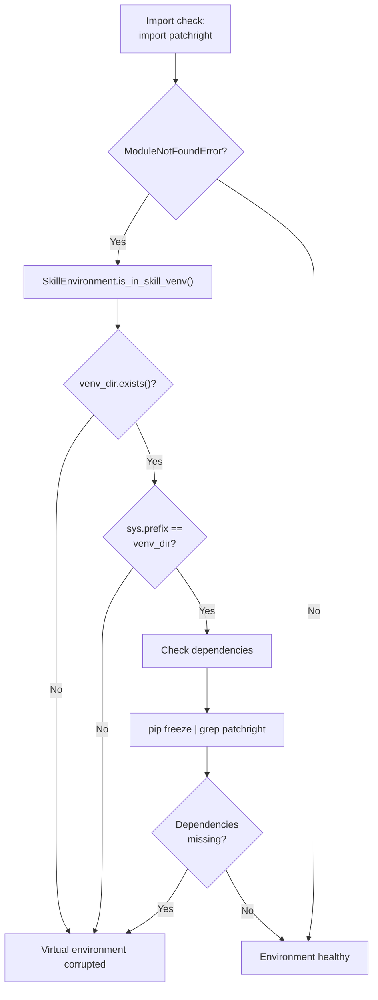
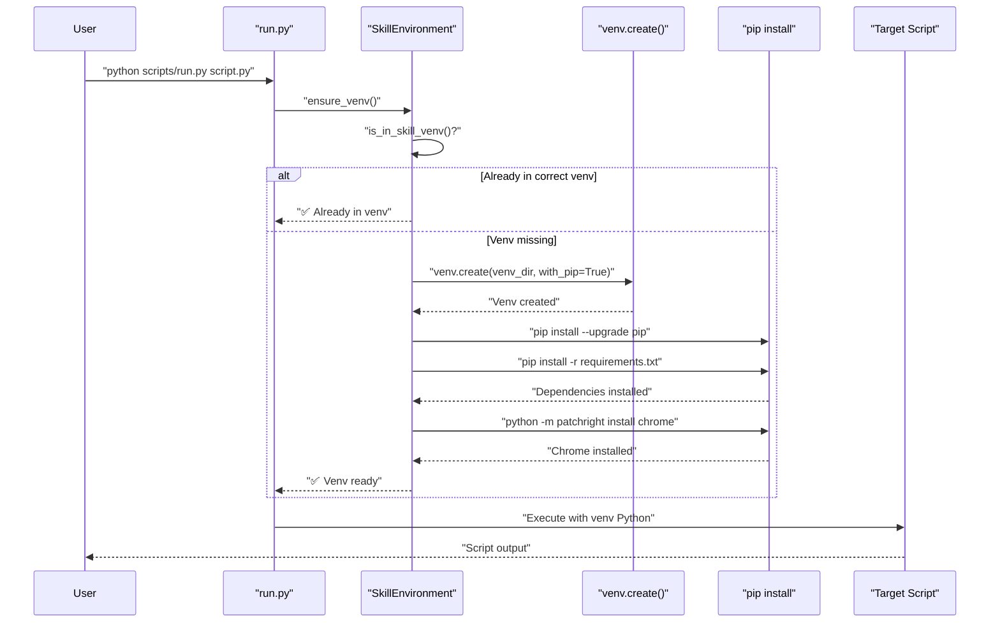
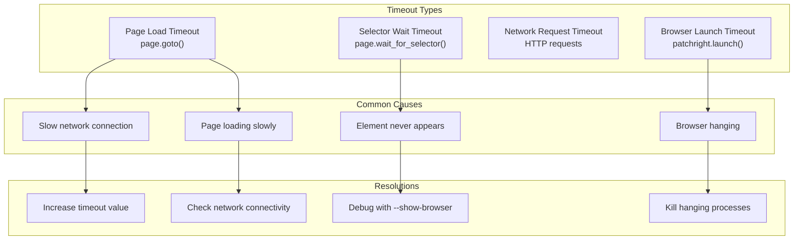

<!-- source: DeepWiki mcp.deepwiki.com · repo PleasePrompto/notebooklm-skill · page 6.3 Browser and Environment Issues · fetched 2026-10-26 -->

# Browser and Environment Issues

<details>
<summary>Relevant source files</summary>

The following files were used as context for generating this wiki page:

- [references/troubleshooting.md](references/troubleshooting.md)
- [scripts/browser_utils.py](scripts/browser_utils.py)
- [scripts/setup_environment.py](scripts/setup_environment.py)

</details>


This page covers troubleshooting for browser crashes, timeout errors, virtual environment corruption, and Chrome installation problems. These are infrastructure-level issues that prevent the skill from executing properly, distinct from application-level problems like authentication failures (see [6.2]()) or notebook access issues (see [6.4]()).

## Browser Process Issues

### Browser Crashes and Hangs

Browser processes can crash or hang during automation, leaving zombie processes that interfere with subsequent operations. The system uses `patchright` to automate a real Chrome instance, which can occasionally become unresponsive due to memory pressure or site-side changes.

**Crash Detection Diagram**



Sources: [scripts/browser_utils.py:19-37](), [references/troubleshooting.md:73-105]()

**Common Crash Scenarios**

| Error Message | Cause | Detection Location |
|---------------|-------|-------------------|
| `Connection refused` | Browser process terminated unexpectedly | `BrowserFactory.launch_persistent_context` |
| `Context closed` | Page context destroyed | During automation |
| `TimeoutError: Waiting for selector failed` | Page never loaded or element not found | `StealthUtils.human_type` or `page.wait_for_selector` |
| `Browser has been closed` | Browser closed during operation | Any browser interaction |

**Resolution Procedure**

1. **Kill hanging processes**:
   ```bash
   # Unix/Linux/Mac
   pkill -f chromium
   pkill -f chrome
   
   # Windows
   taskkill /F /IM chrome.exe
   taskkill /F /IM chromium.exe
   ```

2. **Clean browser state**:
   ```bash
   python scripts/run.py cleanup_manager.py --confirm --preserve-library
   ```

3. **Re-authenticate** (if authentication is lost):
   ```bash
   python scripts/run.py auth_manager.py reauth
   ```

Sources: [references/troubleshooting.md:73-91](), [scripts/browser_utils.py:68-76]()

### Browser Process Lifecycle



Sources: [scripts/browser_utils.py:15-43](), [references/troubleshooting.md:73-91]()

## Chrome Installation Problems

The skill requires **Google Chrome** (not Chromium) for cross-platform reliability and consistent browser fingerprinting. This is managed by the `SkillEnvironment` class.

### Chrome vs Chromium



Sources: [scripts/setup_environment.py:70-86]()

**Why Chrome Over Chromium**

The codebase explicitly requires Chrome at [scripts/setup_environment.py:70-72]():

```python
# Using real Chrome ensures cross-platform reliability and consistent browser fingerprinting
# See: https://github.com/Kaliiiiiiiiii-Vinyzu/patchright-python#anti-detection
```

The `BrowserFactory` also enforces this by setting `channel="chrome"` at [scripts/browser_utils.py:31]().

### Installation Failure Scenarios

**Scenario 1: Automatic Installation Fails**

When [scripts/setup_environment.py:75-80]() fails during the `ensure_venv` process:

```bash
⚠️ Warning: Failed to install Chrome: [error details]
   You may need to run manually: python -m patchright install chrome
   Chrome is required (not Chromium) for reliability!
```

**Manual recovery**:
```bash
cd ~/.claude/skills/notebooklm
source .venv/bin/activate  # Unix
# OR
.venv\Scripts\activate.bat  # Windows

python -m patchright install chrome
```

Sources: [scripts/setup_environment.py:82-85]()

**Scenario 2: Browser Not Found During Execution**

Error message:
```
Browser executable not found
```

**Resolution**:
```bash
# Force reinstall Chrome by running the setup environment script
python scripts/run.py setup_environment.py
```

Sources: [references/troubleshooting.md:93-104]()

## Virtual Environment Issues

### Corruption Detection

The virtual environment (`.venv`) can become corrupted due to interrupted installations or Python version mismatches. The `SkillEnvironment` class provides methods to detect if the execution is happening within the correct environment.

**Corruption Detection Flow**



Sources: [scripts/setup_environment.py:96-102](), [references/troubleshooting.md:170-186]()

### Virtual Environment Recreation

**Automatic Recreation via run.py**

The universal wrapper `run.py` uses `SkillEnvironment.ensure_venv()` to automatically handle setup before running any script.



Sources: [scripts/setup_environment.py:31-94](), [scripts/setup_environment.py:110-136]()

### Dependency Installation Failures

**Common Failure Points**

| Stage | Failure | Cause |
|-------|---------|-------|
| `pip install --upgrade pip` | Network error | Connectivity issues |
| `pip install -r requirements.txt` | Build error | Missing system libraries |
| `python -m patchright install chrome` | Download failure | Network/permissions |

**Resolution Steps**

1. **Check Python version** at [scripts/setup_environment.py:43]():
   ```bash
   python --version  # Must be 3.8+
   ```

2. **Review installation output**:
   The `ensure_venv` method captures and prints output on failure at [scripts/setup_environment.py:88-91]().

Sources: [scripts/setup_environment.py:49-91](), [references/troubleshooting.md:188-195]()

## Timeout Errors

### Timeout Categories

The system interacts with NotebookLM using `patchright` selectors. Timeouts usually occur when the page fails to load or the DOM changes.



Sources: [references/troubleshooting.md:77-79](), [references/troubleshooting.md:199-211](), [scripts/browser_utils.py:73-76]()

### Page Load Timeouts

Error message:
```
TimeoutError: Waiting for selector failed: timeout 30000ms exceeded
```

**Diagnosis**:
Use the `--show-browser` flag (which sets `headless=False` in `BrowserFactory.launch_persistent_context`) to observe the failure.

**Resolution**:
```bash
# Increase timeout via environment variable
export TIMEOUT_SECONDS=60
python scripts/run.py ask_question.py --question "..."
```

Sources: [references/troubleshooting.md:199-211](), [scripts/browser_utils.py:21-32]()

## Environment Configuration Issues

### Python Version Compatibility

The skill requires **Python 3.8+**. The `SkillEnvironment` class manages the Python executable path and virtual environment creation.

**Resolution for Wrong Version**:
```bash
# Check current version
python --version

# If wrong, specify correct Python when running the wrapper
python3.8 scripts/run.py auth_manager.py status
```

Sources: [scripts/setup_environment.py:104-108](), [references/troubleshooting.md:188-195]()

### Path Resolution Issues

The `SkillEnvironment` class resolves paths relative to the skill directory at [scripts/setup_environment.py:17-21]():

```python
self.skill_dir = Path(__file__).parent.parent
self.venv_dir = self.skill_dir / ".venv"
self.requirements_file = self.skill_dir / "requirements.txt"
```

**Common Path Issues**

| Issue | Symptom | Cause |
|-------|---------|-------|
| `FileNotFoundError: requirements.txt` | Can't find requirements | Script run from wrong directory |
| `ModuleNotFoundError` | Can't import from venv | Running scripts directly without `run.py` |

**Resolution**:
Always use the `run.py` wrapper, which correctly handles the working directory and environment activation.

Sources: [scripts/setup_environment.py:17-21](), [references/troubleshooting.md:14-25]()

### Platform-Specific Considerations

The environment setup handles platform differences for binary paths at [scripts/setup_environment.py:24-29]():

```python
if os.name == 'nt':  # Windows
    self.venv_python = self.venv_dir / "Scripts" / "python.exe"
    self.venv_pip = self.venv_dir / "Scripts" / "pip.exe"
else:  # Unix/Linux/Mac
    self.venv_python = self.venv_dir / "bin" / "python"
    self.venv_pip = self.venv_dir / "bin" / "pip"
```

**Manual Activation Instructions**:
The `activate_instructions` method provides the correct command for each platform [scripts/setup_environment.py:138-145]().

Sources: [scripts/setup_environment.py:24-29](), [scripts/setup_environment.py:138-145]()

---

