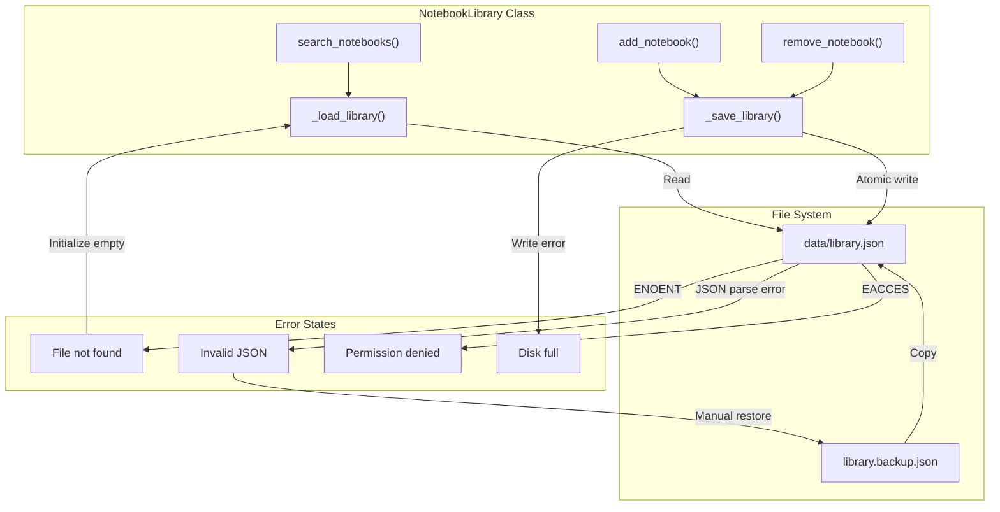
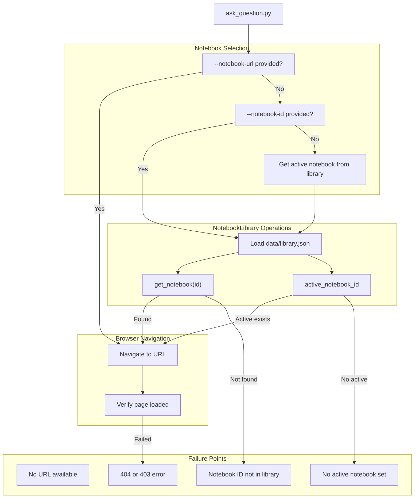

<!-- source: DeepWiki mcp.deepwiki.com · repo PleasePrompto/notebooklm-skill · page 6.4 Notebook and Query Issues · fetched 2026-10-26 -->

# Notebook and Query Issues

<details>
<summary>Relevant source files</summary>

The following files were used as context for generating this wiki page:

- [references/troubleshooting.md](references/troubleshooting.md)
- [scripts/notebook_manager.py](scripts/notebook_manager.py)

</details>


This page covers troubleshooting issues related to notebook library management and query execution. Topics include corrupted `library.json` files, notebook access problems, URL format errors, and query failures.

For authentication-related issues, see [6.2 Authentication Issues](). For browser automation problems, see [6.3 Browser and Environment Issues](). For complete system recovery procedures, see [6.5 Recovery Procedures]().

## Notebook Library Issues

The notebook library is stored in `data/library.json` [scripts/notebook_manager.py:27-27]() and managed by the `NotebookLibrary` class [scripts/notebook_manager.py:17-17](). Corruption or inconsistencies in this file cause most notebook-related issues.

### Corrupted library.json

**Symptoms:**
```
JSONDecodeError: Expecting value: line 1 column 1 (char 0)
Error: Failed to load notebook library
```

**Diagnosis:**
```bash
# Check if library.json is valid JSON
cat ~/.claude/skills/notebooklm/data/library.json | python -m json.tool

# Check file permissions
ls -la ~/.claude/skills/notebooklm/data/library.json
```

**Solution:**
```bash
# Backup existing library
cp ~/.claude/skills/notebooklm/data/library.json ~/library.backup.json

# Remove corrupted file
rm ~/.claude/skills/notebooklm/data/library.json

# Library will be recreated on next operation
python scripts/run.py notebook_manager.py list

# Manually restore notebooks if backup is valid
if [ -f ~/library.backup.json ]; then
    python -m json.tool ~/library.backup.json > /dev/null 2>&1
    if [ $? -eq 0 ]; then
        cp ~/library.backup.json ~/.claude/skills/notebooklm/data/library.json
    fi
fi
```

**Prevention:**
- `library.json` is written by `NotebookLibrary._save_library()` [scripts/notebook_manager.py:50-62]() to maintain persistence.
- Always use `run.py` wrapper to ensure the correct virtual environment and paths are used [references/troubleshooting.md:14-25]().

**Diagram: Library File Lifecycle**

Title: NotebookLibrary Data Flow

Sources: [scripts/notebook_manager.py:34-62](), [references/troubleshooting.md:215-230]()

### Missing Notebook Entries

**Symptoms:**
```
Error: Notebook with id 'react-docs' not found
Available notebooks: []
```

**Diagnosis:**
```bash
# List all notebooks
python scripts/run.py notebook_manager.py list

# Check library file exists and has content
cat ~/.claude/skills/notebooklm/data/library.json

# Search for specific notebook
python scripts/run.py notebook_manager.py search --query "keyword"
```

**Common Causes:**
1. **Never added to library**: Notebook must be explicitly added via `notebook_manager.py add` [scripts/notebook_manager.py:63-121]().
2. **Removed accidentally**: Check if `library.backup.json` exists.
3. **Wrong skill directory**: Verify working directory is `~/.claude/skills/notebooklm/`.

**Solution:**
```bash
# Re-add notebook
python scripts/run.py notebook_manager.py add \
  --url "https://notebooklm.google.com/notebook/abc123" \
  --name "React Documentation" \
  --topics "react, hooks, components"
```
Sources: [references/troubleshooting.md:135-151](), [scripts/notebook_manager.py:202-204]()

## Notebook Access Issues

Notebook access problems occur during query execution when `ask_question.py` attempts to navigate to a notebook URL.

### Notebook Not Found (404)

**Symptoms:**
```
Error: Failed to load notebook
Navigation error: net::ERR_ABORTED
404 Not Found
```

**Diagnosis:**
```bash
# Get notebook URL from library
python scripts/run.py notebook_manager.py list

# Test URL manually in browser
```

**Solution:**
```bash
# Remove invalid notebook
python scripts/run.py notebook_manager.py remove --id old-notebook-id

# Re-add with current URL
python scripts/run.py notebook_manager.py add \
  --url "https://notebooklm.google.com/notebook/new-id" \
  --name "Updated Notebook"
```
Sources: [references/troubleshooting.md:137-151](), [scripts/notebook_manager.py:123-148]()

### Access Denied (403)

**Symptoms:**
```
Error: Access denied to notebook
Authentication may have expired
```

**Common Causes:**
1. **Authentication expired**: Session cookies invalid [references/troubleshooting.md:49-60]().
2. **Wrong account**: Authenticated with account that doesn't have access [references/troubleshooting.md:153-157]().

**Solution:**
```bash
# Re-authenticate
python scripts/run.py auth_manager.py reauth

# If wrong account, clear and setup with correct account
python scripts/run.py auth_manager.py clear
python scripts/run.py auth_manager.py setup
```
Sources: [references/troubleshooting.md:152-167]()

### Wrong Notebook Being Used

**Symptoms:**
```
Answer doesn't match expected source documents
```

**Solution:**
```bash
# Check which notebook is active
python scripts/run.py notebook_manager.py list

# Activate correct notebook
python scripts/run.py notebook_manager.py activate --id correct-notebook-id
```
Sources: [references/troubleshooting.md:159-167](), [scripts/notebook_manager.py:228-245]()

**Diagram: Notebook Resolution Flow**

Title: Notebook Resolution Logic

Sources: [scripts/notebook_manager.py:198-200](), [references/troubleshooting.md:159-167]()

## Query Execution Issues

### Query Timeout Errors

**Symptoms:**
```
TimeoutError: Waiting for selector timed out after 30000ms
```

**Solution:**
```bash
# Increase timeout (default is 30 seconds)
export TIMEOUT_SECONDS=60
python scripts/run.py ask_question.py --question "..." --show-browser
```
Sources: [references/troubleshooting.md:75-91](), [references/troubleshooting.md:202-203]()

### Rate Limiting

**Symptoms:**
```
Error: Rate limit exceeded
```

**Solution:**
```bash
# Option 1: Wait for reset
# Option 2: Switch to different Google account
python scripts/run.py auth_manager.py clear
python scripts/run.py auth_manager.py setup
```
Sources: [references/troubleshooting.md:108-124]()

## Notebook URL Format Issues

### Valid URL Format
NotebookLM URLs must follow the structure:
`https://notebooklm.google.com/notebook/[NOTEBOOK_ID]` [references/troubleshooting.md:148-148]()

| Parameter | Format | When to Use |
|-----------|--------|-------------|
| `--notebook-id` | Short ID (e.g., `react-docs`) | When notebook is in library [scripts/notebook_manager.py:89-89]() |
| `--notebook-url` | Full URL | Direct access, bypassing library |

## Diagnostic Procedures

### Validate Library Integrity

```bash
#!/bin/bash
# Validate library.json structure
LIBRARY_FILE="$HOME/.claude/skills/notebooklm/data/library.json"

if [ ! -f "$LIBRARY_FILE" ]; then
    echo "Error: library.json not found"
    exit 1
fi

if ! python -m json.tool "$LIBRARY_FILE" > /dev/null 2>&1; then
    echo "Error: Invalid JSON format"
    exit 1
fi
```
Sources: [references/troubleshooting.md:213-230]()

### Recovery Strategies

| Issue | Quick Fix Command |
|-------|------------------|
| Corrupted library | `rm data/library.json && python scripts/run.py notebook_manager.py list` [references/troubleshooting.md:226-229]() |
| Wrong active notebook | `python scripts/run.py notebook_manager.py activate --id correct-id` [references/troubleshooting.md:166-166]() |
| Rate limit | `python scripts/run.py auth_manager.py clear` then `setup` [references/troubleshooting.md:119-123]() |

Sources: [references/troubleshooting.md:275-294]()

---

