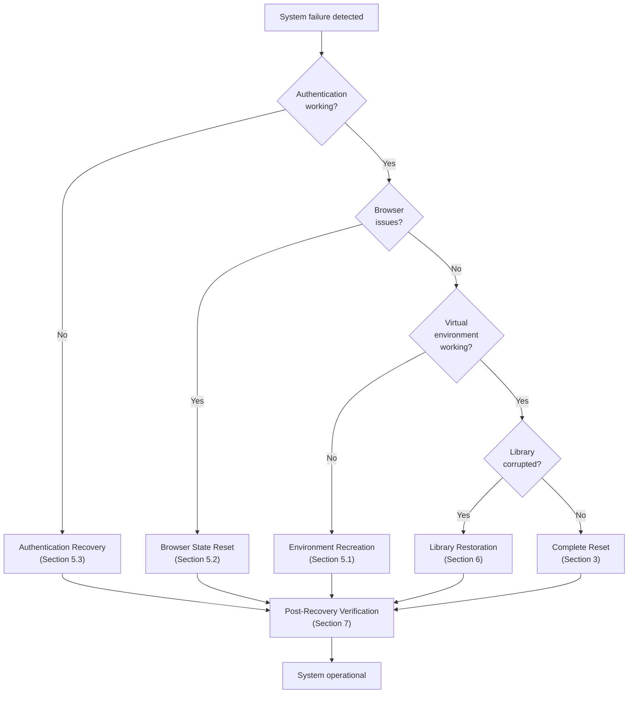
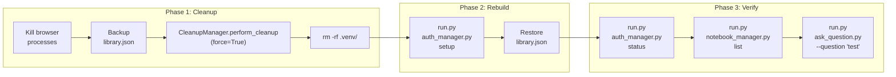
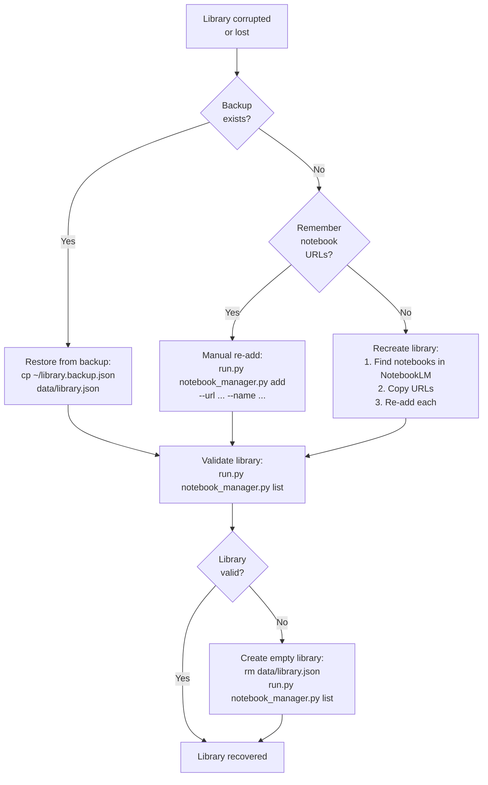
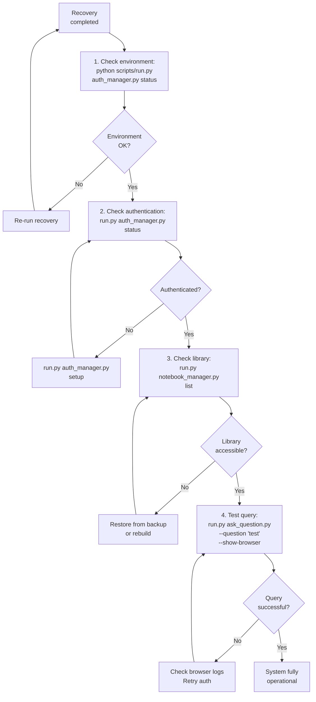

<!-- source: DeepWiki mcp.deepwiki.com · repo PleasePrompto/notebooklm-skill · page 6.5 Recovery Procedures · fetched 2026-10-26 -->

# Recovery Procedures

<details>
<summary>Relevant source files</summary>

The following files were used as context for generating this wiki page:

- [references/troubleshooting.md](references/troubleshooting.md)
- [scripts/cleanup_manager.py](scripts/cleanup_manager.py)

</details>


This page provides step-by-step recovery procedures for restoring the NotebookLM Skill to a working state after various failure scenarios. Recovery procedures range from minimal interventions (browser state reset) to complete system resets.

For diagnosing specific errors before attempting recovery, see [Common Issues](#6.1), [Authentication Issues](#6.2), [Browser and Environment Issues](#6.3), and [Notebook and Query Issues](#6.4).

---

## When to Use Recovery Procedures

Different failure scenarios require different recovery strategies. Use this decision tree to determine the appropriate recovery procedure.

**Decision Tree: Choosing Recovery Procedure**



**Sources:** [references/troubleshooting.md:273-311]()

---

## Pre-Recovery Preparation

Before executing any recovery procedure, back up critical data to prevent permanent data loss.

### Backup Checklist

| Component | File Path | Backup Command | Priority |
|-----------|-----------|----------------|----------|
| Notebook library | `data/library.json` | `cp data/library.json ~/library.backup.json` | **Critical** |
| Authentication | `data/auth_info.json` | `cp data/auth_info.json ~/auth.backup.json` | High |
| Browser state | `data/browser_state/` | `cp -r data/browser_state/ ~/browser_state.backup/` | Medium |
| Environment config | `.env` | `cp .env ~/.env.backup` | Low |

### Pre-Recovery Backup Script

```bash
#!/bin/bash
# Execute from ~/.claude/skills/notebooklm/

BACKUP_DIR=~/notebooklm_backup_$(date +%Y%m%d_%H%M%S)
mkdir -p $BACKUP_DIR

# Backup critical data
if [ -f data/library.json ]; then
    cp data/library.json $BACKUP_DIR/
    echo "✓ Backed up library.json"
fi

if [ -f data/auth_info.json ]; then
    cp data/auth_info.json $BACKUP_DIR/
    echo "✓ Backed up auth_info.json"
fi

if [ -d data/browser_state ]; then
    cp -r data/browser_state/ $BACKUP_DIR/
    echo "✓ Backed up browser_state/"
fi

if [ -f .env ]; then
    cp .env $BACKUP_DIR/
    echo "✓ Backed up .env"
fi

echo "Backup completed: $BACKUP_DIR"
```

**Sources:** [references/troubleshooting.md:276-300](), [scripts/cleanup_manager.py:222-226]()

---

## Complete System Reset

Use this procedure when the system is completely non-functional or when corruption is extensive across multiple components. This resets all components to initial state.

### Reset Procedure Overview



### Complete Reset Commands

```bash
#!/bin/bash
# Complete system reset procedure
# Execute from ~/.claude/skills/notebooklm/

echo "=== Phase 1: Cleanup ==="

# 1. Kill any hanging browser processes
pkill -f chromium
pkill -f chrome
echo "✓ Killed browser processes"

# 2. Backup library if it exists
if [ -f data/library.json ]; then
    cp data/library.json ~/library.backup.json
    echo "✓ Backed up library.json"
fi

# 3. Clean all data (auth, browser state, library)
# Uses CleanupManager class in scripts/cleanup_manager.py
python scripts/run.py cleanup_manager.py --confirm --force
echo "✓ Cleaned data directory"

# 4. Remove virtual environment
rm -rf .venv
echo "✓ Removed virtual environment"

echo ""
echo "=== Phase 2: Rebuild ==="

# 5. Reinstall environment and re-authenticate
# run.py will automatically:
#   - Create .venv/
#   - Install dependencies (patchright, python-dotenv)
#   - Install Chromium
python scripts/run.py auth_manager.py setup
echo "✓ Rebuilt environment and re-authenticated"

# 6. Restore library if backup exists
if [ -f ~/library.backup.json ]; then
    mkdir -p data/
    cp ~/library.backup.json data/library.json
    echo "✓ Restored library.json"
fi

echo ""
echo "=== Phase 3: Verification ==="

# 7. Verify authentication
python scripts/run.py auth_manager.py status

# 8. Verify library
python scripts/run.py notebook_manager.py list | head -5

echo ""
echo "Complete reset finished. System should be operational."
```

### What Gets Reset

| Component | Directory/File | Action | Recoverable |
|-----------|----------------|--------|-------------|
| Virtual environment | `.venv/` | Deleted and recreated | Auto-rebuilt by `run.py` |
| Dependencies | `.venv/site-packages/` | Re-installed | Auto-installed |
| Browser binary | `.venv/` (Chromium) | Re-installed | Auto-installed |
| Authentication | `data/auth_info.json` | Deleted, requires re-auth | Manual login required |
| Browser state | `data/browser_state/` | Deleted | Lost, re-auth recreates |
| Notebook library | `data/library.json` | Deleted | **Restored from backup** |

**Sources:** [references/troubleshooting.md:276-301](), [scripts/cleanup_manager.py:139-197](), [scripts/cleanup_manager.py:30-114]()

---

## Partial Recovery Procedures

Use these procedures when only specific components are corrupted, allowing preservation of working components.

### 5.1 Environment-Only Reset

Rebuilds the Python virtual environment while preserving all data (authentication, notebooks, browser state).

**When to use:**
- `ModuleNotFoundError` despite using `run.py` [references/troubleshooting.md:171-185]()
- Python version conflicts [references/troubleshooting.md:187-195]()
- Corrupted `.venv/` directory
- Broken dependency installations

```bash
#!/bin/bash
# Environment-only reset
# Execute from ~/.claude/skills/notebooklm/

echo "=== Environment-Only Reset ==="

# 1. Remove virtual environment
rm -rf .venv
echo "✓ Removed .venv/"

# 2. run.py automatically recreates environment on next use
# This will:
#   - Create new .venv/
#   - Install patchright, python-dotenv
#   - Install Chromium
python scripts/run.py auth_manager.py status
echo "✓ Environment rebuilt"

echo ""
echo "Environment reset complete. Data preserved."
```

**Data preserved:**
- `data/library.json` (notebooks)
- `data/auth_info.json` (authentication)
- `data/browser_state/` (cookies)

**Sources:** [references/troubleshooting.md:171-185](), [references/troubleshooting.md:303-311]()

---

### 5.2 Browser State Reset

Clears browser cookies and session data while preserving authentication credentials and notebook library.

**When to use:**
- Browser crashes repeatedly [references/troubleshooting.md:75-80]()
- "Session expired" errors despite valid auth [references/troubleshooting.md:49-50]()
- Stale cookies causing request failures
- After switching Google accounts

```bash
#!/bin/bash
# Browser state reset
# Execute from ~/.claude/skills/notebooklm/

echo "=== Browser State Reset ==="

# 1. Kill any running browser processes
pkill -f chromium
pkill -f chrome
echo "✓ Killed browser processes"

# 2. Clean browser state (preserves library and auth credentials)
# Invokes CleanupManager.perform_cleanup(preserve_library=True)
python scripts/run.py cleanup_manager.py --confirm --preserve-library
echo "✓ Cleared browser state"

# 3. Re-authenticate to restore browser session
python scripts/run.py auth_manager.py reauth
echo "✓ Re-authenticated"

echo ""
echo "Browser state reset complete."
```

**What gets cleared:**
- `data/browser_state/` directory (cookies, session storage, cache) [scripts/cleanup_manager.py:53-64]()
- `data/sessions.json` [scripts/cleanup_manager.py:66-74]()

**What gets preserved:**
- `data/library.json` (notebooks) [scripts/cleanup_manager.py:77-86]()
- `data/auth_info.json` (authentication status) [scripts/cleanup_manager.py:89-97]()

**Sources:** [references/troubleshooting.md:76-91](), [scripts/cleanup_manager.py:30-114]()

---

### 5.3 Authentication-Only Reset

Clears and re-establishes authentication without affecting notebooks or environment.

**When to use:**
- "Not authenticated" errors [references/troubleshooting.md:31-34]()
- Need to switch Google accounts [references/troubleshooting.md:117-124]()
- Authentication expired
- 2FA/security challenge required

```bash
#!/bin/bash
# Authentication-only reset
# Execute from ~/.claude/skills/notebooklm/

echo "=== Authentication Reset ==="

# 1. Clear existing authentication
python scripts/run.py auth_manager.py clear
echo "✓ Cleared authentication"

# 2. Setup fresh authentication
# Browser will open - user must manually log in
python scripts/run.py auth_manager.py setup
echo "✓ Re-authenticated"

# 3. Verify authentication
python scripts/run.py auth_manager.py status

echo ""
echo "Authentication reset complete."
```

**Data preserved:**
- `data/library.json` (notebooks)
- `.venv/` (environment)

**Data reset:**
- `data/auth_info.json`
- `data/browser_state/`

**Sources:** [references/troubleshooting.md:29-71](), [references/troubleshooting.md:119-124]()

---

### 5.4 Selective Data Cleanup

The `CleanupManager` class in `scripts/cleanup_manager.py` provides granular control over what data is removed.

**Cleanup Options Matrix**

| Command | Library | Auth | Browser State | Use Case |
|---------|---------|------|---------------|----------|
| `cleanup_manager.py --confirm` | ✓ Cleared | ✓ Cleared | ✓ Cleared | Full data reset |
| `cleanup_manager.py --confirm --preserve-library` | ✗ Preserved | ✓ Cleared | ✓ Cleared | Keep notebooks |
| `cleanup_manager.py --confirm --force` | ✓ Cleared | ✓ Cleared | ✓ Cleared | Force delete all |
| `cleanup_manager.py` (preview) | ✗ No change | ✗ No change | ✗ No change | Preview only |

**Example: Clean auth and browser, keep library**

```bash
# Preview what will be deleted via CleanupManager.print_cleanup_preview()
python scripts/run.py cleanup_manager.py

# Execute cleanup via CleanupManager.perform_cleanup(preserve_library=True)
python scripts/run.py cleanup_manager.py --confirm --preserve-library

# Re-authenticate
python scripts/run.py auth_manager.py setup
```

**Sources:** [scripts/cleanup_manager.py:13-22](), [scripts/cleanup_manager.py:139-197](), [references/troubleshooting.md:52-53]()

---

## Library Recovery

Procedures for recovering or rebuilding the notebook library (`data/library.json`).

### Library Recovery Flow



### 6.1 Restore from Backup

```bash
#!/bin/bash
# Restore library.json from backup

# Check if backup exists
if [ ! -f ~/library.backup.json ]; then
    echo "Error: No backup found at ~/library.backup.json"
    exit 1
fi

# Create data directory if needed
mkdir -p ~/.claude/skills/notebooklm/data/

# Restore library
cp ~/library.backup.json ~/.claude/skills/notebooklm/data/library.json

# Validate restoration
cd ~/.claude/skills/notebooklm
python scripts/run.py notebook_manager.py list

echo "Library restored from backup"
```

### 6.2 Rebuild Library from Scratch

```bash
#!/bin/bash
# Rebuild library when no backup exists

cd ~/.claude/skills/notebooklm

# 1. Remove corrupted library
rm -f data/library.json

# 2. Initialize empty library (run.py creates it automatically)
python scripts/run.py notebook_manager.py list

# 3. Re-add notebooks manually
# Example: Add multiple notebooks
python scripts/run.py notebook_manager.py add \
  --url "https://notebooklm.google.com/notebook/12345" \
  --name "Documentation" \
  --topics "docs, reference"

python scripts/run.py notebook_manager.py add \
  --url "https://notebooklm.google.com/notebook/67890" \
  --name "Research Notes" \
  --topics "research, papers"

# 4. Verify library
python scripts/run.py notebook_manager.py list
```

**Sources:** [references/troubleshooting.md:215-230]()

---

## Post-Recovery Verification

After any recovery procedure, verify system functionality with this checklist.

### Verification Checklist



### Verification Commands

```bash
#!/bin/bash
# Post-recovery verification script
# Execute from ~/.claude/skills/notebooklm/

echo "=== Post-Recovery Verification ==="
echo ""

# Test 1: Environment
echo "Test 1: Environment check..."
if python scripts/run.py auth_manager.py status &>/dev/null; then
    echo "✓ Environment OK"
else
    echo "✗ Environment failed"
    exit 1
fi

# Test 2: Authentication
echo "Test 2: Authentication check..."
AUTH_STATUS=$(python scripts/run.py auth_manager.py status)
if echo "$AUTH_STATUS" | grep -q "authenticated"; then
    echo "✓ Authentication OK"
else
    echo "✗ Not authenticated - run: python scripts/run.py auth_manager.py setup"
    exit 1
fi

# Test 3: Library
echo "Test 3: Library check..."
if python scripts/run.py notebook_manager.py list &>/dev/null; then
    NOTEBOOK_COUNT=$(python scripts/run.py notebook_manager.py list | grep -c "id:")
    echo "✓ Library OK ($NOTEBOOK_COUNT notebooks)"
else
    echo "✗ Library failed"
    exit 1
fi

# Test 4: Browser and query
echo "Test 4: Query test..."
if [ $NOTEBOOK_COUNT -gt 0 ]; then
    FIRST_ID=$(python scripts/run.py notebook_manager.py list | grep "id:" | head -1 | awk '{print $2}')
    if python scripts/run.py ask_question.py \
        --question "test" \
        --notebook-id "$FIRST_ID" &>/dev/null; then
        echo "✓ Query test passed"
    else
        echo "⚠ Query test failed (may be rate limit or browser issue)"
    fi
else
    echo "⚠ No notebooks to test query"
fi

echo ""
echo "=== Verification Complete ==="
echo "System is operational"
```

**Sources:** [references/troubleshooting.md:242-261]()

---

## Recovery from Specific Scenarios

### Scenario 1: System Completely Unresponsive

**Symptoms:**
- All commands fail with errors
- Cannot execute `run.py`
- Virtual environment missing or corrupted

**Recovery:**
```bash
# Complete reset required
cd ~/.claude/skills/notebooklm

# Backup if possible
if [ -f data/library.json ]; then
    cp data/library.json ~/library.backup.json
fi

# Full reset
rm -rf .venv
python scripts/run.py cleanup_manager.py --confirm --force
python scripts/run.py auth_manager.py setup

# Restore library
if [ -f ~/library.backup.json ]; then
    cp ~/library.backup.json data/library.json
fi
```

---

### Scenario 2: Authentication Works, Queries Fail

**Symptoms:**
- `auth_manager.py status` shows authenticated
- `ask_question.py` fails with browser errors (e.g., `TimeoutError`) [references/troubleshooting.md:75-78]()
- Connection errors

**Recovery:**
```bash
# Browser state reset
pkill -f chromium
python scripts/run.py cleanup_manager.py --confirm --preserve-library
python scripts/run.py auth_manager.py reauth

# Test query
python scripts/run.py ask_question.py \
  --question "test" \
  --show-browser
```

---

### Scenario 3: Library Corrupted, Everything Else Works

**Symptoms:**
- JSON decode errors when listing notebooks [references/troubleshooting.md:216-218]()
- Authentication works
- Environment works

**Recovery:**
```bash
# Backup corrupted file for inspection
cp data/library.json data/library.corrupted.json

# Reset library
rm data/library.json

# Verify empty library created
python scripts/run.py notebook_manager.py list

# Re-add notebooks
python scripts/run.py notebook_manager.py add \
  --url "..." --name "..."
```

---

### Scenario 4: Wrong Python Version or System Python Used

**Symptoms:**
- `ModuleNotFoundError` even with `run.py` [references/troubleshooting.md:171-174]()
- Python version mismatch errors
- System Python being used instead of `.venv/`

**Recovery:**
```bash
# Remove corrupted venv
rm -rf .venv

# Ensure correct Python version
python3 --version  # Should be 3.8+ [references/troubleshooting.md:190-191]

# Rebuild with correct Python
python3 scripts/run.py auth_manager.py status

# Verify venv Python
.venv/bin/python --version
```

**Sources:** [references/troubleshooting.md:171-196](), [references/troubleshooting.md:273-311]()

---

## Recovery Best Practices

### 1. Regular Backups

Regularly back up the `data/library.json` file as it contains the mapping of your research materials.

```bash
#!/bin/bash
# Add to cron for weekly backups

BACKUP_DIR=~/notebooklm_backups/$(date +%Y%m%d)
mkdir -p $BACKUP_DIR

cd ~/.claude/skills/notebooklm
if [ -f data/library.json ]; then
    cp data/library.json $BACKUP_DIR/
fi
```

### 2. Minimal Recovery First

Always attempt least-invasive recovery first:

1. **Browser state reset** (if browser issues)
2. **Environment reset** (if ModuleNotFoundError)
3. **Authentication reset** (if auth issues)
4. **Complete reset** (only if all else fails)

### 3. Preserve User Data

When using `cleanup_manager.py`, always consider the `--preserve-library` flag to avoid losing your configured notebooks. [scripts/cleanup_manager.py:35]()

```bash
# Preferred: Keep notebooks
python scripts/run.py cleanup_manager.py --confirm --preserve-library

# Only if necessary: Full reset
python scripts/run.py cleanup_manager.py --confirm --force
```

**Sources:** [scripts/cleanup_manager.py:13-22](), [references/troubleshooting.md:273-311]()

---

