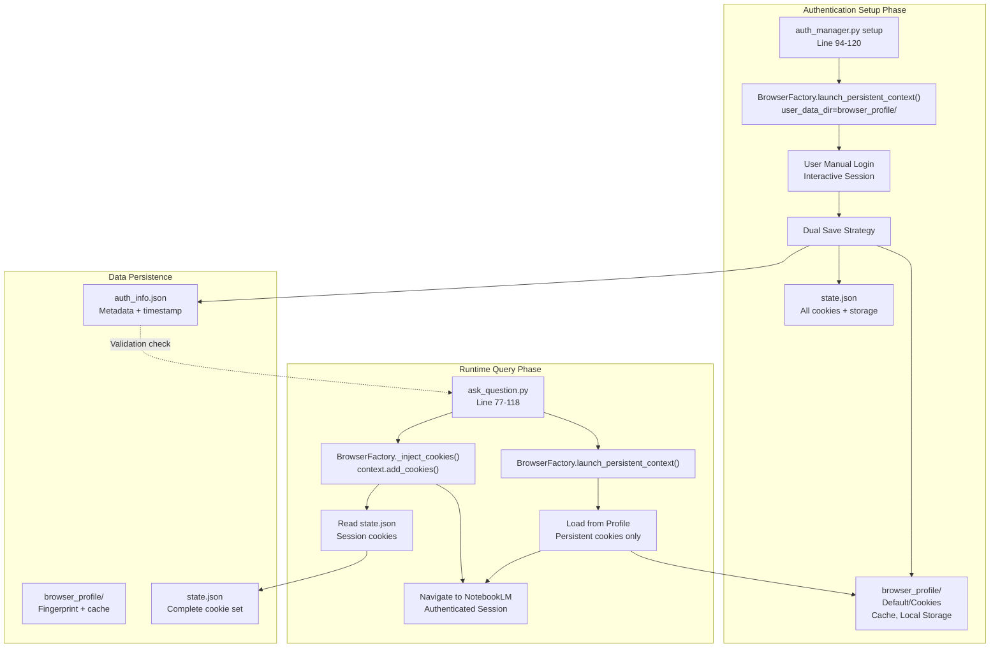
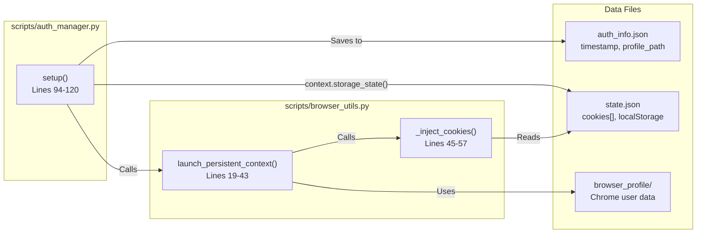
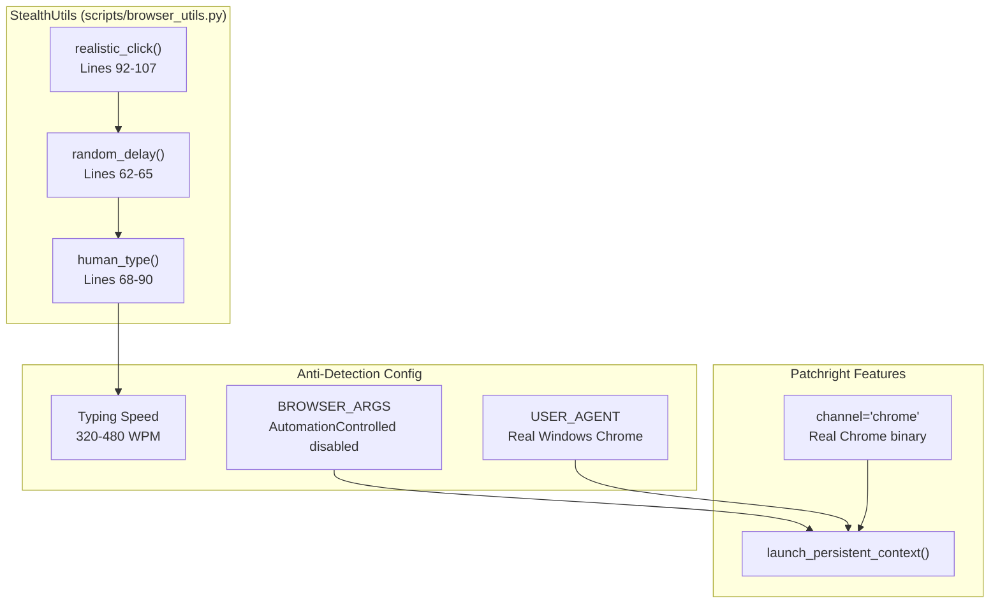

<!-- source: DeepWiki mcp.deepwiki.com · repo PleasePrompto/notebooklm-skill · page 7 Advanced Topics · fetched 2026-10-26 -->

# Advanced Topics

Relevant source files

The following files were used as context for generating this wiki page:

- [AUTHENTICATION.md](AUTHENTICATION.md)
- [CHANGELOG.md](CHANGELOG.md)
- [scripts/browser_utils.py](scripts/browser_utils.py)
- [scripts/config.py](scripts/config.py)

## Purpose and Scope

This section covers advanced technical implementation details and architectural decisions in the NotebookLM skill. Topics include the hybrid authentication strategy that works around Playwright API limitations, stealth techniques for avoiding detection, configuration options for customizing behavior, and architectural comparisons between the skill and MCP server implementations.

For basic usage and command reference, see [User Guide](#4). For troubleshooting authentication issues, see [Authentication Issues](#6.2). For API-level documentation, see [API Reference](#5).

## Architecture Overview

The NotebookLM skill implements several advanced patterns to ensure reliable, undetected browser automation with persistent authentication. The core technical challenges addressed are:

1.  **Playwright's session cookie persistence bug** requiring manual cookie injection.
2.  **Google's bot detection** requiring stealth automation techniques.
3.  **Modular configuration management** via `config.py` and environment variables.
4.  **Stateless session model** optimized for Claude Code's interaction pattern.

The following sections detail each of these areas.

## Authentication Architecture Deep Dive

The system uses a hybrid authentication approach combining persistent browser profiles with explicit cookie management. This design works around fundamental API limitations in Playwright's Python implementation.

### Hybrid Authentication Pattern

**Sources:** [AUTHENTICATION.md:1-155](), [scripts/browser_utils.py:15-58]()

### Cookie Persistence Problem

The Playwright library has a known bug ([#36139](https://github.com/microsoft/playwright/issues/36139)) where session cookies (cookies without an `Expires` attribute) do not persist when using `launch_persistent_context()` with `user_data_dir`. This affects Google authentication which uses both persistent and session cookies [AUTHENTICATION.md:12-24]().

| Cookie Type | Saved to Profile | Behavior |
|-------------|------------------|----------|
| Persistent cookies (with `Expires`) | ✅ Automatic | Persist across browser restarts |
| Session cookies (no `Expires`) | ❌ Lost | Deleted when browser closes |

The Python Playwright API also lacks support for the `storage_state` parameter in `launch_persistent_context()` ([#14949](https://github.com/microsoft/playwright/issues/14949)), which prevents using the TypeScript workaround [AUTHENTICATION.md:37-46]().

**Sources:** [AUTHENTICATION.md:10-48](), [scripts/browser_utils.py:39-43]()

### Implementation Details

The authentication flow is centralized in `BrowserFactory` within `scripts/browser_utils.py` [scripts/browser_utils.py:15-17]().

**Sources:** [scripts/browser_utils.py:15-58](), [scripts/auth_manager.py:94-120]()

#### Phase 1: Setup Authentication
`scripts/auth_manager.py` handles the initial login. It uses `BrowserFactory` to launch a visible browser [scripts/auth_manager.py:100-113](). Once the user logs in, the state is saved to `state.json` via `context.storage_state()` [AUTHENTICATION.md:125-125]().

#### Phase 2: Runtime Cookie Injection
In `ask_question.py`, the system calls `BrowserFactory.launch_persistent_context()`. This function automatically invokes `_inject_cookies()`, which reads `state.json` and uses `context.add_cookies()` to restore session cookies that the browser profile lost [scripts/browser_utils.py:41-53]().

## Stealth Automation Techniques

The skill implements multiple anti-detection techniques to make browser automation appear human-like. These are encapsulated in `StealthUtils` [scripts/browser_utils.py:59-60]().

### Stealth Pattern Implementation

**Sources:** [scripts/browser_utils.py:59-108](), [scripts/config.py:31-40]()

### Human Simulation Layer
- **`human_type`**: Instead of bulk input, it types character-by-character with a random delay between 25ms and 75ms [scripts/browser_utils.py:86-87](). It also includes occasional longer pauses (0.15s - 0.4s) to simulate natural hesitation [scripts/browser_utils.py:88-89]().
- **`realistic_click`**: Before clicking, it calculates the element's bounding box and moves the mouse to the center coordinates over several steps [scripts/browser_utils.py:99-103]().
- **`random_delay`**: Injects jitter between actions to break predictable timing patterns [scripts/browser_utils.py:63-65]().

### Browser Fingerprinting
The system uses real Google Chrome (`channel="chrome"`) and disables the `AutomationControlled` flag in Blink features to hide the `navigator.webdriver` property [scripts/config.py:31-32](). A static, modern `USER_AGENT` is used to maintain consistency across different host environments [scripts/config.py:39-39]().

## Configuration and Customization

The system utilizes a centralized `config.py` to manage paths, selectors, and timeouts, ensuring consistency across the modular codebase [scripts/config.py:1-45]().

### Configuration Reference

| Category | Parameter | Source | Purpose |
|----------|-----------|--------|---------|
| **Paths** | `DATA_DIR` | [scripts/config.py:10]() | Root for all persistent data |
| **Selectors** | `QUERY_INPUT_SELECTORS` | [scripts/config.py:18-22]() | Support for multiple languages (EN/DE) |
| **Selectors** | `RESPONSE_SELECTORS` | [scripts/config.py:24-28]() | Target NotebookLM message containers |
| **Timeouts** | `QUERY_TIMEOUT_SECONDS` | [scripts/config.py:43]() | Max wait for Gemini responses (120s) |
| **Timeouts** | `LOGIN_TIMEOUT_MINUTES` | [scripts/config.py:42]() | Window for manual auth (10m) |

**Sources:** [scripts/config.py:1-45](), [CHANGELOG.md:17-21]()

## Skill vs MCP Server Architecture

The NotebookLM skill and the [NotebookLM MCP Server](https://github.com/PleasePrompto/notebooklm-mcp) share a common goal but implement different architectural patterns.

| Aspect | Claude Code Skill (This) | MCP Server |
|--------|------------------|------------|
| **Protocol** | Claude Skills (Direct CLI) | MCP (JSON-RPC) |
| **Language** | Python | TypeScript |
| **Session Model** | Stateless (Fresh browser/query) | Persistent (Browser stays open) |
| **Workaround** | Manual `add_cookies()` | Native `storageState` parameter |

**Sources:** [AUTHENTICATION.md:25-48](), [CHANGELOG.md:11-14]()

## Subsection Overview

The following child pages provide detailed documentation on specific advanced topics:

- **[Hybrid Authentication Strategy](#7.1)**: Detailed explanation of the hybrid auth approach combining persistent browser profiles with manual cookie injection, and the Playwright bug it works around.
- **[Stealth Techniques](#7.2)**: Document anti-detection measures: human-like typing speeds, random delays, mouse movements, and browser fingerprinting.
- **[Configuration Options](#7.3)**: Complete reference for environment variables and `config.py` constants.
- **[Skill vs MCP Server](#7.4)**: Compare this Python skill implementation with the TypeScript MCP server alternative, explaining architectural differences.

**Sources:** [AUTHENTICATION.md:1-155](), [scripts/browser_utils.py:1-108](), [scripts/config.py:1-45]()

---

