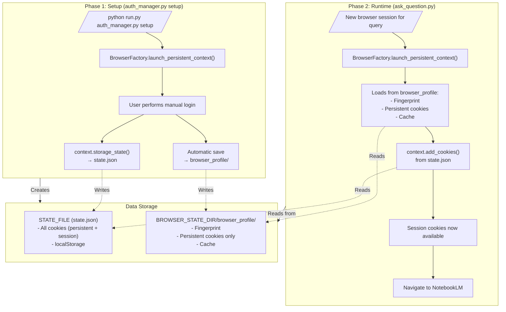
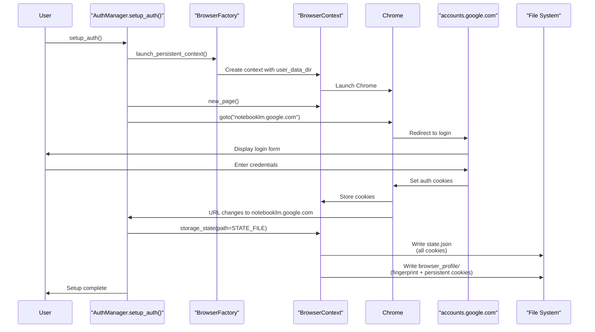
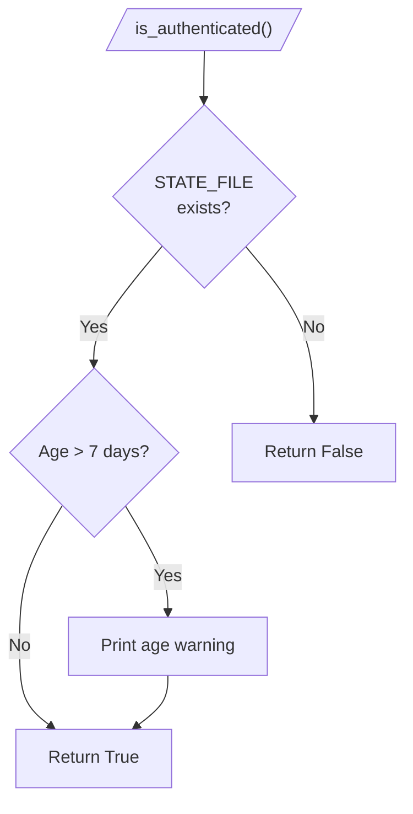
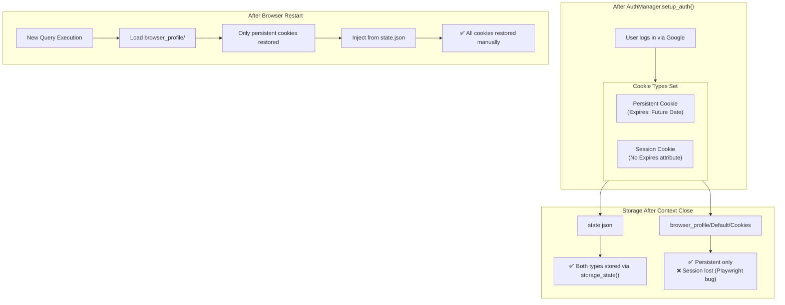

<!-- source: DeepWiki mcp.deepwiki.com · repo PleasePrompto/notebooklm-skill · page 7.1 Hybrid Authentication Strategy · fetched 2026-10-26 -->

# Hybrid Authentication Strategy

<details>
<summary>Relevant source files</summary>

The following files were used as context for generating this wiki page:

- [AUTHENTICATION.md](AUTHENTICATION.md)
- [CHANGELOG.md](CHANGELOG.md)
- [scripts/auth_manager.py](scripts/auth_manager.py)

</details>


## Purpose and Scope

This document explains the **hybrid authentication architecture** used by the NotebookLM Skill to work around a Playwright bug that prevents session cookies from persisting correctly in Python. The system combines persistent browser profiles (`user_data_dir`) with manual cookie injection from `state.json` to achieve reliable, cross-session authentication.

This page focuses on the technical implementation of authentication persistence. For general authentication setup instructions, see [Authentication Setup](#2.2). For browser automation techniques, see [Browser Automation](#3.2).

---

## The Problem: Session Cookie Persistence Bug

Playwright/Patchright has a documented bug ([#36139](https://github.com/microsoft/playwright/issues/36139)) where **session cookies** (cookies without an `Expires` attribute) do not persist correctly when using `launch_persistent_context()` with a `user_data_dir` parameter.

### Cookie Behavior Matrix

| Cookie Type | Browser Profile Persistence | Impact |
|------------|----------------------------|--------|
| **Persistent cookies** (with `Expires` date) | ✅ Saved correctly | Works as expected |
| **Session cookies** (no `Expires` attribute) | ❌ Lost after browser restart | Authentication fails randomly |

Google authentication uses a mix of both cookie types. When session cookies are lost, users experience seemingly random authentication failures where the system reports being authenticated but cannot actually access NotebookLM.

**Sources:** [AUTHENTICATION.md:12-24](), [scripts/auth_manager.py:7-11]()

---

## TypeScript vs Python API Limitations

The MCP Server implementation (TypeScript) can work around this bug using the `storageState` parameter available in the TypeScript Playwright API:

```typescript
// TypeScript - Parameter available
const context = await chromium.launchPersistentContext(userDataDir, {
  storageState: "state.json",  // Loads all cookies including session cookies
  channel: "chrome"
});
```

However, Python's Playwright API does not support passing `storageState` to `launch_persistent_context()`, as documented in issue [#14949](https://github.com/microsoft/playwright/issues/14949):

```python
# Python - NOT SUPPORTED
context = playwright.chromium.launch_persistent_context(
    user_data_dir=profile_dir,
    storage_state="state.json",  # This parameter does not exist in Python API
    channel="chrome"
)
```

This API limitation necessitates the hybrid approach implemented in this skill.

**Sources:** [AUTHENTICATION.md:25-46](), [scripts/auth_manager.py:6-11]()

---

## Hybrid Authentication Architecture

### Two-Phase System Overview



**Diagram: Two-Phase Hybrid Authentication Flow**

The system operates in two distinct phases. Phase 1 (setup) saves authentication state to both locations. Phase 2 (runtime) loads from both sources sequentially, with manual cookie injection bridging the gap left by the Playwright bug.

**Sources:** [AUTHENTICATION.md:48-85](), [scripts/auth_manager.py:87-145](), [scripts/auth_manager.py:160-169]()

---

## Implementation Details

### Phase 1: Authentication Setup

The `AuthManager.setup_auth()` method performs initial authentication:



**Diagram: Authentication Setup Sequence**

**Key Implementation Points:**

1. **Persistent Context Launch** [scripts/auth_manager.py:107-110]():
   - Uses `BrowserFactory.launch_persistent_context()` which abstracts the `user_data_dir` and anti-detection flags.
   - Specifies `channel="chrome"` (via factory defaults) to use real Chrome for consistent fingerprinting.
   - Sets `user_data_dir` to maintain browser identity across sessions.

2. **Manual Login Window** [scripts/auth_manager.py:123-140]():
   - Opens NotebookLM URL which redirects to Google login.
   - Waits up to configurable timeout (default 10 minutes) for user to complete login.
   - Uses regex URL matching to detect successful authentication: `re.compile(r"^https://notebooklm\.google\.com/")` [scripts/auth_manager.py:129]().

3. **Dual State Save** [scripts/auth_manager.py:160-169]():
   - Explicit save via `context.storage_state(path=str(self.state_file))` → writes `state.json` with all cookies.
   - Automatic save to browser profile directory → happens when context closes.
   - The browser profile only retains persistent cookies due to the Playwright bug.

**Sources:** [scripts/auth_manager.py:87-145](), [scripts/auth_manager.py:160-169](), [AUTHENTICATION.md:52-67]()

---

### Phase 2: Runtime Cookie Injection

Every query execution performs a fresh authentication using the hybrid approach. While the exact runtime logic for querying is found in `ask_question.py` (referenced in documentation), the `AuthManager` provides the foundational state management.

**Key Logic (as implemented in runtime scripts):**

1. **Persistent Context Launch**:
   The browser is launched using the `user_data_dir` pointing to `BROWSER_STATE_DIR / "browser_profile"`. This loads the browser profile automatically, providing persistent cookies and fingerprint.

2. **Manual Cookie Injection** [AUTHENTICATION.md:81-85]():
   ```python
   # Step 2: Manually inject cookies from state.json
   with open("state.json", 'r') as f:
       state = json.load(f)
       context.add_cookies(state['cookies'])  # ← Workaround for session cookies!
   ```
   This adds session cookies that were lost from the browser profile, completing the authentication state.

3. **Validation Support** [scripts/auth_manager.py:53-62]():
   The `is_authenticated()` method checks for the existence of the `STATE_FILE` and warns if it is more than 7 days old, ensuring the injected cookies are likely still valid.

**Sources:** [AUTHENTICATION.md:69-85](), [scripts/auth_manager.py:53-62]()

---

### Validation Process

The `AuthManager` provides metadata and status checks to verify this hybrid state:



**Diagram: Authentication Validation Logic**

**Sources:** [scripts/auth_manager.py:53-62]()

---

## File Structure and Data Storage

### Directory Layout

The directory structure is managed by `AuthManager.__init__` [scripts/auth_manager.py:42-50]().

```
~/.claude/skills/notebooklm/data/
├── auth_info.json              # Metadata: authenticated_at_iso
├── browser_state/              # BROWSER_STATE_DIR
│   ├── state.json             # STATE_FILE (All cookies)
│   └── browser_profile/       # Chrome user data directory
│       ├── Default/
│       │   ├── Cookies        # Only persistent cookies (bug!)
│       │   └── ...
```

### File Roles

| File | Purpose | Contents | Updated |
|------|---------|----------|---------|
| `state.json` | **Cookie workaround** | All cookies (persistent + session), localStorage | At setup/re-auth |
| `browser_profile/` | **Fingerprint consistency** | Persistent cookies, cache, preferences | Every browser session |
| `auth_info.json` | **Metadata** | `authenticated_at`, `authenticated_at_iso` | At setup [scripts/auth_manager.py:170-181]() |

**Sources:** [scripts/auth_manager.py:42-50](), [scripts/auth_manager.py:170-181](), [AUTHENTICATION.md:98-111]()

---

## Cookie Persistence Comparison



**Diagram: Cookie Persistence Across Sessions**

**Sources:** [AUTHENTICATION.md:113-120](), [scripts/auth_manager.py:9-11]()

---

## Benefits and Trade-offs

### Comparison Matrix

| Feature | Hybrid Approach | Pure `user_data_dir` | Pure `storage_state` |
|---------|----------------|---------------------|---------------------|
| **Browser fingerprint consistency** | ✅ Same across sessions | ✅ Same across sessions | ❌ Changes each time |
| **Session cookie persistence** | ✅ Manual injection | ❌ Lost (Playwright bug) | ✅ Native support |
| **Persistent cookie persistence** | ✅ Automatic | ✅ Automatic | ✅ Native support |
| **Google trust signals** | ✅ High (same browser) | ✅ High (same browser) | ❌ Low (new browser each time) |
| **HTTP cache performance** | ✅ Cache persists | ✅ Cache persists | ❌ No cache |

**Sources:** [AUTHENTICATION.md:87-97]()

---

## Code Implementation Map

### Setup Phase

| Component | File | Lines | Purpose |
|-----------|------|-------|---------|
| `AuthManager.__init__()` | [scripts/auth_manager.py:42-50]() | 42-50 | Initialize directories |
| `AuthManager.setup_auth()` | [scripts/auth_manager.py:87-145]() | 87-145 | Main setup orchestration |
| `BrowserFactory.launch_persistent_context()` | [scripts/auth_manager.py:107-110]() | 107-110 | Browser initialization |
| `_save_browser_state()` | [scripts/auth_manager.py:160-169]() | 160-169 | Save to `state.json` |

### Cleanup and Maintenance

| Component | File | Lines | Purpose |
|-----------|------|-------|---------|
| `AuthManager.clear_auth()` | [scripts/auth_manager.py:182-213]() | 182-213 | Remove all state files and directories |
| `AuthManager.re_auth()` | [scripts/auth_manager.py:214-220]() | 214-220 | Clear and trigger new setup |
| `AuthManager.is_authenticated()` | [scripts/auth_manager.py:52-62]() | 52-62 | Basic state validation |

**Sources:** [scripts/auth_manager.py:1-220]()

---

