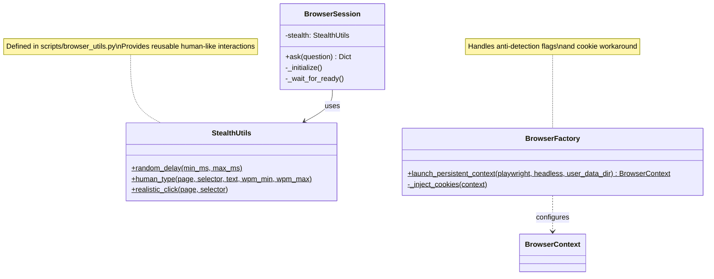
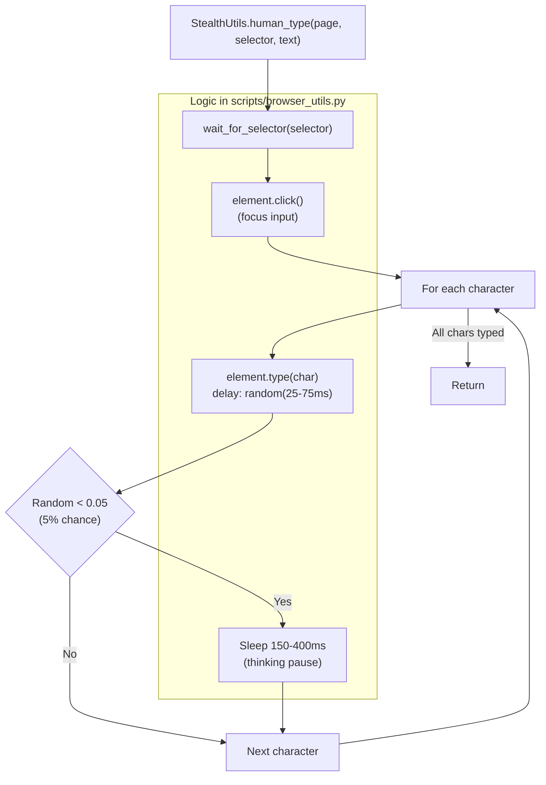
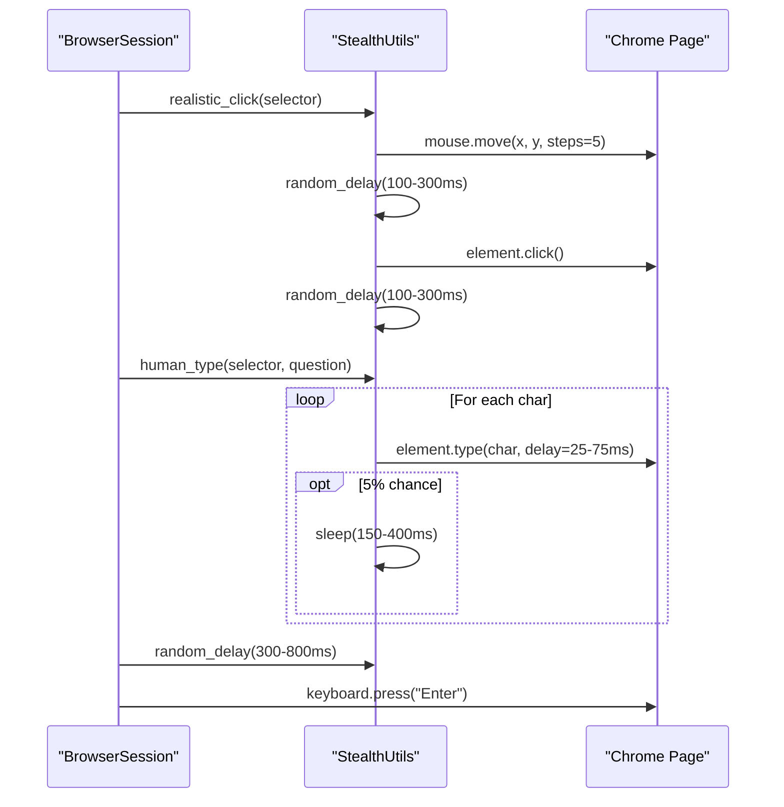

<!-- source: DeepWiki mcp.deepwiki.com · repo PleasePrompto/notebooklm-skill · page 7.2 Stealth Techniques · fetched 2026-10-26 -->

# Stealth Techniques

<details>
<summary>Relevant source files</summary>

The following files were used as context for generating this wiki page:

- [AUTHENTICATION.md](AUTHENTICATION.md)
- [CHANGELOG.md](CHANGELOG.md)
- [scripts/browser_session.py](scripts/browser_session.py)
- [scripts/browser_utils.py](scripts/browser_utils.py)

</details>


This page documents the anti-detection measures and human-like automation techniques used when interacting with NotebookLM through browser automation. The system employs multiple strategies to avoid triggering bot detection systems while maintaining reliability and speed.

For general browser automation architecture, see [3.2](). For the hybrid authentication strategy that complements these techniques, see [7.1](). For query execution implementation, see [5.4]().

## Overview

The stealth implementation consists of two layers:
1. **Browser-level protection**: Configuration flags and settings that mask automation markers using the `BrowserFactory` class.
2. **Interaction-level mimicry**: Human-like typing, mouse movements, and timing patterns provided by the `StealthUtils` class.

All stealth functionality is centralized in `scripts/browser_utils.py` and applied during browser launch configuration in both `BrowserSession` and `ask_question.py`.

**Sources:** [scripts/browser_utils.py:1-108](), [scripts/browser_session.py:17-85](), [scripts/ask_question.py:86-100]()

## Browser Fingerprinting Protection

### Real Chrome vs Chromium

The system uses real Google Chrome (not Chromium) to ensure consistent browser fingerprinting and maintain Google's trust signals across sessions. This is enforced by the `channel="chrome"` parameter in the `launch_persistent_context` method.

```python
# scripts/browser_utils.py:29-37
context = playwright.chromium.launch_persistent_context(
    user_data_dir=user_data_dir,
    channel="chrome",  # Use real Chrome
    headless=headless,
    no_viewport=True,
    ignore_default_args=["--enable-automation"],
    user_agent=USER_AGENT,
    args=BROWSER_ARGS
)
```

**Rationale:** Real Chrome provides a complete, unmodified browser environment that matches legitimate user profiles. Chromium builds often have slightly different fingerprints that can be detected.

**Sources:** [scripts/browser_utils.py:29-37](), [scripts/ask_question.py:86-89]()

### Automation Marker Removal

Multiple browser flags disable automation indicators that bot detection systems look for:

| Flag | Purpose | Detection Vector Addressed |
|------|---------|---------------------------|
| `--disable-blink-features=AutomationControlled` | Patches `navigator.webdriver` | JavaScript property that returns `true` for automated browsers |
| `--ignore-default-args=["--enable-automation"]` | Removes automation infobar | Visual indicator and Chrome DevTools Protocol marker |
| `no_viewport=True` | Disables viewport override | Recommended by Patchright for anti-detection |
| `--no-first-run` | Skips first-run experience | Prevents unusual browser initialization patterns |
| `--no-default-browser-check` | Disables browser check dialog | Avoids automation-specific dialog handling |

**Sources:** [scripts/browser_utils.py:29-37](), [scripts/ask_question.py:90-99]()

### User Agent Configuration

A standard Windows Chrome user agent string is explicitly set via the `USER_AGENT` constant imported from `config.py`. This matches the most common legitimate browser configuration, reducing fingerprint uniqueness.

**Sources:** [scripts/browser_utils.py:35](), [scripts/ask_question.py:92]()

### Persistent Browser Profile

Using `launch_persistent_context` with `user_data_dir` (defaulting to `BROWSER_PROFILE_DIR`) provides:
- **Consistent fingerprint**: Browser profile persists across sessions.
- **Trust signals**: Google recognizes the returning profile.
- **Cookie persistence**: Long-term authentication state (see [7.1]() for cookie injection details).

**Sources:** [scripts/browser_utils.py:22-30](), [scripts/ask_question.py:87]()

## StealthUtils Class Architecture

The `StealthUtils` class provides static methods for human-like interactions, ensuring that automation behavior mirrors human users.



**Implementation Status:** In version 1.3.0, these utilities were refactored into `scripts/browser_utils.py` to provide a centralized source for stealth logic across the codebase.

**Sources:** [scripts/browser_utils.py:15-108](), [CHANGELOG.md:11-14]()

## Human-Like Typing

### Variable Speed Typing

The `human_type` method simulates realistic typing speeds with variation, avoiding the mechanical precision of standard automation tools.

```python
# scripts/browser_utils.py:68-90
def human_type(page: Page, selector: str, text: str, wpm_min: int = 320, wpm_max: int = 480):
    # ... finding element logic ...
    # Click to focus
    element.click()
    
    # Type
    for char in text:
        element.type(char, delay=random.uniform(25, 75))
        if random.random() < 0.05:
            time.sleep(random.uniform(0.15, 0.4))
```

**Speed Characteristics:**
- **Character delay**: 25-75ms per character with random variation.
- **Occasional pauses**: 5% chance of a 150-400ms "thinking" pause between characters.
- **Auto-focus**: Automatically clicks the element before typing to ensure focus.

**Sources:** [scripts/browser_utils.py:68-90]()

### Typing Flow Diagram



**Sources:** [scripts/browser_utils.py:68-90]()

## Natural Mouse Movement

### Realistic Click Implementation

The `realistic_click` method combines mouse movement with timing delays to simulate a user targeting a button or input field.

```python
# scripts/browser_utils.py:92-107
def realistic_click(page: Page, selector: str):
    element = page.query_selector(selector)
    # ...
    box = element.bounding_box()
    if box:
        x = box['x'] + box['width'] / 2
        y = box['y'] + box['height'] / 2
        page.mouse.move(x, y, steps=5)

    StealthUtils.random_delay(100, 300)
    element.click()
    StealthUtils.random_delay(100, 300)
```

**Click Sequence:**
1. **Bounding Box**: Queries the element to find its exact screen coordinates.
2. **Movement**: Moves the mouse to the center of the element using 5 intermediate steps to avoid instant "teleportation."
3. **Pre-click Delay**: Waits 100-300ms (simulating visual confirmation).
4. **Execution**: Performs the actual click.
5. **Post-click Delay**: Waits 100-300ms (simulating reaction time).

**Sources:** [scripts/browser_utils.py:92-107]()

## Timing and Delay Strategies

### Random Delay Utility

The `random_delay` utility is used throughout the session lifecycle to break deterministic patterns.

```python
# scripts/browser_utils.py:62-65
@staticmethod
def random_delay(min_ms: int = 100, max_ms: int = 500):
    """Add random delay"""
    time.sleep(random.uniform(min_ms / 1000, max_ms / 1000))
```

**Common usage patterns in BrowserSession:**

| Context | Delay Range | Purpose |
|---------|-------------|---------|
| Post-initialization | 300-600ms | Simulate human page inspection |
| Pre-submit | 300-800ms | Simulate review before pressing Enter |
| Response wait | 1500-3000ms | Initial wait for LLM processing |

**Sources:** [scripts/browser_utils.py:62-65](), [scripts/browser_session.py:72](), [scripts/browser_session.py:123](), [scripts/browser_session.py:130]()

### Interaction Flow with Timing



**Sources:** [scripts/browser_utils.py:62-108](), [scripts/browser_session.py:118-126]()

## Effectiveness and Trade-offs

### Detection Vector Coverage

| Detection Method | Mitigation Strategy | Implementation |
|------------------|---------------------|----------------|
| `navigator.webdriver` | `--disable-blink-features=AutomationControlled` | `BrowserFactory.launch_persistent_context` |
| Automation infobar | `--ignore-default-args` | `BrowserFactory.launch_persistent_context` |
| Browser fingerprint | Real Chrome + persistent profile | `BrowserFactory.launch_persistent_context` |
| Typing patterns | Variable speed + random pauses | `StealthUtils.human_type` |
| Mouse behavior | Stepped movement to coordinates | `StealthUtils.realistic_click` |
| Timing analysis | Random delays between all actions | `StealthUtils.random_delay` |

**Sources:** [scripts/browser_utils.py:15-108](), [scripts/ask_question.py:86-100]()

### Performance Impact

The stealth measures introduce intentional latency to improve reliability:
- **Typing**: A 100-character query takes approximately 5-10 seconds to type.
- **Stability Detection**: The system now requires 3 consecutive stable polls (checking if text changed) before accepting an answer, preventing truncated responses.
- **Thinking Detection**: The system explicitly waits for `div.thinking-message` to disappear, ensuring "Reviewing the content..." placeholders are not returned as final answers.

**Sources:** [scripts/browser_utils.py:86-90](), [scripts/browser_session.py:177-197](), [CHANGELOG.md:23-34]()

### Integration with Patchright

The project uses **Patchright**, a specialized fork of Playwright designed specifically for anti-detection. Patchright modifies the Chrome DevTools Protocol (CDP) to remove automation markers that vanilla Playwright leaves behind.

**Key benefits used:**
1. **Patched CDP**: Prevents detection of the debugging connection.
2. **Chrome Channel**: Seamless integration with the official Google Chrome binary.
3. **Persistent Context**: Supports the complex hybrid authentication strategy required to bypass Google's session cookie protections.

**Sources:** [scripts/browser_utils.py:11-37](), [AUTHENTICATION.md:5-14]()

---

