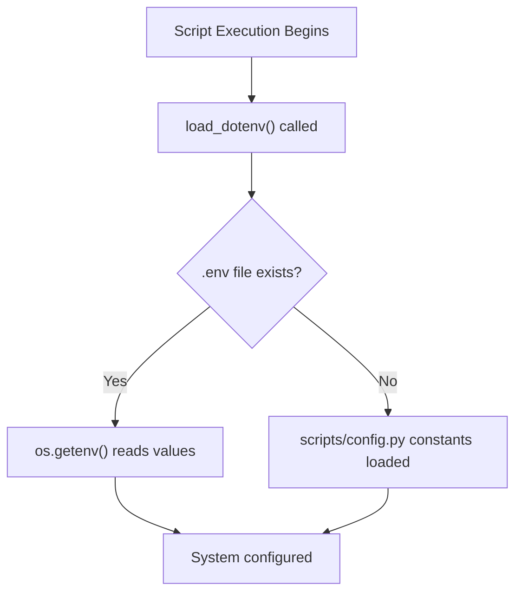
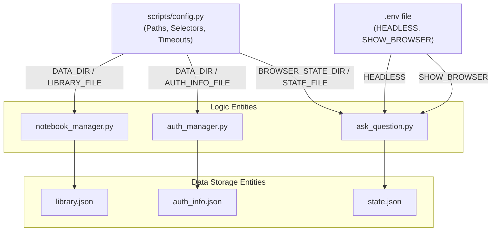
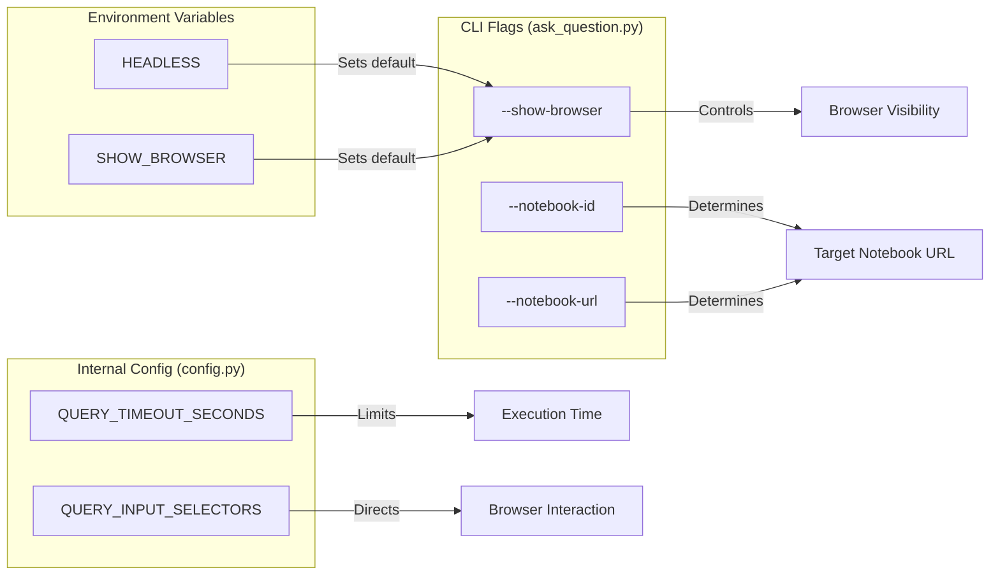

<!-- source: DeepWiki mcp.deepwiki.com · repo PleasePrompto/notebooklm-skill · page 7.3 Configuration Options · fetched 2026-10-26 -->

# Configuration Options

<details>
<summary>Relevant source files</summary>

The following files were used as context for generating this wiki page:

- [SKILL.md](SKILL.md)
- [scripts/config.py](scripts/config.py)

</details>


This document provides a complete reference for all configuration options available in the NotebookLM skill. Configuration is managed through environment variables, typically defined in a `.env` file in the skill directory, or through constants defined in `scripts/config.py`. These options control browser behavior, stealth techniques, automation settings, and default notebook selection.

## Configuration System Overview

The NotebookLM skill uses environment variables for dynamic configuration and a central configuration file for static constants. Configuration is entirely optional; the system provides sensible defaults for all settings.

**Configuration File Locations**
- **Dynamic Config**: `~/.claude/skills/notebooklm/.env` (Excluded from Git via [.gitignore]())
- **Static Constants**: `scripts/config.py` [scripts/config.py:1-45]()

**Loading Mechanism**



**Configuration Loading Flow**

Sources: [SKILL.md:200-210](), [scripts/config.py:1-45]()

### Configuration Precedence

Configuration values are resolved in the following order (highest to lowest priority):

| Priority | Source | Example | Scope |
|----------|--------|---------|-------|
| 1 | Command-line flags | `--show-browser` | Single invocation |
| 2 | Environment variables | `SHOW_BROWSER=true` | All invocations |
| 3 | Static Constants | `QUERY_TIMEOUT_SECONDS = 120` | System-wide |

Sources: [SKILL.md:40-59](), [SKILL.md:124-126](), [scripts/config.py:41-45]()

## Available Configuration Options

### Browser Behavior Options

#### HEADLESS

Controls whether the browser runs in headless mode (no visible window).

```env
HEADLESS=false
```

| Value | Behavior | Use Case |
|-------|----------|----------|
| `true` | Browser runs invisibly | Production, background automation |
| `false` | Browser window visible | Debugging, authentication setup |

**Important:** Authentication operations (`auth_manager.py setup`) **always** run with `headless=False` regardless of this setting, as manual Google login requires user interaction [SKILL.md:71-79]().

**Default:** `true` (headless)

Sources: [SKILL.md:200-210](), [SKILL.md:71-79]()

#### SHOW_BROWSER

Convenience flag that sets the default visibility for query operations in `ask_question.py`.

```env
SHOW_BROWSER=false
```

**Override:** The `--show-browser` command-line flag on `ask_question.py` overrides this environment variable for a single invocation [SKILL.md:124-126]().

Sources: [SKILL.md:124-126](), [SKILL.md:163-166]()

### Stealth and Automation Options

These options control anti-detection measures. For detailed information, see the [Stealth Techniques](7.2) page.

#### BROWSER_ARGS

Hardcoded arguments in `scripts/config.py` used to patch browser fingerprinting and optimize performance.

| Argument | Purpose |
|----------|---------|
| `--disable-blink-features=AutomationControlled` | Patches `navigator.webdriver` to prevent detection |
| `--disable-dev-shm-usage` | Prevents crashes in Docker/resource-constrained environments |
| `--no-sandbox` | Necessary for some Linux environments |

Sources: [scripts/config.py:31-37]()

#### USER_AGENT

The skill mimics a standard Windows Chrome user agent to avoid being flagged as a bot.
`Mozilla/5.0 (Windows NT 10.0; Win64; x64) AppleWebKit/537.36` [scripts/config.py:39-39]().

### Timeouts and Selectors

These are defined in `scripts/config.py` and govern how long the automation waits for Google's UI to respond.

| Constant | Value | Description |
|----------|-------|-------------|
| `LOGIN_TIMEOUT_MINUTES` | 10 | Max time allowed for manual Google login [scripts/config.py:42-42]() |
| `QUERY_TIMEOUT_SECONDS` | 120 | Max time to wait for Gemini's response [scripts/config.py:43-43]() |
| `PAGE_LOAD_TIMEOUT` | 30000 | Playwright default page load timeout (ms) [scripts/config.py:44-44]() |

#### UI Selectors

The system uses specific CSS selectors to interact with NotebookLM. If the Google UI changes, these are the primary points of maintenance in `scripts/config.py`:

- **Query Input**: `textarea.query-box-input` [scripts/config.py:18-22]()
- **Response Container**: `.to-user-container .message-text-content` [scripts/config.py:24-28]()

Sources: [scripts/config.py:17-29](), [scripts/config.py:41-45]()

## Configuration Interactions and Data Flow

The following diagram shows how configuration options and paths defined in `scripts/config.py` flow through the system components.

**Configuration Flow Through System Components**



**Key Observations:**
1. **Centralized Paths**: `scripts/config.py` defines all file paths (e.g., `LIBRARY_FILE`, `STATE_FILE`), ensuring consistency across `notebook_manager.py` and `ask_question.py` [scripts/config.py:8-15]().
2. **Selector Abstraction**: `ask_question.py` does not hardcode CSS selectors; it imports them from `scripts/config.py` to facilitate easy updates when Google's UI changes [scripts/config.py:17-29]().
3. **Auth Override**: `auth_manager.py` ignores the `HEADLESS` environment variable during `setup` to ensure the user can see the login screen [SKILL.md:71-79]().

Sources: [scripts/config.py:8-29](), [SKILL.md:191-199]()

## Configuration File Template

Complete `.env` file template with available options:

```env
# =============================================================================
# NotebookLM Skill Configuration
# Location: ~/.claude/skills/notebooklm/.env
# =============================================================================

# Run browser in headless mode (no visible window)
# Values: true, false
# Default: true
HEADLESS=true

# Show browser for query operations by default
# Values: true, false
# Default: false
# Override per-query with: --show-browser flag
SHOW_BROWSER=false

# Note: Typing speed (WPM) and Stealth are currently 
# handled by internal automation logic in the skill.
```

Sources: [SKILL.md:200-210](), [scripts/config.py:30-45]()

## Common Configuration Scenarios

### Debugging Selectors

**Scenario:** Gemini is responding in the browser, but the skill returns an empty answer.
**Action:** 
1. Set `SHOW_BROWSER=true` in `.env`.
2. Run query: `python scripts/run.py ask_question.py --question "test" --show-browser`.
3. If the browser shows the response but the script fails, update `RESPONSE_SELECTORS` in `scripts/config.py` [scripts/config.py:24-28]().

### Slow Network/Large Documents

**Scenario:** NotebookLM takes longer than 2 minutes to synthesize an answer.
**Action:**
1. Increase `QUERY_TIMEOUT_SECONDS` in `scripts/config.py` [scripts/config.py:43-43]().
2. Increase `PAGE_LOAD_TIMEOUT` if the notebook itself is slow to open [scripts/config.py:44-44]().

## Mapping of Environment Variables to CLI Flags



**Precedence Rules:**
1. **Visibility**: `--show-browser` flag > `SHOW_BROWSER` env var > `HEADLESS` env var.
2. **Notebook Selection**: `--notebook-url` > `--notebook-id` > active notebook in `library.json` [SKILL.md:114-126]().

Sources: [SKILL.md:114-126](), [scripts/config.py:1-45]()

---

