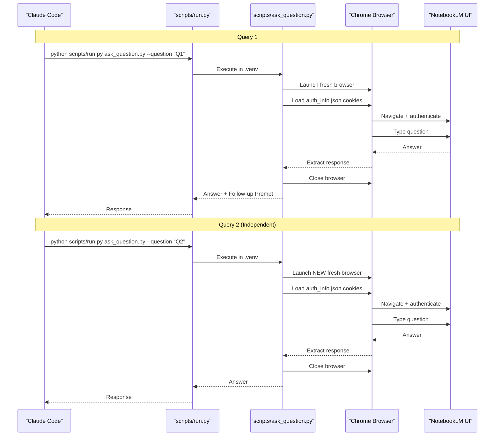
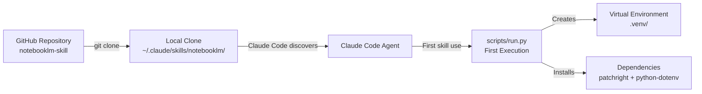

<!-- source: DeepWiki mcp.deepwiki.com · repo PleasePrompto/notebooklm-skill · page 7.4 Skill vs MCP Server · fetched 2026-10-26 -->

# Skill vs MCP Server

<details>
<summary>Relevant source files</summary>

The following files were used as context for generating this wiki page:

- [README.md](README.md)
- [SKILL.md](SKILL.md)

</details>


## Purpose and Scope

This document compares the Python-based Claude Skill implementation with the TypeScript-based Model Context Protocol (MCP) server alternative. Both provide NotebookLM integration but differ fundamentally in architecture, session management, distribution, and target use cases. Understanding these differences helps users select the appropriate implementation for their workflow.

For installation instructions specific to the Skill, see [Installation](2.1). For details on the Skill's stateless session model, see [Stateless Session Model](3.1). For MCP protocol concepts, refer to the [Claude Code Integration](4.3) page for how Claude interprets skill commands.

---

## Architectural Comparison

The two implementations represent fundamentally different integration approaches with distinct architectural patterns.

### Protocol Layer Comparison

```mermaid
graph TB
    subgraph Skill["Claude Skill Architecture (notebooklm-skill)"]
        SkillUser["User"]
        SkillClaude["Claude Code Agent"]
        SkillMD["SKILL.md"]
        SkillRun["run.py"]
        SkillScripts["scripts/*.py"]
        SkillBrowser["Patchright + Chrome"]
        SkillNLM["NotebookLM"]
        
        SkillUser -->|"Natural language"| SkillClaude
        SkillClaude -->|"Reads instructions"| SkillMD
        SkillClaude -->|"Executes via"| SkillRun
        SkillRun -->|"Dispatches to"| SkillScripts
        SkillScripts -->|"Automates"| SkillBrowser
        SkillBrowser -->|"HTTPS"| SkillNLM
    end
    
    subgraph MCP["MCP Server Architecture (notebooklm-mcp)"]
        MCPUser["User"]
        MCPClient["MCP Client (Claude/Cursor/Codex)"]
        MCPProtocol["MCP Protocol Layer"]
        MCPServer["notebooklm-mcp Server"]
        MCPHandlers["TypeScript Handlers"]
        MCPBrowser["Patchright + Chrome"]
        MCPNLM["NotebookLM"]
        
        MCPUser -->|"Natural language"| MCPClient
        MCPClient -->|"MCP protocol messages"| MCPProtocol
        MCPProtocol -->|"JSON-RPC calls"| MCPServer
        MCPServer -->|"Routes to"| MCPHandlers
        MCPHandlers -->|"Automates"| MCPBrowser
        MCPBrowser -->|"HTTPS"| MCPNLM
    end
```



**Sources:** [README.md:145-159](), [SKILL.md:6-17]()

### Implementation Stack Comparison

| Layer | Skill Implementation | MCP Server Implementation |
|-------|---------------------|---------------------------|
| **Entry Point** | `run.py` | `claude mcp add` command |
| **Protocol** | Direct script execution | Model Context Protocol (JSON-RPC) |
| **Language** | Python 3.8+ | TypeScript/Node.js |
| **Package Manager** | pip + requirements.txt | npm + package.json |
| **Browser Library** | patchright (Python) | patchright-nodejs (TypeScript) |
| **Distribution** | Git clone to `~/.claude/skills/` | npm package registry |
| **Instruction Format** | `SKILL.md` | MCP tool definitions |
| **Process Model** | Single process per command | Long-running server process |

**Sources:** [README.md:151-159](), [README.md:162-171](), [SKILL.md:40-59]()

---

## Session Management Models

The most significant architectural difference lies in session management strategy.

### Skill: Stateless Per-Query Model

The Skill follows a stateless execution model where every tool call is an independent process.



**Characteristics:**
- Each invocation of `ask_question.py` creates a fresh browser instance [SKILL.md:8-9]().
- Authentication state loaded from `data/auth_info.json` and `data/browser_state/` [SKILL.md:191-198]().
- No conversation history preserved between questions; the Skill relies on Claude's internal context and the follow-up mechanism [SKILL.md:128-142]().
- Browser closes immediately after response extraction.

**Sources:** [SKILL.md:8-9](), [SKILL.md:128-142](), [README.md:155]()

### MCP Server: Persistent Session Model

The MCP server maintains a long-running background process.

**Characteristics:**
- MCP server process runs continuously in background.
- Single browser instance persists across multiple queries.
- Conversation history maintained by NotebookLM's UI.
- Authentication performed once at session start.
- Follow-up questions leverage existing conversation context.

**Sources:** [README.md:155](), [README.md:147-149]()

### Session Management Comparison Table

| Aspect | Skill (Stateless) | MCP Server (Persistent) |
|--------|------------------|------------------------|
| **Browser Lifetime** | Per-query (seconds) | Process lifetime (hours/days) |
| **Authentication** | Every query loads cookies | Once at session start |
| **Conversation Context** | None (each query independent) | Full history in NotebookLM UI |
| **Follow-up Questions** | New browser session | Same session, context-aware |
| **Memory Footprint** | Minimal (no persistent process) | Higher (Chrome + server running) |
| **Query Latency** | +2-3s browser launch overhead | Minimal (browser already open) |
| **Error Recovery** | Automatic (fresh state) | May require session reset |

**Sources:** [README.md:151-159](), [SKILL.md:8-9]()

---

## Implementation Language and Dependencies

### Skill: Python Ecosystem

**Core Implementation Files:**
- `scripts/run.py`: Universal wrapper and environment manager [scripts/run.py:1-10]().
- `scripts/ask_question.py`: Query execution with browser automation [SKILL.md:163-166]().
- `scripts/auth_manager.py`: Authentication management [SKILL.md:145-151]().
- `scripts/notebook_manager.py`: Library operations [SKILL.md:153-161]().
- `scripts/cleanup_manager.py`: Data cleanup utilities [SKILL.md:168-173]().

**Virtual Environment:**
- Isolated `.venv/` created by `run.py` on first invocation [SKILL.md:54-59]().
- Dependencies installed via `pip install -r requirements.txt` [SKILL.md:187]().
- Chrome installation handled by `patchright install chromium` [SKILL.md:188]().

**Sources:** [SKILL.md:40-59](), [SKILL.md:175-189]()

### MCP Server: TypeScript Ecosystem

**Core Implementation:**
- TypeScript source compiled to JavaScript.
- Distributed as npm package: `@pleasepropto/notebooklm-mcp`.
- Installed via `claude mcp add @pleasepropto/notebooklm-mcp`.

**Sources:** [README.md:157-158]()

---

## Distribution and Installation

### Skill Distribution Model



**Installation Commands:**
```bash
# Manual installation
mkdir -p ~/.claude/skills
cd ~/.claude/skills
git clone https://github.com/PleasePrompto/notebooklm-skill notebooklm
```
[README.md:71-77]()

**Sources:** [README.md:67-91](), [SKILL.md:175-182]()

---

## Compatibility and Tool Support

### Skill: Claude Code Exclusive

**Compatible Tools:**
- ✅ Claude Code (local installation only) [README.md:20-24]()
- ❌ Claude Web UI (sandbox restrictions) [README.md:24]()
- ❌ Cursor
- ❌ Codex

**Restriction Reason:**
The Skill architecture requires direct file system access and the ability to spawn Python subprocesses via `run.py` [SKILL.md:40-52](). The Claude Web UI runs skills in a network-isolated sandbox, making browser automation impossible [README.md:24]().

**Sources:** [README.md:20-26](), [SKILL.md:40-59]()

### MCP Server: Multi-Tool Support

**Compatible Tools:**
- ✅ Claude Code
- ✅ Cursor (with MCP support)
- ✅ Codex
- ✅ Any tool implementing MCP client protocol

**Sources:** [README.md:156]()

---

## Feature Comparison Matrix

### Core Capabilities

| Feature | Skill | MCP Server |
|---------|-------|-----------|
| **Source-grounded responses** | ✅ Yes | ✅ Yes |
| **Notebook library management** | ✅ Yes (`notebook_manager.py`) | ✅ Yes |
| **Persistent authentication** | ✅ Yes (`auth_manager.py`) | ✅ Yes |
| **Browser automation** | ✅ Patchright (Python) | ✅ Patchright (TypeScript) |
| **Smart notebook discovery** | ✅ Yes (Smart Add) | ✅ Yes |

**Sources:** [SKILL.md:19-39](), [README.md:151-159]()

### Session and Context

| Feature | Skill | MCP Server |
|---------|-------|-----------|
| **Conversation history** | ❌ No (stateless) | ✅ Yes (persistent session) |
| **Context-aware follow-ups** | ❌ No (each query independent) | ✅ Yes (same browser session) |
| **Follow-up mechanism** | ✅ Via prompt [SKILL.md:128-142]() | ✅ Via conversation context |
| **Browser state between queries** | ❌ Fresh each time | ✅ Preserved |

**Sources:** [README.md:155](), [SKILL.md:8-9]()

---

## Use Case Selection Guide

### When to Choose the Skill

**Optimal Skill Use Cases:**
1. **Quick integration**: Git clone and immediate use with Claude Code [README.md:69-81]().
2. **Infrequent queries**: Sporadic research tasks where stateless model is sufficient.
3. **Python preference**: Comfortable with Python debugging and customization [README.md:157]().
4. **Single-tool workflow**: Exclusively using Claude Code [README.md:20-24]().
5. **Isolated queries**: Each question is self-contained.

**Sources:** [README.md:145-159](), [SKILL.md:10-17]()

### When to Choose the MCP Server

**Optimal MCP Server Use Cases:**
1. **Multi-tool workflow**: Using Claude Code, Cursor, and/or Codex [README.md:156]().
2. **Interactive research**: Extended conversations with follow-up questions in same context.
3. **High query volume**: Many questions per session, minimizing browser launch overhead.
4. **TypeScript preference**: Comfortable with Node.js ecosystem [README.md:157]().

**Sources:** [README.md:145-159]()

---

## Data Storage Compatibility

Both implementations use compatible data formats stored in the `data/` directory [SKILL.md:191-198]().

**Library Format (`library.json`):**
Contains notebook metadata (ID, Name, URL, Topics, Description) [SKILL.md:91-106]().

**Authentication Format (`auth_info.json`):**
Contains authentication status and session references [SKILL.md:194-197]().

**Sources:** [SKILL.md:191-198](), [README.md:170]()

---

