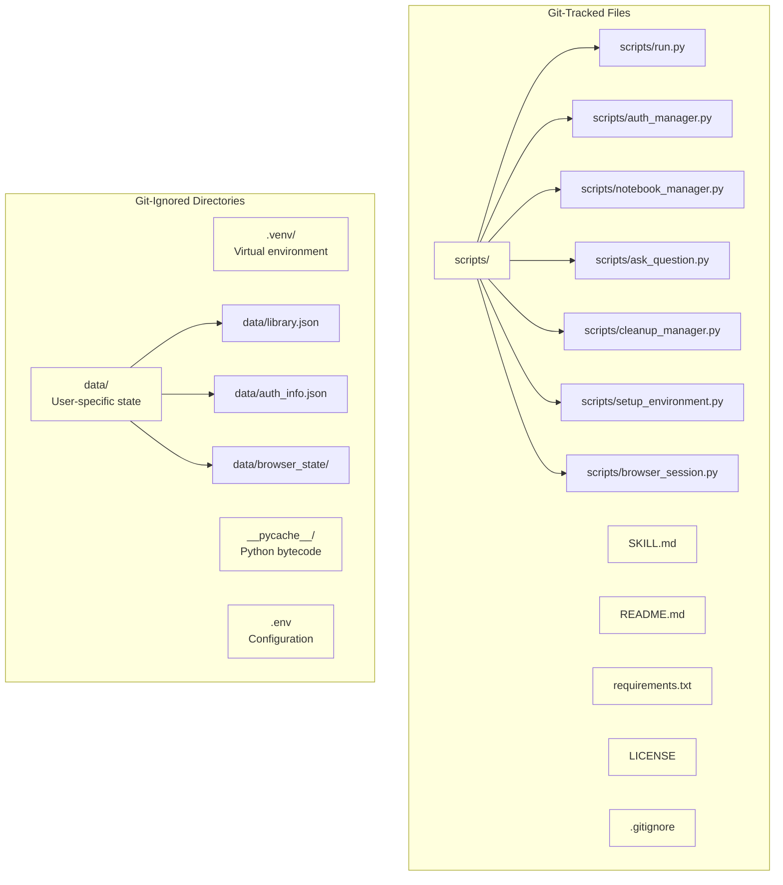
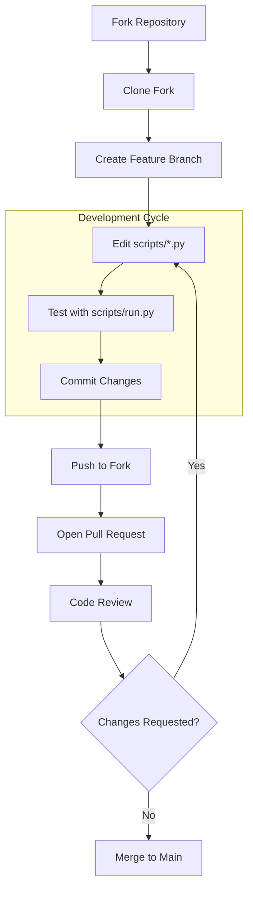
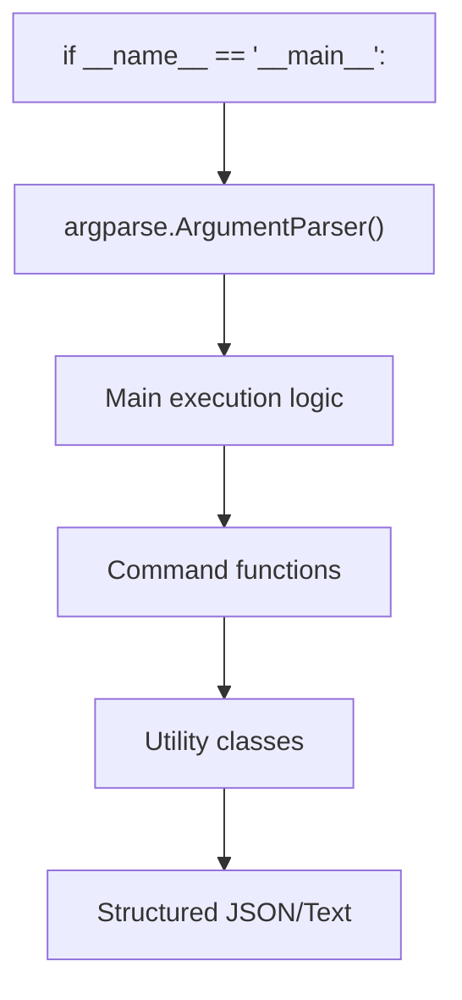

<!-- source: DeepWiki mcp.deepwiki.com · repo PleasePrompto/notebooklm-skill · page 8 Contributing and Maintenance · fetched 2026-10-26 -->

# Contributing and Maintenance

Relevant source files

The following files were used as context for generating this wiki page:

- [.gitignore](.gitignore)
- [LICENSE](LICENSE)

This document provides information for contributors and system maintainers working on the NotebookLM Skill codebase. It covers the contribution workflow, repository structure, Git practices, and maintenance procedures.

For detailed development setup instructions including environment configuration, see [Development Setup](#8.1). For licensing terms and usage permissions, see [License](#8.2).

## Purpose and Scope

This page documents the processes and practices for:
- Contributing code, documentation, or bug fixes to the project.
- Understanding the repository structure and Git workflow.
- Maintaining the codebase and managing releases.
- Handling sensitive data and security considerations.

This page does not cover end-user setup or usage patterns. For installation and initial setup, see [Installation](#2.1). For general system architecture, see [Architecture](#1.1).

---

## Repository Structure and Version Control

The NotebookLM Skill repository follows a clear separation between version-controlled code and Git-ignored user data to protect sensitive authentication information and personal notebook libraries.

### Repository Layout

**Diagram: Repository File Structure**

The repository distinguishes between:
- **Source code** (tracked): All Python scripts, documentation, and configuration files.
- **Runtime data** (ignored): Virtual environments, user authentication, and notebook libraries.
- **Build artifacts** (ignored): Python bytecode, logs, and temporary files.

Sources: [.gitignore:1-74]()

### Critical Git Ignore Patterns

The [.gitignore:1-74]() file implements security-critical exclusion patterns to prevent accidental leakage of private data.

| Pattern | Purpose | Security Risk if Committed |
|---------|---------|----------------------------|
| `data/` | User authentication and notebook library | **HIGH** - Exposes Google session cookies |
| `.venv/` | Virtual environment with dependencies | Low - Large and platform-specific |
| `.env` | Configuration with potential secrets | **MEDIUM** - May contain API keys |
| `auth_info.json` | Authentication status tracking | **HIGH** - Session metadata |
| `browser_state/` | Chromium profile with cookies | **CRITICAL** - Full browser session data |
| `library.json` | Personal notebook URLs | **MEDIUM** - Reveals user's documents |

The most critical exclusion is the entire `data/` directory [.gitignore:7-10](), which contains sensitive session information. Redundant patterns in [.gitignore:30-37]() ensure that even if files like `cookies.json` or `state.json` are placed outside the `data/` folder, they remain untracked.

Sources: [.gitignore:7-10](), [.gitignore:30-37]()

---

## Contribution Workflow

The following diagram illustrates the complete contribution process from forking to merge:

**Diagram: Contribution Process Flow**

### Step-by-Step Contribution Process

1. **Fork and Clone**: Fork the repository on GitHub and clone your fork locally.
2. **Create Feature Branch**: Always branch from `main`. Use descriptive names like `feature/add-export` or `fix/auth-timeout`.
3. **Development**: Write code following existing patterns. Test using the `scripts/run.py` wrapper.
4. **Commit and Push**: Verify no `data/` files are staged using `git status`. Write clear commit messages.
5. **Pull Request**: Open a PR against the `main` branch. Describe changes and reference any related issues.

Sources: [.gitignore:1-74]()

---

## Code Standards and Practices

### File Organization

The codebase follows a functional module pattern where each script implements a specific capability. All logic is encapsulated within the `scripts/` directory.

| Script | Responsibility | Entry Point |
|--------|---------------|-------------|
| `scripts/run.py` | Orchestration and environment management | Main entry point |
| `scripts/auth_manager.py` | Authentication operations | Via `run.py` |
| `scripts/notebook_manager.py` | Library CRUD operations | Via `run.py` |
| `scripts/ask_question.py` | Query execution | Via `run.py` |
| `scripts/cleanup_manager.py` | Data cleanup | Via `run.py` |
| `scripts/setup_environment.py` | First-run environment setup | Auto-invoked by `run.py` |

### Code Pattern: Script Structure

All executable scripts are designed to be modular and invoked through the universal wrapper.

**Diagram: Standard Script Structure**

Each script must define CLI arguments using `argparse`, implement command functions with clear responsibilities, and exit with appropriate status codes (0 for success, 1 for errors).

Sources: [.gitignore:22-23]()

---

## Data Safety Guidelines

Contributors must follow these critical safety rules to prevent committing private data.

### Pre-Commit Checklist

Before every commit, verify:
1. **Check Status**: Run `git status` to see all staged and unstaged files.
2. **Verify Ignores**: Run `git check-ignore data/library.json` to ensure the ignore patterns are active.
3. **Review Diffs**: Run `git diff --cached` to ensure no sensitive tokens or URLs are included in the staged changes.

### Testing Without Committing Data

The system creates `.venv/`, `data/auth_info.json`, `data/library.json`, and `data/browser_state/` during operation. The [.gitignore:7-10]() and [.gitignore:1-5]() patterns ensure these remain local.

Sources: [.gitignore:1-10](), [.gitignore:30-37]()

---

## Maintenance Tasks

### Dependency Updates

The system uses minimal dependencies specified in `requirements.txt`. Maintenance involves periodic updates to `patchright` to ensure compatibility with the latest Chromium versions.

**Critical**: Test authentication and query execution after dependency updates, as browser automation behavior is highly sensitive to library versions.

### Python Version Compatibility

The system is designed for Python 3.7+ compatibility. Maintainers should test on the minimum supported version and the latest stable release before merging major changes.

---

## Child Pages

For more specific information, please refer to the following child pages:

*   **[Development Setup](#8.1)**: Detailed guide for setting up the local environment, installing dependencies, and configuring the virtual environment.
*   **[License](#8.2)**: Full text of the MIT License and copyright information for the project.

Sources: [LICENSE:1-22]()

---

