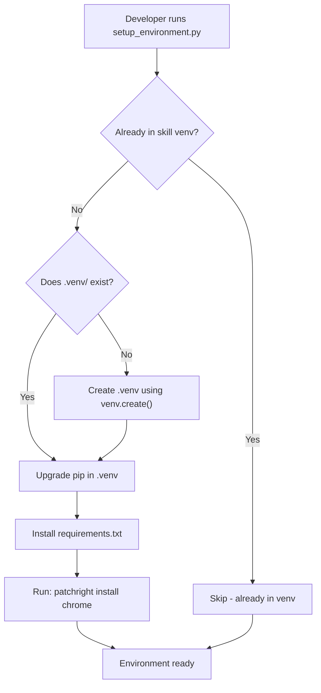
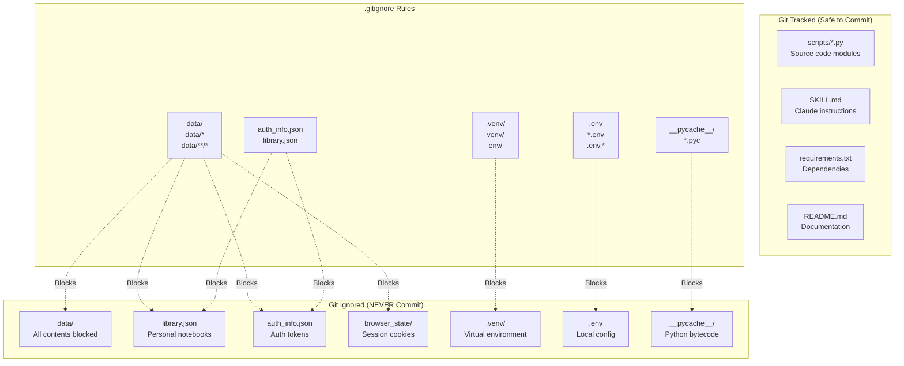
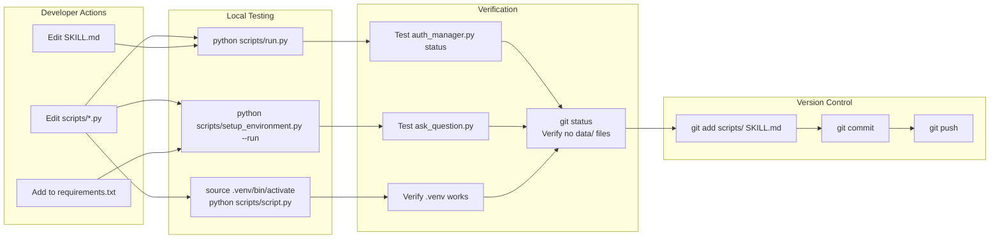

<!-- source: DeepWiki mcp.deepwiki.com · repo PleasePrompto/notebooklm-skill · page 8.1 Development Setup · fetched 2026-10-26 -->

# Development Setup

<details>
<summary>Relevant source files</summary>

The following files were used as context for generating this wiki page:

- [.gitignore](.gitignore)
- [scripts/__init__.py](scripts/__init__.py)
- [scripts/setup_environment.py](scripts/setup_environment.py)

</details>


This document provides guidance for developers who want to contribute to or modify the NotebookLM Skill codebase. It covers repository setup, virtual environment management, understanding `.gitignore` patterns to protect sensitive data, and development workflows.

For end-user installation instructions, see [Installation](#2.1). For environment variables and configuration, see [Configuration Options](#7.3).

## Repository Setup

### Cloning the Repository

The skill is designed to be installed in the Claude Code skills directory:

```bash
# Clone into Claude skills directory
mkdir -p ~/.claude/skills
cd ~/.claude/skills
git clone https://github.com/PleasePrompto/notebooklm-skill notebooklm
cd notebooklm
```

Alternatively, for development in a separate location:

```bash
# Clone to development directory
git clone https://github.com/PleasePrompto/notebooklm-skill
cd notebooklm-skill
```

**Important**: The skill must eventually be located at `~/.claude/skills/notebooklm/` for Claude Code to discover it via the `SKILL.md` file.

Sources: Repository structure from system context

### Repository Directory Structure

```
notebooklm-skill/
├── scripts/                    # Source code (Git tracked)
│   ├── run.py                 # Universal wrapper entrypoint
│   ├── setup_environment.py   # Environment management
│   ├── auth_manager.py        # Authentication module
│   ├── notebook_manager.py    # Library management
│   ├── ask_question.py        # Query execution
│   ├── cleanup_manager.py     # Data cleanup
│   └── lib/                   # Shared utilities
│       ├── auth_manager.py    # AuthManager class
│       ├── notebook_library.py # NotebookLibrary class
│       └── browser_session.py  # Browser utilities
├── data/                      # User data (Git ignored!)
│   ├── library.json           # Notebook metadata
│   ├── auth_info.json         # Auth status
│   └── browser_state/         # Browser cookies/sessions
├── .venv/                     # Virtual environment (Git ignored)
├── requirements.txt           # Python dependencies (Git tracked)
├── SKILL.md                   # Claude instructions (Git tracked)
├── .gitignore                 # Protection patterns (Git tracked)
├── .env                       # Local config (Git ignored)
└── README.md                  # Documentation (Git tracked)
```

**Key Principles**:
- **Source code** in `scripts/` is version controlled
- **User data** in `data/` is **never committed** (contains auth tokens and personal notebooks) [[.gitignore:7-10]()]
- **Virtual environment** `.venv/` is local-only and excluded from Git [[.gitignore:1-5]()]
- **Configuration** `.env` is local and excluded from Git [[.gitignore:26-28]()]

Sources: [[.gitignore:1-74]()]

## Development Virtual Environment

### Understanding SkillEnvironment

The `SkillEnvironment` class [[scripts/setup_environment.py:14-146]()] manages the isolated Python environment:

```python
class SkillEnvironment:
    def __init__(self):
        self.skill_dir = Path(__file__).parent.parent
        self.venv_dir = self.skill_dir / ".venv"
        self.requirements_file = self.skill_dir / "requirements.txt"
```

**Key methods**:
- `ensure_venv()` - Creates `.venv/` if missing, installs dependencies [[scripts/setup_environment.py:31-95]()]
- `is_in_skill_venv()` - Checks if current Python is from the skill's venv [[scripts/setup_environment.py:96-102]()]
- `get_python_executable()` - Returns path to venv Python [[scripts/setup_environment.py:104-108]()]
- `run_script()` - Executes scripts with venv Python [[scripts/setup_environment.py:110-136]()]

Sources: [[scripts/setup_environment.py:14-146]()]

### Creating the Development Environment

#### Diagram: Virtual Environment Setup Process



Sources: [[scripts/setup_environment.py:31-95]()]

#### Manual Setup

```bash
# Run setup script directly
python scripts/setup_environment.py

# Or check environment status
python scripts/setup_environment.py --check

# Or run a specific script with venv
python scripts/setup_environment.py --run auth_manager.py status
```

The setup process [[scripts/setup_environment.py:31-95]]():
1. Checks if `.venv/` exists, creates it if not using `venv.create()` [[scripts/setup_environment.py:40-47]()]
2. Upgrades pip: `pip install --upgrade pip` [[scripts/setup_environment.py:53-59]()]
3. Installs requirements: `pip install -r requirements.txt` [[scripts/setup_environment.py:62-68]()]
4. Installs Chrome browser: `python -m patchright install chrome` [[scripts/setup_environment.py:73-86]()]

**Note**: Chrome (not Chromium) is installed for anti-detection reliability [[scripts/setup_environment.py:70-85]]().

Sources: [[scripts/setup_environment.py:31-95]()]

### Platform-Specific Paths

The venv Python executable path varies by platform [[scripts/setup_environment.py:23-29]]():

| Platform | Python Path | Pip Path |
|----------|-------------|----------|
| Windows | `.venv/Scripts/python.exe` | `.venv/Scripts/pip.exe` |
| Unix/Linux/Mac | `.venv/bin/python` | `.venv/bin/pip` |

For manual activation:
- **Windows**: `.venv\Scripts\activate.bat` [[scripts/setup_environment.py:141-142]()]
- **Unix/Linux/Mac**: `source .venv/bin/activate` [[scripts/setup_environment.py:144-145]()]

Sources: [[scripts/setup_environment.py:23-29](), [scripts/setup_environment.py:138-145]()]

## Understanding .gitignore Patterns

The `.gitignore` file is **critical** for preventing accidental commit of sensitive data. Understanding these patterns is essential for safe development.

### Diagram: Git Tracked vs Ignored Files



Sources: [[.gitignore:1-74]()]

### Critical Protection Patterns

#### Data Directory (Lines 7-10)

```gitignore
data/
data/*
data/**/*
```

**Purpose**: Prevents **any file** in `data/` from being committed. This directory contains:
- `library.json` - User's notebook URLs (may contain internal/private links)
- `auth_info.json` - Google authentication status and profile info
- `browser_state/` - Browser cookies and session tokens

**Why critical**: Committing these files would expose personal notebook content references and authentication cookies that could grant account access [[.gitignore:7-10]()].

Sources: [[.gitignore:7-10]()]

#### Virtual Environment (Lines 1-5)

```gitignore
.venv/
venv/
env/
*.venv
```

**Purpose**: Excludes the Python virtual environment, which is platform-specific and large [[.gitignore:1-5]()].

Sources: [[.gitignore:1-5]()]

#### Environment Files (Lines 26-28)

```gitignore
.env
*.env
.env.*
```

**Purpose**: Protects local configuration that may contain personal preference or debugging settings [[.gitignore:26-28]()].

Sources: [[.gitignore:26-28]()]

#### Fallback Protection (Lines 30-37)

```gitignore
browser_state/
auth/
auth_info.json
library.json
notebooks.json
state.json
cookies.json
```

**Purpose**: Catches sensitive files even if accidentally created outside the `data/` directory [[.gitignore:30-37]()].

Sources: [[.gitignore:30-37]()]

## Development Workflow

### Diagram: Development Execution Flow



Sources: [[scripts/setup_environment.py:110-136]()]

### Making Code Changes

1. **Edit source files** in `scripts/` or `scripts/lib/`
2. **Update dependencies** if adding imports:
   ```bash
   # Add to requirements.txt
   echo "new-package==1.2.3" >> requirements.txt
   
   # Reinstall in venv
   python scripts/setup_environment.py
   ```

3. **Update SKILL.md** if changing CLI interface or commands

Sources: General development practice

### Testing Changes Locally

#### Option 1: Using run.py (Recommended)

The `run.py` wrapper automatically handles venv setup via its orchestration logic.

```bash
# Test authentication module
python scripts/run.py auth_manager.py status

# Test query with specific notebook
python scripts/run.py ask_question.py \
  --question "Test query" \
  --notebook-id test-123 \
  --show-browser
```

Sources: System architecture context

#### Option 2: Using setup_environment.py

```bash
# Run specific script with venv
python scripts/setup_environment.py --run auth_manager.py status
```

This approach [[scripts/setup_environment.py:110-136]]() explicitly calls `ensure_venv()` before execution and is good for debugging environment issues.

Sources: [[scripts/setup_environment.py:110-136]()]

#### Option 3: Manual venv Activation

```bash
# Activate venv
source .venv/bin/activate  # Unix/Mac
# or
.venv\Scripts\activate.bat  # Windows

# Run scripts directly
python scripts/auth_manager.py status
```

Sources: [[scripts/setup_environment.py:138-145]()]

### Automated Environment Handling in Scripts

The `scripts/__init__.py` file provides a fallback mechanism that ensures a virtual environment is set up even if a script is imported or run directly [[scripts/__init__.py:13-71]()]. It checks if the current execution is inside the skill's `.venv` and prompts the user or performs setup if necessary [[scripts/__init__.py:18-32]()].

Sources: [[scripts/__init__.py:13-81]()]

## Pre-Commit Checklist

Before pushing changes:

### 1. Verify No Sensitive Data

```bash
# Check staged files
git status

# Verify no data files are accidentally tracked
git ls-files --stage | grep data/
```

### 2. Test Core Functionality

```bash
# Test environment setup
python scripts/setup_environment.py --check

# Test library operations
python scripts/run.py notebook_manager.py list
```

### 3. Validate Code Quality

Check for syntax errors and verify that `requirements.txt` is updated if new packages were added.

Sources: [[scripts/setup_environment.py:50-68]()]

## File Organization Reference

### Diagram: Development vs Runtime Files

```mermaid
graph TB
    subgraph Development["Development Files (Edit These)"]
        Source["scripts/*.py<br/>Python source code"]
        Lib["scripts/lib/*.py<br/>Shared utilities"]
        SkillDoc["SKILL.md<br/>Claude instructions"]
        Requirements["requirements.txt<br/>Dependencies"]
        GitIgnore[".gitignore<br/>Protection rules"]
    end
    
    subgraph Runtime["Runtime Files (Auto-Generated)"]
        Venv[".venv/<br/>Created by setup_environment.py"]
        DataLib["data/library.json<br/>Created by notebook_manager.py"]
        DataAuth["data/auth_info.json<br/>Created by auth_manager.py"]
        DataBrowser["data/browser_state/<br/>Created by auth flow"]
        Pycache["__pycache__/<br/>Created by Python"]
    end
    
    subgraph Config["Configuration Files (User-Specific)"]
        Env[".env<br/>Optional local config"]
    end
    
    Source -.->|"imports"| Lib
    Source -.->|"reads"| Requirements
    Source -.->|"creates"| Venv
    Source -.->|"creates"| DataLib
    Source -.->|"creates"| DataAuth
    Source -.->|"creates"| DataBrowser
    Source -.->|"reads"| Env
    
    GitIgnore -.->|"protects"| Venv
    GitIgnore -.->|"protects"| DataLib
    GitIgnore -.->|"protects"| DataAuth
    GitIgnore -.->|"protects"| DataBrowser
    GitIgnore -.->|"protects"| Env
    GitIgnore -.->|"protects"| Pycache
```



Sources: [[.gitignore:1-74](), [scripts/setup_environment.py:14-29]()]

### Source Code Layout

| Path | Purpose | Git Tracked |
|------|---------|-------------|
| `scripts/run.py` | Universal wrapper entrypoint | ✓ |
| `scripts/setup_environment.py` | Environment management [[scripts/setup_environment.py:1-5]()] | ✓ |
| `scripts/auth_manager.py` | Authentication CLI | ✓ |
| `scripts/notebook_manager.py` | Library management CLI | ✓ |
| `scripts/ask_question.py` | Query execution CLI | ✓ |
| `scripts/cleanup_manager.py` | Data cleanup CLI | ✓ |
| `scripts/__init__.py` | Auto-env management [[scripts/__init__.py:2-5]()] | ✓ |

Sources: [[scripts/setup_environment.py:1-11](), [scripts/__init__.py:1-5]()]

### Data Directory Layout

| Path | Purpose | Git Tracked |
|------|---------|-------------|
| `data/library.json` | Notebook metadata store | ✗ |
| `data/auth_info.json` | Auth status and profile | ✗ |
| `data/browser_state/` | Browser cookies/sessions | ✗ |

**Critical**: The entire `data/` directory is blocked by `.gitignore` patterns [[.gitignore:7-10]()]. This ensures no user-specific data is ever committed.

Sources: [[.gitignore:7-10]()]

## Summary

Key principles for safe development:

1. **Never commit `data/`** - Contains personal notebooks and auth tokens [[.gitignore:7-10]()]
2. **Use venv consistently** - Prevents dependency conflicts [[scripts/setup_environment.py:39-47]()]
3. **Test with `run.py`** - Matches production behavior
4. **Verify before commit** - Check `git status` for sensitive files
5. **Keep source and data separate** - Source in `scripts/`, data in `data/`

The `setup_environment.py` script handles venv creation and dependency installation automatically [[scripts/setup_environment.py:31-95]()]. The `.gitignore` patterns provide multiple layers of protection against accidentally committing sensitive data [[.gitignore:1-74]()].

Sources: [[scripts/setup_environment.py:1-197](), [.gitignore:1-74]()]

---

