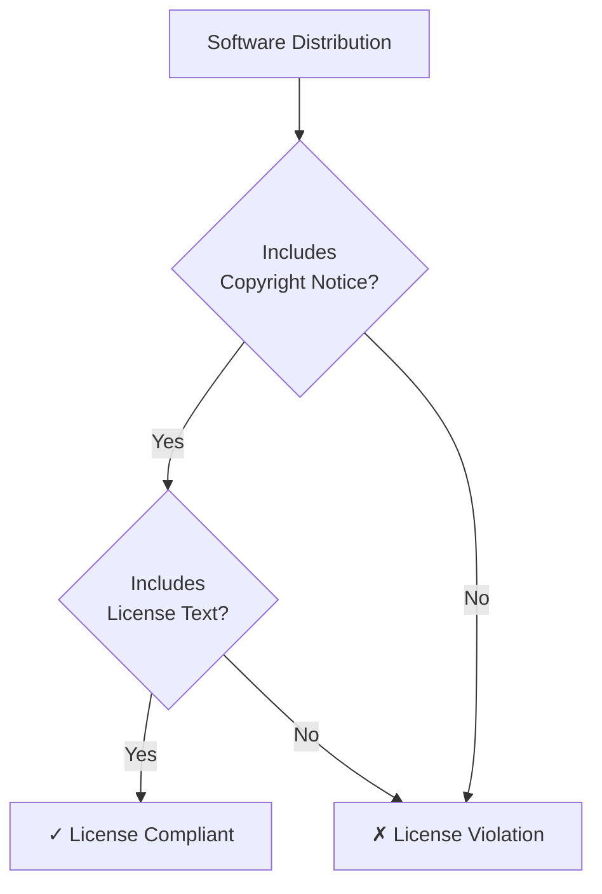
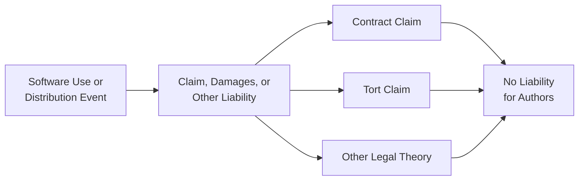
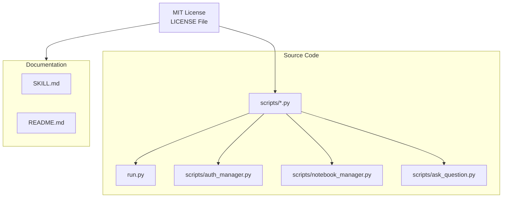

<!-- source: DeepWiki mcp.deepwiki.com · repo PleasePrompto/notebooklm-skill · page 8.2 License · fetched 2026-10-26 -->

# License

<details>
<summary>Relevant source files</summary>

The following files were used as context for generating this wiki page:

- [LICENSE](LICENSE)

</details>


This page documents the licensing terms for the NotebookLM Skill codebase. It covers the MIT License terms, copyright holder, permitted uses, distribution requirements, and warranty disclaimers.

## License Overview

The NotebookLM Skill is distributed under the MIT License, a permissive open-source license that allows broad usage rights with minimal restrictions. The complete license text is located at [LICENSE:1-22]().

### License Type and Copyright

The software is copyrighted by "Please Prompto!" with the copyright year 2025. The MIT License is applied to all software and documentation files within the repository.

**Copyright Holder:** Please Prompto!  
**Copyright Year:** 2025  
**License Type:** MIT License (SPDX: MIT)

Sources: [LICENSE:1-4]()

### File Location in Repository

The license file is located at the repository root, making it immediately visible to users and automated license scanning tools:

```
notebooklm-skill/
├── LICENSE                  # MIT License text [LICENSE:1-22]
├── README.md
├── SKILL.md
├── run.py
└── scripts/
    ├── auth_manager.py
    ├── notebook_manager.py
    ├── ask_question.py
    └── ...
```

Sources: [LICENSE:1-22]()

## Permitted Uses

The MIT License grants extensive permissions to anyone obtaining a copy of the software. These permissions apply without requiring prior approval from the copyright holder.

### Usage Rights Matrix

| Permission Type | Description | Restrictions |
|----------------|-------------|--------------|
| **Use** | Run the software for any purpose, commercial or non-commercial | None |
| **Copy** | Create copies of the software | Must include license notice |
| **Modify** | Alter the source code to create derivative works | Must include license notice |
| **Merge** | Combine with other software | Must include license notice |
| **Publish** | Make the software publicly available | Must include license notice |
| **Distribute** | Share copies with others | Must include license notice |
| **Sublicense** | Grant the same rights to downstream users | Must include license notice |
| **Sell** | Distribute copies for commercial consideration | Must include license notice |

All of these rights are granted "without restriction" as stated in [LICENSE:5-9](), meaning there are no additional constraints beyond the requirements described in the next section.

Sources: [LICENSE:5-9]()

### Commercial Use

The MIT License explicitly permits commercial use without requiring payment of royalties or licensing fees to the copyright holder. This includes:

- Using the skill in commercial AI research workflows.
- Integrating the skill into commercial products or services.
- Selling modified versions of the software.
- Using the software to generate commercial value (e.g., querying notebooks for business intelligence).

Sources: [LICENSE:5-9]()

## Distribution Requirements

While the MIT License is highly permissive, it imposes two mandatory requirements on anyone distributing the software or derivative works.

### Mandatory Inclusion Conditions

Title: License Compliance Logic


**Required Elements in All Distributions:**

1. **Copyright Notice:** The line "Copyright (c) 2025 Please Prompto!" from [LICENSE:3]() must be preserved.
2. **License Text:** The complete permission statement and warranty disclaimer from [LICENSE:5-21]() must be included.

These requirements apply to "all copies or substantial portions of the Software" as specified in [LICENSE:12-13]().

Sources: [LICENSE:3](), [LICENSE:5-21](), [LICENSE:12-13]()

## Warranty Disclaimer

The MIT License includes a comprehensive warranty disclaimer that limits liability for the copyright holders and contributors. This is a standard legal protection for open-source software.

### No Warranty Statement

The software is provided "AS IS" without any warranty, express or implied [LICENSE:15-16](). This disclaimer covers multiple warranty types:

*   **MERCHANTABILITY:** Software is not guaranteed to be suitable for commercial use [LICENSE:16]().
*   **FITNESS FOR A PARTICULAR PURPOSE:** Software is not guaranteed to meet specific user needs [LICENSE:17]().
*   **NONINFRINGEMENT:** No guarantee that the software does not infringe third-party intellectual property rights [LICENSE:17]().

Sources: [LICENSE:15-17]()

### Liability Limitations

The license explicitly limits liability for the copyright holders ("AUTHORS OR COPYRIGHT HOLDERS") in [LICENSE:17-21]():

Title: Liability Limitation Flow


The authors and copyright holders are not liable for any claim, damages, or other liability, whether in an action of contract, tort, or otherwise, arising from, out of, or in connection with the software [LICENSE:17-21]().

Sources: [LICENSE:17-21]()

## License Application Scope

The license terms apply to all components of the NotebookLM Skill system provided in the repository.

### Covered Components

Title: Codebase Entity Mapping to License Scope


The license covers "this software and associated documentation files" [LICENSE:5-6](), which includes:

- **Python Scripts:** All executable modules such as `run.py` and those in the `scripts/` directory.
- **Documentation Files:** SKILL.md and README.md.
- **Supporting Files:** Any configuration templates like `.env.example`.

Sources: [LICENSE:5-6]()

### Components Not Covered

The following components are **not** part of the licensed software and have their own licensing terms:

| Component | License | Relationship |
|-----------|---------|--------------|
| **patchright** | Apache 2.0 | External dependency |
| **Google Chrome** | Proprietary | Required external application |
| **NotebookLM Service** | Google ToS | External cloud service accessed via automation |
| **User Data** | User-owned | Files in `data/` (e.g., `library.json`, `auth_info.json`) |

User-generated data stored in the `data/` directory is owned by the user and is not part of the licensed software.

Sources: [LICENSE:5-6]()

## Summary

The NotebookLM Skill is released under the MIT License with the following key terms:

- **Copyright:** Please Prompto! (2025) [LICENSE:3]()
- **Permission:** Unrestricted use, modification, and distribution [LICENSE:5-9]()
- **Requirements:** Include copyright notice and license text in distributions [LICENSE:12-13]()
- **Warranty:** Provided "AS IS" with no warranties [LICENSE:15-16]()
- **Liability:** Authors have no liability for damages [LICENSE:17-18]()

The complete license text is available at [LICENSE:1-22]() in the repository root.

Sources: [LICENSE:1-22]()

---

