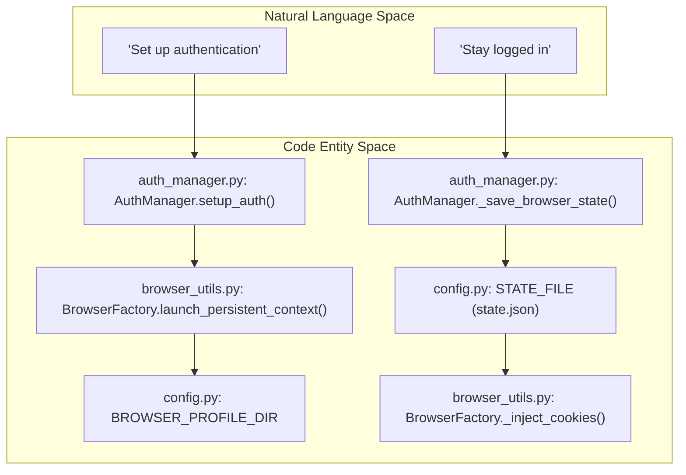
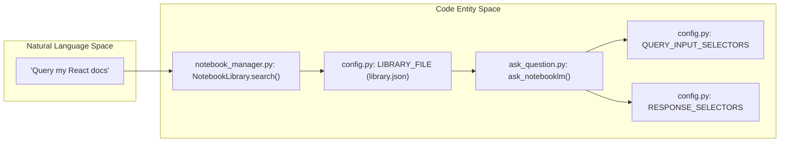

<!-- source: DeepWiki mcp.deepwiki.com · repo PleasePrompto/notebooklm-skill · page 9 Glossary · fetched 2026-10-26 -->

# Glossary

Relevant source files

The following files were used as context for generating this wiki page:

- [AUTHENTICATION.md](AUTHENTICATION.md)
- [CHANGELOG.md](CHANGELOG.md)
- [README.md](README.md)
- [SKILL.md](SKILL.md)
- [references/api_reference.md](references/api_reference.md)
- [scripts/ask_question.py](scripts/ask_question.py)
- [scripts/auth_manager.py](scripts/auth_manager.py)
- [scripts/browser_utils.py](scripts/browser_utils.py)
- [scripts/config.py](scripts/config.py)

This page defines codebase-specific terms, jargon, and domain concepts used within the NotebookLM Skill. It serves as a technical reference for onboarding engineers to understand the internal nomenclature and implementation details of the system.

## Core System Terms

| Term | Definition | Key Code Reference |
|:---|:---|:---|
| **Skill** | A local integration for Claude Code consisting of a `SKILL.md` instruction file and associated automation scripts. | [SKILL.md:1-4]() |
| **Run Wrapper** | The `run.py` script which acts as the mandatory entry point for all operations, handling environment isolation and dependency checks. | [scripts/run.py:1-10]() |
| **Smart Add** | A two-step discovery process where Claude first queries a notebook for its content before adding it to the local library with accurate metadata. | [SKILL.md:19-30]() |
| **Follow-up Mechanism** | A critical logic loop where Claude is instructed to analyze NotebookLM responses for gaps and perform recursive queries until the user's request is satisfied. | [SKILL.md:128-142]() |
| **Stateless Session** | The architectural decision where each query spawns a fresh browser instance that is closed immediately after the response is retrieved. | [scripts/ask_question.py:31-37]() |

**Sources:** [SKILL.md:1-4](), [SKILL.md:19-30](), [SKILL.md:128-142](), [scripts/ask_question.py:31-37]()

## Authentication & Browser Domain

The system uses a sophisticated browser automation stack to bypass detection and maintain persistent Google sessions.

### Hybrid Authentication
A specialized strategy designed to overcome a Playwright limitation where session cookies (cookies without an `Expires` attribute) are not persisted in `user_data_dir`. The system combines a physical browser profile with manual JSON-based cookie injection.

**Implementation Details:**
*   **Phase 1 (Setup):** `AuthManager.setup_auth` launches a visible Chrome instance. After manual login, it calls `context.storage_state()` to save cookies to `state.json`.
*   **Phase 2 (Runtime):** `BrowserFactory.launch_persistent_context` launches Chrome using `BROWSER_PROFILE_DIR` and then calls `_inject_cookies` to manually push cookies from `state.json` into the active context.

### Stealth Features
To prevent being flagged as a bot by Google, the system implements several "human-like" behaviors via the `StealthUtils` class.

*   **Human Typing:** The `human_type` function simulates variable delays between keystrokes and occasional pauses.
*   **Realistic Click:** The `realistic_click` function moves the mouse cursor to the element's bounding box coordinates before clicking.
*   **Automation Masking:** Uses `BROWSER_ARGS` like `--disable-blink-features=AutomationControlled` to hide the `navigator.webdriver` flag.

### Browser Entity Mapping
The following diagram bridges the Natural Language concepts of "Login" and "Session" to the specific code entities responsible for them.

**Diagram: Authentication Logic Flow**

**Sources:** [AUTHENTICATION.md:5-10](), [AUTHENTICATION.md:48-86](), [scripts/browser_utils.py:15-58](), [scripts/browser_utils.py:59-108](), [scripts/config.py:31-37](), [scripts/auth_manager.py:86-140]()

## Data Management & Library

The system maintains a local "Knowledge Base" of notebooks to allow Claude to select the correct source without user intervention.

### Notebook Library
A local registry of NotebookLM URLs and metadata.
*   **Library File:** `library.json` stores an array of notebook objects, including `id`, `name`, `url`, `description`, and `topics`.
*   **Active Notebook:** A specific notebook ID marked in the library that the system defaults to if no specific ID is provided in a query.

### Data Directory Structure
All persistent data is stored in the `data/` directory, which is ignored by Git to protect sensitive session information.

| File/Folder | Purpose | Code Reference |
|:---|:---|:---|
| `library.json` | Metadata for all tracked notebooks. | [scripts/config.py:15]() |
| `auth_info.json` | Metadata about the last successful login (ISO timestamp). | [scripts/config.py:14]() |
| `browser_state/` | Contains the `state.json` cookie file and the `browser_profile/` Chrome user data. | [scripts/config.py:11-13]() |

**Diagram: Notebook Discovery and Query Flow**

**Sources:** [SKILL.md:81-106](), [scripts/notebook_manager.py:24-30](), [scripts/config.py:8-16](), [scripts/config.py:18-28](), [scripts/ask_question.py:40-51]()

## Technical Jargon & Abbreviations

*   **Patchright:** A specialized fork of Playwright used for enhanced stealth and anti-detection in browser automation.
*   **WPM (Words Per Minute):** Used in `StealthUtils.human_type` to calculate the delay between character inputs to mimic human typing speed.
*   **Thinking Message:** The `div.thinking-message` element in the NotebookLM UI. The system polls for the disappearance of this element to ensure the response is complete before reading it.
*   **Source-Grounded:** A term describing Gemini's behavior in NotebookLM where it only answers based on provided documents, significantly reducing hallucinations.

**Sources:** [README.md:12-14](), [CHANGELOG.md:23-27](), [scripts/browser_utils.py:68-70](), [scripts/ask_question.py:126-133]()