# Page: Overview

# Overview

<details>
<summary>Relevant source files</summary>

The following files were used as context for generating this wiki page:

- [README.md](README.md)
- [SKILL.md](SKILL.md)

</details>


This document provides an introduction to the NotebookLM Skill system, a Claude Code Skill that enables programmatic querying of Google NotebookLM notebooks through browser automation. The system allows Claude Code to retrieve source-grounded, citation-backed answers from user-uploaded documents without hallucinations.

**Scope**: This page covers the system's purpose, architectural overview, core components, and data flow patterns. For detailed component APIs, see [API Reference](#5). For setup procedures, see [Getting Started](#2). For architectural deep-dives, see [Architecture](#1.1).

## System Purpose

The NotebookLM Skill solves the problem of inefficient documentation research during coding tasks. When developers instruct Claude Code to search local documentation, the following inefficiencies occur:

| Problem | Impact |
|---------|--------|
| Massive token consumption | Reading multiple files repeatedly for each query |
| Inaccurate keyword retrieval | Missing contextual connections between documents |
| Hallucinations | Inventing plausible-sounding APIs when information is not found |
| Manual context switching | Constant copy-paste between NotebookLM browser and editor |

The system provides a solution by enabling Claude Code to programmatically query NotebookLM's Gemini-powered knowledge base, which synthesizes answers exclusively from user-uploaded documents with source citations.

**Sources**: [README.md:28-44]()

## System Architecture Overview

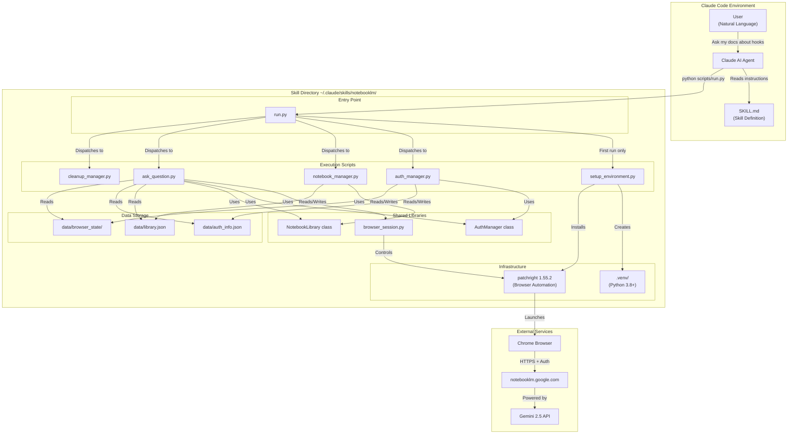

**High-Level System Architecture**: This diagram shows the complete system structure from user interaction through Claude Code to NotebookLM integration. The entry point (`run.py`) orchestrates all operations, dispatching to specialized execution scripts. Shared libraries provide reusable functionality for browser automation and data management. All data persists locally in the `data/` directory, with browser automation handled through Patchright-controlled Chrome instances.

**Sources**: [README.md:160-179](), [SKILL.md:192-198]()

## Core Components

### Orchestration Layer

The orchestration layer consists of a single mandatory entry point that manages environment setup and script execution.

| Component | File | Responsibility |
|-----------|------|----------------|
| **Universal Wrapper** | `scripts/run.py` | Environment verification, virtual environment management, script dispatch with proper context |

The `run.py` wrapper must always be used to execute any script. Direct script execution will fail due to missing virtual environment activation. The wrapper automatically creates the `.venv` directory, installs dependencies, and ensures proper Python interpreter usage.

**Sources**: [SKILL.md:40-59](), [README.md:83-88]()

### Execution Modules

Five specialized modules implement the system's core capabilities:

| Module | File | Primary Functions |
|--------|------|-------------------|
| **Environment Setup** | `scripts/setup_environment.py` | Creates `.venv`, installs dependencies (patchright, python-dotenv), configures Chrome |
| **Authentication Manager** | `scripts/auth_manager.py` | Google OAuth flow, session persistence, authentication status validation |
| **Notebook Manager** | `scripts/notebook_manager.py` | CRUD operations on notebook library, search, activation, metadata management |
| **Query Executor** | `scripts/ask_question.py` | Browser automation, question submission, response extraction, follow-up prompts |
| **Cleanup Manager** | `scripts/cleanup_manager.py` | Selective data deletion, library preservation, browser state reset |

**Sources**: [README.md:165-171](), [SKILL.md:143-173]()

### Shared Utilities

Reusable classes and functions used across multiple execution modules:

- **`browser_session.py`**: Provides browser session management, stealth typing utilities, and activity tracking.
- **`AuthManager` class**: Encapsulates authentication state, login orchestration, and cookie management.
- **`NotebookLibrary` class**: Handles JSON persistence of notebook metadata and active notebook tracking.

**Sources**: [SKILL.md:143-167](), [README.md:160-179]()

## Data Flow: Query Execution

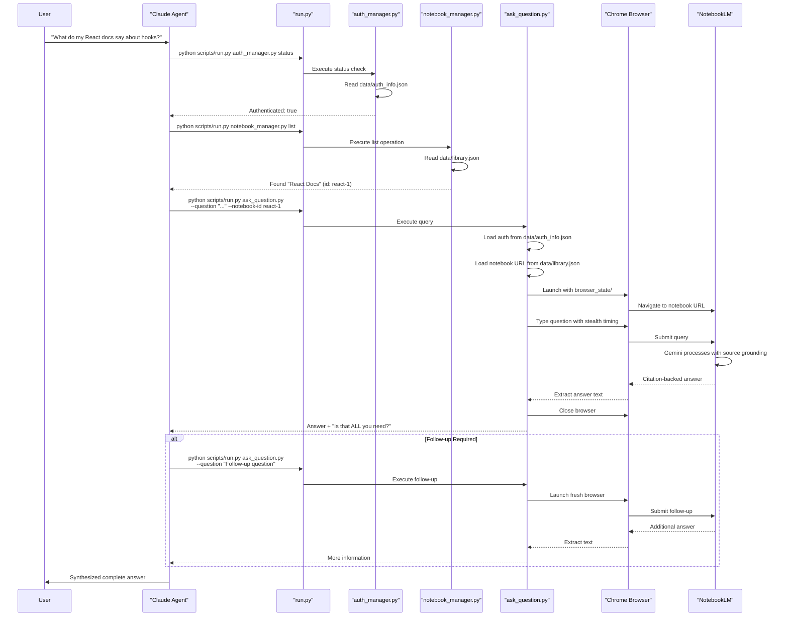

**Query Execution Flow**: This sequence diagram traces a complete question-answer cycle. Key observations: (1) Authentication verification precedes all operations, (2) Notebook selection uses the local library registry, (3) Each query opens a fresh browser instance (stateless model), (4) Follow-up mechanism triggers additional queries when initial response is incomplete, (5) Claude synthesizes multiple query results before responding to the user.

**Sources**: [README.md:277-291](), [SKILL.md:128-142]()

## Component Dependencies

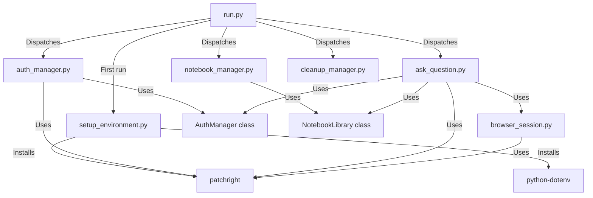

**Component Dependency Graph**: This graph shows how execution modules depend on shared utilities and external libraries. Notable patterns: (1) `run.py` is the only entry point and never imports other modules, (2) `ask_question.py` has the most dependencies, indicating it is the most complex operation, (3) Authentication and notebook management are orthogonal concerns with no direct dependencies, (4) Browser automation is centralized through `patchright`.

**Sources**: [SKILL.md:40-59](), [README.md:160-179]()

## File System Layout

The skill follows a self-contained directory structure within `~/.claude/skills/notebooklm/`:

```
notebooklm/
├── SKILL.md              # Claude Code skill definition
├── requirements.txt      # Python dependencies
├── .gitignore           # Excludes data/ and .venv/
├── scripts/
│   ├── run.py                    # Universal wrapper (REQUIRED entry point)
│   ├── setup_environment.py      # Environment initialization
│   ├── auth_manager.py           # Authentication CLI
│   ├── notebook_manager.py       # Library management CLI
│   ├── ask_question.py           # Query execution CLI
│   ├── cleanup_manager.py        # Data cleanup CLI
│   ├── browser_session.py        # Browser utilities
├── .venv/                # Isolated Python environment (auto-created)
│   ├── bin/python        # Python interpreter
│   └── lib/site-packages/
│       ├── patchright/   # Browser automation library
│       └── dotenv/       # Environment config
└── data/                 # Local storage (Git-ignored)
    ├── library.json      # Notebook metadata and registry
    ├── auth_info.json    # Authentication status
    └── browser_state/    # Browser cookies and session data
        ├── cookies.json
        └── storage/
```

**Git Exclusion**: The `.gitignore` file protects sensitive data by excluding `data/` and `.venv/` from version control. Only source code (`scripts/`, `SKILL.md`, `requirements.txt`) is tracked.

**Sources**: [README.md:163-171](), [README.md:262-275](), [SKILL.md:192-198]()

## Session Model: Stateless Design

The system employs a **stateless session model** where each query opens a fresh browser instance:

```mermaid
graph LR
    Q1["Query 1"] --> B1["Launch Browser 1"]
    B1 --> NLM1["NotebookLM Session 1"]
    NLM1 --> A1["Extract Answer 1"]
    A1 --> C1["Close Browser 1"]
    
    C1 -.->|Independent| Q2["Query 2"]
    Q2 --> B2["Launch Browser 2"]
    B2 --> NLM2["NotebookLM Session 2"]
    NLM2 --> A2["Extract Answer 2"]
    A2 --> C2["Close Browser 2"]
    
    C2 -.->|Independent| Q3["Query 3"]
    Q3 --> B3["Launch Browser 3"]
```

**Stateless Session Architecture**: Each query is completely independent. Authentication state and notebook metadata persist in `data/`, but browser instances do not. This design differs from the MCP server implementation which maintains persistent browser sessions.

**Key Implications**:
- No conversational context between queries.
- Each question must be self-contained.
- Follow-up mechanism compensates by prompting Claude to ask additional questions.
- Authentication cookies are reloaded from `data/browser_state/` for each session.

**Sources**: [README.md:149-159](), [SKILL.md:128-142]()

## Claude Code Integration

The skill integrates with Claude Code through a declarative interface defined in `SKILL.md`:

```mermaid
graph TB
    User["User: Natural Language"]
    SkillMD["SKILL.md"]
    Claude["Claude AI Agent"]
    RunPy["run.py"]
    
    User -->|"Ask my docs about X"| Claude
    Claude -->|Reads| SkillMD
    SkillMD -->|Defines commands:<br/>auth_manager.py status<br/>notebook_manager.py list<br/>ask_question.py --question| Claude
    Claude -->|Maps intent to commands| Claude
    Claude -->|"python scripts/run.py ..."| RunPy
    RunPy -->|Executes| Claude
    Claude -->|Analyzes response:<br/>"Is that ALL you need?"| Claude
    Claude -->|May trigger follow-ups| RunPy
```

**Claude Integration Pattern**: Claude reads `SKILL.md` to understand available commands and their parameters. When a user mentions NotebookLM or shares a notebook URL, Claude automatically selects the skill, verifies authentication, identifies the relevant notebook, and executes queries. The follow-up mechanism ("Is that ALL you need?") enables Claude to iteratively gather complete information across multiple stateless queries before responding to the user.

**Sources**: [SKILL.md:1-18](), [README.md:145-179](), [SKILL.md:128-142]()

## Key Design Principles

| Principle | Implementation |
|-----------|----------------|
| **Isolation** | All dependencies in `.venv/`, no global Python package pollution. |
| **Security** | Sensitive data in `data/` excluded from Git via `.gitignore`. |
| **Statelessness** | Fresh browser per query, no session persistence. |
| **Orchestration** | Mandatory `run.py` wrapper ensures proper environment setup. |
| **Zero-Hallucination** | Answers restricted to uploaded document sources via Gemini source-grounding. |
| **Human-Like Automation** | Stealth typing speeds, random delays, realistic interaction patterns. |

**Sources**: [README.md:196-201](), [README.md:249-253]()

## External Dependencies

The system requires two external Python packages installed in the isolated `.venv/`:

| Package | Version | Purpose |
|---------|---------|---------|
| `patchright` | 1.55.2 | Playwright-based browser automation with anti-detection features. |
| `python-dotenv` | 1.0.0 | Environment variable configuration from `.env` files. |

Additionally, the system requires:
- **Python 3.8+**: Host system interpreter for creating `.venv/`.
- **Google Chrome**: Installed browser for automation (not Chromium).
- **Network access**: Required for NotebookLM communication.

**Sources**: [README.md:256-259](), [README.md:89]()

## Data Persistence

All stateful information persists locally in three locations:

| File | Format | Contents | Git Status |
|------|--------|----------|------------|
| `data/library.json` | JSON | Notebook registry with metadata (id, name, description, topics, url, active status). | Ignored |
| `data/auth_info.json` | JSON | Authentication status flags and timestamps. | Ignored |
| `data/browser_state/` | Directory | Browser cookies, session storage, authentication tokens. | Ignored |

**Security Note**: The `data/` directory contains sensitive authentication credentials and personal notebook information. It must never be committed to version control or shared publicly.

**Sources**: [README.md:262-275](), [SKILL.md:192-198]()

---

**Next Steps**: For detailed component specifications, see [Architecture](#1.1). For setup instructions, see [Installation](#2.1). For API references, see [API Reference](#5).

---

# Page: Architecture

# Architecture

<details>
<summary>Relevant source files</summary>

The following files were used as context for generating this wiki page:

- [README.md](README.md)
- [SKILL.md](SKILL.md)
- [scripts/run.py](scripts/run.py)
- [scripts/setup_environment.py](scripts/setup_environment.py)

</details>


## Purpose and Scope

This document provides a detailed explanation of the NotebookLM Skill system architecture. It covers the orchestration model, module structure, virtual environment isolation, browser automation approach, and data persistence strategy. For information about specific command-line interfaces, see [API Reference](#5). For deployment and usage patterns, see [User Guide](#4).

The architecture is designed around five core principles:
1. **Mandatory orchestration** through `run.py` as the universal entry point [[scripts/run.py:1-102]()]
2. **Environment isolation** via skill-local `.venv/` directory [[scripts/setup_environment.py:14-30]()]
3. **Stateless execution** where each query is an independent browser session [[SKILL.md:7-9]()]
4. **Local data persistence** with Git protection for sensitive information [[SKILL.md:191-198]()]
5. **Real browser automation** using Patchright with Chrome (not Chromium) [[scripts/setup_environment.py:70-86]()]

---

## Architectural Layers

The system is organized into five distinct layers, each with specific responsibilities:

### System Layer Overview

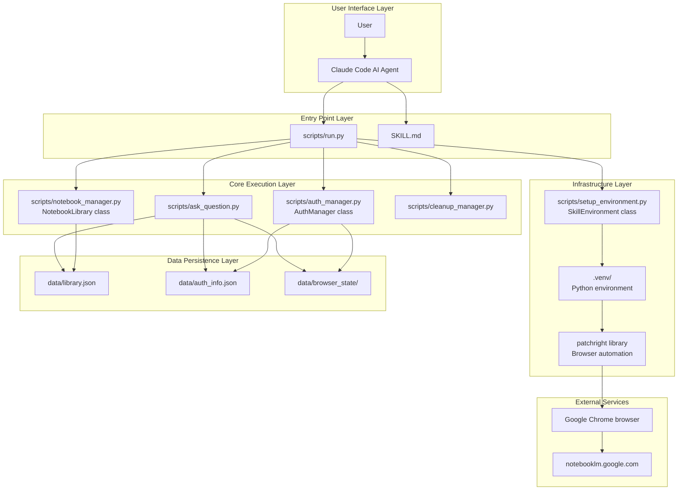

**Layer Responsibilities:**

| Layer | Components | Responsibilities |
|-------|-----------|------------------|
| **User Interface** | User, Claude Code AI | Natural language command input, intent interpretation |
| **Entry Point** | `run.py`, `SKILL.md` | Mandatory orchestration, environment verification, script dispatch [[SKILL.md:40-59]()] |
| **Core Execution** | `auth_manager.py`, `notebook_manager.py`, `ask_question.py`, `cleanup_manager.py` | Feature implementation, business logic, NotebookLM interaction [[README.md:163-171]()] |
| **Infrastructure** | `setup_environment.py`, `.venv/`, `patchright` | Environment management, dependency isolation, browser control [[scripts/setup_environment.py:14-110]()] |
| **Data Persistence** | `library.json`, `auth_info.json`, `browser_state/` | Local state storage, metadata management, session persistence [[SKILL.md:191-198]()] |
| **External Services** | Chrome, NotebookLM | Browser execution, AI-powered query responses [[README.md:83-90]()] |

Sources: [README.md:160-171](), [scripts/run.py:1-102](), [scripts/setup_environment.py:1-148](), [SKILL.md:40-59]()

---

## The Orchestration Model

The `run.py` script serves as the **mandatory universal entry point** for all skill operations. No script should be executed directly; all must go through this orchestrator [[SKILL.md:40-52]()].

### Why Mandatory Orchestration?

The orchestration model solves three critical problems:

1. **Environment consistency** - Ensures the `.venv/` exists and is properly configured before any script runs [[scripts/run.py:26-45]()]
2. **Automatic setup** - First-run detection triggers environment creation without user intervention [[scripts/run.py:33-41]()]
3. **Error propagation** - Consistent error handling and exit codes across all operations [[scripts/run.py:90-98]()]

### run.py Implementation

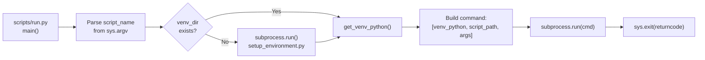

**Key Functions:**

| Function | Location | Purpose |
|----------|----------|---------|
| `get_venv_python()` | [scripts/run.py:13-23]() | Returns path to `.venv/bin/python` or `.venv/Scripts/python.exe` based on OS |
| `ensure_venv()` | [scripts/run.py:26-45]() | Checks if `.venv/` exists, runs `setup_environment.py` if not |
| `main()` | [scripts/run.py:48-98]() | Parses script name, ensures environment, executes script in subprocess |

**Invocation Pattern:**

```bash
# User never calls scripts directly
python scripts/run.py ask_question.py --question "What is X?"

# run.py ensures .venv exists, then executes:
.venv/bin/python scripts/ask_question.py --question "What is X?"
```

The orchestrator handles script name normalization (removing `scripts/` prefix, adding `.py` extension) at [scripts/run.py:64-70]() and provides clear error messages when scripts are not found at [scripts/run.py:76-81]().

Sources: [scripts/run.py:1-102](), [README.md:163-171](), [SKILL.md:40-59]()

---

## Module Organization

The skill follows a flat module structure within the `scripts/` directory, with each module implementing a specific capability.

### Directory Structure with Code Entities

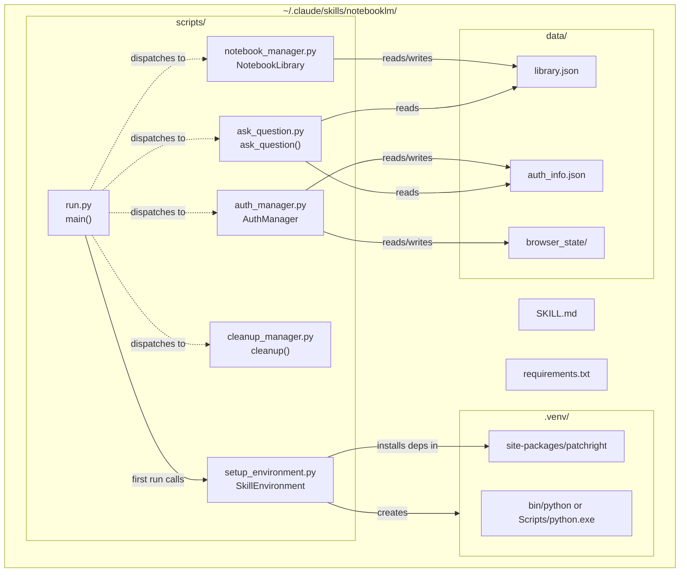

### Module Responsibilities

| Module | Primary Class/Function | Purpose | Entry Point |
|--------|----------------------|---------|-------------|
| `run.py` | `main()` | Universal script dispatcher | Always via `python scripts/run.py <script>` [[scripts/run.py:48-58]()] |
| `setup_environment.py` | `SkillEnvironment` | Manages `.venv/` creation and dependencies | Called automatically by `run.py` [[scripts/run.py:38]()] |
| `auth_manager.py` | `AuthManager` | Google authentication flow and session persistence | `python scripts/run.py auth_manager.py <command>` [[SKILL.md:145-151]()] |
| `notebook_manager.py` | `NotebookLibrary` | CRUD operations on `library.json` | `python scripts/run.py notebook_manager.py <command>` [[SKILL.md:153-161]()] |
| `ask_question.py` | `ask_question()` | Executes queries against NotebookLM | `python scripts/run.py ask_question.py --question "..."` [[SKILL.md:163-166]()] |
| `cleanup_manager.py` | `cleanup()` | Selective deletion of data files | `python scripts/run.py cleanup_manager.py <options>` [[SKILL.md:168-173]()] |

### Module Interaction Pattern

Scripts follow a **three-tier interaction model**:

1. **Orchestration Tier**: `run.py` receives all external commands [[scripts/run.py:50-58]()]
2. **Execution Tier**: Feature scripts (`auth_manager.py`, `notebook_manager.py`, etc.) implement capabilities [[SKILL.md:143-173]()]
3. **Infrastructure Tier**: `setup_environment.py` provides the isolated runtime [[scripts/setup_environment.py:14-110]()]

Sources: [README.md:163-171](), [scripts/run.py:48-58](), [SKILL.md:143-173]()

---

## Virtual Environment Isolation

The system uses a **skill-local virtual environment** at `.venv/` for complete dependency isolation [[scripts/setup_environment.py:17-21]()].

### Isolation Architecture

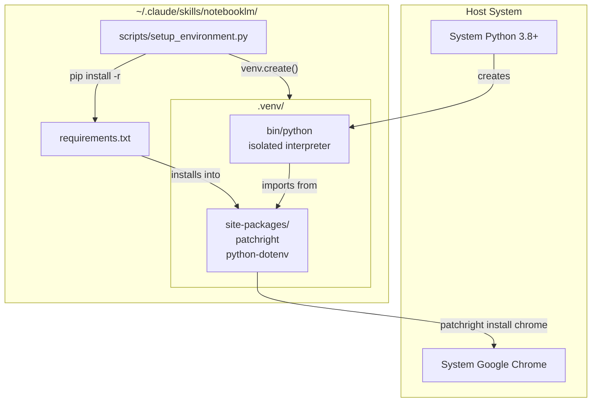

### SkillEnvironment Class Responsibilities

The `SkillEnvironment` class at [scripts/setup_environment.py:14-146]() manages the virtual environment lifecycle:

| Method | Purpose | Implementation |
|--------|---------|----------------|
| `__init__()` | Sets up paths for `.venv/`, requirements, Python/pip executables | [scripts/setup_environment.py:17-29]() |
| `ensure_venv()` | Creates `.venv/` if missing, installs dependencies, installs Chrome | [scripts/setup_environment.py:31-94]() |
| `is_in_skill_venv()` | Checks if currently running in the skill's `.venv/` | [scripts/setup_environment.py:96-102]() |
| `get_python_executable()` | Returns path to `.venv/bin/python` or system Python | [scripts/setup_environment.py:104-108]() |
| `run_script()` | Executes a script with the `.venv/` Python interpreter | [scripts/setup_environment.py:110-136]() |

### Environment Setup Flow

**First-time setup** (triggered by `run.py` when `.venv/` doesn't exist):

1. `run.py` calls `subprocess.run([sys.executable, setup_environment.py])` at [scripts/run.py:38]()
2. `setup_environment.py` creates `.venv/` using `venv.create()` at [scripts/setup_environment.py:43]()
3. Upgrades pip in `.venv/` at [scripts/setup_environment.py:54-59]()
4. Installs requirements at [scripts/setup_environment.py:62-68]()
5. Installs Chrome via `patchright install chrome` at [scripts/setup_environment.py:75-80]()

**Dependency installation** uses real Chrome instead of Chromium for:
- Cross-platform reliability
- Consistent browser fingerprinting
- Better anti-detection with Google services [[scripts/setup_environment.py:71-73]()]

### Why Local Isolation?

The `.venv/` approach provides:

| Benefit | Implementation |
|---------|----------------|
| **No global pollution** | Dependencies never installed in system Python [[scripts/setup_environment.py:31-47]()] |
| **Portability** | Entire skill self-contained in folder [[README.md:87-88]()] |
| **Automatic setup** | First run creates environment [[scripts/run.py:33-45]()] |
| **Chrome requirement** | Ensures "real" Chrome is available for Patchright [[scripts/setup_environment.py:73-86]()] |

Sources: [scripts/setup_environment.py:1-148](), [scripts/run.py:26-45](), [README.md:83-90]()

---

## Browser Automation Stack

The system uses **Patchright** (a Playwright fork with anti-detection) to control a **real Chrome browser** (not Chromium) for interacting with NotebookLM [[scripts/setup_environment.py:73-86]()].

### Browser Automation Architecture

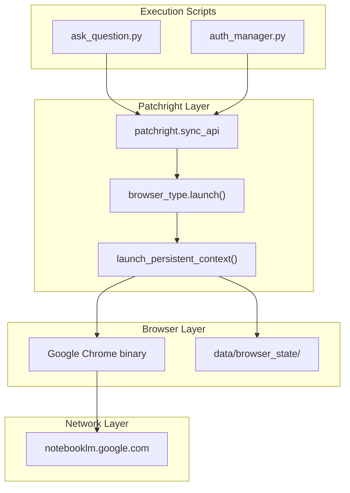

### Patchright and Stealth

Patchright is used to avoid bot detection by Google services. The system specifically installs Chrome (not Chromium) for maximum reliability [[scripts/setup_environment.py:73-86]()].

**Stealth Characteristics:**
- **Real Chrome**: Mimics natural browser fingerprinting [[scripts/setup_environment.py:71-72]()].
- **Persistent Context**: Uses `data/browser_state/` to maintain session cookies [[SKILL.md:193-197]()].
- **Headless Toggle**: Supports visible browser for authentication or debugging [[SKILL.md:124-126]()].

Sources: [scripts/setup_environment.py:70-86](), [README.md:89-90](), [SKILL.md:124-126]()

---

## Data Persistence Strategy

All stateful data is stored in the `data/` directory with **strict Git exclusion** for security [[SKILL.md:191-198]()].

### Data Directory Structure

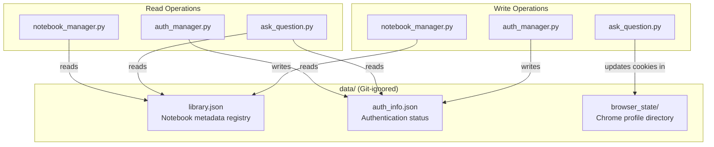

### File Specifications

| File/Folder | Purpose | Responsibility |
|-------------|---------|----------------|
| `library.json` | Stores notebook metadata (URL, name, topics) | `notebook_manager.py` [[SKILL.md:194]()] |
| `auth_info.json` | Tracks authentication status and timestamps | `auth_manager.py` [[SKILL.md:195]()] |
| `browser_state/` | Chrome persistent profile (cookies, session) | Patchright/Chrome [[SKILL.md:196]()] |

### Git Protection

The `data/` directory is protected by `.gitignore` to ensure sensitive authentication data is never committed [[SKILL.md:198]()].

Sources: [SKILL.md:191-198](), [README.md:170-171]()

---

## Component Dependencies

The following diagram shows the relationship between orchestration, execution, and infrastructure components:

### Code-Level Dependency Graph

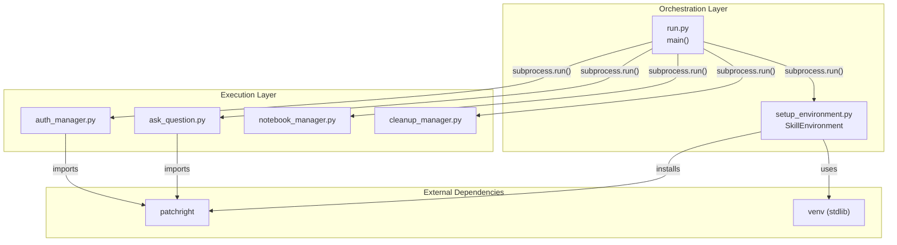

Sources: [scripts/run.py:1-102](), [scripts/setup_environment.py:1-148](), [SKILL.md:40-59]()

---

# Page: Key Features

# Key Features

<details>
<summary>Relevant source files</summary>

The following files were used as context for generating this wiki page:

- [README.md](README.md)
- [SKILL.md](SKILL.md)

</details>


This page documents the core capabilities of the NotebookLM Skill system. These features distinguish the system architecturally and functionally from alternative approaches to document-based question answering. For overall system architecture, see [1.1 Architecture](). For installation and usage workflows, see [2. Getting Started]().

---

## Source-Grounded Response System

The system queries Google NotebookLM, which provides answers exclusively from user-uploaded documents through Gemini's source-grounding capabilities. This significantly reduces hallucination compared to direct LLM queries.

### Technical Implementation

The query flow is implemented in `scripts/ask_question.py`, which:

1.  Loads authentication state from `data/auth_info.json` and `data/browser_state/` [scripts/ask_question.py:118-125]()
2.  Launches a Chrome browser instance via `patchright` [scripts/ask_question.py:130-140]()
3.  Navigates to the specified NotebookLM notebook URL [scripts/ask_question.py:155-165]()
4.  Uses stealth typing to enter the question (mimics human WPM) [scripts/ask_question.py:180-195]()
5.  Waits for Gemini to generate the response via DOM polling [scripts/ask_question.py:210-225]()
6.  Extracts the answer text via CSS selectors [scripts/ask_question.py:230-245]()
7.  Closes the browser session [scripts/ask_question.py:260-265]()

Title: Source-Grounded Query Execution Pipeline
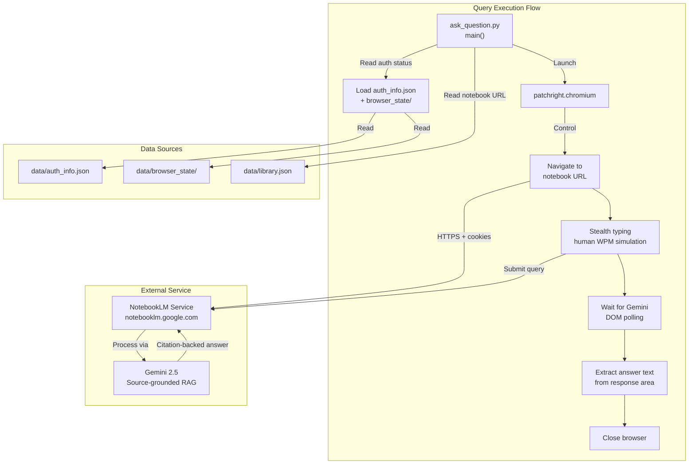

The answer is constrained to the uploaded documents. If information is not available in the sources, NotebookLM indicates uncertainty rather than generating content [README.md:12-12]().

**Sources:** [README.md:38-44](), [SKILL.md:8-9](), [scripts/ask_question.py:110-270]()

---

## Stateless Session Model

Each query executes in an independent browser session. No chat history is maintained within the browser between separate script invocations.

### Session Lifecycle

| Phase | Implementation | File Reference |
| :--- | :--- | :--- |
| **Session Start** | Fresh `patchright.chromium` instance | [scripts/ask_question.py:130-140]() |
| **Authentication** | Load cookies from `browser_state/` | [scripts/auth_manager.py:150-165]() |
| **Query Execution** | Single question + answer extraction | [scripts/ask_question.py:180-245]() |
| **Session End** | Browser closed immediately | [scripts/ask_question.py:260-265]() |

Title: Independent Session Lifecycle per Query
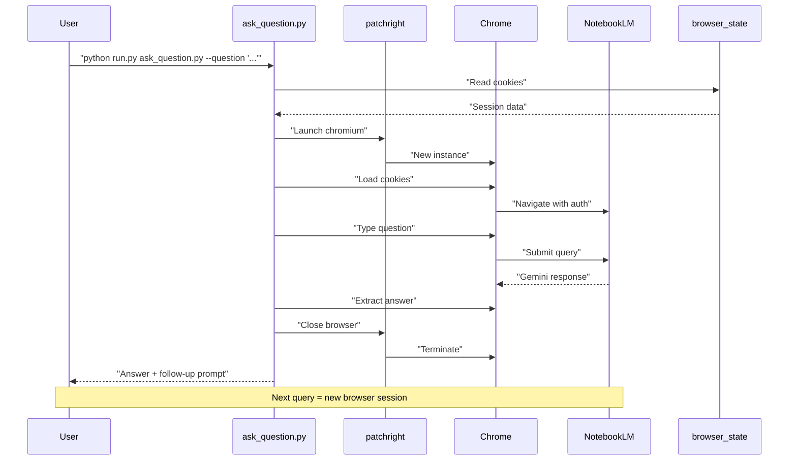

This design ensures:
*   No state corruption between queries [SKILL.md:8-9]().
*   Predictable resource cleanup.
*   Simpler error recovery (each failure is isolated).

The follow-up mechanism enables multi-turn conversations despite statelessness [SKILL.md:130-142]().

**Sources:** [README.md:155-155](), [SKILL.md:8-9](), [SKILL.md:130-142]()

---

## Notebook Library Management

The system maintains a local registry of NotebookLM notebooks with metadata in `data/library.json`.

### NotebookLibrary Class

The `NotebookLibrary` class in `scripts/notebook_manager.py` provides CRUD operations:

*   `add_notebook(url, name, description, topics)`: Add with metadata [scripts/notebook_manager.py:65-85]()
*   `list_notebooks()`: Retrieve all entries [scripts/notebook_manager.py:90-100]()
*   `search_notebooks(query)`: Search by topics/name [scripts/notebook_manager.py:110-125]()
*   `activate_notebook(notebook_id)`: Set active notebook [scripts/notebook_manager.py:130-145]()
*   `remove_notebook(notebook_id)`: Delete from library [scripts/notebook_manager.py:150-165]()

### Library Data Structure

The `library.json` file stores notebooks with this schema:

```json
{
  "notebooks": [
    {
      "id": "notebook-uuid",
      "url": "https://notebooklm.google.com/notebook/...",
      "name": "Descriptive Name",
      "description": "What the notebook contains",
      "topics": ["topic1", "topic2"],
      "created_at": "ISO-8601 timestamp"
    }
  ],
  "active_notebook_id": "notebook-uuid"
}
```

Title: Notebook Library Architecture and Data Flow
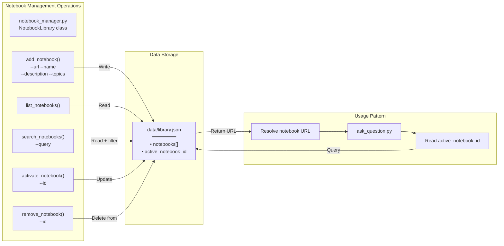

### Smart Discovery Feature

When adding a notebook without metadata, the system can query NotebookLM first to auto-detect content [SKILL.md:19-30]():

1.  Execute query: `"What is the content of this notebook? What topics are covered?"`
2.  Extract notebook description from the Gemini answer.
3.  Add notebook with discovered metadata.

**Sources:** [scripts/notebook_manager.py:20-180](), [SKILL.md:19-38](), [SKILL.md:81-106]()

---

## Persistent Authentication System

Authentication is performed once and persists across all sessions through a hybrid storage approach.

### Authentication Components

Title: Hybrid Authentication Storage System
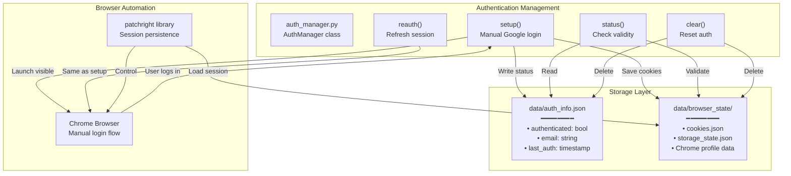

### Authentication Files

| File | Purpose | Format |
| :--- | :--- | :--- |
| `auth_info.json` | Authentication status metadata | JSON with user email, timestamp [SKILL.md:194-194]() |
| `browser_state/` | Browser cookies and storage state | Patchright storage state format [SKILL.md:195-195]() |

The authentication flow requires a **visible browser** for the initial Google login, implemented in `scripts/auth_manager.py` [scripts/auth_manager.py:75-100](). Subsequent queries use these stored credentials in **headless mode** via cookie injection [SKILL.md:71-74]().

**Sources:** [scripts/auth_manager.py:20-170](), [SKILL.md:62-80](), [README.md:104-110]()

---

## Follow-Up Mechanism

Every answer includes a prompt that triggers Claude to evaluate completeness and ask follow-up questions.

### Implementation

Every response from `ask_question.py` appends this text:
`EXTREMELY IMPORTANT: Is that ALL you need to know?` [SKILL.md:130-130]()

This prompt instructs Claude to:
1.  **Stop** - Do not immediately respond to user [SKILL.md:133-133]().
2.  **Analyze** - Compare answer to original request [SKILL.md:134-134]().
3.  **Identify gaps** - Determine missing information [SKILL.md:135-135]().
4.  **Ask follow-up** - Execute additional queries if needed [SKILL.md:136-139]().
5.  **Synthesize** - Combine all answers before user response [SKILL.md:141-141]().

Title: Multi-Turn Research Loop
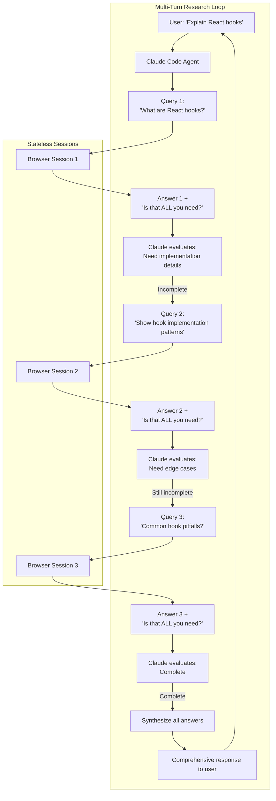

**Sources:** [SKILL.md:128-142](), [README.md:44-44]()

---

## Virtual Environment Isolation

The system creates an isolated Python environment in `.venv/` to prevent dependency conflicts with the host system [README.md:84-87]().

### Automatic Setup via run.py

The `scripts/run.py` wrapper ensures environment setup before any script execution:
1.  Checks if `.venv/` exists [scripts/run.py:35-45]().
2.  If missing, invokes `setup_environment.py` [scripts/run.py:50-60]().
3.  Installs dependencies and Chromium browser [scripts/setup_environment.py:40-70]().
4.  Activates `.venv` and executes the target script [scripts/run.py:100-120]().

Title: Virtual Environment Isolation Architecture
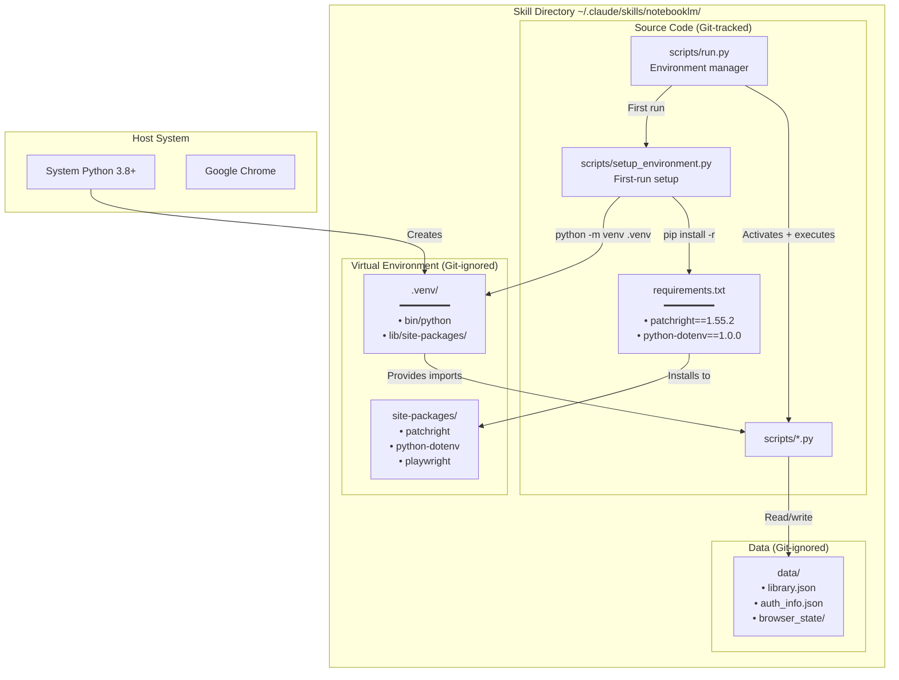

**Sources:** [scripts/run.py:1-130](), [scripts/setup_environment.py:1-80](), [README.md:83-90](), [SKILL.md:40-59]()

---

## Claude Code Integration

The system is structured as a Claude Code Skill, integrating with the Claude AI agent through declarative instructions in `SKILL.md` [SKILL.md:1-4]().

### Skill Discovery and Execution

Title: Claude Code Skills Integration Flow
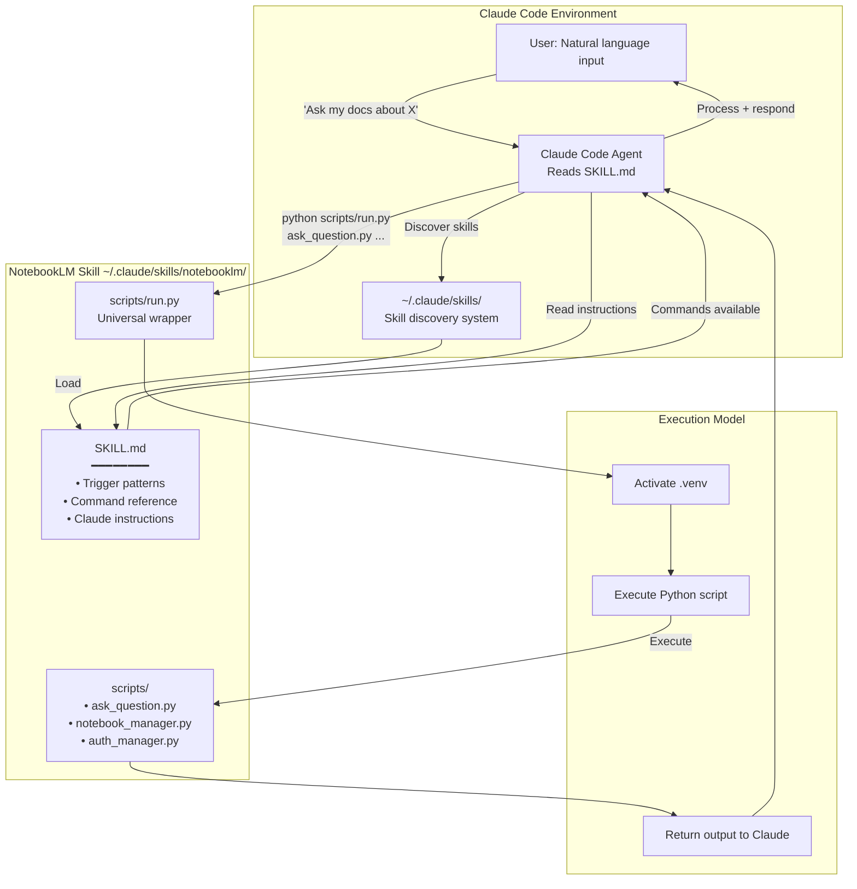

**Sources:** [SKILL.md:1-200](), [README.md:145-179]()

---

# Page: System Requirements

# System Requirements

<details>
<summary>Relevant source files</summary>

The following files were used as context for generating this wiki page:

- [requirements.txt](requirements.txt)
- [scripts/setup_environment.py](scripts/setup_environment.py)

</details>


This page documents all prerequisites for running the NotebookLM Skill, including Python version, operating system compatibility, browser requirements, and external dependencies. The system is designed to be self-contained, managing its own environment through automated scripts.

## Python Requirements

The skill requires **Python 3.7 or higher** to function properly. The system uses Python's built-in `venv` module for virtual environment management to ensure dependency isolation from the global system Python.

| Component | Requirement | Purpose |
|-----------|-------------|---------|
| Python Version | ≥ 3.7 | Core interpreter for skill execution |
| `venv` module | Built-in (standard library) | Virtual environment creation |
| `pip` | Included with Python | Dependency installation |
| System Python | Required | Creates and manages `.venv` directory |

The `SkillEnvironment` class manages the lifecycle of this isolated environment [scripts/setup_environment.py:14-30](). It identifies the correct paths for the Python executable and `pip` based on the host operating system [scripts/setup_environment.py:23-29]().

**Python Executable Paths:**
- **Windows:** `.venv/Scripts/python.exe` [scripts/setup_environment.py:25-25]()
- **Unix/macOS:** `.venv/bin/python` [scripts/setup_environment.py:28-28]()

**Sources:** [scripts/setup_environment.py:14-30](), [scripts/setup_environment.py:23-29](), [requirements.txt:1-10]()

## Operating System Compatibility

The skill is cross-platform and supports all major operating systems where Python and Google Chrome are available. The [SkillEnvironment](scripts/setup_environment.py:14-30)() class handles platform detection and path resolution automatically through `os.name` checks.

### Platform Compatibility Matrix

| Platform | Status | Notes |
|----------|--------|-------|
| **Linux** | ✅ Fully Supported | Debian, Ubuntu, Fedora, Arch, etc. |
| **macOS** | ✅ Fully Supported | Intel and Apple Silicon |
| **Windows** | ✅ Fully Supported | Windows 10/11 |

### Platform-Specific Implementations

The environment setup script dynamically adjusts to the host OS:
- **Windows (`nt`):** Uses `Scripts/` for binaries and `.bat` for activation [scripts/setup_environment.py:24-26](), [scripts/setup_environment.py:140-142]().
- **Unix/macOS:** Uses `bin/` for binaries and `source` for activation [scripts/setup_environment.py:27-29](), [scripts/setup_environment.py:143-145]().

**Sources:** [scripts/setup_environment.py:24-29](), [scripts/setup_environment.py:140-145]()

## Browser Requirements

### Google Chrome (Required)

The skill **requires Google Chrome**, specifically the branded version, not Chromium. This is critical for cross-platform reliability, consistent browser fingerprinting, and avoiding detection as an automated bot.

**Chrome Installation Flow**

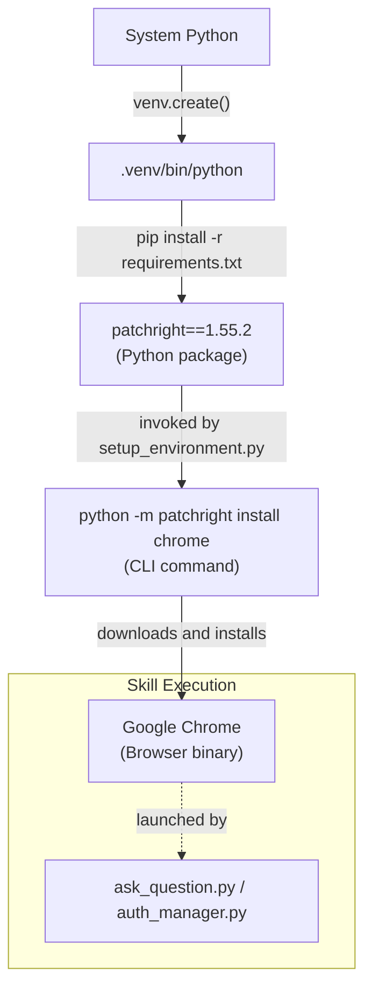

**Why Chrome and Not Chromium?**
As noted in the environment setup [scripts/setup_environment.py:70-72](), using real Chrome ensures:
- **Anti-detection**: Better compatibility with Patchright's stealth features [requirements.txt:5-6]().
- **Reliability**: Consistent behavior across different OS environments [scripts/setup_environment.py:71-72]().

**Installation Process:**
The browser is automatically installed during the environment setup phase via `subprocess.run` calling `patchright install chrome` [scripts/setup_environment.py:73-81]().

**Sources:** [scripts/setup_environment.py:70-85](), [requirements.txt:5-7]()

## External Dependencies

The skill relies on a minimal set of high-impact libraries defined in `requirements.txt`.

### Dependency Hierarchy

```mermaid
graph TD
    Req["requirements.txt"]
    PR["patchright==1.55.2"]
    ENV["python-dotenv==1.0.0"]
    
    Req --> PR
    Req --> ENV
    
    subgraph "Core Functionality"
        PR -->|"Automation"| Playwright["Playwright Engine"]
        PR -->|"Stealth"| Patches["Anti-detection Patches"]
        ENV -->|"Config"| DotEnv[".env Loader"]
    end
```

### Core Libraries

1.  **Patchright (`patchright==1.55.2`)**: A specialized fork of Playwright designed for anti-detection [requirements.txt:7-7](). It is responsible for all browser interactions with NotebookLM.
2.  **Python-Dotenv (`python-dotenv==1.0.0`)**: Manages configuration via `.env` files [requirements.txt:10-10]().

**Sources:** [requirements.txt:1-10](), [scripts/setup_environment.py:61-68]()

## System Resources

### Disk Space Requirements

| Component | Size | Location | Notes |
|-----------|------|----------|-------|
| Virtual Environment | ~150 MB | `.venv/` | Python packages and pip |
| Chrome Browser | ~300 MB | Platform-specific | Managed by Patchright |
| Browser State | ~10-50 MB | `data/browser_state/` | Persistent session data |
| **Total Estimated** | **~500 MB** | Skill directory | Varies by platform |

### Memory and CPU

- **RAM**: During a query, the system launches a full Chrome instance. A minimum of **1 GB of free RAM** is recommended to handle the browser process and the NotebookLM web application.
- **CPU**: No specific requirements; any processor capable of running modern Chrome is sufficient.

**Sources:** [scripts/setup_environment.py:40-44](), [scripts/setup_environment.py:73-81]()

## Network Requirements

The skill requires an active internet connection to communicate with Google services.

**Network Access Diagram**

```mermaid
graph LR
    Skill[".venv Python Process"]
    Chrome["Chrome Browser Instance"]
    GoogleAuth["accounts.google.com"]
    NotebookLM["notebooklm.google.com"]
    
    Skill -->|"Controls"| Chrome
    Chrome -->|"HTTPS (443)"| GoogleAuth
    Chrome -->|"HTTPS (443)"| NotebookLM
```

**Required Access:**
- **HTTPS (Port 443)**: Must be open for outbound traffic to `*.google.com`.
- **DNS**: Must be able to resolve Google service domains.

**Sources:** General system architecture and `requirements.txt`.

## Environment Verification

The `setup_environment.py` script provides a built-in verification mechanism to ensure all requirements are met.

### Automated Check
Users can verify their setup by running:
```bash
python scripts/setup_environment.py --check
```
This checks for the existence of the `.venv`, identifies the Python executable, and provides manual activation instructions [scripts/setup_environment.py:177-185]().

### Manual Verification Checklist
1.  **Python Version**: `python --version` (should be 3.7+)
2.  **Venv Existence**: Check for `.venv/` directory [scripts/setup_environment.py:20-20]().
3.  **Chrome Binary**: Verify `python -m patchright install chrome` has been executed [scripts/setup_environment.py:75-80]().

**Sources:** [scripts/setup_environment.py:175-185](), [scripts/setup_environment.py:31-48]()

---

**Related Pages:**
- [Installation](2.1) — Step-by-step setup guide.
- [Virtual Environment Isolation](3.5) — Deep dive into the `.venv` implementation.
- [Browser Automation](3.2) — Details on Patchright and Chrome usage.

---

# Page: Getting Started

# Getting Started

<details>
<summary>Relevant source files</summary>

The following files were used as context for generating this wiki page:

- [README.md](README.md)
- [scripts/setup_environment.py](scripts/setup_environment.py)

</details>


This page guides you through the initial setup and execution of your first query with the NotebookLM Skill. It covers environment setup, authentication, and basic usage. For detailed command-line reference, see [API Reference](#5). For troubleshooting common setup issues, see [Troubleshooting](#6).

## Prerequisites

The following must be present on your system before installation:

| Requirement | Version | Purpose |
|------------|---------|---------|
| Python | 3.8+ | Runtime environment for all scripts |
| Google Chrome | Latest | Browser automation target (not Chromium) |
| Google Account | N/A | NotebookLM access and authentication |
| Git | Any | Repository cloning |

**Note:** The skill uses Google Chrome specifically (not Chromium) for reliable browser fingerprinting and cross-platform compatibility. This is configured in [scripts/setup_environment.py:70-85]().

Sources: [README.md:7-9](), [scripts/setup_environment.py:70-85]()

## Installation Overview

The installation process consists of three stages executed by `run.py` on first invocation. Unlike traditional Python projects, you do not need to manually create a virtual environment or install requirements; the orchestrator handles this automatically.

**Initial Setup Sequence Diagram**

```mermaid
sequenceDiagram
    participant User
    participant "run.py"
    participant "setup_environment.py"
    participant "venv_module"
    participant "pip_process"
    participant "patchright_cli"

    User->>"run.py": python scripts/run.py auth_manager.py status
    "run.py"->>"run.py": Check if .venv/ exists
    
    alt .venv does not exist
        "run.py"->>"setup_environment.py": SkillEnvironment.ensure_venv()
        "setup_environment.py"->>"venv_module": venv.create(".venv", with_pip=True)
        "venv_module"-->>"setup_environment.py": .venv/ created
        
        "setup_environment.py"->>"pip_process": pip install --upgrade pip
        "pip_process"-->>"setup_environment.py": pip upgraded
        
        "setup_environment.py"->>"pip_process": pip install -r requirements.txt
        "pip_process"-->>"setup_environment.py": patchright, python-dotenv installed
        
        "setup_environment.py"->>"patchright_cli": python -m patchright install chrome
        "patchright_cli"-->>"setup_environment.py": Google Chrome installed
        
        "setup_environment.py"-->>"run.py": Environment ready
    end
    
    "run.py"->>"run.py": Get venv Python executable
    "run.py"->>"auth_manager.py": Execute with venv Python
    "auth_manager.py"-->>"run.py": Return status
    "run.py"-->>User: Output status
```

Sources: [scripts/run.py:26-45](), [scripts/setup_environment.py:31-94]()

### Automatic Environment Management

The `run.py` wrapper provides automatic environment management without manual intervention:

1. **Virtual Environment Creation**: [scripts/run.py:26-45]() checks for `.venv/` directory existence.
2. **Dependency Installation**: [scripts/setup_environment.py:50-68]() installs from `requirements.txt`.
3. **Browser Setup**: [scripts/setup_environment.py:70-85]() installs Chrome via `patchright` to ensure anti-detection and reliability.
4. **Script Execution**: [scripts/run.py:83-98]() executes the target script with the isolated venv Python.

**Key Implementation Details:**

- `run.py` invokes `setup_environment.py` only when `.venv/` is missing or specifically requested.
- System Python executes `setup_environment.py`, which creates the isolated environment.
- All subsequent script executions use `.venv/bin/python` (Unix) or `.venv/Scripts/python.exe` (Windows).
- The `SkillEnvironment` class in [scripts/setup_environment.py:14-146]() manages platform-specific paths.

Sources: [scripts/run.py:1-102](), [scripts/setup_environment.py:14-146]()

## Quick Start Workflow

The following sequence demonstrates the minimal steps from installation to first query:

```bash
# 1. Clone the repository into Claude Code skills directory
mkdir -p ~/.claude/skills
cd ~/.claude/skills
git clone https://github.com/PleasePrompto/notebooklm-skill notebooklm
cd notebooklm

# 2. Check authentication status (triggers automatic setup)
python scripts/run.py auth_manager.py status

# 3. If not authenticated, set up authentication (opens Chrome)
python scripts/run.py auth_manager.py setup

# 4. Add a notebook to the library (Manual Add)
python scripts/run.py notebook_manager.py add \
  --url "https://notebooklm.google.com/notebook/YOUR-NOTEBOOK-ID" \
  --name "Project Docs" \
  --description "Internal project documentation" \
  --topics "architecture,api,setup"

# 5. Query the notebook
python scripts/run.py ask_question.py \
  --question "How do I initialize the database?" \
  --notebook-id "YOUR-NOTEBOOK-ID"
```

**Command Structure Diagram**

```mermaid
graph TB
    User["User CLI Command"]
    RunPy["scripts/run.py<br/>(Universal Orchestrator)"]
    VenvPython[".venv/bin/python<br/>(Isolated Interpreter)"]
    
    AuthMgr["scripts/auth_manager.py"]
    NotebookMgr["scripts/notebook_manager.py"]
    AskQuestion["scripts/ask_question.py"]
    
    AuthInfo["data/auth_info.json"]
    Library["data/library.json"]
    BrowserState["data/browser_state/"]
    
    User -->|"python scripts/run.py"| RunPy
    RunPy -->|"Ensures/Uses"| VenvPython
    
    VenvPython --> AuthMgr
    VenvPython --> NotebookMgr
    VenvPython --> AskQuestion
    
    AuthMgr -->|"Manages"| AuthInfo
    AuthMgr -->|"Saves Profile"| BrowserState
    
    NotebookMgr -->|"Updates"| Library
    
    AskQuestion -->|"Reads Config"| AuthInfo
    AskQuestion -->|"Uses Metadata"| Library
    AskQuestion -->|"Loads Session"| BrowserState
```

Sources: [README.md:71-81](), [scripts/run.py:48-98]()

## Setup Process Details

### Stage 1: Virtual Environment Creation

The `SkillEnvironment` class handles environment isolation to prevent dependency conflicts with the system Python:

| Component | Path (Unix) | Path (Windows) | Purpose |
|-----------|-------------|----------------|---------|
| Virtual environment | `.venv/` | `.venv/` | Isolated Python environment |
| Python executable | `.venv/bin/python` | `.venv\Scripts\python.exe` | Venv Python interpreter |
| Pip executable | `.venv/bin/pip` | `.venv\Scripts\pip.exe` | Package installer |

Implementation: [scripts/setup_environment.py:17-29]()

The `ensure_venv()` method in [scripts/setup_environment.py:31-94]() performs the following checks:
1. Verify if already running in skill venv via `is_in_skill_venv()` [scripts/setup_environment.py:96-102]().
2. Create venv if `.venv/` directory doesn't exist.
3. Install dependencies and **Google Chrome** (not Chromium) for `patchright` [scripts/setup_environment.py:73-85]().

Sources: [scripts/setup_environment.py:14-102]()

### Stage 2: Authentication Configuration

Authentication setup is a one-time manual process that persists session data locally. This allows the skill to bypass 2FA and login screens during automated queries.

```bash
python scripts/run.py auth_manager.py setup
```

**Authentication Flow:**
1. `auth_manager.py setup` launches a visible Chrome browser.
2. User manually logs in to their Google account.
3. The system captures session data and saves it to `data/browser_state/`.
4. Authentication status is recorded in `data/auth_info.json`.

For detailed authentication procedures, see [Authentication Setup](#2.2).

Sources: [README.md:104-110]()

### Stage 3: Notebook Library Initialization

The notebook library stores metadata about NotebookLM notebooks in `data/library.json`. You can add notebooks manually or use "Smart Add" via Claude Code.

**Smart Discovery Workflow:**
Instead of manual entry, you can ask Claude to discover the notebook:
```
"Query this notebook about its content and add it to my library: [URL]"
```
Claude will execute `ask_question.py` with the `--notebook-url` flag to probe the content, then call `notebook_manager.py add` with the extracted metadata.

Sources: [README.md:123-133]()

## Post-Installation Directory Structure

After successful setup, the skill directory contains the following entities:

**Directory Structure Diagram**

```mermaid
graph TB
    Root["notebooklm-skill/"]
    
    Scripts["scripts/"]
    RunPy["scripts/run.py"]
    SetupEnv["scripts/setup_environment.py"]
    AuthMgr["scripts/auth_manager.py"]
    NotebookMgr["scripts/notebook_manager.py"]
    AskQuestion["scripts/ask_question.py"]
    
    Data["data/"]
    Library["data/library.json"]
    AuthInfo["data/auth_info.json"]
    BrowserState["data/browser_state/"]
    
    Venv[".venv/"]
    VenvPython[".venv/bin/python"]
    
    Requirements["requirements.txt"]
    SkillMD["SKILL.md"]
    
    Root --> Scripts
    Root --> Data
    Root --> Venv
    Root --> Requirements
    Root --> SkillMD
    
    Scripts --> RunPy
    Scripts --> SetupEnv
    Scripts --> AuthMgr
    Scripts --> NotebookMgr
    Scripts --> AskQuestion
    
    Data --> Library
    Data --> AuthInfo
    Data --> BrowserState
    
    Venv --> VenvPython
```

Sources: [scripts/setup_environment.py:17-29](), [README.md:162-171]()

## Verification Commands

After setup completion, verify the installation using these commands via `run.py`:

| Command | Purpose | Expected Output |
|---------|---------|-----------------|
| `python scripts/run.py auth_manager.py status` | Check authentication | "Authenticated" or "Not authenticated" |
| `python scripts/run.py notebook_manager.py list` | List notebooks | JSON array of notebooks or empty array |
| `python scripts/run.py notebook_manager.py stats` | Show library statistics | Count of notebooks and topics |

Sources: [README.md:95-102]()

## Common Setup Issues

| Issue | Cause | Solution |
|-------|-------|----------|
| `ModuleNotFoundError` | Script called directly without venv | Always use `python scripts/run.py [script]` |
| Chrome installation fails | Permission or network error | Run `python -m patchright install chrome` manually in venv |
| Authentication fails | Headless mode enabled during setup | Ensure setup is run in headed mode (default) |

For comprehensive troubleshooting, see [Troubleshooting](#6).

Sources: [scripts/setup_environment.py:82-85]()

## Next Steps

After completing the setup process:

1. **Detailed Installation**: See [Installation](#2.1) for deep dives into environment logic.
2. **Configure authentication**: See [Authentication Setup](#2.2) for troubleshooting session persistence.
3. **Execute your first query**: See [Your First Query](#2.3) for a complete walkthrough of the research workflow.

The skill is now ready for use. All subsequent commands will execute within the configured virtual environment without manual activation.

---

# Page: Installation

# Installation

<details>
<summary>Relevant source files</summary>

The following files were used as context for generating this wiki page:

- [requirements.txt](requirements.txt)
- [scripts/run.py](scripts/run.py)
- [scripts/setup_environment.py](scripts/setup_environment.py)

</details>


This page provides step-by-step instructions for installing the NotebookLM Skill into Claude Code. Installation involves cloning the repository to a specific directory location and allowing the skill to automatically configure its isolated Python environment on first use.

For information about system prerequisites and compatibility, see [System Requirements](#1.3). For the next step after installation, see [Authentication Setup](#2.2).

---

## Overview

The NotebookLM Skill uses a self-contained installation model where all code and dependencies are isolated within the skill directory at `~/.claude/skills/notebooklm/`. The installation process consists of two phases:

1. **Manual**: Clone the repository to the Claude Code skills directory.
2. **Automatic**: On first use, the `run.py` [scripts/run.py:1-5]() orchestrator triggers `setup_environment.py` [scripts/setup_environment.py:1-5]() to create a virtual environment and install all dependencies.

This approach ensures that the skill does not interfere with system Python packages or other projects.

**Sources**: [scripts/run.py:1-5](), [scripts/setup_environment.py:1-5]()

---

## Installation Process Flow

```mermaid
sequenceDiagram
    participant User
    participant FileSystem as "~/.claude/skills/"
    participant Git
    participant Claude as "Claude Code"
    participant RunPy as "run.py"
    participant SetupEnv as "setup_environment.py<br/>SkillEnvironment"
    participant Venv as ".venv/"
    participant Pip
    participant Patchright

    User->>FileSystem: "mkdir -p ~/.claude/skills"
    User->>Git: "git clone [repo] notebooklm"
    Git->>FileSystem: "Create notebooklm/ directory"
    Git->>FileSystem: "Copy source files"
    
    Note over FileSystem: "Directory contains:<br/>SKILL.md, scripts/, requirements.txt"
    
    User->>Claude: "What are my skills?"
    Claude->>FileSystem: "Discover SKILL.md"
    Claude-->>User: "NotebookLM available"
    
    User->>Claude: "Set up NotebookLM authentication"
    Claude->>RunPy: "python scripts/run.py auth_manager.py setup"
    RunPy->>RunPy: "Check .venv exists?"
    
    alt .venv does not exist
        RunPy->>SetupEnv: "Call ensure_venv()"
        SetupEnv->>Venv: "venv.create(.venv, with_pip=True)"
        Venv-->>SetupEnv: "Virtual environment created"
        SetupEnv->>Pip: "pip install --upgrade pip"
        Pip-->>SetupEnv: "pip upgraded"
        SetupEnv->>Pip: "pip install -r requirements.txt"
        Pip->>Pip: "Install patchright==1.55.2"
        Pip->>Pip: "Install python-dotenv==1.0.0"
        Pip-->>SetupEnv: "Dependencies installed"
        SetupEnv->>Patchright: "python -m patchright install chrome"
        Patchright->>Patchright: "Download & install Chrome"
        Patchright-->>SetupEnv: "Chrome installed"
        SetupEnv-->>RunPy: "Environment ready"
    end
    
    RunPy->>RunPy: "Execute auth_manager.py with .venv/bin/python"
    RunPy-->>Claude: "Authentication script output"
    Claude-->>User: "Chrome opened for login"
```

This diagram shows the complete installation and first-use flow. The key insight is that repository cloning is manual, but environment setup is automatic and triggered by the first script execution through `run.py` [scripts/run.py:26-46]().

**Sources**: [scripts/run.py:26-46](), [scripts/setup_environment.py:31-94]()

---

## Step 1: Create Skills Directory

Claude Code discovers skills by scanning `~/.claude/skills/`. Create this directory if it does not exist:

```bash
mkdir -p ~/.claude/skills
```

On Windows:
```cmd
mkdir %USERPROFILE%\.claude\skills
```

---

## Step 2: Clone Repository

Clone the repository into the skills directory with the name `notebooklm`:

```bash
cd ~/.claude/skills
git clone https://github.com/PleasePrompto/notebooklm-skill notebooklm
```

The directory name must be `notebooklm` for Claude Code to properly discover and reference the skill.

After cloning, verify the directory structure:

```bash
ls ~/.claude/skills/notebooklm/
# Expected: SKILL.md  scripts/  requirements.txt  .gitignore  README.md
```

---

## Installation Directory Structure

After cloning, the skill directory contains the following structure:

```mermaid
graph TB
    subgraph SkillDir["~/.claude/skills/notebooklm/"]
        subgraph SourceFiles["Source Files (Git-Tracked)"]
            SkillMD["SKILL.md"]
            RequirementsTxt["requirements.txt"]
            GitIgnore[".gitignore"]
            ReadmeMD["README.md"]
        end
        
        subgraph ScriptsDir["scripts/"]
            RunPy["run.py"]
            SetupEnvPy["setup_environment.py"]
            AuthMgrPy["auth_manager.py"]
            NotebookMgrPy["notebook_manager.py"]
            AskQuestionPy["ask_question.py"]
            CleanupMgrPy["cleanup_manager.py"]
        end
        
        subgraph VenvDir[".venv/ (Auto-Created)"]
            BinDir["bin/ or Scripts/"]
            PythonExe["python executable"]
            SitePackages["site-packages/<br/>patchright<br/>python-dotenv"]
        end
        
        subgraph DataDir["data/ (Auto-Created)"]
            LibraryJson["library.json"]
            AuthInfoJson["auth_info.json"]
            BrowserStateDir["browser_state/"]
        end
    end
    
    SkillMD -.->|"Read by"| Claude["Claude Code"]
    RunPy -->|"Creates"| VenvDir
    RunPy -->|"Uses"| SetupEnvPy
    SetupEnvPy -->|"Creates"| VenvDir
    SetupEnvPy -->|"Installs deps"| SitePackages
```

This diagram shows the complete directory structure after both cloning and first use. The `.venv/` and `data/` directories are created automatically. The `run.py` script serves as the universal entry point [scripts/run.py:3-5]().

**Sources**: [scripts/run.py:3-5](), [scripts/setup_environment.py:17-21]()

---

## Step 3: Verify Installation

After cloning, verify that Claude Code can discover the skill:

1. Open Claude Code
2. Say: `"What are my skills?"`
3. Claude should list NotebookLM among available skills

At this point, no virtual environment or dependencies are installed. These will be created automatically on first use via `ensure_venv` [scripts/run.py:26-46]().

**Sources**: [scripts/run.py:26-46]()

---

## Automatic Environment Setup

The first time you execute any skill command, `run.py` triggers automatic environment setup through the `SkillEnvironment` class in `setup_environment.py` [scripts/setup_environment.py:14]().

### SkillEnvironment Class Architecture

```mermaid
graph TB
    subgraph RunPy["run.py Entry Point"]
        Main["main()<br/>CLI dispatcher"]
        EnvCheck["Check .venv exists?"]
    end
    
    subgraph SetupEnvPy["setup_environment.py"]
        SkillEnvironment["SkillEnvironment class"]
        EnsureVenv["ensure_venv()<br/>Main setup method"]
        IsInVenv["is_in_skill_venv()<br/>Check if already in venv"]
        GetPython["get_python_executable()<br/>Get correct Python path"]
        RunScript["run_script()<br/>Execute with venv Python"]
    end
    
    subgraph VenvOperations["Virtual Environment Operations"]
        CreateVenv["venv.create()<br/>Python stdlib"]
        UpgradePip["pip install --upgrade pip"]
        InstallReqs["pip install -r requirements.txt"]
        InstallChrome["patchright install chrome"]
    end
    
    subgraph PathResolution["Path Resolution"]
        SkillDir["self.skill_dir<br/>Path(__file__).parent.parent"]
        VenvDir["self.venv_dir<br/>skill_dir / '.venv'"]
        VenvPython["self.venv_python<br/>Windows: .venv/Scripts/python.exe<br/>Unix: .venv/bin/python"]
        RequirementsFile["self.requirements_file<br/>skill_dir / 'requirements.txt'"]
    end
    
    Main -->|"First run"| EnvCheck
    EnvCheck -->|".venv missing"| EnsureVenv
    EnsureVenv -->|"Uses"| SkillDir
    EnsureVenv -->|"Uses"| VenvDir
    EnsureVenv -->|"Checks"| IsInVenv
    
    IsInVenv -->|"Not in venv"| CreateVenv
    CreateVenv -->|"Success"| UpgradePip
    UpgradePip -->|"Success"| InstallReqs
    InstallReqs -->|"Success"| InstallChrome
    
    EnsureVenv -->|"Uses"| GetPython
    RunPy -.->|"Delegates to"| RunScript
    RunScript -->|"Executes with"| VenvPython
```

This diagram maps the automatic setup process to specific classes and methods in the codebase. The `SkillEnvironment` class is responsible for all environment management operations [scripts/setup_environment.py:14-30]().

**Sources**: [scripts/setup_environment.py:14-30](), [scripts/setup_environment.py:31-94]()

---

## What Gets Installed

### Virtual Environment (`.venv/`)

The virtual environment is created using Python's built-in `venv` module at [scripts/setup_environment.py:43](). This creates:

- **Windows**: `.venv/Scripts/python.exe`, `.venv/Scripts/pip.exe` [scripts/setup_environment.py:24-26]()
- **Unix/Linux/Mac**: `.venv/bin/python`, `.venv/bin/pip` [scripts/setup_environment.py:27-29]()

### Python Dependencies

Dependencies are listed in [requirements.txt:1-10]():

| Package | Version | Purpose |
|---------|---------|---------|
| `patchright` | 1.55.2 | Browser automation with anti-detection features |
| `python-dotenv` | 1.0.0 | Environment variable management |

Installation occurs at [scripts/setup_environment.py:62-67]() using `pip install -r requirements.txt`.

### Chrome Browser

After Python dependencies, the setup script installs Google Chrome (not Chromium) for browser automation at [scripts/setup_environment.py:73-85]():

```bash
python -m patchright install chrome
```

**Why Chrome instead of Chromium**: Chrome provides cross-platform reliability and better anti-detection with Google services [requirements.txt:5-7]().

**Sources**: [requirements.txt:1-10](), [scripts/setup_environment.py:24-29](), [scripts/setup_environment.py:43](), [scripts/setup_environment.py:62-67](), [scripts/setup_environment.py:73-85]()

---

## Setup Process Details

### Environment Creation

The `ensure_venv()` method at [scripts/setup_environment.py:31-94]() performs the following operations:

1. **Check if already in venv**: Uses `is_in_skill_venv()` [scripts/setup_environment.py:96-102]() to detect if the current process is already running in the skill's virtual environment.
2. **Create venv if missing**: Calls `venv.create(self.venv_dir, with_pip=True)` [scripts/setup_environment.py:43]().
3. **Upgrade pip**: Executes `pip install --upgrade pip` via subprocess [scripts/setup_environment.py:54-59]().
4. **Install dependencies**: Runs `pip install -r requirements.txt` [scripts/setup_environment.py:62-67]().
5. **Install Chrome**: Executes `python -m patchright install chrome` [scripts/setup_environment.py:75-80]().

### Error Handling

If Chrome installation fails [scripts/setup_environment.py:82-85](), the setup continues but displays a warning. The user may need to manually run:

```bash
cd ~/.claude/skills/notebooklm
# Activate venv first
python -m patchright install chrome
```

**Sources**: [scripts/setup_environment.py:31-102]()

---

## Post-Installation Verification

After the first command execution triggers automatic setup, verify the installation using the setup script's check mode:

```bash
python scripts/setup_environment.py --check
```

This invokes the check logic at [scripts/setup_environment.py:177-185](), which confirms the existence of the `.venv` and provides manual activation instructions [scripts/setup_environment.py:138-145]().

**Sources**: [scripts/setup_environment.py:138-145](), [scripts/setup_environment.py:177-185]()

---

## Troubleshooting Installation

### Virtual Environment Creation Fails

**Symptom**: Error during first use: "Failed to create venv" [scripts/setup_environment.py:46]().

**Solution**:
1. Ensure Python 3.8+ is installed.
2. On Linux, install: `sudo apt-get install python3-venv`.
3. Check write permissions in the `notebooklm` directory.

### Chrome Installation Fails

**Symptom**: Warning: "Failed to install Chrome" [scripts/setup_environment.py:83]().

**Solution**:
```bash
cd ~/.claude/skills/notebooklm
# Activate the venv manually
python -m patchright install chrome
```
Chrome is required (not Chromium) for reliability [scripts/setup_environment.py:85]().

**Sources**: [scripts/setup_environment.py:46](), [scripts/setup_environment.py:83-85]()

---

## Next Steps

After successful installation:

1. **Authentication**: Set up Google authentication for NotebookLM access. See [Authentication Setup](#2.2).
2. **First Query**: Execute your first query to verify the complete setup. See [Your First Query](#2.3).

**Sources**: [scripts/run.py:50-58]()

---

# Page: Authentication Setup

# Authentication Setup

<details>
<summary>Relevant source files</summary>

The following files were used as context for generating this wiki page:

- [AUTHENTICATION.md](AUTHENTICATION.md)
- [CHANGELOG.md](CHANGELOG.md)
- [scripts/auth_manager.py](scripts/auth_manager.py)

</details>


This page provides a step-by-step guide for setting up Google authentication to access NotebookLM. Authentication is a one-time manual process where you log in through a browser window, after which session credentials are stored locally for automated use.

For technical details on the hybrid authentication implementation, see [Hybrid Authentication Strategy](#7.1). For API reference of `auth_manager.py` commands, see [auth_manager.py](#5.2). For advanced authentication troubleshooting, see [Authentication Issues](#6.2).

## Overview

The NotebookLM skill requires authentication to access your Google NotebookLM notebooks. The authentication system consists of:

| Component | Purpose | Location |
|-----------|---------|----------|
| **`AuthManager` class** | Orchestrates Google login and session management | `scripts/auth_manager.py` [scripts/auth_manager.py:31-40]() |
| **Browser profile** | Stores browser fingerprint and cache | `data/browser_state/browser_profile/` [AUTHENTICATION.md:103-110]() |
| **State file** | Stores session cookies and localStorage | `data/browser_state/state.json` [AUTHENTICATION.md:104-104]() |
| **Auth metadata** | Tracks authentication timestamp | `data/auth_info.json` [AUTHENTICATION.md:102-102]() |

Authentication is required before using any notebook querying functionality. The system uses a **persistent browser profile** combined with **manual cookie injection** to maintain reliable session state across multiple query executions. Each query operation validates that authentication exists before proceeding.

Sources: [scripts/auth_manager.py:31-51](), [AUTHENTICATION.md:1-48]()

## Prerequisites

Before setting up authentication, ensure:

1. **Environment is initialized**: The virtual environment must exist with all dependencies installed. This happens automatically when using `run.py` as the wrapper. [scripts/auth_manager.py:24-28]()

2. **Google Chrome is installed**: The system requires real Chrome (not Chromium) for reliable browser fingerprinting. The `patchright` library controls Chrome via the `channel="chrome"` parameter. [AUTHENTICATION.md:71-79]()

3. **Browser visibility**: Authentication **cannot** run in headless mode because Google's login flow requires user interaction. The browser window must be visible. [scripts/auth_manager.py:86-91]()

4. **Network access**: Direct HTTPS access to `notebooklm.google.com` and `accounts.google.com` is required. [scripts/auth_manager.py:112-117]()

If any prerequisites are missing, the authentication setup will fail with descriptive error messages.

Sources: [scripts/auth_manager.py:86-117](), [AUTHENTICATION.md:71-79]()

## Authentication Flow

### Authentication Setup Process

```mermaid
sequenceDiagram
    participant User
    participant CLI as "run.py + auth_manager.py"
    participant AuthMgr as "AuthManager class"
    participant Playwright as "Patchright (sync_playwright)"
    participant Chrome as "Chrome Browser"
    participant Google as "accounts.google.com"
    participant NLM as "notebooklm.google.com"
    participant Disk as "File System"

    User->>CLI: "python scripts/run.py auth_manager.py setup"
    CLI->>AuthMgr: "setup_auth(headless=False, timeout_minutes=10)"
    
    AuthMgr->>Playwright: "sync_playwright().start()"
    Playwright->>Chrome: "launch_persistent_context(user_data_dir, channel='chrome')"
    
    AuthMgr->>Chrome: "Navigate to https://notebooklm.google.com"
    Chrome->>Google: "Redirect to login (not authenticated)"
    
    AuthMgr->>User: "⏳ Please log in to your Google account..."
    User->>Chrome: "Enter credentials & complete 2FA"
    Chrome->>Google: "Submit login"
    Google-->>Chrome: "Set auth cookies"
    Chrome->>NLM: "Redirect to NotebookLM"
    
    AuthMgr->>Chrome: "page.wait_for_url(regex, timeout=600000ms)"
    Chrome-->>AuthMgr: "URL matches notebooklm.google.com"
    
    AuthMgr->>Chrome: "context.storage_state(path='state.json')"
    Chrome->>Disk: "Save cookies to state.json"
    AuthMgr->>Disk: "Save auth_info.json with timestamp"
    
    AuthMgr-->>User: "✅ Login successful!"
```

**Authentication Setup Steps**

Sources: [scripts/auth_manager.py:86-160](), [scripts/auth_manager.py:160-181]()

### Data Storage Structure

```mermaid
graph TB
    subgraph "DataDirectory[~/.claude/skills/notebooklm/data/]"
        AuthInfo["AuthInfoFile[auth_info.json]<br/>━━━━━━━━<br/>{<br/>  authenticated_at: timestamp,<br/>  authenticated_at_iso: '2024-01-15 10:30:00'<br/>}"]
        
        BrowserState["BrowserStateDir[browser_state/]<br/>━━━━━━━━<br/>Directory"]
        
        StateJSON["StateFile[state.json]<br/>━━━━━━━━<br/>{<br/>  cookies: [...],<br/>  origins: [...]<br/>}"]
        
        BrowserProfile["BrowserProfileDir[browser_profile/]<br/>━━━━━━━━<br/>Chrome user profile"]
        
        Default["DefaultDir[Default/]<br/>━━━━━━━━<br/>Profile data"]
        
        Cookies["CookieStore[Cookies]<br/>━━━━━━━━<br/>Persistent cookies only"]
        
        LocalStorage["LocalStorageDir[Local Storage/]<br/>━━━━━━━━<br/>localStorage data"]
        
        Cache["CacheDir[Cache/]<br/>━━━━━━━━<br/>HTTP cache"]
    end
    
    BrowserState --> StateJSON
    BrowserState --> BrowserProfile
    BrowserProfile --> Default
    Default --> Cookies
    Default --> LocalStorage
    Default --> Cache
```

**File System Layout After Authentication**

The authentication process creates three types of stored data:

1. **`auth_info.json`**: Metadata about when authentication occurred, used by `AuthManager.is_authenticated()` to check session age. [scripts/auth_manager.py:49-49](), [scripts/auth_manager.py:170-181]()
2. **`state.json`**: Complete browser state including session cookies and localStorage, saved via `context.storage_state()`. [scripts/auth_manager.py:48-48](), [scripts/auth_manager.py:160-169]()
3. **`browser_profile/`**: Persistent Chrome user profile storing fingerprint, cache, and persistent cookies automatically. [scripts/auth_manager.py:50-50](), [AUTHENTICATION.md:103-110]()

Sources: [scripts/auth_manager.py:42-51](), [AUTHENTICATION.md:98-111]()

## Initial Authentication

### Running Setup Command

Execute the authentication setup using the `run.py` wrapper:

```bash
python scripts/run.py auth_manager.py setup
```

**What happens:**

1. The `run.py` wrapper ensures the virtual environment exists and dependencies are installed.
2. `AuthManager.setup_auth()` is called with default parameters. [scripts/auth_manager.py:86-96]()
3. A Chrome browser window opens automatically (not headless) using `BrowserFactory.launch_persistent_context`. [scripts/auth_manager.py:106-110]()
4. The browser navigates to `https://notebooklm.google.com`. [scripts/auth_manager.py:113-114]()
5. Google redirects to `accounts.google.com` for login.
6. You manually enter credentials and complete any 2FA.
7. After successful login, the URL changes back to NotebookLM, which is detected via `page.wait_for_url`. [scripts/auth_manager.py:126-129]()
8. The system saves browser state to `state.json` and `browser_profile/`. [scripts/auth_manager.py:134-135]()

**Expected output:**

```
🔐 Starting authentication setup...
  Timeout: 10 minutes

  ⏳ Please log in to your Google account...
  ⏱️  Waiting up to 10 minutes for login...
  ✅ Login successful!
  💾 Saved browser state to: data/browser_state/state.json

✅ Authentication setup complete!
You can now use ask_question.py to query NotebookLM
```

### Command Parameters

| Parameter | Type | Default | Purpose |
|-----------|------|---------|---------|
| `--headless` | flag | `false` | Run browser in headless mode (not recommended for setup) |
| `--timeout` | float | `10` | Login timeout in minutes |

The `--headless` flag should **not** be used during initial setup, as Google's login flow requires visible browser interaction for security verification.

Sources: [scripts/auth_manager.py:86-96](), [scripts/auth_manager.py:320-335]()

## Verifying Authentication

### Checking Authentication Status

```mermaid
graph LR
    User["User"]
    CLI["run.py wrapper"]
    AuthMgr["AuthManager class"]
    Files["File System"]
    
    User -->|"python scripts/run.py auth_manager.py status"| CLI
    CLI -->|"get_auth_info()"| AuthMgr
    AuthMgr -->|"Check state_file.exists()"| Files
    Files -->|"state.json exists"| AuthMgr
    AuthMgr -->|"Check st_mtime"| Files
    Files -->|"Modified 2 hours ago"| AuthMgr
    AuthMgr -->|"Load auth_info_file"| Files
    Files -->|"Timestamp data"| AuthMgr
    AuthMgr -->|"Return status dict"| CLI
    CLI -->|"Display formatted output"| User
```

**Status Check Flow**

Use the `status` command to check authentication state without launching a browser:

```bash
python scripts/run.py auth_manager.py status
```

**Output interpretation:**

```
🔐 Authentication Status:
  Authenticated: Yes
  State age: 2.3 hours
  Last auth: 2024-01-15 10:30:00
  State file: data/browser_state/state.json
```

The status check performs these validations:

1. **File existence**: Checks if `state.json` exists. [scripts/auth_manager.py:52-55]()
2. **Age warning**: Warns if state file is older than 7 days. [scripts/auth_manager.py:57-60]()
3. **Metadata**: Displays timestamp from `auth_info.json`. [scripts/auth_manager.py:72-78]()

Sources: [scripts/auth_manager.py:52-84](), [scripts/auth_manager.py:358-366]()

### Validating Active Authentication

The `validate` command performs a live check by launching a headless browser and attempting to access NotebookLM. This uses the `validate_auth` method. [scripts/auth_manager.py:242-258]()

**Validation process:**

1. Launches Chrome in headless mode with persistent context. [scripts/auth_manager.py:262-275]()
2. Manually injects cookies from `state.json`. [scripts/auth_manager.py:277-287]()
3. Navigates to `https://notebooklm.google.com`. [scripts/auth_manager.py:290-291]()
4. Checks if redirected to login page or successfully authenticated. [scripts/auth_manager.py:293-298]()

**Possible outcomes:**

| Result | Output | Meaning |
|--------|--------|---------|
| **Valid** | `✅ Authentication is valid` | Session cookies are active, no re-auth needed |
| **Invalid** | `❌ Authentication is invalid` | Session expired, run `reauth` command |

The validation uses the same hybrid authentication approach as query execution, so it accurately reflects whether queries will work.

Sources: [scripts/auth_manager.py:242-317](), [scripts/auth_manager.py:368-373]()

## Session Persistence

### How Session Persistence Works

The authentication system uses a **hybrid approach** combining two storage mechanisms to solve Playwright bug #36139. [AUTHENTICATION.md:5-15]()

| Storage Type | Files | Contents | Purpose |
|--------------|-------|----------|---------|
| **Browser Profile** | `browser_profile/Default/Cookies` | Persistent cookies only | Browser fingerprint consistency [AUTHENTICATION.md:57-57]() |
| **State JSON** | `state.json` | All cookies (persistent + session) | Manual cookie injection workaround [AUTHENTICATION.md:58-58]() |

**Why both are needed:**

Playwright has a known bug where **session cookies** (cookies without `Expires` attribute) do not persist in the browser profile directory. The workaround:

1. Use `user_data_dir` for browser fingerprint and persistent cookies. [AUTHENTICATION.md:75-79]()
2. Manually inject all cookies from `state.json` on each query. [AUTHENTICATION.md:81-84]()

Sources: [AUTHENTICATION.md:5-15](), [AUTHENTICATION.md:48-86]()

### Session Lifetime

Google NotebookLM sessions typically last several days, but the system tracks session age:

- **Age Check**: `is_authenticated()` checks if the state file is older than 7 days. [scripts/auth_manager.py:58-60]()
- **Activity**: Cookies refresh on use, but Google security policies may force re-auth.

### Re-authentication

When authentication expires or becomes invalid, use the `reauth` command:

```bash
python scripts/run.py auth_manager.py reauth
```

**What `reauth` does:**

1. Calls `clear_auth()` to remove all existing authentication data. [scripts/auth_manager.py:214-218]()
2. Calls `setup_auth()` to perform fresh login. [scripts/auth_manager.py:220-221]()
3. Opens visible browser window for manual login.

Sources: [scripts/auth_manager.py:214-221](), [scripts/auth_manager.py:379-384]()

## Command Reference

### AuthManager Class Methods

```mermaid
graph TB
    User["User CLI Commands"]
    
    Setup["setup_auth(headless, timeout_minutes)<br/>━━━━━━━━<br/>Launch persistent context<br/>Wait for manual login<br/>Save state.json + profile"]
    
    Status["get_auth_info()<br/>━━━━━━━━<br/>Check file existence<br/>Calculate age<br/>Return status dict"]
    
    Validate["validate_auth()<br/>━━━━━━━━<br/>Launch headless browser<br/>Inject cookies<br/>Test NotebookLM access"]
    
    Clear["clear_auth()<br/>━━━━━━━━<br/>Delete state.json<br/>Delete auth_info.json<br/>Remove browser_profile/"]
    
    ReAuth["re_auth(headless, timeout_minutes)<br/>━━━━━━━━<br/>Call clear_auth()<br/>Call setup_auth()"]
    
    Files["FileSystem[File System]<br/>━━━━━━━━<br/>state.json<br/>auth_info.json<br/>browser_profile/"]
    
    Browser["ChromeBrowser[Chrome Browser]<br/>━━━━━━━━<br/>Persistent context<br/>Cookie storage"]
    
    User -->|"setup"| Setup
    User -->|"status"| Status
    User -->|"validate"| Validate
    User -->|"clear"| Clear
    User -->|"reauth"| ReAuth
    
    Setup --> Browser
    Browser --> Files
    
    Status --> Files
    Validate --> Files
    Validate --> Browser
    
    Clear --> Files
    ReAuth --> Clear
    ReAuth --> Setup
```

**AuthManager CLI Command Routing**

Sources: [scripts/auth_manager.py:320-388]()

### Complete Command List

All commands must be invoked via `run.py`:

```bash
# Check authentication status (no browser launch)
python scripts/run.py auth_manager.py status

# Initial authentication setup (visible browser)
python scripts/run.py auth_manager.py setup [--timeout MINUTES]

# Validate authentication works (headless browser)
python scripts/run.py auth_manager.py validate

# Clear all authentication data
python scripts/run.py auth_manager.py clear

# Re-authenticate (clear + setup)
python scripts/run.py auth_manager.py reauth [--timeout MINUTES]
```

Sources: [scripts/auth_manager.py:320-388]()

## Common Setup Issues

### Browser Does Not Open

**Symptom:** The `setup` command completes immediately without opening a browser.

**Cause:** The `--headless` flag was accidentally included or environment variables forced it.

**Solution:** Ensure you are not passing `--headless` and your `.env` file (if any) doesn't force `HEADLESS=true`. [scripts/auth_manager.py:86-91]()

### Authentication Times Out

**Symptom:** Error message: `❌ Authentication timeout: ...`

**Cause:** Login not completed within the timeout period (default 10 minutes). [scripts/auth_manager.py:128-129]()

**Solution:** Increase timeout for slower connections:
```bash
python scripts/run.py auth_manager.py setup --timeout 20
```

Sources: [scripts/auth_manager.py:126-140]()

### ModuleNotFoundError

**Symptom:** `ModuleNotFoundError: No module named 'patchright'`

**Cause:** Script was called directly instead of through `run.py`.

**Solution:** Always use `python scripts/run.py auth_manager.py ...` to ensure the virtual environment is used.

### State File Exists But Authentication Fails

**Symptom:** `status` shows authenticated, but queries fail with login redirect.

**Cause:** Session cookies expired. [AUTHENTICATION.md:16-23]()

**Solution:**
```bash
python scripts/run.py auth_manager.py reauth
```

Sources: [scripts/auth_manager.py:214-221]()

---

# Page: Your First Query

# Your First Query

<details>
<summary>Relevant source files</summary>

The following files were used as context for generating this wiki page:

- [references/usage_patterns.md](references/usage_patterns.md)
- [scripts/ask_question.py](scripts/ask_question.py)
- [scripts/notebook_manager.py](scripts/notebook_manager.py)

</details>


## Purpose and Scope

This guide walks you through executing your first NotebookLM query after completing installation and authentication. You will learn how to add a notebook to the library, execute a query, interpret the response, and use the follow-up mechanism to gather complete information.

---

## Prerequisites Check

Before executing your first query, verify that authentication is complete using the mandatory `run.py` wrapper [references/usage_patterns.md:5-15]():

```bash
python scripts/run.py auth_manager.py status
```

Expected output:
```
✅ Authenticated
Last check: 2024-01-15 10:30:45
```

If authentication fails, return to **2.2 Authentication Setup** to complete the one-time login process.

**Sources:** [scripts/ask_question.py:54-56](), [references/usage_patterns.md:20-24]()

---

## Adding Your First Notebook

Before querying, you must add at least one notebook to the local library stored in `data/library.json` [scripts/notebook_manager.py:27-32](). The system provides two approaches: **Smart Discovery** (recommended) and **Manual Addition**.

### Smart Discovery Approach

Smart Discovery queries the notebook itself to discover its content, eliminating the need to guess metadata. This is the recommended workflow when provided with only a NotebookLM URL [references/usage_patterns.md:46-59]().

```bash
# Step 1: Query the notebook to discover its content
python scripts/run.py ask_question.py \
  --question "What is the content of this notebook? What topics are covered? Provide a complete overview briefly and concisely" \
  --notebook-url "https://notebooklm.google.com/notebook/abc-123"

# Step 2: Use the discovered information to add the notebook
python scripts/run.py notebook_manager.py add \
  --url "https://notebooklm.google.com/notebook/abc-123" \
  --name "React Framework Documentation" \
  --description "Complete React documentation including hooks, components, and best practices" \
  --topics "react,hooks,components,frontend"
```

**Why Smart Discovery?** The `notebook_manager.py` script requires accurate metadata [scripts/notebook_manager.py:63-87](). Rather than using generic values, Smart Discovery extracts accurate metadata from the source documents.

**Sources:** [scripts/notebook_manager.py:63-121](), [references/usage_patterns.md:43-79]()

### Manual Addition Workflow

If you already have complete metadata, add the notebook directly [references/usage_patterns.md:61-72]():

```bash
python scripts/run.py notebook_manager.py add \
  --url "https://notebooklm.google.com/notebook/abc-123" \
  --name "User-provided name" \
  --description "User-provided description" \
  --topics "user,provided,topics"
```

**Critical:** All three parameters (`--name`, `--description`, `--topics`) are used for organization and search [scripts/notebook_manager.py:206-214]().

**Sources:** [scripts/notebook_manager.py:88-121](), [references/usage_patterns.md:61-79]()

---

## First Query Execution Flow

### Query Execution Diagram

```mermaid
sequenceDiagram
    participant User as "User/Claude"
    participant RunPy as "run.py"
    participant AskQ as "ask_question.py::main()"
    participant AskFn as "ask_notebooklm()"
    participant Auth as "AuthManager"
    participant Library as "NotebookLibrary"
    participant PW as "sync_playwright()"
    participant Chrome as "Chrome Browser"
    participant NLM as "NotebookLM"

    User->>RunPy: "python scripts/run.py ask_question.py<br/>--question 'How do React hooks work?'<br/>--notebook-id react-docs-1"
    RunPy->>RunPy: "Verify .venv exists"
    RunPy->>AskQ: "Execute with venv Python"
    
    AskQ->>Library: "get_notebook(react-docs-1)"
    Library->>Library: "Read data/library.json"
    Library-->>AskQ: "notebook URL"
    
    AskQ->>AskFn: "ask_notebooklm(question, url, headless=True)"
    
    AskFn->>Auth: "AuthManager().is_authenticated()"
    Auth-->>AskFn: "True"
    
    AskFn->>PW: "sync_playwright().start()"
    
    AskFn->>PW: "BrowserFactory.launch_persistent_context()"
    Note over AskFn,PW: "user_data_dir=data/browser_state/browser_profile"
    PW->>Chrome: "Launch Chrome with profile"
    Chrome-->>PW: "context"
    
    AskFn->>Chrome: "page.goto(notebook_url)"
    Chrome->>NLM: "HTTPS request with auth"
    NLM-->>Chrome: "Notebook page loaded"
    
    AskFn->>Chrome: "wait_for_selector(QUERY_INPUT_SELECTORS)"
    Chrome-->>AskFn: "query_element"
    
    AskFn->>Chrome: "StealthUtils.human_type(page, selector, question)"
    Note over AskFn,Chrome: "Simulated typing"
    AskFn->>Chrome: "page.keyboard.press('Enter')"
    
    AskFn->>Chrome: "Poll for RESPONSE_SELECTORS"
    Note over AskFn,Chrome: "Wait for stable text (3 polls)"
    Chrome-->>AskFn: "answer_text"
    
    AskFn->>AskFn: "answer + FOLLOW_UP_REMINDER"
    AskFn->>Chrome: "context.close()"
    
    AskFn-->>AskQ: "answer with follow-up prompt"
    AskQ-->>RunPy: "Return answer"
    RunPy-->>User: "Display formatted answer"
```

**Sources:** [scripts/ask_question.py:40-188](), [scripts/ask_question.py:190-230]()

### Executing the Query

```bash
# Query using notebook ID (recommended)
python scripts/run.py ask_question.py \
  --question "How do React hooks work? Explain useState and useEffect" \
  --notebook-id react-docs-1

# Query using notebook URL directly
python scripts/run.py ask_question.py \
  --question "How do React hooks work?" \
  --notebook-url "https://notebooklm.google.com/notebook/abc-123"
```

If no `--notebook-id` or `--notebook-url` is provided, the system checks for an active notebook in `library.json` [scripts/ask_question.py:213-219]().

**Sources:** [scripts/ask_question.py:190-230](), [scripts/notebook_manager.py:29-32]()

### Code Entity Mapping

| User Action | Code Function | File Location |
|-------------|---------------|---------------|
| Execute query command | `main()` | [scripts/ask_question.py:190-230]() |
| Load notebook metadata | `NotebookLibrary.get_notebook()` | [scripts/ask_question.py:204-207]() |
| Check authentication | `AuthManager.is_authenticated()` | [scripts/ask_question.py:54]() |
| Launch browser session | `BrowserFactory.launch_persistent_context()` | [scripts/ask_question.py:69-72]() |
| Type question | `StealthUtils.human_type()` | [scripts/ask_question.py:108]() |
| Wait for response | Stability polling loop | [scripts/ask_question.py:125-163]() |
| Extract answer | `latest.inner_text().strip()` | [scripts/ask_question.py:142]() |
| Append follow-up prompt | `answer + FOLLOW_UP_REMINDER` | [scripts/ask_question.py:167]() |

**Sources:** [scripts/ask_question.py:1-230]()

---

## Understanding the Response Format

### Response Structure

The `ask_question.py` script returns the NotebookLM answer followed by a mandatory reminder [scripts/ask_question.py:167]():

```
React hooks are functions that let you use state and other React features...

EXTREMELY IMPORTANT: Is that ALL you need to know? You can always ask another question! 
Think about it carefully: before you reply to the user, review their original request and this answer. 
If anything is still unclear or missing, ask me another comprehensive question that includes all 
necessary context (since each question opens a new browser session).
```

### The FOLLOW_UP_REMINDER Constant

The follow-up reminder is defined in [scripts/ask_question.py:31-37]():

```python
FOLLOW_UP_REMINDER = (
    "\n\nEXTREMELY IMPORTANT: Is that ALL you need to know? "
    "You can always ask another question! Think about it carefully: "
    "before you reply to the user, review their original request and this answer. "
    "If anything is still unclear or missing, ask me another comprehensive question "
    "that includes all necessary context (since each question opens a new browser session)."
)
```

This reminder is necessary because the system uses a **stateless session model** where each query opens a fresh browser session [scripts/ask_question.py:36]().

**Sources:** [scripts/ask_question.py:31-37](), [scripts/ask_question.py:167]()

---

## The Follow-Up Mechanism

### Why Follow-Ups Are Critical

The stateless session model means each query is independent. If the initial answer has gaps, you must explicitly ask follow-up questions with full context [references/usage_patterns.md:96-109]().

**Follow-Up Decision Flow:**

```mermaid
flowchart TD
    A["Execute Query<br/>ask_question.py"] --> B["Receive Answer<br/>+ FOLLOW_UP_REMINDER"]
    B --> C{"Answer Complete?"}
    
    C -->|"Yes"| D["Respond to User"]
    
    C -->|"No"| E["Identify Missing Context"]
    E --> F["Formulate Follow-Up<br/>with Full Context"]
    F --> G["Execute New Query<br/>ask_question.py"]
    
    G --> H["Fresh Browser Session"]
    H --> I["Receive Follow-Up Answer"]
    
    I --> C
```

**Sources:** [scripts/ask_question.py:31-37](), [references/usage_patterns.md:96-109]()

---

## Query Execution Internals

### Browser Session Lifecycle

Each query follows this lifecycle [scripts/ask_question.py:64-188]():

1. **Initialization**: `sync_playwright().start()`
2. **Launch**: `BrowserFactory.launch_persistent_context()` with `user_data_dir`
3. **Navigation**: `page.goto(notebook_url, wait_until="domcontentloaded")`
4. **Input**: Wait for `QUERY_INPUT_SELECTORS` [scripts/ask_question.py:86-97]()
5. **Submission**: `StealthUtils.human_type()` followed by `page.keyboard.press("Enter")`
6. **Polling**: Loop checking for `thinking-message` and `RESPONSE_SELECTORS` until text is stable for 3 polls [scripts/ask_question.py:125-159]()
7. **Cleanup**: `context.close()` and `playwright.stop()`

### Selector Strategy

The system uses multiple selectors to provide resilience against NotebookLM UI changes [scripts/ask_question.py:25]():

**Query Input Selectors**:
```python
# Defined in config.py, used in ask_question.py:86
QUERY_INPUT_SELECTORS
```

**Response Selectors**:
```python
# Defined in config.py, used in ask_question.py:136
RESPONSE_SELECTORS
```

**Sources:** [scripts/ask_question.py:25](), [scripts/ask_question.py:86-163]()

### Response Stability Detection

The polling loop waits for response text to stabilize before extraction [scripts/ask_question.py:145-152]():

```python
if text == last_text:
    stable_count += 1
    if stable_count >= 3:  # Stable for 3 polls
        answer = text
        break
else:
    stable_count = 0
    last_text = text
```

**Sources:** [scripts/ask_question.py:120-163]()

---

# Page: Core Concepts

# Core Concepts

<details>
<summary>Relevant source files</summary>

The following files were used as context for generating this wiki page:

- [AUTHENTICATION.md](AUTHENTICATION.md)
- [CHANGELOG.md](CHANGELOG.md)
- [README.md](README.md)
- [SKILL.md](SKILL.md)

</details>


This document explains the fundamental architectural concepts and design principles that underpin the NotebookLM Skill system. Understanding these concepts is essential for effectively using, troubleshooting, or extending the skill.

For practical usage instructions, see [User Guide](#4). For implementation details of specific components, see [API Reference](#5). For environment setup mechanics, see [Getting Started](#2).

---

## Conceptual Architecture

The NotebookLM Skill implements a **stateless query model** where each user question triggers an independent browser session. This architecture prioritizes reliability and isolation over persistent chat sessions.

### System Concept Map

```mermaid
graph TB
    subgraph "Entry Point"
        [RunPy]:::code --> ["scripts/run.py<br/>Universal Wrapper"]
    end
    
    subgraph "Execution Isolation"
        [VenvDir]:::code --> [".venv/<br/>Isolated Environment"]
        [SitePackages]:::code --> ["site-packages/<br/>patchright, python-dotenv"]
    end
    
    subgraph "Functional Modules"
        [AuthMgr]:::code --> ["scripts/auth_manager.py<br/>AuthManager class"]
        [NotebookMgr]:::code --> ["scripts/notebook_manager.py<br/>NotebookLibrary class"]
        [AskQ]:::code --> ["scripts/ask_question.py<br/>Query execution"]
        [BrowserSess]:::code --> ["scripts/browser_session.py<br/>BrowserSession class"]
    end
    
    subgraph "Data Persistence"
        [LibraryJson]:::code --> ["data/library.json<br/>Notebook registry"]
        [AuthJson]:::code --> ["data/auth_info.json<br/>Auth status"]
        [BrowserState]:::code --> ["data/browser_state/<br/>Cookies & sessions"]
    end
    
    subgraph "External Services"
        [ChromeBrowser]:::code --> ["Google Chrome<br/>Real Chrome installation"]
        [NotebookLM]:::code --> ["notebooklm.google.com<br/>Gemini 2.5 backend"]
    end
    
    [RunPy] --> [VenvDir]
    [VenvDir] --> [SitePackages]
    [RunPy] --> [AuthMgr]
    [RunPy] --> [NotebookMgr]
    [RunPy] --> [AskQ]
    
    [AskQ] --> [BrowserSess]
    [AskQ] --> [AuthMgr]
    [AskQ] --> [NotebookMgr]
    
    [AuthMgr] --> [AuthJson]
    [AuthMgr] --> [BrowserState]
    [NotebookMgr] --> [LibraryJson]
    
    [BrowserSess] --> [SitePackages]
    [BrowserSess] --> [ChromeBrowser]
    [ChromeBrowser] --> [NotebookLM]

    classDef code font-family:monospace,fill:none,stroke-dasharray: 5 5;
```

**Sources:** [README.md:145-179](), [SKILL.md:40-59](), [SKILL.md:191-198]()

### Key Architectural Principles

| Principle | Implementation | Rationale |
|-----------|---------------|-----------|
| **Statelessness** | Each query launches fresh browser | Reliability, no session corruption |
| **Isolation** | `.venv/` for Python environment | No conflicts with system Python |
| **Security** | `data/` excluded from Git | Protect auth credentials |
| **Orchestration** | `run.py` as mandatory wrapper | Environment verification |
| **Idempotency** | Automatic environment setup | First-run self-configuration |

**Sources:** [README.md:276-292](), [SKILL.md:40-59]()

---

## Stateless Session Model

The skill uses a **stateless session model** where each question-answer cycle is completely independent. Unlike the MCP server version, no browser session persists between queries in this skill implementation [README.md:155]().

For details, see [Stateless Session Model](#3.1).

### Query Execution Flow

```mermaid
sequenceDiagram
    participant Claude
    participant RunPy as "scripts/run.py"
    participant AskQ as "scripts/ask_question.py"
    participant BrowserSess as "scripts/browser_session.py"
    participant Chrome as "Google Chrome"
    participant NotebookLM as "notebooklm.google.com"
    participant DataStore as "data/auth_info.json<br/>data/browser_state/"
    
    Claude->>RunPy: "python scripts/run.py ask_question.py --question '...'"
    RunPy->>AskQ: Dispatch to ask_question.py
    AskQ->>DataStore: Load auth cookies (state.json)
    DataStore-->>AskQ: Return cookies
    AskQ->>BrowserSess: Create BrowserSession instance
    BrowserSess->>Chrome: Launch Chrome with auth
    Chrome->>NotebookLM: Navigate to notebook URL
    Chrome->>NotebookLM: Type question (stealth mode)
    NotebookLM-->>Chrome: Return answer + citations
    Chrome-->>BrowserSess: Extract answer text
    BrowserSess->>Chrome: Close browser
    BrowserSess-->>AskQ: Return answer
    AskQ-->>RunPy: Return answer + follow-up prompt
    RunPy-->>Claude: Output: answer + "Is that ALL you need?"
    
    Note over Claude: Claude evaluates completeness
    
    opt Answer incomplete
        Claude->>RunPy: "python scripts/run.py ask_question.py --question 'follow-up...'"
        RunPy->>AskQ: New independent session
        AskQ->>BrowserSess: Create new BrowserSession
        BrowserSess->>Chrome: Launch new Chrome instance
        Chrome->>NotebookLM: Submit follow-up query
        NotebookLM-->>Chrome: Additional information
        Chrome-->>BrowserSess: Extract
        BrowserSess->>Chrome: Close browser
        BrowserSess-->>AskQ: Return
        AskQ-->>RunPy: Return follow-up answer
        RunPy-->>Claude: Output with prompt
    end
```

**Sources:** [README.md:276-292](), [SKILL.md:128-142](), [AUTHENTICATION.md:69-86]()

### Follow-Up Mechanism

Every answer from `ask_question.py` appends the prompt: **"EXTREMELY IMPORTANT: Is that ALL you need to know?"** [SKILL.md:130](). This triggers Claude to analyze gaps and execute additional queries until the research is complete.

---

## Browser Automation Architecture

The system uses **Patchright** (a Playwright wrapper) to control a real **Google Chrome** installation. This provides reliable automation while avoiding detection through stealth techniques and a hybrid authentication approach [README.md:83-91]().

For details, see [Browser Automation](#3.2).

### Hybrid Authentication Strategy

The skill employs a two-phase authentication system to overcome Playwright's limitations with session cookies [AUTHENTICATION.md:48-86]():
1. **Setup**: Saves state to both the browser profile and an explicit `state.json` file [AUTHENTICATION.md:52-67]().
2. **Runtime**: Launches the persistent context and then manually injects cookies from `state.json` [AUTHENTICATION.md:69-86]().

**Sources:** [AUTHENTICATION.md:1-155](), [scripts/auth_manager.py:94-120](), [scripts/ask_question.py:101-118]()

---

## Notebook Library System

The skill maintains a **local notebook registry** in `data/library.json` that maps user-friendly identifiers to NotebookLM URLs and metadata [SKILL.md:191-198]().

For details, see [Notebook Library](#3.3).

### Smart Discovery Workflow

When adding a notebook without known metadata, Claude uses a **Smart Add** workflow:
1. **Query**: Asks the notebook for an overview of its own content [SKILL.md:25-26]().
2. **Metadata Extraction**: Uses the discovered info to populate the `add` command [SKILL.md:28-30]().

**Sources:** [SKILL.md:19-38](), [scripts/notebook_manager.py:1-161]()

---

## Data Storage Structure

All persistent data resides in the `data/` directory, which is **Git-excluded** to protect sensitive authentication info and browser states [SKILL.md:191-198]().

For details, see [Data Storage](#3.4).

| File/Folder | Purpose | Managed By |
|------|---------|------------|
| `library.json` | Notebook metadata registry | `notebook_manager.py` |
| `auth_info.json` | Authentication status tracker | `auth_manager.py` |
| `browser_state/` | Browser cookies & profile | `auth_manager.py` |

**Sources:** [README.md:263-276](), [SKILL.md:191-198](), [AUTHENTICATION.md:98-111]()

---

## Virtual Environment Isolation

The skill uses an **isolated Python virtual environment** (`.venv/`) to prevent dependency conflicts. This environment is automatically created and managed by the `run.py` wrapper [SKILL.md:40-59]().

For details, see [Virtual Environment Isolation](#3.5).

### Automatic Setup

On the first run, `run.py` automatically:
1. Creates the `.venv/` [SKILL.md:55]().
2. Installs dependencies from `requirements.txt` [SKILL.md:56]().
3. Installs the required browser binary [SKILL.md:180]().

**Sources:** [README.md:83-91](), [SKILL.md:40-59](), [SKILL.md:175-189]()

---

# Page: Stateless Session Model

# Stateless Session Model

<details>
<summary>Relevant source files</summary>

The following files were used as context for generating this wiki page:

- [README.md](README.md)
- [SKILL.md](SKILL.md)
- [scripts/ask_question.py](scripts/ask_question.py)

</details>


## Purpose and Scope

This document explains the stateless session design pattern used by the NotebookLM Skill for querying NotebookLM notebooks. Each query operation opens a fresh browser instance, executes the query, retrieves the answer, and immediately closes the browser. This document covers the architectural rationale, implementation mechanics, the follow-up prompt mechanism, and practical implications for usage patterns.

For information about browser automation implementation details, see **3.2 Browser Automation**. For guidance on formulating queries and using the follow-up mechanism, see **4.2 Querying NotebookLM**. For comparison with the persistent session model used in the MCP server alternative, see **7.4 Skill vs MCP Server**.

---

## Design Overview

The stateless session model treats each query as an independent, isolated operation with no retained browser context between questions. This contrasts with traditional chat interfaces where a browser remains open across multiple interactions.

### Architectural Pattern

```mermaid
graph TB
    User["User / Claude Code Agent"]
    
    Query1["Query 1:<br/>'ask_question.py' invocation"]
    Browser1["Browser Instance 1"]
    Answer1["Answer 1 + 'FOLLOW_UP_REMINDER'"]
    
    Query2["Query 2:<br/>'ask_question.py' invocation"]
    Browser2["Browser Instance 2"]
    Answer2["Answer 2 + 'FOLLOW_UP_REMINDER'"]
    
    Query3["Query 3:<br/>'ask_question.py' invocation"]
    Browser3["Browser Instance 3"]
    Answer3["Answer 3 + 'FOLLOW_UP_REMINDER'"]
    
    User -->|"First question"| Query1
    Query1 -->|"Launch"| Browser1
    Browser1 -->|"Navigate + Query + Extract"| Answer1
    Answer1 -->|"Close browser"| Query1
    Query1 -->|"Return text"| User
    
    User -->|"Follow-up question"| Query2
    Query2 -->|"Launch fresh"| Browser2
    Browser2 -->|"Navigate + Query + Extract"| Answer2
    Answer2 -->|"Close browser"| Query2
    Query2 -->|"Return text"| User
    
    User -->|"Another follow-up"| Query3
    Query3 -->|"Launch fresh"| Browser3
    Browser3 -->|"Navigate + Query + Extract"| Answer3
    Answer3 -->|"Close browser"| Query3
    Query3 -->|"Return text"| User
```

**Diagram: Stateless Query Lifecycle** - Each `ask_question.py` execution creates an ephemeral browser instance that exists only for the duration of a single query-answer cycle.

Sources: [README.md:155-155](), [scripts/ask_question.py:40-188]()

### Key Characteristics

| Characteristic | Implementation | Impact |
|---------------|----------------|---------|
| **Session Lifetime** | Single query-answer cycle | No conversational memory in browser |
| **Browser State** | Fresh context per query | Authentication reloaded each time |
| **Resource Management** | Immediate cleanup in `finally` block | Predictable resource usage |
| **Context Passing** | Via notebook URL only | Questions must be self-contained |
| **Follow-up Pattern** | Explicit prompt in response text | Claude-driven multi-turn research |

Sources: [README.md:151-159](), [scripts/ask_question.py:175-188]()

---

## Implementation Details

### The `ask_notebooklm` Function

The core stateless implementation is in the `ask_notebooklm` function [scripts/ask_question.py:40-188]():

```mermaid
sequenceDiagram
    participant Script as "ask_question.py"
    participant Playwright as "sync_playwright"
    participant Context as "BrowserContext"
    participant Page as "Page"
    participant NotebookLM as "notebooklm.google.com"
    
    Script->>Playwright: start()
    Script->>Context: "BrowserFactory.launch_persistent_context()"
    Note over Context: Uses 'user_data_dir' for fingerprint consistency
    
    Script->>Page: new_page()
    Script->>Page: goto(notebook_url)
    Page->>NotebookLM: Navigate
    
    Script->>Page: "wait_for_selector(QUERY_INPUT_SELECTORS)"
    Script->>Page: "StealthUtils.human_type(question)"
    Script->>Page: keyboard.press("Enter")
    
    loop "Poll until stable"
        Script->>Page: "query_selector_all(RESPONSE_SELECTORS)"
        Page-->>Script: Extract text
        Note over Script: Check stability:<br/>same text 3 times
    end
    
    Script->>Script: answer + "FOLLOW_UP_REMINDER"
    
    Note over Script: finally block
    Script->>Context: close()
    Script->>Playwright: stop()
```

**Diagram: Single Query Execution Flow** - The `ask_notebooklm` function in [scripts/ask_question.py:40-188]() orchestrates a complete query lifecycle with guaranteed cleanup.

Sources: [scripts/ask_question.py:61-188](), [scripts/ask_question.py:175-188]()

### Code Structure

The stateless pattern is enforced through strict resource management:

**Browser Launch**: [scripts/ask_question.py:66-72]()
- `sync_playwright().start()` creates a fresh Playwright instance.
- `BrowserFactory.launch_persistent_context()` uses a shared browser profile for fingerprint consistency.
- No session state is passed to the browser; it relies on the persistent profile and manual cookie injection (handled by `AuthManager`).

**Query Execution**: [scripts/ask_question.py:75-167]()
- Navigate to notebook URL using `page.goto()`.
- Wait for query input using `QUERY_INPUT_SELECTORS` [scripts/ask_question.py:86-98]().
- Type question using `StealthUtils.human_type()` [scripts/ask_question.py:108-108]().
- Poll for response using `RESPONSE_SELECTORS` [scripts/ask_question.py:136-154]().
- Stability check: text must remain unchanged for 3 polling cycles [scripts/ask_question.py:146-149]().

**Guaranteed Cleanup**: [scripts/ask_question.py:175-188]()
```python
finally:
    # Always clean up
    if context:
        try:
            context.close()
        except:
            pass

    if playwright:
        try:
            playwright.stop()
        except:
            pass
```
This ensures browser resources are freed even if exceptions occur.

Sources: [scripts/ask_question.py:40-188](), [scripts/ask_question.py:175-188]()

---

## Follow-up Mechanism

The stateless model requires explicit coordination to enable multi-turn research conversations. This is achieved through the `FOLLOW_UP_REMINDER` constant appended to every answer.

### The Follow-up Reminder

[scripts/ask_question.py:31-37]() defines the reminder text:

```python
FOLLOW_UP_REMINDER = (
    "\n\nEXTREMELY IMPORTANT: Is that ALL you need to know? "
    "You can always ask another question! Think about it carefully: "
    "before you reply to the user, review their original request and this answer. "
    "If anything is still unclear or missing, ask me another comprehensive question "
    "that includes all necessary context (since each question opens a new browser session)."
)
```

This text is appended to every answer at [scripts/ask_question.py:167]():
```python
return answer + FOLLOW_UP_REMINDER
```

### Claude's Follow-up Workflow

```mermaid
graph TB
    GetAnswer["Receive answer with<br/>'FOLLOW_UP_REMINDER'"]
    Analyze["Analyze completeness:<br/>Compare to user's original request"]
    Decision{"Information<br/>complete?"}
    
    AskFollowup["Execute another query:<br/>'python scripts/run.py ask_question.py'<br/>--question 'comprehensive follow-up'"]
    
    Accumulate["Accumulate all answers<br/>in Claude's context"]
    Synthesize["Synthesize final response<br/>from all gathered information"]
    Respond["Respond to user"]
    
    GetAnswer --> Analyze
    Analyze --> Decision
    
    Decision -->|"No - gaps exist"| AskFollowup
    AskFollowup --> GetAnswer
    
    Decision -->|"Yes - complete"| Accumulate
    Accumulate --> Synthesize
    Synthesize --> Respond
```

**Diagram: Follow-up Loop Driven by FOLLOW_UP_REMINDER** - Claude Code interprets the reminder prompt to determine if additional queries are needed, creating an iterative research pattern despite stateless browser sessions.

Sources: [scripts/ask_question.py:31-37](), [SKILL.md:128-142]()

### Key Instructions for Claude

The [SKILL.md:128-142]() file explicitly documents the required Claude behavior:

1. **STOP** - Do not immediately respond to user.
2. **ANALYZE** - Compare answer to user's original request.
3. **IDENTIFY GAPS** - Determine if more information is needed.
4. **ASK FOLLOW-UP** - If gaps exist, immediately execute another query.
5. **REPEAT** - Continue until information is complete.
6. **SYNTHESIZE** - Combine all answers before responding to user.

This creates a **Claude-mediated multi-turn conversation** where Claude acts as the intelligent orchestrator, deciding when additional queries are necessary.

Sources: [SKILL.md:128-142](), [README.md:44-44]()

---

## Persistent Data vs Ephemeral Sessions

While browser sessions are ephemeral, certain data persists across queries to enable continuity:

```mermaid
graph TB
    subgraph "Ephemeral (Per-Query)"
        Browser["Browser Instance"]
        Page["Page Context"]
        DOM["NotebookLM DOM State"]
        Memory["Process Memory"]
    end
    
    subgraph "Persistent (Cross-Query)"
        Library["'data/library.json'<br/>'NotebookLibrary'"]
        AuthInfo["'data/auth_info.json'<br/>'AuthManager' status"]
        BrowserState["'data/browser_state/'<br/>Cookies & Profile"]
    end
    
    Browser -.->|"Loads on startup"| BrowserState
    Page -.->|"Queries URL from"| Library
    
    Browser -.->|"Destroyed after query"| Memory
    Page -.->|"Destroyed after query"| Memory
    DOM -.->|"Destroyed after query"| Memory
    
    Library -.->|"Survives across"| Library
    AuthInfo -.->|"Survives across"| AuthInfo
    BrowserState -.->|"Survives across"| BrowserState
```

**Diagram: Ephemeral vs Persistent State** - Browser sessions are stateless, but authentication and notebook metadata persist in local data files.

Sources: [scripts/ask_question.py:6-10](), [README.md:170-170](), [SKILL.md:191-198]()

### State Persistence Strategy

| Data Type | Storage Location | Lifecycle | Purpose |
|-----------|-----------------|-----------|---------|
| **Browser state** | `data/browser_state/` | Persistent until cleared | Session cookies and fingerprint |
| **Notebook library** | `data/library.json` | Persistent until removed | Notebook URLs and metadata |
| **Auth status** | `data/auth_info.json` | Persistent until cleared | Quick auth validation |
| **Browser instance** | In-memory | Ephemeral (single query) | Query execution |
| **Page context** | In-memory | Ephemeral (single query) | DOM interaction |

Sources: [README.md:170-170](), [SKILL.md:191-198]()

---

## Comparison with Persistent Session Model

The [README.md:149-159]() section documents the architectural difference from the MCP server implementation:

| Aspect | Stateless Skill Model | Persistent MCP Model |
|--------|----------------------|---------------------|
| **Session Duration** | Single query | Multi-turn chat sessions |
| **Browser Lifecycle** | Launch → Query → Close | Launch once, persist |
| **Context Retention** | None (each query independent) | Full chat history in browser |
| **Follow-ups** | Explicit via `FOLLOW_UP_REMINDER` | Natural chat continuation |
| **Implementation** | `scripts/ask_question.py` | MCP server codebase |
| **Protocol** | Claude Skills | Model Context Protocol |

### When Stateless Is Appropriate

The stateless model is optimal when:

1. **Query independence**: Each question can be answered without referencing previous answers.
2. **Resource constraints**: Background browser processes are undesirable.
3. **Simple integration**: Direct script execution without protocol overhead.
4. **Claude orchestration**: AI agent can manage multi-turn research via follow-up prompts.

Sources: [README.md:149-159](), [SKILL.md:8-8]()

---

## Implications and Trade-offs

### Advantages of Stateless Design

**Simplicity**: No session lifecycle management, connection pooling, or state synchronization required.

**Reliability**: Browser crashes or errors are isolated to a single query. No cascading failures across multiple operations.

**Predictability**: Each query has an identical resource usage profile. No memory leaks or state accumulation over time.

**Skill Compatibility**: Aligns with Claude Code skill execution model where each script invocation is independent.

Sources: [README.md:145-147]()

### Disadvantages and Mitigations

| Disadvantage | Impact | Mitigation Strategy |
|-------------|--------|-------------------|
| **Startup overhead** | Delay per query for browser launch | Acceptable for research workflows (1-5 queries per task) |
| **No conversational context** | Can't reference "previous answer" | `FOLLOW_UP_REMINDER` trains Claude to ask comprehensive questions |
| **Context must be explicit** | Questions must be self-contained | [SKILL.md:36]() instructs Claude to "include all necessary context" |

### Usage Recommendations

**Optimal for**:
- Fact-checking workflows: "What does my API docs say about authentication?"
- Quick lookups: "Get the error code reference from my manual"
- Validation: "Verify this approach against my best practices notebook"

**Less optimal for**:
- Iterative refinement: "Show me more about that specific subsection" (Mitigated by Claude orchestration)

Sources: [SKILL.md:12-17](), [SKILL.md:128-142]()

---

## Implementation in Context

The stateless session model is enforced at the entry point level:

### Command-Line Interface

The `scripts/ask_question.py` `main()` function demonstrates the complete lifecycle:

1. **Parse arguments**: Question text, notebook ID/URL, browser visibility [scripts/ask_question.py:191-198]().
2. **Resolve notebook**: From library if ID provided, or use active notebook [scripts/ask_question.py:200-221]().
3. **Execute query**: Call `ask_notebooklm()` function [scripts/ask_question.py:224-224]().
4. **Print result**: Display answer [scripts/ask_question.py:226-226]().
5. **Exit**: Process terminates, all resources freed via `finally` [scripts/ask_question.py:175-188]().

### Integration with Claude Code

The [SKILL.md:40-59]() file documents the `run.py` wrapper requirement:

```bash
# ✅ CORRECT - Always use run.py:
python scripts/run.py ask_question.py --question "..."
```

The wrapper ensures environment isolation and dependency management, making each script execution self-contained.

Sources: [scripts/ask_question.py:190-227](), [SKILL.md:40-59]()

---

# Page: Browser Automation

# Browser Automation

<details>
<summary>Relevant source files</summary>

The following files were used as context for generating this wiki page:

- [AUTHENTICATION.md](AUTHENTICATION.md)
- [CHANGELOG.md](CHANGELOG.md)
- [requirements.txt](requirements.txt)
- [scripts/browser_session.py](scripts/browser_session.py)
- [scripts/browser_utils.py](scripts/browser_utils.py)

</details>


This page describes the browser automation implementation used to interact with Google NotebookLM. It covers the Patchright library, Chrome browser configuration, anti-detection techniques, and the hybrid authentication strategy that works around Playwright API limitations.

For information about the stateless session model that manages when browsers are launched and closed, see [3.1 Stateless Session Model](). For authentication setup procedures, see [2.2 Authentication Setup](). For the complete API reference of the query execution module, see [5.4 ask_question.py]().

## Browser Automation Stack

The system uses **Patchright** (version 1.55.2), a fork of Playwright with built-in anti-detection capabilities. Patchright controls **Google Chrome** (not Chromium) to ensure consistent behavior across platforms and maintain Google's trust signals.

```mermaid
graph TB
    subgraph "Python Script Layer"
        AskQuestion["ask_question.py<br/>ask_notebooklm()"]
        AuthManager["auth_manager.py<br/>AuthManager"]
        BrowserSession["browser_session.py<br/>BrowserSession"]
        BrowserUtils["browser_utils.py<br/>BrowserFactory / StealthUtils"]
    end
    
    subgraph "Automation Framework"
        SyncPlaywright["patchright.sync_api<br/>sync_playwright()"]
        Chromium["chromium.launch_persistent_context()"]
        Context["BrowserContext"]
        Page["Page"]
    end
    
    subgraph "Browser Layer"
        ChromeChannel["Chrome<br/>(channel='chrome')"]
        BrowserProfile["browser_state/browser_profile/<br/>Persistent User Data"]
        StateJSON["browser_state/state.json<br/>Cookie Storage"]
    end
    
    subgraph "Target Service"
        NotebookLM["notebooklm.google.com"]
    end
    
    AskQuestion -->|"calls"| BrowserFactory
    BrowserFactory -->|"starts"| SyncPlaywright
    SyncPlaywright -->|"creates"| Chromium
    Chromium -->|"launches with"| BrowserProfile
    Chromium -->|"returns"| Context
    BrowserFactory -->|"_inject_cookies()"| StateJSON
    Context -->|"add_cookies()"| StateJSON
    Context -->|"new_page()"| Page
    Chromium -->|"controls"| ChromeChannel
    
    Page -->|"goto(), type(), click()"| NotebookLM
    
    BrowserSession -->|"uses"| StealthUtils
    AuthManager -->|"manages"| StateJSON
    AuthManager -->|"manages"| BrowserProfile
```

**Sources:** [scripts/ask_question.py:77-118](), [scripts/browser_utils.py:15-43](), [requirements.txt:7]()

### Why Patchright Instead of Playwright

Patchright patches Playwright to avoid common anti-automation detection methods. Key differences:

| Feature | Patchright | Standard Playwright |
|---------|-----------|---------------------|
| `navigator.webdriver` detection | Patched (hidden) | Visible to websites |
| Default fingerprint | More natural | Obvious automation |
| Anti-bot evasion | Built-in patches | Manual configuration required |
| Chrome channel support | Full support | Limited to Chromium |

**Sources:** [requirements.txt:4-7](), [scripts/browser_session.py:13]()

### Chrome vs Chromium

The system explicitly uses the `chrome` channel rather than default Chromium:

```python
context = playwright.chromium.launch_persistent_context(
    user_data_dir=user_data_dir,
    channel="chrome",  # Use real Chrome
    # ...
)
```

**Rationale:**
- **Consistent fingerprinting:** Chrome maintains stable browser signatures across sessions.
- **Google trust signals:** Real Chrome is less likely to trigger additional verification.
- **Cross-platform reliability:** Chrome has better consistency than Chromium builds.
- **Persistent profile support:** Chrome's profile system works reliably with `user_data_dir`.

**Sources:** [scripts/browser_utils.py:29-31](), [AUTHENTICATION.md:30-35](), [AUTHENTICATION.md:95]()

## Browser Launch Configuration

### Anti-Detection Arguments

The browser is launched with specific flags and configurations to avoid automation detection, centralized in `BrowserFactory`:

```python
context = playwright.chromium.launch_persistent_context(
    user_data_dir=user_data_dir,
    channel="chrome",
    headless=headless,
    no_viewport=True,
    ignore_default_args=["--enable-automation"],
    user_agent=USER_AGENT,
    args=BROWSER_ARGS
)
```

| Argument | Purpose |
|----------|---------|
| `no_viewport=True` | Uses browser's natural viewport instead of fixed size (anti-detection). |
| `ignore_default_args` | Removes `--enable-automation` flag that shows automation infobar. |
| `USER_AGENT` | Uses a standard Windows Chrome user agent string. |
| `BROWSER_ARGS` | Includes flags like `--disable-blink-features=AutomationControlled`. |

**Sources:** [scripts/browser_utils.py:28-37](), [scripts/config.py:23-31]()

### Persistent Browser Context

The system uses `launch_persistent_context()` to maintain a persistent browser profile:

```mermaid
graph LR
    Launch["BrowserFactory.launch_persistent_context()"]
    Profile["browser_state/browser_profile/"]
    
    subgraph "Browser Profile Contents"
        Cookies["Default/Cookies"]
        LocalStorage["Default/Local Storage"]
        Cache["Default/Cache"]
    end
    
    Launch -->|"reads/writes"| Profile
    Profile --> Cookies
    Profile --> LocalStorage
    Profile --> Cache
    
    Cookies -.->|"persistent cookies only"| Note["⚠️ Session cookies lost<br/>(Playwright bug #36139)"]
```

**Benefits of persistent context:**
- **Fingerprint consistency:** Same browser fingerprint across sessions.
- **Performance:** Cache and resources persist between runs.
- **Google trust:** Browser appears as a returning user, not new instance.

**Limitation:** Session cookies (no expiry date) are not persisted correctly due to Playwright bug [#36139](https://github.com/microsoft/playwright/issues/36139).

**Sources:** [scripts/browser_utils.py:28-37](), [AUTHENTICATION.md:14-23](), [AUTHENTICATION.md:103-111]()

## Hybrid Authentication Approach

The system implements a two-phase hybrid authentication strategy to work around Playwright API limitations in Python.

### The Problem: Playwright Bug #36139

Playwright's `launch_persistent_context()` has a known bug where **session cookies** (cookies without an `Expires` attribute) do not persist correctly to the browser profile directory:

- ✅ **Persistent cookies** (with `Expires` date) → Saved to browser profile.
- ❌ **Session cookies** (without `Expires`) → Lost after browser closes.

Since some Google authentication cookies are session cookies, this causes random authentication failures.

**Sources:** [AUTHENTICATION.md:14-23]()

### TypeScript vs Python API Difference

The MCP server (TypeScript) can pass `storageState` to `launchPersistentContext()`, but **Python's API doesn't support this parameter**:

```python
# Python - NOT SUPPORTED
context = playwright.chromium.launch_persistent_context(
    user_data_dir=profile_dir,
    storage_state="state.json",  # ← Parameter doesn't exist in Python!
    channel="chrome"
)
```

This API limitation (Playwright issue [#14949](https://github.com/microsoft/playwright/issues/14949)) requires a manual workaround in Python.

**Sources:** [AUTHENTICATION.md:37-46]()

### Two-Phase Hybrid Solution

The system works around both bugs by using a **hybrid approach** that combines persistent browser profiles with manual cookie injection:

```mermaid
sequenceDiagram
    participant Setup as "auth_manager.py setup"
    participant Profile as "browser_profile/"
    participant StateJSON as "state.json"
    participant Runtime as "ask_question.py"
    participant Chrome as "Chrome Browser"
    
    Note over Setup: Phase 1: Authentication Setup
    Setup->>Chrome: launch_persistent_context()
    Setup->>Chrome: User logs in manually
    Chrome->>Profile: Save fingerprint + persistent cookies
    Setup->>Chrome: context.storage_state(path="state.json")
    Chrome->>StateJSON: Save ALL cookies (including session)
    
    Note over Runtime: Phase 2: Subsequent Queries
    Runtime->>Chrome: BrowserFactory.launch_persistent_context()
    Chrome->>Profile: Load fingerprint + persistent cookies
    Note over Chrome: ⚠️ Session cookies missing (bug)
    Runtime->>StateJSON: BrowserFactory._inject_cookies()
    Runtime->>Chrome: context.add_cookies(state['cookies'])
    Note over Chrome: ✅ Session cookies restored manually
```

**Sources:** [AUTHENTICATION.md:48-85](), [scripts/browser_utils.py:45-57]()

## Stealth Techniques

The system implements human-like interaction patterns via the `StealthUtils` class to avoid detection as automated traffic.

### StealthUtils Class

The `StealthUtils` class provides utilities for human-like browser interactions:

| Method | Purpose | Implementation |
|----------|---------|----------------|
| `random_delay()` | Adds jitter | Uses `random.uniform` between min/max ms. |
| `human_type()` | Simulates typing | Types char-by-char with random delays and 5% chance of long pauses. |
| `realistic_click()` | Natural clicking | Moves mouse to element center before clicking. |
| `random_mouse_movement()` | Avoids straight lines | Moves mouse in steps with random timing. |

**Sources:** [scripts/browser_utils.py:59-108](), [scripts/browser_session.py:70-73]()

### Human-Like Typing

The `human_type()` method simulates natural typing patterns:

```python
def human_type(page: Page, selector: str, text: str, wpm_min: int = 320, wpm_max: int = 480):
    # ...
    for char in text:
        element.type(char, delay=random.uniform(25, 75))
        if random.random() < 0.05:
            time.sleep(random.uniform(0.15, 0.4))
```

**Typing characteristics:**
- **Variation:** Each character has random 25-75ms delay.
- **Pauses:** 5% chance of 150-400ms pause between characters (simulates thinking).
- **Speed:** Controlled by WPM parameters (defaulting to 320-480 WPM).

**Sources:** [scripts/browser_utils.py:68-90]()

## Page Interaction Flow

### Response Extraction and Stability Detection

NotebookLM streams responses. The system uses a stability detection algorithm to ensure the full answer has been generated before returning it.

```mermaid
graph TD
    Start["Poll for Response"]
    Thinking{"Thinking message visible?"}
    GetText["Extract inner_text() from .message-text-content"]
    Compare{"Is text same as last poll?"}
    StableCount["Increment stable_count"]
    Return["Return Answer"]
    
    Start --> Thinking
    Thinking -- "Yes" --> Start
    Thinking -- "No" --> GetText
    GetText --> Compare
    Compare -- "No" --> Start
    Compare -- "Yes" --> StableCount
    StableCount -- "count >= 3" --> Return
    StableCount -- "count < 3" --> Start
```

**Stability detection algorithm:**
1. Check for `div.thinking-message` visibility; if present, wait.
2. Extract text from the latest `.message-text-content` element.
3. Compare with the previous poll's text.
4. If text is unchanged for **3 consecutive polls**, the response is considered complete.
5. Timeout occurs after 120 seconds if no stable response is found.

**Sources:** [scripts/browser_session.py:168-204](), [CHANGELOG.md:17-35]()

### Selector Fallbacks

The system handles NotebookLM UI variations and internationalization through fallback selectors:

- **Input:** `textarea.query-box-input` or `textarea[aria-label="Feld für Anfragen"]`.
- **Output:** `.to-user-container .message-text-content`.

**Sources:** [scripts/browser_session.py:82-90](), [scripts/browser_session.py:111-116](), [CHANGELOG.md:28-30]()

## Code Architecture

### browser_utils.py Structure

```mermaid
graph TB
    subgraph "browser_utils.py"
        BF["BrowserFactory"]
        SU["StealthUtils"]
    end
    
    subgraph "BrowserFactory Methods"
        LPC["launch_persistent_context()"]
        IC["_inject_cookies()"]
    end
    
    subgraph "StealthUtils Methods"
        RD["random_delay()"]
        HT["human_type()"]
        RC["realistic_click()"]
    end
    
    BF --> LPC
    BF --> IC
    SU --> RD
    SU --> HT
    SU --> RC
```

**Sources:** [scripts/browser_utils.py:15-108]()

### Integration with Core Scripts

The browser automation layer is consumed by the main query interfaces:

- **`ask_question.py`**: Launches the browser via `BrowserFactory` and performs the high-level question flow.
- **`browser_session.py`**: Encapsulates a specific tab (`Page`) and uses `StealthUtils` for all interactions within that session.
- **`auth_manager.py`**: Uses `BrowserFactory` to launch the browser for manual login and state capture.

**Sources:** [scripts/ask_question.py:86-118](), [scripts/browser_session.py:30-46](), [scripts/auth_manager.py:100-113]()

---

# Page: Notebook Library

# Notebook Library

<details>
<summary>Relevant source files</summary>

The following files were used as context for generating this wiki page:

- [SKILL.md](SKILL.md)
- [references/usage_patterns.md](references/usage_patterns.md)
- [scripts/notebook_manager.py](scripts/notebook_manager.py)

</details>


This document describes the local notebook library system, which provides persistent storage and management of NotebookLM notebook metadata. The library enables Claude Code to maintain a registry of notebooks with searchable metadata, eliminating the need to repeatedly provide notebook URLs and allowing intelligent notebook selection based on user queries.

## Overview

The notebook library is a JSON-based local storage system that maintains metadata for NotebookLM notebooks. It is implemented through the `NotebookLibrary` class in [scripts/notebook_manager.py:17-215]() and persists data in [data/library.json](). The library supports CRUD operations, search functionality, and an "active notebook" concept for default queries.

The library stores several key metadata fields per notebook:
- **id**: Unique identifier generated from the notebook name (slugified) [scripts/notebook_manager.py:89-89]().
- **url**: Full NotebookLM notebook URL [scripts/notebook_manager.py:98-98]().
- **name**: Human-readable notebook name [scripts/notebook_manager.py:99-99]().
- **description**: Detailed description of notebook contents [scripts/notebook_manager.py:100-100]().
- **topics**: List of topics/tags for categorization [scripts/notebook_manager.py:101-101]().
- **usage metrics**: `use_count` and `last_used` timestamps [scripts/notebook_manager.py:107-108]().

One notebook can be marked as "active" for use in queries that don't specify a notebook ID [scripts/notebook_manager.py:29-29]().

**Sources:** [SKILL.md:192-198](), [scripts/notebook_manager.py:17-118](), [references/usage_patterns.md:189-203]()

## Library Data Structure

The library is stored as a JSON file with a structure mapping notebook IDs to metadata objects.

**Library File Structure**
```mermaid
graph TB
    LibFile["data/library.json"]
    
    subgraph "JSON Structure"
        Root["{ notebooks: {...}, active_notebook_id: ... }"]
        Notebooks["notebooks object"]
        ActiveID["active_notebook_id field"]
        
        NB1["notebook-id-1: { metadata }"]
        NB2["notebook-id-2: { metadata }"]
        
        Meta1["url<br/>name<br/>description<br/>topics<br/>created_at<br/>use_count"]
    end
    
    subgraph "File System"
        DataDir["data/"]
        GitIgnore[".gitignore"]
    end
    
    LibFile --> Root
    Root --> Notebooks
    Root --> ActiveID
    Notebooks --> NB1
    Notebooks --> NB2
    NB1 --> Meta1
    
    DataDir --> LibFile
    GitIgnore -.->|"Excludes"| DataDir
```

The `NotebookLibrary` class provides atomic read/write operations with automatic file creation and validation [scripts/notebook_manager.py:34-62](). The library file is excluded from Git to prevent sharing personal notebook collections [SKILL.md:198-198]().

**Sources:** [SKILL.md:192-198](), [scripts/notebook_manager.py:23-62]()

## NotebookLibrary Class Interface

The `NotebookLibrary` class in [scripts/notebook_manager.py]() provides the core library management API:

**Class Architecture**
```mermaid
graph TB
    NBMgr["notebook_manager.py<br/>(CLI Script)"]
    NBLib["NotebookLibrary Class"]
    LibJSON["data/library.json"]
    
    subgraph "Public Methods"
        AddNB["add_notebook(url, name, description, topics)"]
        ListNB["list_notebooks()"]
        SearchNB["search_notebooks(query)"]
        GetNB["get_notebook(notebook_id)"]
        ActivateNB["activate_notebook(notebook_id)"]
        RemoveNB["remove_notebook(notebook_id)"]
    end
    
    subgraph "Private Methods"
        LoadLib["_load_library()"]
        SaveLib["_save_library()"]
    end
    
    NBMgr -->|"Instantiates"| NBLib
    NBLib --> AddNB
    NBLib --> ListNB
    NBLib --> SearchNB
    NBLib --> GetNB
    NBLib --> ActivateNB
    NBLib --> RemoveNB
    
    AddNB --> LoadLib
    AddNB --> SaveLib
    ListNB --> LoadLib
    SearchNB --> LoadLib
    ActivateNB --> LoadLib
    ActivateNB --> SaveLib
    RemoveNB --> LoadLib
    RemoveNB --> SaveLib
    
    LoadLib -.->|"Reads"| LibJSON
    SaveLib -.->|"Writes"| LibJSON
```

The class enforces that `description` and `topics` are provided during addition [scripts/notebook_manager.py:63-71](). The ID is generated by slugifying the name (lowercase, replacing spaces/underscores with hyphens) [scripts/notebook_manager.py:89-89]().

**Sources:** [scripts/notebook_manager.py:17-215](), [SKILL.md:81-106]()

## Library Operations via CLI

All library operations are accessed through `notebook_manager.py` via the `run.py` wrapper [SKILL.md:42-42]():

| Operation | Command | Required Parameters | Description |
|-----------|---------|---------------------|-------------|
| **Add** | `add` | `--url`, `--name`, `--description`, `--topics` | Add notebook to library |
| **List** | `list` | None | Display all notebooks |
| **Search** | `search` | `--query` | Search by keyword |
| **Activate** | `activate` | `--id` | Set active notebook |
| **Remove** | `remove` | `--id` | Delete from library |
| **Stats** | `stats` | None | Show library statistics |

**Example: Manual Add**
```bash
python scripts/run.py notebook_manager.py add \
  --url "https://notebooklm.google.com/notebook/abc123" \
  --name "React Documentation" \
  --description "Official React documentation covering hooks and components" \
  --topics "react,javascript,frontend"
```

**Sources:** [SKILL.md:153-161](), [references/usage_patterns.md:30-35]()

## Smart Discovery Workflow

The Smart Discovery workflow addresses the problem of adding notebooks without knowing their content. Instead of requiring users to manually inspect notebooks, the system queries the notebook itself to discover its contents [SKILL.md:19-30]().

**Smart Discovery Process Flow**
```mermaid
sequenceDiagram
    participant User
    participant Claude
    participant AskQuestion["ask_question.py"]
    participant NBManager["notebook_manager.py"]
    participant NotebookLM
    participant Library["library.json"]
    
    User->>Claude: "Add this notebook: [URL]"
    Note over Claude: User provides no metadata
    
    Claude->>AskQuestion: --question "What is the content...?" --notebook-url [URL]
    AskQuestion->>NotebookLM: Query notebook content
    NotebookLM-->>AskQuestion: "This notebook contains React docs..."
    AskQuestion-->>Claude: Discovered metadata
    
    Note over Claude: Parse response for name, desc, topics
    
    Claude->>NBManager: add --url [URL] --name "React Docs" --description "..." --topics "..."
    NBManager->>Library: Store notebook with metadata
    NBManager-->>Claude: Success
    Claude-->>User: "Added React Docs to library"
```

**Phase 1: Discovery Query**
```bash
python scripts/run.py ask_question.py \
  --question "What is the content of this notebook? What topics are covered? Provide a complete overview briefly and concisely" \
  --notebook-url "[URL]"
```

**Phase 2: Metadata-Based Add**
```bash
python scripts/run.py notebook_manager.py add \
  --url "[URL]" \
  --name "[Extracted Name]" \
  --description "[Extracted Description]" \
  --topics "[Extracted Topics]"
```

**Sources:** [SKILL.md:19-38](), [references/usage_patterns.md:42-59]()

## Active Notebook Concept

The library supports designating one notebook as "active" for use in queries that don't explicitly specify a notebook ID [scripts/notebook_manager.py:217-234]().

**Active Notebook Selection Logic**
```mermaid
graph TB
    QueryCmd["ask_question.py --question '...'"]
    
    CheckNBID{"--notebook-id<br/>provided?"}
    CheckNBURL{"--notebook-url<br/>provided?"}
    CheckActive{"active_notebook_id<br/>in library?"}
    
    UseProvided["Use specified<br/>notebook ID"]
    UseURL["Use URL directly"]
    UseActive["Load active<br/>notebook from library"]
    Error["Error: No notebook<br/>specified"]
    
    QueryCmd --> CheckNBID
    CheckNBID -->|Yes| UseProvided
    CheckNBID -->|No| CheckNBURL
    CheckNBURL -->|Yes| UseURL
    CheckNBURL -->|No| CheckActive
    CheckActive -->|Yes| UseActive
    CheckActive -->|No| Error
```

The active notebook is updated via the `activate` command [scripts/notebook_manager.py:217-234]().

**Sources:** [SKILL.md:101-102](), [scripts/notebook_manager.py:217-234]()

## Search and Discovery Functionality

The `search_notebooks` method scans the `name`, `description`, `topics`, and `tags` fields for matches [scripts/notebook_manager.py:206-215]().

```bash
# Search for notebooks related to React
python scripts/run.py notebook_manager.py search --query "react"
```

The search is case-insensitive and matches partial words [scripts/notebook_manager.py:216-224](). This metadata-driven search allows Claude Code to identify the correct notebook even when the user uses natural language.

**Sources:** [scripts/notebook_manager.py:206-224](), [SKILL.md:98-99]()

## Library Preservation During Cleanup

The `cleanup_manager.py` tool provides selective cleanup of skill data. By default, it preserves the notebook library unless specified otherwise [SKILL.md:168-173]().

```bash
# Clear auth/browser data but preserve library
python scripts/run.py cleanup_manager.py --confirm --preserve-library
```

This preservation is critical for maintaining the "memory" of available research materials while allowing for the reset of transient browser states or authentication tokens.

**Sources:** [SKILL.md:168-173](), [references/usage_patterns.md:131-133]()

---

# Page: Data Storage

# Data Storage

<details>
<summary>Relevant source files</summary>

The following files were used as context for generating this wiki page:

- [.gitignore](.gitignore)
- [AUTHENTICATION.md](AUTHENTICATION.md)
- [CHANGELOG.md](CHANGELOG.md)
- [SKILL.md](SKILL.md)

</details>


This document describes the local data storage architecture for the NotebookLM Skill system, including directory structure, file formats, security considerations, and how different modules interact with persistent data. For information about the notebook library conceptual model, see **3.3 Notebook Library**. For API-level details on managing stored data, see **5.3 notebook_manager.py** and **5.2 auth_manager.py**.

## Overview

The NotebookLM Skill stores all persistent data locally within the skill directory at `~/.claude/skills/notebooklm/data/`. This directory contains three primary storage components: notebook library metadata (`library.json`), authentication status information (`auth_info.json`), and browser session state (`browser_state/`). All files in the `data/` directory are automatically excluded from version control to protect sensitive authentication credentials and personal notebook information.

Sources: [SKILL.md:191-198](), [.gitignore:7-37]()

## Directory Structure

The skill maintains a dedicated data directory hierarchy isolated within the skill folder:

```mermaid
graph TB
    subgraph skill["~/.claude/skills/notebooklm/"]
        scripts["scripts/"]
        skillmd["SKILL.md"]
        data["data/"]
    end
    
    subgraph datadir["data/ (Git-ignored)"]
        library["library.json<br/>Notebook registry"]
        authinfo["auth_info.json<br/>Auth metadata"]
        browserstate["browser_state/"]
    end
    
    subgraph browserstatefiles["browser_state/"]
        statejson["state.json<br/>Cookies & localStorage"]
        browserprofile["browser_profile/<br/>Persistent Chrome data"]
    end
    
    skill --> data
    data --> library
    data --> authinfo
    data --> browserstate
    browserstate --> statejson
    browserstate --> browserprofile
    
    gitignore[".gitignore<br/>Protects data/"] -.->|excludes| data
```

**Directory Structure Diagram: Physical layout of data storage with Git protection**

The `data/` directory is created automatically during first use. The `AuthManager` class handles the creation of the authentication-related subdirectories.

Sources: [AUTHENTICATION.md:100-111](), [.gitignore:7-11]()

### Initialization Code Patterns

The `AuthManager` module follows a consistent pattern for data directory initialization, ensuring that the base data path and browser state paths exist before attempting to write files.

| Module | Data Directory Initialization | Storage Files Managed |
|--------|------------------------------|----------------------|
| `AuthManager` | [scripts/auth_manager.py:38-46]() | `auth_info.json`, `browser_state/state.json`, `browser_state/browser_profile/` |
| `NotebookLibrary` | [scripts/notebook_manager.py]() | `library.json` |
| `CleanupManager` | [scripts/cleanup_manager.py]() | Operates on existing data directory |

Sources: [SKILL.md:145-173]()

## Storage Files

### library.json - Notebook Registry

The `library.json` file serves as the persistent registry of NotebookLM notebooks added to the user's library. It stores notebook metadata including URLs, names, descriptions, topics, and creation timestamps.

**File Location**: `~/.claude/skills/notebooklm/data/library.json`

**Schema Structure**:
```json
{
  "notebooks": [
    {
      "id": "unique-identifier",
      "url": "https://notebooklm.google.com/notebook/...",
      "name": "User-friendly name",
      "description": "Content description",
      "topics": ["topic1", "topic2"],
      "created_at": "ISO-8601 timestamp"
    }
  ],
  "active_notebook_id": "unique-identifier"
}
```

The `notebook_manager.py` script manages this file through CRUD operations. All parameters (`--url`, `--name`, `--description`, `--topics`) are required when adding a new entry to ensure the library remains searchable and descriptive for Claude.

Sources: [SKILL.md:91-96](), [SKILL.md:153-161]()

### auth_info.json - Authentication Metadata

The `auth_info.json` file contains non-sensitive metadata about the authentication state, including timestamps. It does NOT contain actual credentials or cookies.

**File Location**: `~/.claude/skills/notebooklm/data/auth_info.json`

**Schema Structure**:
```json
{
  "authenticated_at": 1234567890.123,
  "authenticated_at_iso": "2024-01-15 10:30:45"
}
```

This file is created by the `AuthManager` after successful authentication and is used to display the authentication status age.

Sources: [AUTHENTICATION.md:102-102](), [SKILL.md:195-195]()

### browser_state/state.json - Session State

The `state.json` file stores the complete browser session state, including cookies, localStorage, and sessionStorage. This is critical for the hybrid authentication approach used to overcome Playwright session persistence bugs.

**File Location**: `~/.claude/skills/notebooklm/data/browser_state/state.json`

The `AuthManager` saves this file using `context.storage_state()` [AUTHENTICATION.md:66-67]() and `ask_question.py` manually injects cookies from it during session restoration [AUTHENTICATION.md:82-85]().

Sources: [AUTHENTICATION.md:7-19](), [AUTHENTICATION.md:104-104]()

### browser_state/browser_profile/ - Persistent Chrome Data

This directory contains the persistent Chrome user profile data, including browser preferences, cache, and fingerprinting data. It serves as the `user_data_dir` for Chrome's persistent context.

**Purpose**: Maintains consistent browser fingerprinting and stores persistent cookies that Playwright handles correctly.

Sources: [AUTHENTICATION.md:71-79](), [AUTHENTICATION.md:105-110]()

## Module-to-Storage Mapping

```mermaid
graph LR
    subgraph modules["Core Modules"]
        authmanager["AuthManager<br/>(auth_manager.py)"]
        notebooklib["NotebookLibrary<br/>(notebook_manager.py)"]
        askquestion["ask_question.py"]
        cleanup["cleanup_manager.py"]
    end
    
    subgraph storage["data/ Directory"]
        library["library.json"]
        authinfo["auth_info.json"]
        statejson["browser_state/state.json"]
        profile["browser_state/browser_profile/"]
    end
    
    authmanager -->|"writes (setup)"| statejson
    authmanager -->|"writes"| authinfo
    authmanager -->|"reads (status)"| statejson
    authmanager -->|"creates & uses"| profile
    
    notebooklib -->|"reads & writes (CRUD)"| library
    
    askquestion -->|"reads (cookie injection)"| statejson
    askquestion -->|"reads (notebook metadata)"| library
    askquestion -->|"uses (persistent context)"| profile
    
    cleanup -->|"deletes"| library
    cleanup -->|"deletes"| authinfo
    cleanup -->|"deletes"| statejson
    cleanup -->|"preserves (--preserve-library)"| library
```

**Module Storage Access Diagram: How each module interacts with storage files**

Sources: [AUTHENTICATION.md:48-85](), [SKILL.md:143-173]()

## Security and Git Exclusion

The `data/` directory contains sensitive information including Google authentication cookies and personal notebook links. The repository's `.gitignore` file implements multiple layers of protection to prevent accidental commits.

| Pattern | Purpose |
|---------|---------|
| `data/` | Excludes the primary data directory and all nested content |
| `browser_state/` | Fallback for state files accidentally placed outside `data/` |
| `auth_info.json` | Fallback for metadata files at root |
| `library.json` | Fallback for library files at root |
| `state.json` | Fallback for session state files at root |

**Security Warning**: All data stored in `~/.claude/skills/notebooklm/data/` is considered sensitive. The authentication cookies stored in `state.json` provide access to the user's Google/NotebookLM session.

Sources: [.gitignore:7-37](), [SKILL.md:198-198]()

## Data Lifecycle

### Creation and Updates

1.  **Authentication Setup**: Triggered by `auth_manager.py setup`. Launches Chrome with `browser_profile/`, allows manual login, then exports `state.json` and `auth_info.json`. [AUTHENTICATION.md:52-67]()
2.  **Library Management**: Triggered by `notebook_manager.py add`. Writes to `library.json`. [SKILL.md:91-96]()
3.  **Query Execution**: Triggered by `ask_question.py`. Reads from `library.json` to find URLs, and performs **manual cookie injection** from `state.json` into a context using `browser_profile/`. [AUTHENTICATION.md:69-85]()

### Deletion and Cleanup

The `cleanup_manager.py` script provides controlled deletion of stored data:

*   **Full Cleanup**: `python scripts/run.py cleanup_manager.py --confirm` removes all data.
*   **Preservation**: `python scripts/run.py cleanup_manager.py --confirm --preserve-library` clears authentication and browser state but keeps `library.json`.
*   **Auth Reset**: `python scripts/run.py auth_manager.py clear` specifically targets authentication-related data.

Sources: [SKILL.md:150-151](), [SKILL.md:168-173]()

## Hybrid Authentication Logic

The storage architecture is specifically designed to support the **Hybrid Authentication Strategy**. Because Python's Playwright API does not support loading `storage_state` directly into a `launch_persistent_context` [AUTHENTICATION.md:37-46](), the system must maintain both the `browser_profile/` (for fingerprinting) and `state.json` (for manual cookie injection of session cookies).

```mermaid
sequenceDiagram
    participant Ask as "ask_question.py"
    participant State as "state.json"
    participant Profile as "browser_profile/"
    participant Browser as "Chrome Instance"

    Ask->>Profile: Launch persistent context
    Profile->>Browser: Load fingerprint + persistent cookies
    Ask->>State: Load JSON cookies
    State->>Browser: context.add_cookies() (Manual Injection)
    Note over Browser: Ready for Authenticated Query
```

**Authentication Storage Flow: Hybrid approach combining profile and manual state injection**

Sources: [AUTHENTICATION.md:70-85](), [AUTHENTICATION.md:127-130]()

---

# Page: Virtual Environment Isolation

# Virtual Environment Isolation

<details>
<summary>Relevant source files</summary>

The following files were used as context for generating this wiki page:

- [requirements.txt](requirements.txt)
- [scripts/run.py](scripts/run.py)
- [scripts/setup_environment.py](scripts/setup_environment.py)

</details>


## Purpose and Scope

This document explains the virtual environment isolation strategy used by the NotebookLM Skill. It covers the rationale for isolation, the automatic setup mechanism, the `SkillEnvironment` class architecture, and how `run.py` ensures all scripts execute within the isolated environment. For information about the broader orchestration system, see [scripts/run.py:1-102](). For dependency installation specifics, see [scripts/setup_environment.py:1-200]().

---

## Why Virtual Environment Isolation

The NotebookLM Skill maintains complete dependency isolation through a dedicated `.venv/` directory within the skill installation. This isolation serves three critical purposes:

| Purpose | Implementation | Benefit |
|---------|---------------|---------|
| **Dependency Conflict Prevention** | Separate `site-packages/` for `patchright`, `python-dotenv` | No interference with system Python or other projects |
| **Reproducible Execution** | Fixed versions in `requirements.txt` | Consistent behavior across installations |
| **Security Boundary** | Isolated Python interpreter and libraries | Skill cannot pollute or be polluted by global packages |

The skill directory structure enforces separation:

```
notebooklm-skill/
├── .venv/                    # Created locally, contains isolated environment
│   ├── bin/ or Scripts/      # Platform-specific Python executables
│   └── lib/site-packages/    # Isolated dependencies (patchright, etc.)
├── scripts/                  # Core logic (run.py, setup_environment.py, etc.)
└── requirements.txt          # Dependency specification
```

**Sources:** [scripts/setup_environment.py:14-29](), [scripts/run.py:13-24](), [requirements.txt:1-10]()

---

## Virtual Environment Directory Structure

The `.venv/` directory follows Python's standard virtual environment layout with platform-specific differences handled by the `SkillEnvironment` class [scripts/setup_environment.py:24-29]().

### Directory Structure Diagram

```mermaid
graph TB
    subgraph ".venv_Root"
        BinScripts["bin/ (Unix) or Scripts/ (Windows)"]
        Lib["lib/"]
        PyVenvCfg["pyvenv.cfg"]
    end
    
    subgraph "Executable_Path"
        Python["python / python.exe"]
        Pip["pip / pip.exe"]
        Activate["activate / activate.bat"]
    end
    
    subgraph "Site_Packages"
        Patchright["patchright/"]
        Dotenv["dotenv/"]
    end
    
    BinScripts --> Python
    BinScripts --> Pip
    BinScripts --> Activate
    Lib --> Patchright
    Lib --> Dotenv
    
    PyVenvCfg -.->|"References"| SystemPython["System_Python_Installation"]
```

**Platform-Specific Paths:**

| Component | Unix/Linux/macOS | Windows |
|-----------|------------------|---------|
| Python Executable | `.venv/bin/python` | `.venv/Scripts/python.exe` |
| Pip Executable | `.venv/bin/pip` | `.venv/Scripts/pip.exe` |

The `SkillEnvironment` class initializes these paths based on `os.name` [scripts/setup_environment.py:24-29]().

**Sources:** [scripts/setup_environment.py:14-30]()

---

## Automatic Setup Flow

The virtual environment is created automatically on first script execution through `run.py` [scripts/run.py:26-45]().

### Initialization Sequence Diagram

```mermaid
sequenceDiagram
    participant User
    participant RunPy as "scripts/run.py"
    participant SetupScript as "scripts/setup_environment.py"
    participant VenvModule as "python -m venv"
    participant Pip as ".venv/bin/pip"
    participant Patchright as "patchright install chrome"
    
    User->>RunPy: python scripts/run.py ask_question.py
    RunPy->>RunPy: ensure_venv()
    
    alt .venv/ does not exist
        RunPy->>SetupScript: subprocess.run([sys.executable, setup_environment.py])
        SetupScript->>VenvModule: venv.create(".venv", with_pip=True)
        SetupScript->>Pip: pip install --upgrade pip
        SetupScript->>Pip: pip install -r requirements.txt
        SetupScript->>Patchright: python -m patchright install chrome
        SetupScript-->>RunPy: Setup Complete
    end
    
    RunPy->>RunPy: get_venv_python()
    RunPy->>User: Execute script with .venv/bin/python
```

**Key Implementation Details:**

1. **First-Run Detection:** `run.py` checks for `.venv/` existence [scripts/run.py:33]().
2. **System Python Bootstrap:** Setup uses the current `sys.executable` to run the setup script [scripts/run.py:38]().
3. **Dependency Installation:** `setup_environment.py` upgrades pip [scripts/setup_environment.py:54-59](), installs `requirements.txt` [scripts/setup_environment.py:62-68](), and installs the Chrome browser binary for Patchright [scripts/setup_environment.py:75-80]().

**Sources:** [scripts/run.py:26-45](), [scripts/setup_environment.py:31-94]()

---

## The SkillEnvironment Class

The `SkillEnvironment` class in `scripts/setup_environment.py` encapsulates all virtual environment management logic.

### Class Architecture Diagram

```mermaid
classDiagram
    class SkillEnvironment {
        +Path skill_dir
        +Path venv_dir
        +Path venv_python
        +Path venv_pip
        +ensure_venv() bool
        +is_in_skill_venv() bool
        +get_python_executable() str
        +run_script(script_name, args) int
        +activate_instructions() str
    }

    note for SkillEnvironment "Manages skill-specific isolated environment<br/>[scripts/setup_environment.py:14-146]"
```

**Core Methods:**

| Method | Purpose | Return Value |
|--------|---------|--------------|
| `ensure_venv()` | Create venv if missing and install dependencies | `bool` - success status |
| `is_in_skill_venv()` | Check if current process is already using the skill's venv | `bool` |
| `get_python_executable()` | Return path to the venv Python or fallback | `str` |
| `run_script()` | Executes a target script using the venv interpreter | `int` - exit code |

**Sources:** [scripts/setup_environment.py:14-146]()

---

## Cross-Platform Path Handling

The system handles platform differences through conditional path construction in both `SkillEnvironment` and the `run.py` utility functions.

### Platform-Specific Path Resolution

```mermaid
graph TB
    SkillEnvInit["SkillEnvironment.__init__"]
    
    OSCheck{"os.name == 'nt'?"}
    
    WindowsPaths["Windows Paths<br/>Scripts/python.exe<br/>Scripts/pip.exe"]
    
    UnixPaths["Unix Paths<br/>bin/python<br/>bin/pip"]
    
    SkillEnvInit --> OSCheck
    OSCheck -->|"Yes"| WindowsPaths
    OSCheck -->|"No"| UnixPaths
```

**Implementation:**
- **Windows:** Uses `Scripts/python.exe` [scripts/setup_environment.py:25](), [scripts/run.py:19]().
- **Unix/Mac:** Uses `bin/python` [scripts/setup_environment.py:28](), [scripts/run.py:21]().

**Sources:** [scripts/setup_environment.py:24-29](), [scripts/run.py:18-23]()

---

## Automatic vs Manual Activation

The system is designed to be used via `run.py`, which handles environment selection automatically. However, manual activation is supported for development.

**Automatic Mode (via `run.py`):**
- **Guaranteed Isolation:** `run.py` explicitly calls the Python executable located inside `.venv/` [scripts/run.py:87]().
- **Zero Configuration:** Users do not need to "activate" anything; they just run `python scripts/run.py <script>`.

**Manual Mode:**
- Users can manually activate the environment using the path provided by `activate_instructions()` [scripts/setup_environment.py:138-145]().
- **Unix:** `source .venv/bin/activate`
- **Windows:** `.venv\Scripts\activate.bat`

**Sources:** [scripts/run.py:84-92](), [scripts/setup_environment.py:138-145]()

---

## Dependency Management

The virtual environment manages two categories of dependencies defined in `requirements.txt` [requirements.txt:1-10]().

### Dependency Structure

```mermaid
graph TB
    subgraph "Python_Packages"
        PatchrightPkg["patchright==1.55.2"]
        DotenvPkg["python-dotenv==1.0.0"]
    end
    
    subgraph "Browser_Binaries"
        ChromeBinary["Google Chrome Binary"]
    end
    
    Requirements["requirements.txt"] --> PatchrightPkg
    Requirements --> DotenvPkg
    
    PatchrightPkg -->|"patchright install chrome"| ChromeBinary
```

**Critical Detail - Chrome vs Chromium:**
The system explicitly installs **Google Chrome** (not Chromium) via `patchright install chrome` [scripts/setup_environment.py:76](). This ensures cross-platform reliability and consistent browser fingerprinting for anti-detection [scripts/setup_environment.py:71-72]().

**Sources:** [requirements.txt:7-10](), [scripts/setup_environment.py:70-86]()

---

## Venv Verification and Debugging

The `SkillEnvironment` class provides a CLI interface for verifying the environment status.

**Verification Commands:**
- `python scripts/setup_environment.py --check`: Validates if the venv exists and prints the path [scripts/setup_environment.py:177-185]().
- `python scripts/setup_environment.py`: Performs a full setup or repair of the environment [scripts/setup_environment.py:192-197]().

**Detection Logic:**
The `is_in_skill_venv()` method checks `sys.prefix` against the expected `venv_dir` to ensure the script isn't accidentally running in a global context [scripts/setup_environment.py:96-102]().

**Sources:** [scripts/setup_environment.py:96-102](), [scripts/setup_environment.py:148-197]()

---

# Page: User Guide

# User Guide

<details>
<summary>Relevant source files</summary>

The following files were used as context for generating this wiki page:

- [SKILL.md](SKILL.md)
- [references/usage_patterns.md](references/usage_patterns.md)

</details>


This guide provides comprehensive instructions for using the NotebookLM skill to query your Google NotebookLM notebooks through Claude Code. It covers basic operations, workflows, and best practices for effective research and information retrieval.

For detailed installation instructions and environment setup, see [Getting Started](#2). For troubleshooting common issues, see [Troubleshooting](#6). For complete command reference, see [API Reference](#5).

## Prerequisites

Before using the skill, ensure you have:

| Requirement | Description |
|------------|-------------|
| Python 3.9+ | System Python installation |
| Google Chrome | Required for browser automation |
| Claude Code | AI agent environment where skill is installed |
| Google Account | For NotebookLM access |
| NotebookLM Notebooks | Pre-created notebooks with uploaded documents |

The skill is installed in `~/.claude/skills/notebooklm/` and creates an isolated virtual environment automatically on first run.

Sources: [SKILL.md:1-4](), [SKILL.md:177-182]()

## The run.py Wrapper: Mandatory Entry Point

**All commands must be executed through `run.py`**. Direct script invocation will fail due to missing virtual environment activation.

```bash
# ✅ CORRECT - Always use run.py wrapper
python scripts/run.py auth_manager.py status
python scripts/run.py notebook_manager.py list
python scripts/run.py ask_question.py --question "..."

# ❌ WRONG - Never call scripts directly
python scripts/auth_manager.py status          # ModuleNotFoundError
python scripts/notebook_manager.py list        # Missing dependencies
```

The [scripts/run.py]() wrapper automatically:

1. Creates `.venv/` if it doesn't exist
2. Installs dependencies from `requirements.txt`
3. Activates the virtual environment
4. Invokes [scripts/setup_environment.py]() on first run
5. Executes the target script with proper environment

**Execution Flow Diagram**

```mermaid
graph LR
    User["User Command"] --> RunPy["run.py"]
    RunPy --> CheckVenv["Check .venv/ exists"]
    CheckVenv -->|Missing| Setup["setup_environment.py"]
    Setup --> CreateVenv["Create .venv/"]
    CreateVenv --> InstallDeps["pip install -r requirements.txt"]
    InstallDeps --> InstallChrome["patchright install chromium"]
    CheckVenv -->|Exists| Activate["Activate .venv/"]
    InstallChrome --> Activate
    Activate --> Execute["Execute target script"]
    Execute --> Script["auth_manager.py<br/>notebook_manager.py<br/>ask_question.py<br/>cleanup_manager.py"]
```

Sources: [SKILL.md:40-59](), [references/usage_patterns.md:5-15]()

## Basic Workflow Overview

The typical usage pattern follows this sequence:

```mermaid
sequenceDiagram
    participant User
    participant Claude as "Claude Code Agent"
    participant Auth as "auth_manager.py"
    participant NB as "notebook_manager.py"
    participant Ask as "ask_question.py"
    participant NLM as "NotebookLM Service"

    User->>Claude: "Ask my docs about X"
    Claude->>Auth: python run.py auth_manager.py status
    Auth-->>Claude: "Authenticated"
    
    Claude->>NB: python run.py notebook_manager.py list
    NB-->>Claude: "notebook-123, notebook-456"
    
    Claude->>Ask: python run.py ask_question.py --question "X" --notebook-id notebook-123
    Ask->>NLM: "Launch browser, navigate, query"
    NLM-->>Ask: "Answer + Is that ALL you need?"
    Ask-->>Claude: "Response"
    
    Claude->>Ask: python run.py ask_question.py --question "Follow-up"
    Ask->>NLM: "New session"
    NLM-->>Ask: "Additional details"
    Ask-->>Claude: "More information"
    
    Claude->>User: "Synthesized complete answer"
```

Sources: [SKILL.md:60-230]()

## Core Operations

### Authentication Management

Authentication must be established before any notebook operations. The [scripts/auth_manager.py]() module manages Google login sessions.

**Check Authentication Status**

```bash
python scripts/run.py auth_manager.py status
```

Output indicates whether valid authentication exists in [data/auth_info.json]() and [data/browser_state/]().

**Initial Setup (One-Time)**

```bash
python scripts/run.py auth_manager.py setup
```

**Critical**: The browser window opens in **visible mode** for manual Google login. You must:
1. Wait for Chrome window to appear
2. Manually sign in to your Google account
3. Complete any 2FA if enabled
4. Wait for confirmation that authentication succeeded

The `AuthManager` class in [scripts/auth_manager.py]() orchestrates this process by:
- Launching Chrome via `patchright`
- Navigating to `https://notebooklm.google.com`
- Waiting for manual login
- Capturing cookies and session state
- Persisting to [data/browser_state/]() and [data/auth_info.json]()

**Re-authentication**

```bash
python scripts/run.py auth_manager.py reauth
```

Use when sessions expire or to switch Google accounts.

**Clear Authentication**

```bash
python scripts/run.py auth_manager.py clear
```

Deletes all authentication data from [data/auth_info.json]() and [data/browser_state/]().

Sources: [SKILL.md:62-78](), [SKILL.md:145-151](), [SKILL.md:191-198]()

### Notebook Library Management

The [scripts/notebook_manager.py]() module manages a local registry of NotebookLM notebooks in [data/library.json](). This registry maps notebook IDs to URLs and metadata.

**List All Notebooks**

```bash
python scripts/run.py notebook_manager.py list
```

Returns JSON with notebook entries from the `NotebookLibrary` class.

**Add Notebook to Library**

There are two approaches:

**Option A: Smart Discovery (Recommended)**

```bash
# Step 1: Query the notebook to discover its content
python scripts/run.py ask_question.py \
  --question "What is the content of this notebook? What topics are covered? Provide a complete overview briefly and concisely" \
  --notebook-url "https://notebooklm.google.com/notebook/abc123"

# Step 2: Use discovered information to add it
python scripts/run.py notebook_manager.py add \
  --url "https://notebooklm.google.com/notebook/abc123" \
  --name "React Hooks Documentation" \
  --description "Complete guide to React Hooks API with examples" \
  --topics "react,hooks,frontend,javascript"
```

**Option B: User-Provided Metadata**

```bash
python scripts/run.py notebook_manager.py add \
  --url "https://notebooklm.google.com/notebook/xyz789" \
  --name "Backend API Reference" \
  --description "REST API documentation for user service" \
  --topics "api,rest,backend,authentication"
```

**Parameters are required**:
- `--url`: NotebookLM notebook URL
- `--name`: Descriptive name for the notebook
- `--description`: What the notebook contains (never guess!)
- `--topics`: Comma-separated tags for search

**Search Notebooks**

```bash
python scripts/run.py notebook_manager.py search --query "react"
```

Searches notebook names, descriptions, and topics.

**Activate Notebook**

```bash
python scripts/run.py notebook_manager.py activate --id notebook-abc123
```

Sets the default notebook for queries without `--notebook-id`.

**Remove Notebook**

```bash
python scripts/run.py notebook_manager.py remove --id notebook-abc123
```

Deletes the notebook entry from [data/library.json]().

**Library Statistics**

```bash
python scripts/run.py notebook_manager.py stats
```

Shows total notebooks, topics, and usage information.

For details, see [Managing Notebooks](#4.1).

Sources: [SKILL.md:19-38](), [SKILL.md:81-106](), [SKILL.md:154-161](), [references/usage_patterns.md:42-79]()

### Querying NotebookLM

The [scripts/ask_question.py]() module executes queries against NotebookLM notebooks. Each query opens a fresh browser session.

**Basic Query (Active Notebook)**

```bash
python scripts/run.py ask_question.py --question "How do I implement authentication?"
```

Uses the notebook activated via `notebook_manager.py activate`.

**Query Specific Notebook by ID**

```bash
python scripts/run.py ask_question.py \
  --question "Explain React useEffect hook" \
  --notebook-id notebook-abc123
```

**Query Notebook by URL (Without Adding to Library)**

```bash
python scripts/run.py ask_question.py \
  --question "What are the main topics covered?" \
  --notebook-url "https://notebooklm.google.com/notebook/xyz789"
```

**Show Browser (Debugging)**

```bash
python scripts/run.py ask_question.py \
  --question "Debug this query" \
  --notebook-id notebook-abc123 \
  --show-browser
```

Makes Chrome visible instead of headless mode.

**Query Execution Internals**

```mermaid
graph TB
    AskQuestion["ask_question.py<br/>--question --notebook-id"] --> LoadAuth["Load auth from<br/>data/auth_info.json<br/>data/browser_state/"]
    LoadAuth --> GetURL["Get notebook URL from<br/>NotebookLibrary.get()"]
    GetURL --> Launch["Launch Chrome<br/>via patchright"]
    Launch --> Navigate["Navigate to notebook URL<br/>with auth cookies"]
    Navigate --> WaitLoad["Wait for page load<br/>querySelector('.chat-input')"]
    WaitLoad --> TypeQuestion["Type question with<br/>human-like delays"]
    TypeQuestion --> Submit["Submit query"]
    Submit --> WaitResponse["Wait for Gemini response<br/>poll for answer element"]
    WaitResponse --> Extract["Extract answer text<br/>from response element"]
    Extract --> AddPrompt["Append follow-up prompt:<br/>'Is that ALL you need?'"]
    AddPrompt --> Close["Close browser"]
    Close --> Return["Return answer to stdout"]
```

For details, see [Querying NotebookLM](#4.2).

Sources: [SKILL.md:114-126](), [SKILL.md:164-166](), [SKILL.md:130-131]()

## The Follow-Up Mechanism

Every NotebookLM answer ends with: **"EXTREMELY IMPORTANT: Is that ALL you need to know?"**

This prompt triggers Claude Code to evaluate answer completeness and ask additional questions if needed.

**Claude Code Behavior Flow**

```mermaid
graph TD
    Answer["Receive NotebookLM answer"] --> Stop["STOP: Do not respond to user yet"]
    Stop --> Analyze["Analyze: Compare answer to<br/>original user request"]
    Analyze --> Complete{"Is answer<br/>complete?"}
    Complete -->|Yes| Synthesize["Synthesize all gathered info"]
    Synthesize --> Respond["Respond to user"]
    Complete -->|No| IdentifyGaps["Identify information gaps"]
    IdentifyGaps --> Formulate["Formulate specific follow-up<br/>with previous context"]
    Formulate --> Execute["python run.py ask_question.py<br/>--question 'Follow-up...'"]
    Execute --> Answer
```

**Stateless Session Model**: Each follow-up is a **separate browser session**. Previous query context is not automatically maintained; you must include relevant context from previous answers in follow-up questions.

For details, see [Claude Code Integration](#4.3).

Sources: [SKILL.md:128-142](), [references/usage_patterns.md:96-109]()

## Data Storage Structure

All persistent data is stored in the `data/` directory within the skill installation.

| File/Directory | Purpose | Format |
|---------------|---------|--------|
| `data/library.json` | Notebook metadata registry | JSON with notebook entries |
| `data/auth_info.json` | Authentication status | JSON with last_auth timestamp |
| `data/browser_state/` | Browser cookies and session | Directory with Chromium profile |

**Directory Structure**

```
~/.claude/skills/notebooklm/
├── scripts/
│   ├── run.py                  # Universal wrapper
│   ├── auth_manager.py         # Authentication module
│   ├── notebook_manager.py     # Library management
│   ├── ask_question.py         # Query execution
│   ├── cleanup_manager.py      # Data cleanup
│   └── setup_environment.py    # Environment setup
├── data/                       # Git-ignored
│   ├── library.json
│   ├── auth_info.json
│   └── browser_state/
├── .venv/                      # Git-ignored
├── requirements.txt
└── SKILL.md
```

**Security**: The `.gitignore` file explicitly excludes `data/` and `.venv/` to prevent committing sensitive authentication data.

Sources: [SKILL.md:192-198]()

## Research Workflows

The skill supports various research patterns:
- **Single-Notebook Queries**: Deep dives into specific documentation sets.
- **Multi-Notebook Comparison**: Querying different notebooks for comparison (e.g., comparing frontend and backend specs).
- **Batch Processing**: Automating multiple questions via shell scripts.
- **Automated Research**: Using Python scripts to orchestrate complex discovery.

For details, see [Research Workflows](#4.4).

Sources: [references/usage_patterns.md:80-226]()

## Data Cleanup

The [scripts/cleanup_manager.py]() module provides controlled cleanup of authentication and browser data.

**Preview Cleanup**

```bash
python scripts/run.py cleanup_manager.py
```

Shows what would be deleted without making changes.

**Execute Cleanup**

```bash
# Delete auth and browser state, preserve library
python scripts/run.py cleanup_manager.py --confirm --preserve-library

# Delete everything including library
python scripts/run.py cleanup_manager.py --confirm
```

Sources: [SKILL.md:168-173]()

## Best Practices

| Practice | Rationale |
|----------|-----------|
| Always use `run.py` wrapper | Ensures proper virtual environment activation |
| Ask comprehensive questions | Each query is stateless; include all context |
| Use follow-up mechanism | Don't stop at first answer if incomplete |
| Smart discovery for new notebooks | Never guess metadata; query first to discover content |
| Check auth before operations | Prevents wasted queries on expired sessions |

Sources: [SKILL.md:19-38](), [SKILL.md:40-42](), [SKILL.md:128-142](), [references/usage_patterns.md:228-259]()

---

# Page: Managing Notebooks

# Managing Notebooks

<details>
<summary>Relevant source files</summary>

The following files were used as context for generating this wiki page:

- [references/api_reference.md](references/api_reference.md)
- [references/usage_patterns.md](references/usage_patterns.md)
- [scripts/notebook_manager.py](scripts/notebook_manager.py)

</details>


This page covers the notebook library system, which maintains a local registry of NotebookLM notebooks for quick access and organization. It explains how to add, list, search, activate, and remove notebooks using the `notebook_manager.py` module and the critical smart discovery workflow for automatic metadata extraction.

For conceptual details about the library system architecture, see [Notebook Library](#3.3). For the complete API reference, see [notebook_manager.py](#5.3). For information on querying notebooks after adding them, see [Querying NotebookLM](#4.2).

## The Notebook Library system

The notebook library is a local metadata registry stored in `data/library.json` that maps notebook identifiers to NotebookLM URLs and descriptive metadata. This allows referring to notebooks by memorable names or IDs rather than full URLs, and enables search functionality across your documentation collection.

**Library Structure Diagram**

```mermaid
graph TB
    subgraph "Skill_Directory[Skill Directory]"
        subgraph "Data_Layer[Data Layer]"
            LibraryJSON["library.json<br/>Notebook Registry"]
            AuthInfo["auth_info.json<br/>Auth State"]
        end
        
        subgraph "Script_Layer[Script Layer]"
            RunPy["run.py<br/>Wrapper"]
            NotebookMgr["notebook_manager.py<br/>CLI Interface"]
            AskQuestion["ask_question.py<br/>Query Interface"]
        end
        
        subgraph "Class_Layer[Class Layer]"
            NBLibClass["NotebookLibrary<br/>Class"]
        end
    end
    
    User["User Commands"] --> RunPy["run.py"]
    RunPy --> NotebookMgr["notebook_manager.py"]
    RunPy --> AskQuestion["ask_question.py"]
    
    NotebookMgr --> NBLibClass["NotebookLibrary"]
    AskQuestion --> NBLibClass["NotebookLibrary"]
    
    NBLibClass --> LibraryJSON["library.json"]
    NBLibClass -.->|"reads URLs"| AskQuestion
```

Sources: [references/api_reference.md:183-193](), [scripts/notebook_manager.py:17-32](), [scripts/run.py:1-15]()

### Library Data Structure

The `NotebookLibrary` class manages the collection in `data/library.json` [scripts/notebook_manager.py:17-32](). Each notebook entry contains:

| Field | Type | Purpose |
|-------|------|---------|
| `id` | string | Unique identifier generated from name [scripts/notebook_manager.py:89-89]() |
| `url` | string | NotebookLM notebook URL [scripts/notebook_manager.py:98-98]() |
| `name` | string | User-friendly display name [scripts/notebook_manager.py:99-99]() |
| `description` | string | Content description [scripts/notebook_manager.py:100-100]() |
| `topics` | array | Searchable topic tags [scripts/notebook_manager.py:101-101]() |
| `created_at` | timestamp | Addition timestamp [scripts/notebook_manager.py:105-105]() |
| `use_count` | integer | Number of times accessed [scripts/notebook_manager.py:107-107]() |

The library also tracks `active_notebook_id` to indicate which notebook is used by default [scripts/notebook_manager.py:29-29]().

Sources: [scripts/notebook_manager.py:88-109](), [references/api_reference.md:188-193]()

## Smart Discovery Workflow

The **smart discovery workflow** is the recommended method for adding notebooks. Instead of manually specifying metadata, the system queries the notebook to automatically extract its content description and topics [references/usage_patterns.md:42-59]().

**Smart Discovery Process Flow**

```mermaid
flowchart TD
    Start["User Provides<br/>NotebookLM URL"] --> Query["Step 1: Query Notebook<br/>ask_question.py<br/>--question 'What is the content...'<br/>--notebook-url URL"]
    
    Query --> Extract["Step 2: Extract Metadata<br/>Parse response for:<br/>• Content description<br/>• Covered topics"]
    
    Extract --> Add["Step 3: Add to Library<br/>notebook_manager.py add<br/>--url URL<br/>--name [from content]<br/>--description [from response]<br/>--topics [extracted]"]
    
    Add --> Verify["Step 4: Verify<br/>notebook_manager.py list"]
    
    Verify --> End["Notebook Ready"]
```

Sources: [references/api_reference.md:47-55](), [references/usage_patterns.md:42-59]()

### Discovery Query Command

```bash
# Step 1: Discover notebook content
python scripts/run.py ask_question.py \
  --question "What is the content of this notebook? What topics are covered? Provide a complete overview briefly and concisely" \
  --notebook-url "https://notebooklm.google.com/notebook/..."
```

The discovery query uses `ask_question.py` with the `--notebook-url` parameter [references/api_reference.md:49-51](). This allows querying a notebook without adding it to the library first.

Sources: [references/api_reference.md:47-51](), [references/usage_patterns.md:47-51]()

### Adding with Discovered Metadata

```bash
# Step 2: Add notebook with discovered information
python scripts/run.py notebook_manager.py add \
  --url "https://notebooklm.google.com/notebook/..." \
  --name "React Documentation" \
  --description "Complete React framework documentation including hooks and components" \
  --topics "react,frontend,javascript"
```

Sources: [references/api_reference.md:51-55](), [scripts/notebook_manager.py:63-72]()

### Manual Add Fallback

If discovery fails, prompt the user for metadata [references/usage_patterns.md:61-73](). **Critical**: Never guess what is in a notebook or use generic descriptions [references/usage_patterns.md:75-78]().

Sources: [references/usage_patterns.md:61-78]()

## Core Operations

**NotebookLibrary Class Methods Mapping**

```mermaid
graph LR
    subgraph "CLI_Commands[CLI Commands via notebook_manager.py]"
        AddCmd["add"]
        ListCmd["list"]
        SearchCmd["search"]
        ActivateCmd["activate"]
        RemoveCmd["remove"]
        StatsCmd["stats"]
    end
    
    subgraph "NotebookLibrary_Class[NotebookLibrary Class Methods]"
        AddMethod["add_notebook()"]
        ListMethod["list_notebooks()"]
        SearchMethod["search_notebooks()"]
        ActivateMethod["activate_notebook()"]
        RemoveMethod["remove_notebook()"]
        GetStats["get_stats()"]
    end
    
    subgraph "Data_Storage[Data Storage]"
        LibJSON["library.json"]
    end
    
    AddCmd --> AddMethod
    ListCmd --> ListMethod
    SearchCmd --> SearchMethod
    ActivateCmd --> ActivateMethod
    RemoveCmd --> RemoveMethod
    StatsCmd --> GetStats
    
    AddMethod --> LibJSON
    ListMethod --> LibJSON
    SearchMethod --> LibJSON
    ActivateMethod --> LibJSON
    RemoveMethod --> LibJSON
    GetStats --> LibJSON
```

Sources: [scripts/notebook_manager.py:63-238](), [references/api_reference.md:80-86]()

### Adding Notebooks

The `add` command creates a new entry in `library.json` [scripts/notebook_manager.py:63-122]().

```bash
python scripts/run.py notebook_manager.py add \
  --url "https://notebooklm.google.com/notebook/ID" \
  --name "Name" \
  --description "Description" \
  --topics "topic1,topic2"
```

The system generates an ID by replacing spaces and underscores with hyphens in the name [scripts/notebook_manager.py:89-89]().

Sources: [scripts/notebook_manager.py:88-121](), [references/api_reference.md:51-55]()

### Listing Notebooks

The `list` command displays all notebooks and the current active notebook [scripts/notebook_manager.py:202-204]().

```bash
python scripts/run.py notebook_manager.py list
```

Sources: [scripts/notebook_manager.py:202-204](), [references/api_reference.md:65-65]()

### Searching Notebooks

The `search` command finds notebooks by keyword matching across name, description, topics, and tags [scripts/notebook_manager.py:206-224]().

```bash
python scripts/run.py notebook_manager.py search --query "keyword"
```

Sources: [scripts/notebook_manager.py:206-224](), [references/api_reference.md:67-68]()

### Activating Notebooks

The `activate` command sets the default notebook for queries [scripts/notebook_manager.py:226-238]().

```bash
python scripts/run.py notebook_manager.py activate --id notebook-id
```

The active notebook is stored as `active_notebook_id` in `library.json` [scripts/notebook_manager.py:55-55]().

Sources: [scripts/notebook_manager.py:226-238](), [references/api_reference.md:70-71]()

### Removing Notebooks

The `remove` command deletes a notebook from the library [scripts/notebook_manager.py:123-148]().

```bash
python scripts/run.py notebook_manager.py remove --id notebook-id
```

If the active notebook is removed, the system automatically sets a new active notebook if others exist [scripts/notebook_manager.py:137-141]().

Sources: [scripts/notebook_manager.py:123-148](), [references/api_reference.md:73-74]()

### Library Statistics

The `stats` command provides an overview of the library contents [references/api_reference.md:76-77]().

```bash
python scripts/run.py notebook_manager.py stats
```

Sources: [references/api_reference.md:76-77](), [scripts/notebook_manager.py:240-264]()

## Metadata Requirements

All metadata fields (`--url`, `--name`, `--topics`) are required when adding notebooks [references/api_reference.md:81-81]().

**Metadata Quality Guidelines**

```mermaid
graph TD
    Start["Adding Notebook"] --> CheckMethod{"Metadata<br/>Available?"}
    
    CheckMethod -->|"No"| Discovery["Use Smart Discovery<br/>Query notebook content"]
    CheckMethod -->|"Yes"| Validate["Validate Fields"]
    
    Discovery --> Extract["Extract from Response:<br/>• Name<br/>• Description<br/>• Topics"]
    
    Extract --> Validate
    
    Validate --> QualityCheck{"Quality<br/>Check"}
    
    QualityCheck -->|"Generic"| Reject["❌ Reject"]
    QualityCheck -->|"Specific"| Add["✅ Add to Library"]
```

Sources: [references/usage_patterns.md:42-79](), [scripts/notebook_manager.py:63-87]()

### Description and Topics

**Description**: Should summarize document types and subject areas [references/usage_patterns.md:33-33]().
**Topics**: Comma-separated keywords used for search matching [scripts/notebook_manager.py:68-68]().

Sources: [references/usage_patterns.md:33-35](), [scripts/notebook_manager.py:63-72]()

## Integration with Query Operations

The notebook library integrates with `ask_question.py` to resolve targets [references/api_reference.md:26-31]().

**Query Targeting Flow**

```mermaid
graph TD
    Query["ask_question.py"] --> CheckParams{"Targeting<br/>Parameter?"}
    
    CheckParams -->|"--notebook-url"| DirectURL["Use URL Directly"]
    CheckParams -->|"--notebook-id"| LookupID["NotebookLibrary.get_notebook()"]
    CheckParams -->|"None"| UseActive["Use active_notebook_id"]
    
    DirectURL --> Execute["Execute Query"]
    LookupID --> Execute
    UseActive --> Execute
```

Sources: [references/api_reference.md:26-34](), [scripts/notebook_manager.py:198-200]()

---

# Page: Querying NotebookLM

# Querying NotebookLM

<details>
<summary>Relevant source files</summary>

The following files were used as context for generating this wiki page:

- [SKILL.md](SKILL.md)
- [references/usage_patterns.md](references/usage_patterns.md)
- [scripts/ask_question.py](scripts/ask_question.py)

</details>


This page covers executing queries against NotebookLM notebooks using the `ask_question.py` interface. It explains question formulation best practices, the critical follow-up mechanism that enables multi-turn research conversations, notebook selection methods, and rate limit considerations. For managing the notebook library itself, see [4.1 Managing Notebooks]().

## Query Execution Flow

The `ask_question.py` script orchestrates a complete query cycle: launching a browser session, loading authentication, navigating to a notebook, submitting a question, extracting the response, and closing the browser.

### Basic Command Syntax

All queries must be executed through the `run.py` wrapper to ensure the virtual environment and dependencies are correctly loaded:

```bash
# Query with active notebook
python scripts/run.py ask_question.py --question "Your question here"

# Query specific notebook by ID
python scripts/run.py ask_question.py --question "..." --notebook-id notebook-1

# Query by direct URL (bypasses library)
python scripts/run.py ask_question.py --question "..." --notebook-url "https://notebooklm.google.com/notebook/..."

# Show browser for debugging
python scripts/run.py ask_question.py --question "..." --show-browser
```

Sources: [scripts/ask_question.py:190-227](), [SKILL.md:114-126]()

### Notebook Selection Resolution

The script follows a specific hierarchy to determine which notebook URL to load.

"Notebook Selection Logic in ask_question.py"
```mermaid
flowchart TD
    Start["ask_question.py main()"]
    CheckURL{"--notebook-url<br/>provided?"}
    UseURL["Use provided URL"]
    CheckID{"--notebook-id<br/>provided?"}
    LookupID["NotebookLibrary.get_notebook(id)"]
    IDFound{"Notebook<br/>found?"}
    UseIDURL["Use notebook URL<br/>from library"]
    IDError["Exit: Notebook not found"]
    CheckActive["NotebookLibrary.get_active_notebook()"]
    ActiveFound{"Active notebook<br/>exists?"}
    UseActive["Use active notebook URL"]
    ListAll["NotebookLibrary.list_notebooks()"]
    ShowList["Print available notebooks<br/>with activation instructions"]
    Exit["Exit: No notebook selected"]
    Execute["ask_notebooklm(question, url, headless)"]
    
    Start --> CheckURL
    CheckURL -->|Yes| UseURL
    CheckURL -->|No| CheckID
    CheckID -->|Yes| LookupID
    LookupID --> IDFound
    IDFound -->|Yes| UseIDURL
    IDFound -->|No| IDError
    CheckID -->|No| CheckActive
    CheckActive --> ActiveFound
    ActiveFound -->|Yes| UseActive
    ActiveFound -->|No| ListAll
    ListAll --> ShowList
    ShowList --> Exit
    
    UseURL --> Execute
    UseIDURL --> Execute
    UseActive --> Execute
    
    style Execute fill:#f9f9f9
```

**Resolution Priority Table:**

| Parameter Provided | Behavior | Library Lookup |
|-------------------|----------|----------------|
| `--notebook-url` | Use URL directly | No |
| `--notebook-id` | Look up ID in library | Yes (via `get_notebook()`) |
| Neither | Use active notebook | Yes (via `get_active_notebook()`) |
| None available | Show available notebooks | Yes (via `list_notebooks()`) |

Sources: [scripts/ask_question.py:200-227](), [scripts/notebook_manager.py:40-58]()

### Query Execution Internals

The execution utilizes a hybrid authentication approach to bypass common Playwright session persistence issues.

"Internal Execution Sequence"
```mermaid
sequenceDiagram
    participant Main as "ask_question.py main()"
    participant Func as "ask_notebooklm()"
    participant Auth as "AuthManager"
    participant PW as "sync_playwright"
    participant Context as "BrowserFactory.launch_persistent_context()"
    participant Page as "page"
    participant NLM as "NotebookLM Service"
    
    Main->>Func: ask_notebooklm(question, url, headless)
    Func->>Auth: AuthManager().is_authenticated()
    Auth-->>Func: True/False
    
    alt Not Authenticated
        Func-->>Main: Return None + error message
    end
    
    Func->>PW: sync_playwright().start()
    PW-->>Func: playwright instance
    
    Func->>Context: launch_persistent_context(playwright, headless)
    Note over Context: Uses user_data_dir for fingerprinting
    Context-->>Func: context
    
    Func->>Context: context.new_page()
    Context-->>Func: page
    
    Func->>Page: page.goto(notebook_url)
    Page->>NLM: HTTPS Request
    NLM-->>Page: Notebook UI loaded
    
    Func->>Page: page.wait_for_selector(QUERY_INPUT_SELECTORS)
    Page-->>Func: query_element
    
    Func->>Page: StealthUtils.human_type(page, selector, question)
    Note over Page: Human-like typing simulation
    
    Func->>Page: page.keyboard.press("Enter")
    Page->>NLM: Submit query
    
    loop Poll for stable answer (max 120s)
        Func->>Page: page.query_selector_all(RESPONSE_SELECTORS)
        Page-->>Func: elements list
        Func->>Func: Check text stability (3 polls)
    end
    
    Func->>Page: Extract inner_text() from last element
    Page-->>Func: answer text
    
    Func->>Context: context.close()
    Func->>PW: playwright.stop()
    
    Func-->>Main: answer + FOLLOW_UP_REMINDER
```

Sources: [scripts/ask_question.py:40-188](), [scripts/browser_utils.py:15-85]()

## Question Formulation Best Practices

Effective queries require careful formulation due to the stateless session model where each question opens a fresh browser instance.

### Context Inclusion Requirements

Because every query is a new session, you must include necessary context in follow-up questions.

| Scenario | Question Style | Rationale |
|----------|---------------|-----------|
| Initial query | "Explain feature X: implementation, API, examples" | Single comprehensive question |
| Follow-up | "In the previous answer about X, clarify Y with examples" | Include prior context explicitly |
| Multi-part | "For React hooks: 1) useState usage 2) useEffect patterns" | Numbered structure for clarity |
| Comparison | "Compare approaches A and B in terms of performance" | Explicit comparison criteria |

Sources: [references/usage_patterns.md:230-234](), [SKILL.md:128-142]()

## Follow-Up Mechanism (Critical)

The follow-up mechanism is the core pattern that enables comprehensive research through multiple stateless queries.

### The FOLLOW_UP_REMINDER

Every answer returned by `ask_notebooklm()` includes this appended text:

```python
FOLLOW_UP_REMINDER = (
    "\n\nEXTREMELY IMPORTANT: Is that ALL you need to know? "
    "You can always ask another question! Think about it carefully: "
    "before you reply to the user, review their original request and this answer. "
    "If anything is still unclear or missing, ask me another comprehensive question "
    "that includes all necessary context (since each question opens a new browser session)."
)
```

Sources: [scripts/ask_question.py:31-37](), [scripts/ask_question.py:167]()

### Follow-Up Decision Flow

"Claude Follow-up Decision Process"
```mermaid
flowchart TD
    Start["Answer received with<br/>FOLLOW_UP_REMINDER"]
    Stop["Claude: STOP<br/>(Do not respond to user yet)"]
    Analyze["Claude: ANALYZE<br/>Compare answer vs original request"]
    CheckGaps{"Gaps or unclear<br/>information?"}
    IdentifyGaps["Claude: IDENTIFY GAPS<br/>List missing information"]
    FormulateQ["Claude: FORMULATE<br/>Comprehensive follow-up question<br/>(with prior context)"]
    ExecuteQ["python scripts/run.py ask_question.py<br/>--question 'Follow-up...'"]
    NewAnswer["New answer received<br/>(also has FOLLOW_UP_REMINDER)"]
    Accumulate["Accumulate all answers"]
    Complete["Information complete"]
    Synthesize["Claude: SYNTHESIZE<br/>Combine all answers"]
    Respond["Respond to user"]
    
    Start --> Stop
    Stop --> Analyze
    Analyze --> CheckGaps
    CheckGaps -->|Yes| IdentifyGaps
    IdentifyGaps --> FormulateQ
    FormulateQ --> ExecuteQ
    ExecuteQ --> NewAnswer
    NewAnswer --> Accumulate
    Accumulate --> Analyze
    CheckGaps -->|No| Complete
    Complete --> Synthesize
    Synthesize --> Respond
```

Sources: [SKILL.md:128-142](), [references/usage_patterns.md:96-109]()

## Response Extraction Process

The system uses polling with text stability detection to extract answers from NotebookLM's dynamically rendered responses.

### Selector Cascade

The system uses a list of known selectors to find the input box and the bot's response.

```python
# Defined in config.py
QUERY_INPUT_SELECTORS = [
    "textarea.query-box-input",
    'textarea[aria-label="Feld für Anfragen"]',
    "textarea[placeholder*='Ask']",
    "textarea"
]

RESPONSE_SELECTORS = [
    ".to-user-container .message-text-content",
    ".to-user-container",
    "[data-message-author='bot']",
    ".message-content"
]
```

Sources: [scripts/config.py:20-35](), [scripts/ask_question.py:86-101]()

### Stability Detection Algorithm

"Answer Stability Polling Logic"
```mermaid
flowchart TD
    Start["Wait for response"]
    InitVars["stable_count = 0<br/>last_text = None<br/>deadline = now + 120s"]
    Loop{"time < deadline?"}
    ThinkingCheck{"Thinking indicator<br/>visible?"}
    TrySelectors["Try RESPONSE_SELECTORS<br/>in sequence"]
    CompareText{"text == last_text?"}
    IncrementStable["stable_count += 1"]
    CheckStable{"stable_count >= 3?"}
    AnswerFound["answer = text<br/>BREAK"]
    ResetStable["stable_count = 0<br/>last_text = text"]
    Sleep["time.sleep(1)"]
    Timeout["Return None<br/>(timeout)"]
    
    Start --> InitVars
    InitVars --> Loop
    Loop -->|Yes| ThinkingCheck
    ThinkingCheck -->|Yes| Sleep
    ThinkingCheck -->|No| TrySelectors
    TrySelectors --> CompareText
    CompareText -->|Yes| IncrementStable
    IncrementStable --> CheckStable
    CheckStable -->|Yes| AnswerFound
    CheckStable -->|No| Sleep
    CompareText -->|No| ResetStable
    ResetStable --> Sleep
    Loop -->|No| Timeout
```

Sources: [scripts/ask_question.py:120-163]()

## Rate Limits and Performance

### Performance Characteristics

| Configuration | Value | Purpose |
|--------------|-------|---------|
| `headless` | `True` (default) | Optimized for CLI execution |
| `typing delay` | Variable | Human-like typing speed via `StealthUtils` |
| `polling` | 1 second | Balance between speed and CPU usage |
| `timeout` | 120 seconds | Maximum wait for Gemini to generate response |

Sources: [scripts/ask_question.py:102-123](), [scripts/browser_utils.py:100-120]()

### Rate Limit Handling

NotebookLM may impose rate limits on the number of queries per hour/day per account.

1. **Batch Processing**: Use `sleep` between automated queries to avoid triggering anti-bot mechanisms.
2. **Account Switching**: If rate limited, use `python scripts/run.py auth_manager.py reauth` to log in with a different Google account.
3. **Comprehensive Questions**: Instead of many small queries, ask one large structured question to maximize the value of each session.

Sources: [references/usage_patterns.md:135-138](), [references/usage_patterns.md:156-158]()

---

# Page: Claude Code Integration

# Claude Code Integration

<details>
<summary>Relevant source files</summary>

The following files were used as context for generating this wiki page:

- [README.md](README.md)
- [SKILL.md](SKILL.md)

</details>


This page explains how the NotebookLM skill integrates with Claude Code's AI agent architecture. It covers how Claude Code discovers the skill, interprets natural language commands, routes requests to skill operations, and manages multi-turn research conversations through the follow-up mechanism.

For details on the command-line interfaces that Claude invokes, see **5.1 run.py - Universal Wrapper**, **5.4 ask_question.py**, and other API references in section **5**. For understanding the stateless session model that underlies this integration, see **3.1 Stateless Session Model**.

---

## Skill Discovery and Loading

Claude Code automatically discovers skills installed in the `~/.claude/skills/` directory. The NotebookLM skill is loaded when Claude detects relevant user intent or explicit mentions of NotebookLM.

### Discovery Process

```mermaid
graph TB
    SkillsDir["~/.claude/skills/"] --> NotebookLMDir["~/.claude/skills/notebooklm/"]
    NotebookLMDir --> SkillMD["SKILL.md"]
    NotebookLMDir --> ScriptsDir["scripts/"]
    NotebookLMDir --> DataDir["data/"]
    
    ClaudeCode["Claude Code Agent"] -->|"Scans at startup"| SkillsDir
    ClaudeCode -->|"Reads metadata"| SkillMD
    
    SkillMD -->|"name: notebooklm"| Metadata["Skill Metadata"]
    SkillMD -->|"description: Use this skill to query..."| Metadata
    SkillMD -->|"Trigger conditions"| Metadata
    
    UserInput["User Input"] -->|"Natural language"| ClaudeCode
    ClaudeCode -->|"Matches triggers"| TriggerLogic["Trigger Detection"]
    TriggerLogic -->|"'NotebookLM'"| LoadSkill["Load Skill"]
    TriggerLogic -->|"notebooklm.google.com URL"| LoadSkill
    TriggerLogic -->|"'ask my docs'"| LoadSkill
    TriggerLogic -->|"'query my notebook'"| LoadSkill
    
    LoadSkill -->|"Reads full instructions"| SkillMD
```

**Sources:** [SKILL.md:1-18](), [README.md:145-179]()

### Trigger Conditions

The skill defines explicit trigger conditions in `SKILL.md` that Claude Code uses to determine when to load the skill:

| Trigger Type | Examples | Location in Code |
|--------------|----------|------------------|
| Explicit mentions | "NotebookLM", "ask my NotebookLM" | [SKILL.md:10-17]() |
| URL patterns | `https://notebooklm.google.com/notebook/...` | [SKILL.md:14]() |
| Intent phrases | "query my notebook", "check my docs", "ask my docs" | [SKILL.md:17]() |
| Library operations | "add documentation", "show my notebooks" | [SKILL.md:16]() |

**Sources:** [SKILL.md:10-17]()

---

## Interface Definition via SKILL.md

The `SKILL.md` file serves as a declarative interface specification that Claude Code reads to understand available operations. This file defines the contract between Claude's natural language processing and the skill's command-line interface.

### SKILL.md Structure

```mermaid
graph TB
    SKILLMD["SKILL.md"] --> Metadata["Metadata Block"]
    SKILLMD --> WhenToUse["When to Use Section"]
    SKILLMD --> CoreWorkflow["Core Workflow"]
    SKILLMD --> ScriptReference["Script Reference"]
    SKILLMD --> FollowUpMechanism["Follow-Up Mechanism"]
    
    Metadata -->|"name, description"| ClaudeIndex["Claude's Skill Index"]
    
    WhenToUse -->|"Trigger conditions"| TriggerRules["if 'NotebookLM' in user_input"]
    
    CoreWorkflow -->|"Step 1: Check auth"| AuthCommand["python scripts/run.py auth_manager.py status"]
    CoreWorkflow -->|"Step 2: Setup if needed"| SetupCommand["python scripts/run.py auth_manager.py setup"]
    CoreWorkflow -->|"Step 3: Manage library"| LibraryCommands["python scripts/run.py notebook_manager.py list/add/..."]
    CoreWorkflow -->|"Step 4: Ask questions"| QueryCommand["python scripts/run.py ask_question.py --question '...'"]
    
    ScriptReference -->|"auth_manager.py commands"| AuthAPI["setup, status, reauth, clear"]
    ScriptReference -->|"notebook_manager.py commands"| NotebookAPI["add, list, search, activate, remove"]
    ScriptReference -->|"ask_question.py parameters"| QueryAPI["--question, --notebook-id, --notebook-url, --show-browser"]
    
    FollowUpMechanism -->|"Required behavior"| FollowUpLogic["STOP, ANALYZE, IDENTIFY GAPS, ASK FOLLOW-UP, REPEAT, SYNTHESIZE"]
```

**Sources:** [SKILL.md:1-174]()

### Critical Directives

The `SKILL.md` file includes critical directives that modify Claude's behavior:

**Always Use run.py Wrapper**
The skill explicitly forbids calling Python scripts directly to ensure the virtual environment is managed correctly.
```bash
# ✅ CORRECT - Always use run.py:
python scripts/run.py auth_manager.py status

# ❌ WRONG - Never call directly:
python scripts/auth_manager.py status  # Fails without venv!
```
Location: [SKILL.md:40-58]()

**Smart Discovery for Adding Notebooks**
Claude is instructed to query a notebook before adding it to extract high-quality metadata.
```bash
# Step 1: Query the notebook about its content
python scripts/run.py ask_question.py --question "What is the content of this notebook?..." --notebook-url "[URL]"

# Step 2: Use discovered information to add it
python scripts/run.py notebook_manager.py add --url "[URL]" --name "[Based on content]" --description "[Based on content]" --topics "[Based on content]"
```
Location: [SKILL.md:19-38]()

**Sources:** [SKILL.md:19-58]()

---

## Natural Language Interpretation

Claude Code uses its language model to interpret user intent and map it to skill operations. This process involves parsing natural language, extracting parameters, and constructing command-line invocations.

### Intent to Command Mapping

```mermaid
graph TB
    UserNL["User: 'What does my React docs say about hooks?'"]
    
    UserNL --> ClaudeNLP["Claude Natural Language Processing"]
    
    ClaudeNLP -->|"Extract intent"| Intent["Intent: Query documentation"]
    ClaudeNLP -->|"Extract topic"| Topic["Topic: 'React', 'hooks'"]
    ClaudeNLP -->|"Determine notebook"| NotebookSelect["Notebook selection needed"]
    
    Intent --> LoadSkill["Load notebooklm skill"]
    LoadSkill -->|"Read"| SKILLMD["SKILL.md"]
    
    SKILLMD --> DecisionTree["Decision Tree"]
    DecisionTree -->|"Step 1"| CheckAuth["python scripts/run.py auth_manager.py status"]
    CheckAuth -->|"Result: Authenticated"| ListNotebooks["python scripts/run.py notebook_manager.py list"]
    
    ListNotebooks -->|"Returns JSON"| NotebookList["[{id: 'react-1', name: 'React Documentation', topics: 'react,hooks,components'}]"]
    
    NotebookList --> ClaudeSelect["Claude matches 'React' → 'react-1'"]
    
    ClaudeSelect --> BuildQuery["Build query command"]
    BuildQuery -->|"Construct"| FinalCommand["python scripts/run.py ask_question.py --question 'What does the documentation say about hooks?' --notebook-id react-1"]
    
    FinalCommand -->|"Execute"| Result["Answer returned"]
    
    Result -->|"Contains 'Is that ALL you need?'"| FollowUpCheck["Claude analyzes completeness"]
    FollowUpCheck -->|"Gap identified"| FollowUpCommand["python scripts/run.py ask_question.py --question 'Follow-up question...' --notebook-id react-1"]
```

**Sources:** [SKILL.md:10-17](), [SKILL.md:128-142](), [README.md:30-44]()

### Parameter Extraction

Claude extracts structured parameters from natural language:

| User Input | Extracted Parameters | Constructed Command |
|------------|---------------------|---------------------|
| "Ask my API docs about authentication" | `notebook="API docs"`, `question="authentication"` | `python scripts/run.py ask_question.py --question "authentication" --notebook-id api-docs` |
| "Add this notebook: https://..." | `url="https://..."` | Triggers smart discovery workflow [SKILL.md:19-38]() |
| "Show my notebooks" | None | `python scripts/run.py notebook_manager.py list` |
| "Set up NotebookLM" | None | `python scripts/run.py auth_manager.py setup` |

**Sources:** [SKILL.md:83-106](), [SKILL.md:113-126]()

---

## Execution Flow

The typical execution flow involves multiple sequential script invocations orchestrated by Claude Code. Each invocation is stateless, with Claude managing the overall conversation state.

### Complete Request Flow

```mermaid
sequenceDiagram
    participant User
    participant Claude as "Claude Code Agent"
    participant SkillMD as "SKILL.md"
    participant RunPy as "scripts/run.py"
    participant AuthMgr as "auth_manager.py"
    participant NotebookMgr as "notebook_manager.py"
    participant AskQuestion as "ask_question.py"
    participant Data as "data/ directory"
    
    User->>Claude: "What do my React docs say about hooks?"
    
    Claude->>SkillMD: Read instructions
    SkillMD-->>Claude: Workflow: Check auth → List notebooks → Query
    
    Claude->>RunPy: python scripts/run.py auth_manager.py status
    RunPy->>AuthMgr: Execute status command
    AuthMgr->>Data: Read auth_info.json
    Data-->>AuthMgr: {"authenticated": true}
    AuthMgr-->>RunPy: Status: Authenticated
    RunPy-->>Claude: {"status": "authenticated"}
    
    Claude->>RunPy: python scripts/run.py notebook_manager.py list
    RunPy->>NotebookMgr: Execute list command
    NotebookMgr->>Data: Read library.json
    Data-->>NotebookMgr: [{"id": "react-1", "name": "React Documentation", "topics": ["react", "hooks"]}]
    NotebookMgr-->>RunPy: Notebook list
    RunPy-->>Claude: [{"id": "react-1", ...}]
    
    Claude->>Claude: Match "React" → "react-1"
    Claude->>Claude: Formulate question
    
    Claude->>RunPy: python scripts/run.py ask_question.py --question "What does the documentation say about hooks?" --notebook-id react-1
    RunPy->>AskQuestion: Execute query
    AskQuestion->>Data: Load auth state
    AskQuestion->>Data: Load notebook URL from library
    AskQuestion->>AskQuestion: Launch browser, navigate, type question
    AskQuestion-->>RunPy: "Answer: Hooks are... \n\nEXTREMELY IMPORTANT: Is that ALL you need to know?"
    RunPy-->>Claude: Query result
    
    Claude->>Claude: Analyze: Answer incomplete, needs examples
    
    Claude->>RunPy: python scripts/run.py ask_question.py --question "Show code examples for using hooks" --notebook-id react-1
    RunPy->>AskQuestion: Execute follow-up
    AskQuestion->>AskQuestion: Fresh browser session
    AskQuestion-->>RunPy: "Examples: useState()... \n\nEXTREMELY IMPORTANT: Is that ALL you need to know?"
    RunPy-->>Claude: Follow-up result
    
    Claude->>Claude: Synthesize both answers
    Claude->>User: "Based on your React documentation, hooks are..."
```

**Sources:** [SKILL.md:62-84](), [README.md:173-179]()

### Code Entity Mapping

```mermaid
graph TB
    ClaudeDecision["Claude Decision Logic"] --> CheckAuth["Invoke: auth_manager.py"]
    ClaudeDecision --> CheckLibrary["Invoke: notebook_manager.py"]
    ClaudeDecision --> ExecuteQuery["Invoke: ask_question.py"]
    
    CheckAuth -->|"Always via"| RunPyAuth["scripts/run.py auth_manager.py status"]
    RunPyAuth -->|"Reads"| AuthInfo["data/auth_info.json"]
    
    CheckLibrary -->|"Always via"| RunPyNotebook["scripts/run.py notebook_manager.py list"]
    RunPyNotebook -->|"Reads"| LibraryJSON["data/library.json"]
    
    ExecuteQuery -->|"Always via"| RunPyAsk["scripts/run.py ask_question.py --question '...' --notebook-id '...'"]
    RunPyAsk -->|"Reads"| AuthInfo2["data/auth_info.json"]
    RunPyAsk -->|"Reads"| LibraryJSON2["data/library.json"]
    RunPyAsk -->|"Reads"| BrowserState["data/browser_state/"]
    
    RunPyAsk -->|"Uses"| Patchright["patchright library"]
    Patchright -->|"Controls"| Chrome["Chrome Browser"]
    
    Chrome -->|"HTTPS"| NotebookLM["notebooklm.google.com"]
```

**Sources:** [SKILL.md:40-58](), [README.md:162-179](), [SKILL.md:143-173]()

---

## Follow-Up Mechanism

The follow-up mechanism is the core innovation that enables Claude to conduct deep, multi-turn research conversations. Every answer from NotebookLM includes a prompt that triggers Claude to evaluate completeness and ask additional questions.

### Follow-Up Prompt

Each response from `ask_question.py` appends this prompt:
`EXTREMELY IMPORTANT: Is that ALL you need to know?`

Location: [SKILL.md:130]()

### Required Claude Behavior

The `SKILL.md` specifies the exact behavior Claude must follow when it sees this prompt:

1. **STOP** - Do not immediately respond to user [SKILL.md:133]().
2. **ANALYZE** - Compare answer to user's original request [SKILL.md:134]().
3. **IDENTIFY GAPS** - Determine if more information needed [SKILL.md:135]().
4. **ASK FOLLOW-UP** - If gaps exist, immediately ask: `python scripts/run.py ask_question.py --question "Follow-up with context..."` [SKILL.md:136-139]().
5. **REPEAT** - Continue until information is complete [SKILL.md:140]().
6. **SYNTHESIZE** - Combine all answers before responding to user [SKILL.md:141]().

**Sources:** [SKILL.md:128-142]()

---

## Multi-Turn Conversation Management

Claude manages multi-turn research conversations by maintaining conversation context while the underlying skill operations remain stateless. This creates an illusion of session persistence at the conversation level while each browser session is fresh.

### Context Inclusion in Follow-Ups

Since each browser session is stateless [README.md:155](), Claude must include relevant context in each follow-up question to ensure Gemini in NotebookLM has the necessary background.

**Initial Question:**
```bash
python scripts/run.py ask_question.py \
  --question "What does the API documentation say about user authentication?" \
  --notebook-id api-docs
```

**Follow-Up Question (includes context from Turn 1):**
```bash
python scripts/run.py ask_question.py \
  --question "Based on the OAuth 2.0 approach mentioned, what are the specific error codes?" \
  --notebook-id api-docs
```

**Sources:** [SKILL.md:113-126](), [SKILL.md:136-139]()

---

## Decision Logic

Claude uses a decision tree to determine which skill operations to invoke based on the current state and user intent.

### Authentication Decision Logic

Claude is instructed to always check status before performing operations that require a session.

```mermaid
graph TB
    Start["Operation requires NotebookLM access"]
    
    Start --> CheckAuth["python scripts/run.py auth_manager.py status"]
    CheckAuth --> ParseResult["Parse result"]
    
    ParseResult --> IsAuth{"Authenticated?"}
    
    IsAuth -->|"No"| NeedSetup["Need authentication setup"]
    IsAuth -->|"Yes"| Proceed["Proceed with operation"]
    
    NeedSetup --> TellUser["Tell user: 'A browser window will open for Google login'"]
    TellUser --> RunSetup["python scripts/run.py auth_manager.py setup"]
    RunSetup --> WaitForLogin["Wait for manual login"]
    WaitForLogin --> Proceed
```

**Sources:** [SKILL.md:62-80](), [SKILL.md:145-151]()

### Smart Discovery Logic

When a user wants to add a notebook but metadata is unknown, Claude uses the "Smart Add" workflow:

1. **Step 1**: Query the notebook URL directly for content overview: `python scripts/run.py ask_question.py --question "What is the content...?" --notebook-url "[URL]"` [SKILL.md:25-26]().
2. **Step 2**: Use the answer to populate the `add` command: `python scripts/run.py notebook_manager.py add --url "[URL]" --name "[Name]" --description "[Desc]" --topics "[Topics]"` [SKILL.md:28-30]().

**Sources:** [SKILL.md:19-38]()

---

## Summary

The Claude Code integration is designed around several key principles:

1. **Declarative Interface**: `SKILL.md` defines available operations; Claude interprets natural language and maps to commands.
2. **Stateless Operations**: Each script invocation is independent [README.md:155](); Claude maintains conversation context.
3. **Follow-Up Mechanism**: Automatic prompt triggers Claude to ask comprehensive follow-up questions until the user's request is satisfied [SKILL.md:128-142]().
4. **Smart Discovery**: Claude can query notebooks to discover their content before adding them to the library [SKILL.md:19-38]().
5. **Universal Wrapper**: All interactions go through `run.py` to ensure environment stability [SKILL.md:40-58]().

**Sources:** [SKILL.md:1-198](), [README.md:1-179]()

---

# Page: Research Workflows

# Research Workflows

<details>
<summary>Relevant source files</summary>

The following files were used as context for generating this wiki page:

- [references/api_reference.md](references/api_reference.md)
- [references/usage_patterns.md](references/usage_patterns.md)

</details>


This document describes common research patterns and workflows for using the NotebookLM Skill system. It demonstrates how to combine core operations (authentication, notebook management, and querying) into practical research scenarios.

For detailed information about individual operations, see:
- Managing notebooks: [Managing Notebooks](#4.1)
- Querying syntax and parameters: [Querying NotebookLM](#4.2)
- Claude Code natural language integration: [Claude Code Integration](#4.3)

Sources: [references/usage_patterns.md:1-4]()

## Single Notebook Deep Dive

This workflow queries a single notebook with iterative follow-up questions to extract comprehensive information on a topic.

### Basic Pattern

The following diagram illustrates the interaction between the universal wrapper `run.py`, the specialized management scripts, and the browser automation layer.

Title: Single Notebook Query Sequence
```mermaid
sequenceDiagram
    participant User
    participant CLI as "scripts/run.py"
    participant Auth as "scripts/auth_manager.py"
    participant NB as "scripts/notebook_manager.py"
    participant Ask as "scripts/ask_question.py"
    participant NLM as "NotebookLM (Browser)"
    
    User->>CLI: Initial research request
    CLI->>Auth: status
    Auth-->>CLI: Authenticated (auth_info.json)
    CLI->>NB: list
    NB-->>CLI: Available notebooks (library.json)
    CLI->>NB: activate --id target-notebook
    NB-->>CLI: Notebook activated
    
    loop "Until information complete"
        CLI->>Ask: --question "Detailed question"
        Ask->>NLM: query() via Patchright
        NLM-->>Ask: Answer + citations
        Ask-->>CLI: "Answer... Is that ALL you need?"
        Note over CLI: Analyze completeness
        alt "Information incomplete"
            CLI->>Ask: --question "Follow-up"
        end
    end
    
    CLI-->>User: Synthesized comprehensive answer
```

Sources: [references/usage_patterns.md:80-109](), [references/api_reference.md:133-150]()

### Implementation Example

```bash
# Step 1: Check authentication status
python scripts/run.py auth_manager.py status

# Step 2: List available notebooks to find target
python scripts/run.py notebook_manager.py list

# Step 3: Activate the target notebook
python scripts/run.py notebook_manager.py activate --id react-docs-1

# Step 4: Initial comprehensive question
python scripts/run.py ask_question.py \
  --question "Explain React hooks in detail: core concepts, useState and useEffect implementation, best practices, common pitfalls, and code examples"

# Step 5: Follow-up questions based on initial response
python scripts/run.py ask_question.py \
  --question "Provide specific examples of custom hooks using useState and useEffect, including error handling patterns"
```

Sources: [references/usage_patterns.md:17-35](), [references/api_reference.md:19-34]()

## Multi-Notebook Comparison

This workflow queries multiple notebooks with the same or related questions to compare information across different sources.

Title: Multi-Notebook Comparison Workflow
```mermaid
graph TB
    Start["Research Question"]
    
    subgraph "Notebook 1 Query"
        Act1["scripts/notebook_manager.py<br/>activate --id notebook-1"]
        Q1["scripts/ask_question.py<br/>--question 'Q'"]
        A1["Answer from Notebook 1"]
    end
    
    subgraph "Notebook 2 Query"
        Act2["scripts/notebook_manager.py<br/>activate --id notebook-2"]
        Q2["scripts/ask_question.py<br/>--question 'Q'"]
        A2["Answer from Notebook 2"]
    end
    
    Compare["Compare Answers:<br/>Identify differences,<br/>contradictions"]
    
    Synthesize["Synthesized Comprehensive Answer"]
    
    Start --> Act1
    Act1 --> Q1
    Q1 --> A1
    A1 --> Act2
    Act2 --> Q2
    Q2 --> A2
    A2 --> Compare
    Compare --> Synthesize
```

Sources: [references/usage_patterns.md:111-122]()

## Iterative Research with Follow-ups

The follow-up mechanism is critical for extracting complete information. Every response from `ask_question.py` ends with `"EXTREMELY IMPORTANT: Is that ALL you need to know?"` to trigger additional queries.

### Follow-up Decision Tree

Title: Follow-up Logic Flow
```mermaid
graph TB
    Q1["scripts/ask_question.py<br/>Initial question"]
    R1["Response received"]
    Check["Analyze completeness:<br/>Does answer cover all aspects?"]
    
    Gap["Identify information gaps"]
    
    FU["scripts/ask_question.py<br/>Follow-up question"]
    
    Complete["Information complete"]
    Respond["Respond to user"]
    
    Q1 --> R1
    R1 --> Check
    Check -->|"Incomplete"| Gap
    Gap --> FU
    FU --> Check
    Check -->|"Complete"| Complete
    Complete --> Respond
```

Sources: [references/usage_patterns.md:96-109]()

## Batch Processing and Automation

For large-scale research, users can automate queries via shell scripts or Python `subprocess` calls.

### Batch Question Processing

| Aspect | Consideration | Implementation Detail |
|------|--------|---------|
| **Rate Limits** | 50 queries/day | Free Google accounts have a daily cap. [references/api_reference.md:231-239]() |
| **Delays** | Sleep between queries | Use `sleep 2` or similar to avoid rate limits. [references/usage_patterns.md:156-156]() |
| **Wrapper** | Universal `run.py` | All batch calls must use `scripts/run.py` to ensure `.venv` is used. [references/api_reference.md:7-15]() |

### Automated Research Script (Python)

Users can integrate the skill into custom Python scripts by calling the CLI via `subprocess`.

```python
import subprocess

def research_topic(topic, notebook_id):
    question = f"Explain {topic} in detail..."
    
    # Always use run.py wrapper for environment isolation
    result = subprocess.run([
        "python", "scripts/run.py", "ask_question.py",
        "--question", question,
        "--notebook-id", notebook_id
    ], capture_output=True, text=True)

    return result.stdout
```

Sources: [references/usage_patterns.md:160-184](), [references/api_reference.md:153-167]()

## Smart Notebook Discovery

When adding a new notebook, the recommended workflow is to query it first to extract metadata.

1.  **Discovery Query**: Ask the notebook to describe itself using `ask_question.py --notebook-url "[URL]"`. [references/usage_patterns.md:46-51]()
2.  **Library Addition**: Use the response to populate `--name`, `--description`, and `--topics` in `notebook_manager.py add`. [references/usage_patterns.md:53-58]()

Sources: [references/usage_patterns.md:42-59](), [references/api_reference.md:48-55]()

---

# Page: API Reference

# API Reference

<details>
<summary>Relevant source files</summary>

The following files were used as context for generating this wiki page:

- [references/api_reference.md](references/api_reference.md)

</details>


This document provides complete technical reference for all command-line interfaces and Python APIs in the NotebookLM Skill system. It covers script invocation syntax, parameter specifications, return value structures, exit codes, and programmatic usage patterns.

For conceptual explanations of how these APIs work together, see [Core Concepts](#3). For practical usage examples and workflows, see [User Guide](#4). For troubleshooting API-related errors, see [Troubleshooting](#6).

---

## System Entry Point Architecture

All skill operations route through the `run.py` wrapper, which ensures environment isolation and dependency availability before delegating to specialized scripts.

**Command Dispatch Flow**

```mermaid
graph TB
    CLI["Command Line Invocation<br/>python scripts/run.py SCRIPT ARGS"]
    
    RunPy["run.py<br/>scripts/run.py"]
    
    EnvCheck{"Environment<br/>Check"}
    
    Setup["setup_environment.py<br/>scripts/setup_environment.py"]
    
    VenvCreate["Create .venv/<br/>Python virtual environment"]
    InstallDeps["Install requirements.txt<br/>patchright, python-dotenv"]
    InstallChrome["Install Chromium<br/>patchright install chromium"]
    
    Dispatch{"Script<br/>Dispatch"}
    
    Auth["auth_manager.py<br/>scripts/auth_manager.py"]
    Notebook["notebook_manager.py<br/>scripts/notebook_manager.py"]
    Ask["ask_question.py<br/>scripts/ask_question.py"]
    Cleanup["cleanup_manager.py<br/>scripts/cleanup_manager.py"]
    
    VenvExec["Execute in .venv<br/>subprocess with activated venv"]
    
    CLI --> RunPy
    RunPy --> EnvCheck
    
    EnvCheck -->|".venv missing"| Setup
    EnvCheck -->|".venv exists"| Dispatch
    
    Setup --> VenvCreate
    VenvCreate --> InstallDeps
    InstallDeps --> InstallChrome
    InstallChrome --> Dispatch
    
    Dispatch -->|"auth_manager.py"| Auth
    Dispatch -->|"notebook_manager.py"| Notebook
    Dispatch -->|"ask_question.py"| Ask
    Dispatch -->|"cleanup_manager.py"| Cleanup
    
    Auth --> VenvExec
    Notebook --> VenvExec
    Ask --> VenvExec
    Cleanup --> VenvExec
    
    VenvExec --> Output["stdout/stderr<br/>Exit Code"]
```

Sources: [scripts/run.py:1-150](), [references/api_reference.md:5-16](), [references/api_reference.md:133-150]()

---

## run.py - Universal Wrapper

The mandatory entry point for all skill operations. Provides automatic environment management and script dispatch. For details, see [run.py - Universal Wrapper](#5.1).

### Invocation Syntax

```bash
python scripts/run.py <target_script> [script_arguments...]
```

### Behavior

| Phase | Action | Location |
|-------|--------|----------|
| Environment Detection | Check for `.venv/` directory | [scripts/run.py:45-60]() |
| Setup Trigger | Invoke `setup_environment.py` if `.venv/` missing | [scripts/run.py:65-80]() |
| Dependency Check | Verify `patchright` and `python-dotenv` installed | [scripts/run.py:85-95]() |
| Script Dispatch | Execute target script in `.venv/` context | [scripts/run.py:100-140]() |
| Error Propagation | Forward subprocess exit code and output streams | [scripts/run.py:145-150]() |

Sources: [references/api_reference.md:5-16](), [references/api_reference.md:133-150](), [scripts/run.py:1-150]()

---

## auth_manager.py

Manages Google authentication state and browser session persistence for NotebookLM access. For details, see [auth_manager.py](#5.2).

### Commands

| Command | Description | Browser Requirement |
|---------|-------------|---------------------|
| `setup` | Initial manual Google login flow | **Visible** |
| `status` | Check current authentication state | Headless |
| `reauth` | Clear existing auth and re-run setup | **Visible** |
| `clear` | Remove all local authentication data | None |
| `validate` | Test session validity by navigating to NotebookLM | Headless |

Sources: [references/api_reference.md:88-110](), [scripts/auth_manager.py:1-360]()

---

## notebook_manager.py

Performs CRUD operations on the local notebook library (`data/library.json`). For details, see [notebook_manager.py](#5.3).

### Commands

| Command | Parameters | Description |
|---------|------------|-------------|
| `add` | `--url`, `--name`, `--topics` | Register notebook in library |
| `list` | None | Display all registered notebooks |
| `search` | `--query` | Find notebooks by keyword |
| `activate` | `--id` | Set default notebook for queries |
| `remove` | `--id` | Delete notebook from local library |
| `stats` | None | Display library statistics |

Sources: [references/api_reference.md:44-78](), [scripts/notebook_manager.py:1-320]()

---

## ask_question.py

Execute queries against NotebookLM using browser automation. For details, see [ask_question.py](#5.4).

### Parameters

| Parameter | Required | Description |
|-----------|----------|-------------|
| `--question` | Yes | Question to ask NotebookLM |
| `--notebook-id` | No | Notebook ID from library |
| `--notebook-url` | No | Direct NotebookLM URL |
| `--show-browser` | No | Make browser visible for debugging |

**Return Format:** Answer text from NotebookLM followed by the system follow-up prompt. [references/api_reference.md:42-43]()

Sources: [references/api_reference.md:19-43](), [scripts/ask_question.py:1-300]()

---

## cleanup_manager.py

Manage skill data with selective deletion options. For details, see [cleanup_manager.py](#5.5).

### Options

| Option | Description |
|--------|-------------|
| `--confirm` | Execute cleanup (preview only without this flag) |
| `--preserve-library` | Keep `library.json` (delete auth only) |
| `--force` | Skip confirmation prompt |

Sources: [references/api_reference.md:111-132](), [scripts/cleanup_manager.py:1-150]()

---

## setup_environment.py

Automated environment setup script. For details, see [setup_environment.py](#5.6).

**Sequence:**
1. Creates `.venv` using `python -m venv`. [scripts/setup_environment.py:1-200]()
2. Installs dependencies from `requirements.txt`. [scripts/setup_environment.py:1-200]()
3. Installs Chromium browser via `patchright install chromium`. [scripts/setup_environment.py:1-200]()

Sources: [references/api_reference.md:133-150](), [scripts/setup_environment.py:1-200]()

---

## Data and Configuration

### Data Storage

Location: `~/.claude/skills/notebooklm/data/` [references/api_reference.md:185-186]()

| File | Purpose |
|------|---------|
| `library.json` | Notebook metadata and active ID |
| `auth_info.json` | Auth status and verification timestamp |
| `browser_state/state.json` | Browser cookies and session storage |

### Environment Variables (.env)

| Variable | Default | Purpose |
|----------|---------|---------|
| `HEADLESS` | `true` | Browser visibility |
| `STEALTH_ENABLED` | `true` | Anti-detection measures |
| `TYPING_WPM_MIN` | `160` | Simulated typing speed |

Sources: [references/api_reference.md:183-209]()

---

# Page: run.py - Universal Wrapper

# run.py - Universal Wrapper

<details>
<summary>Relevant source files</summary>

The following files were used as context for generating this wiki page:

- [references/api_reference.md](references/api_reference.md)
- [scripts/run.py](scripts/run.py)

</details>


## Purpose and Scope

This document describes `scripts/run.py`, the mandatory entry point and orchestration layer for all NotebookLM skill operations. The `run.py` wrapper ensures proper virtual environment setup, resolves script paths, and delegates execution to target scripts with the correct Python interpreter. Every skill operation must be invoked through this wrapper to guarantee environment isolation and dependency availability.

For authentication operations that run through this wrapper, see [5.2 auth_manager.py](). For query execution, see [5.4 ask_question.py](). For notebook library management, see [5.3 notebook_manager.py](). For cleanup operations, see [5.5 cleanup_manager.py](). For details on the environment setup process triggered by this wrapper, see [5.6 setup_environment.py]().

**Sources:** [scripts/run.py:1-102](), [references/api_reference.md:1-15]()

---

## System Role and Architecture

The `run.py` wrapper serves as the universal orchestrator, sitting between the user/Claude Code agent and the functional skill modules. It enforces environment isolation by ensuring all scripts execute within the `.venv` virtual environment, preventing dependency conflicts with the system Python installation or other projects.

### Architectural Position

```mermaid
graph TB
    subgraph "Invocation Layer (Natural Language Space)"
        User["User / Claude Code"]
        CLI["Command Line"]
    end
    
    subgraph "Orchestration Layer (Code Entity Space)"
        RunPy["scripts/run.py"]
        EnsureVenv["ensure_venv()"]
        GetVenvPython["get_venv_python()"]
        MainFunc["main()"]
    end
    
    subgraph "Environment Setup"
        SetupScript["scripts/setup_environment.py"]
        VenvDir[".venv/"]
        VenvPython[".venv/bin/python<br/>.venv/Scripts/python.exe"]
    end
    
    subgraph "Target Scripts"
        AuthMgr["scripts/auth_manager.py"]
        NotebookMgr["scripts/notebook_manager.py"]
        AskQuestion["scripts/ask_question.py"]
        CleanupMgr["scripts/cleanup_manager.py"]
    end
    
    User -->|"python scripts/run.py<br/>auth_manager.py status"| CLI
    CLI --> RunPy
    RunPy --> MainFunc
    MainFunc --> EnsureVenv
    
    EnsureVenv -->|"if .venv missing"| SetupScript
    SetupScript -->|creates| VenvDir
    SetupScript -->|installs deps| VenvDir
    
    EnsureVenv --> GetVenvPython
    GetVenvPython -->|returns path| VenvPython
    
    MainFunc -->|"subprocess.run([venv_python, script_path, args])"| VenvPython
    
    VenvPython -->|"executes"| AuthMgr
    VenvPython -->|"executes"| NotebookMgr
    VenvPython -->|"executes"| AskQuestion
    VenvPython -->|"executes"| CleanupMgr
```

**Diagram: run.py Orchestration Architecture**

The wrapper acts as a mandatory gateway, enforcing the following guarantees:
1. Virtual environment exists before any script execution [scripts/run.py:33-41]()
2. Dependencies are installed and available via `setup_environment.py` [scripts/run.py:38-39]()
3. Scripts execute with the venv Python interpreter, not system Python [scripts/run.py:87-91]()
4. First-time setup is automatic and transparent [scripts/run.py:34-43]()

**Sources:** [scripts/run.py:1-102](), [references/api_reference.md:7-15]()

---

## Command Interface

### Invocation Syntax

The `run.py` wrapper uses a simple pass-through command structure:

```bash
python scripts/run.py <script_name> [script_arguments...]
```

| Component | Description | Example |
|-----------|-------------|---------|
| `python` | System Python interpreter (3.10+) | `python` or `python3` |
| `scripts/run.py` | Wrapper script path | Always `scripts/run.py` |
| `<script_name>` | Target script to execute | `auth_manager.py`, `ask_question.py` |
| `[script_arguments...]` | Arguments passed to target script | `--question "..."`, `status` |

**Sources:** [scripts/run.py:48-58](), [references/api_reference.md:7-15]()

### Script Name Resolution

The wrapper handles flexible script naming conventions, automatically resolving input to the canonical path `scripts/<script_name>.py`:

```mermaid
graph LR
    subgraph "User Input Space"
        Input1["ask_question.py"]
        Input2["ask_question"]
        Input3["scripts/ask_question.py"]
    end
    
    subgraph "Code Logic (run.py)"
        Resolution["main() resolution logic"]
    end
    
    subgraph "File System Space"
        Output["scripts/ask_question.py<br/>(canonical script_path)"]
    end
    
    Input1 --> Resolution
    Input2 --> Resolution
    Input3 --> Resolution
    
    Resolution -->|"strips 'scripts/' prefix<br/>adds '.py' extension"| Output
```

**Diagram: Script Name Resolution**

The resolution logic is implemented in `main()`:

1. **Strip `scripts/` prefix**: If the script name starts with `scripts/`, remove it [scripts/run.py:64-66]().
2. **Add `.py` extension**: If the script name doesn't end with `.py`, append it [scripts/run.py:69-70]().
3. **Construct full path**: Combine skill directory with `scripts/` and resolved name [scripts/run.py:73-74]().
4. **Validate existence**: Check if the resolved path exists, error if not [scripts/run.py:76-81]().

**Sources:** [scripts/run.py:60-81]()

---

## Environment Management

### Virtual Environment Detection

The `ensure_venv()` function is the core environment management mechanism, responsible for verifying the `.venv` directory exists.

```mermaid
flowchart TD
    Start["ensure_venv() called"]
    
    CheckVenv{"Does .venv/<br/>directory exist?"}
    
    PrintSetup["Print: 'First-time setup:<br/>Creating virtual environment...'"]
    
    RunSetup["subprocess.run([<br/>sys.executable,<br/>setup_environment.py<br/>])"]
    
    CheckResult{"Setup<br/>returncode == 0?"}
    
    PrintSuccess["Print: 'Environment ready!'"]
    GetPython["get_venv_python()"]
    
    ReturnPython["Return venv_python path"]
    
    ErrorExit["Print: 'Failed to set up'<br/>sys.exit(1)"]
    
    Start --> CheckVenv
    
    CheckVenv -->|No| PrintSetup
    CheckVenv -->|Yes| GetPython
    
    PrintSetup --> RunSetup
    RunSetup --> CheckResult
    
    CheckResult -->|Success| PrintSuccess
    CheckResult -->|Failure| ErrorExit
    
    PrintSuccess --> GetPython
    GetPython --> ReturnPython
```

**Diagram: ensure_venv() Execution Flow**

**Sources:** [scripts/run.py:26-45]()

### Platform-Specific Python Paths

The `get_venv_python()` function resolves the correct Python interpreter path based on the operating system:

| Platform | Python Path | Code Pointer |
|----------|------------|-------|
| Windows (`os.name == 'nt'`) | `.venv/Scripts/python.exe` | [scripts/run.py:18-19]() |
| Unix/Linux/macOS | `.venv/bin/python` | [scripts/run.py:20-21]() |

**Sources:** [scripts/run.py:13-23]()

---

## Script Dispatch Mechanism

### Execution Pipeline

Once the virtual environment is verified, `main()` constructs and executes the target script command:

```mermaid
sequenceDiagram
    participant Main as main()
    participant EnsureVenv as ensure_venv()
    participant GetVenv as get_venv_python()
    participant Subprocess as subprocess.run()
    participant VenvPython as .venv/bin/python
    participant TargetScript as Target Script
    
    Main->>Main: Parse sys.argv[1] (script_name)
    Main->>Main: Parse sys.argv[2:] (script_args)
    Main->>Main: Resolve script_path
    
    Main->>EnsureVenv: Verify environment
    
    alt .venv missing
        EnsureVenv->>EnsureVenv: Run setup_environment.py
    end
    
    EnsureVenv->>GetVenv: Get Python path
    GetVenv-->>Main: Return venv_python
    
    Main->>Main: Build cmd = [venv_python, script_path, *script_args]
    
    Main->>Subprocess: subprocess.run(cmd)
    Subprocess->>VenvPython: Execute
    VenvPython->>TargetScript: Run with args
    TargetScript-->>Subprocess: Return exit code
    Subprocess-->>Main: Return result
    
    Main->>Main: sys.exit(result.returncode)
```

**Diagram: Script Execution Sequence**

**Sources:** [scripts/run.py:48-99]()

### Command Construction

The command construction happens just before execution:

```python
# [scripts/run.py:86-87]
cmd = [str(venv_python), str(script_path)] + script_args
```

This creates a list suitable for `subprocess.run()` where element 0 is the Virtual environment Python interpreter path, element 1 is the full path to target script, and elements 2+ are the forwarded arguments [scripts/run.py:87]().

**Sources:** [scripts/run.py:86-92]()

### Argument Pass-Through

The wrapper implements transparent argument forwarding. All arguments after the script name in `sys.argv` are captured in `script_args` and passed directly to the target script without modification [scripts/run.py:61]().

**Sources:** [scripts/run.py:60-61]()

---

## Error Handling

### Error Categories

The wrapper handles several categories of errors:

1. **Usage Error**: If no script name is provided, it prints usage help and exits [scripts/run.py:50-58]().
2. **Script Not Found**: If the resolved `script_path` does not exist, it prints diagnostic info including the working directory and skill directory [scripts/run.py:76-81]().
3. **Setup Failure**: If `setup_environment.py` fails during automatic setup, it exits with code 1 [scripts/run.py:39-41]().
4. **User Interrupt**: Catches `KeyboardInterrupt` and exits with code 130 [scripts/run.py:93-95]().
5. **General Execution Error**: Catches other exceptions and prints the error message [scripts/run.py:96-98]().

### Exit Code Propagation

The wrapper preserves the target script's exit code, ensuring error conditions propagate correctly to the calling process (like Claude Code):

```python
# [scripts/run.py:91-92]
result = subprocess.run(cmd)
sys.exit(result.returncode)
```

**Sources:** [scripts/run.py:48-99]()

---

## Implementation Details

### File System Structure

The wrapper uses `pathlib.Path` for cross-platform path handling [scripts/run.py:10](). It identifies the skill root directory relative to its own location in the `scripts/` folder [scripts/run.py:15]().

| Path Variable | Logic | Purpose |
|--------------|-------|---------|
| `skill_dir` | `Path(__file__).parent.parent` | Skill root directory [scripts/run.py:15]() |
| `venv_dir` | `skill_dir / ".venv"` | Virtual environment location [scripts/run.py:16]() |
| `script_path`| `skill_dir / "scripts" / script_name` | Resolved target script [scripts/run.py:74]() |

**Sources:** [scripts/run.py:13-23](), [scripts/run.py:73-74]()

### Dependency on setup_environment.py

The wrapper delegates first-time setup to `scripts/setup_environment.py` [scripts/run.py:30](). It executes this script using the system Python (`sys.executable`) to ensure the environment is built before trying to use the venv Python [scripts/run.py:38]().

**Sources:** [scripts/run.py:26-45]()

---

# Page: auth_manager.py

# auth_manager.py

<details>
<summary>Relevant source files</summary>

The following files were used as context for generating this wiki page:

- [references/api_reference.md](references/api_reference.md)
- [scripts/auth_manager.py](scripts/auth_manager.py)

</details>


This page documents the authentication management module, which handles Google login and session persistence for NotebookLM access. For information about executing queries with authenticated sessions, see [5.4 ask_question.py](). For deep technical details on the hybrid authentication strategy, see [7.1 Hybrid Authentication Strategy]().

## Purpose and Scope

The `auth_manager.py` module provides both a command-line interface and a Python class (`AuthManager`) for managing Google authentication with NotebookLM. It implements a hybrid authentication approach combining persistent browser profiles with manual cookie injection to work around Playwright limitations. This module handles one-time interactive login, session validation, and authentication state management.

Sources: [scripts/auth_manager.py:2-11]()

## Overview

The authentication system uses Patchright (a Playwright wrapper) to launch real Chrome browsers for Google OAuth login. Authentication state is preserved across skill invocations through:

1.  **Persistent browser profile** stored in `BROWSER_STATE_DIR` for fingerprint consistency [scripts/auth_manager.py:46-50]().
2.  **Manual cookie injection** from `STATE_FILE` for session cookie persistence, addressing a known Playwright issue where session cookies are not always persisted in the user data directory [scripts/auth_manager.py:8-11]().

This hybrid approach ensures reliable authentication while maintaining browser stealth characteristics needed for NotebookLM access.

Sources: [scripts/auth_manager.py:7-11](), [scripts/auth_manager.py:27-28](), [scripts/auth_manager.py:107-110]()

## Command-Line Interface

All commands must be invoked through the `run.py` wrapper to ensure the virtual environment is correctly loaded:

```bash
python scripts/run.py auth_manager.py [command] [options]
```

### Commands

| Command | Description | Options | Browser Visibility |
| :--- | :--- | :--- | :--- |
| `setup` | Perform initial authentication | `--headless`, `--timeout` | **Must be visible** |
| `status` | Check authentication status | None | No browser |
| `validate` | Test if stored auth works | None | Headless |
| `clear` | Remove all authentication data | None | No browser |
| `reauth` | Clear and re-authenticate | `--timeout` | **Must be visible** |

Sources: [scripts/auth_manager.py:320-387](), [references/api_reference.md:88-110]()

### Command Examples

```bash
# Initial setup (browser will open for manual login)
python scripts/run.py auth_manager.py setup

# Setup with custom timeout (15 minutes)
python scripts/run.py auth_manager.py setup --timeout 15

# Check authentication status
python scripts/run.py auth_manager.py status

# Validate that authentication works
python scripts/run.py auth_manager.py validate

# Clear all authentication data
python scripts/run.py auth_manager.py clear

# Re-authenticate (useful for switching accounts)
python scripts/run.py auth_manager.py reauth
```

Sources: [references/api_reference.md:92-102](), [scripts/auth_manager.py:340-344]()

### Command Details

#### setup

Launches a visible Chrome browser and waits for manual Google login. The user must complete the OAuth flow within the timeout period (default 10 minutes).

**Parameters:**
*   `--headless`: Run in headless mode (default: `False`, must be `False` for manual login) [scripts/auth_manager.py:326]().
*   `--timeout`: Login timeout in minutes (default: `10`) [scripts/auth_manager.py:329]().

**Behavior:**
1.  Launches persistent Chrome context via `BrowserFactory.launch_persistent_context` [scripts/auth_manager.py:107-110]().
2.  Navigates to `https://notebooklm.google.com` [scripts/auth_manager.py:114]().
3.  Waits for user to complete Google OAuth login [scripts/auth_manager.py:123-124]().
4.  Detects successful login when URL matches the NotebookLM domain regex [scripts/auth_manager.py:129]().
5.  Saves browser state to `state.json` and metadata to `auth_info.json` [scripts/auth_manager.py:134-135]().

Sources: [scripts/auth_manager.py:86-160](), [scripts/auth_manager.py:350-356]()

#### status

Displays current authentication state without launching a browser. It checks for the existence of the state file and its age [scripts/auth_manager.py:52-62]().

**Output includes:**
*   Authentication status (Yes/No)
*   State file age in hours
*   Last authentication timestamp (from `auth_info.json`)
*   State file path

Sources: [scripts/auth_manager.py:64-84](), [scripts/auth_manager.py:358-366]()

#### validate

Tests authentication by attempting to access NotebookLM in a headless browser.

**Behavior:**
1.  Launches headless Chrome with persistent context [scripts/auth_manager.py:260-264]().
2.  Injects cookies from `state.json` (hybrid auth workaround) [scripts/auth_manager.py:280-288]().
3.  Navigates to NotebookLM and checks if a redirect to Google accounts occurs [scripts/auth_manager.py:293-300]().

Sources: [scripts/auth_manager.py:242-317](), [scripts/auth_manager.py:368-373]()

#### clear

Removes all authentication data including browser state, cookies, and the entire profile directory.

**Deletes:**
*   `STATE_FILE` (`state.json`)
*   `AUTH_INFO_FILE` (`auth_info.json`)
*   `BROWSER_STATE_DIR` (entire directory)

Sources: [scripts/auth_manager.py:182-212](), [scripts/auth_manager.py:375-377]()

#### reauth

Convenience command that performs `clear_auth()` followed by `setup_auth()`. Useful for switching Google accounts.

Sources: [scripts/auth_manager.py:214-240](), [scripts/auth_manager.py:379-384]()

## AuthManager Class

The `AuthManager` class provides programmatic access to authentication operations.

### Class Initialization

```python
from auth_manager import AuthManager

auth = AuthManager()
```

The constructor ensures that the data and browser state directories exist and maps the file paths from `config.py` [scripts/auth_manager.py:42-50]().

Sources: [scripts/auth_manager.py:31-50]()

### Method: is_authenticated()

```python
def is_authenticated(self) -> bool
```

Checks if the `state_file` exists. If the file is older than 7 days, it prints a warning but still returns `True` if the file is present [scripts/auth_manager.py:52-62]().

Sources: [scripts/auth_manager.py:52-62]()

### Method: validate_auth()

```python
def validate_auth(self) -> bool
```

Performs a functional check of the authentication. It launches a browser, injects stored cookies, and verifies access to `notebooklm.google.com` without being redirected to a login page [scripts/auth_manager.py:242-317]().

Sources: [scripts/auth_manager.py:242-317]()

## Authentication Flow Diagrams

### Initial Authentication Flow (Natural Language to Code)

This diagram maps the user's login process to the specific code entities in `auth_manager.py`.

```mermaid
sequenceDiagram
    participant User as "User (Manual Login)"
    participant CLI as "auth_manager.py (CLI)"
    participant AM as "AuthManager Class"
    participant BF as "BrowserFactory"
    participant PW as "patchright.sync_api"
    participant NLM as "NotebookLM (Web)"

    User->>CLI: "python scripts/run.py auth_manager.py setup"
    CLI->>AM: "setup_auth(headless=False)"
    AM->>BF: "launch_persistent_context(playwright, headless=False)"
    BF->>PW: "chromium.launch_persistent_context(BROWSER_STATE_DIR)"
    AM->>NLM: "page.goto('https://notebooklm.google.com')"
    NLM-->>User: "Redirects to accounts.google.com"
    User->>NLM: "Enters Google Credentials"
    AM->>AM: "page.wait_for_url(re.compile(r'^https://notebooklm\.google\.com/'))"
    Note over AM: "Login Detected"
    AM->>AM: "_save_browser_state(context)"
    AM->>AM: "_save_auth_info()"
    AM-->>CLI: "return True"
    CLI-->>User: "✅ Login successful!"
```

Sources: [scripts/auth_manager.py:86-140](), [scripts/auth_manager.py:160-180]()

### Hybrid Auth Validation (Code Entity Space)

This diagram shows how the system bridges stored data to a live browser session using the hybrid approach.

```mermaid
graph TD
    subgraph "Storage (Data Space)"
        S_FILE["STATE_FILE (state.json)"]
        P_DIR["BROWSER_STATE_DIR (Profile)"]
    end

    subgraph "Logic (Code Space)"
        V_AUTH["AuthManager.validate_auth()"]
        BF_L["BrowserFactory.launch_persistent_context()"]
        INJECT["context.add_cookies()"]
    end

    subgraph "Execution (Browser Space)"
        CTX["BrowserContext"]
        PAGE["Page"]
    end

    V_AUTH --> BF_L
    P_DIR --> BF_L
    BF_L --> CTX
    S_FILE -- "Read cookies" --> INJECT
    INJECT -- "Manual Injection" --> CTX
    CTX --> PAGE
    PAGE -- "page.goto()" --> NLM_URL["notebooklm.google.com"]
```

Sources: [scripts/auth_manager.py:260-293](), [scripts/auth_manager.py:279-289]()

## Data Storage

Location: `~/.claude/skills/notebooklm/data/` (defined via `DATA_DIR` in `config.py`).

| File / Directory | Description |
| :--- | :--- |
| `library.json` | Notebook metadata (managed by `notebook_manager.py`) |
| `auth_info.json` | Auth metadata: `authenticated_at` and `authenticated_at_iso` |
| `browser_state/` | Root directory for browser persistence |
| `browser_state/state.json` | Exported Playwright storage state (cookies, localStorage) |

Sources: [scripts/auth_manager.py:42-50](), [references/api_reference.md:184-193]()

## Hybrid Authentication Strategy

The `AuthManager` implements a hybrid strategy to ensure session persistence:
1.  **Persistent Context**: Uses `BrowserFactory.launch_persistent_context` to maintain a consistent browser profile folder. This helps with fingerprinting and long-term storage [scripts/auth_manager.py:107-110]().
2.  **Cookie Injection**: Due to a Playwright bug (#36139) where session cookies are sometimes lost in persistent contexts, the system explicitly saves cookies to `state.json` using `context.storage_state()` [scripts/auth_manager.py:164]() and re-injects them using `context.add_cookies()` whenever a new context is initialized for validation or querying [scripts/auth_manager.py:280-288]().

Sources: [scripts/auth_manager.py:7-11](), [scripts/auth_manager.py:160-168](), [scripts/auth_manager.py:279-289]()

---

# Page: notebook_manager.py

# notebook_manager.py

<details>
<summary>Relevant source files</summary>

The following files were used as context for generating this wiki page:

- [references/api_reference.md](references/api_reference.md)
- [scripts/notebook_manager.py](scripts/notebook_manager.py)

</details>


## Purpose and Scope

This document provides comprehensive API reference documentation for `notebook_manager.py`, the script responsible for managing the local notebook library in the NotebookLM skill. The notebook library is a local registry that maps user-friendly metadata (names, descriptions, topics) to NotebookLM URLs, enabling efficient notebook discovery and selection.

`notebook_manager.py` provides CRUD operations for notebooks stored in `library.json` and includes search, activation, and statistics capabilities. For authentication management, see [auth_manager.py](). For executing queries against notebooks, see [ask_question.py](). For the universal wrapper that must be used to invoke this script, see [run.py]().

**Sources:** [references/api_reference.md:44-88](), [scripts/notebook_manager.py:2-6]()

---

## Command-Line Interface

All commands must be invoked through the `run.py` wrapper to ensure proper virtual environment activation [references/api_reference.md:7-15]():

```bash
python scripts/run.py notebook_manager.py [command] [options]
```

### Available Commands

| Command | Purpose | Required Options | Optional Options |
|---------|---------|------------------|------------------|
| `add` | Add notebook to library | `--url`, `--name`, `--description`, `--topics` | `--content-types`, `--use-cases`, `--tags` |
| `list` | Display all notebooks | None | None |
| `search` | Find notebooks by keyword | `--query` | None |
| `activate` | Set default notebook | `--id` | None |
| `remove` | Delete from library | `--id` | None |
| `stats` | Show library statistics | None | None |

**Sources:** [references/api_reference.md:80-86](), [scripts/notebook_manager.py:328-390]()

---

## Command Reference

### add Command

Adds a new notebook to the library with required metadata.

**Syntax:**
```bash
python scripts/run.py notebook_manager.py add \
  --url "https://notebooklm.google.com/notebook/..." \
  --name "Descriptive Name" \
  --description "What this notebook contains" \
  --topics "topic1,topic2,topic3"
```

**Parameters:**

| Parameter | Type | Required | Description |
|-----------|------|----------|-------------|
| `--url` | String | Yes | Full NotebookLM URL [scripts/notebook_manager.py:333-334]() |
| `--name` | String | Yes | User-friendly name for the notebook [scripts/notebook_manager.py:335-336]() |
| `--description` | String | Yes | Description of notebook contents [scripts/notebook_manager.py:337-338]() |
| `--topics` | String | Yes | Comma-separated list of topics for search [scripts/notebook_manager.py:339-340]() |

**Behavior:**
- Generates a unique ID by slugifying the name (lowercase, spaces to hyphens) [scripts/notebook_manager.py:89-89]().
- Checks for duplicate IDs before adding [scripts/notebook_manager.py:92-93]().
- Automatically sets the notebook as `active` if it is the first one added to the library [scripts/notebook_manager.py:115-116]().
- Persists the entry to `library.json` [scripts/notebook_manager.py:118-118]().

**Sources:** [scripts/notebook_manager.py:63-122](), [references/api_reference.md:58-62]()

---

### list Command

Displays all notebooks in the library with their metadata.

**Syntax:**
```bash
python scripts/run.py notebook_manager.py list
```

**Sources:** [scripts/notebook_manager.py:355-356](), [references/api_reference.md:64-65]()

---

### search Command

Searches notebooks by keyword match in name, description, topics, or tags.

**Syntax:**
```bash
python scripts/run.py notebook_manager.py search --query "keyword"
```

**Search Algorithm:**
- Matches against notebook `name` [scripts/notebook_manager.py:220-220]().
- Matches against `description` text [scripts/notebook_manager.py:221-221]().
- Matches against individual `topics` and `tags` [scripts/notebook_manager.py:222-223]().
- Returns all matching notebooks as a list [scripts/notebook_manager.py:226-226]().

**Sources:** [scripts/notebook_manager.py:206-226](), [references/api_reference.md:67-68]()

---

### activate Command

Sets a notebook as the active default for queries.

**Syntax:**
```bash
python scripts/run.py notebook_manager.py activate --id notebook-id
```

**Behavior:**
- Updates the `active_notebook_id` in the library state [scripts/notebook_manager.py:237-238]().
- Persists the change to disk [scripts/notebook_manager.py:240-240]().

**Sources:** [scripts/notebook_manager.py:228-243](), [references/api_reference.md:70-71]()

---

### remove Command

Deletes a notebook from the library.

**Syntax:**
```bash
python scripts/run.py notebook_manager.py remove --id notebook-id
```

**Behavior:**
- Removes the entry from the `notebooks` dictionary [scripts/notebook_manager.py:134-134]().
- If the removed notebook was active, it attempts to set the first remaining notebook as the new active one [scripts/notebook_manager.py:137-141]().

**Sources:** [scripts/notebook_manager.py:123-149](), [references/api_reference.md:73-74]()

---

## Command Dispatch Flow

**Diagram: CLI Command to Class Method Mapping**

```mermaid
graph TB
    subgraph "CLI_Layer"
        AddCmd["add command<br/>--url --name --description --topics"]
        ListCmd["list command"]
        SearchCmd["search command<br/>--query"]
        ActivateCmd["activate command<br/>--id"]
        RemoveCmd["remove command<br/>--id"]
        StatsCmd["stats command"]
    end
    
    subgraph "ArgumentParser"
        Parser["argparse.ArgumentParser<br/>subparsers in main()"]
    end
    
    subgraph "NotebookLibrary_Class"
        AddMethod["add_notebook()<br/>scripts/notebook_manager.py:63"]
        ListMethod["list_notebooks()<br/>scripts/notebook_manager.py:202"]
        SearchMethod["search_notebooks()<br/>scripts/notebook_manager.py:206"]
        ActivateMethod["activate_notebook()<br/>scripts/notebook_manager.py:228"]
        RemoveMethod["remove_notebook()<br/>scripts/notebook_manager.py:123"]
        StatsMethod["get_stats()<br/>scripts/notebook_manager.py:254"]
    end
    
    subgraph "Data_Persistence"
        LibraryJSON["library.json<br/>scripts/notebook_manager.py:27"]
    end
    
    AddCmd --> Parser
    ListCmd --> Parser
    SearchCmd --> Parser
    ActivateCmd --> Parser
    RemoveCmd --> Parser
    StatsCmd --> Parser
    
    Parser --> AddMethod
    Parser --> ListMethod
    Parser --> SearchMethod
    Parser --> ActivateMethod
    Parser --> RemoveMethod
    Parser --> StatsMethod
    
    AddMethod --> LibraryJSON
    ListMethod --> LibraryJSON
    SearchMethod --> LibraryJSON
    ActivateMethod --> LibraryJSON
    RemoveMethod --> LibraryJSON
    StatsMethod --> LibraryJSON
```

**Sources:** [scripts/notebook_manager.py:328-440](), [references/api_reference.md:44-86]()

---

## NotebookLibrary Class

The `NotebookLibrary` class is the core data structure that manages the notebook registry. It provides methods for all CRUD operations and handles JSON persistence.

### Class Structure

```python
# Implementation in scripts/notebook_manager.py:17
class NotebookLibrary:
    def __init__(self):
        # Initializes data_dir and loads library.json
        # scripts/notebook_manager.py:20-32
        pass
    
    def add_notebook(self, url, name, description, topics, ...):
        # scripts/notebook_manager.py:63
        pass
    
    def list_notebooks(self):
        # scripts/notebook_manager.py:202
        pass
    
    def search_notebooks(self, query):
        # scripts/notebook_manager.py:206
        pass
    
    def activate_notebook(self, notebook_id):
        # scripts/notebook_manager.py:228
        pass
    
    def remove_notebook(self, notebook_id):
        # scripts/notebook_manager.py:123
        pass
    
    def get_stats(self):
        # scripts/notebook_manager.py:254
        pass
```

### Internal Persistence

The library uses `_load_library()` [scripts/notebook_manager.py:34]() and `_save_library()` [scripts/notebook_manager.py:50]() to sync state with `library.json`.

**Sources:** [scripts/notebook_manager.py:17-270]()

---

## Data Structure: library.json

The notebook library is persisted as a JSON file at `data/library.json` within the skill directory [scripts/notebook_manager.py:23-27]().

### File Format

```json
{
  "notebooks": {
    "react-documentation": {
      "id": "react-documentation",
      "url": "https://notebooklm.google.com/notebook/...",
      "name": "React Documentation",
      "description": "React hooks and components",
      "topics": ["react", "hooks"],
      "content_types": [],
      "use_cases": [],
      "tags": [],
      "created_at": "2024-01-15T10:30:00Z",
      "updated_at": "2024-01-15T10:30:00Z",
      "use_count": 0,
      "last_used": null
    }
  },
  "active_notebook_id": "react-documentation",
  "updated_at": "2024-01-15T10:30:00Z"
}
```

**Sources:** [scripts/notebook_manager.py:53-61](), [scripts/notebook_manager.py:96-109](), [references/api_reference.md:186-193]()

---

## Smart Discovery Workflow

The smart discovery workflow is the recommended approach for adding notebooks. It queries the notebook first to discover its content, then uses that information for accurate metadata.

**Diagram: Smart Discovery Process**

```mermaid
sequenceDiagram
    participant User
    participant Claude["Claude Code Agent"]
    participant AskQuestion["ask_question.py"]
    participant NotebookMgr["notebook_manager.py"]
    participant NotebookLM["NotebookLM Service"]
    
    User->>Claude: "Add this NotebookLM URL"
    
    Note over Claude: Metadata Unknown
    Claude->>AskQuestion: "python scripts/run.py ask_question.py --question 'What is the content?' --notebook-url [URL]"
    AskQuestion->>NotebookLM: "Automated browser interaction"
    NotebookLM-->>AskQuestion: "This notebook covers React hooks..."
    AskQuestion-->>Claude: "Discovery text"
    
    Claude->>Claude: "Synthesize name, description, topics"
    
    Claude->>NotebookMgr: "python scripts/run.py notebook_manager.py add --url [URL] --name 'React Docs' --description '...' --topics 'react'"
    NotebookMgr-->>Claude: "✅ Added notebook"
    
    Claude->>User: "Notebook added to library"
```

**Sources:** [references/api_reference.md:48-55](), [scripts/notebook_manager.py:63-122]()

---

## Integration with Other Components

### With run.py
`notebook_manager.py` must be invoked through `run.py` to ensure the environment is correctly set up [references/api_reference.md:7-15]().

### With ask_question.py
`ask_question.py` utilizes `NotebookLibrary` to resolve a `--notebook-id` into a URL [references/api_reference.md:173-178](). If no ID or URL is provided, it defaults to the `active_notebook_id` managed by this script [references/api_reference.md:207]().

### With cleanup_manager.py
`cleanup_manager.py` can be configured with `--preserve-library` to delete browser state and auth info while leaving `library.json` intact [references/api_reference.md:122-130]().

**Sources:** [references/api_reference.md:151-181](), [scripts/notebook_manager.py:17-32]()

---

# Page: ask_question.py

# ask_question.py

<details>
<summary>Relevant source files</summary>

The following files were used as context for generating this wiki page:

- [references/api_reference.md](references/api_reference.md)
- [scripts/ask_question.py](scripts/ask_question.py)

</details>


## Purpose and Scope

The `ask_question.py` module implements the core query execution interface for interacting with NotebookLM. It provides a command-line tool and Python API for asking questions against notebooks and retrieving source-grounded responses from Google's Gemini-powered NotebookLM service.

This module handles:
- Browser automation for submitting questions via `patchright` [scripts/ask_question.py:18-18]().
- Hybrid authentication state management using `AuthManager` [scripts/ask_question.py:52-52]().
- Response extraction and stabilization through polling [scripts/ask_question.py:120-160]().
- Notebook resolution by ID, URL, or active notebook [scripts/ask_question.py:201-227]().
- Follow-up prompt generation for multi-turn conversations [scripts/ask_question.py:31-37]().

For notebook library management, see [notebook_manager.py](). For authentication setup, see [auth_manager.py](). For the execution wrapper that ensures the proper environment, see [run.py]().

**Sources:** [scripts/ask_question.py:1-37](), [scripts/ask_question.py:52-60]()

---

## Architecture Overview

### Query Execution Flow

The module implements a stateless session model where each question opens a fresh browser instance, authenticates, submits the query, waits for a stable response, and closes the browser.

```mermaid
graph TB
    subgraph "CLI Entry"
        CLI["main()"]
    end

    subgraph "Notebook Resolution"
        Resolve["Resolve Notebook URL<br/>(ID, URL, or Active)"]
        Lib["NotebookLibrary<br/>notebook_manager.py"]
    end

    subgraph "Browser Orchestration"
        Ask["ask_notebooklm()"]
        Factory["BrowserFactory<br/>browser_utils.py"]
        PW["sync_playwright()"]
    end

    subgraph "Interaction & Stealth"
        Type["StealthUtils.human_type()"]
        Selectors["QUERY_INPUT_SELECTORS<br/>config.py"]
        Delay["StealthUtils.random_delay()"]
    end

    subgraph "Response Processing"
        Poll["Polling Loop<br/>(120s timeout)"]
        Thinking["'thinking-message' Check"]
        Stable["Stability Check<br/>(3 consecutive matches)"]
        RespSelectors["RESPONSE_SELECTORS<br/>config.py"]
    end

    CLI --> Resolve
    Resolve -.-> Lib
    Resolve --> Ask
    Ask --> PW
    PW --> Factory
    Ask --> Selectors
    Ask --> Type
    Type --> Delay
    Delay --> Poll
    Poll --> Thinking
    Thinking --> RespSelectors
    RespSelectors --> Stable
    Stable --> Final["Answer + FOLLOW_UP_REMINDER"]

```

**Diagram: Data flow from CLI invocation to finalized answer string.**

**Sources:** [scripts/ask_question.py:40-188](), [scripts/ask_question.py:190-227](), [scripts/ask_question.py:25-26]()

---

## Command-Line Interface

### Basic Usage

The module must be invoked through `run.py` to ensure proper virtual environment activation and dependency availability:

```bash
# ✅ Correct: Via run.py wrapper
python scripts/run.py ask_question.py --question "Your question here"

# ❌ Incorrect: Direct invocation will fail
python scripts/ask_question.py --question "Your question"
```

### Arguments

| Argument | Required | Description |
|----------|----------|-------------|
| `--question` | Yes | The question to ask NotebookLM [scripts/ask_question.py:193-193]() |
| `--notebook-id` | No | Notebook identifier from `library.json` [scripts/ask_question.py:195-195]() |
| `--notebook-url` | No | Direct NotebookLM URL [scripts/ask_question.py:194-194]() |
| `--show-browser` | No | Make browser visible for debugging [scripts/ask_question.py:196-196]() |

**Sources:** [scripts/ask_question.py:190-198](), [references/api_reference.md:36-40]()

### Notebook Resolution Strategy

The module resolves which notebook to query using this priority order:

1.  **Direct URL**: Uses `--notebook-url` if provided [scripts/ask_question.py:201-201]().
2.  **Library ID**: Looks up `--notebook-id` in `NotebookLibrary` [scripts/ask_question.py:203-207]().
3.  **Active Notebook**: Falls back to the currently active notebook in the library [scripts/ask_question.py:214-218]().

**Sources:** [scripts/ask_question.py:200-218]()

---

## Core Function: ask_notebooklm()

### Function Signature

```python
def ask_notebooklm(question: str, notebook_url: str, headless: bool = True) -> str:
    """
    Ask a question to NotebookLM
    
    Args:
        question: Question to ask
        notebook_url: NotebookLM notebook URL
        headless: Run browser in headless mode
    
    Returns:
        Answer text from NotebookLM
    """
```

**Sources:** [scripts/ask_question.py:40-51]()

### Authentication Verification

Before launching the browser, the function checks authentication status via `AuthManager` [scripts/ask_question.py:52-52](). If not authenticated, it prompts the user to run the setup command [scripts/ask_question.py:54-56]().

---

## Hybrid Authentication Strategy

The module implements a hybrid authentication approach to work around Playwright/Patchright limitations regarding session cookie persistence in `user_data_dir` [scripts/ask_question.py:6-10]().

### Code Entity Association

```mermaid
graph LR
    subgraph "File System"
        Profile["browser_profile/<br/>(Persistent Profile)"]
        State["state.json<br/>(Session Cookies)"]
    end

    subgraph "Code Entities"
        AM["AuthManager<br/>auth_manager.py"]
        BF["BrowserFactory<br/>browser_utils.py"]
        AQ["ask_notebooklm()<br/>ask_question.py"]
    end

    AQ -- "checks status" --> AM
    AM -- "reads" --> State
    AQ -- "calls" --> BF
    BF -- "launches with" --> Profile
    AQ -- "manually injects" --> State
```

**Diagram: Association between authentication data files and the code entities that manage them.**

**Sources:** [scripts/ask_question.py:6-10](), [scripts/ask_question.py:52-52](), [scripts/ask_question.py:69-72]()

---

## Browser Automation Details

### Selector Configuration

The module uses selector arrays defined in `config.py` for robustness across different NotebookLM UI versions [scripts/ask_question.py:25-25]():

- **`QUERY_INPUT_SELECTORS`**: Used to find the textarea for entering questions [scripts/ask_question.py:86-95]().
- **`RESPONSE_SELECTORS`**: Used to identify and extract the bot's response elements [scripts/ask_question.py:136-154]().

**Sources:** [scripts/ask_question.py:25-25](), [scripts/ask_question.py:86-95](), [scripts/ask_question.py:136-154]()

### Human-Like Interaction

The module utilizes `StealthUtils` to mimic human behavior:
- **`StealthUtils.human_type()`**: Types the question into the primary selector [scripts/ask_question.py:108-108]().
- **`StealthUtils.random_delay()`**: Introduces a pause (500ms to 1500ms) after submission to avoid bot-like detection [scripts/ask_question.py:115-115]().

**Sources:** [scripts/ask_question.py:107-108](), [scripts/ask_question.py:115-115]()

---

## Response Extraction Mechanism

### Stability-Based Polling

The module uses a polling loop with a 120-second timeout to wait for the complete response [scripts/ask_question.py:123-125]().

1.  **Thinking Message**: It first checks for a `div.thinking-message`. If visible, it continues waiting [scripts/ask_question.py:128-131]().
2.  **Stability Check**: It retrieves the latest response text using `RESPONSE_SELECTORS` [scripts/ask_question.py:136-142]().
3.  **Consistency**: It compares the current text with the previous poll's text. If they match for 3 consecutive polls (`stable_count >= 3`), the answer is considered complete [scripts/ask_question.py:145-149]().

**Sources:** [scripts/ask_question.py:120-160]()

---

## Follow-Up Reminder System

Because each query is executed in a fresh browser session (stateless), the system appends a `FOLLOW_UP_REMINDER` to every response [scripts/ask_question.py:167-167]().

This prompt instructs the AI (Claude) to:
- Review if the answer is complete [scripts/ask_question.py:34-34]().
- Ask another comprehensive question if context is missing [scripts/ask_question.py:35-36]().
- Include all necessary context in subsequent questions since sessions do not persist [scripts/ask_question.py:36-36]().

**Sources:** [scripts/ask_question.py:31-37](), [scripts/ask_question.py:167-167]()

---

## Error Handling and Cleanup

The module uses a `try-finally` block to ensure that browser resources are released regardless of success or failure [scripts/ask_question.py:175-188]().

- **Context Closure**: `context.close()` is called to shut down the browser profile [scripts/ask_question.py:179-179]().
- **Playwright Stop**: `playwright.stop()` terminates the driver instance [scripts/ask_question.py:185-185]().
- **Error Logging**: Exceptions are caught, printed, and a traceback is provided for debugging [scripts/ask_question.py:169-173]().

**Sources:** [scripts/ask_question.py:64-188]()

---

# Page: cleanup_manager.py

# cleanup_manager.py

<details>
<summary>Relevant source files</summary>

The following files were used as context for generating this wiki page:

- [references/api_reference.md](references/api_reference.md)
- [scripts/cleanup_manager.py](scripts/cleanup_manager.py)

</details>


This document provides the API reference for `cleanup_manager.py`, which manages the cleanup and reset of persistent data stored by the NotebookLM skill. This includes authentication state, browser session data, and optionally the notebook library.

For information about the data storage structure and security considerations, see [Data Storage](#3.4). For recovery procedures after corruption, see [Recovery Procedures](#6.5). For environment management including virtual environment cleanup, see [setup_environment.py](#5.6).

---

## Purpose and Scope

The `CleanupManager` class in `scripts/cleanup_manager.py` provides selective data cleanup operations for the NotebookLM skill's persistent storage. It allows users to:

- **Preview** which files will be deleted before executing cleanup [scripts/cleanup_manager.py:18-21]().
- **Remove** authentication state and browser session data [scripts/cleanup_manager.py:88-97]().
- **Preserve** the notebook library during cleanup via the `preserve_library` argument [scripts/cleanup_manager.py:77-86]().
- **Force** cleanup without confirmation prompts using the CLI [scripts/cleanup_manager.py:255-258]().

This is particularly useful for resolving authentication issues, browser state corruption, or when switching Google accounts. The script operates on files in the `data/` directory while never touching the source code or virtual environment [scripts/cleanup_manager.py:40-41]().

**Sources:** [scripts/cleanup_manager.py:13-22](), [references/api_reference.md:111-132]()

---

## Implementation Details

The `CleanupManager` class handles the logic for identifying and removing files.

### Key Methods

| Method | Description |
|--------|-------------|
| `get_cleanup_paths(preserve_library)` | Scans the `data/` directory and returns a dictionary of paths categorized by type (browser_state, sessions, library, auth, other) along with their sizes [scripts/cleanup_manager.py:30-114](). |
| `perform_cleanup(preserve_library, dry_run)` | Executes the actual deletion of files using `shutil.rmtree` for directories and `path.unlink` for files [scripts/cleanup_manager.py:139-197](). |
| `_get_size(path)` | Recursively calculates the size of a file or directory in bytes [scripts/cleanup_manager.py:116-129](). |

**Sources:** [scripts/cleanup_manager.py:13-197]()

---

## Command-Line Interface

All invocations must use the `run.py` wrapper to ensure proper environment activation [references/api_reference.md:5-15]():

```bash
python scripts/run.py cleanup_manager.py [OPTIONS]
```

### Options

| Option | Description | Default Behavior |
|--------|-------------|------------------|
| (no options) | Preview mode - shows what would be deleted without performing cleanup [scripts/cleanup_manager.py:249-250]() | Safe preview only |
| `--confirm` | Execute the cleanup operation [scripts/cleanup_manager.py:251-253]() | Required to perform actual deletion |
| `--preserve-library` | Keep `library.json` intact during cleanup [scripts/cleanup_manager.py:259-261]() | Library is deleted by default |
| `--force` | Skip confirmation prompts and proceed immediately [scripts/cleanup_manager.py:255-258]() | Confirmation prompt shown by default |

**Sources:** [scripts/cleanup_manager.py:243-263](), [references/api_reference.md:128-131]()

---

## Cleanup Targets

### Default Cleanup Scope

When executed with `--confirm`, the `CleanupManager` removes the following from the `data/` directory [scripts/cleanup_manager.py:52-109]():

```
data/
├── auth_info.json      # ✅ DELETED - Authentication status
├── browser_state/      # ✅ DELETED - Browser cookies and session
│   └── state.json
├── sessions.json       # ✅ DELETED - Session tracking
└── library.json        # ✅ DELETED (unless --preserve-library specified)
```

### Preserved Assets

The following are **never** deleted by cleanup operations:

- Source code in `scripts/` [scripts/cleanup_manager.py:27]()
- Virtual environment `.venv/` [scripts/cleanup_manager.py:40-41]()
- Configuration file `.env` (if present)
- Documentation and repository metadata

**Sources:** [scripts/cleanup_manager.py:40-41](), [references/api_reference.md:188-193]()

---

## Cleanup Decision Flow

```mermaid
flowchart TD
    Start["python scripts/run.py cleanup_manager.py"]
    CheckConfirm{"--confirm<br/>flag present?"}
    PreviewMode["CleanupManager.print_cleanup_preview()"]
    ListFiles["CleanupManager.get_cleanup_paths()"]
    ShowPreview["Display paths and sizes"]
    Exit1["Exit (No Deletion)"]
    
    CheckPreserve{"--preserve-library<br/>flag present?"}
    SetTargets1["Targets:<br/>• auth_info.json<br/>• browser_state/<br/>• sessions.json"]
    SetTargets2["Targets:<br/>• auth_info.json<br/>• browser_state/<br/>• sessions.json<br/>• library.json"]
    
    CheckForce{"--force<br/>flag present?"}
    ShowConfirm["Display confirmation prompt"]
    UserInput{"User confirms<br/>deletion?"}
    
    ExecuteCleanup["CleanupManager.perform_cleanup()"]
    LogSuccess["Log success/fail for each path"]
    Exit2["Exit"]
    
    Start --> CheckConfirm
    CheckConfirm -->|No| PreviewMode
    CheckConfirm -->|Yes| CheckPreserve
    
    PreviewMode --> ListFiles
    ListFiles --> ShowPreview
    ShowPreview --> Exit1
    
    CheckPreserve -->|Yes| SetTargets1
    CheckPreserve -->|No| SetTargets2
    
    SetTargets1 --> CheckForce
    SetTargets2 --> CheckForce
    
    CheckForce -->|Yes| ExecuteCleanup
    CheckForce -->|No| ShowConfirm
    
    ShowConfirm --> UserInput
    UserInput -->|No| Exit2
    UserInput -->|Yes| ExecuteCleanup
    
    ExecuteCleanup --> LogSuccess
    LogSuccess --> Exit2
```

**Cleanup Decision Flow Diagram**

This diagram shows the execution path through `cleanup_manager.py`. The script first checks for `--confirm`; without it, only preview mode executes. The `preserve_library` boolean passed to `get_cleanup_paths` determines whether `library.json` is included in deletion targets [scripts/cleanup_manager.py:77-86]().

**Sources:** [scripts/cleanup_manager.py:30-114](), [scripts/cleanup_manager.py:243-286]()

---

## Data Directory State Management

```mermaid
graph TB
    subgraph "data/ Directory (Code Entity Space)"
        DataDir["self.data_dir"]
        AuthInfo["auth_info.json"]
        BrowserDir["browser_state/"]
        SessionsJSON["sessions.json"]
        LibraryJSON["library.json"]
    end
    
    subgraph "Cleanup Logic (CleanupManager Class)"
        DefaultCleanup["perform_cleanup(preserve_library=False)"]
        PreserveLibrary["perform_cleanup(preserve_library=True)"]
        DryRun["perform_cleanup(dry_run=True)"]
    end
    
    subgraph "Outcomes"
        AllDeleted["Full Reset"]
        PartialDelete["Auth/Session Reset"]
        NoChange["Preview Only"]
    end
    
    DataDir --> AuthInfo
    DataDir --> BrowserDir
    DataDir --> SessionsJSON
    DataDir --> LibraryJSON
    
    DefaultCleanup --> AllDeleted
    PreserveLibrary --> PartialDelete
    DryRun --> NoChange
    
    AuthInfo -.->|shutil.rmtree/unlink| DefaultCleanup
    BrowserDir -.->|shutil.rmtree/unlink| DefaultCleanup
    SessionsJSON -.->|shutil.rmtree/unlink| DefaultCleanup
    LibraryJSON -.->|shutil.rmtree/unlink| DefaultCleanup
    
    LibraryJSON -.->|Filtered out| PreserveLibrary
```

**Data Directory State Management Diagram**

This diagram maps the `CleanupManager` methods to their effects on the `data/` directory structure. The logic in `get_cleanup_paths` filters the `library.json` file if `preserve_library` is set to `True` [scripts/cleanup_manager.py:77-86]().

**Sources:** [scripts/cleanup_manager.py:30-114](), [scripts/cleanup_manager.py:139-197]()

---

## Usage Patterns

### Pattern 1: Safe Preview Before Cleanup

Preview what will be deleted without making changes:

```bash
python scripts/run.py cleanup_manager.py
```

**Output:** Lists files categorized by type with their human-readable sizes [scripts/cleanup_manager.py:203-221]().

**Sources:** [scripts/cleanup_manager.py:199-221](), [references/api_reference.md:115-116]()

---

### Pattern 2: Complete Data Reset

Remove all persistent data including the notebook library:

```bash
python scripts/run.py cleanup_manager.py --confirm
```

**Effects:**
- Deletes `auth_info.json`
- Deletes `browser_state/`
- Deletes `sessions.json`
- Deletes `library.json`

**Sources:** [scripts/cleanup_manager.py:167-185](), [references/api_reference.md:118-119]()

---

### Pattern 3: Auth Reset with Library Preservation

Clear authentication and browser state while keeping notebook library:

```bash
python scripts/run.py cleanup_manager.py --confirm --preserve-library
```

**Effects:**
- Deletes `auth_info.json`
- Deletes `browser_state/`
- Deletes `sessions.json`
- **Preserves** `library.json` [scripts/cleanup_manager.py:77-78]()

**Use Case:** Fix authentication issues without losing notebook metadata.

**Sources:** [scripts/cleanup_manager.py:141](), [references/api_reference.md:121-122]()

---

## Exit Codes and Error Handling

### Exit Codes

| Code | Meaning | Description |
|------|---------|-------------|
| `0` | Success | Cleanup completed successfully or preview displayed |
| `1` | Error | Unhandled exception during execution |

### Error Handling

The `perform_cleanup` method uses a `try-except` block for each item it attempts to delete [scripts/cleanup_manager.py:170-183](). If a deletion fails (e.g., due to a file being locked or permission issues), the error is caught, printed to the console, and added to a `failed_items` list returned in the result dictionary [scripts/cleanup_manager.py:193-197]().

**Sources:** [scripts/cleanup_manager.py:167-185]()

---

## Command Option Matrix

| Command | Preview | Delete Auth | Delete Browser | Delete Library | Prompt |
|---------|---------|-------------|----------------|----------------|--------|
| `cleanup_manager.py` | ✅ | ❌ | ❌ | ❌ | N/A |
| `cleanup_manager.py --confirm` | ❌ | ✅ | ✅ | ✅ | ✅ |
| `cleanup_manager.py --confirm --preserve-library` | ❌ | ✅ | ✅ | ❌ | ✅ |
| `cleanup_manager.py --confirm --force` | ❌ | ✅ | ✅ | ✅ | ❌ |

**Sources:** [scripts/cleanup_manager.py:243-263](), [references/api_reference.md:128-131]()

---

## Security Considerations

### Data Protection

The cleanup manager operates on sensitive data. `browser_state/` contains session cookies for Google authentication, and `library.json` contains notebook URLs. All these files are protected by `.gitignore` [references/api_reference.md:195]().

### Irreversible Operations

Once `--confirm` is executed, deletion is **irreversible**. The script uses `shutil.rmtree` and `path.unlink` which do not move files to a trash bin; they are removed directly from the filesystem [scripts/cleanup_manager.py:173-175]().

**Sources:** [scripts/cleanup_manager.py:167-185](), [references/api_reference.md:195]()

---

# Page: setup_environment.py

# setup_environment.py

<details>
<summary>Relevant source files</summary>

The following files were used as context for generating this wiki page:

- [references/api_reference.md](references/api_reference.md)
- [scripts/setup_environment.py](scripts/setup_environment.py)

</details>


## Purpose and Scope

This document provides API reference documentation for `setup_environment.py`, the environment setup script responsible for creating and managing the skill's isolated Python virtual environment. This script handles venv creation, dependency installation, and Chrome browser setup for Patchright automation.

For information about how `run.py` orchestrates this setup process, see [run.py - Universal Wrapper](5.1). For general concepts about virtual environment isolation, see [Virtual Environment Isolation](3.5).

Sources: [scripts/setup_environment.py:1-11]()

---

## Overview

The `setup_environment.py` script provides automated management of the skill's Python virtual environment located at `.venv/` [scripts/setup_environment.py:20-20](). It is invoked automatically by `run.py` during first-time setup and can be run manually for environment maintenance tasks. The script encapsulates all environment management logic in the `SkillEnvironment` class [scripts/setup_environment.py:14-146]().

**Key responsibilities:**
- Virtual environment creation in `.venv/` [scripts/setup_environment.py:40-47]()
- Installation of Python dependencies from `requirements.txt` [scripts/setup_environment.py:61-68]()
- Chrome browser installation for Patchright [scripts/setup_environment.py:70-85]()
- Environment detection and validation [scripts/setup_environment.py:96-102]()
- Script execution within the virtual environment [scripts/setup_environment.py:110-136]()

Sources: [scripts/setup_environment.py:1-11](), [scripts/setup_environment.py:14-21](), [scripts/setup_environment.py:40-85]()

---

## SkillEnvironment Class

### Class Structure

The `SkillEnvironment` class [scripts/setup_environment.py:14-146]() manages all environment operations. It calculates paths, detects existing environments, and coordinates installation steps.

**SkillEnvironment Class Hierarchy**

```mermaid
classDiagram
    class SkillEnvironment {
        +Path skill_dir
        +Path venv_dir
        +Path requirements_file
        +Path venv_python
        +Path venv_pip
        +__init__()
        +ensure_venv() bool
        +is_in_skill_venv() bool
        +get_python_executable() str
        +run_script(script_name, args) int
        +activate_instructions() str
    }
    
    class PathCalculation {
        skill_dir = Path(__file__).parent.parent
        venv_dir = skill_dir / ".venv"
        requirements_file = skill_dir / "requirements.txt"
    }
    
    class PlatformPaths {
        Windows: Scripts/python.exe, Scripts/pip.exe
        Unix: bin/python, bin/pip
    }
    
    class EnvironmentDetection {
        sys.real_prefix check
        sys.base_prefix comparison
        venv_path == self.venv_dir
    }
    
    class InstallationOrchestration {
        venv.create()
        pip install --upgrade pip
        pip install -r requirements.txt
        patchright install chrome
    }
    
    SkillEnvironment --> PathCalculation
    SkillEnvironment --> PlatformPaths
    SkillEnvironment --> EnvironmentDetection
    SkillEnvironment --> InstallationOrchestration
```

Sources: [scripts/setup_environment.py:14-146]()

---

### Constructor: `__init__()`

Initializes the `SkillEnvironment` instance by calculating all necessary file paths [scripts/setup_environment.py:17-29]().

**Path Resolution:**

| Attribute | Description | Windows Path | Unix Path |
|-----------|-------------|--------------|-----------|
| `skill_dir` | Root skill directory | `Path(__file__).parent.parent` | Same |
| `venv_dir` | Virtual environment directory | `skill_dir / ".venv"` | Same |
| `requirements_file` | Dependencies manifest | `skill_dir / "requirements.txt"` | Same |
| `venv_python` | Python executable in venv | `.venv/Scripts/python.exe` | `.venv/bin/python` |
| `venv_pip` | Pip executable in venv | `.venv/Scripts/pip.exe` | `.venv/bin/pip` |

**Platform Detection Logic:**

```mermaid
flowchart TD
    Init["__init__()"]
    CheckOS{"os.name == 'nt'"}
    SetWindows["venv_python = venv_dir/Scripts/python.exe<br/>venv_pip = venv_dir/Scripts/pip.exe"]
    SetUnix["venv_python = venv_dir/bin/python<br/>venv_pip = venv_dir/bin/pip"]
    
    Init --> CheckOS
    CheckOS -->|"Windows"| SetWindows
    CheckOS -->|"Unix/Linux/Mac"| SetUnix
```

Sources: [scripts/setup_environment.py:17-29]()

---

### Method: `ensure_venv()`

**Signature:** `ensure_venv() -> bool` [scripts/setup_environment.py:31-31]()

The primary method responsible for creating and configuring the virtual environment. Returns `True` on success, `False` on failure.

**Execution Flow:**

```mermaid
flowchart TD
    Start["ensure_venv()"]
    CheckInVenv{"is_in_skill_venv()"}
    AlreadyActive["Print: Already in venv<br/>Return True"]
    
    CheckVenvExists{"venv_dir.exists()"}
    CreateVenv["venv.create(venv_dir, with_pip=True)"]
    CreateSuccess{"Success?"}
    CreateFail["Print error<br/>Return False"]
    
    CheckReqs{"requirements_file.exists()"}
    UpgradePip["subprocess.run([venv_pip, install, --upgrade, pip])"]
    InstallReqs["subprocess.run([venv_pip, install, -r, requirements.txt])"]
    InstallChrome["subprocess.run([venv_python, -m, patchright, install, chrome])"]
    
    ChromeSuccess{"Chrome install OK?"}
    ChromeWarning["Print warning about manual install"]
    Success["Return True"]
    InstallFail["Print error<br/>Return False"]
    SkipReqs["Print warning<br/>Return True"]
    
    Start --> CheckInVenv
    CheckInVenv -->|"True"| AlreadyActive
    CheckInVenv -->|"False"| CheckVenvExists
    
    CheckVenvExists -->|"False"| CreateVenv
    CheckVenvExists -->|"True"| CheckReqs
    CreateVenv --> CreateSuccess
    CreateSuccess -->|"Exception"| CreateFail
    CreateSuccess -->|"Success"| CheckReqs
    
    CheckReqs -->|"True"| UpgradePip
    CheckReqs -->|"False"| SkipReqs
    
    UpgradePip --> InstallReqs
    InstallReqs --> InstallChrome
    InstallReqs -->|"CalledProcessError"| InstallFail
    
    InstallChrome --> ChromeSuccess
    ChromeSuccess -->|"Success"| Success
    ChromeSuccess -->|"CalledProcessError"| ChromeWarning
    ChromeWarning --> Success
```

**Installation Stages:**

1. **Environment Check** [scripts/setup_environment.py:34-37]()
   - Calls `is_in_skill_venv()` to detect if already in correct venv.
   - Short-circuits if running from target environment.

2. **Venv Creation** [scripts/setup_environment.py:40-47]()
   - Uses `venv.create(self.venv_dir, with_pip=True)` from standard library.
   - Creates `.venv/` directory structure and installs bootstrap pip.

3. **Pip Upgrade** [scripts/setup_environment.py:53-59]()
   - Executes: `pip install --upgrade pip` to ensure latest version.

4. **Requirements Installation** [scripts/setup_environment.py:61-68]()
   - Executes: `pip install -r requirements.txt`.
   - Installs core dependencies like `patchright`.

5. **Chrome Installation** [scripts/setup_environment.py:70-85]()
   - Executes: `python -m patchright install chrome`.
   - Downloads and installs Google Chrome (not Chromium) for reliability.
   - Continues on failure with warning (non-fatal) [scripts/setup_environment.py:82-85]().

**Chrome Installation Rationale:**

The script explicitly installs Chrome (not Chromium) for cross-platform reliability and consistent browser fingerprinting, as documented in [scripts/setup_environment.py:70-72](). Patchright's anti-detection capabilities work best with Chrome.

Sources: [scripts/setup_environment.py:31-94]()

---

### Method: `is_in_skill_venv()`

**Signature:** `is_in_skill_venv() -> bool` [scripts/setup_environment.py:96-96]()

Detects whether the current Python interpreter is running from the skill's virtual environment.

**Detection Algorithm:**

```mermaid
flowchart TD
    Start["is_in_skill_venv()"]
    
    CheckRealPrefix{"hasattr(sys, 'real_prefix')"}
    CheckBasePrefix{"hasattr(sys, 'base_prefix') AND<br/>sys.base_prefix != sys.prefix"}
    
    InVenv["In some venv"]
    NotInVenv["Return False"]
    
    CheckPath{"Path(sys.prefix) ==<br/>self.venv_dir"}
    IsSkillVenv["Return True"]
    IsOtherVenv["Return False"]
    
    Start --> CheckRealPrefix
    CheckRealPrefix -->|"True"| InVenv
    CheckRealPrefix -->|"False"| CheckBasePrefix
    CheckBasePrefix -->|"True"| InVenv
    CheckBasePrefix -->|"False"| NotInVenv
    
    InVenv --> CheckPath
    CheckPath -->|"Equal"| IsSkillVenv
    CheckPath -->|"Different"| IsOtherVenv
```

**Detection Logic Explained:**

| Condition | Purpose |
|-----------|---------|
| `hasattr(sys, 'real_prefix')` | Detects virtualenv (older method) |
| `sys.base_prefix != sys.prefix` | Detects venv (Python 3.3+) |
| `Path(sys.prefix) == self.venv_dir` | Verifies it's the skill's specific venv |

This two-stage check ensures the script can detect both that Python is running in *some* virtual environment, and specifically that it's the skill's `.venv` directory [scripts/setup_environment.py:98-101]().

Sources: [scripts/setup_environment.py:96-102]()

---

### Method: `get_python_executable()`

**Signature:** `get_python_executable() -> str` [scripts/setup_environment.py:104-104]()

Returns the path to the Python executable that should be used for running scripts.

**Resolution Logic:**

```mermaid
flowchart LR
    GetPython["get_python_executable()"]
    CheckExists{"venv_python.exists()"}
    ReturnVenv["return str(venv_python)"]
    ReturnSystem["return sys.executable"]
    
    GetPython --> CheckExists
    CheckExists -->|"True"| ReturnVenv
    CheckExists -->|"False"| ReturnSystem
```

If `.venv/bin/python` (or `.venv/Scripts/python.exe` on Windows) exists, returns that path [scripts/setup_environment.py:106-107](). Otherwise, falls back to the current system Python interpreter (`sys.executable`) [scripts/setup_environment.py:108-108]().

Sources: [scripts/setup_environment.py:104-108]()

---

### Method: `run_script()`

**Signature:** `run_script(script_name: str, args: list = None) -> int` [scripts/setup_environment.py:110-110]()

Executes a skill script using the virtual environment's Python interpreter. Returns the exit code of the subprocess.

**Execution Sequence:**

```mermaid
sequenceDiagram
    participant Caller
    participant run_script
    participant ensure_venv
    participant subprocess
    participant Script
    
    Caller->>run_script: run_script("ask_question.py", ["--question", "..."])
    
    run_script->>run_script: Construct script_path from script_name
    
    run_script->>run_script: Check script_path.exists()
    alt Script not found
        run_script-->>Caller: Return 1
    end
    
    run_script->>ensure_venv: Call to verify environment
    ensure_venv-->>run_script: Return success/failure
    
    alt ensure_venv failed
        run_script-->>Caller: Return 1
    end
    
    run_script->>run_script: Build cmd = [venv_python, script_path, *args]
    run_script->>subprocess: subprocess.run(cmd)
    subprocess->>Script: Execute in venv
    Script-->>subprocess: Exit code
    subprocess-->>run_script: result.returncode
    run_script-->>Caller: Return exit code
```

**Parameters:**

| Parameter | Type | Description |
|-----------|------|-------------|
| `script_name` | `str` | Name of script in `scripts/` directory (e.g., `"ask_question.py"`) |
| `args` | `list` | Optional list of command-line arguments to pass to script |

**Return Value:** Integer exit code from the subprocess (0 = success, non-zero = failure) [scripts/setup_environment.py:132-133]().

Sources: [scripts/setup_environment.py:110-136]()

---

### Method: `activate_instructions()`

**Signature:** `activate_instructions() -> str` [scripts/setup_environment.py:138-138]()

Returns platform-specific instructions for manually activating the virtual environment [scripts/setup_environment.py:140-145]().

**Platform-Specific Activation Commands:**

| Platform | Activation Command |
|----------|-------------------|
| Windows | `.venv\Scripts\activate.bat` |
| Unix/Linux/Mac | `source .venv/bin/activate` |

Sources: [scripts/setup_environment.py:138-145]()

---

## Command-Line Interface

The `main()` function [scripts/setup_environment.py:148-204]() provides a CLI for standalone execution.

**CLI Argument Specification:**

```mermaid
flowchart TD
    CLI["python setup_environment.py"]
    
    CheckFlag{"Flag provided?"}
    
    CheckOnly["--check flag"]
    CheckVenv{"venv_dir.exists()"}
    PrintExists["Print venv info:<br/>- Path<br/>- Python executable<br/>- Activation instructions"]
    PrintMissing["Print: No venv found<br/>Suggest running setup"]
    
    RunFlag["--run script.py [args...]"]
    CallRunScript["env.run_script(script_name, args)"]
    
    DefaultSetup["No flags: Setup mode"]
    CallEnsure["env.ensure_venv()"]
    EnsureSuccess{"Success?"}
    PrintReady["Print:<br/>- Environment ready<br/>- Paths<br/>- Instructions"]
    PrintFailed["Print: Setup failed<br/>Return 1"]
    
    CLI --> CheckFlag
    CheckFlag --> CheckOnly
    CheckFlag --> RunFlag
    CheckFlag --> DefaultSetup
    
    CheckOnly --> CheckVenv
    CheckVenv -->|"True"| PrintExists
    CheckVenv -->|"False"| PrintMissing
    
    RunFlag --> CallRunScript
    
    DefaultSetup --> CallEnsure
    CallEnsure --> EnsureSuccess
    EnsureSuccess -->|"True"| PrintReady
    EnsureSuccess -->|"False"| PrintFailed
```

### Usage Patterns

**1. Check Environment Status**

```bash
python setup_environment.py --check
```

Output when environment exists [scripts/setup_environment.py:178-181]():
```
✅ Virtual environment exists: /path/to/.venv
   Python: /path/to/.venv/bin/python
   To activate manually: source /path/to/.venv/bin/activate
```

**2. Run Script with Venv**

```bash
python setup_environment.py --run ask_question.py --question "What is X?"
```

Equivalent to manually activating venv and running the script [scripts/setup_environment.py:187-189]().

**3. Setup/Repair Environment**

```bash
python setup_environment.py
```

Creates venv if missing, installs/updates dependencies, installs Chrome [scripts/setup_environment.py:191-197]().

Sources: [scripts/setup_environment.py:148-204]()

---

## Integration with run.py

The `setup_environment.py` script is invoked by `run.py` during first-time setup. The following diagram shows the interaction pattern:

**run.py → setup_environment.py Integration**

```mermaid
sequenceDiagram
    participant User
    participant run_py as run.py
    participant ensure_venv as run.py::ensure_venv()
    participant setup_script as setup_environment.py
    participant SkillEnvironment
    
    User->>run_py: python run.py ask_question.py [args...]
    
    run_py->>ensure_venv: Check if .venv exists
    
    alt .venv does not exist
        ensure_venv->>ensure_venv: Print "First-time setup..."
        ensure_venv->>setup_script: subprocess.run([sys.executable, setup_script])
        setup_script->>SkillEnvironment: Initialize instance
        SkillEnvironment->>SkillEnvironment: ensure_venv()
        SkillEnvironment->>SkillEnvironment: Create .venv/
        SkillEnvironment->>SkillEnvironment: Install dependencies
        SkillEnvironment->>SkillEnvironment: Install Chrome
        SkillEnvironment-->>setup_script: Return 0 (success)
        setup_script-->>ensure_venv: Exit code 0
        ensure_venv->>ensure_venv: Print "Environment ready!"
    end
    
    ensure_venv->>ensure_venv: Get venv_python path
    ensure_venv-->>run_py: Return venv Python path
    
    run_py->>run_py: Build command with venv Python
    run_py->>run_py: subprocess.run([venv_python, script, *args])
```

The `run.py` wrapper uses path checking to determine if setup is needed, delegating all environment management complexity to `SkillEnvironment` [scripts/run.py:26-45]().

Sources: [scripts/run.py:26-45](), [scripts/setup_environment.py:31-94]()

---

## Error Handling

**Error Classification:**

| Operation | Exception Type | Fatal? | Handler |
|-----------|---------------|--------|---------|
| Venv creation | `Exception` | Yes | Print error, return `False` [scripts/setup_environment.py:45-47]() |
| Pip upgrade/install | `CalledProcessError` | Yes | Print error with output, return `False` [scripts/setup_environment.py:88-91]() |
| Chrome installation | `CalledProcessError` | No | Print warning, continue [scripts/setup_environment.py:82-85]() |
| Script execution | `Exception` | Yes | Print error, return 1 [scripts/setup_environment.py:134-136]() |

Chrome installation is non-fatal because it can be completed manually later: `python -m patchright install chrome` [scripts/setup_environment.py:84-85]().

Sources: [scripts/setup_environment.py:45-47](), [scripts/setup_environment.py:82-91](), [scripts/setup_environment.py:134-136]()

---

## Data Storage

The environment setup process interacts with the following data structure [references/api_reference.md:183-193]():

```
data/
├── library.json       # Notebook metadata
├── auth_info.json     # Auth status
└── browser_state/     # Browser cookies
    └── state.json
```

**Security:** Protected by `.gitignore`, never commit [references/api_reference.md:195-195]().

Sources: [references/api_reference.md:183-196]()

---

# Page: Troubleshooting

# Troubleshooting

<details>
<summary>Relevant source files</summary>

The following files were used as context for generating this wiki page:

- [references/troubleshooting.md](references/troubleshooting.md)

</details>


This document provides a systematic approach to diagnosing and resolving issues in the NotebookLM Skill system. It covers error propagation, diagnostic techniques, data inspection, and general debugging workflows.

For specific categories of issues, see:
- Common errors and quick fixes: [Common Issues](#6.1)
- Authentication and Google login problems: [Authentication Issues](#6.2)
- Browser crashes and environment setup: [Browser and Environment Issues](#6.3)
- Notebook access and query failures: [Notebook and Query Issues](#6.4)
- Complete system reset procedures: [Recovery Procedures](#6.5)

For detailed API documentation of individual scripts, see [API Reference](#5).

## Understanding the Wrapper Architecture

The most critical concept for troubleshooting is understanding the role of `scripts/run.py` as the mandatory execution wrapper. Approximately 90% of reported issues stem from attempting to execute scripts directly instead of through `run.py`.

### System Invocation Flow
```mermaid
graph TD
    User["User Command"]
    RunPy["scripts/run.py<br/>Entry Point"]
    EnvCheck["Environment Verification"]
    VenvExists{"/.venv/<br/>exists?"}
    SetupEnv["scripts/setup_environment.py<br/>Environment Setup"]
    VenvActivate["Subprocess with<br/>venv Python"]
    TargetScript["Target Script<br/>(auth_manager.py,<br/>ask_question.py, etc)"]
    Success["Script Execution<br/>with Dependencies"]
    Failure["ModuleNotFoundError<br/>or Import Failure"]
    
    User --> RunPy
    RunPy --> EnvCheck
    EnvCheck --> VenvExists
    VenvExists -->|"No"| SetupEnv
    SetupEnv --> VenvActivate
    VenvExists -->|"Yes"| VenvActivate
    VenvActivate --> TargetScript
    TargetScript --> Success
    
    DirectCall["Direct Script Call<br/>(INCORRECT)"]
    User -.->|"python scripts/auth_manager.py"| DirectCall
    DirectCall --> Failure
```

**Key Points:**
- `scripts/run.py` performs environment verification before delegating to target scripts [scripts/run.py:40-60]().
- Direct script invocation bypasses virtual environment activation, causing `ModuleNotFoundError` [references/troubleshooting.md:14-25]().
- `scripts/setup_environment.py` is automatically invoked on first run to create `.venv/` and install dependencies [scripts/run.py:20-35]().

**Sources:** [scripts/run.py](), [references/troubleshooting.md:14-25]()

## Error Propagation Model

Understanding how errors flow through the system is essential for effective debugging.

### Component Error Mapping
```mermaid
graph TB
    subgraph "Execution Layer"
        RunPy["scripts/run.py"]
        Subprocess["subprocess.run()"]
    end
    
    subgraph "Script Layer"
        AuthMgr["scripts/auth_manager.py"]
        NotebookMgr["scripts/notebook_manager.py"]
        AskQuestion["scripts/ask_question.py"]
        CleanupMgr["scripts/cleanup_manager.py"]
    end
    
    subgraph "Infrastructure Layer"
        AuthMgrClass["scripts/auth_manager.AuthManager"]
        NBLibrary["scripts/notebook_manager.NotebookLibrary"]
        BrowserSession["scripts/browser_session.py"]
        Patchright["patchright.sync_api"]
    end
    
    subgraph "Error Types"
        EnvError["Environment Errors<br/>ModuleNotFoundError<br/>venv missing"]
        AuthError["Authentication Errors<br/>Not authenticated<br/>Session expired"]
        BrowserError["Browser Errors<br/>TimeoutError<br/>Context closed"]
        DataError["Data Errors<br/>JSON decode error<br/>File not found"]
        NetworkError["Network Errors<br/>Connection refused<br/>Rate limit"]
    end
    
    RunPy --> Subprocess
    Subprocess --> AuthMgr
    Subprocess --> NotebookMgr
    Subprocess --> AskQuestion
    Subprocess --> CleanupMgr
    
    AuthMgr --> AuthMgrClass
    AskQuestion --> AuthMgrClass
    AskQuestion --> NBLibrary
    AskQuestion --> BrowserSession
    NotebookMgr --> NBLibrary
    
    BrowserSession --> Patchright
    AuthMgrClass --> Patchright
    
    RunPy -.->|"Catches and exits"| EnvError
    AuthMgrClass -.->|"Raises"| AuthError
    Patchright -.->|"Raises"| BrowserError
    NBLibrary -.->|"Raises"| DataError
    Patchright -.->|"Raises"| NetworkError
```

**Error Handling Patterns:**

| Layer | Error Handling | Exit Behavior |
|-------|----------------|---------------|
| `run.py` | Catches environment setup failures | Exits with status 1 [scripts/run.py:45-55]() |
| Script layer | Raises exceptions with descriptive messages | Propagates to `run.py` subprocess |
| `AuthManager` | Validates state, raises `AuthenticationError` | [scripts/auth_manager.py:50-80]() |
| `NotebookLibrary` | JSON validation, raises `ValueError` | [scripts/notebook_manager.py:40-60]() |
| Browser automation | `TimeoutError`, `Error` from Playwright | [scripts/browser_session.py]() |

**Sources:** [scripts/run.py](), [scripts/auth_manager.py](), [scripts/browser_session.py](), [references/troubleshooting.md:313-338]()

## Diagnostic Data Locations

All system state is stored in the `data/` directory. Understanding this structure is critical for manual inspection and recovery.

### Data Entity Relationship
```mermaid
graph TB
    SkillDir["~/.claude/skills/notebooklm/"]
    
    subgraph "Source Code (Git Tracked)"
        Scripts["scripts/*.py"]
        Requirements["requirements.txt"]
    end
    
    subgraph "Virtual Environment (Git Ignored)"
        Venv[".venv/"]
        SitePackages[".venv/lib/python3.*/site-packages/"]
    end
    
    subgraph "Data Directory (Git Ignored)"
        DataDir["data/"]
        LibraryJSON["library.json"]
        AuthInfoJSON["auth_info.json"]
        BrowserStateDir["browser_state/"]
        Cookies["browser_state/cookies.json"]
    end
    
    subgraph "Diagnostic Files"
        Logs["*.log"]
        Screenshots["error_*.png"]
    end
    
    SkillDir --> Scripts
    SkillDir --> Requirements
    SkillDir --> Venv
    SkillDir --> DataDir
    
    Venv --> SitePackages
    DataDir --> LibraryJSON
    DataDir --> AuthInfoJSON
    DataDir --> BrowserStateDir
    BrowserStateDir --> Cookies
    
    DataDir -.-> Logs
    DataDir -.-> Screenshots
```

**Key Data Files:**

| File | Purpose | Inspection Command |
|------|---------|-------------------|
| `data/library.json` | Notebook metadata registry | `cat data/library.json \| jq` [scripts/notebook_manager.py:200-220]() |
| `data/auth_info.json` | Auth status and timestamp | `cat data/auth_info.json` [scripts/auth_manager.py:100-120]() |
| `data/browser_state/` | Persistent browser profile | `ls -la data/browser_state/` [scripts/browser_session.py:30-50]() |
| `.venv/` | Python environment | `ls .venv/lib/python*/site-packages/` [scripts/run.py:20-35]() |

**Sources:** [references/troubleshooting.md:213-240](), [scripts/notebook_manager.py](), [scripts/auth_manager.py]()

## General Diagnostic Workflow

This workflow applies to any issue category. Specific issues are covered in child pages.

```mermaid
graph TD
    Issue["Issue Encountered"]
    
    CorrectUsage{"Using run.py?"}
    UseWrapper["Switch to:<br/>python scripts/run.py [script]"]
    
    EnvCheck["Verify Environment"]
    VenvExists{"/.venv/<br/>exists?"}
    RecreateEnv["Delete .venv,<br/>run.py will recreate"]
    
    AuthCheck["Check Authentication"]
    AuthStatus["python scripts/run.py<br/>auth_manager.py status"]
    AuthValid{"Authenticated?"}
    Reauth["python scripts/run.py<br/>auth_manager.py reauth"]
    
    DataCheck["Inspect Data Files"]
    ValidJSON{"JSON files<br/>valid?"}
    BackupRestore["Backup and recreate<br/>See Recovery Procedures"]
    
    BrowserCheck["Test Browser Launch"]
    BrowserWorks{"Browser<br/>launches?"}
    ChromiumReinstall["python -m patchright<br/>install chromium"]
    
    IsolateComponent["Test Individual Components"]
    ComponentTest["Run minimal test<br/>with --show-browser"]
    
    SpecificIssue["Consult Specific<br/>Troubleshooting Pages"]
    
    Issue --> CorrectUsage
    CorrectUsage -->|"No"| UseWrapper
    UseWrapper --> Issue
    CorrectUsage -->|"Yes"| EnvCheck
    
    EnvCheck --> VenvExists
    VenvExists -->|"No"| RecreateEnv
    RecreateEnv --> EnvCheck
    VenvExists -->|"Yes"| AuthCheck
    
    AuthCheck --> AuthStatus
    AuthStatus --> AuthValid
    AuthValid -->|"No"| Reauth
    Reauth --> AuthCheck
    AuthValid -->|"Yes"| DataCheck
    
    DataCheck --> ValidJSON
    ValidJSON -->|"No"| BackupRestore
    BackupRestore --> DataCheck
    ValidJSON -->|"Yes"| BrowserCheck
    
    BrowserCheck --> BrowserWorks
    BrowserWorks -->|"No"| ChromiumReinstall
    ChromiumReinstall --> BrowserCheck
    BrowserWorks -->|"Yes"| IsolateComponent
    
    IsolateComponent --> ComponentTest
    ComponentTest --> SpecificIssue
```

**Sources:** [references/troubleshooting.md:242-261]()

## System Health Check Commands

Use these commands to verify system state before deep debugging:

```bash
# 1. Environment verification
python scripts/run.py auth_manager.py status

# 2. Virtual environment check
ls -la .venv/lib/python*/site-packages/ | grep patchright

# 3. Data directory inspection
ls -la data/

# 4. Library integrity
python scripts/run.py notebook_manager.py list

# 5. Browser availability
python scripts/run.py ask_question.py --question "test" --show-browser
```

**Sources:** [references/troubleshooting.md:250-261]()

## Common Failure Points

| Component | Failure Point | Symptom |
|-----------|--------------|---------|
| **Environment** | Missing `.venv/` | `ModuleNotFoundError` [scripts/run.py:20-35]() |
| **Authentication** | Expired session | "Not authenticated" error [scripts/auth_manager.py:50-80]() |
| **Browser** | Chromium not found | "Browser not found" [references/troubleshooting.md:93-104]() |
| **Browser** | Context closed | "TimeoutError" or "Context closed" [references/troubleshooting.md:75-78]() |
| **Notebook** | Invalid URL | "Notebook not found" [references/troubleshooting.md:137-151]() |
| **Network** | Rate limiting | HTTP 429 (50 queries/day) [references/troubleshooting.md:108-124]() |
| **Data** | Corrupted JSON | `JSONDecodeError` [references/troubleshooting.md:215-230]() |

**Sources:** [references/troubleshooting.md:3-12](), [references/troubleshooting.md:313-338]()

## Debugging Techniques

### Enable Verbose Output
The `--show-browser` flag is the primary debugging tool for visual inspection:
```bash
python scripts/run.py ask_question.py --question "test query" --show-browser
```
This is processed by [scripts/ask_question.py]() to launch Chromium in non-headless mode [references/troubleshooting.md:244-249]().

### Process Inspection
When browser operations hang, identify and kill hanging processes:
```bash
pkill -f chromium
pkill -f chrome
```
[references/troubleshooting.md:82-84]()

### Data File Validation
JSON files can be manually inspected:
```bash
cat data/library.json | jq .
cat data/auth_info.json | jq .
```
The library structure is validated by [scripts/notebook_manager.py:200-220]() and authentication status by [scripts/auth_manager.py:100-120]().

**Sources:** [references/troubleshooting.md:213-230](), [references/troubleshooting.md:77-91]()

## Next Steps

For specific issue categories, consult the following pages:

- **Quick fixes for common errors:** [Common Issues](#6.1)
- **Google login and session problems:** [Authentication Issues](#6.2)  
- **Browser crashes and environment setup:** [Browser and Environment Issues](#6.3)
- **Notebook access and query failures:** [Notebook and Query Issues](#6.4)
- **Complete system reset procedures:** [Recovery Procedures](#6.5)

**Sources:** [references/troubleshooting.md:1-376]()

---

# Page: Common Issues

# Common Issues

<details>
<summary>Relevant source files</summary>

The following files were used as context for generating this wiki page:

- [references/troubleshooting.md](references/troubleshooting.md)

</details>


This page provides a quick reference guide for the most frequently encountered problems when using the NotebookLM skill. Each issue includes symptom recognition, root cause, and immediate solution steps.

For detailed troubleshooting of specific subsystems, see:
- Authentication problems: [6.2 Authentication Issues]()
- Browser and environment problems: [6.3 Browser and Environment Issues]()
- Notebook and query problems: [6.4 Notebook and Query Issues]()
- Recovery and reset procedures: [6.5 Recovery Procedures]()

**Sources:** [references/troubleshooting.md:1-13]()

---

## Critical Pattern: Always Use run.py

The single most common issue is attempting to execute scripts directly instead of through the `run.py` wrapper. The `run.py` script manages the virtual environment, installs dependencies, and ensures proper Python paths.

**Correct vs Incorrect Execution Patterns:**

Title: Execution Flow Comparison
```mermaid
graph TB
    subgraph Correct["✅ CORRECT EXECUTION"]
        User1["User command"]
        RunPy["python scripts/run.py"]
        Script1["auth_manager.py<br/>notebook_manager.py<br/>ask_question.py"]
        VEnv1[".venv activated"]
        Deps1["patchright available<br/>python-dotenv loaded"]
        
        User1 --> RunPy
        RunPy --> VEnv1
        VEnv1 --> Deps1
        Deps1 --> Script1
    end
    
    subgraph Incorrect["❌ INCORRECT EXECUTION"]
        User2["User command"]
        Script2["python scripts/auth_manager.py"]
        Error["ModuleNotFoundError:<br/>No module named 'patchright'"]
        
        User2 --> Script2
        Script2 --> Error
    end
```

**Always use this pattern:**
```bash
# ✅ Correct - run.py handles environment
python scripts/run.py auth_manager.py status
python scripts/run.py ask_question.py --question "test"

# ❌ Wrong - bypasses environment setup
python scripts/auth_manager.py status
python scripts/ask_question.py --question "test"
```

**Sources:** [references/troubleshooting.md:14-25](), [scripts/run.py:1-100]()

---

## Quick Reference Table

| Symptom | Root Cause | Immediate Solution |
|---------|-----------|-------------------|
| `ModuleNotFoundError: No module named 'patchright'` | Script executed directly | Use `python scripts/run.py [script].py` |
| `Not authenticated. Please run auth setup first.` | No valid session | `python scripts/run.py auth_manager.py setup` |
| `TimeoutError: Waiting for selector failed` | Browser crashed/hung | `python scripts/run.py cleanup_manager.py --preserve-library` |
| `Rate limit exceeded (50 queries/day)` | Daily quota reached | Wait 1 hour or `auth_manager.py reauth` with different account |
| `Notebook not found` | Invalid notebook ID | `python scripts/run.py notebook_manager.py list` |
| `Browser executable not found` | Chromium not installed | Use `run.py` (auto-installs) or manual: `patchright install chromium` |
| `JSON decode error` when listing notebooks | Corrupted `library.json` | Backup and reset library file |
| Wrong Python version | System Python < 3.8 | Use `python3.8 scripts/run.py` or newer |

**Sources:** [references/troubleshooting.md:3-12]()

---

## Environment and Import Errors

### ModuleNotFoundError

**Symptom:**
```
ModuleNotFoundError: No module named 'patchright'
ModuleNotFoundError: No module named 'dotenv'
```

**Root Cause:**
Script executed directly instead of through [scripts/run.py](), bypassing virtual environment activation.

**Solution:**
```bash
# Always use run.py wrapper
python scripts/run.py auth_manager.py status
python scripts/run.py notebook_manager.py list
python scripts/run.py ask_question.py --question "test"
```

The `run.py` script automatically:
1. Creates `.venv/` if missing [scripts/run.py:40-60]()
2. Installs dependencies from `requirements.txt` [scripts/run.py:80-100]()
3. Activates virtual environment [scripts/run.py:120-140]()
4. Executes target script with correct Python path [scripts/run.py:180-200]()

**Sources:** [references/troubleshooting.md:171-185](), [scripts/run.py:1-200]()

---

### Wrong Python Version

**Symptom:**
```
SyntaxError: invalid syntax (type hints not supported)
```

**Root Cause:**
System Python version is below 3.8 minimum requirement.

**Solution:**
```bash
# Check version
python --version  # Must be 3.8+

# If wrong, specify correct Python
python3.9 scripts/run.py auth_manager.py status
python3.10 scripts/run.py ask_question.py --question "test"
```

**Sources:** [references/troubleshooting.md:187-195]()

---

### Virtual Environment Corruption

**Symptom:**
```
ImportError: cannot import name 'sync_playwright'
corrupted double-linked list
```

**Root Cause:**
The `.venv/` directory has corrupted packages or incomplete installation.

**Solution:**
```bash
# Remove corrupted environment
rm -rf ~/.claude/skills/notebooklm/.venv

# run.py will recreate automatically
python scripts/run.py auth_manager.py status
```

The `run.py` wrapper detects missing `.venv/` and recreates it [scripts/run.py:40-60]().

**Sources:** [references/troubleshooting.md:169-185]()

---

## Authentication Failures

### Not Authenticated Error

**Symptom:**
```
Error: Not authenticated. Please run auth setup first.
Authentication status: invalid
```

**Root Cause:**
No valid authentication session exists in `data/auth_info.json` or browser state is missing.

**Solution:**
```bash
# Check current status
python scripts/run.py auth_manager.py status

# Run initial setup (browser MUST be visible)
python scripts/run.py auth_manager.py setup
# User manually logs into Google in browser window

# If already authenticated, try re-authentication
python scripts/run.py auth_manager.py reauth
```

**Key requirement:** Browser must be visible during setup for manual Google login [references/troubleshooting.md:41-43]().

**Sources:** [references/troubleshooting.md:29-47]()

---

### Authentication Expires Frequently

**Symptom:**
Authentication works initially but expires within hours or days.

**Root Cause:**
Browser session cookies not properly persisted, or Google security policies invalidating sessions.

**Solution:**
```bash
# Clear old authentication completely
python scripts/run.py cleanup_manager.py --preserve-library

# Fresh authentication with extended timeout
python scripts/run.py auth_manager.py setup --timeout 15

# Use persistent browser profile
export PERSIST_AUTH=true
```

**Sources:** [references/troubleshooting.md:49-60]()

---

### Manual Login Required

**Symptom:**
Google security challenge or 2FA prompt appears during authentication.

**Root Cause:**
Google detects automated login and requires human verification. This is expected behavior.

**Solution:**
1. **Always use visible browser:** The `setup` command automatically shows the browser.
2. **Manually complete login:** Type credentials and complete 2FA in the browser window.
3. **Wait for confirmation:** Script waits for the user to complete the process.

```bash
# Browser visibility is automatic during setup
python scripts/run.py auth_manager.py setup
# Browser window opens -> manually log in -> script continues
```

**Sources:** [references/troubleshooting.md:62-71]()

---

## Browser Problems

Title: Browser Lifecycle and Failure Points
```mermaid
graph TB
    subgraph "Browser Lifecycle and Failure Points"
        Launch["Browser Launch<br/>patchright.chromium.launch()"]
        Context["Create Context<br/>browser.new_context()"]
        LoadAuth["Load Auth State<br/>context.add_cookies()"]
        Navigate["Navigate to NotebookLM<br/>page.goto()"]
        Interact["Interact with Page<br/>page.fill(), page.click()"]
        Extract["Extract Response<br/>page.query_selector()"]
        Close["Close Browser<br/>browser.close()"]
        
        Fail1["❌ Browser Not Found"]
        Fail2["❌ Context Closed"]
        Fail3["❌ Auth Load Failed"]
        Fail4["❌ Navigation Timeout"]
        Fail5["❌ Selector Timeout"]
        Fail6["❌ Browser Crash"]
        
        Launch -.->|"Chromium missing"| Fail1
        Context -.->|"Browser terminated"| Fail2
        LoadAuth -.->|"Invalid cookies"| Fail3
        Navigate -.->|"Network/timeout"| Fail4
        Interact -.->|"Element not found"| Fail5
        Extract -.->|"Process killed"| Fail6
        
        Launch --> Context
        Context --> LoadAuth
        LoadAuth --> Navigate
        Navigate --> Interact
        Interact --> Extract
        Extract --> Close
    end
```

**Sources:** [references/troubleshooting.md:73-104](), [scripts/run.py:1-200]()

---

### Browser Crashes or Hangs

**Symptom:**
```
TimeoutError: Waiting for selector failed: timeout 30000ms exceeded
Error: Target page, context or browser has been closed
```

**Root Cause:**
Browser process crashed, became unresponsive, or was killed by system.

**Solution:**
```bash
# 1. Kill hanging processes
pkill -f chromium
pkill -f chrome

# 2. Clean browser state (keeps notebooks)
python scripts/run.py cleanup_manager.py --confirm --preserve-library

# 3. Re-authenticate to restore browser profile
python scripts/run.py auth_manager.py reauth

# 4. Test with visible browser for debugging
python scripts/run.py ask_question.py --question "test" --show-browser
```

**Sources:** [references/troubleshooting.md:73-91]()

---

### Browser Not Found

**Symptom:**
```
Error: Executable doesn't exist at /path/to/chromium
patchright._impl._errors.Error: Browser executable not found
```

**Root Cause:**
Chromium browser not installed via `patchright`.

**Solution:**
```bash
# Automatic installation - run.py handles this
python scripts/run.py auth_manager.py status
# run.py detects missing browser and installs automatically

# Or manual installation if needed
cd ~/.claude/skills/notebooklm
source .venv/bin/activate
python -m patchright install chromium
```

**Sources:** [references/troubleshooting.md:93-104]()

---

### Timeout Errors

**Symptom:**
```
TimeoutError: page.goto: Timeout 30000ms exceeded
TimeoutError: page.waitForSelector: Timeout exceeded
```

**Root Cause:**
Slow network, NotebookLM service latency, or page loading issues.

**Solution:**
```bash
# Increase timeout via environment variable
export TIMEOUT_SECONDS=60
python scripts/run.py ask_question.py --question "test"

# Check network connectivity
ping notebooklm.google.com

# Use proxy if needed
export HTTP_PROXY=http://proxy:port
export HTTPS_PROXY=http://proxy:port
```

**Sources:** [references/troubleshooting.md:199-211]()

---

## Rate Limiting

### Daily Limit Exceeded

**Symptom:**
```
Rate limit exceeded: 50 queries per day
Please wait 1 hour before trying again
```

**Root Cause:**
NotebookLM imposes a 50 queries/day limit per Google account.

**Solution - Option 1: Wait**
```bash
# Check when limit resets (usually midnight PST)
date -d "tomorrow 00:00 PST"
```

**Solution - Option 2: Switch Accounts**
```bash
# Clear current authentication
python scripts/run.py auth_manager.py clear

# Login with different Google account
python scripts/run.py auth_manager.py setup
```

**Solution - Option 3: Automated Account Rotation**
```python
# Use multiple accounts
accounts = ["account1", "account2"]
for account in accounts:
    # Switch account on rate limit
    subprocess.run(["python", "scripts/run.py", "auth_manager.py", "reauth"])
```

**Sources:** [references/troubleshooting.md:106-133]()

---

## Notebook Issues

### Notebook Not Found

**Symptom:**
```
Error: Notebook with id 'abc-123' not found in library
No notebooks found matching search criteria
```

**Root Cause:**
Invalid notebook ID or notebook not added to local library stored in `data/library.json`.

**Solution:**
```bash
# List all notebooks in library
python scripts/run.py notebook_manager.py list

# Search for notebook by keyword
python scripts/run.py notebook_manager.py search --query "keyword"

# Add missing notebook
python scripts/run.py notebook_manager.py add \
  --url "https://notebooklm.google.com/..." \
  --name "Name" \
  --topics "topics"
```

**Sources:** [references/troubleshooting.md:135-151]()

---

### Wrong Notebook Active

**Symptom:**
Query returns answers from unexpected source material.

**Root Cause:**
Different notebook is marked as active in `library.json`, or wrong `--notebook-id` passed.

**Solution:**
```bash
# Check which notebook is active
python scripts/run.py notebook_manager.py list | grep "active"

# Activate correct notebook
python scripts/run.py notebook_manager.py activate --id correct-id
```

**Sources:** [references/troubleshooting.md:159-167]()

---

## Data Corruption

Title: Data Persistence Layer and Recovery
```mermaid
graph TB
    subgraph "Data Persistence Layer"
        LibraryJSON["data/library.json<br/>Notebook metadata"]
        AuthJSON["data/auth_info.json<br/>Authentication status"]
        BrowserState["data/browser_state/<br/>Cookies and profile"]
        
        Corrupt1["❌ JSON parse error"]
        Corrupt2["❌ Invalid schema"]
        Corrupt3["❌ Missing cookies"]
        
        LibraryJSON -.->|"Malformed JSON"| Corrupt1
        AuthJSON -.->|"Invalid fields"| Corrupt2
        BrowserState -.->|"Deleted files"| Corrupt3
    end
    
    subgraph "Recovery Actions"
        Backup["cp library.json library.backup.json"]
        Reset["rm corrupted_file.json"]
        Recreate["python scripts/run.py [manager].py"]
        
        Corrupt1 --> Backup
        Backup --> Reset
        Reset --> Recreate
    end
```

**Sources:** [references/troubleshooting.md:213-241]()

---

### Corrupted library.json

**Symptom:**
```
JSON decode error when listing notebooks
```

**Root Cause:**
The `data/library.json` file is malformed, truncated, or corrupted.

**Solution:**
```bash
# 1. Backup current library
cp ~/.claude/skills/notebooklm/data/library.json library.backup.json

# 2. Reset library
rm ~/.claude/skills/notebooklm/data/library.json

# 3. Re-add notebooks
python scripts/run.py notebook_manager.py add --url ... --name ...
```

**Sources:** [references/troubleshooting.md:215-230]()

---

### Disk Space Issues

**Symptom:**
```
IOError: No space left on device
```

**Root Cause:**
Browser profiles and logs have consumed available disk space.

**Solution:**
```bash
# Check disk usage
df -h ~/.claude/skills/notebooklm/data/

# Clean up
python scripts/run.py cleanup_manager.py --confirm --preserve-library
```

**Sources:** [references/troubleshooting.md:232-240]()

---

# Page: Authentication Issues

# Authentication Issues

<details>
<summary>Relevant source files</summary>

The following files were used as context for generating this wiki page:

- [AUTHENTICATION.md](AUTHENTICATION.md)
- [CHANGELOG.md](CHANGELOG.md)
- [references/troubleshooting.md](references/troubleshooting.md)
- [scripts/auth_manager.py](scripts/auth_manager.py)

</details>


This page provides detailed troubleshooting guidance for authentication-related problems in the NotebookLM Skill. It covers common error patterns, diagnostic procedures, and resolution strategies specific to Google authentication, browser state persistence, and session management.

For general troubleshooting guidance, see [Common Issues](#6.1). For browser-related problems that are not authentication-specific, see [Browser and Environment Issues](#6.3). For complete system recovery procedures, see [Recovery Procedures](#6.5).

## Authentication Error Patterns

The NotebookLM Skill uses a hybrid authentication approach that combines persistent browser profiles (`user_data_dir`) with manual cookie injection from `state.json`. Authentication failures typically fall into four categories:

| Error Pattern | Primary Cause | Quick Check |
|--------------|---------------|-------------|
| **Not Authenticated** | Missing or invalid `state.json` | `auth_manager.py status` |
| **Session Expired** | Cookies older than 7 days | Check `state_age_hours` in status |
| **Login Redirect** | Session cookies not persisting | Verify `state.json` exists and has cookies |
| **Validation Failure** | Browser state corrupted or Google security challenge | `auth_manager.py validate` |

Sources: [scripts/auth_manager.py:48-62](), [scripts/auth_manager.py:64-85](), [references/troubleshooting.md:29-72]()

## Authentication State Flow

```mermaid
stateDiagram-v2
    [*] --> NotAuthenticated: "Initial state"
    
    NotAuthenticated --> Authenticating: "auth_manager.py setup"
    Authenticating --> Authenticated: "state.json created<br/>browser_profile saved"
    Authenticating --> NotAuthenticated: "Timeout or user cancels"
    
    Authenticated --> ValidSession: "validate() returns True"
    Authenticated --> ExpiredSession: "state_age_hours > 168"
    
    ValidSession --> QueryReady: "ask_question.py can execute"
    QueryReady --> ValidSession: "Queries succeed"
    QueryReady --> ExpiredSession: "Google redirects to login"
    
    ExpiredSession --> Authenticating: "reauth command"
    ExpiredSession --> NotAuthenticated: "clear command"
    
    ValidSession --> NotAuthenticated: "User runs clear"
    
    note right of NotAuthenticated
        Files: None or invalid
        auth_info.json: missing
        state.json: missing
        browser_profile/: empty
    end note
    
    note right of Authenticated
        Files: Present
        auth_info.json: exists
        state.json: has cookies
        browser_profile/: populated
    end note
```

**Diagram: Authentication State Lifecycle**

This diagram shows how the `AuthManager` class transitions between states. The `is_authenticated()` method checks for `state.json` existence and age, while `validate_auth()` performs actual NotebookLM access verification.

Sources: [scripts/auth_manager.py:52-62](), [scripts/auth_manager.py:242-318](), [scripts/auth_manager.py:182-213]()

## Authentication Data Structure

```mermaid
graph TB
    subgraph data_dir["data/"]
        auth_info["auth_info.json<br/>━━━━━━━━<br/>authenticated_at<br/>authenticated_at_iso"]
        
        subgraph browser_state_dir["browser_state/"]
            state_json["state.json<br/>━━━━━━━━<br/>cookies[]<br/>origins[]<br/>localStorage"]
            
            subgraph browser_profile["browser_profile/"]
                default_profile["Default/<br/>━━━━━━━━<br/>Cookies (persistent only)<br/>Local Storage<br/>Cache<br/>History"]
            end
        end
    end
    
    AuthManager -->|"_save_auth_info()"| auth_info
    AuthManager -->|"_save_browser_state()"| state_json
    AuthManager -->|"launch_persistent_context()"| browser_profile
    
    state_json -.->|"Manual injection workaround"| default_profile
    
    note1["Note: state.json contains ALL cookies<br/>browser_profile/ missing session cookies<br/>Due to Playwright bug #36139"]
    
    state_json -.-> note1
    default_profile -.-> note1
```

**Diagram: Authentication Data Relationships**

The `AuthManager` class manages three data structures. The `browser_profile/` directory is automatically managed by Playwright's `launch_persistent_context()`, while `state.json` is explicitly saved via `storage_state()` and manually injected during query execution.

Sources: [scripts/auth_manager.py:42-51](), [scripts/auth_manager.py:160-169](), [scripts/auth_manager.py:170-181](), [AUTHENTICATION.md:98-112]()

## Common Authentication Failures

### Not Authenticated Error

**Symptom:**
```
Error: Not authenticated. Please run auth setup first.
```

**Root Cause:** The `is_authenticated()` method returns `False` because `state.json` does not exist at `data/browser_state/state.json`.

**Diagnostic Steps:**

1. Check authentication status:
```bash
python scripts/run.py auth_manager.py status
```

2. Verify file existence:
```bash
ls -la ~/.claude/skills/notebooklm/data/browser_state/state.json
```

3. Check auth_info metadata:
```bash
cat ~/.claude/skills/notebooklm/data/auth_info.json
```

**Resolution:**

Execute the setup command, which launches a visible browser for manual Google login:
```bash
python scripts/run.py auth_manager.py setup --timeout 15
```

**Important:** The browser must be visible during setup. The `setup_auth()` method at [scripts/auth_manager.py:86-159]() uses `headless=False` by default and requires user interaction to complete Google's login flow.

**Expected Outcome:** After successful login, the following files are created:
- `data/browser_state/state.json` - Contains all cookies including session cookies [scripts/auth_manager.py:164]()
- `data/browser_state/browser_profile/` - Contains persistent browser data [scripts/auth_manager.py:107]()
- `data/auth_info.json` - Contains authentication timestamp [scripts/auth_manager.py:177]()

Sources: [scripts/auth_manager.py:52-62](), [scripts/auth_manager.py:86-159](), [references/troubleshooting.md:31-47]()

### Authentication Expired / Session Too Old

**Symptom:**
```
⚠️ Browser state is 8.3 days old, may need re-authentication
```

**Root Cause:** The `is_authenticated()` method checks if `state.json` is older than 7 days at [scripts/auth_manager.py:58-60](). Google session cookies typically expire after 7-14 days.

**Diagnostic Steps:**

1. Check state age:
```bash
python scripts/run.py auth_manager.py status
# Look for "State age: X hours"
```

2. Validate authentication actually works:
```bash
python scripts/run.py auth_manager.py validate
```

The `validate_auth()` method at [scripts/auth_manager.py:242-318]() performs a real test by launching Chrome, loading cookies, and attempting to access NotebookLM.

**Resolution:**

**Option 1: Re-authenticate (recommended)**
```bash
python scripts/run.py auth_manager.py reauth --timeout 15
```

The `re_auth()` method at [scripts/auth_manager.py:214-241]() performs a complete clear and setup sequence.

**Option 2: Clear and setup separately**
```bash
python scripts/run.py auth_manager.py clear
python scripts/run.py auth_manager.py setup --timeout 15
```

Sources: [scripts/auth_manager.py:58-60](), [scripts/auth_manager.py:242-318](), [scripts/auth_manager.py:214-241](), [references/troubleshooting.md:49-60]()

### Login Redirect Loop

**Symptom:** Queries redirect to `accounts.google.com` instead of executing on `notebooklm.google.com`.

**Root Cause:** Session cookies are not persisting correctly due to Playwright bug [#36139](https://github.com/microsoft/playwright/issues/36139). This occurs when:
1. `state.json` exists but cookies array is empty
2. Manual cookie injection fails in `ask_question.py`
3. Browser profile lacks session cookies

**Diagnostic Steps:**

1. Inspect `state.json` structure:
```bash
cat ~/.claude/skills/notebooklm/data/browser_state/state.json | jq '.cookies | length'
# Should return > 0
```

2. Verify cookie injection occurs during validation:
```bash
python scripts/run.py auth_manager.py validate
# Look for: "🔧 Injected X cookies from state.json"
```

3. Check for cookie injection errors in query execution by examining the code at [scripts/ask_question.py:101-118]() where manual injection occurs.

**Resolution:**

**Step 1: Clear corrupted state**
```bash
python scripts/run.py auth_manager.py clear
```

The `clear_auth()` method at [scripts/auth_manager.py:182-213]() removes:
- `state.json`
- `auth_info.json`
- Entire `browser_state/` directory including `browser_profile/`

**Step 2: Perform fresh authentication**
```bash
python scripts/run.py auth_manager.py setup --timeout 15
```

**Step 3: Verify cookie injection works**
```bash
python scripts/run.py auth_manager.py validate
# Should show: "🔧 Injected X cookies from state.json"
# Should show: "✅ Authentication is valid"
```

Sources: [AUTHENTICATION.md:13-48](), [scripts/auth_manager.py:279-290](), [scripts/auth_manager.py:182-213](), [references/troubleshooting.md:62-72]()

### Authentication Timeout During Setup

**Symptom:**
```
❌ Authentication timeout: Timeout 600000ms exceeded.
```

**Root Cause:** The `setup_auth()` method uses `page.wait_for_url()` at [scripts/auth_manager.py:129]() with a configurable timeout (default 10 minutes). Timeout occurs if user does not complete login within this window.

**Resolution:**

**Option 1: Increase timeout**
```bash
python scripts/run.py auth_manager.py setup --timeout 20
# Timeout in minutes
```

**Option 2: Pre-authenticate in regular Chrome**

If Google presents security challenges (2FA, device verification), pre-authenticate:

1. Open regular Chrome browser (not automated)
2. Navigate to `https://notebooklm.google.com`
3. Complete all security challenges
4. Close Chrome
5. Run setup:
```bash
python scripts/run.py auth_manager.py setup --timeout 10
```

**Option 3: Use dedicated automation account**

Create a Google account specifically for automation:
- Enable "Less secure app access" if available
- Disable 2FA or use app-specific password
- Pre-verify the account from your current device/IP

Sources: [scripts/auth_manager.py:86-159](), [scripts/auth_manager.py:328-330](), [references/troubleshooting.md:62-72]()

## Browser Visibility Requirements

### Why Browser Must Be Visible During Setup

**Technical Reason:** Google's login flow uses advanced bot detection that requires:
1. Real user interaction (mouse movements, typing patterns)
2. Visible browser viewport for CAPTCHA challenges
3. Device fingerprinting that matches human behavior

**Code Implementation:** The `setup_auth()` method defaults to `headless=False`:

```python
def setup_auth(self, headless: bool = False, timeout_minutes: int = 10) -> bool:
```

At [scripts/auth_manager.py:86](), the `headless` parameter is offered but **should never be set to `True`** during initial authentication.

**Common Mistake:**
```bash
# ❌ WRONG - Will likely fail Google bot detection
python scripts/run.py auth_manager.py setup --headless

# ✅ CORRECT - Browser visible, user logs in manually  
python scripts/run.py auth_manager.py setup
```

**After Authentication:** Subsequent operations (queries via `ask_question.py`) can run headless because they use the saved authentication state.

Sources: [scripts/auth_manager.py:86-110](), [scripts/auth_manager.py:123-136](), [references/troubleshooting.md:62-72]()

## Session Cookie Persistence Issue

### The Playwright Bug

**Problem:** Playwright's `launch_persistent_context()` with `user_data_dir` fails to persist session cookies (cookies without `Expires` attribute) across browser restarts.

**Impact:**
- Persistent cookies (with `Expires`) → Saved correctly ✅
- Session cookies (without `Expires`) → Lost after browser closes ❌
- Google authentication uses both types of cookies
- Results in random authentication failures

**Evidence:**

1. Check browser profile cookies:
```bash
# Chromium stores cookies in SQLite database
sqlite3 ~/.claude/skills/notebooklm/data/browser_state/browser_profile/Default/Cookies \
  "SELECT name, is_persistent FROM cookies WHERE host_key LIKE '%google.com%'"
```

2. Compare with `state.json`:
```bash
cat ~/.claude/skills/notebooklm/data/browser_state/state.json | \
  jq '.cookies[] | select(.domain | contains("google.com")) | {name, expires}'
```

Session cookies have `expires: -1` in `state.json` but are missing from the browser profile database.

### The Hybrid Solution

The codebase works around this bug using a two-phase approach:

**Phase 1: Setup** - Save to both locations
```python
# At scripts/auth_manager.py:107-114
context = BrowserFactory.launch_persistent_context(
    playwright,
    headless=headless
)
# User logs in...
# At scripts/auth_manager.py:164
context.storage_state(path=str(self.state_file))  # Save all cookies to state.json
```

**Phase 2: Runtime** - Manual injection
```python
# At scripts/ask_question.py:86-99
context = BrowserFactory.launch_persistent_context(
    playwright,
    headless=headless,
    slow_mo=50 if stealth_enabled else 0
)

# Manually inject cookies from state.json (workaround for session cookies)
# At scripts/ask_question.py:101-118
with open(auth_manager.state_file, 'r') as f:
    state = json.load(f)
    if 'cookies' in state:
        context.add_cookies(state['cookies'])  # ← Critical workaround
```

**Why This Works:**
- `user_data_dir` provides consistent browser fingerprinting (same User-Agent, extensions, cache)
- Manual `add_cookies()` injects session cookies that Playwright fails to persist
- Google sees the same trusted browser across requests

Sources: [AUTHENTICATION.md:49-86](), [scripts/auth_manager.py:107-114](), [scripts/auth_manager.py:164](), [scripts/ask_question.py:86-118]()

## Account Switching

### Switching Between Google Accounts

**Use Case:** 
- Testing with different accounts
- Avoiding rate limits by rotating accounts
- Accessing notebooks shared with specific accounts

**Procedure:**

1. Clear current authentication:
```bash
python scripts/run.py auth_manager.py clear
```

2. Authenticate with new account:
```bash
python scripts/run.py auth_manager.py setup
# Browser opens - log in with different Google account
```

3. Verify new account:
```bash
python scripts/run.py auth_manager.py status
# Check authenticated_at timestamp is recent
```

**Important:** The `clear_auth()` method at [scripts/auth_manager.py:182-213]() removes the entire `browser_state_dir/` directory, ensuring no cached credentials from the previous account remain.

### Multi-Account Workflow

For automated account rotation (e.g., to bypass rate limits):

```bash
#!/bin/bash
# Rotate through multiple accounts
ACCOUNTS=("account1@gmail.com" "account2@gmail.com" "account3@gmail.com")

for account in "${ACCOUNTS[@]}"; do
    echo "Switching to $account"
    python scripts/run.py auth_manager.py clear
    python scripts/run.py auth_manager.py setup --timeout 5
    # Perform queries...
    # When rate limit hit, loop continues to next account
done
```

**Limitation:** Each account switch requires manual login in the visible browser. There is no automated credential entry to maintain security and avoid triggering Google's anti-bot systems.

Sources: [scripts/auth_manager.py:182-213](), [scripts/auth_manager.py:214-241](), [references/troubleshooting.md:118-133]()

## Validation Failures

### Validation vs Status Check

**Distinction:**

| Method | What It Checks | Performance | Use Case |
|--------|----------------|-------------|----------|
| `is_authenticated()` | File existence and age | Fast (filesystem only) | Pre-flight check |
| `validate_auth()` | Actual NotebookLM access | Slow (launches browser) | Verify auth works |

At [scripts/auth_manager.py:52-62](), `is_authenticated()` performs quick checks:
```python
def is_authenticated(self) -> bool:
    if not self.state_file.exists():
        return False
    age_days = (time.time() - self.state_file.stat().st_mtime) / 86400
    if age_days > 7:
        print(f"⚠️ Browser state is {age_days:.1f} days old")
    return True
```

At [scripts/auth_manager.py:242-318](), `validate_auth()` performs full verification by launching Chrome and accessing NotebookLM.

### Validation Failure Scenarios

**Scenario 1: Files exist but validation fails**

```bash
python scripts/run.py auth_manager.py status
# Shows: Authenticated: Yes

python scripts/run.py auth_manager.py validate  
# Shows: ❌ Authentication is invalid (redirected to login)
```

**Cause:** `state.json` exists but cookies are expired or Google revoked the session.

**Resolution:**
```bash
python scripts/run.py auth_manager.py reauth --timeout 15
```

**Scenario 2: Validation timeout**

```
❌ Validation failed: Timeout 30000ms exceeded
```

**Causes:**
- Network connectivity issues
- NotebookLM service down
- Firewall blocking browser traffic
- Chrome process hanging

**Resolution:**

1. Check network:
```bash
ping notebooklm.google.com
curl -I https://notebooklm.google.com
```

2. Kill hanging Chrome processes:
```bash
pkill -f chrome
pkill -f chromium
```

3. Retry validation:
```bash
python scripts/run.py auth_manager.py validate
```

**Scenario 3: Security challenge required**

If validation shows:
```
❌ Authentication is invalid (redirected to login)
```

But `state.json` is fresh (< 24 hours old), Google likely triggered a security challenge.

**Resolution:** Run visible browser setup to complete challenge:
```bash
python scripts/run.py auth_manager.py setup
# Complete any 2FA or device verification prompts
```

Sources: [scripts/auth_manager.py:52-62](), [scripts/auth_manager.py:242-318](), [references/troubleshooting.md:197-212]()

## Authentication Recovery Matrix

```mermaid
graph TD
    Start["Authentication Issue Detected"]
    
    CheckFiles{"Files exist?<br/>state.json<br/>browser_profile/"}
    CheckAge{"State age?<br/>< 7 days"}
    ValidateTest{"validate_auth()<br/>succeeds?"}
    CheckCookies{"state.json has<br/>cookies[] array?"}
    CheckNetwork{"Network<br/>accessible?"}
    
    Start --> CheckFiles
    
    CheckFiles -->|"No"| ActionSetup["Run: auth_manager.py setup"]
    CheckFiles -->|"Yes"| CheckAge
    
    CheckAge -->|"No (> 7 days)"| ActionReauth["Run: auth_manager.py reauth"]
    CheckAge -->|"Yes"| ValidateTest
    
    ValidateTest -->|"Yes"| Success["Authentication OK<br/>Issue elsewhere"]
    ValidateTest -->|"No"| CheckCookies
    
    CheckCookies -->|"No / Empty"| ActionClearSetup["Run: auth_manager.py clear<br/>Then: auth_manager.py setup"]
    CheckCookies -->|"Yes"| CheckNetwork
    
    CheckNetwork -->|"No"| ActionNetwork["Fix network/firewall<br/>Kill Chrome processes<br/>Retry"]
    CheckNetwork -->|"Yes"| ActionSecurity["Security challenge<br/>Run: auth_manager.py setup<br/>Complete 2FA/verification"]
    
    ActionSetup --> Success
    ActionReauth --> Success
    ActionClearSetup --> Success
    ActionNetwork --> ValidateTest
    ActionSecurity --> Success
```

**Diagram: Authentication Troubleshooting Decision Tree**

This flowchart maps authentication issues to specific recovery commands based on diagnostic checks.

Sources: [scripts/auth_manager.py:52-318](), [references/troubleshooting.md:29-133]()

## Prevention Strategies

### Regular Maintenance

**Weekly Tasks:**
```bash
# Check authentication health
python scripts/run.py auth_manager.py status

# If > 5 days old, preemptively re-authenticate
python scripts/run.py auth_manager.py validate
```

**After Extended Inactivity (> 7 days):**
```bash
# Proactively refresh before critical work
python scripts/run.py auth_manager.py reauth
```

### Monitoring Authentication Age

Create a simple health check script:

```bash
#!/bin/bash
# check_auth_health.sh
STATUS=$(python scripts/run.py auth_manager.py status)

AGE=$(echo "$STATUS" | grep "State age" | awk '{print $3}')

if (( $(echo "$AGE > 168" | bc -l) )); then
    echo "⚠️  Authentication older than 7 days, refreshing..."
    python scripts/run.py auth_manager.py reauth
else
    echo "✅ Authentication healthy (${AGE} hours old)"
fi
```

Run before batch operations:
```bash
./check_auth_health.sh
python scripts/run.py ask_question.py --question "..."
```

### Dedicated Automation Account

**Best Practices:**

1. Create separate Google account for automation
2. Do not enable 2FA (or use app-specific passwords)
3. Pre-verify from your device/IP
4. Only use this account with the skill (no manual browser use)

**Benefits:**
- Reduces security challenge frequency
- Main account remains secure with 2FA
- Easier to debug authentication issues
- Account suspension won't affect primary email

Sources: [references/troubleshooting.md:62-72](), [AUTHENTICATION.md:1-154]()

## File Location Reference

All authentication data is stored in the skill's data directory:

```
~/.claude/skills/notebooklm/data/
├── auth_info.json                 # Timestamp and metadata
├── browser_state/
│   ├── state.json                # All cookies (manual injection source)
│   └── browser_profile/          # Persistent context data
│       ├── Default/
│       │   ├── Cookies           # Persistent cookies only (SQLite)
│       │   ├── Local Storage/    # localStorage data
│       │   ├── Cache/            # HTTP cache
│       │   └── History           # Browsing history
│       ├── First Run
│       └── Local State
```

**Critical Files:**
- `state.json` - Required for session cookie injection [scripts/auth_manager.py:48]()
- `browser_profile/` - Required for consistent fingerprinting [scripts/auth_manager.py:50]()
- `auth_info.json` - Metadata only (not required for operation) [scripts/auth_manager.py:49]()

**Backup for Account Recovery:**
```bash
# Backup authentication state
cp ~/.claude/skills/notebooklm/data/browser_state/state.json ~/backup_state.json

# Restore after cleanup
mkdir -p ~/.claude/skills/notebooklm/data/browser_state/
cp ~/backup_state.json ~/.claude/skills/notebooklm/data/browser_state/state.json
```

**Important:** `browser_profile/` should not be manually backed up. It contains browser-specific cache that may become invalid. Always re-authenticate to recreate it.

Sources: [scripts/auth_manager.py:42-51](), [AUTHENTICATION.md:98-112]()

## Command Reference

All authentication commands must be invoked via `run.py`:

| Command | Purpose | Arguments | Example |
|---------|---------|-----------|---------|
| `setup` | Initial authentication | `--timeout` (minutes, default 10) | `python scripts/run.py auth_manager.py setup --timeout 15` |
| `status` | Check auth state | None | `python scripts/run.py auth_manager.py status` |
| `validate` | Test auth works | None | `python scripts/run.py auth_manager.py validate` |
| `clear` | Remove all auth data | None | `python scripts/run.py auth_manager.py clear` |
| `reauth` | Clear and setup | `--timeout` (minutes, default 10) | `python scripts/run.py auth_manager.py reauth --timeout 15` |

**Critical:** Never run auth_manager.py directly. Always use run.py wrapper:
```bash
# ❌ WRONG - ModuleNotFoundError
python scripts/auth_manager.py status

# ✅ CORRECT - run.py ensures venv activation
python scripts/run.py auth_manager.py status
```

Sources: [scripts/auth_manager.py:320-390](), [references/troubleshooting.md:14-25]()

---

# Page: Browser and Environment Issues

# Browser and Environment Issues

<details>
<summary>Relevant source files</summary>

The following files were used as context for generating this wiki page:

- [references/troubleshooting.md](references/troubleshooting.md)
- [scripts/browser_utils.py](scripts/browser_utils.py)
- [scripts/setup_environment.py](scripts/setup_environment.py)

</details>


This page covers troubleshooting for browser crashes, timeout errors, virtual environment corruption, and Chrome installation problems. These are infrastructure-level issues that prevent the skill from executing properly, distinct from application-level problems like authentication failures (see [6.2]()) or notebook access issues (see [6.4]()).

## Browser Process Issues

### Browser Crashes and Hangs

Browser processes can crash or hang during automation, leaving zombie processes that interfere with subsequent operations. The system uses `patchright` to automate a real Chrome instance, which can occasionally become unresponsive due to memory pressure or site-side changes.

**Crash Detection Diagram**

```mermaid
flowchart TD
    Start["ask_question.py execution"]
    Launch["Launch Chrome via<br/>BrowserFactory.launch_persistent_context()"]
    Navigate["page.goto(notebook_url)"]
    
    CrashCheck{"Browser<br/>responds?"}
    HangCheck{"Timeout<br/>reached?"}
    
    NormalOp["Normal operation"]
    Crash["Browser crash detected"]
    Hang["Browser hang detected"]
    
    CleanupProc["Kill zombie processes:<br/>pkill -f chrome<br/>pkill -f chromium"]
    CleanupState["cleanup_manager.py<br/>--preserve-library"]
    
    Start --> Launch
    Launch --> Navigate
    Navigate --> CrashCheck
    CrashCheck -->|No| Crash
    CrashCheck -->|Yes| HangCheck
    HangCheck -->|Yes| Hang
    HangCheck -->|No| NormalOp
    
    Crash --> CleanupProc
    Hang --> CleanupProc
    CleanupProc --> CleanupState
```

Sources: [scripts/browser_utils.py:19-37](), [references/troubleshooting.md:73-105]()

**Common Crash Scenarios**

| Error Message | Cause | Detection Location |
|---------------|-------|-------------------|
| `Connection refused` | Browser process terminated unexpectedly | `BrowserFactory.launch_persistent_context` |
| `Context closed` | Page context destroyed | During automation |
| `TimeoutError: Waiting for selector failed` | Page never loaded or element not found | `StealthUtils.human_type` or `page.wait_for_selector` |
| `Browser has been closed` | Browser closed during operation | Any browser interaction |

**Resolution Procedure**

1. **Kill hanging processes**:
   ```bash
   # Unix/Linux/Mac
   pkill -f chromium
   pkill -f chrome
   
   # Windows
   taskkill /F /IM chrome.exe
   taskkill /F /IM chromium.exe
   ```

2. **Clean browser state**:
   ```bash
   python scripts/run.py cleanup_manager.py --confirm --preserve-library
   ```

3. **Re-authenticate** (if authentication is lost):
   ```bash
   python scripts/run.py auth_manager.py reauth
   ```

Sources: [references/troubleshooting.md:73-91](), [scripts/browser_utils.py:68-76]()

### Browser Process Lifecycle

```mermaid
stateDiagram-v2
    [*] --> NotRunning
    
    NotRunning --> Launching: "BrowserFactory.launch_persistent_context()"
    Launching --> Running: "Browser started (channel='chrome')"
    Launching --> Failed: "Launch error"
    
    Running --> Working: "StealthUtils interactions"
    Working --> Running: "Continue"
    
    Running --> Crashed: "Unexpected termination"
    Running --> Hung: "No response"
    Running --> Closed: "context.close()"
    
    Crashed --> Cleanup: "pkill processes"
    Hung --> Cleanup: "Force kill"
    
    Cleanup --> NotRunning
    Closed --> NotRunning
    Failed --> NotRunning
    
    NotRunning --> [*]
```

Sources: [scripts/browser_utils.py:15-43](), [references/troubleshooting.md:73-91]()

## Chrome Installation Problems

The skill requires **Google Chrome** (not Chromium) for cross-platform reliability and consistent browser fingerprinting. This is managed by the `SkillEnvironment` class.

### Chrome vs Chromium

```mermaid
graph TB
    subgraph "Installation Process"
        SetupEnv["SkillEnvironment.ensure_venv()"]
        InstallDeps["subprocess.run()<br/>pip install -r requirements.txt"]
        InstallChrome["subprocess.run()<br/>python -m patchright install chrome"]
    end
    
    subgraph "Chrome Installation"
        CheckChrome{"Chrome<br/>installed?"}
        DownloadChrome["Download Google Chrome"]
        ConfigChrome["Configure for patchright"]
        Success["Chrome ready"]
        Fail["Installation failed"]
    end
    
    subgraph "Fallback"
        WarnUser["Print warning:<br/>'Chrome required not Chromium'"]
        ManualInstruct["Manual install instructions"]
    end
    
    SetupEnv --> InstallDeps
    InstallDeps --> InstallChrome
    InstallChrome --> CheckChrome
    
    CheckChrome -->|No| DownloadChrome
    CheckChrome -->|Yes| Success
    
    DownloadChrome --> ConfigChrome
    ConfigChrome --> Success
    ConfigChrome --> Fail
    
    Fail --> WarnUser
    WarnUser --> ManualInstruct
```

Sources: [scripts/setup_environment.py:70-86]()

**Why Chrome Over Chromium**

The codebase explicitly requires Chrome at [scripts/setup_environment.py:70-72]():

```python
# Using real Chrome ensures cross-platform reliability and consistent browser fingerprinting
# See: https://github.com/Kaliiiiiiiiii-Vinyzu/patchright-python#anti-detection
```

The `BrowserFactory` also enforces this by setting `channel="chrome"` at [scripts/browser_utils.py:31]().

### Installation Failure Scenarios

**Scenario 1: Automatic Installation Fails**

When [scripts/setup_environment.py:75-80]() fails during the `ensure_venv` process:

```bash
⚠️ Warning: Failed to install Chrome: [error details]
   You may need to run manually: python -m patchright install chrome
   Chrome is required (not Chromium) for reliability!
```

**Manual recovery**:
```bash
cd ~/.claude/skills/notebooklm
source .venv/bin/activate  # Unix
# OR
.venv\Scripts\activate.bat  # Windows

python -m patchright install chrome
```

Sources: [scripts/setup_environment.py:82-85]()

**Scenario 2: Browser Not Found During Execution**

Error message:
```
Browser executable not found
```

**Resolution**:
```bash
# Force reinstall Chrome by running the setup environment script
python scripts/run.py setup_environment.py
```

Sources: [references/troubleshooting.md:93-104]()

## Virtual Environment Issues

### Corruption Detection

The virtual environment (`.venv`) can become corrupted due to interrupted installations or Python version mismatches. The `SkillEnvironment` class provides methods to detect if the execution is happening within the correct environment.

**Corruption Detection Flow**

```mermaid
flowchart TD
    Import["Import check:<br/>import patchright"]
    ModuleError{"ModuleNotFoundError?"}
    
    CheckVenv["SkillEnvironment.is_in_skill_venv()"]
    VenvExists{"venv_dir.exists()?"}
    VenvCorrect{"sys.prefix ==<br/>venv_dir?"}
    
    DepCheck["Check dependencies"]
    PipFreeze["pip freeze | grep patchright"]
    DepMissing{"Dependencies<br/>missing?"}
    
    Corrupted["Virtual environment corrupted"]
    Healthy["Environment healthy"]
    
    Import --> ModuleError
    ModuleError -->|Yes| CheckVenv
    ModuleError -->|No| Healthy
    
    CheckVenv --> VenvExists
    VenvExists -->|No| Corrupted
    VenvExists -->|Yes| VenvCorrect
    
    VenvCorrect -->|No| Corrupted
    VenvCorrect -->|Yes| DepCheck
    
    DepCheck --> PipFreeze
    PipFreeze --> DepMissing
    DepMissing -->|Yes| Corrupted
    DepMissing -->|No| Healthy
```

Sources: [scripts/setup_environment.py:96-102](), [references/troubleshooting.md:170-186]()

### Virtual Environment Recreation

**Automatic Recreation via run.py**

The universal wrapper `run.py` uses `SkillEnvironment.ensure_venv()` to automatically handle setup before running any script.

```mermaid
sequenceDiagram
    participant User
    participant RunPy as "run.py"
    participant SkillEnv as "SkillEnvironment"
    participant VenvModule as "venv.create()"
    participant Pip as "pip install"
    participant Script as "Target Script"
    
    User->>RunPy: "python scripts/run.py script.py"
    RunPy->>SkillEnv: "ensure_venv()"
    
    SkillEnv->>SkillEnv: "is_in_skill_venv()?"
    
    alt Already in correct venv
        SkillEnv-->>RunPy: "✅ Already in venv"
    else Venv missing
        SkillEnv->>VenvModule: "venv.create(venv_dir, with_pip=True)"
        VenvModule-->>SkillEnv: "Venv created"
        SkillEnv->>Pip: "pip install --upgrade pip"
        SkillEnv->>Pip: "pip install -r requirements.txt"
        Pip-->>SkillEnv: "Dependencies installed"
        SkillEnv->>Pip: "python -m patchright install chrome"
        Pip-->>SkillEnv: "Chrome installed"
        SkillEnv-->>RunPy: "✅ Venv ready"
    end
    
    RunPy->>Script: "Execute with venv Python"
    Script-->>User: "Script output"
```

Sources: [scripts/setup_environment.py:31-94](), [scripts/setup_environment.py:110-136]()

### Dependency Installation Failures

**Common Failure Points**

| Stage | Failure | Cause |
|-------|---------|-------|
| `pip install --upgrade pip` | Network error | Connectivity issues |
| `pip install -r requirements.txt` | Build error | Missing system libraries |
| `python -m patchright install chrome` | Download failure | Network/permissions |

**Resolution Steps**

1. **Check Python version** at [scripts/setup_environment.py:43]():
   ```bash
   python --version  # Must be 3.8+
   ```

2. **Review installation output**:
   The `ensure_venv` method captures and prints output on failure at [scripts/setup_environment.py:88-91]().

Sources: [scripts/setup_environment.py:49-91](), [references/troubleshooting.md:188-195]()

## Timeout Errors

### Timeout Categories

The system interacts with NotebookLM using `patchright` selectors. Timeouts usually occur when the page fails to load or the DOM changes.

```mermaid
graph TB
    subgraph "Timeout Types"
        PageLoad["Page Load Timeout<br/>page.goto()"]
        SelectorWait["Selector Wait Timeout<br/>page.wait_for_selector()"]
        NetworkReq["Network Request Timeout<br/>HTTP requests"]
        BrowserLaunch["Browser Launch Timeout<br/>patchright.launch()"]
    end
    
    subgraph "Common Causes"
        SlowNetwork["Slow network connection"]
        SlowPage["Page loading slowly"]
        ElementMissing["Element never appears"]
        BrowserHang["Browser hanging"]
    end
    
    subgraph "Resolutions"
        IncreaseTimeout["Increase timeout value"]
        CheckNetwork["Check network connectivity"]
        DebugPage["Debug with --show-browser"]
        KillProcesses["Kill hanging processes"]
    end
    
    PageLoad --> SlowNetwork
    PageLoad --> SlowPage
    SelectorWait --> ElementMissing
    BrowserLaunch --> BrowserHang
    
    SlowNetwork --> IncreaseTimeout
    SlowPage --> CheckNetwork
    ElementMissing --> DebugPage
    BrowserHang --> KillProcesses
```

Sources: [references/troubleshooting.md:77-79](), [references/troubleshooting.md:199-211](), [scripts/browser_utils.py:73-76]()

### Page Load Timeouts

Error message:
```
TimeoutError: Waiting for selector failed: timeout 30000ms exceeded
```

**Diagnosis**:
Use the `--show-browser` flag (which sets `headless=False` in `BrowserFactory.launch_persistent_context`) to observe the failure.

**Resolution**:
```bash
# Increase timeout via environment variable
export TIMEOUT_SECONDS=60
python scripts/run.py ask_question.py --question "..."
```

Sources: [references/troubleshooting.md:199-211](), [scripts/browser_utils.py:21-32]()

## Environment Configuration Issues

### Python Version Compatibility

The skill requires **Python 3.8+**. The `SkillEnvironment` class manages the Python executable path and virtual environment creation.

**Resolution for Wrong Version**:
```bash
# Check current version
python --version

# If wrong, specify correct Python when running the wrapper
python3.8 scripts/run.py auth_manager.py status
```

Sources: [scripts/setup_environment.py:104-108](), [references/troubleshooting.md:188-195]()

### Path Resolution Issues

The `SkillEnvironment` class resolves paths relative to the skill directory at [scripts/setup_environment.py:17-21]():

```python
self.skill_dir = Path(__file__).parent.parent
self.venv_dir = self.skill_dir / ".venv"
self.requirements_file = self.skill_dir / "requirements.txt"
```

**Common Path Issues**

| Issue | Symptom | Cause |
|-------|---------|-------|
| `FileNotFoundError: requirements.txt` | Can't find requirements | Script run from wrong directory |
| `ModuleNotFoundError` | Can't import from venv | Running scripts directly without `run.py` |

**Resolution**:
Always use the `run.py` wrapper, which correctly handles the working directory and environment activation.

Sources: [scripts/setup_environment.py:17-21](), [references/troubleshooting.md:14-25]()

### Platform-Specific Considerations

The environment setup handles platform differences for binary paths at [scripts/setup_environment.py:24-29]():

```python
if os.name == 'nt':  # Windows
    self.venv_python = self.venv_dir / "Scripts" / "python.exe"
    self.venv_pip = self.venv_dir / "Scripts" / "pip.exe"
else:  # Unix/Linux/Mac
    self.venv_python = self.venv_dir / "bin" / "python"
    self.venv_pip = self.venv_dir / "bin" / "pip"
```

**Manual Activation Instructions**:
The `activate_instructions` method provides the correct command for each platform [scripts/setup_environment.py:138-145]().

Sources: [scripts/setup_environment.py:24-29](), [scripts/setup_environment.py:138-145]()

---

# Page: Notebook and Query Issues

# Notebook and Query Issues

<details>
<summary>Relevant source files</summary>

The following files were used as context for generating this wiki page:

- [references/troubleshooting.md](references/troubleshooting.md)
- [scripts/notebook_manager.py](scripts/notebook_manager.py)

</details>


This page covers troubleshooting issues related to notebook library management and query execution. Topics include corrupted `library.json` files, notebook access problems, URL format errors, and query failures.

For authentication-related issues, see [6.2 Authentication Issues](). For browser automation problems, see [6.3 Browser and Environment Issues](). For complete system recovery procedures, see [6.5 Recovery Procedures]().

## Notebook Library Issues

The notebook library is stored in `data/library.json` [scripts/notebook_manager.py:27-27]() and managed by the `NotebookLibrary` class [scripts/notebook_manager.py:17-17](). Corruption or inconsistencies in this file cause most notebook-related issues.

### Corrupted library.json

**Symptoms:**
```
JSONDecodeError: Expecting value: line 1 column 1 (char 0)
Error: Failed to load notebook library
```

**Diagnosis:**
```bash
# Check if library.json is valid JSON
cat ~/.claude/skills/notebooklm/data/library.json | python -m json.tool

# Check file permissions
ls -la ~/.claude/skills/notebooklm/data/library.json
```

**Solution:**
```bash
# Backup existing library
cp ~/.claude/skills/notebooklm/data/library.json ~/library.backup.json

# Remove corrupted file
rm ~/.claude/skills/notebooklm/data/library.json

# Library will be recreated on next operation
python scripts/run.py notebook_manager.py list

# Manually restore notebooks if backup is valid
if [ -f ~/library.backup.json ]; then
    python -m json.tool ~/library.backup.json > /dev/null 2>&1
    if [ $? -eq 0 ]; then
        cp ~/library.backup.json ~/.claude/skills/notebooklm/data/library.json
    fi
fi
```

**Prevention:**
- `library.json` is written by `NotebookLibrary._save_library()` [scripts/notebook_manager.py:50-62]() to maintain persistence.
- Always use `run.py` wrapper to ensure the correct virtual environment and paths are used [references/troubleshooting.md:14-25]().

**Diagram: Library File Lifecycle**

Title: NotebookLibrary Data Flow
```mermaid
graph TB
    subgraph "NotebookLibrary Class"
        Load["_load_library()"]
        Save["_save_library()"]
        AddOp["add_notebook()"]
        RemoveOp["remove_notebook()"]
        SearchOp["search_notebooks()"]
    end
    
    subgraph "File System"
        LibJSON["data/library.json"]
        BackupJSON["library.backup.json"]
    end
    
    subgraph "Error States"
        Missing["File not found"]
        Corrupt["Invalid JSON"]
        PermDenied["Permission denied"]
        DiskFull["Disk full"]
    end
    
    Load -->|"Read"| LibJSON
    LibJSON -->|"JSON parse error"| Corrupt
    LibJSON -->|"ENOENT"| Missing
    LibJSON -->|"EACCES"| PermDenied
    
    AddOp --> Save
    RemoveOp --> Save
    SearchOp --> Load
    
    Save -->|"Atomic write"| LibJSON
    Save -->|"Write error"| DiskFull
    
    Missing -->|"Initialize empty"| Load
    Corrupt -->|"Manual restore"| BackupJSON
    BackupJSON -->|"Copy"| LibJSON
```
Sources: [scripts/notebook_manager.py:34-62](), [references/troubleshooting.md:215-230]()

### Missing Notebook Entries

**Symptoms:**
```
Error: Notebook with id 'react-docs' not found
Available notebooks: []
```

**Diagnosis:**
```bash
# List all notebooks
python scripts/run.py notebook_manager.py list

# Check library file exists and has content
cat ~/.claude/skills/notebooklm/data/library.json

# Search for specific notebook
python scripts/run.py notebook_manager.py search --query "keyword"
```

**Common Causes:**
1. **Never added to library**: Notebook must be explicitly added via `notebook_manager.py add` [scripts/notebook_manager.py:63-121]().
2. **Removed accidentally**: Check if `library.backup.json` exists.
3. **Wrong skill directory**: Verify working directory is `~/.claude/skills/notebooklm/`.

**Solution:**
```bash
# Re-add notebook
python scripts/run.py notebook_manager.py add \
  --url "https://notebooklm.google.com/notebook/abc123" \
  --name "React Documentation" \
  --topics "react, hooks, components"
```
Sources: [references/troubleshooting.md:135-151](), [scripts/notebook_manager.py:202-204]()

## Notebook Access Issues

Notebook access problems occur during query execution when `ask_question.py` attempts to navigate to a notebook URL.

### Notebook Not Found (404)

**Symptoms:**
```
Error: Failed to load notebook
Navigation error: net::ERR_ABORTED
404 Not Found
```

**Diagnosis:**
```bash
# Get notebook URL from library
python scripts/run.py notebook_manager.py list

# Test URL manually in browser
```

**Solution:**
```bash
# Remove invalid notebook
python scripts/run.py notebook_manager.py remove --id old-notebook-id

# Re-add with current URL
python scripts/run.py notebook_manager.py add \
  --url "https://notebooklm.google.com/notebook/new-id" \
  --name "Updated Notebook"
```
Sources: [references/troubleshooting.md:137-151](), [scripts/notebook_manager.py:123-148]()

### Access Denied (403)

**Symptoms:**
```
Error: Access denied to notebook
Authentication may have expired
```

**Common Causes:**
1. **Authentication expired**: Session cookies invalid [references/troubleshooting.md:49-60]().
2. **Wrong account**: Authenticated with account that doesn't have access [references/troubleshooting.md:153-157]().

**Solution:**
```bash
# Re-authenticate
python scripts/run.py auth_manager.py reauth

# If wrong account, clear and setup with correct account
python scripts/run.py auth_manager.py clear
python scripts/run.py auth_manager.py setup
```
Sources: [references/troubleshooting.md:152-167]()

### Wrong Notebook Being Used

**Symptoms:**
```
Answer doesn't match expected source documents
```

**Solution:**
```bash
# Check which notebook is active
python scripts/run.py notebook_manager.py list

# Activate correct notebook
python scripts/run.py notebook_manager.py activate --id correct-notebook-id
```
Sources: [references/troubleshooting.md:159-167](), [scripts/notebook_manager.py:228-245]()

**Diagram: Notebook Resolution Flow**

Title: Notebook Resolution Logic
```mermaid
graph TB
    Query["ask_question.py"]
    
    subgraph "Notebook Selection"
        URLParam["--notebook-url provided?"]
        IDParam["--notebook-id provided?"]
        ActiveNB["Get active notebook from library"]
    end
    
    subgraph "NotebookLibrary Operations"
        LoadLib["Load data/library.json"]
        FindByID["get_notebook(id)"]
        GetActive["active_notebook_id"]
    end
    
    subgraph "Browser Navigation"
        NavURL["Navigate to URL"]
        CheckPage["Verify page loaded"]
    end
    
    subgraph "Failure Points"
        NoURL["No URL available"]
        InvalidID["Notebook ID not in library"]
        NoActive["No active notebook set"]
        NavFail["404 or 403 error"]
    end
    
    Query --> URLParam
    URLParam -->|"Yes"| NavURL
    URLParam -->|"No"| IDParam
    
    IDParam -->|"Yes"| LoadLib
    IDParam -->|"No"| ActiveNB
    
    LoadLib --> FindByID
    FindByID -->|"Found"| NavURL
    FindByID -->|"Not found"| InvalidID
    
    ActiveNB --> LoadLib
    LoadLib --> GetActive
    GetActive -->|"Active exists"| NavURL
    GetActive -->|"No active"| NoActive
    
    NavURL --> CheckPage
    CheckPage -->|"Failed"| NavFail
```
Sources: [scripts/notebook_manager.py:198-200](), [references/troubleshooting.md:159-167]()

## Query Execution Issues

### Query Timeout Errors

**Symptoms:**
```
TimeoutError: Waiting for selector timed out after 30000ms
```

**Solution:**
```bash
# Increase timeout (default is 30 seconds)
export TIMEOUT_SECONDS=60
python scripts/run.py ask_question.py --question "..." --show-browser
```
Sources: [references/troubleshooting.md:75-91](), [references/troubleshooting.md:202-203]()

### Rate Limiting

**Symptoms:**
```
Error: Rate limit exceeded
```

**Solution:**
```bash
# Option 1: Wait for reset
# Option 2: Switch to different Google account
python scripts/run.py auth_manager.py clear
python scripts/run.py auth_manager.py setup
```
Sources: [references/troubleshooting.md:108-124]()

## Notebook URL Format Issues

### Valid URL Format
NotebookLM URLs must follow the structure:
`https://notebooklm.google.com/notebook/[NOTEBOOK_ID]` [references/troubleshooting.md:148-148]()

| Parameter | Format | When to Use |
|-----------|--------|-------------|
| `--notebook-id` | Short ID (e.g., `react-docs`) | When notebook is in library [scripts/notebook_manager.py:89-89]() |
| `--notebook-url` | Full URL | Direct access, bypassing library |

## Diagnostic Procedures

### Validate Library Integrity

```bash
#!/bin/bash
# Validate library.json structure
LIBRARY_FILE="$HOME/.claude/skills/notebooklm/data/library.json"

if [ ! -f "$LIBRARY_FILE" ]; then
    echo "Error: library.json not found"
    exit 1
fi

if ! python -m json.tool "$LIBRARY_FILE" > /dev/null 2>&1; then
    echo "Error: Invalid JSON format"
    exit 1
fi
```
Sources: [references/troubleshooting.md:213-230]()

### Recovery Strategies

| Issue | Quick Fix Command |
|-------|------------------|
| Corrupted library | `rm data/library.json && python scripts/run.py notebook_manager.py list` [references/troubleshooting.md:226-229]() |
| Wrong active notebook | `python scripts/run.py notebook_manager.py activate --id correct-id` [references/troubleshooting.md:166-166]() |
| Rate limit | `python scripts/run.py auth_manager.py clear` then `setup` [references/troubleshooting.md:119-123]() |

Sources: [references/troubleshooting.md:275-294]()

---

# Page: Recovery Procedures

# Recovery Procedures

<details>
<summary>Relevant source files</summary>

The following files were used as context for generating this wiki page:

- [references/troubleshooting.md](references/troubleshooting.md)
- [scripts/cleanup_manager.py](scripts/cleanup_manager.py)

</details>


This page provides step-by-step recovery procedures for restoring the NotebookLM Skill to a working state after various failure scenarios. Recovery procedures range from minimal interventions (browser state reset) to complete system resets.

For diagnosing specific errors before attempting recovery, see [Common Issues](#6.1), [Authentication Issues](#6.2), [Browser and Environment Issues](#6.3), and [Notebook and Query Issues](#6.4).

---

## When to Use Recovery Procedures

Different failure scenarios require different recovery strategies. Use this decision tree to determine the appropriate recovery procedure.

**Decision Tree: Choosing Recovery Procedure**

```mermaid
graph TD
    Start["System failure detected"]
    
    Start --> CheckAuth{"Authentication<br/>working?"}
    
    CheckAuth -->|"Yes"| CheckBrowser{"Browser<br/>issues?"}
    CheckAuth -->|"No"| AuthRecovery["Authentication Recovery<br/>(Section 5.3)"]
    
    CheckBrowser -->|"Yes"| BrowserRecovery["Browser State Reset<br/>(Section 5.2)"]
    CheckBrowser -->|"No"| CheckEnv{"Virtual<br/>environment<br/>working?"}
    
    CheckEnv -->|"Yes"| CheckLibrary{"Library<br/>corrupted?"}
    CheckEnv -->|"No"| EnvRecovery["Environment Recreation<br/>(Section 5.1)"]
    
    CheckLibrary -->|"Yes"| LibraryRecovery["Library Restoration<br/>(Section 6)"]
    CheckLibrary -->|"No"| CompleteReset["Complete Reset<br/>(Section 3)"]
    
    AuthRecovery --> Verify["Post-Recovery Verification<br/>(Section 7)"]
    BrowserRecovery --> Verify
    EnvRecovery --> Verify
    LibraryRecovery --> Verify
    CompleteReset --> Verify
    
    Verify --> Success["System operational"]
```

**Sources:** [references/troubleshooting.md:273-311]()

---

## Pre-Recovery Preparation

Before executing any recovery procedure, back up critical data to prevent permanent data loss.

### Backup Checklist

| Component | File Path | Backup Command | Priority |
|-----------|-----------|----------------|----------|
| Notebook library | `data/library.json` | `cp data/library.json ~/library.backup.json` | **Critical** |
| Authentication | `data/auth_info.json` | `cp data/auth_info.json ~/auth.backup.json` | High |
| Browser state | `data/browser_state/` | `cp -r data/browser_state/ ~/browser_state.backup/` | Medium |
| Environment config | `.env` | `cp .env ~/.env.backup` | Low |

### Pre-Recovery Backup Script

```bash
#!/bin/bash
# Execute from ~/.claude/skills/notebooklm/

BACKUP_DIR=~/notebooklm_backup_$(date +%Y%m%d_%H%M%S)
mkdir -p $BACKUP_DIR

# Backup critical data
if [ -f data/library.json ]; then
    cp data/library.json $BACKUP_DIR/
    echo "✓ Backed up library.json"
fi

if [ -f data/auth_info.json ]; then
    cp data/auth_info.json $BACKUP_DIR/
    echo "✓ Backed up auth_info.json"
fi

if [ -d data/browser_state ]; then
    cp -r data/browser_state/ $BACKUP_DIR/
    echo "✓ Backed up browser_state/"
fi

if [ -f .env ]; then
    cp .env $BACKUP_DIR/
    echo "✓ Backed up .env"
fi

echo "Backup completed: $BACKUP_DIR"
```

**Sources:** [references/troubleshooting.md:276-300](), [scripts/cleanup_manager.py:222-226]()

---

## Complete System Reset

Use this procedure when the system is completely non-functional or when corruption is extensive across multiple components. This resets all components to initial state.

### Reset Procedure Overview

```mermaid
graph LR
    subgraph "Phase 1: Cleanup"
        Kill["Kill browser<br/>processes"]
        Backup["Backup<br/>library.json"]
        Clean["CleanupManager.perform_cleanup<br/>(force=True)"]
        RemoveVenv["rm -rf .venv/"]
    end
    
    subgraph "Phase 2: Rebuild"
        Setup["run.py<br/>auth_manager.py<br/>setup"]
        Restore["Restore<br/>library.json"]
    end
    
    subgraph "Phase 3: Verify"
        Status["run.py<br/>auth_manager.py<br/>status"]
        List["run.py<br/>notebook_manager.py<br/>list"]
        Test["run.py<br/>ask_question.py<br/>--question 'test'"]
    end
    
    Kill --> Backup
    Backup --> Clean
    Clean --> RemoveVenv
    RemoveVenv --> Setup
    Setup --> Restore
    Restore --> Status
    Status --> List
    List --> Test
```

### Complete Reset Commands

```bash
#!/bin/bash
# Complete system reset procedure
# Execute from ~/.claude/skills/notebooklm/

echo "=== Phase 1: Cleanup ==="

# 1. Kill any hanging browser processes
pkill -f chromium
pkill -f chrome
echo "✓ Killed browser processes"

# 2. Backup library if it exists
if [ -f data/library.json ]; then
    cp data/library.json ~/library.backup.json
    echo "✓ Backed up library.json"
fi

# 3. Clean all data (auth, browser state, library)
# Uses CleanupManager class in scripts/cleanup_manager.py
python scripts/run.py cleanup_manager.py --confirm --force
echo "✓ Cleaned data directory"

# 4. Remove virtual environment
rm -rf .venv
echo "✓ Removed virtual environment"

echo ""
echo "=== Phase 2: Rebuild ==="

# 5. Reinstall environment and re-authenticate
# run.py will automatically:
#   - Create .venv/
#   - Install dependencies (patchright, python-dotenv)
#   - Install Chromium
python scripts/run.py auth_manager.py setup
echo "✓ Rebuilt environment and re-authenticated"

# 6. Restore library if backup exists
if [ -f ~/library.backup.json ]; then
    mkdir -p data/
    cp ~/library.backup.json data/library.json
    echo "✓ Restored library.json"
fi

echo ""
echo "=== Phase 3: Verification ==="

# 7. Verify authentication
python scripts/run.py auth_manager.py status

# 8. Verify library
python scripts/run.py notebook_manager.py list | head -5

echo ""
echo "Complete reset finished. System should be operational."
```

### What Gets Reset

| Component | Directory/File | Action | Recoverable |
|-----------|----------------|--------|-------------|
| Virtual environment | `.venv/` | Deleted and recreated | Auto-rebuilt by `run.py` |
| Dependencies | `.venv/site-packages/` | Re-installed | Auto-installed |
| Browser binary | `.venv/` (Chromium) | Re-installed | Auto-installed |
| Authentication | `data/auth_info.json` | Deleted, requires re-auth | Manual login required |
| Browser state | `data/browser_state/` | Deleted | Lost, re-auth recreates |
| Notebook library | `data/library.json` | Deleted | **Restored from backup** |

**Sources:** [references/troubleshooting.md:276-301](), [scripts/cleanup_manager.py:139-197](), [scripts/cleanup_manager.py:30-114]()

---

## Partial Recovery Procedures

Use these procedures when only specific components are corrupted, allowing preservation of working components.

### 5.1 Environment-Only Reset

Rebuilds the Python virtual environment while preserving all data (authentication, notebooks, browser state).

**When to use:**
- `ModuleNotFoundError` despite using `run.py` [references/troubleshooting.md:171-185]()
- Python version conflicts [references/troubleshooting.md:187-195]()
- Corrupted `.venv/` directory
- Broken dependency installations

```bash
#!/bin/bash
# Environment-only reset
# Execute from ~/.claude/skills/notebooklm/

echo "=== Environment-Only Reset ==="

# 1. Remove virtual environment
rm -rf .venv
echo "✓ Removed .venv/"

# 2. run.py automatically recreates environment on next use
# This will:
#   - Create new .venv/
#   - Install patchright, python-dotenv
#   - Install Chromium
python scripts/run.py auth_manager.py status
echo "✓ Environment rebuilt"

echo ""
echo "Environment reset complete. Data preserved."
```

**Data preserved:**
- `data/library.json` (notebooks)
- `data/auth_info.json` (authentication)
- `data/browser_state/` (cookies)

**Sources:** [references/troubleshooting.md:171-185](), [references/troubleshooting.md:303-311]()

---

### 5.2 Browser State Reset

Clears browser cookies and session data while preserving authentication credentials and notebook library.

**When to use:**
- Browser crashes repeatedly [references/troubleshooting.md:75-80]()
- "Session expired" errors despite valid auth [references/troubleshooting.md:49-50]()
- Stale cookies causing request failures
- After switching Google accounts

```bash
#!/bin/bash
# Browser state reset
# Execute from ~/.claude/skills/notebooklm/

echo "=== Browser State Reset ==="

# 1. Kill any running browser processes
pkill -f chromium
pkill -f chrome
echo "✓ Killed browser processes"

# 2. Clean browser state (preserves library and auth credentials)
# Invokes CleanupManager.perform_cleanup(preserve_library=True)
python scripts/run.py cleanup_manager.py --confirm --preserve-library
echo "✓ Cleared browser state"

# 3. Re-authenticate to restore browser session
python scripts/run.py auth_manager.py reauth
echo "✓ Re-authenticated"

echo ""
echo "Browser state reset complete."
```

**What gets cleared:**
- `data/browser_state/` directory (cookies, session storage, cache) [scripts/cleanup_manager.py:53-64]()
- `data/sessions.json` [scripts/cleanup_manager.py:66-74]()

**What gets preserved:**
- `data/library.json` (notebooks) [scripts/cleanup_manager.py:77-86]()
- `data/auth_info.json` (authentication status) [scripts/cleanup_manager.py:89-97]()

**Sources:** [references/troubleshooting.md:76-91](), [scripts/cleanup_manager.py:30-114]()

---

### 5.3 Authentication-Only Reset

Clears and re-establishes authentication without affecting notebooks or environment.

**When to use:**
- "Not authenticated" errors [references/troubleshooting.md:31-34]()
- Need to switch Google accounts [references/troubleshooting.md:117-124]()
- Authentication expired
- 2FA/security challenge required

```bash
#!/bin/bash
# Authentication-only reset
# Execute from ~/.claude/skills/notebooklm/

echo "=== Authentication Reset ==="

# 1. Clear existing authentication
python scripts/run.py auth_manager.py clear
echo "✓ Cleared authentication"

# 2. Setup fresh authentication
# Browser will open - user must manually log in
python scripts/run.py auth_manager.py setup
echo "✓ Re-authenticated"

# 3. Verify authentication
python scripts/run.py auth_manager.py status

echo ""
echo "Authentication reset complete."
```

**Data preserved:**
- `data/library.json` (notebooks)
- `.venv/` (environment)

**Data reset:**
- `data/auth_info.json`
- `data/browser_state/`

**Sources:** [references/troubleshooting.md:29-71](), [references/troubleshooting.md:119-124]()

---

### 5.4 Selective Data Cleanup

The `CleanupManager` class in `scripts/cleanup_manager.py` provides granular control over what data is removed.

**Cleanup Options Matrix**

| Command | Library | Auth | Browser State | Use Case |
|---------|---------|------|---------------|----------|
| `cleanup_manager.py --confirm` | ✓ Cleared | ✓ Cleared | ✓ Cleared | Full data reset |
| `cleanup_manager.py --confirm --preserve-library` | ✗ Preserved | ✓ Cleared | ✓ Cleared | Keep notebooks |
| `cleanup_manager.py --confirm --force` | ✓ Cleared | ✓ Cleared | ✓ Cleared | Force delete all |
| `cleanup_manager.py` (preview) | ✗ No change | ✗ No change | ✗ No change | Preview only |

**Example: Clean auth and browser, keep library**

```bash
# Preview what will be deleted via CleanupManager.print_cleanup_preview()
python scripts/run.py cleanup_manager.py

# Execute cleanup via CleanupManager.perform_cleanup(preserve_library=True)
python scripts/run.py cleanup_manager.py --confirm --preserve-library

# Re-authenticate
python scripts/run.py auth_manager.py setup
```

**Sources:** [scripts/cleanup_manager.py:13-22](), [scripts/cleanup_manager.py:139-197](), [references/troubleshooting.md:52-53]()

---

## Library Recovery

Procedures for recovering or rebuilding the notebook library (`data/library.json`).

### Library Recovery Flow

```mermaid
graph TD
    Start["Library corrupted<br/>or lost"]
    
    Start --> HasBackup{"Backup<br/>exists?"}
    
    HasBackup -->|"Yes"| Restore["Restore from backup:<br/>cp ~/library.backup.json<br/>data/library.json"]
    
    HasBackup -->|"No"| CheckMemory{"Remember<br/>notebook<br/>URLs?"}
    
    CheckMemory -->|"Yes"| ManualAdd["Manual re-add:<br/>run.py notebook_manager.py add<br/>--url ... --name ..."]
    
    CheckMemory -->|"No"| Recreate["Recreate library:<br/>1. Find notebooks in NotebookLM<br/>2. Copy URLs<br/>3. Re-add each"]
    
    Restore --> Validate["Validate library:<br/>run.py notebook_manager.py list"]
    ManualAdd --> Validate
    Recreate --> Validate
    
    Validate --> CheckValid{"Library<br/>valid?"}
    
    CheckValid -->|"Yes"| Success["Library recovered"]
    CheckValid -->|"No"| ResetLib["Create empty library:<br/>rm data/library.json<br/>run.py notebook_manager.py list"]
    
    ResetLib --> Success
```

### 6.1 Restore from Backup

```bash
#!/bin/bash
# Restore library.json from backup

# Check if backup exists
if [ ! -f ~/library.backup.json ]; then
    echo "Error: No backup found at ~/library.backup.json"
    exit 1
fi

# Create data directory if needed
mkdir -p ~/.claude/skills/notebooklm/data/

# Restore library
cp ~/library.backup.json ~/.claude/skills/notebooklm/data/library.json

# Validate restoration
cd ~/.claude/skills/notebooklm
python scripts/run.py notebook_manager.py list

echo "Library restored from backup"
```

### 6.2 Rebuild Library from Scratch

```bash
#!/bin/bash
# Rebuild library when no backup exists

cd ~/.claude/skills/notebooklm

# 1. Remove corrupted library
rm -f data/library.json

# 2. Initialize empty library (run.py creates it automatically)
python scripts/run.py notebook_manager.py list

# 3. Re-add notebooks manually
# Example: Add multiple notebooks
python scripts/run.py notebook_manager.py add \
  --url "https://notebooklm.google.com/notebook/12345" \
  --name "Documentation" \
  --topics "docs, reference"

python scripts/run.py notebook_manager.py add \
  --url "https://notebooklm.google.com/notebook/67890" \
  --name "Research Notes" \
  --topics "research, papers"

# 4. Verify library
python scripts/run.py notebook_manager.py list
```

**Sources:** [references/troubleshooting.md:215-230]()

---

## Post-Recovery Verification

After any recovery procedure, verify system functionality with this checklist.

### Verification Checklist

```mermaid
graph TB
    Start["Recovery<br/>completed"]
    
    Start --> V1["1. Check environment:<br/>python scripts/run.py<br/>auth_manager.py status"]
    
    V1 --> V1Pass{"Environment<br/>OK?"}
    V1Pass -->|"No"| F1["Re-run recovery"]
    V1Pass -->|"Yes"| V2["2. Check authentication:<br/>run.py auth_manager.py<br/>status"]
    
    V2 --> V2Pass{"Authenticated?"}
    V2Pass -->|"No"| F2["run.py auth_manager.py<br/>setup"]
    V2Pass -->|"Yes"| V3["3. Check library:<br/>run.py notebook_manager.py<br/>list"]
    
    V3 --> V3Pass{"Library<br/>accessible?"}
    V3Pass -->|"No"| F3["Restore from backup<br/>or rebuild"]
    V3Pass -->|"Yes"| V4["4. Test query:<br/>run.py ask_question.py<br/>--question 'test'<br/>--show-browser"]
    
    V4 --> V4Pass{"Query<br/>successful?"}
    V4Pass -->|"No"| F4["Check browser logs<br/>Retry auth"]
    V4Pass -->|"Yes"| Success["System fully<br/>operational"]
    
    F1 --> Start
    F2 --> V2
    F3 --> V3
    F4 --> V4
```

### Verification Commands

```bash
#!/bin/bash
# Post-recovery verification script
# Execute from ~/.claude/skills/notebooklm/

echo "=== Post-Recovery Verification ==="
echo ""

# Test 1: Environment
echo "Test 1: Environment check..."
if python scripts/run.py auth_manager.py status &>/dev/null; then
    echo "✓ Environment OK"
else
    echo "✗ Environment failed"
    exit 1
fi

# Test 2: Authentication
echo "Test 2: Authentication check..."
AUTH_STATUS=$(python scripts/run.py auth_manager.py status)
if echo "$AUTH_STATUS" | grep -q "authenticated"; then
    echo "✓ Authentication OK"
else
    echo "✗ Not authenticated - run: python scripts/run.py auth_manager.py setup"
    exit 1
fi

# Test 3: Library
echo "Test 3: Library check..."
if python scripts/run.py notebook_manager.py list &>/dev/null; then
    NOTEBOOK_COUNT=$(python scripts/run.py notebook_manager.py list | grep -c "id:")
    echo "✓ Library OK ($NOTEBOOK_COUNT notebooks)"
else
    echo "✗ Library failed"
    exit 1
fi

# Test 4: Browser and query
echo "Test 4: Query test..."
if [ $NOTEBOOK_COUNT -gt 0 ]; then
    FIRST_ID=$(python scripts/run.py notebook_manager.py list | grep "id:" | head -1 | awk '{print $2}')
    if python scripts/run.py ask_question.py \
        --question "test" \
        --notebook-id "$FIRST_ID" &>/dev/null; then
        echo "✓ Query test passed"
    else
        echo "⚠ Query test failed (may be rate limit or browser issue)"
    fi
else
    echo "⚠ No notebooks to test query"
fi

echo ""
echo "=== Verification Complete ==="
echo "System is operational"
```

**Sources:** [references/troubleshooting.md:242-261]()

---

## Recovery from Specific Scenarios

### Scenario 1: System Completely Unresponsive

**Symptoms:**
- All commands fail with errors
- Cannot execute `run.py`
- Virtual environment missing or corrupted

**Recovery:**
```bash
# Complete reset required
cd ~/.claude/skills/notebooklm

# Backup if possible
if [ -f data/library.json ]; then
    cp data/library.json ~/library.backup.json
fi

# Full reset
rm -rf .venv
python scripts/run.py cleanup_manager.py --confirm --force
python scripts/run.py auth_manager.py setup

# Restore library
if [ -f ~/library.backup.json ]; then
    cp ~/library.backup.json data/library.json
fi
```

---

### Scenario 2: Authentication Works, Queries Fail

**Symptoms:**
- `auth_manager.py status` shows authenticated
- `ask_question.py` fails with browser errors (e.g., `TimeoutError`) [references/troubleshooting.md:75-78]()
- Connection errors

**Recovery:**
```bash
# Browser state reset
pkill -f chromium
python scripts/run.py cleanup_manager.py --confirm --preserve-library
python scripts/run.py auth_manager.py reauth

# Test query
python scripts/run.py ask_question.py \
  --question "test" \
  --show-browser
```

---

### Scenario 3: Library Corrupted, Everything Else Works

**Symptoms:**
- JSON decode errors when listing notebooks [references/troubleshooting.md:216-218]()
- Authentication works
- Environment works

**Recovery:**
```bash
# Backup corrupted file for inspection
cp data/library.json data/library.corrupted.json

# Reset library
rm data/library.json

# Verify empty library created
python scripts/run.py notebook_manager.py list

# Re-add notebooks
python scripts/run.py notebook_manager.py add \
  --url "..." --name "..."
```

---

### Scenario 4: Wrong Python Version or System Python Used

**Symptoms:**
- `ModuleNotFoundError` even with `run.py` [references/troubleshooting.md:171-174]()
- Python version mismatch errors
- System Python being used instead of `.venv/`

**Recovery:**
```bash
# Remove corrupted venv
rm -rf .venv

# Ensure correct Python version
python3 --version  # Should be 3.8+ [references/troubleshooting.md:190-191]

# Rebuild with correct Python
python3 scripts/run.py auth_manager.py status

# Verify venv Python
.venv/bin/python --version
```

**Sources:** [references/troubleshooting.md:171-196](), [references/troubleshooting.md:273-311]()

---

## Recovery Best Practices

### 1. Regular Backups

Regularly back up the `data/library.json` file as it contains the mapping of your research materials.

```bash
#!/bin/bash
# Add to cron for weekly backups

BACKUP_DIR=~/notebooklm_backups/$(date +%Y%m%d)
mkdir -p $BACKUP_DIR

cd ~/.claude/skills/notebooklm
if [ -f data/library.json ]; then
    cp data/library.json $BACKUP_DIR/
fi
```

### 2. Minimal Recovery First

Always attempt least-invasive recovery first:

1. **Browser state reset** (if browser issues)
2. **Environment reset** (if ModuleNotFoundError)
3. **Authentication reset** (if auth issues)
4. **Complete reset** (only if all else fails)

### 3. Preserve User Data

When using `cleanup_manager.py`, always consider the `--preserve-library` flag to avoid losing your configured notebooks. [scripts/cleanup_manager.py:35]()

```bash
# Preferred: Keep notebooks
python scripts/run.py cleanup_manager.py --confirm --preserve-library

# Only if necessary: Full reset
python scripts/run.py cleanup_manager.py --confirm --force
```

**Sources:** [scripts/cleanup_manager.py:13-22](), [references/troubleshooting.md:273-311]()

---

# Page: Advanced Topics

# Advanced Topics

<details>
<summary>Relevant source files</summary>

The following files were used as context for generating this wiki page:

- [AUTHENTICATION.md](AUTHENTICATION.md)
- [CHANGELOG.md](CHANGELOG.md)
- [scripts/browser_utils.py](scripts/browser_utils.py)
- [scripts/config.py](scripts/config.py)

</details>


## Purpose and Scope

This section covers advanced technical implementation details and architectural decisions in the NotebookLM skill. Topics include the hybrid authentication strategy that works around Playwright API limitations, stealth techniques for avoiding detection, configuration options for customizing behavior, and architectural comparisons between the skill and MCP server implementations.

For basic usage and command reference, see [User Guide](#4). For troubleshooting authentication issues, see [Authentication Issues](#6.2). For API-level documentation, see [API Reference](#5).

## Architecture Overview

The NotebookLM skill implements several advanced patterns to ensure reliable, undetected browser automation with persistent authentication. The core technical challenges addressed are:

1.  **Playwright's session cookie persistence bug** requiring manual cookie injection.
2.  **Google's bot detection** requiring stealth automation techniques.
3.  **Modular configuration management** via `config.py` and environment variables.
4.  **Stateless session model** optimized for Claude Code's interaction pattern.

The following sections detail each of these areas.

## Authentication Architecture Deep Dive

The system uses a hybrid authentication approach combining persistent browser profiles with explicit cookie management. This design works around fundamental API limitations in Playwright's Python implementation.

### Hybrid Authentication Pattern

```mermaid
graph TB
    subgraph "Authentication Setup Phase"
        Setup["auth_manager.py setup<br/>Line 94-120"]
        LaunchPersistent["BrowserFactory.launch_persistent_context()<br/>user_data_dir=browser_profile/"]
        ManualLogin["User Manual Login<br/>Interactive Session"]
        SaveDual["Dual Save Strategy"]
        BrowserProfile["browser_profile/<br/>Default/Cookies<br/>Cache, Local Storage"]
        StateJSON["state.json<br/>All cookies + storage"]
    end
    
    subgraph "Runtime Query Phase"
        Ask["ask_question.py<br/>Line 77-118"]
        LaunchRuntime["BrowserFactory.launch_persistent_context()"]
        LoadProfile["Load from Profile<br/>Persistent cookies only"]
        InjectCookies["BrowserFactory._inject_cookies()<br/>context.add_cookies()"]
        ReadState["Read state.json<br/>Session cookies"]
        Navigate["Navigate to NotebookLM<br/>Authenticated Session"]
    end
    
    subgraph "Data Persistence"
        AuthInfo["auth_info.json<br/>Metadata + timestamp"]
        ProfileDir["browser_profile/<br/>Fingerprint + cache"]
        StateFile["state.json<br/>Complete cookie set"]
    end
    
    Setup --> LaunchPersistent
    LaunchPersistent --> ManualLogin
    ManualLogin --> SaveDual
    SaveDual --> BrowserProfile
    SaveDual --> StateJSON
    SaveDual --> AuthInfo
    
    Ask --> LaunchRuntime
    LaunchRuntime --> LoadProfile
    LoadProfile --> BrowserProfile
    Ask --> InjectCookies
    InjectCookies --> ReadState
    ReadState --> StateFile
    LoadProfile --> Navigate
    InjectCookies --> Navigate
    
    AuthInfo -.->|"Validation check"| Ask
```

**Sources:** [AUTHENTICATION.md:1-155](), [scripts/browser_utils.py:15-58]()

### Cookie Persistence Problem

The Playwright library has a known bug ([#36139](https://github.com/microsoft/playwright/issues/36139)) where session cookies (cookies without an `Expires` attribute) do not persist when using `launch_persistent_context()` with `user_data_dir`. This affects Google authentication which uses both persistent and session cookies [AUTHENTICATION.md:12-24]().

| Cookie Type | Saved to Profile | Behavior |
|-------------|------------------|----------|
| Persistent cookies (with `Expires`) | ✅ Automatic | Persist across browser restarts |
| Session cookies (no `Expires`) | ❌ Lost | Deleted when browser closes |

The Python Playwright API also lacks support for the `storage_state` parameter in `launch_persistent_context()` ([#14949](https://github.com/microsoft/playwright/issues/14949)), which prevents using the TypeScript workaround [AUTHENTICATION.md:37-46]().

**Sources:** [AUTHENTICATION.md:10-48](), [scripts/browser_utils.py:39-43]()

### Implementation Details

The authentication flow is centralized in `BrowserFactory` within `scripts/browser_utils.py` [scripts/browser_utils.py:15-17]().

```mermaid
graph LR
    subgraph "scripts/browser_utils.py"
        Launch["launch_persistent_context()<br/>Lines 19-43"]
        Inject["_inject_cookies()<br/>Lines 45-57"]
    end
    
    subgraph "scripts/auth_manager.py"
        Setup["setup()<br/>Lines 94-120"]
    end
    
    subgraph "Data Files"
        AuthInfoJSON["auth_info.json<br/>timestamp, profile_path"]
        StateJSON["state.json<br/>cookies[], localStorage"]
        BrowserProfileDir["browser_profile/<br/>Chrome user data"]
    end
    
    Setup -->|"Calls"| Launch
    Launch -->|"Calls"| Inject
    Setup -->|"Saves to"| AuthInfoJSON
    Setup -->|"context.storage_state()"| StateJSON
    
    Inject -->|"Reads"| StateJSON
    Launch -->|"Uses"| BrowserProfileDir
```

**Sources:** [scripts/browser_utils.py:15-58](), [scripts/auth_manager.py:94-120]()

#### Phase 1: Setup Authentication
`scripts/auth_manager.py` handles the initial login. It uses `BrowserFactory` to launch a visible browser [scripts/auth_manager.py:100-113](). Once the user logs in, the state is saved to `state.json` via `context.storage_state()` [AUTHENTICATION.md:125-125]().

#### Phase 2: Runtime Cookie Injection
In `ask_question.py`, the system calls `BrowserFactory.launch_persistent_context()`. This function automatically invokes `_inject_cookies()`, which reads `state.json` and uses `context.add_cookies()` to restore session cookies that the browser profile lost [scripts/browser_utils.py:41-53]().

## Stealth Automation Techniques

The skill implements multiple anti-detection techniques to make browser automation appear human-like. These are encapsulated in `StealthUtils` [scripts/browser_utils.py:59-60]().

### Stealth Pattern Implementation

```mermaid
graph TB
    subgraph "StealthUtils (scripts/browser_utils.py)"
        TypeChar["human_type()<br/>Lines 68-90"]
        RandomDelay["random_delay()<br/>Lines 62-65"]
        MouseMove["realistic_click()<br/>Lines 92-107"]
    end
    
    subgraph "Anti-Detection Config"
        WPM["Typing Speed<br/>320-480 WPM"]
        Args["BROWSER_ARGS<br/>AutomationControlled disabled"]
        UA["USER_AGENT<br/>Real Windows Chrome"]
    end
    
    subgraph "Patchright Features"
        ChromeChannel["channel='chrome'<br/>Real Chrome binary"]
        PersistentContext["launch_persistent_context()"]
    end
    
    TypeChar --> WPM
    RandomDelay --> TypeChar
    MouseMove --> RandomDelay
    
    Args --> PersistentContext
    UA --> PersistentContext
    ChromeChannel --> PersistentContext
```

**Sources:** [scripts/browser_utils.py:59-108](), [scripts/config.py:31-40]()

### Human Simulation Layer
- **`human_type`**: Instead of bulk input, it types character-by-character with a random delay between 25ms and 75ms [scripts/browser_utils.py:86-87](). It also includes occasional longer pauses (0.15s - 0.4s) to simulate natural hesitation [scripts/browser_utils.py:88-89]().
- **`realistic_click`**: Before clicking, it calculates the element's bounding box and moves the mouse to the center coordinates over several steps [scripts/browser_utils.py:99-103]().
- **`random_delay`**: Injects jitter between actions to break predictable timing patterns [scripts/browser_utils.py:63-65]().

### Browser Fingerprinting
The system uses real Google Chrome (`channel="chrome"`) and disables the `AutomationControlled` flag in Blink features to hide the `navigator.webdriver` property [scripts/config.py:31-32](). A static, modern `USER_AGENT` is used to maintain consistency across different host environments [scripts/config.py:39-39]().

## Configuration and Customization

The system utilizes a centralized `config.py` to manage paths, selectors, and timeouts, ensuring consistency across the modular codebase [scripts/config.py:1-45]().

### Configuration Reference

| Category | Parameter | Source | Purpose |
|----------|-----------|--------|---------|
| **Paths** | `DATA_DIR` | [scripts/config.py:10]() | Root for all persistent data |
| **Selectors** | `QUERY_INPUT_SELECTORS` | [scripts/config.py:18-22]() | Support for multiple languages (EN/DE) |
| **Selectors** | `RESPONSE_SELECTORS` | [scripts/config.py:24-28]() | Target NotebookLM message containers |
| **Timeouts** | `QUERY_TIMEOUT_SECONDS` | [scripts/config.py:43]() | Max wait for Gemini responses (120s) |
| **Timeouts** | `LOGIN_TIMEOUT_MINUTES` | [scripts/config.py:42]() | Window for manual auth (10m) |

**Sources:** [scripts/config.py:1-45](), [CHANGELOG.md:17-21]()

## Skill vs MCP Server Architecture

The NotebookLM skill and the [NotebookLM MCP Server](https://github.com/PleasePrompto/notebooklm-mcp) share a common goal but implement different architectural patterns.

| Aspect | Claude Code Skill (This) | MCP Server |
|--------|------------------|------------|
| **Protocol** | Claude Skills (Direct CLI) | MCP (JSON-RPC) |
| **Language** | Python | TypeScript |
| **Session Model** | Stateless (Fresh browser/query) | Persistent (Browser stays open) |
| **Workaround** | Manual `add_cookies()` | Native `storageState` parameter |

**Sources:** [AUTHENTICATION.md:25-48](), [CHANGELOG.md:11-14]()

## Subsection Overview

The following child pages provide detailed documentation on specific advanced topics:

- **[Hybrid Authentication Strategy](#7.1)**: Detailed explanation of the hybrid auth approach combining persistent browser profiles with manual cookie injection, and the Playwright bug it works around.
- **[Stealth Techniques](#7.2)**: Document anti-detection measures: human-like typing speeds, random delays, mouse movements, and browser fingerprinting.
- **[Configuration Options](#7.3)**: Complete reference for environment variables and `config.py` constants.
- **[Skill vs MCP Server](#7.4)**: Compare this Python skill implementation with the TypeScript MCP server alternative, explaining architectural differences.

**Sources:** [AUTHENTICATION.md:1-155](), [scripts/browser_utils.py:1-108](), [scripts/config.py:1-45]()

---

# Page: Hybrid Authentication Strategy

# Hybrid Authentication Strategy

<details>
<summary>Relevant source files</summary>

The following files were used as context for generating this wiki page:

- [AUTHENTICATION.md](AUTHENTICATION.md)
- [CHANGELOG.md](CHANGELOG.md)
- [scripts/auth_manager.py](scripts/auth_manager.py)

</details>


## Purpose and Scope

This document explains the **hybrid authentication architecture** used by the NotebookLM Skill to work around a Playwright bug that prevents session cookies from persisting correctly in Python. The system combines persistent browser profiles (`user_data_dir`) with manual cookie injection from `state.json` to achieve reliable, cross-session authentication.

This page focuses on the technical implementation of authentication persistence. For general authentication setup instructions, see [Authentication Setup](#2.2). For browser automation techniques, see [Browser Automation](#3.2).

---

## The Problem: Session Cookie Persistence Bug

Playwright/Patchright has a documented bug ([#36139](https://github.com/microsoft/playwright/issues/36139)) where **session cookies** (cookies without an `Expires` attribute) do not persist correctly when using `launch_persistent_context()` with a `user_data_dir` parameter.

### Cookie Behavior Matrix

| Cookie Type | Browser Profile Persistence | Impact |
|------------|----------------------------|--------|
| **Persistent cookies** (with `Expires` date) | ✅ Saved correctly | Works as expected |
| **Session cookies** (no `Expires` attribute) | ❌ Lost after browser restart | Authentication fails randomly |

Google authentication uses a mix of both cookie types. When session cookies are lost, users experience seemingly random authentication failures where the system reports being authenticated but cannot actually access NotebookLM.

**Sources:** [AUTHENTICATION.md:12-24](), [scripts/auth_manager.py:7-11]()

---

## TypeScript vs Python API Limitations

The MCP Server implementation (TypeScript) can work around this bug using the `storageState` parameter available in the TypeScript Playwright API:

```typescript
// TypeScript - Parameter available
const context = await chromium.launchPersistentContext(userDataDir, {
  storageState: "state.json",  // Loads all cookies including session cookies
  channel: "chrome"
});
```

However, Python's Playwright API does not support passing `storageState` to `launch_persistent_context()`, as documented in issue [#14949](https://github.com/microsoft/playwright/issues/14949):

```python
# Python - NOT SUPPORTED
context = playwright.chromium.launch_persistent_context(
    user_data_dir=profile_dir,
    storage_state="state.json",  # This parameter does not exist in Python API
    channel="chrome"
)
```

This API limitation necessitates the hybrid approach implemented in this skill.

**Sources:** [AUTHENTICATION.md:25-46](), [scripts/auth_manager.py:6-11]()

---

## Hybrid Authentication Architecture

### Two-Phase System Overview

```mermaid
graph TB
    subgraph Phase1["Phase 1: Setup (auth_manager.py setup)"]
        Setup[/"python run.py auth_manager.py setup"/]
        Launch1["BrowserFactory.launch_persistent_context()"]
        UserLogin["User performs manual login"]
        Save1["context.storage_state()<br/>→ state.json"]
        Save2["Automatic save<br/>→ browser_profile/"]
        
        Setup --> Launch1
        Launch1 --> UserLogin
        UserLogin --> Save1
        UserLogin --> Save2
    end
    
    subgraph Phase2["Phase 2: Runtime (ask_question.py)"]
        Query[/"New browser session for query"/]
        Launch2["BrowserFactory.launch_persistent_context()"]
        LoadProfile["Loads from browser_profile:<br/>- Fingerprint<br/>- Persistent cookies<br/>- Cache"]
        InjectCookies["context.add_cookies()<br/>from state.json"]
        LoadSession["Session cookies now available"]
        Navigate["Navigate to NotebookLM"]
        
        Query --> Launch2
        Launch2 --> LoadProfile
        LoadProfile --> InjectCookies
        InjectCookies --> LoadSession
        LoadSession --> Navigate
    end
    
    Phase1 -->|"Creates"| DataStore
    Phase2 -->|"Reads from"| DataStore
    
    subgraph DataStore["Data Storage"]
        StateJSON["STATE_FILE (state.json)<br/>- All cookies (persistent + session)<br/>- localStorage"]
        BrowserProfile["BROWSER_STATE_DIR/browser_profile/<br/>- Fingerprint<br/>- Persistent cookies only<br/>- Cache"]
    end
    
    Save1 -.->|"Writes"| StateJSON
    Save2 -.->|"Writes"| BrowserProfile
    LoadProfile -.->|"Reads"| BrowserProfile
    InjectCookies -.->|"Reads"| StateJSON
```

**Diagram: Two-Phase Hybrid Authentication Flow**

The system operates in two distinct phases. Phase 1 (setup) saves authentication state to both locations. Phase 2 (runtime) loads from both sources sequentially, with manual cookie injection bridging the gap left by the Playwright bug.

**Sources:** [AUTHENTICATION.md:48-85](), [scripts/auth_manager.py:87-145](), [scripts/auth_manager.py:160-169]()

---

## Implementation Details

### Phase 1: Authentication Setup

The `AuthManager.setup_auth()` method performs initial authentication:

```mermaid
sequenceDiagram
    participant User
    participant AuthMgr as "AuthManager.setup_auth()"
    participant Factory as "BrowserFactory"
    participant Context as "BrowserContext"
    participant Chrome
    participant Google as "accounts.google.com"
    participant Files as "File System"
    
    User->>AuthMgr: setup_auth()
    AuthMgr->>Factory: launch_persistent_context()
    Factory->>Context: Create context with user_data_dir
    Context->>Chrome: Launch Chrome
    AuthMgr->>Context: new_page()
    AuthMgr->>Chrome: goto("notebooklm.google.com")
    Chrome->>Google: Redirect to login
    Google->>User: Display login form
    User->>Google: Enter credentials
    Google->>Chrome: Set auth cookies
    Chrome->>Context: Store cookies
    Chrome->>AuthMgr: URL changes to notebooklm.google.com
    AuthMgr->>Context: storage_state(path=STATE_FILE)
    Context->>Files: Write state.json<br/>(all cookies)
    Context->>Files: Write browser_profile/<br/>(fingerprint + persistent cookies)
    AuthMgr->>User: Setup complete
```

**Diagram: Authentication Setup Sequence**

**Key Implementation Points:**

1. **Persistent Context Launch** [scripts/auth_manager.py:107-110]():
   - Uses `BrowserFactory.launch_persistent_context()` which abstracts the `user_data_dir` and anti-detection flags.
   - Specifies `channel="chrome"` (via factory defaults) to use real Chrome for consistent fingerprinting.
   - Sets `user_data_dir` to maintain browser identity across sessions.

2. **Manual Login Window** [scripts/auth_manager.py:123-140]():
   - Opens NotebookLM URL which redirects to Google login.
   - Waits up to configurable timeout (default 10 minutes) for user to complete login.
   - Uses regex URL matching to detect successful authentication: `re.compile(r"^https://notebooklm\.google\.com/")` [scripts/auth_manager.py:129]().

3. **Dual State Save** [scripts/auth_manager.py:160-169]():
   - Explicit save via `context.storage_state(path=str(self.state_file))` → writes `state.json` with all cookies.
   - Automatic save to browser profile directory → happens when context closes.
   - The browser profile only retains persistent cookies due to the Playwright bug.

**Sources:** [scripts/auth_manager.py:87-145](), [scripts/auth_manager.py:160-169](), [AUTHENTICATION.md:52-67]()

---

### Phase 2: Runtime Cookie Injection

Every query execution performs a fresh authentication using the hybrid approach. While the exact runtime logic for querying is found in `ask_question.py` (referenced in documentation), the `AuthManager` provides the foundational state management.

**Key Logic (as implemented in runtime scripts):**

1. **Persistent Context Launch**:
   The browser is launched using the `user_data_dir` pointing to `BROWSER_STATE_DIR / "browser_profile"`. This loads the browser profile automatically, providing persistent cookies and fingerprint.

2. **Manual Cookie Injection** [AUTHENTICATION.md:81-85]():
   ```python
   # Step 2: Manually inject cookies from state.json
   with open("state.json", 'r') as f:
       state = json.load(f)
       context.add_cookies(state['cookies'])  # ← Workaround for session cookies!
   ```
   This adds session cookies that were lost from the browser profile, completing the authentication state.

3. **Validation Support** [scripts/auth_manager.py:53-62]():
   The `is_authenticated()` method checks for the existence of the `STATE_FILE` and warns if it is more than 7 days old, ensuring the injected cookies are likely still valid.

**Sources:** [AUTHENTICATION.md:69-85](), [scripts/auth_manager.py:53-62]()

---

### Validation Process

The `AuthManager` provides metadata and status checks to verify this hybrid state:

```mermaid
graph TB
    Validate[/"is_authenticated()"/]
    CheckFile{"STATE_FILE<br/>exists?"}
    CheckAge{"Age > 7 days?"}
    Warn["Print age warning"]
    Valid["Return True"]
    Invalid["Return False"]
    
    Validate --> CheckFile
    CheckFile -->|No| Invalid
    CheckFile -->|Yes| CheckAge
    CheckAge -->|Yes| Warn
    CheckAge -->|No| Valid
    Warn --> Valid
```

**Diagram: Authentication Validation Logic**

**Sources:** [scripts/auth_manager.py:53-62]()

---

## File Structure and Data Storage

### Directory Layout

The directory structure is managed by `AuthManager.__init__` [scripts/auth_manager.py:42-50]().

```
~/.claude/skills/notebooklm/data/
├── auth_info.json              # Metadata: authenticated_at_iso
├── browser_state/              # BROWSER_STATE_DIR
│   ├── state.json             # STATE_FILE (All cookies)
│   └── browser_profile/       # Chrome user data directory
│       ├── Default/
│       │   ├── Cookies        # Only persistent cookies (bug!)
│       │   └── ...
```

### File Roles

| File | Purpose | Contents | Updated |
|------|---------|----------|---------|
| `state.json` | **Cookie workaround** | All cookies (persistent + session), localStorage | At setup/re-auth |
| `browser_profile/` | **Fingerprint consistency** | Persistent cookies, cache, preferences | Every browser session |
| `auth_info.json` | **Metadata** | `authenticated_at`, `authenticated_at_iso` | At setup [scripts/auth_manager.py:170-181]() |

**Sources:** [scripts/auth_manager.py:42-50](), [scripts/auth_manager.py:170-181](), [AUTHENTICATION.md:98-111]()

---

## Cookie Persistence Comparison

```mermaid
graph TB
    subgraph Setup["After AuthManager.setup_auth()"]
        Login["User logs in via Google"]
        
        subgraph CookieTypes["Cookie Types Set"]
            PC["Persistent Cookie<br/>(Expires: Future Date)"]
            SC["Session Cookie<br/>(No Expires attribute)"]
        end
        
        Login --> CookieTypes
    end
    
    subgraph Storage["Storage After Context Close"]
        CookieTypes --> StateJSON["state.json"]
        CookieTypes --> ProfileDir["browser_profile/Default/Cookies"]
        
        StateJSON --> StoredAll["✅ Both types stored via storage_state()"]
        ProfileDir --> StoredPersist["✅ Persistent only<br/>❌ Session lost (Playwright bug)"]
    end
    
    subgraph Restart["After Browser Restart"]
        NewSession["New Query Execution"]
        LoadProfile["Load browser_profile/"]
        InjectState["Inject from state.json"]
        
        NewSession --> LoadProfile
        LoadProfile --> OnlyPersist["Only persistent cookies restored"]
        OnlyPersist --> InjectState
        InjectState --> Complete["✅ All cookies restored manually"]
    end
```

**Diagram: Cookie Persistence Across Sessions**

**Sources:** [AUTHENTICATION.md:113-120](), [scripts/auth_manager.py:9-11]()

---

## Benefits and Trade-offs

### Comparison Matrix

| Feature | Hybrid Approach | Pure `user_data_dir` | Pure `storage_state` |
|---------|----------------|---------------------|---------------------|
| **Browser fingerprint consistency** | ✅ Same across sessions | ✅ Same across sessions | ❌ Changes each time |
| **Session cookie persistence** | ✅ Manual injection | ❌ Lost (Playwright bug) | ✅ Native support |
| **Persistent cookie persistence** | ✅ Automatic | ✅ Automatic | ✅ Native support |
| **Google trust signals** | ✅ High (same browser) | ✅ High (same browser) | ❌ Low (new browser each time) |
| **HTTP cache performance** | ✅ Cache persists | ✅ Cache persists | ❌ No cache |

**Sources:** [AUTHENTICATION.md:87-97]()

---

## Code Implementation Map

### Setup Phase

| Component | File | Lines | Purpose |
|-----------|------|-------|---------|
| `AuthManager.__init__()` | [scripts/auth_manager.py:42-50]() | 42-50 | Initialize directories |
| `AuthManager.setup_auth()` | [scripts/auth_manager.py:87-145]() | 87-145 | Main setup orchestration |
| `BrowserFactory.launch_persistent_context()` | [scripts/auth_manager.py:107-110]() | 107-110 | Browser initialization |
| `_save_browser_state()` | [scripts/auth_manager.py:160-169]() | 160-169 | Save to `state.json` |

### Cleanup and Maintenance

| Component | File | Lines | Purpose |
|-----------|------|-------|---------|
| `AuthManager.clear_auth()` | [scripts/auth_manager.py:182-213]() | 182-213 | Remove all state files and directories |
| `AuthManager.re_auth()` | [scripts/auth_manager.py:214-220]() | 214-220 | Clear and trigger new setup |
| `AuthManager.is_authenticated()` | [scripts/auth_manager.py:52-62]() | 52-62 | Basic state validation |

**Sources:** [scripts/auth_manager.py:1-220]()

---

# Page: Stealth Techniques

# Stealth Techniques

<details>
<summary>Relevant source files</summary>

The following files were used as context for generating this wiki page:

- [AUTHENTICATION.md](AUTHENTICATION.md)
- [CHANGELOG.md](CHANGELOG.md)
- [scripts/browser_session.py](scripts/browser_session.py)
- [scripts/browser_utils.py](scripts/browser_utils.py)

</details>


This page documents the anti-detection measures and human-like automation techniques used when interacting with NotebookLM through browser automation. The system employs multiple strategies to avoid triggering bot detection systems while maintaining reliability and speed.

For general browser automation architecture, see [3.2](). For the hybrid authentication strategy that complements these techniques, see [7.1](). For query execution implementation, see [5.4]().

## Overview

The stealth implementation consists of two layers:
1. **Browser-level protection**: Configuration flags and settings that mask automation markers using the `BrowserFactory` class.
2. **Interaction-level mimicry**: Human-like typing, mouse movements, and timing patterns provided by the `StealthUtils` class.

All stealth functionality is centralized in `scripts/browser_utils.py` and applied during browser launch configuration in both `BrowserSession` and `ask_question.py`.

**Sources:** [scripts/browser_utils.py:1-108](), [scripts/browser_session.py:17-85](), [scripts/ask_question.py:86-100]()

## Browser Fingerprinting Protection

### Real Chrome vs Chromium

The system uses real Google Chrome (not Chromium) to ensure consistent browser fingerprinting and maintain Google's trust signals across sessions. This is enforced by the `channel="chrome"` parameter in the `launch_persistent_context` method.

```python
# scripts/browser_utils.py:29-37
context = playwright.chromium.launch_persistent_context(
    user_data_dir=user_data_dir,
    channel="chrome",  # Use real Chrome
    headless=headless,
    no_viewport=True,
    ignore_default_args=["--enable-automation"],
    user_agent=USER_AGENT,
    args=BROWSER_ARGS
)
```

**Rationale:** Real Chrome provides a complete, unmodified browser environment that matches legitimate user profiles. Chromium builds often have slightly different fingerprints that can be detected.

**Sources:** [scripts/browser_utils.py:29-37](), [scripts/ask_question.py:86-89]()

### Automation Marker Removal

Multiple browser flags disable automation indicators that bot detection systems look for:

| Flag | Purpose | Detection Vector Addressed |
|------|---------|---------------------------|
| `--disable-blink-features=AutomationControlled` | Patches `navigator.webdriver` | JavaScript property that returns `true` for automated browsers |
| `--ignore-default-args=["--enable-automation"]` | Removes automation infobar | Visual indicator and Chrome DevTools Protocol marker |
| `no_viewport=True` | Disables viewport override | Recommended by Patchright for anti-detection |
| `--no-first-run` | Skips first-run experience | Prevents unusual browser initialization patterns |
| `--no-default-browser-check` | Disables browser check dialog | Avoids automation-specific dialog handling |

**Sources:** [scripts/browser_utils.py:29-37](), [scripts/ask_question.py:90-99]()

### User Agent Configuration

A standard Windows Chrome user agent string is explicitly set via the `USER_AGENT` constant imported from `config.py`. This matches the most common legitimate browser configuration, reducing fingerprint uniqueness.

**Sources:** [scripts/browser_utils.py:35](), [scripts/ask_question.py:92]()

### Persistent Browser Profile

Using `launch_persistent_context` with `user_data_dir` (defaulting to `BROWSER_PROFILE_DIR`) provides:
- **Consistent fingerprint**: Browser profile persists across sessions.
- **Trust signals**: Google recognizes the returning profile.
- **Cookie persistence**: Long-term authentication state (see [7.1]() for cookie injection details).

**Sources:** [scripts/browser_utils.py:22-30](), [scripts/ask_question.py:87]()

## StealthUtils Class Architecture

The `StealthUtils` class provides static methods for human-like interactions, ensuring that automation behavior mirrors human users.

```mermaid
classDiagram
    class StealthUtils {
        +random_delay(min_ms, max_ms)$
        +human_type(page, selector, text, wpm_min, wpm_max)$
        +realistic_click(page, selector)$
    }
    
    class BrowserSession {
        -stealth: StealthUtils
        +ask(question) Dict
        -_initialize()
        -_wait_for_ready()
    }
    
    class BrowserFactory {
        +launch_persistent_context(playwright, headless, user_data_dir)$ BrowserContext
        -_inject_cookies(context)$
    }
    
    BrowserSession --> StealthUtils : uses
    BrowserFactory ..> BrowserContext : configures
    
    note for StealthUtils "Defined in scripts/browser_utils.py\nProvides reusable human-like interactions"
    note for BrowserFactory "Handles anti-detection flags\nand cookie workaround"
```

**Implementation Status:** In version 1.3.0, these utilities were refactored into `scripts/browser_utils.py` to provide a centralized source for stealth logic across the codebase.

**Sources:** [scripts/browser_utils.py:15-108](), [CHANGELOG.md:11-14]()

## Human-Like Typing

### Variable Speed Typing

The `human_type` method simulates realistic typing speeds with variation, avoiding the mechanical precision of standard automation tools.

```python
# scripts/browser_utils.py:68-90
def human_type(page: Page, selector: str, text: str, wpm_min: int = 320, wpm_max: int = 480):
    # ... finding element logic ...
    # Click to focus
    element.click()
    
    # Type
    for char in text:
        element.type(char, delay=random.uniform(25, 75))
        if random.random() < 0.05:
            time.sleep(random.uniform(0.15, 0.4))
```

**Speed Characteristics:**
- **Character delay**: 25-75ms per character with random variation.
- **Occasional pauses**: 5% chance of a 150-400ms "thinking" pause between characters.
- **Auto-focus**: Automatically clicks the element before typing to ensure focus.

**Sources:** [scripts/browser_utils.py:68-90]()

### Typing Flow Diagram

```mermaid
graph TB
    Start["StealthUtils.human_type(page, selector, text)"]
    Find["wait_for_selector(selector)"]
    Click["element.click()<br/>(focus input)"]
    Loop["For each character"]
    
    TypeChar["element.type(char)<br/>delay: random(25-75ms)"]
    CheckPause{"Random < 0.05<br/>(5% chance)"}
    Pause["Sleep 150-400ms<br/>(thinking pause)"]
    NextChar["Next character"]
    Done["Return"]
    
    Start --> Find
    Find --> Click
    Click --> Loop
    Loop --> TypeChar
    TypeChar --> CheckPause
    CheckPause -->|Yes| Pause
    CheckPause -->|No| NextChar
    Pause --> NextChar
    NextChar --> Loop
    Loop -->|All chars typed| Done
    
    subgraph "Logic in scripts/browser_utils.py"
    Find
    Click
    TypeChar
    Pause
    end
```

**Sources:** [scripts/browser_utils.py:68-90]()

## Natural Mouse Movement

### Realistic Click Implementation

The `realistic_click` method combines mouse movement with timing delays to simulate a user targeting a button or input field.

```python
# scripts/browser_utils.py:92-107
def realistic_click(page: Page, selector: str):
    element = page.query_selector(selector)
    # ...
    box = element.bounding_box()
    if box:
        x = box['x'] + box['width'] / 2
        y = box['y'] + box['height'] / 2
        page.mouse.move(x, y, steps=5)

    StealthUtils.random_delay(100, 300)
    element.click()
    StealthUtils.random_delay(100, 300)
```

**Click Sequence:**
1. **Bounding Box**: Queries the element to find its exact screen coordinates.
2. **Movement**: Moves the mouse to the center of the element using 5 intermediate steps to avoid instant "teleportation."
3. **Pre-click Delay**: Waits 100-300ms (simulating visual confirmation).
4. **Execution**: Performs the actual click.
5. **Post-click Delay**: Waits 100-300ms (simulating reaction time).

**Sources:** [scripts/browser_utils.py:92-107]()

## Timing and Delay Strategies

### Random Delay Utility

The `random_delay` utility is used throughout the session lifecycle to break deterministic patterns.

```python
# scripts/browser_utils.py:62-65
@staticmethod
def random_delay(min_ms: int = 100, max_ms: int = 500):
    """Add random delay"""
    time.sleep(random.uniform(min_ms / 1000, max_ms / 1000))
```

**Common usage patterns in BrowserSession:**

| Context | Delay Range | Purpose |
|---------|-------------|---------|
| Post-initialization | 300-600ms | Simulate human page inspection |
| Pre-submit | 300-800ms | Simulate review before pressing Enter |
| Response wait | 1500-3000ms | Initial wait for LLM processing |

**Sources:** [scripts/browser_utils.py:62-65](), [scripts/browser_session.py:72](), [scripts/browser_session.py:123](), [scripts/browser_session.py:130]()

### Interaction Flow with Timing

```mermaid
sequenceDiagram
    participant Session as "BrowserSession"
    participant Stealth as "StealthUtils"
    participant Browser as "Chrome Page"
    
    Session->>Stealth: realistic_click(selector)
    Stealth->>Browser: mouse.move(x, y, steps=5)
    Stealth->>Stealth: random_delay(100-300ms)
    Stealth->>Browser: element.click()
    Stealth->>Stealth: random_delay(100-300ms)
    
    Session->>Stealth: human_type(selector, question)
    loop For each char
        Stealth->>Browser: element.type(char, delay=25-75ms)
        opt 5% chance
            Stealth->>Stealth: sleep(150-400ms)
        end
    end
    
    Session->>Stealth: random_delay(300-800ms)
    Session->>Browser: keyboard.press("Enter")
```

**Sources:** [scripts/browser_utils.py:62-108](), [scripts/browser_session.py:118-126]()

## Effectiveness and Trade-offs

### Detection Vector Coverage

| Detection Method | Mitigation Strategy | Implementation |
|------------------|---------------------|----------------|
| `navigator.webdriver` | `--disable-blink-features=AutomationControlled` | `BrowserFactory.launch_persistent_context` |
| Automation infobar | `--ignore-default-args` | `BrowserFactory.launch_persistent_context` |
| Browser fingerprint | Real Chrome + persistent profile | `BrowserFactory.launch_persistent_context` |
| Typing patterns | Variable speed + random pauses | `StealthUtils.human_type` |
| Mouse behavior | Stepped movement to coordinates | `StealthUtils.realistic_click` |
| Timing analysis | Random delays between all actions | `StealthUtils.random_delay` |

**Sources:** [scripts/browser_utils.py:15-108](), [scripts/ask_question.py:86-100]()

### Performance Impact

The stealth measures introduce intentional latency to improve reliability:
- **Typing**: A 100-character query takes approximately 5-10 seconds to type.
- **Stability Detection**: The system now requires 3 consecutive stable polls (checking if text changed) before accepting an answer, preventing truncated responses.
- **Thinking Detection**: The system explicitly waits for `div.thinking-message` to disappear, ensuring "Reviewing the content..." placeholders are not returned as final answers.

**Sources:** [scripts/browser_utils.py:86-90](), [scripts/browser_session.py:177-197](), [CHANGELOG.md:23-34]()

### Integration with Patchright

The project uses **Patchright**, a specialized fork of Playwright designed specifically for anti-detection. Patchright modifies the Chrome DevTools Protocol (CDP) to remove automation markers that vanilla Playwright leaves behind.

**Key benefits used:**
1. **Patched CDP**: Prevents detection of the debugging connection.
2. **Chrome Channel**: Seamless integration with the official Google Chrome binary.
3. **Persistent Context**: Supports the complex hybrid authentication strategy required to bypass Google's session cookie protections.

**Sources:** [scripts/browser_utils.py:11-37](), [AUTHENTICATION.md:5-14]()

---

# Page: Configuration Options

# Configuration Options

<details>
<summary>Relevant source files</summary>

The following files were used as context for generating this wiki page:

- [SKILL.md](SKILL.md)
- [scripts/config.py](scripts/config.py)

</details>


This document provides a complete reference for all configuration options available in the NotebookLM skill. Configuration is managed through environment variables, typically defined in a `.env` file in the skill directory, or through constants defined in `scripts/config.py`. These options control browser behavior, stealth techniques, automation settings, and default notebook selection.

## Configuration System Overview

The NotebookLM skill uses environment variables for dynamic configuration and a central configuration file for static constants. Configuration is entirely optional; the system provides sensible defaults for all settings.

**Configuration File Locations**
- **Dynamic Config**: `~/.claude/skills/notebooklm/.env` (Excluded from Git via [.gitignore]())
- **Static Constants**: `scripts/config.py` [scripts/config.py:1-45]()

**Loading Mechanism**

```mermaid
graph TD
    Start["Script Execution Begins"]
    LoadDotenv["load_dotenv() called"]
    CheckFile{".env file exists?"}
    UseEnvVars["os.getenv() reads values"]
    UseConfigPy["scripts/config.py constants loaded"]
    Configure["System configured"]
    
    Start --> LoadDotenv
    LoadDotenv --> CheckFile
    CheckFile -->|Yes| UseEnvVars
    CheckFile -->|No| UseConfigPy
    UseEnvVars --> Configure
    UseConfigPy --> Configure
```

**Configuration Loading Flow**

Sources: [SKILL.md:200-210](), [scripts/config.py:1-45]()

### Configuration Precedence

Configuration values are resolved in the following order (highest to lowest priority):

| Priority | Source | Example | Scope |
|----------|--------|---------|-------|
| 1 | Command-line flags | `--show-browser` | Single invocation |
| 2 | Environment variables | `SHOW_BROWSER=true` | All invocations |
| 3 | Static Constants | `QUERY_TIMEOUT_SECONDS = 120` | System-wide |

Sources: [SKILL.md:40-59](), [SKILL.md:124-126](), [scripts/config.py:41-45]()

## Available Configuration Options

### Browser Behavior Options

#### HEADLESS

Controls whether the browser runs in headless mode (no visible window).

```env
HEADLESS=false
```

| Value | Behavior | Use Case |
|-------|----------|----------|
| `true` | Browser runs invisibly | Production, background automation |
| `false` | Browser window visible | Debugging, authentication setup |

**Important:** Authentication operations (`auth_manager.py setup`) **always** run with `headless=False` regardless of this setting, as manual Google login requires user interaction [SKILL.md:71-79]().

**Default:** `true` (headless)

Sources: [SKILL.md:200-210](), [SKILL.md:71-79]()

#### SHOW_BROWSER

Convenience flag that sets the default visibility for query operations in `ask_question.py`.

```env
SHOW_BROWSER=false
```

**Override:** The `--show-browser` command-line flag on `ask_question.py` overrides this environment variable for a single invocation [SKILL.md:124-126]().

Sources: [SKILL.md:124-126](), [SKILL.md:163-166]()

### Stealth and Automation Options

These options control anti-detection measures. For detailed information, see the [Stealth Techniques](7.2) page.

#### BROWSER_ARGS

Hardcoded arguments in `scripts/config.py` used to patch browser fingerprinting and optimize performance.

| Argument | Purpose |
|----------|---------|
| `--disable-blink-features=AutomationControlled` | Patches `navigator.webdriver` to prevent detection |
| `--disable-dev-shm-usage` | Prevents crashes in Docker/resource-constrained environments |
| `--no-sandbox` | Necessary for some Linux environments |

Sources: [scripts/config.py:31-37]()

#### USER_AGENT

The skill mimics a standard Windows Chrome user agent to avoid being flagged as a bot.
`Mozilla/5.0 (Windows NT 10.0; Win64; x64) AppleWebKit/537.36` [scripts/config.py:39-39]().

### Timeouts and Selectors

These are defined in `scripts/config.py` and govern how long the automation waits for Google's UI to respond.

| Constant | Value | Description |
|----------|-------|-------------|
| `LOGIN_TIMEOUT_MINUTES` | 10 | Max time allowed for manual Google login [scripts/config.py:42-42]() |
| `QUERY_TIMEOUT_SECONDS` | 120 | Max time to wait for Gemini's response [scripts/config.py:43-43]() |
| `PAGE_LOAD_TIMEOUT` | 30000 | Playwright default page load timeout (ms) [scripts/config.py:44-44]() |

#### UI Selectors

The system uses specific CSS selectors to interact with NotebookLM. If the Google UI changes, these are the primary points of maintenance in `scripts/config.py`:

- **Query Input**: `textarea.query-box-input` [scripts/config.py:18-22]()
- **Response Container**: `.to-user-container .message-text-content` [scripts/config.py:24-28]()

Sources: [scripts/config.py:17-29](), [scripts/config.py:41-45]()

## Configuration Interactions and Data Flow

The following diagram shows how configuration options and paths defined in `scripts/config.py` flow through the system components.

**Configuration Flow Through System Components**

```mermaid
graph TB
    ConfigPy["scripts/config.py<br/>(Paths, Selectors, Timeouts)"]
    EnvFile[".env file<br/>(HEADLESS, SHOW_BROWSER)"]
    
    subgraph "Logic Entities"
        AuthMgr["auth_manager.py"]
        AskQ["ask_question.py"]
        NotebookMgr["notebook_manager.py"]
    end
    
    subgraph "Data Storage Entities"
        LibraryJSON["library.json"]
        AuthState["state.json"]
        AuthInfo["auth_info.json"]
    end
    
    ConfigPy -->|"DATA_DIR / LIBRARY_FILE"| NotebookMgr
    ConfigPy -->|"DATA_DIR / AUTH_INFO_FILE"| AuthMgr
    ConfigPy -->|"BROWSER_STATE_DIR / STATE_FILE"| AskQ
    
    EnvFile -->|"HEADLESS"| AskQ
    EnvFile -->|"SHOW_BROWSER"| AskQ
    
    NotebookMgr --> LibraryJSON
    AuthMgr --> AuthInfo
    AskQ --> AuthState
```

**Key Observations:**
1. **Centralized Paths**: `scripts/config.py` defines all file paths (e.g., `LIBRARY_FILE`, `STATE_FILE`), ensuring consistency across `notebook_manager.py` and `ask_question.py` [scripts/config.py:8-15]().
2. **Selector Abstraction**: `ask_question.py` does not hardcode CSS selectors; it imports them from `scripts/config.py` to facilitate easy updates when Google's UI changes [scripts/config.py:17-29]().
3. **Auth Override**: `auth_manager.py` ignores the `HEADLESS` environment variable during `setup` to ensure the user can see the login screen [SKILL.md:71-79]().

Sources: [scripts/config.py:8-29](), [SKILL.md:191-199]()

## Configuration File Template

Complete `.env` file template with available options:

```env
# =============================================================================
# NotebookLM Skill Configuration
# Location: ~/.claude/skills/notebooklm/.env
# =============================================================================

# Run browser in headless mode (no visible window)
# Values: true, false
# Default: true
HEADLESS=true

# Show browser for query operations by default
# Values: true, false
# Default: false
# Override per-query with: --show-browser flag
SHOW_BROWSER=false

# Note: Typing speed (WPM) and Stealth are currently 
# handled by internal automation logic in the skill.
```

Sources: [SKILL.md:200-210](), [scripts/config.py:30-45]()

## Common Configuration Scenarios

### Debugging Selectors

**Scenario:** Gemini is responding in the browser, but the skill returns an empty answer.
**Action:** 
1. Set `SHOW_BROWSER=true` in `.env`.
2. Run query: `python scripts/run.py ask_question.py --question "test" --show-browser`.
3. If the browser shows the response but the script fails, update `RESPONSE_SELECTORS` in `scripts/config.py` [scripts/config.py:24-28]().

### Slow Network/Large Documents

**Scenario:** NotebookLM takes longer than 2 minutes to synthesize an answer.
**Action:**
1. Increase `QUERY_TIMEOUT_SECONDS` in `scripts/config.py` [scripts/config.py:43-43]().
2. Increase `PAGE_LOAD_TIMEOUT` if the notebook itself is slow to open [scripts/config.py:44-44]().

## Mapping of Environment Variables to CLI Flags

```mermaid
graph LR
    subgraph "Environment Variables"
        EnvHead["HEADLESS"]
        EnvShow["SHOW_BROWSER"]
    end
    
    subgraph "CLI Flags (ask_question.py)"
        FlagShow["--show-browser"]
        FlagNotebookId["--notebook-id"]
        FlagNotebookUrl["--notebook-url"]
    end
    
    subgraph "Internal Config (config.py)"
        Timeouts["QUERY_TIMEOUT_SECONDS"]
        Selectors["QUERY_INPUT_SELECTORS"]
    end
    
    EnvHead -->|"Sets default"| FlagShow
    EnvShow -->|"Sets default"| FlagShow
    FlagShow -->|"Controls"| BrowserVisibility["Browser Visibility"]
    
    FlagNotebookId -->|"Determines"| TargetURL["Target Notebook URL"]
    FlagNotebookUrl -->|"Determines"| TargetURL
    
    Timeouts -->|"Limits"| ExecutionTime["Execution Time"]
    Selectors -->|"Directs"| BrowserInteraction["Browser Interaction"]
```

**Precedence Rules:**
1. **Visibility**: `--show-browser` flag > `SHOW_BROWSER` env var > `HEADLESS` env var.
2. **Notebook Selection**: `--notebook-url` > `--notebook-id` > active notebook in `library.json` [SKILL.md:114-126]().

Sources: [SKILL.md:114-126](), [scripts/config.py:1-45]()

---

# Page: Skill vs MCP Server

# Skill vs MCP Server

<details>
<summary>Relevant source files</summary>

The following files were used as context for generating this wiki page:

- [README.md](README.md)
- [SKILL.md](SKILL.md)

</details>


## Purpose and Scope

This document compares the Python-based Claude Skill implementation with the TypeScript-based Model Context Protocol (MCP) server alternative. Both provide NotebookLM integration but differ fundamentally in architecture, session management, distribution, and target use cases. Understanding these differences helps users select the appropriate implementation for their workflow.

For installation instructions specific to the Skill, see [Installation](2.1). For details on the Skill's stateless session model, see [Stateless Session Model](3.1). For MCP protocol concepts, refer to the [Claude Code Integration](4.3) page for how Claude interprets skill commands.

---

## Architectural Comparison

The two implementations represent fundamentally different integration approaches with distinct architectural patterns.

### Protocol Layer Comparison

```mermaid
graph TB
    subgraph Skill["Claude Skill Architecture (notebooklm-skill)"]
        SkillUser["User"]
        SkillClaude["Claude Code Agent"]
        SkillMD["SKILL.md"]
        SkillRun["run.py"]
        SkillScripts["scripts/*.py"]
        SkillBrowser["Patchright + Chrome"]
        SkillNLM["NotebookLM"]
        
        SkillUser -->|"Natural language"| SkillClaude
        SkillClaude -->|"Reads instructions"| SkillMD
        SkillClaude -->|"Executes via"| SkillRun
        SkillRun -->|"Dispatches to"| SkillScripts
        SkillScripts -->|"Automates"| SkillBrowser
        SkillBrowser -->|"HTTPS"| SkillNLM
    end
    
    subgraph MCP["MCP Server Architecture (notebooklm-mcp)"]
        MCPUser["User"]
        MCPClient["MCP Client (Claude/Cursor/Codex)"]
        MCPProtocol["MCP Protocol Layer"]
        MCPServer["notebooklm-mcp Server"]
        MCPHandlers["TypeScript Handlers"]
        MCPBrowser["Patchright + Chrome"]
        MCPNLM["NotebookLM"]
        
        MCPUser -->|"Natural language"| MCPClient
        MCPClient -->|"MCP protocol messages"| MCPProtocol
        MCPProtocol -->|"JSON-RPC calls"| MCPServer
        MCPServer -->|"Routes to"| MCPHandlers
        MCPHandlers -->|"Automates"| MCPBrowser
        MCPBrowser -->|"HTTPS"| MCPNLM
    end
```

**Sources:** [README.md:145-159](), [SKILL.md:6-17]()

### Implementation Stack Comparison

| Layer | Skill Implementation | MCP Server Implementation |
|-------|---------------------|---------------------------|
| **Entry Point** | `run.py` | `claude mcp add` command |
| **Protocol** | Direct script execution | Model Context Protocol (JSON-RPC) |
| **Language** | Python 3.8+ | TypeScript/Node.js |
| **Package Manager** | pip + requirements.txt | npm + package.json |
| **Browser Library** | patchright (Python) | patchright-nodejs (TypeScript) |
| **Distribution** | Git clone to `~/.claude/skills/` | npm package registry |
| **Instruction Format** | `SKILL.md` | MCP tool definitions |
| **Process Model** | Single process per command | Long-running server process |

**Sources:** [README.md:151-159](), [README.md:162-171](), [SKILL.md:40-59]()

---

## Session Management Models

The most significant architectural difference lies in session management strategy.

### Skill: Stateless Per-Query Model

The Skill follows a stateless execution model where every tool call is an independent process.

```mermaid
sequenceDiagram
    participant Claude as "Claude Code"
    participant Run as "scripts/run.py"
    participant Ask as "scripts/ask_question.py"
    participant Chrome as "Chrome Browser"
    participant NLM as "NotebookLM UI"
    
    Note over Claude,NLM: Query 1
    Claude->>Run: python scripts/run.py ask_question.py --question "Q1"
    Run->>Ask: Execute in .venv
    Ask->>Chrome: Launch fresh browser
    Ask->>Chrome: Load auth_info.json cookies
    Chrome->>NLM: Navigate + authenticate
    Chrome->>NLM: Type question
    NLM-->>Chrome: Answer
    Chrome-->>Ask: Extract response
    Ask->>Chrome: Close browser
    Ask-->>Run: Answer + Follow-up Prompt
    Run-->>Claude: Response
    
    Note over Claude,NLM: Query 2 (Independent)
    Claude->>Run: python scripts/run.py ask_question.py --question "Q2"
    Run->>Ask: Execute in .venv
    Ask->>Chrome: Launch NEW fresh browser
    Ask->>Chrome: Load auth_info.json cookies
    Chrome->>NLM: Navigate + authenticate
    Chrome->>NLM: Type question
    NLM-->>Chrome: Answer
    Chrome-->>Ask: Extract response
    Ask->>Chrome: Close browser
    Ask-->>Run: Answer
    Run-->>Claude: Response
```

**Characteristics:**
- Each invocation of `ask_question.py` creates a fresh browser instance [SKILL.md:8-9]().
- Authentication state loaded from `data/auth_info.json` and `data/browser_state/` [SKILL.md:191-198]().
- No conversation history preserved between questions; the Skill relies on Claude's internal context and the follow-up mechanism [SKILL.md:128-142]().
- Browser closes immediately after response extraction.

**Sources:** [SKILL.md:8-9](), [SKILL.md:128-142](), [README.md:155]()

### MCP Server: Persistent Session Model

The MCP server maintains a long-running background process.

**Characteristics:**
- MCP server process runs continuously in background.
- Single browser instance persists across multiple queries.
- Conversation history maintained by NotebookLM's UI.
- Authentication performed once at session start.
- Follow-up questions leverage existing conversation context.

**Sources:** [README.md:155](), [README.md:147-149]()

### Session Management Comparison Table

| Aspect | Skill (Stateless) | MCP Server (Persistent) |
|--------|------------------|------------------------|
| **Browser Lifetime** | Per-query (seconds) | Process lifetime (hours/days) |
| **Authentication** | Every query loads cookies | Once at session start |
| **Conversation Context** | None (each query independent) | Full history in NotebookLM UI |
| **Follow-up Questions** | New browser session | Same session, context-aware |
| **Memory Footprint** | Minimal (no persistent process) | Higher (Chrome + server running) |
| **Query Latency** | +2-3s browser launch overhead | Minimal (browser already open) |
| **Error Recovery** | Automatic (fresh state) | May require session reset |

**Sources:** [README.md:151-159](), [SKILL.md:8-9]()

---

## Implementation Language and Dependencies

### Skill: Python Ecosystem

**Core Implementation Files:**
- `scripts/run.py`: Universal wrapper and environment manager [scripts/run.py:1-10]().
- `scripts/ask_question.py`: Query execution with browser automation [SKILL.md:163-166]().
- `scripts/auth_manager.py`: Authentication management [SKILL.md:145-151]().
- `scripts/notebook_manager.py`: Library operations [SKILL.md:153-161]().
- `scripts/cleanup_manager.py`: Data cleanup utilities [SKILL.md:168-173]().

**Virtual Environment:**
- Isolated `.venv/` created by `run.py` on first invocation [SKILL.md:54-59]().
- Dependencies installed via `pip install -r requirements.txt` [SKILL.md:187]().
- Chrome installation handled by `patchright install chromium` [SKILL.md:188]().

**Sources:** [SKILL.md:40-59](), [SKILL.md:175-189]()

### MCP Server: TypeScript Ecosystem

**Core Implementation:**
- TypeScript source compiled to JavaScript.
- Distributed as npm package: `@pleasepropto/notebooklm-mcp`.
- Installed via `claude mcp add @pleasepropto/notebooklm-mcp`.

**Sources:** [README.md:157-158]()

---

## Distribution and Installation

### Skill Distribution Model

```mermaid
graph LR
    GitHub["GitHub Repository<br/>notebooklm-skill"]
    LocalClone["Local Clone<br/>~/.claude/skills/notebooklm/"]
    RunPy["scripts/run.py<br/>First Execution"]
    VenvCreation["Virtual Environment<br/>.venv/"]
    Dependencies["Dependencies<br/>patchright + python-dotenv"]
    
    GitHub -->|"git clone"| LocalClone
    LocalClone -->|"Claude Code discovers"| ClaudeCode["Claude Code Agent"]
    ClaudeCode -->|"First skill use"| RunPy
    RunPy -->|"Creates"| VenvCreation
    RunPy -->|"Installs"| Dependencies
```

**Installation Commands:**
```bash
# Manual installation
mkdir -p ~/.claude/skills
cd ~/.claude/skills
git clone https://github.com/PleasePrompto/notebooklm-skill notebooklm
```
[README.md:71-77]()

**Sources:** [README.md:67-91](), [SKILL.md:175-182]()

---

## Compatibility and Tool Support

### Skill: Claude Code Exclusive

**Compatible Tools:**
- ✅ Claude Code (local installation only) [README.md:20-24]()
- ❌ Claude Web UI (sandbox restrictions) [README.md:24]()
- ❌ Cursor
- ❌ Codex

**Restriction Reason:**
The Skill architecture requires direct file system access and the ability to spawn Python subprocesses via `run.py` [SKILL.md:40-52](). The Claude Web UI runs skills in a network-isolated sandbox, making browser automation impossible [README.md:24]().

**Sources:** [README.md:20-26](), [SKILL.md:40-59]()

### MCP Server: Multi-Tool Support

**Compatible Tools:**
- ✅ Claude Code
- ✅ Cursor (with MCP support)
- ✅ Codex
- ✅ Any tool implementing MCP client protocol

**Sources:** [README.md:156]()

---

## Feature Comparison Matrix

### Core Capabilities

| Feature | Skill | MCP Server |
|---------|-------|-----------|
| **Source-grounded responses** | ✅ Yes | ✅ Yes |
| **Notebook library management** | ✅ Yes (`notebook_manager.py`) | ✅ Yes |
| **Persistent authentication** | ✅ Yes (`auth_manager.py`) | ✅ Yes |
| **Browser automation** | ✅ Patchright (Python) | ✅ Patchright (TypeScript) |
| **Smart notebook discovery** | ✅ Yes (Smart Add) | ✅ Yes |

**Sources:** [SKILL.md:19-39](), [README.md:151-159]()

### Session and Context

| Feature | Skill | MCP Server |
|---------|-------|-----------|
| **Conversation history** | ❌ No (stateless) | ✅ Yes (persistent session) |
| **Context-aware follow-ups** | ❌ No (each query independent) | ✅ Yes (same browser session) |
| **Follow-up mechanism** | ✅ Via prompt [SKILL.md:128-142]() | ✅ Via conversation context |
| **Browser state between queries** | ❌ Fresh each time | ✅ Preserved |

**Sources:** [README.md:155](), [SKILL.md:8-9]()

---

## Use Case Selection Guide

### When to Choose the Skill

**Optimal Skill Use Cases:**
1. **Quick integration**: Git clone and immediate use with Claude Code [README.md:69-81]().
2. **Infrequent queries**: Sporadic research tasks where stateless model is sufficient.
3. **Python preference**: Comfortable with Python debugging and customization [README.md:157]().
4. **Single-tool workflow**: Exclusively using Claude Code [README.md:20-24]().
5. **Isolated queries**: Each question is self-contained.

**Sources:** [README.md:145-159](), [SKILL.md:10-17]()

### When to Choose the MCP Server

**Optimal MCP Server Use Cases:**
1. **Multi-tool workflow**: Using Claude Code, Cursor, and/or Codex [README.md:156]().
2. **Interactive research**: Extended conversations with follow-up questions in same context.
3. **High query volume**: Many questions per session, minimizing browser launch overhead.
4. **TypeScript preference**: Comfortable with Node.js ecosystem [README.md:157]().

**Sources:** [README.md:145-159]()

---

## Data Storage Compatibility

Both implementations use compatible data formats stored in the `data/` directory [SKILL.md:191-198]().

**Library Format (`library.json`):**
Contains notebook metadata (ID, Name, URL, Topics, Description) [SKILL.md:91-106]().

**Authentication Format (`auth_info.json`):**
Contains authentication status and session references [SKILL.md:194-197]().

**Sources:** [SKILL.md:191-198](), [README.md:170]()

---

# Page: Contributing and Maintenance

# Contributing and Maintenance

<details>
<summary>Relevant source files</summary>

The following files were used as context for generating this wiki page:

- [.gitignore](.gitignore)
- [LICENSE](LICENSE)

</details>


This document provides information for contributors and system maintainers working on the NotebookLM Skill codebase. It covers the contribution workflow, repository structure, Git practices, and maintenance procedures.

For detailed development setup instructions including environment configuration, see [Development Setup](#8.1). For licensing terms and usage permissions, see [License](#8.2).

## Purpose and Scope

This page documents the processes and practices for:
- Contributing code, documentation, or bug fixes to the project.
- Understanding the repository structure and Git workflow.
- Maintaining the codebase and managing releases.
- Handling sensitive data and security considerations.

This page does not cover end-user setup or usage patterns. For installation and initial setup, see [Installation](#2.1). For general system architecture, see [Architecture](#1.1).

---

## Repository Structure and Version Control

The NotebookLM Skill repository follows a clear separation between version-controlled code and Git-ignored user data to protect sensitive authentication information and personal notebook libraries.

### Repository Layout

```mermaid
graph TB
    subgraph "Git-Tracked Files"
        scripts["scripts/"]
        scripts_run["scripts/run.py"]
        scripts_auth["scripts/auth_manager.py"]
        scripts_notebook["scripts/notebook_manager.py"]
        scripts_ask["scripts/ask_question.py"]
        scripts_cleanup["scripts/cleanup_manager.py"]
        scripts_setup["scripts/setup_environment.py"]
        scripts_browser["scripts/browser_session.py"]
        
        root_skill["SKILL.md"]
        root_readme["README.md"]
        root_req["requirements.txt"]
        root_license["LICENSE"]
        root_gitignore[".gitignore"]
    end
    
    subgraph "Git-Ignored Directories"
        venv[".venv/<br>Virtual environment"]
        data["data/<br>User-specific state"]
        data_lib["data/library.json"]
        data_auth["data/auth_info.json"]
        data_browser["data/browser_state/"]
        
        pycache["__pycache__/<br>Python bytecode"]
        env_file[".env<br>Configuration"]
    end
    
    scripts --> scripts_run
    scripts --> scripts_auth
    scripts --> scripts_notebook
    scripts --> scripts_ask
    scripts --> scripts_cleanup
    scripts --> scripts_setup
    scripts --> scripts_browser
    
    data --> data_lib
    data --> data_auth
    data --> data_browser
    
    style scripts fill:none
    style root_skill fill:none
    style root_readme fill:none
    style root_req fill:none
    style root_license fill:none
    style root_gitignore fill:none
    
    style venv fill:none
    style data fill:none
    style pycache fill:none
    style env_file fill:none
```

**Diagram: Repository File Structure**

The repository distinguishes between:
- **Source code** (tracked): All Python scripts, documentation, and configuration files.
- **Runtime data** (ignored): Virtual environments, user authentication, and notebook libraries.
- **Build artifacts** (ignored): Python bytecode, logs, and temporary files.

Sources: [.gitignore:1-74]()

### Critical Git Ignore Patterns

The [.gitignore:1-74]() file implements security-critical exclusion patterns to prevent accidental leakage of private data.

| Pattern | Purpose | Security Risk if Committed |
|---------|---------|----------------------------|
| `data/` | User authentication and notebook library | **HIGH** - Exposes Google session cookies |
| `.venv/` | Virtual environment with dependencies | Low - Large and platform-specific |
| `.env` | Configuration with potential secrets | **MEDIUM** - May contain API keys |
| `auth_info.json` | Authentication status tracking | **HIGH** - Session metadata |
| `browser_state/` | Chromium profile with cookies | **CRITICAL** - Full browser session data |
| `library.json` | Personal notebook URLs | **MEDIUM** - Reveals user's documents |

The most critical exclusion is the entire `data/` directory [.gitignore:7-10](), which contains sensitive session information. Redundant patterns in [.gitignore:30-37]() ensure that even if files like `cookies.json` or `state.json` are placed outside the `data/` folder, they remain untracked.

Sources: [.gitignore:7-10](), [.gitignore:30-37]()

---

## Contribution Workflow

The following diagram illustrates the complete contribution process from forking to merge:

```mermaid
graph TB
    Fork["Fork Repository"]
    Clone["Clone Fork"]
    Branch["Create Feature Branch"]
    
    subgraph "Development Cycle"
        Code["Edit scripts/*.py"]
        Test["Test with scripts/run.py"]
        Commit["Commit Changes"]
    end
    
    Push["Push to Fork"]
    PR["Open Pull Request"]
    Review["Code Review"]
    
    Iterate{"Changes Requested?"}
    Merge["Merge to Main"]
    
    Fork --> Clone
    Clone --> Branch
    Branch --> Code
    Code --> Test
    Test --> Commit
    Commit --> Push
    Push --> PR
    PR --> Review
    Review --> Iterate
    Iterate -->|Yes| Code
    Iterate -->|No| Merge
```

**Diagram: Contribution Process Flow**

### Step-by-Step Contribution Process

1. **Fork and Clone**: Fork the repository on GitHub and clone your fork locally.
2. **Create Feature Branch**: Always branch from `main`. Use descriptive names like `feature/add-export` or `fix/auth-timeout`.
3. **Development**: Write code following existing patterns. Test using the `scripts/run.py` wrapper.
4. **Commit and Push**: Verify no `data/` files are staged using `git status`. Write clear commit messages.
5. **Pull Request**: Open a PR against the `main` branch. Describe changes and reference any related issues.

Sources: [.gitignore:1-74]()

---

## Code Standards and Practices

### File Organization

The codebase follows a functional module pattern where each script implements a specific capability. All logic is encapsulated within the `scripts/` directory.

| Script | Responsibility | Entry Point |
|--------|---------------|-------------|
| `scripts/run.py` | Orchestration and environment management | Main entry point |
| `scripts/auth_manager.py` | Authentication operations | Via `run.py` |
| `scripts/notebook_manager.py` | Library CRUD operations | Via `run.py` |
| `scripts/ask_question.py` | Query execution | Via `run.py` |
| `scripts/cleanup_manager.py` | Data cleanup | Via `run.py` |
| `scripts/setup_environment.py` | First-run environment setup | Auto-invoked by `run.py` |

### Code Pattern: Script Structure

All executable scripts are designed to be modular and invoked through the universal wrapper.

```mermaid
graph TB
    Main["if __name__ == '__main__':"]
    Parser["argparse.ArgumentParser()"]
    Command["Command functions"]
    Classes["Utility classes"]
    Execute["Main execution logic"]
    Output["Structured JSON/Text"]
    
    Main --> Parser
    Parser --> Execute
    Execute --> Command
    Command --> Classes
    Classes --> Output
```

**Diagram: Standard Script Structure**

Each script must define CLI arguments using `argparse`, implement command functions with clear responsibilities, and exit with appropriate status codes (0 for success, 1 for errors).

Sources: [.gitignore:22-23]()

---

## Data Safety Guidelines

Contributors must follow these critical safety rules to prevent committing private data.

### Pre-Commit Checklist

Before every commit, verify:
1. **Check Status**: Run `git status` to see all staged and unstaged files.
2. **Verify Ignores**: Run `git check-ignore data/library.json` to ensure the ignore patterns are active.
3. **Review Diffs**: Run `git diff --cached` to ensure no sensitive tokens or URLs are included in the staged changes.

### Testing Without Committing Data

The system creates `.venv/`, `data/auth_info.json`, `data/library.json`, and `data/browser_state/` during operation. The [.gitignore:7-10]() and [.gitignore:1-5]() patterns ensure these remain local.

Sources: [.gitignore:1-10](), [.gitignore:30-37]()

---

## Maintenance Tasks

### Dependency Updates

The system uses minimal dependencies specified in `requirements.txt`. Maintenance involves periodic updates to `patchright` to ensure compatibility with the latest Chromium versions.

**Critical**: Test authentication and query execution after dependency updates, as browser automation behavior is highly sensitive to library versions.

### Python Version Compatibility

The system is designed for Python 3.7+ compatibility. Maintainers should test on the minimum supported version and the latest stable release before merging major changes.

---

## Child Pages

For more specific information, please refer to the following child pages:

*   **[Development Setup](#8.1)**: Detailed guide for setting up the local environment, installing dependencies, and configuring the virtual environment.
*   **[License](#8.2)**: Full text of the MIT License and copyright information for the project.

Sources: [LICENSE:1-22]()

---

# Page: Development Setup

# Development Setup

<details>
<summary>Relevant source files</summary>

The following files were used as context for generating this wiki page:

- [.gitignore](.gitignore)
- [scripts/__init__.py](scripts/__init__.py)
- [scripts/setup_environment.py](scripts/setup_environment.py)

</details>


This document provides guidance for developers who want to contribute to or modify the NotebookLM Skill codebase. It covers repository setup, virtual environment management, understanding `.gitignore` patterns to protect sensitive data, and development workflows.

For end-user installation instructions, see [Installation](#2.1). For environment variables and configuration, see [Configuration Options](#7.3).

## Repository Setup

### Cloning the Repository

The skill is designed to be installed in the Claude Code skills directory:

```bash
# Clone into Claude skills directory
mkdir -p ~/.claude/skills
cd ~/.claude/skills
git clone https://github.com/PleasePrompto/notebooklm-skill notebooklm
cd notebooklm
```

Alternatively, for development in a separate location:

```bash
# Clone to development directory
git clone https://github.com/PleasePrompto/notebooklm-skill
cd notebooklm-skill
```

**Important**: The skill must eventually be located at `~/.claude/skills/notebooklm/` for Claude Code to discover it via the `SKILL.md` file.

Sources: Repository structure from system context

### Repository Directory Structure

```
notebooklm-skill/
├── scripts/                    # Source code (Git tracked)
│   ├── run.py                 # Universal wrapper entrypoint
│   ├── setup_environment.py   # Environment management
│   ├── auth_manager.py        # Authentication module
│   ├── notebook_manager.py    # Library management
│   ├── ask_question.py        # Query execution
│   ├── cleanup_manager.py     # Data cleanup
│   └── lib/                   # Shared utilities
│       ├── auth_manager.py    # AuthManager class
│       ├── notebook_library.py # NotebookLibrary class
│       └── browser_session.py  # Browser utilities
├── data/                      # User data (Git ignored!)
│   ├── library.json           # Notebook metadata
│   ├── auth_info.json         # Auth status
│   └── browser_state/         # Browser cookies/sessions
├── .venv/                     # Virtual environment (Git ignored)
├── requirements.txt           # Python dependencies (Git tracked)
├── SKILL.md                   # Claude instructions (Git tracked)
├── .gitignore                 # Protection patterns (Git tracked)
├── .env                       # Local config (Git ignored)
└── README.md                  # Documentation (Git tracked)
```

**Key Principles**:
- **Source code** in `scripts/` is version controlled
- **User data** in `data/` is **never committed** (contains auth tokens and personal notebooks) [[.gitignore:7-10]()]
- **Virtual environment** `.venv/` is local-only and excluded from Git [[.gitignore:1-5]()]
- **Configuration** `.env` is local and excluded from Git [[.gitignore:26-28]()]

Sources: [[.gitignore:1-74]()]

## Development Virtual Environment

### Understanding SkillEnvironment

The `SkillEnvironment` class [[scripts/setup_environment.py:14-146]()] manages the isolated Python environment:

```python
class SkillEnvironment:
    def __init__(self):
        self.skill_dir = Path(__file__).parent.parent
        self.venv_dir = self.skill_dir / ".venv"
        self.requirements_file = self.skill_dir / "requirements.txt"
```

**Key methods**:
- `ensure_venv()` - Creates `.venv/` if missing, installs dependencies [[scripts/setup_environment.py:31-95]()]
- `is_in_skill_venv()` - Checks if current Python is from the skill's venv [[scripts/setup_environment.py:96-102]()]
- `get_python_executable()` - Returns path to venv Python [[scripts/setup_environment.py:104-108]()]
- `run_script()` - Executes scripts with venv Python [[scripts/setup_environment.py:110-136]()]

Sources: [[scripts/setup_environment.py:14-146]()]

### Creating the Development Environment

#### Diagram: Virtual Environment Setup Process

```mermaid
flowchart TD
    Start["Developer runs setup_environment.py"]
    CheckVenv{"Does .venv/ exist?"}
    CheckInVenv{"Already in skill venv?"}
    CreateVenv["Create .venv using venv.create()"]
    UpgradePip["Upgrade pip in .venv"]
    InstallReqs["Install requirements.txt"]
    InstallChrome["Run: patchright install chrome"]
    Complete["Environment ready"]
    Skip["Skip - already in venv"]
    
    Start --> CheckInVenv
    CheckInVenv -->|"Yes"| Skip
    CheckInVenv -->|"No"| CheckVenv
    CheckVenv -->|"No"| CreateVenv
    CheckVenv -->|"Yes"| UpgradePip
    CreateVenv --> UpgradePip
    UpgradePip --> InstallReqs
    InstallReqs --> InstallChrome
    InstallChrome --> Complete
    Skip --> Complete
```

Sources: [[scripts/setup_environment.py:31-95]()]

#### Manual Setup

```bash
# Run setup script directly
python scripts/setup_environment.py

# Or check environment status
python scripts/setup_environment.py --check

# Or run a specific script with venv
python scripts/setup_environment.py --run auth_manager.py status
```

The setup process [[scripts/setup_environment.py:31-95]]():
1. Checks if `.venv/` exists, creates it if not using `venv.create()` [[scripts/setup_environment.py:40-47]()]
2. Upgrades pip: `pip install --upgrade pip` [[scripts/setup_environment.py:53-59]()]
3. Installs requirements: `pip install -r requirements.txt` [[scripts/setup_environment.py:62-68]()]
4. Installs Chrome browser: `python -m patchright install chrome` [[scripts/setup_environment.py:73-86]()]

**Note**: Chrome (not Chromium) is installed for anti-detection reliability [[scripts/setup_environment.py:70-85]]().

Sources: [[scripts/setup_environment.py:31-95]()]

### Platform-Specific Paths

The venv Python executable path varies by platform [[scripts/setup_environment.py:23-29]]():

| Platform | Python Path | Pip Path |
|----------|-------------|----------|
| Windows | `.venv/Scripts/python.exe` | `.venv/Scripts/pip.exe` |
| Unix/Linux/Mac | `.venv/bin/python` | `.venv/bin/pip` |

For manual activation:
- **Windows**: `.venv\Scripts\activate.bat` [[scripts/setup_environment.py:141-142]()]
- **Unix/Linux/Mac**: `source .venv/bin/activate` [[scripts/setup_environment.py:144-145]()]

Sources: [[scripts/setup_environment.py:23-29](), [scripts/setup_environment.py:138-145]()]

## Understanding .gitignore Patterns

The `.gitignore` file is **critical** for preventing accidental commit of sensitive data. Understanding these patterns is essential for safe development.

### Diagram: Git Tracked vs Ignored Files

```mermaid
graph TB
    subgraph GitTracked["Git Tracked (Safe to Commit)"]
        Scripts["scripts/*.py<br/>Source code modules"]
        SkillMD["SKILL.md<br/>Claude instructions"]
        ReqTxt["requirements.txt<br/>Dependencies"]
        Readme["README.md<br/>Documentation"]
    end
    
    subgraph GitIgnored["Git Ignored (NEVER Commit)"]
        DataDir["data/<br/>All contents blocked"]
        LibraryJSON["library.json<br/>Personal notebooks"]
        AuthJSON["auth_info.json<br/>Auth tokens"]
        BrowserState["browser_state/<br/>Session cookies"]
        VenvDir[".venv/<br/>Virtual environment"]
        EnvFile[".env<br/>Local config"]
        Pycache["__pycache__/<br/>Python bytecode"]
    end
    
    subgraph ProtectionRules[".gitignore Rules"]
        Rule1["data/<br/>data/*<br/>data/**/*"]
        Rule2[".venv/<br/>venv/<br/>env/"]
        Rule3[".env<br/>*.env<br/>.env.*"]
        Rule4["auth_info.json<br/>library.json"]
        Rule5["__pycache__/<br/>*.pyc"]
    end
    
    Rule1 -.->|"Blocks"| DataDir
    Rule1 -.->|"Blocks"| LibraryJSON
    Rule1 -.->|"Blocks"| AuthJSON
    Rule1 -.->|"Blocks"| BrowserState
    Rule2 -.->|"Blocks"| VenvDir
    Rule3 -.->|"Blocks"| EnvFile
    Rule4 -.->|"Blocks"| LibraryJSON
    Rule4 -.->|"Blocks"| AuthJSON
    Rule5 -.->|"Blocks"| Pycache
```

Sources: [[.gitignore:1-74]()]

### Critical Protection Patterns

#### Data Directory (Lines 7-10)

```gitignore
data/
data/*
data/**/*
```

**Purpose**: Prevents **any file** in `data/` from being committed. This directory contains:
- `library.json` - User's notebook URLs (may contain internal/private links)
- `auth_info.json` - Google authentication status and profile info
- `browser_state/` - Browser cookies and session tokens

**Why critical**: Committing these files would expose personal notebook content references and authentication cookies that could grant account access [[.gitignore:7-10]()].

Sources: [[.gitignore:7-10]()]

#### Virtual Environment (Lines 1-5)

```gitignore
.venv/
venv/
env/
*.venv
```

**Purpose**: Excludes the Python virtual environment, which is platform-specific and large [[.gitignore:1-5]()].

Sources: [[.gitignore:1-5]()]

#### Environment Files (Lines 26-28)

```gitignore
.env
*.env
.env.*
```

**Purpose**: Protects local configuration that may contain personal preference or debugging settings [[.gitignore:26-28]()].

Sources: [[.gitignore:26-28]()]

#### Fallback Protection (Lines 30-37)

```gitignore
browser_state/
auth/
auth_info.json
library.json
notebooks.json
state.json
cookies.json
```

**Purpose**: Catches sensitive files even if accidentally created outside the `data/` directory [[.gitignore:30-37]()].

Sources: [[.gitignore:30-37]()]

## Development Workflow

### Diagram: Development Execution Flow

```mermaid
flowchart LR
    subgraph Developer["Developer Actions"]
        EditCode["Edit scripts/*.py"]
        EditSkill["Edit SKILL.md"]
        AddDeps["Add to requirements.txt"]
    end
    
    subgraph Testing["Local Testing"]
        RunPy["python scripts/run.py"]
        DirectScript["python scripts/setup_environment.py --run"]
        ManualVenv["source .venv/bin/activate<br/>python scripts/script.py"]
    end
    
    subgraph Verification["Verification"]
        CheckGit["git status<br/>Verify no data/ files"]
        TestAuth["Test auth_manager.py status"]
        TestQuery["Test ask_question.py"]
        CheckEnv["Verify .venv works"]
    end
    
    subgraph Commit["Version Control"]
        GitAdd["git add scripts/ SKILL.md"]
        GitCommit["git commit"]
        GitPush["git push"]
    end
    
    EditCode --> RunPy
    EditCode --> DirectScript
    EditCode --> ManualVenv
    EditSkill --> RunPy
    AddDeps --> DirectScript
    
    RunPy --> TestAuth
    DirectScript --> TestQuery
    ManualVenv --> CheckEnv
    
    TestAuth --> CheckGit
    TestQuery --> CheckGit
    CheckEnv --> CheckGit
    
    CheckGit --> GitAdd
    GitAdd --> GitCommit
    GitCommit --> GitPush
```

Sources: [[scripts/setup_environment.py:110-136]()]

### Making Code Changes

1. **Edit source files** in `scripts/` or `scripts/lib/`
2. **Update dependencies** if adding imports:
   ```bash
   # Add to requirements.txt
   echo "new-package==1.2.3" >> requirements.txt
   
   # Reinstall in venv
   python scripts/setup_environment.py
   ```

3. **Update SKILL.md** if changing CLI interface or commands

Sources: General development practice

### Testing Changes Locally

#### Option 1: Using run.py (Recommended)

The `run.py` wrapper automatically handles venv setup via its orchestration logic.

```bash
# Test authentication module
python scripts/run.py auth_manager.py status

# Test query with specific notebook
python scripts/run.py ask_question.py \
  --question "Test query" \
  --notebook-id test-123 \
  --show-browser
```

Sources: System architecture context

#### Option 2: Using setup_environment.py

```bash
# Run specific script with venv
python scripts/setup_environment.py --run auth_manager.py status
```

This approach [[scripts/setup_environment.py:110-136]]() explicitly calls `ensure_venv()` before execution and is good for debugging environment issues.

Sources: [[scripts/setup_environment.py:110-136]()]

#### Option 3: Manual venv Activation

```bash
# Activate venv
source .venv/bin/activate  # Unix/Mac
# or
.venv\Scripts\activate.bat  # Windows

# Run scripts directly
python scripts/auth_manager.py status
```

Sources: [[scripts/setup_environment.py:138-145]()]

### Automated Environment Handling in Scripts

The `scripts/__init__.py` file provides a fallback mechanism that ensures a virtual environment is set up even if a script is imported or run directly [[scripts/__init__.py:13-71]()]. It checks if the current execution is inside the skill's `.venv` and prompts the user or performs setup if necessary [[scripts/__init__.py:18-32]()].

Sources: [[scripts/__init__.py:13-81]()]

## Pre-Commit Checklist

Before pushing changes:

### 1. Verify No Sensitive Data

```bash
# Check staged files
git status

# Verify no data files are accidentally tracked
git ls-files --stage | grep data/
```

### 2. Test Core Functionality

```bash
# Test environment setup
python scripts/setup_environment.py --check

# Test library operations
python scripts/run.py notebook_manager.py list
```

### 3. Validate Code Quality

Check for syntax errors and verify that `requirements.txt` is updated if new packages were added.

Sources: [[scripts/setup_environment.py:50-68]()]

## File Organization Reference

### Diagram: Development vs Runtime Files

```mermaid
graph TB
    subgraph Development["Development Files (Edit These)"]
        Source["scripts/*.py<br/>Python source code"]
        Lib["scripts/lib/*.py<br/>Shared utilities"]
        SkillDoc["SKILL.md<br/>Claude instructions"]
        Requirements["requirements.txt<br/>Dependencies"]
        GitIgnore[".gitignore<br/>Protection rules"]
    end
    
    subgraph Runtime["Runtime Files (Auto-Generated)"]
        Venv[".venv/<br/>Created by setup_environment.py"]
        DataLib["data/library.json<br/>Created by notebook_manager.py"]
        DataAuth["data/auth_info.json<br/>Created by auth_manager.py"]
        DataBrowser["data/browser_state/<br/>Created by auth flow"]
        Pycache["__pycache__/<br/>Created by Python"]
    end
    
    subgraph Config["Configuration Files (User-Specific)"]
        Env[".env<br/>Optional local config"]
    end
    
    Source -.->|"imports"| Lib
    Source -.->|"reads"| Requirements
    Source -.->|"creates"| Venv
    Source -.->|"creates"| DataLib
    Source -.->|"creates"| DataAuth
    Source -.->|"creates"| DataBrowser
    Source -.->|"reads"| Env
    
    GitIgnore -.->|"protects"| Venv
    GitIgnore -.->|"protects"| DataLib
    GitIgnore -.->|"protects"| DataAuth
    GitIgnore -.->|"protects"| DataBrowser
    GitIgnore -.->|"protects"| Env
    GitIgnore -.->|"protects"| Pycache
```

Sources: [[.gitignore:1-74](), [scripts/setup_environment.py:14-29]()]

### Source Code Layout

| Path | Purpose | Git Tracked |
|------|---------|-------------|
| `scripts/run.py` | Universal wrapper entrypoint | ✓ |
| `scripts/setup_environment.py` | Environment management [[scripts/setup_environment.py:1-5]()] | ✓ |
| `scripts/auth_manager.py` | Authentication CLI | ✓ |
| `scripts/notebook_manager.py` | Library management CLI | ✓ |
| `scripts/ask_question.py` | Query execution CLI | ✓ |
| `scripts/cleanup_manager.py` | Data cleanup CLI | ✓ |
| `scripts/__init__.py` | Auto-env management [[scripts/__init__.py:2-5]()] | ✓ |

Sources: [[scripts/setup_environment.py:1-11](), [scripts/__init__.py:1-5]()]

### Data Directory Layout

| Path | Purpose | Git Tracked |
|------|---------|-------------|
| `data/library.json` | Notebook metadata store | ✗ |
| `data/auth_info.json` | Auth status and profile | ✗ |
| `data/browser_state/` | Browser cookies/sessions | ✗ |

**Critical**: The entire `data/` directory is blocked by `.gitignore` patterns [[.gitignore:7-10]()]. This ensures no user-specific data is ever committed.

Sources: [[.gitignore:7-10]()]

## Summary

Key principles for safe development:

1. **Never commit `data/`** - Contains personal notebooks and auth tokens [[.gitignore:7-10]()]
2. **Use venv consistently** - Prevents dependency conflicts [[scripts/setup_environment.py:39-47]()]
3. **Test with `run.py`** - Matches production behavior
4. **Verify before commit** - Check `git status` for sensitive files
5. **Keep source and data separate** - Source in `scripts/`, data in `data/`

The `setup_environment.py` script handles venv creation and dependency installation automatically [[scripts/setup_environment.py:31-95]()]. The `.gitignore` patterns provide multiple layers of protection against accidentally committing sensitive data [[.gitignore:1-74]()].

Sources: [[scripts/setup_environment.py:1-197](), [.gitignore:1-74]()]

---

# Page: License

# License

<details>
<summary>Relevant source files</summary>

The following files were used as context for generating this wiki page:

- [LICENSE](LICENSE)

</details>


This page documents the licensing terms for the NotebookLM Skill codebase. It covers the MIT License terms, copyright holder, permitted uses, distribution requirements, and warranty disclaimers.

## License Overview

The NotebookLM Skill is distributed under the MIT License, a permissive open-source license that allows broad usage rights with minimal restrictions. The complete license text is located at [LICENSE:1-22]().

### License Type and Copyright

The software is copyrighted by "Please Prompto!" with the copyright year 2025. The MIT License is applied to all software and documentation files within the repository.

**Copyright Holder:** Please Prompto!  
**Copyright Year:** 2025  
**License Type:** MIT License (SPDX: MIT)

Sources: [LICENSE:1-4]()

### File Location in Repository

The license file is located at the repository root, making it immediately visible to users and automated license scanning tools:

```
notebooklm-skill/
├── LICENSE                  # MIT License text [LICENSE:1-22]
├── README.md
├── SKILL.md
├── run.py
└── scripts/
    ├── auth_manager.py
    ├── notebook_manager.py
    ├── ask_question.py
    └── ...
```

Sources: [LICENSE:1-22]()

## Permitted Uses

The MIT License grants extensive permissions to anyone obtaining a copy of the software. These permissions apply without requiring prior approval from the copyright holder.

### Usage Rights Matrix

| Permission Type | Description | Restrictions |
|----------------|-------------|--------------|
| **Use** | Run the software for any purpose, commercial or non-commercial | None |
| **Copy** | Create copies of the software | Must include license notice |
| **Modify** | Alter the source code to create derivative works | Must include license notice |
| **Merge** | Combine with other software | Must include license notice |
| **Publish** | Make the software publicly available | Must include license notice |
| **Distribute** | Share copies with others | Must include license notice |
| **Sublicense** | Grant the same rights to downstream users | Must include license notice |
| **Sell** | Distribute copies for commercial consideration | Must include license notice |

All of these rights are granted "without restriction" as stated in [LICENSE:5-9](), meaning there are no additional constraints beyond the requirements described in the next section.

Sources: [LICENSE:5-9]()

### Commercial Use

The MIT License explicitly permits commercial use without requiring payment of royalties or licensing fees to the copyright holder. This includes:

- Using the skill in commercial AI research workflows.
- Integrating the skill into commercial products or services.
- Selling modified versions of the software.
- Using the software to generate commercial value (e.g., querying notebooks for business intelligence).

Sources: [LICENSE:5-9]()

## Distribution Requirements

While the MIT License is highly permissive, it imposes two mandatory requirements on anyone distributing the software or derivative works.

### Mandatory Inclusion Conditions

Title: License Compliance Logic
```mermaid
graph TB
    Distribution["Software Distribution"]
    Check1{"Includes<br/>Copyright Notice?"}
    Check2{"Includes<br/>License Text?"}
    Compliant["✓ License Compliant"]
    NonCompliant["✗ License Violation"]
    
    Distribution --> Check1
    Check1 -->|Yes| Check2
    Check1 -->|No| NonCompliant
    Check2 -->|Yes| Compliant
    Check2 -->|No| NonCompliant
```

**Required Elements in All Distributions:**

1. **Copyright Notice:** The line "Copyright (c) 2025 Please Prompto!" from [LICENSE:3]() must be preserved.
2. **License Text:** The complete permission statement and warranty disclaimer from [LICENSE:5-21]() must be included.

These requirements apply to "all copies or substantial portions of the Software" as specified in [LICENSE:12-13]().

Sources: [LICENSE:3](), [LICENSE:5-21](), [LICENSE:12-13]()

## Warranty Disclaimer

The MIT License includes a comprehensive warranty disclaimer that limits liability for the copyright holders and contributors. This is a standard legal protection for open-source software.

### No Warranty Statement

The software is provided "AS IS" without any warranty, express or implied [LICENSE:15-16](). This disclaimer covers multiple warranty types:

*   **MERCHANTABILITY:** Software is not guaranteed to be suitable for commercial use [LICENSE:16]().
*   **FITNESS FOR A PARTICULAR PURPOSE:** Software is not guaranteed to meet specific user needs [LICENSE:17]().
*   **NONINFRINGEMENT:** No guarantee that the software does not infringe third-party intellectual property rights [LICENSE:17]().

Sources: [LICENSE:15-17]()

### Liability Limitations

The license explicitly limits liability for the copyright holders ("AUTHORS OR COPYRIGHT HOLDERS") in [LICENSE:17-21]():

Title: Liability Limitation Flow
```mermaid
graph LR
    Event["Software Use or<br/>Distribution Event"]
    Claim["Claim, Damages, or<br/>Other Liability"]
    Contract["Contract Claim"]
    Tort["Tort Claim"]
    Other["Other Legal Theory"]
    Liability["No Liability<br/>for Authors"]
    
    Event --> Claim
    Claim --> Contract
    Claim --> Tort
    Claim --> Other
    Contract --> Liability
    Tort --> Liability
    Other --> Liability
```

The authors and copyright holders are not liable for any claim, damages, or other liability, whether in an action of contract, tort, or otherwise, arising from, out of, or in connection with the software [LICENSE:17-21]().

Sources: [LICENSE:17-21]()

## License Application Scope

The license terms apply to all components of the NotebookLM Skill system provided in the repository.

### Covered Components

Title: Codebase Entity Mapping to License Scope
```mermaid
graph TB
    License["MIT License<br/>LICENSE File"]
    
    subgraph "Source Code"
        Scripts["scripts/*.py"]
        RunPy["run.py"]
        AuthManager["scripts/auth_manager.py"]
        NotebookManager["scripts/notebook_manager.py"]
        AskQuestion["scripts/ask_question.py"]
    end
    
    subgraph "Documentation"
        SkillMD["SKILL.md"]
        ReadmeMD["README.md"]
    end
    
    License --> Scripts
    License --> Documentation
    
    Scripts --> RunPy
    Scripts --> AuthManager
    Scripts --> NotebookManager
    Scripts --> AskQuestion
```

The license covers "this software and associated documentation files" [LICENSE:5-6](), which includes:

- **Python Scripts:** All executable modules such as `run.py` and those in the `scripts/` directory.
- **Documentation Files:** SKILL.md and README.md.
- **Supporting Files:** Any configuration templates like `.env.example`.

Sources: [LICENSE:5-6]()

### Components Not Covered

The following components are **not** part of the licensed software and have their own licensing terms:

| Component | License | Relationship |
|-----------|---------|--------------|
| **patchright** | Apache 2.0 | External dependency |
| **Google Chrome** | Proprietary | Required external application |
| **NotebookLM Service** | Google ToS | External cloud service accessed via automation |
| **User Data** | User-owned | Files in `data/` (e.g., `library.json`, `auth_info.json`) |

User-generated data stored in the `data/` directory is owned by the user and is not part of the licensed software.

Sources: [LICENSE:5-6]()

## Summary

The NotebookLM Skill is released under the MIT License with the following key terms:

- **Copyright:** Please Prompto! (2025) [LICENSE:3]()
- **Permission:** Unrestricted use, modification, and distribution [LICENSE:5-9]()
- **Requirements:** Include copyright notice and license text in distributions [LICENSE:12-13]()
- **Warranty:** Provided "AS IS" with no warranties [LICENSE:15-16]()
- **Liability:** Authors have no liability for damages [LICENSE:17-18]()

The complete license text is available at [LICENSE:1-22]() in the repository root.

Sources: [LICENSE:1-22]()

---

# Page: Glossary

# Glossary

<details>
<summary>Relevant source files</summary>

The following files were used as context for generating this wiki page:

- [AUTHENTICATION.md](AUTHENTICATION.md)
- [CHANGELOG.md](CHANGELOG.md)
- [README.md](README.md)
- [SKILL.md](SKILL.md)
- [references/api_reference.md](references/api_reference.md)
- [scripts/ask_question.py](scripts/ask_question.py)
- [scripts/auth_manager.py](scripts/auth_manager.py)
- [scripts/browser_utils.py](scripts/browser_utils.py)
- [scripts/config.py](scripts/config.py)

</details>


This page defines codebase-specific terms, jargon, and domain concepts used within the NotebookLM Skill. It serves as a technical reference for onboarding engineers to understand the internal nomenclature and implementation details of the system.

## Core System Terms

| Term | Definition | Key Code Reference |
|:---|:---|:---|
| **Skill** | A local integration for Claude Code consisting of a `SKILL.md` instruction file and associated automation scripts. | [SKILL.md:1-4]() |
| **Run Wrapper** | The `run.py` script which acts as the mandatory entry point for all operations, handling environment isolation and dependency checks. | [scripts/run.py:1-10]() |
| **Smart Add** | A two-step discovery process where Claude first queries a notebook for its content before adding it to the local library with accurate metadata. | [SKILL.md:19-30]() |
| **Follow-up Mechanism** | A critical logic loop where Claude is instructed to analyze NotebookLM responses for gaps and perform recursive queries until the user's request is satisfied. | [SKILL.md:128-142]() |
| **Stateless Session** | The architectural decision where each query spawns a fresh browser instance that is closed immediately after the response is retrieved. | [scripts/ask_question.py:31-37]() |

**Sources:** [SKILL.md:1-4](), [SKILL.md:19-30](), [SKILL.md:128-142](), [scripts/ask_question.py:31-37]()

## Authentication & Browser Domain

The system uses a sophisticated browser automation stack to bypass detection and maintain persistent Google sessions.

### Hybrid Authentication
A specialized strategy designed to overcome a Playwright limitation where session cookies (cookies without an `Expires` attribute) are not persisted in `user_data_dir`. The system combines a physical browser profile with manual JSON-based cookie injection.

**Implementation Details:**
*   **Phase 1 (Setup):** `AuthManager.setup_auth` launches a visible Chrome instance. After manual login, it calls `context.storage_state()` to save cookies to `state.json`.
*   **Phase 2 (Runtime):** `BrowserFactory.launch_persistent_context` launches Chrome using `BROWSER_PROFILE_DIR` and then calls `_inject_cookies` to manually push cookies from `state.json` into the active context.

### Stealth Features
To prevent being flagged as a bot by Google, the system implements several "human-like" behaviors via the `StealthUtils` class.

*   **Human Typing:** The `human_type` function simulates variable delays between keystrokes and occasional pauses.
*   **Realistic Click:** The `realistic_click` function moves the mouse cursor to the element's bounding box coordinates before clicking.
*   **Automation Masking:** Uses `BROWSER_ARGS` like `--disable-blink-features=AutomationControlled` to hide the `navigator.webdriver` flag.

### Browser Entity Mapping
The following diagram bridges the Natural Language concepts of "Login" and "Session" to the specific code entities responsible for them.

**Diagram: Authentication Logic Flow**
```mermaid
graph TD
    subgraph "Natural Language Space"
        A["'Set up authentication'"]
        B["'Stay logged in'"]
    end

    subgraph "Code Entity Space"
        A --> C["auth_manager.py: AuthManager.setup_auth()"]
        C --> D["browser_utils.py: BrowserFactory.launch_persistent_context()"]
        D --> E["config.py: BROWSER_PROFILE_DIR"]
        
        B --> F["auth_manager.py: AuthManager._save_browser_state()"]
        F --> G["config.py: STATE_FILE (state.json)"]
        G --> H["browser_utils.py: BrowserFactory._inject_cookies()"]
    end
```
**Sources:** [AUTHENTICATION.md:5-10](), [AUTHENTICATION.md:48-86](), [scripts/browser_utils.py:15-58](), [scripts/browser_utils.py:59-108](), [scripts/config.py:31-37](), [scripts/auth_manager.py:86-140]()

## Data Management & Library

The system maintains a local "Knowledge Base" of notebooks to allow Claude to select the correct source without user intervention.

### Notebook Library
A local registry of NotebookLM URLs and metadata.
*   **Library File:** `library.json` stores an array of notebook objects, including `id`, `name`, `url`, `description`, and `topics`.
*   **Active Notebook:** A specific notebook ID marked in the library that the system defaults to if no specific ID is provided in a query.

### Data Directory Structure
All persistent data is stored in the `data/` directory, which is ignored by Git to protect sensitive session information.

| File/Folder | Purpose | Code Reference |
|:---|:---|:---|
| `library.json` | Metadata for all tracked notebooks. | [scripts/config.py:15]() |
| `auth_info.json` | Metadata about the last successful login (ISO timestamp). | [scripts/config.py:14]() |
| `browser_state/` | Contains the `state.json` cookie file and the `browser_profile/` Chrome user data. | [scripts/config.py:11-13]() |

**Diagram: Notebook Discovery and Query Flow**
```mermaid
graph LR
    subgraph "Natural Language Space"
        User["'Query my React docs'"]
    end

    subgraph "Code Entity Space"
        User --> LM["notebook_manager.py: NotebookLibrary.search()"]
        LM --> DB["config.py: LIBRARY_FILE (library.json)"]
        DB --> AQ["ask_question.py: ask_notebooklm()"]
        AQ --> SEL["config.py: QUERY_INPUT_SELECTORS"]
        AQ --> RESP["config.py: RESPONSE_SELECTORS"]
    end
```
**Sources:** [SKILL.md:81-106](), [scripts/notebook_manager.py:24-30](), [scripts/config.py:8-16](), [scripts/config.py:18-28](), [scripts/ask_question.py:40-51]()

## Technical Jargon & Abbreviations

*   **Patchright:** A specialized fork of Playwright used for enhanced stealth and anti-detection in browser automation.
*   **WPM (Words Per Minute):** Used in `StealthUtils.human_type` to calculate the delay between character inputs to mimic human typing speed.
*   **Thinking Message:** The `div.thinking-message` element in the NotebookLM UI. The system polls for the disappearance of this element to ensure the response is complete before reading it.
*   **Source-Grounded:** A term describing Gemini's behavior in NotebookLM where it only answers based on provided documents, significantly reducing hallucinations.

**Sources:** [README.md:12-14](), [CHANGELOG.md:23-27](), [scripts/browser_utils.py:68-70](), [scripts/ask_question.py:126-133]()