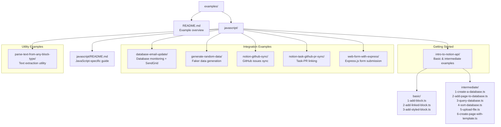
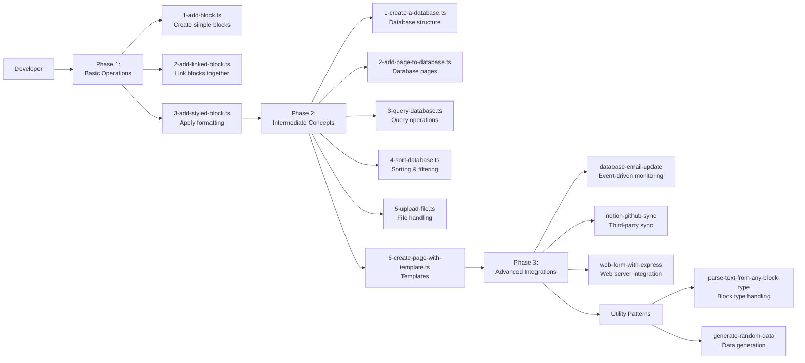
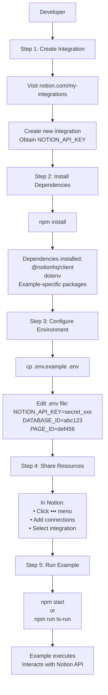
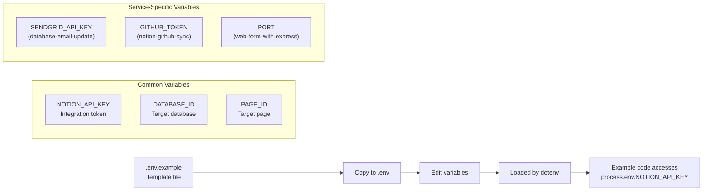

<!-- source: DeepWiki mcp.deepwiki.com · repo makenotion/notion-cookbook · page 3 Examples · fetched 2026-10-26 -->

# Examples

<details>
<summary>Relevant source files</summary>

The following files were used as context for generating this wiki page:

- [examples/README.md](examples/README.md)
- [examples/javascript/README.md](examples/javascript/README.md)

</details>


## Purpose and Scope

This document provides an overview of all working code examples in the Notion Cookbook repository, organized by programming language and complexity level. These examples demonstrate practical integrations with Notion's API, from basic operations to advanced multi-service integrations.

For detailed documentation of specific examples, see:
- [Introduction to Notion API](#3.1) - Basic and intermediate Notion API operations
- [Database Email Update](#3.2) - Database monitoring with email notifications
- [Generate Random Data](#3.3) - Synthetic data population utilities
- [Additional JavaScript Examples](#3.4) - GitHub sync, web forms, and text parsing

For initial setup instructions, see [Getting Started](#2). For contribution guidelines, see [Contributing](#6).

**Sources:** [examples/README.md:1-43]()

## Example Organization

All examples are located in the `examples/` directory and organized by programming language. Currently, all available examples are in JavaScript and utilize the official `@notionhq/client` SDK.

### Directory Structure



**Sources:** [examples/README.md:1-43](), [examples/javascript/README.md:1-62]()

## Example Categories

### Getting Started Examples

| Example | Purpose | Complexity | Key Concepts |
|---------|---------|------------|--------------|
| **intro-to-notion-api** | Learn fundamental Notion API operations | Basic → Intermediate | Blocks, pages, databases, file uploads, templates |

The `intro-to-notion-api` example serves as the entry point for developers new to Notion's API. It includes two subdirectories: `basic/` for fundamental operations and `intermediate/` for more complex interactions.

**Sources:** [examples/README.md:11](), [examples/javascript/README.md:15]()

### Integration Examples

| Example | Purpose | External Services | Key Concepts |
|---------|---------|-------------------|--------------|
| **database-email-update** | Monitor database changes and send notifications | SendGrid | Database queries, change detection, email delivery |
| **generate-random-data** | Populate databases with synthetic test data | Faker.js | Data generation, batch operations, database population |
| **notion-github-sync** | Sync GitHub issues to Notion database | GitHub API | Bidirectional sync, issue tracking, webhooks |
| **notion-task-github-pr-sync** | Link Notion tasks with GitHub pull requests | GitHub API | Task management, PR tracking, status updates |
| **web-form-with-express** | Submit web form data to Notion | Express.js | HTTP routing, form processing, page creation |

These examples demonstrate real-world integration patterns that combine Notion's API with external services.

**Sources:** [examples/README.md:12-17](), [examples/javascript/README.md:19-24]()

### Utility Examples

| Example | Purpose | Key Concepts |
|---------|---------|--------------|
| **parse-text-from-any-block-type** | Extract text content from various block types | Block traversal, type handling, text extraction |

This utility demonstrates how to handle Notion's diverse block types when extracting textual content.

**Sources:** [examples/README.md:16](), [examples/javascript/README.md:27]()

## Learning Progression

The examples are designed to support a progressive learning path, starting with fundamental concepts and advancing to complex integrations.



**Sources:** [examples/README.md:11](), [examples/javascript/README.md:13-28]()

## Common Setup Pattern

All JavaScript examples follow a standardized setup workflow, ensuring consistency and reducing cognitive load when switching between examples.



**Sources:** [examples/README.md:19-28](), [examples/javascript/README.md:29-56]()

## Prerequisites

### System Requirements

| Requirement | Version | Purpose |
|-------------|---------|---------|
| **Node.js** | 18 or higher | JavaScript runtime |
| **npm** | Included with Node.js | Package management |

**Sources:** [examples/javascript/README.md:7]()

### Notion Requirements

| Requirement | Acquisition Method |
|-------------|-------------------|
| **Notion Integration** | Create at [notion.com/my-integrations](https://www.notion.com/my-integrations) |
| **API Key** | Generated when creating integration (format: `secret_xxx...`) |
| **Shared Resources** | Page or database must be explicitly shared with integration |

All examples require a Notion integration with appropriate capabilities (read content, update content, insert content) depending on the example's operations.

**Sources:** [examples/README.md:23-24](), [examples/javascript/README.md:8-9]()

## Environment Configuration

Each example includes an `.env.example` file that serves as a template for required environment variables. The common pattern is:



**Sources:** [examples/javascript/README.md:39-46]()

## Common Dependencies

All JavaScript examples share core dependencies, with additional packages required for specific integrations:

| Package | Purpose | Used In |
|---------|---------|---------|
| **@notionhq/client** | Official Notion SDK | All examples |
| **dotenv** | Environment variable management | All examples |
| **typescript** | Type checking and compilation | All examples |
| **@sendgrid/mail** | Email delivery | database-email-update |
| **@faker-js/faker** | Synthetic data generation | generate-random-data |
| **@octokit/rest** | GitHub API client | notion-github-sync, notion-task-github-pr-sync |
| **express** | Web server framework | web-form-with-express |

**Sources:** [examples/README.md:1-43](), [examples/javascript/README.md:1-62]()

## Running Examples

### Standard Execution

Most examples provide an `npm start` script that executes the main entry point:

```bash
npm install
npm start
```

For TypeScript examples with a custom runner:

```bash
npm run ts-run
```

### Resource Sharing

Before running any example, the target Notion page or database must be shared with the integration:

1. Navigate to the page/database in Notion
2. Click the `•••` menu (top right)
3. Select "Add connections"
4. Choose your integration from the list

Without this step, the API will return authorization errors when attempting operations.

**Sources:** [examples/README.md:19-27](), [examples/javascript/README.md:48-56]()

## Example Structure

Each example follows a consistent directory structure:

```
example-name/
├── README.md           # Specific setup and usage instructions
├── package.json        # Dependencies and npm scripts
├── tsconfig.json       # TypeScript configuration
├── .env.example        # Environment variable template
├── index.ts or index.js # Main entry point
└── src/                # Additional source files (if needed)
```

This standardization ensures developers can quickly navigate and understand any example in the repository.

**Sources:** [examples/README.md:33-38]()

## Contributing Examples

The repository welcomes new examples that demonstrate additional integration patterns or programming languages. When contributing an example, ensure it includes:

| Requirement | Purpose |
|-------------|---------|
| **Clear README** | Explains purpose, setup steps, and usage |
| **Configuration files** | `package.json`, `tsconfig.json`, `.env.example` |
| **Working code** | Tested and verified functionality |
| **Focused scope** | Demonstrates a specific technique or integration |

For complete contribution guidelines, see [Contributing](#6).

**Sources:** [examples/README.md:29-42]()

## Additional Resources

| Resource | Location |
|----------|----------|
| **Notion API Reference** | [developers.notion.com/reference](https://developers.notion.com/reference) |
| **JavaScript SDK Documentation** | [github.com/makenotion/notion-sdk-js](https://github.com/makenotion/notion-sdk-js) |
| **Getting Started Guide** | [developers.notion.com/docs/getting-started](https://developers.notion.com/docs/getting-started) |

**Sources:** [examples/javascript/README.md:58-62]()

---

