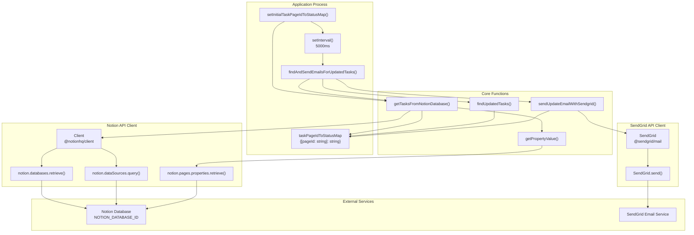
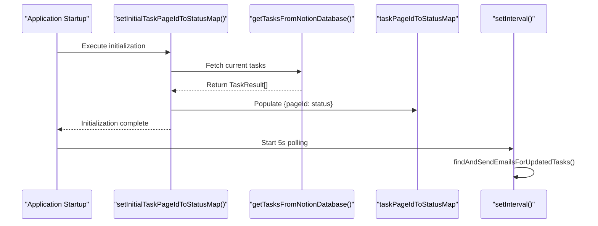
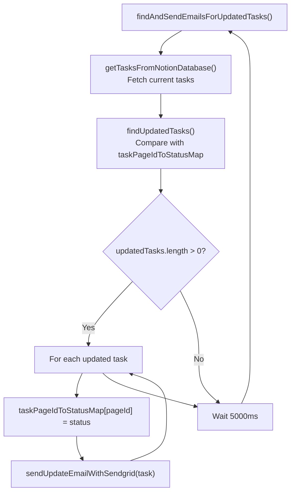
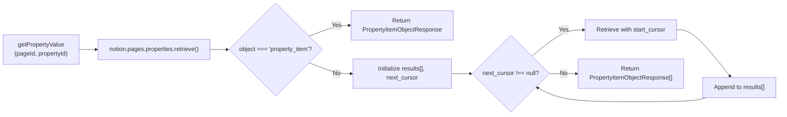
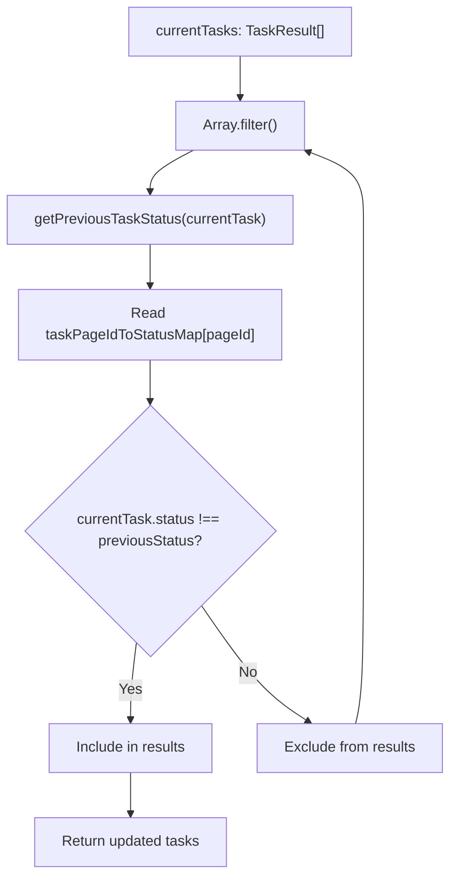

<!-- source: DeepWiki mcp.deepwiki.com · repo makenotion/notion-cookbook · page 3.2 Database Email Update · fetched 2026-10-26 -->

# Database Email Update

<details>
<summary>Relevant source files</summary>

The following files were used as context for generating this wiki page:

- [examples/javascript/database-email-update/README.md](examples/javascript/database-email-update/README.md)
- [examples/javascript/database-email-update/example.env](examples/javascript/database-email-update/example.env)
- [examples/javascript/database-email-update/index.ts](examples/javascript/database-email-update/index.ts)
- [examples/javascript/database-email-update/package.json](examples/javascript/database-email-update/package.json)
- [examples/javascript/database-email-update/tsconfig.json](examples/javascript/database-email-update/tsconfig.json)

</details>


## Purpose and Scope

This page documents the `database-email-update` example, which demonstrates event-driven monitoring of Notion databases. The integration polls a Notion database at regular intervals, detects when the `Status` property of pages changes, and sends email notifications via the SendGrid API. This example illustrates polling-based change detection, stateful caching, and third-party service integration.

For basic Notion API operations (creating databases, querying pages), see [Introduction to Notion API](#3.1). For other integration patterns, see [Additional JavaScript Examples](#3.4).

**Sources:** [examples/javascript/database-email-update/README.md:1-58](), [examples/javascript/database-email-update/index.ts:1-264]()

---

## System Overview

The `database-email-update` integration implements a monitoring system that continuously tracks status changes in a Notion database. The system maintains an in-memory cache (`taskPageIdToStatusMap`) of page IDs mapped to their last known status values. Every 5 seconds, the integration queries the Notion database, compares the current state with the cached state, and dispatches email notifications through SendGrid when changes are detected.

The integration is designed to work with a specific [database template](https://public-api-examples.notion.site/0def5dfb6d9b4cdaa907a0466834b9f4?v=aea75fc133e54b3382d12292291d9248) that includes `Name` (title) and `Status` (select) properties.

**Sources:** [examples/javascript/database-email-update/README.md:5-9](), [examples/javascript/database-email-update/index.ts:24-36]()

---

## Architecture and Data Flow

### High-Level Component Diagram



**Sources:** [examples/javascript/database-email-update/index.ts:10-20](), [examples/javascript/database-email-update/index.ts:34-62]()

---

## Initialization and Polling Loop

### Initialization Process

The application starts by executing `setInitialTaskPageIdToStatusMap()`, which populates the in-memory cache with the current state of all pages in the database. This baseline prevents false-positive notifications when the integration first starts.



The initialization logic at [examples/javascript/database-email-update/index.ts:41-46]() iterates through the initial task set and stores each page's current status in `taskPageIdToStatusMap`. After initialization completes, `setInterval()` begins calling `findAndSendEmailsForUpdatedTasks()` every 5000 milliseconds [examples/javascript/database-email-update/index.ts:34-36]().

**Sources:** [examples/javascript/database-email-update/index.ts:34-46]()

### Polling Loop Execution

Each polling cycle performs three operations:

1. **Fetch Current State**: `getTasksFromNotionDatabase()` retrieves all pages from the database
2. **Detect Changes**: `findUpdatedTasks()` compares current state with cached state
3. **Notify and Update**: For each changed task, send email via `sendUpdateEmailWithSendgrid()` and update cache



**Sources:** [examples/javascript/database-email-update/index.ts:48-62]()

---

## Database Query Implementation

### Task Retrieval Process

The `getTasksFromNotionDatabase()` function implements a multi-step process to retrieve task data:

1. **Database Validation**: Retrieve database metadata to verify read permissions
2. **Page Pagination**: Query data source with cursor-based pagination
3. **Property Extraction**: Fetch individual properties (`Status` and `Name`) for each page
4. **Data Transformation**: Convert Notion API responses to `TaskResult` objects

**Type Definition:**

```typescript
type TaskResult = {
  pageId: string
  status: string
  title: string
}
```

**Sources:** [examples/javascript/database-email-update/index.ts:64-68](), [examples/javascript/database-email-update/index.ts:73-127]()

### Database Query Flow

```mermaid
flowchart TD
    START["getTasksFromNotionDatabase()"]
    RETRIEVE["notion.databases.retrieve()<br/>database_id"]
    CHECKDB{isFullDatabase()?}
    ERROR1["Log: No read permissions"]
    QUERY["notion.dataSources.query()<br/>data_source_id, start_cursor"]
    PAGES["Accumulate pages[]"]
    CURSOR{next_cursor exists?}
    ITERATE["For each page in pages[]"]
    FULLPAGE{isFullPage()?}
    ERROR2["Log: Not a full page"]
    GETSTAT["getPropertyValue()<br/>propertyId: Status"]
    GETTITLE["getPropertyValue()<br/>propertyId: Name"]
    EXTRACT["Extract status & title"]
    TASK["Create TaskResult object"]
    RETURN["Return TaskResult[]"]
    
    START --> RETRIEVE
    RETRIEVE --> CHECKDB
    CHECKDB -->|No| ERROR1
    CHECKDB -->|Yes| QUERY
    ERROR1 --> RETURN
    QUERY --> PAGES
    PAGES --> CURSOR
    CURSOR -->|Yes| QUERY
    CURSOR -->|No| ITERATE
    ITERATE --> FULLPAGE
    FULLPAGE -->|No| ERROR2
    FULLPAGE -->|Yes| GETSTAT
    ERROR2 --> ITERATE
    GETSTAT --> GETTITLE
    GETTITLE --> EXTRACT
    EXTRACT --> TASK
    TASK --> ITERATE
    ITERATE --> RETURN
```

The implementation at [examples/javascript/database-email-update/index.ts:73-127]() uses a `while` loop to handle pagination, accumulating pages until `next_cursor` is `null`. For each page, it retrieves the `Status` and `Name` properties using `getPropertyValue()`, then extracts the plain text values using type-specific extraction functions.

**Sources:** [examples/javascript/database-email-update/index.ts:73-127]()

---

## Property Value Extraction

### Property Retrieval with Pagination

The `getPropertyValue()` function handles both simple and paginated property responses from the Notion API. When a property contains more items than can fit in a single response, the API returns a paginated list with a `next_cursor`.



**Sources:** [examples/javascript/database-email-update/index.ts:224-264]()

### Type-Specific Value Extraction

Two extraction functions convert Notion property responses to plain strings:

**`getStatusPropertyValue()`** [examples/javascript/database-email-update/index.ts:129-148](): Extracts the `name` field from a `select` property type, returning `"No Status"` as default.

**`getTitlePropertyValue()`** [examples/javascript/database-email-update/index.ts:150-169](): Extracts the `plain_text` field from a `title` property type, returning `"No Title"` as default.

Both functions handle responses that may be either a single `PropertyItemObjectResponse` or an array of such objects (for paginated properties).

**Sources:** [examples/javascript/database-email-update/index.ts:129-169]()

---

## Change Detection and State Management

### In-Memory Cache Structure

The `taskPageIdToStatusMap` variable [examples/javascript/database-email-update/index.ts:24-28]() serves as the application's state store:

```typescript
const taskPageIdToStatusMap = {}
// Structure: { [pageId: string]: string }
```

This JavaScript object maps Notion page IDs to their last observed status values. The cache is initialized during startup and updated after each email notification is sent.

**Sources:** [examples/javascript/database-email-update/index.ts:24-28]()

### Change Detection Algorithm

The `findUpdatedTasks()` function [examples/javascript/database-email-update/index.ts:171-182]() filters the current task list to identify pages whose status has changed:



The `getPreviousTaskStatus()` function [examples/javascript/database-email-update/index.ts:213-222]() retrieves the cached status for a page. If the page ID is not in the cache (indicating a newly created page), it initializes the cache entry with the current status to prevent a spurious notification.

**Sources:** [examples/javascript/database-email-update/index.ts:171-222]()

---

## Email Notification System

### SendGrid Integration

The `sendUpdateEmailWithSendgrid()` function [examples/javascript/database-email-update/index.ts:184-211]() formats and dispatches email notifications through the SendGrid API.

**Email Message Structure:**

| Field | Value | Source |
|-------|-------|--------|
| `to` | `process.env.EMAIL_TO_FIELD` | Configuration variable |
| `from` | `process.env.EMAIL_FROM_FIELD` | Configuration variable |
| `subject` | `"Notion Task Status Updated"` | Hardcoded string |
| `text` | Formatted message with task title and new status | Template string |

The message body follows the format: `Status of Notion task ("{title}") has been updated to "{status}".`

**Error Handling:**

The function wraps the `SendGrid.send()` call in a try-catch block [examples/javascript/database-email-update/index.ts:197-210](). Errors are logged to console but do not interrupt the polling loop.

**Sources:** [examples/javascript/database-email-update/index.ts:184-211]()

### Email Dispatch Flow

```mermaid
sequenceDiagram
    participant Loop as "Polling Loop"
    participant Send as "sendUpdateEmailWithSendgrid()"
    participant SG as "SendGrid.send()"
    participant API as "SendGrid API"
    participant Recipient as "Email Recipient"
    
    Loop->>Send: task {title, status}
    Send->>Send: Format message template
    Send->>SG: {to, from, subject, text}
    SG->>API: HTTP POST /v3/mail/send
    API->>Recipient: Deliver email
    API-->>SG: 202 Accepted
    SG-->>Send: Success
    Send->>Send: Log confirmation
    Send-->>Loop: Complete
    
    Note over Send,SG: Error handling:<br/>catch block logs errors
```

**Sources:** [examples/javascript/database-email-update/index.ts:184-211]()

---

## Configuration and Environment

### Environment Variables

The integration requires five environment variables defined in a `.env` file:

| Variable | Purpose | Example |
|----------|---------|---------|
| `NOTION_KEY` | Notion API integration token | `secret_abc123...` |
| `SENDGRID_KEY` | SendGrid API key | `SG.xyz789...` |
| `NOTION_DATABASE_ID` | Target database UUID | `0def5dfb-6d9b-4cda-a907-...` |
| `EMAIL_TO_FIELD` | Recipient email address(es) | `user@example.com` |
| `EMAIL_FROM_FIELD` | Sender email address (verified in SendGrid) | `notifications@example.com` |

The template file `example.env` [examples/javascript/database-email-update/example.env:1-6]() provides a reference for required variables.

**Sources:** [examples/javascript/database-email-update/example.env:1-6](), [examples/javascript/database-email-update/README.md:43-51]()

### Client Initialization

The integration initializes two API clients at module load:

```typescript
SendGrid.setApiKey(String(process.env.SENDGRID_KEY))
const notion = new Client({ auth: process.env.NOTION_KEY })
```

Both clients are configured using environment variables loaded by the `dotenv` package [examples/javascript/database-email-update/index.ts:18-20]().

**Sources:** [examples/javascript/database-email-update/index.ts:10-22]()

---

## Setup and Execution

### Prerequisites

1. **SendGrid Account**: Free account required; obtain API key from Email API integration settings
2. **Notion Integration**: Create integration at https://www.notion.com/my-integrations
3. **Database Access**: Share the target database with the Notion integration
4. **Database Template**: Use the [provided template](https://public-api-examples.notion.site/0def5dfb6d9b4cdaa907a0466834b9f4?v=aea75fc133e54b3382d12292291d9248) or create a database with `Name` (title) and `Status` (select) properties

**Sources:** [examples/javascript/database-email-update/README.md:24-39]()

### Installation and Execution

**Installation:**

```bash
cd notion-cookbook/examples/javascript/database-email-update
npm install
```

**Configuration:**

1. Copy `example.env` to `.env`
2. Populate all five required environment variables
3. Verify the SendGrid sender email is verified in your SendGrid account

**Execution:**

```bash
npm run ts-run
```

The `ts-run` script executes `node --loader ts-node/esm index.ts`, running the TypeScript file directly without compilation [examples/javascript/database-email-update/package.json:11]().

**Sources:** [examples/javascript/database-email-update/README.md:11-57](), [examples/javascript/database-email-update/package.json:9-12]()

---

## Dependencies

The integration relies on four npm packages:

| Package | Version | Purpose |
|---------|---------|---------|
| `@notionhq/client` | `^5.3.0` | Official Notion API SDK |
| `@sendgrid/mail` | `^8.1.5` | SendGrid email client |
| `dotenv` | `^16.0.1` | Environment variable loader |
| `ts-node` | `^10.8.2` | TypeScript execution runtime |

Node.js version `>=14` is required [examples/javascript/database-email-update/package.json:6-8]().

**Sources:** [examples/javascript/database-email-update/package.json:1-21]()

---

## TypeScript Configuration

The `tsconfig.json` [examples/javascript/database-email-update/tsconfig.json:1-24]() configures the TypeScript compiler with the following notable settings:

- `target: "ESNext"` - Use latest ECMAScript features
- `module: "commonjs"` - Generate CommonJS modules
- `strict: false` - Disable strict type checking
- `noUncheckedIndexedAccess: true` - Add undefined to index signature results
- `isolatedModules: true` - Ensure each file can be transpiled independently

The relaxed strict mode facilitates rapid prototyping while maintaining basic type safety.

**Sources:** [examples/javascript/database-email-update/tsconfig.json:1-24]()

---

## Operational Characteristics

### Polling Interval

The integration polls every **5000 milliseconds (5 seconds)** [examples/javascript/database-email-update/index.ts:35](). This interval represents a balance between responsiveness and API rate limit consumption. For lower-frequency monitoring, increase the interval value.

### State Persistence

The `taskPageIdToStatusMap` cache exists only in memory. Restarting the application re-initializes the cache, meaning the first poll after restart will not detect changes that occurred while the process was stopped.

### Concurrency

The polling loop uses `await` to serialize operations. Only one polling cycle executes at a time, preventing overlapping requests and duplicate notifications. If a cycle takes longer than 5 seconds, the next cycle will start immediately after completion.

### Error Handling

The implementation includes two error scenarios:

1. **Database Permission Errors**: Logged to console if `isFullDatabase()` returns false [examples/javascript/database-email-update/index.ts:82-85]()
2. **Email Send Errors**: Caught and logged without interrupting the polling loop [examples/javascript/database-email-update/index.ts:208-210]()

**Sources:** [examples/javascript/database-email-update/index.ts:35](), [examples/javascript/database-email-update/index.ts:82-85](), [examples/javascript/database-email-update/index.ts:208-210]()

---

