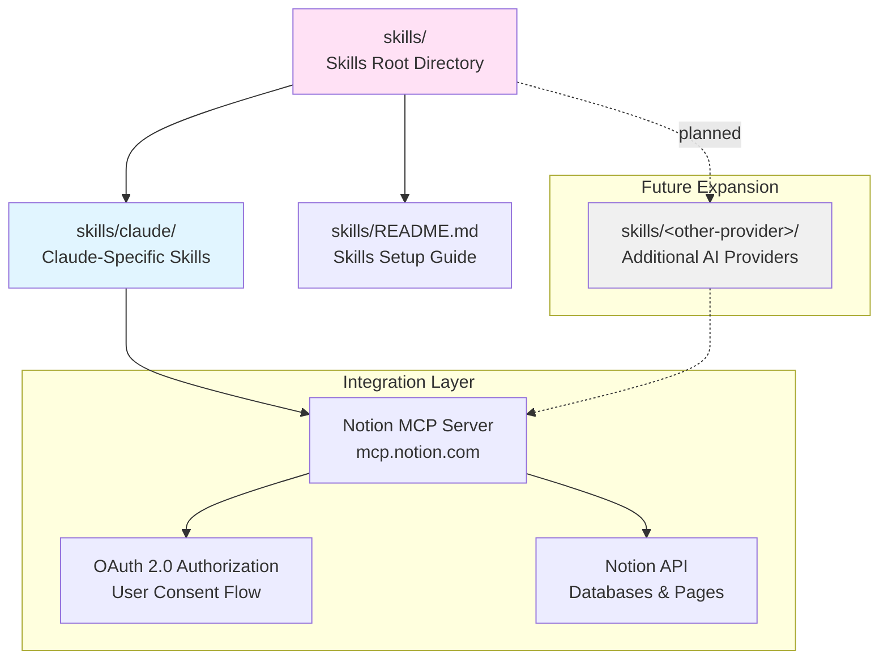
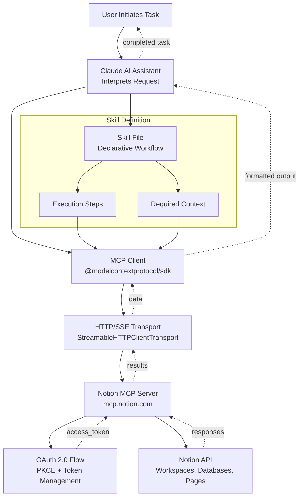
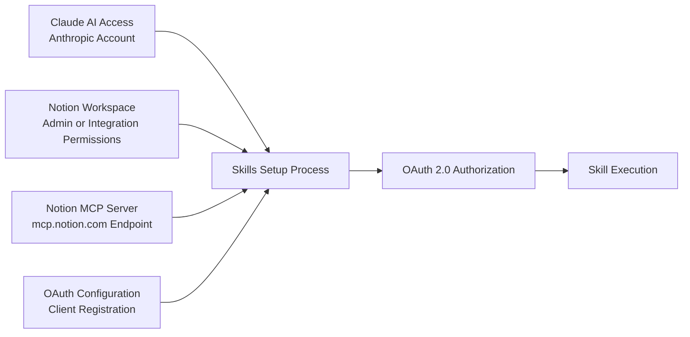
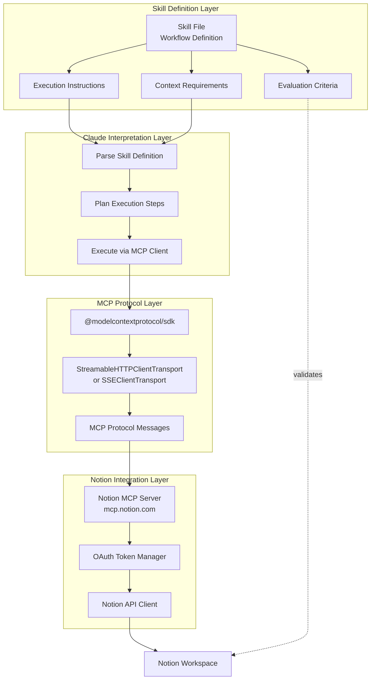
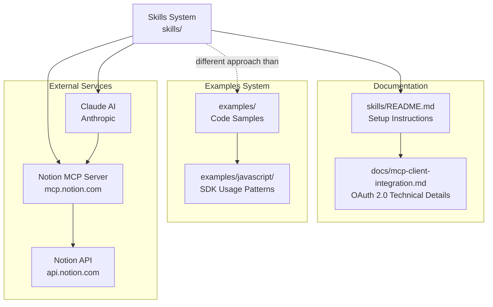

<!-- source: DeepWiki mcp.deepwiki.com · repo makenotion/notion-cookbook · page 4 Skills · fetched 2026-10-26 -->

# Skills

Relevant source files

The following files were used as context for generating this wiki page:

- [README.md](README.md)
- [docs/README.md](docs/README.md)

## Purpose and Scope

This document describes the Skills system within the Notion Cookbook repository. Skills are AI-powered workflows that integrate AI assistants with the Notion API to automate common tasks like documentation generation, meeting preparation, and research aggregation. Unlike the code [Examples](#3) which demonstrate API usage patterns, Skills are production-ready automation tools designed to be executed by AI agents through the Model Context Protocol (MCP).

For information about the MCP client integration architecture that underpins Skills, see [MCP Client Integration](#5.1). For traditional code examples that demonstrate API patterns, see [Examples](#3).

**Sources:** [README.md:17-23](), [README.md:40-42]()

---

## Overview

Skills represent a distinct category of assets in the Notion Cookbook, separate from traditional code examples. While examples teach API patterns through standalone runnable code, Skills provide declarative workflow definitions that AI assistants execute through the Notion MCP server.

| Aspect | Skills | Examples |
|--------|--------|----------|
| **Execution Model** | AI agent interprets and executes | Developer runs directly |
| **Integration** | Claude AI + Notion MCP Server | Notion API + SDK |
| **Format** | Declarative workflow definitions | Imperative code samples |
| **Authentication** | OAuth 2.0 via MCP | API keys in `.env` files |
| **Target User** | AI-assisted workflows | Developers learning API |
| **Location** | `skills/` directory | `examples/` directory |

**Sources:** [README.md:9-23](), Diagram 1, Diagram 4

---

## Repository Structure

**Diagram: Skills Directory Structure and Integration**

The Skills system is organized with a provider-specific structure to accommodate multiple AI platforms. Currently, only Claude skills are implemented in `skills/claude/`, but the architecture supports future expansion to other AI providers. All skills, regardless of provider, interact with Notion through the MCP server rather than direct API calls.

**Sources:** [README.md:17-23](), Diagram 1

---

## Skills Architecture

**Diagram: Skill Execution Flow**

When a user requests a task from Claude, the AI assistant consults the skill definition to understand the workflow steps and required context. Claude then acts as an MCP client, using the `@modelcontextprotocol/sdk` to communicate with the Notion MCP server via HTTP or SSE transport. The MCP server handles OAuth 2.0 authentication (including PKCE, token refresh, and rotation) before executing Notion API operations. Results flow back through the same chain, allowing Claude to format and present the completed task to the user.

**Sources:** [README.md:40-42](), [docs/README.md:7](), Diagram 5

---

## Claude Skills

The `skills/claude/` directory contains AI-powered workflows specifically designed for use with Anthropic's Claude assistant. These skills leverage Claude's ability to interpret natural language instructions and execute multi-step workflows through the Notion MCP server.

### Skill Categories

Based on the repository overview, Claude skills cover the following automation domains:

| Category | Purpose | Typical Operations |
|----------|---------|-------------------|
| **Documentation** | Automated document generation | Create pages, organize hierarchies, apply templates |
| **Meeting Preparation** | Pre-meeting research and setup | Query databases, aggregate information, create agendas |
| **Research** | Information gathering and synthesis | Search across workspaces, compile findings, link resources |
| **Additional Workflows** | General automation tasks | Database updates, content migration, bulk operations |

**Sources:** [README.md:21]()

---

## Setting Up Skills

Skills require a different setup process compared to traditional code examples because they execute through an AI assistant rather than directly on a developer's machine.

### Prerequisites

**Diagram: Skills Setup Prerequisites**

Unlike examples that use API keys in `.env` files, skills authenticate through OAuth 2.0, requiring users to authorize Claude's access to their Notion workspace. This provides more granular permission control and follows modern security practices.

### Setup Process

1. **Access Skill Documentation**: Navigate to [skills/README.md]() for provider-specific setup instructions
2. **Configure Claude**: Register the Notion MCP server as a resource Claude can access
3. **Authorize Access**: Complete the OAuth 2.0 flow to grant Claude permission to your Notion workspace
4. **Execute Skills**: Request Claude to perform skill-defined tasks through natural language

**Sources:** [README.md:40-42]()

---

## Skills vs Direct API Integration

Understanding when to use Skills versus traditional API integration helps developers choose the appropriate approach for their use case.

### Comparison Matrix

| Consideration | Use Skills | Use Examples/Direct API |
|---------------|------------|-------------------------|
| **Execution Frequency** | Occasional, ad-hoc tasks | Scheduled, automated workflows |
| **User Interaction** | Natural language requests | Programmatic triggers |
| **Deployment** | No deployment needed | Requires hosting/infrastructure |
| **Customization** | Limited to skill definition | Full code-level control |
| **Authentication** | OAuth (user authorization) | API keys (integration tokens) |
| **Error Handling** | AI interprets and retries | Explicit error handling code |
| **Learning Curve** | Minimal (natural language) | Moderate (SDK knowledge required) |

### Skill Use Cases

**Ideal for Skills:**
- One-time documentation tasks ("Create a project overview page with these sections...")
- Research aggregation ("Summarize all meeting notes from this month...")
- Exploratory workflows ("Find all databases related to customer feedback...")
- Quick data organization ("Move these pages to the correct parent...")

**Better Suited for Examples:**
- Production integrations (email notifications, GitHub sync)
- High-frequency operations (continuous monitoring, real-time updates)
- Complex business logic (conditional routing, data transformations)
- Third-party service integrations (SendGrid, web forms)

**Sources:** [README.md:11-23](), Diagram 1, Diagram 4

---

## Technical Implementation

### MCP Integration

Skills rely on the Model Context Protocol (MCP) for communication between Claude and Notion. The MCP server at `mcp.notion.com` acts as an intermediary, translating Claude's actions into Notion API calls.

**Diagram: Skills Technical Stack**

The skill definition file provides instructions, context requirements, and evaluation criteria. Claude interprets these and executes the workflow using the MCP SDK. The transport layer (preferably HTTP, with SSE fallback) communicates with the Notion MCP server, which handles OAuth token management before making Notion API calls.

**Sources:** Diagram 5, [docs/README.md:7]()

---

## OAuth 2.0 Authentication

Skills use a more sophisticated authentication mechanism than traditional examples. Instead of static API keys, skills authenticate through OAuth 2.0 with PKCE (Proof Key for Code Exchange).

### Authentication Flow

| Step | Component | Action |
|------|-----------|--------|
| 1 | User | Requests skill execution from Claude |
| 2 | Claude | Initiates OAuth flow if no valid token exists |
| 3 | MCP Server | Performs OAuth discovery (RFC 9470, RFC 8414) |
| 4 | MCP Server | Generates PKCE parameters (code_verifier, code_challenge) |
| 5 | User | Authorizes access via Notion's consent screen |
| 6 | MCP Server | Exchanges authorization code for access token |
| 7 | MCP Server | Stores tokens for subsequent skill executions |
| 8 | MCP Server | Refreshes access token before expiration |

### Token Management

The Notion MCP server handles token lifecycle automatically:

- **Proactive Refresh**: Tokens are refreshed before expiration
- **Invalid Grant Handling**: Re-authentication triggered when needed
- **Rotation Support**: Refresh tokens are rotated per OAuth best practices
- **Secure Storage**: Tokens stored according to platform security guidelines

**Sources:** Diagram 5, [docs/README.md:7]()

---

## Skill Development

While the repository currently contains Claude skills, the architecture supports future expansion to other AI providers. The modular structure ensures each provider has isolated skill definitions while sharing the underlying MCP integration.

### Skill Structure

Based on the repository's contribution guidelines and skill system architecture, skill definitions should include:

1. **Workflow Definition**: Clear steps for the AI to execute
2. **Context Requirements**: Specification of required Notion resources (databases, pages)
3. **Evaluation Criteria**: Success metrics for validating execution
4. **Examples**: Sample inputs and expected outputs

### Adding New Skills

Contributors adding skills should refer to [CONTRIBUTING.md]() for guidelines on:

- Skill documentation standards
- Evaluation requirement (demonstrating skill effectiveness)
- Provider-specific considerations
- Testing and validation procedures

**Sources:** [README.md:44-46]()

---

## Relationship to Other Systems

The Skills system interacts with several other components of the Notion Cookbook repository:

### Integration Points

**Diagram: Skills System Relationships**

Skills complement but do not replace the Examples system. Developers learning the Notion API should start with [Examples](#3) to understand API mechanics, while users seeking AI-powered automation should explore Skills. The [MCP Client Integration](#5.1) documentation provides the technical foundation for understanding how Skills authenticate and communicate with Notion.

**Sources:** [README.md:9-28](), [docs/README.md:1-8](), Diagram 1

---

## Future Expansion

The Skills system is designed for extensibility beyond Claude. The repository's architecture anticipates additional AI providers through the same MCP-based integration pattern.

### Planned Provider Support

Based on the repository structure and documentation:

- **Current**: `skills/claude/` - Claude AI skills (implemented)
- **Future**: `skills/<provider>/` - Additional AI platforms following similar patterns

New provider integrations will follow the same authentication and communication patterns established by the Claude skills implementation, ensuring consistency across the Skills ecosystem.

**Sources:** [README.md:23]()

---

