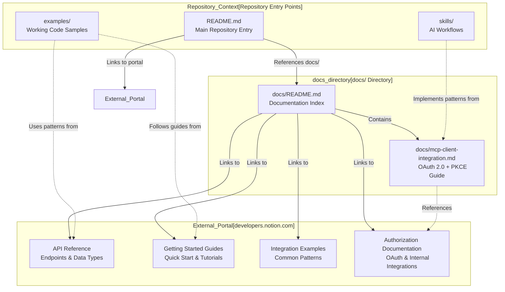
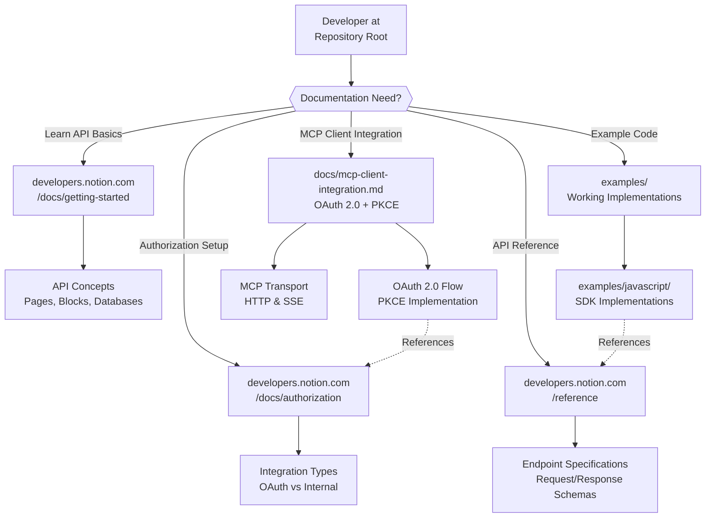
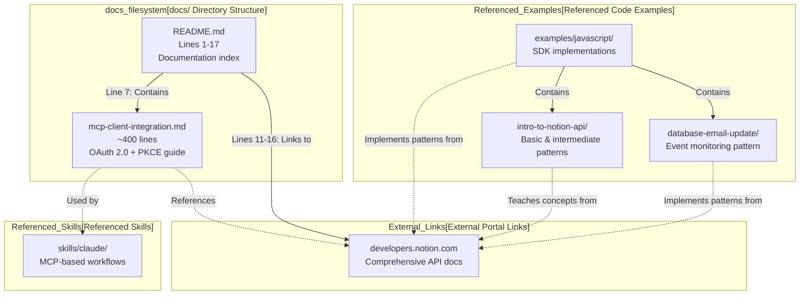

<!-- source: DeepWiki mcp.deepwiki.com · repo makenotion/notion-cookbook · page 5 Developer Documentation · fetched 2026-10-26 -->

# Developer Documentation

Relevant source files

The following files were used as context for generating this wiki page:

- [README.md](README.md)
- [docs/README.md](docs/README.md)

This page provides an index of developer documentation for advanced Notion integrations and references to external API resources. The documentation in this repository focuses on integration patterns and workflows that extend beyond basic API usage.

For working code examples and tutorials, see [Examples](#3). For AI-powered automation workflows, see [Skills](#4). For contribution guidelines and development infrastructure, see [Contributing](#6) and [Development Infrastructure](#7).

## Overview

The documentation system consists of two primary components:

| Component | Purpose | Location |
|-----------|---------|----------|
| **Internal Guides** | Integration patterns and advanced workflows specific to this repository | `docs/` directory |
| **External References** | Comprehensive API documentation, authorization guides, and getting started tutorials | [developers.notion.com](https://developers.notion.com) |

The `docs/` directory serves as the canonical location for developer documentation that will be migrated from the external portal in the future. Currently, it contains specialized integration guides not available elsewhere.

Sources: [docs/README.md:1-17](), [README.md:25-27]()

## Documentation Architecture

The following diagram illustrates the structure and organization of the documentation system:

**Documentation Access Pattern by User Journey**

This diagram shows how developers navigate the documentation system based on their needs:

Sources: [docs/README.md:1-17](), [README.md:1-57]()

## Available Guides

### MCP Client Integration

The primary guide currently available in the documentation system covers the complete implementation of an MCP (Model Context Protocol) client that integrates with Notion's MCP server using OAuth 2.0 Authorization Code flow with PKCE.

**Guide Location:** [docs/mcp-client-integration.md]()

**Detailed Coverage:** See [MCP Client Integration](#5.1) for the complete technical documentation.

**Topics Covered:**

| Section | Description | Key Specifications |
|---------|-------------|-------------------|
| **OAuth Discovery** | Metadata discovery process | RFC 9470, RFC 8414 |
| **Client Registration** | Dynamic registration (optional) | RFC 7591 |
| **PKCE Flow** | Authorization with code challenge | RFC 7636 (S256 method) |
| **Token Management** | Access and refresh token handling | Proactive refresh, rotation |
| **Transport Protocols** | MCP communication channels | HTTP (`/mcp`), SSE (`/sse`) |
| **Error Handling** | Common failure scenarios | `invalid_grant`, `invalid_client` |

This guide is designed for developers building AI tools, IDEs, or other clients that need to access Notion workspaces through the MCP protocol. It includes complete implementation details for the authentication flow, transport layer selection, and security best practices.

Sources: [docs/README.md:5-8]()

## External Documentation Resources

The Notion developer portal at [developers.notion.com](https://developers.notion.com) provides comprehensive documentation for the Notion API. The following resources are essential references for working with Notion integrations:

### API Reference

**Location:** [developers.notion.com/reference](https://developers.notion.com/reference)

The API reference provides detailed specifications for:
- All API endpoints (pages, blocks, databases, users, comments)
- Request and response schemas
- Property types and configurations
- Rate limits and pagination
- Error codes and responses

### Getting Started Guides

**Location:** [developers.notion.com/docs/getting-started](https://developers.notion.com/docs/getting-started)

Introductory tutorials covering:
- Creating Notion integrations
- Making first API calls
- Understanding page and database structures
- Working with blocks and rich text

### Integration Examples

**Location:** [developers.notion.com/docs/examples](https://developers.notion.com/docs/examples)

Pattern examples for:
- Database queries and filtering
- Page creation and updates
- File uploads
- Rich text formatting

### Authorization Documentation

**Location:** [developers.notion.com/docs/authorization](https://developers.notion.com/docs/authorization)

Authorization concepts including:
- OAuth 2.0 for public integrations
- Internal integrations (API keys)
- Scopes and capabilities
- User consent flows

**Relationship to Repository Examples**

The following table shows how repository examples relate to external documentation:

| Repository Example | External Documentation References |
|-------------------|----------------------------------|
| [examples/javascript/intro-to-notion-api]() | Getting Started, API Reference (blocks, pages, databases) |
| [examples/javascript/database-email-update]() | API Reference (databases), Authorization |
| [examples/javascript/generate-random-data]() | API Reference (databases, pages), Getting Started |
| [docs/mcp-client-integration.md]() | Authorization (OAuth 2.0), API Reference |

Sources: [docs/README.md:9-17](), [README.md:48-52]()

## Documentation Files and Structure

The following diagram maps the physical file structure of the documentation system to its logical components:

**File-Level Documentation Manifest**

| File Path | Lines | Purpose | Primary Audience |
|-----------|-------|---------|-----------------|
| `docs/README.md` | 17 | Documentation index and navigation | All developers |
| `docs/mcp-client-integration.md` | ~400 | Complete MCP client implementation guide | MCP client developers, AI tool builders |

Sources: [docs/README.md:1-17]()

## Documentation Roadmap

The documentation system is designed to expand as Notion's developer platform evolves. Based on the repository structure and current state, future documentation additions will include:

### Planned Documentation

1. **Core Developer Documentation Migration**
   - Content from [developers.notion.com](https://developers.notion.com) will be migrated to `docs/` directory
   - Referenced in [README.md:25-27]()

2. **Advanced Integration Patterns**
   - Database schema design
   - Bulk operations and pagination
   - Rate limiting strategies
   - Webhook event handling

3. **SDK-Specific Guides**
   - JavaScript SDK deep dive
   - Type definitions and TypeScript patterns
   - Error handling best practices

4. **Multi-Service Integration Guides**
   - Building on patterns from existing examples like `database-email-update` and GitHub sync examples
   - Third-party service authentication patterns

### Contributing Documentation

To contribute new documentation, follow the guidelines in [Contributing](#6). Documentation contributions should:
- Follow the established structure in `docs/README.md`
- Include practical code examples or references to repository examples
- Link to relevant external documentation
- Use clear technical language with minimal filler

Sources: [README.md:25-27](), [docs/README.md:1-17]()

## Usage Patterns

The documentation system supports multiple developer workflows:

### Workflow 1: Learning Notion API Basics

1. Start at [developers.notion.com/docs/getting-started](https://developers.notion.com/docs/getting-started)
2. Follow tutorials in [Introduction to Notion API](#3.1)
3. Reference API specifications at [developers.notion.com/reference](https://developers.notion.com/reference)

### Workflow 2: Building MCP Client Integration

1. Read authorization overview at [developers.notion.com/docs/authorization](https://developers.notion.com/docs/authorization)
2. Follow implementation guide at [MCP Client Integration](#5.1)
3. Reference OAuth specifications (RFC 7636, RFC 8414) as needed

### Workflow 3: Implementing Advanced Integration

1. Study relevant example in [Examples](#3) directory
2. Reference API documentation for specific endpoints
3. Consult `docs/` guides for integration-specific patterns
4. Refer to external authorization documentation for security requirements

Sources: [docs/README.md:1-17](), [README.md:29-42]()

## Summary

The Developer Documentation system provides a hybrid approach: internal guides for advanced integration patterns specific to this repository (currently focusing on MCP client integration), and comprehensive external references for general API usage. As the platform evolves, additional guides will be added to the `docs/` directory, while maintaining links to the authoritative API reference at developers.notion.com.

For implementation details of the MCP client integration, see [MCP Client Integration](#5.1). For working code examples that demonstrate these patterns, see [Examples](#3).

Sources: [docs/README.md:1-17](), [README.md:1-57]()

---

